# Decks

Generated by `make deck-graph` from each lecture's `lecture:` block and each README's Builds on table. Don't edit it by hand.

A pillar's series is one lecture per note, plus an overview. A pillar deck is the older single condensed deck.

## The curriculum

An arrow means the pillar at its head builds on the one at its tail.

```mermaid
flowchart LR
  subgraph ai_engineering[ai-engineering]
    ai_engineering_01_prompt_engineering["01-prompt-engineering"]
    ai_engineering_02_context_engineering["02-context-engineering"]
    ai_engineering_03_harness_engineering["03-harness-engineering"]
    ai_engineering_04_loop_engineering["04-loop-engineering"]
    ai_engineering_05_graph_engineering["05-graph-engineering"]
    ai_engineering_07_inference_engineering["07-inference-engineering"]
    ai_engineering_08_multimodal_engineering["08-multimodal-engineering"]
    ai_engineering_09_safety_and_security["09-safety-and-security"]
  end
  subgraph generative_ai[generative-ai]
    generative_ai_01_llm_fundamentals["01-llm-fundamentals"]
    generative_ai_02_rag_retrieval["02-rag-retrieval"]
    generative_ai_03_agentic_foundations["03-agentic-foundations"]
    generative_ai_04_agentic_frameworks["04-agentic-frameworks"]
    generative_ai_05_RL["05-RL"]
    generative_ai_06_observability["06-observability"]
    generative_ai_07_agentic_applications["07-agentic-applications"]
    generative_ai_08_eval["08-eval"]
    generative_ai_09_llms_from_scratch["09-llms-from-scratch"]
  end
  subgraph data_analytics[data-analytics]
    data_analytics_01_python_for_data_analysis["01-python-for-data-analysis"]
    data_analytics_02_probability_and_statistics["02-probability-and-statistics"]
    data_analytics_03_experimentation_and_causality["03-experimentation-and-causality"]
    data_analytics_04_bayesian_analysis["04-bayesian-analysis"]
    data_analytics_05_visualisation_and_storytelling["05-visualisation-and-storytelling"]
    data_analytics_06_applied_analyses["06-applied-analyses"]
  end
  subgraph data_science[data-science]
    data_science_01_classical_ml["01-classical-ml"]
    data_science_02_deep_learning["02-deep-learning"]
    data_science_03_nlp["03-nlp"]
    data_science_05_time_series_and_recommenders["05-time-series-and-recommenders"]
  end
  subgraph data_engineering[data-engineering]
    data_engineering_01_storage_and_compute_foundations["01-storage-and-compute-foundations"]
    data_engineering_02_ingest_and_modelling["02-ingest-and-modelling"]
    data_engineering_03_transform_and_orchestrate["03-transform-and-orchestrate"]
    data_engineering_04_warehouse_lakehouse_streaming["04-warehouse-lakehouse-streaming"]
    data_engineering_05_quality_and_observability["05-quality-and-observability"]
    data_engineering_06_ml_platform["06-ml-platform"]
    data_engineering_07_architecture_and_governance["07-architecture-and-governance"]
  end
  subgraph programming[programming]
    programming_backend_and_system_design["backend-and-system-design"]
    programming_computer_science["computer-science"]
    programming_frontend_and_ux["frontend-and-ux"]
    programming_software_design["software-design"]
    programming_sql["sql"]
    programming_typescript["typescript"]
  end
  data_analytics_03_experimentation_and_causality --> ai_engineering_01_prompt_engineering
  generative_ai_01_llm_fundamentals --> ai_engineering_01_prompt_engineering
  generative_ai_08_eval --> ai_engineering_01_prompt_engineering
  generative_ai_02_rag_retrieval --> ai_engineering_02_context_engineering
  generative_ai_03_agentic_foundations --> ai_engineering_02_context_engineering
  generative_ai_08_eval --> ai_engineering_02_context_engineering
  data_science_01_classical_ml --> ai_engineering_02_context_engineering
  generative_ai_03_agentic_foundations --> ai_engineering_03_harness_engineering
  generative_ai_02_rag_retrieval --> ai_engineering_03_harness_engineering
  generative_ai_08_eval --> ai_engineering_03_harness_engineering
  data_science_01_classical_ml --> ai_engineering_03_harness_engineering
  generative_ai_03_agentic_foundations --> ai_engineering_04_loop_engineering
  generative_ai_08_eval --> ai_engineering_04_loop_engineering
  data_analytics_04_bayesian_analysis --> ai_engineering_04_loop_engineering
  generative_ai_05_RL --> ai_engineering_04_loop_engineering
  data_science_03_nlp --> ai_engineering_05_graph_engineering
  generative_ai_08_eval --> ai_engineering_05_graph_engineering
  data_science_02_deep_learning --> ai_engineering_07_inference_engineering
  generative_ai_01_llm_fundamentals --> ai_engineering_07_inference_engineering
  data_engineering_06_ml_platform --> ai_engineering_07_inference_engineering
  data_science_02_deep_learning --> ai_engineering_08_multimodal_engineering
  data_science_03_nlp --> ai_engineering_08_multimodal_engineering
  generative_ai_01_llm_fundamentals --> ai_engineering_08_multimodal_engineering
  generative_ai_02_rag_retrieval --> ai_engineering_08_multimodal_engineering
  generative_ai_07_agentic_applications --> ai_engineering_08_multimodal_engineering
  generative_ai_08_eval --> ai_engineering_08_multimodal_engineering
  data_analytics_02_probability_and_statistics --> ai_engineering_09_safety_and_security
  data_analytics_03_experimentation_and_causality --> ai_engineering_09_safety_and_security
  data_science_01_classical_ml --> ai_engineering_09_safety_and_security
  generative_ai_05_RL --> ai_engineering_09_safety_and_security
  generative_ai_08_eval --> ai_engineering_09_safety_and_security
  data_science_03_nlp --> generative_ai_01_llm_fundamentals
  data_science_02_deep_learning --> generative_ai_01_llm_fundamentals
  generative_ai_09_llms_from_scratch --> generative_ai_01_llm_fundamentals
  data_engineering_07_architecture_and_governance --> generative_ai_02_rag_retrieval
  data_science_03_nlp --> generative_ai_02_rag_retrieval
  data_science_01_classical_ml --> generative_ai_02_rag_retrieval
  data_science_05_time_series_and_recommenders --> generative_ai_02_rag_retrieval
  data_analytics_04_bayesian_analysis --> generative_ai_03_agentic_foundations
  generative_ai_01_llm_fundamentals --> generative_ai_03_agentic_foundations
  generative_ai_03_agentic_foundations --> generative_ai_04_agentic_frameworks
  data_analytics_04_bayesian_analysis --> generative_ai_05_RL
  data_analytics_06_applied_analyses --> generative_ai_05_RL
  data_analytics_05_visualisation_and_storytelling --> generative_ai_06_observability
  data_engineering_07_architecture_and_governance --> generative_ai_07_agentic_applications
  data_analytics_01_python_for_data_analysis --> generative_ai_07_agentic_applications
  data_analytics_02_probability_and_statistics --> generative_ai_07_agentic_applications
  data_analytics_03_experimentation_and_causality --> generative_ai_07_agentic_applications
  data_analytics_02_probability_and_statistics --> generative_ai_08_eval
  data_analytics_03_experimentation_and_causality --> generative_ai_08_eval
  data_science_01_classical_ml --> generative_ai_08_eval
  data_science_02_deep_learning --> generative_ai_08_eval
  generative_ai_06_observability --> generative_ai_08_eval
  data_science_05_time_series_and_recommenders --> generative_ai_08_eval
  data_science_01_classical_ml --> generative_ai_09_llms_from_scratch
  data_science_02_deep_learning --> generative_ai_09_llms_from_scratch
  data_science_03_nlp --> generative_ai_09_llms_from_scratch
  data_analytics_01_python_for_data_analysis --> data_analytics_02_probability_and_statistics
  data_analytics_02_probability_and_statistics --> data_analytics_03_experimentation_and_causality
  data_analytics_02_probability_and_statistics --> data_analytics_04_bayesian_analysis
  data_analytics_01_python_for_data_analysis --> data_analytics_05_visualisation_and_storytelling
  programming_typescript --> data_analytics_05_visualisation_and_storytelling
  programming_sql --> data_analytics_06_applied_analyses
  data_analytics_02_probability_and_statistics --> data_science_01_classical_ml
  data_analytics_03_experimentation_and_causality --> data_science_01_classical_ml
  data_analytics_06_applied_analyses --> data_science_01_classical_ml
  generative_ai_08_eval --> data_science_01_classical_ml
  data_science_01_classical_ml --> data_science_02_deep_learning
  data_analytics_04_bayesian_analysis --> data_science_03_nlp
  data_analytics_06_applied_analyses --> data_science_03_nlp
  data_analytics_01_python_for_data_analysis --> data_science_05_time_series_and_recommenders
  data_analytics_03_experimentation_and_causality --> data_science_05_time_series_and_recommenders
  data_analytics_06_applied_analyses --> data_science_05_time_series_and_recommenders
  data_science_01_classical_ml --> data_science_05_time_series_and_recommenders
  generative_ai_02_rag_retrieval --> data_science_05_time_series_and_recommenders
  data_analytics_01_python_for_data_analysis --> data_engineering_05_quality_and_observability
  data_analytics_02_probability_and_statistics --> data_engineering_05_quality_and_observability
  data_analytics_06_applied_analyses --> data_engineering_06_ml_platform
  data_science_01_classical_ml --> data_engineering_06_ml_platform
  data_science_05_time_series_and_recommenders --> data_engineering_06_ml_platform
  ai_engineering_08_multimodal_engineering --> data_engineering_06_ml_platform
  generative_ai_08_eval --> data_engineering_06_ml_platform
  data_engineering_02_ingest_and_modelling --> data_engineering_07_architecture_and_governance
  data_engineering_05_quality_and_observability --> data_engineering_07_architecture_and_governance
  data_analytics_06_applied_analyses --> data_engineering_07_architecture_and_governance
  programming_computer_science --> programming_backend_and_system_design
  data_engineering_01_storage_and_compute_foundations --> programming_backend_and_system_design
  data_engineering_05_quality_and_observability --> programming_backend_and_system_design
  programming_typescript --> programming_frontend_and_ux
  programming_computer_science --> programming_frontend_and_ux
  programming_software_design --> programming_frontend_and_ux
```

## Progress

| Pillar | Lectures written | Notes | Pillar deck |
|---|---|---|---|
| [ai-engineering/01-prompt-engineering](ai-engineering/01-prompt-engineering/README.md) | 0 of 14 | 13 | yes |
| [ai-engineering/02-context-engineering](ai-engineering/02-context-engineering/README.md) | 0 of 16 | 15 | yes |
| [ai-engineering/03-harness-engineering](ai-engineering/03-harness-engineering/README.md) | 0 of 12 | 11 | yes |
| [ai-engineering/04-loop-engineering](ai-engineering/04-loop-engineering/README.md) | 0 of 12 | 11 | yes |
| [ai-engineering/05-graph-engineering](ai-engineering/05-graph-engineering/README.md) | 0 of 19 | 18 | yes |
| [ai-engineering/07-inference-engineering](ai-engineering/07-inference-engineering/README.md) | 0 of 12 | 11 | yes |
| [ai-engineering/08-multimodal-engineering](ai-engineering/08-multimodal-engineering/README.md) | 0 of 9 | 8 | yes |
| [ai-engineering/09-safety-and-security](ai-engineering/09-safety-and-security/README.md) | 0 of 8 | 7 | yes |
| [generative-ai/01-llm-fundamentals](generative-ai/01-llm-fundamentals/README.md) | 0 of 16 | 15 | yes |
| [generative-ai/02-rag-retrieval](generative-ai/02-rag-retrieval/README.md) | 0 of 19 | 18 | yes |
| [generative-ai/03-agentic-foundations](generative-ai/03-agentic-foundations/README.md) | 0 of 14 | 13 | yes |
| [generative-ai/04-agentic-frameworks](generative-ai/04-agentic-frameworks/README.md) | 0 of 8 | 7 | yes |
| [generative-ai/05-RL](generative-ai/05-RL/README.md) | 0 of 16 | 15 | yes |
| [generative-ai/06-observability](generative-ai/06-observability/README.md) | 0 of 7 | 6 | yes |
| [generative-ai/07-agentic-applications](generative-ai/07-agentic-applications/README.md) | 0 of 8 | 7 | yes |
| [generative-ai/08-eval](generative-ai/08-eval/README.md) | 0 of 19 | 18 | yes |
| [generative-ai/09-llms-from-scratch](generative-ai/09-llms-from-scratch/README.md) | 0 of 4 | 3 | yes |
| [data-analytics/01-python-for-data-analysis](data-analytics/01-python-for-data-analysis/README.md) | 0 of 8 | 7 | yes |
| [data-analytics/02-probability-and-statistics](data-analytics/02-probability-and-statistics/README.md) | 0 of 9 | 8 | yes |
| [data-analytics/03-experimentation-and-causality](data-analytics/03-experimentation-and-causality/README.md) | 0 of 6 | 5 | yes |
| [data-analytics/04-bayesian-analysis](data-analytics/04-bayesian-analysis/README.md) | 0 of 8 | 7 | yes |
| [data-analytics/05-visualisation-and-storytelling](data-analytics/05-visualisation-and-storytelling/README.md) | 0 of 7 | 6 | yes |
| [data-analytics/06-applied-analyses](data-analytics/06-applied-analyses/README.md) | 0 of 13 | 12 | yes |
| [data-science/01-classical-ml](data-science/01-classical-ml/README.md) | 2 of 17 | 16 | yes |
| [data-science/02-deep-learning](data-science/02-deep-learning/README.md) | 0 of 9 | 8 | yes |
| [data-science/03-nlp](data-science/03-nlp/README.md) | 0 of 8 | 7 | yes |
| [data-science/05-time-series-and-recommenders](data-science/05-time-series-and-recommenders/README.md) | 0 of 6 | 5 | yes |
| [data-engineering/01-storage-and-compute-foundations](data-engineering/01-storage-and-compute-foundations/README.md) | 0 of 11 | 10 | yes |
| [data-engineering/02-ingest-and-modelling](data-engineering/02-ingest-and-modelling/README.md) | 0 of 5 | 4 | yes |
| [data-engineering/03-transform-and-orchestrate](data-engineering/03-transform-and-orchestrate/README.md) | 0 of 6 | 5 | yes |
| [data-engineering/04-warehouse-lakehouse-streaming](data-engineering/04-warehouse-lakehouse-streaming/README.md) | 0 of 7 | 6 | yes |
| [data-engineering/05-quality-and-observability](data-engineering/05-quality-and-observability/README.md) | 0 of 7 | 6 | yes |
| [data-engineering/06-ml-platform](data-engineering/06-ml-platform/README.md) | 0 of 7 | 6 | yes |
| [data-engineering/07-architecture-and-governance](data-engineering/07-architecture-and-governance/README.md) | 0 of 4 | 3 | yes |
| [programming/backend-and-system-design](programming/backend-and-system-design/README.md) | 0 of 11 | 10 | yes |
| [programming/computer-science](programming/computer-science/README.md) | 0 of 7 | 6 | yes |
| [programming/frontend-and-ux](programming/frontend-and-ux/README.md) | 0 of 6 | 5 | yes |
| [programming/software-design](programming/software-design/README.md) | 0 of 8 | 7 | yes |
| [programming/sql](programming/sql/README.md) | 0 of 11 | 10 | yes |
| [programming/typescript](programming/typescript/README.md) | 0 of 10 | 9 | yes |

## data-science/01-classical-ml

| # | Lecture | Before it | After it |
|---|---|---|---|
| 1 | [Classical Machine Learning](data-science/01-classical-ml/slides/lectures/00-overview.yaml) | nothing | Statistical Foundations |
| 2 | [Statistical Foundations](data-science/01-classical-ml/slides/lectures/01-statistical-foundations.yaml) | Classical Machine Learning, Probability Foundations (data-analytics/02-probability-and-statistics), notes only | Supervised Learning, notes only |
