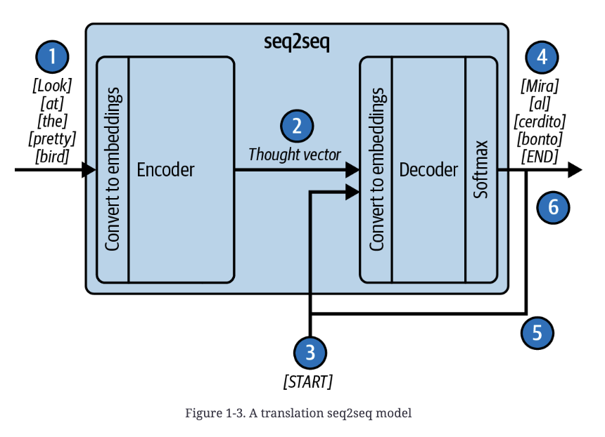
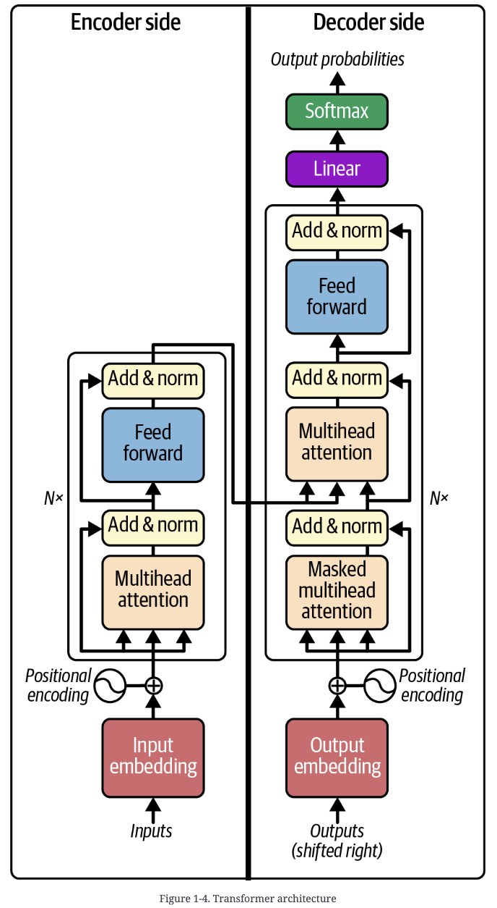
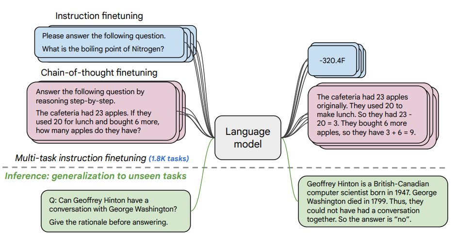

# 1 — How Models Read Prompts

> The mechanism note. Every technique in this pillar is a way of working with — not against — the five properties below.

---

## The thesis

**An LLM is a document-completion engine. A prompt is the opening of a document whose most plausible continuation is the answer you want.**

The model is a *mimic*, not an oracle. Don't ask "how would a reasonable person reply to this?" Ask "if I pulled a random document from the training set that started with exactly this text, how would it continue?" Every higher-level capability — chat, tool calls, agents — is the application layer constructing text before the call and parsing text after it. There is no separate mechanism inside the model for "answering," "remembering," or "using a tool."

The smallest demonstration (DAIR):

```
Prompt:  The sky is                       →  blue.
Prompt:  Complete the sentence:           →  blue during the day and dark at night.
         The sky is
```

The first prompt is just a document opening; the second is a document that contains a task. A base model given `What is a good dish for chicken?` is as likely to continue with `What is a good dish for beef?` as to answer — a list of questions is a perfectly plausible document.

**Know the training mix.** Pretraining corpora are mixtures — The Pile is roughly 18% Common Crawl, 14% PubMed, 12% books, 10% OpenWebText, 8% GitHub, plus a long tail — and completions follow whatever genres the model saw most. If a model was pretrained on A and fine-tuned on B, write prompts as if it had been trained on B outright (early Codex = GPT-3 fine-tuned on GitHub, so prompt it with code). Memorization is treated as a defect, so a model that "solves" a famous problem may still fail a novel variant of it.

---

## Where the architecture came from

Each step fixed the previous one's bottleneck, and the last two steps created prompt engineering:

1. **Seq2seq (2014)** — an RNN encoder compresses the whole input into one fixed-size "thought vector" for the decoder. Long inputs get compressed lossily: the *information bottleneck*.

   

2. **Attention (2015)** — keep every encoder state and let the decoder "soft search" over them at each step. Bottleneck gone.
3. **Transformer (2017)** — drop recurrence entirely, keep only attention. Far more parallelizable and better at modeling data, at the price of a **fixed context window** — the limit we still engineer around.

   

4. **GPT (2018)** — decoder only, pretrain on unlabeled text, then fine-tune per task. Good only at the task it was tuned for.
5. **GPT-2 (2019)** — ~10× scale. The raw model, with no task fine-tuning, matched tuned models on many benchmarks (appending `TL;DR` elicits a summary).
6. **GPT-3 (2020)** — another ~10×. A handful of examples *in the prompt* reproduces almost any task, with no weight updates. **This is the origin of the discipline**: task behavior became something you elicit by changing the input.

Each generation is roughly an order-of-magnitude scale-up paired with a qualitative capability jump — the trend to watch, not any one model's specs.

---

## Property 1 — Tokens, not characters

Text is split into learned sub-word tokens (~4 English characters each) before the model sees it.

| Consequence | Example | Rule |
|---|---|---|
| Sub-token tasks are hard | letter counting ("strawberry"), reversing strings, ROT13 | Do these in pre/post-processing, not in the model |
| Typos change the token sequence | `ghost` = 1 token, `gohst` = 3 (`g`-`oh`-`st`) | Models notice typos well (the pattern looks wrong) but don't silently autocorrect |
| Case and rare characters cost attention | `strange new worlds` = 4 tokens, `STRANGE NEW WORLDS` = 6; 😊 = 2; random IDs and keys < 2 chars/token | Avoid SHOUTING, ASCII art, and random IDs where you can |
| Tokens are the unit of cost and length | context window = prompt + completion tokens; billing is per token | Measure with a real tokenizer (`tiktoken`, Hugging Face), not character counts |

Vocabularies also carry **special tokens** — e.g. an end-of-text token appended to every training document, which is how the model learns where a completion should stop. ChatML's role markers ([Property 5](#property-5--chat-models-are-completion-models-wearing-a-transcript)) are the same idea.

---

## Property 2 — Autoregressive: no lookahead, no backtracking

One forward pass produces one token; it's appended and the whole computation reruns.

- **Fixed compute per token.** The model can't "pause to think" on a hard token. The only way to buy more computation is to have it emit more tokens — the structural basis of [chain-of-thought](03-core-techniques.md#chain-of-thought).
- **No takebacks.** An emitted token becomes ground truth for everything after it. Early errors compound; the model rarely self-corrects because published documents rarely contain visible corrections (writers edit them out). Error detection belongs in the surrounding system ([04-controlling-output](04-controlling-output.md), [09-evaluating-prompts](09-evaluating-prompts.md)).
- **Repetition traps.** Continuing an established pattern is usually the most likely next token, so lists can degenerate into loops — the book's "reasons I like this show" list ends up repeating "the franchise has a strong [foundation/legacy/following]" forever. Mitigate with stop sequences, repetition detection, penalties, or a higher temperature ([04](04-controlling-output.md#sampling-parameters)).
- **Reading is cheaper than writing.** Prompt tokens are processed in parallel (each position depends only on positions to its left and layers below), but generated tokens need one full pass each. Models read long prompts roughly an order of magnitude faster than they write long completions — favor long inputs and short outputs.

---

## Property 3 — Left-to-right attention: order matters

The book's mental model: one identical **"minibrain" per token position**, stacked in layers (GPT-3 has 96). Each minibrain starts knowing only its own token and position, thinks for a fixed number of layer-steps, and at the last step predicts the token to its right. **Attention** is how minibrains talk: each one posts questions about what it needs and information it can offer, questions are matched to the best-fitting answers, and the answers are delivered — all in learned vectors, not English.

Two masks constrain that exchange:

- **Left → right only.** A position can receive answers only from positions to its left. Nothing later in the prompt can influence how earlier text was read.
- **Bottom → top only.** Insights from higher layers never flow back down — except through one channel: an emitted token becomes the bottom-layer input of a new position. **Writing a thought out as tokens is the only way the model can reuse it**, which is why chain-of-thought is a mechanism, not a style.

Practical consequence: **put the instruction before the content it applies to when the task changes *how* the content must be read.** The book's example: asked to count words in a paragraph *after* reading it, ChatGPT answered 348 for a 173-word paragraph; asked *first*, it answered 173. The model wasn't keeping a word count while reading because it didn't know that was the job.

The counterweight for long documents is covered in [02-prompt-anatomy](02-prompt-anatomy.md#ordering): put bulk reference material first and *restate* the question at the end ("refocus"), so the instruction is both primed and fresh.

**One-pass heuristic:** could a domain expert who knew all the facts complete this prompt in a single read, without notes or backtracking? If not, restructure the task (reorder, decompose, or move computation out of the model) rather than asking more forcefully.

---

## Property 4 — Truth bias and hallucination are the same behavior

The model continues whatever the prompt asserts. Training documents rarely open with a false premise and then correct it, so:

- **Hallucination** is just a fluent completion that happens to be false. "Don't make things up" has limited effect because the model doesn't distinguish knowing from guessing.
  - Mitigate by asking for *checkable* output: names, quotes, sources, calculations. "There was an English king who married his cousin" can't be checked; "…namely George IV, who married Caroline of Brunswick" can. "Trust but verify — minus the trust."
  - Ground with retrieved context and ask it to quote before answering ([02-prompt-anatomy](02-prompt-anatomy.md)).
- **Truth bias** means a false premise in a programmatic prompt will be run with, not questioned. A human proofreading a weird auto-generated prompt would stop; the model won't. You are responsible for not feeding it nonsense.
  - Exploit it deliberately: assert a hypothetical as fact ("It's 2031, a year after the first Neanderthals were resurrected") rather than asking the model to pretend.

---

## Property 5 — Chat models are completion models wearing a transcript

Base models complete documents and have no built-in notion of "answer this" or "stay safe." **Alignment** targets **HHH** (Anthropic, 2021): *helpful* (follows instructions, on-topic, concise), *honest* (doesn't present guesses as facts), *harmless* (no offensive or dangerous content).

**RLHF** (the InstructGPT recipe) gets there in three fine-tuning stages:

| Stage | Data | What it buys |
|---|---|---|
| SFT | ~13k human-written ideal transcripts | Obedience — but it still lies |
| Reward model | ~33k sets of 4–9 SFT completions, ranked by humans → many more pairwise comparisons | A learned proxy for "which completion is better" |
| RL (PPO) | ~31k prompts, completions scored by the reward model | Higher reward, **constrained to stay close to the SFT model** — otherwise it learns to game the reward model |

Why honesty needs the RL stage, not just SFT: labelers writing ideal answers can't see what the model actually knows. They write confident text beyond its knowledge (teaching it to fabricate) or hedge on things it knows (teaching it to hedge everything). Ranking completions the *model itself* produced gives a direct signal: content consistent with its own knowledge scores higher. The cost is the **alignment tax** — measurable capability loss on some tasks — partly offset by mixing pretraining data back into RL training.

Instruction tuning generalizes: train on enough tasks phrased as instructions (FLAN used 1.8k) and the model follows instructions for tasks it never saw.



**From instruct to chat.** Instruct models were trained to treat prompts as requests, but a raw prompt string never says "your turn now," so the model had to guess whether to continue or answer. **ChatML** makes turn-taking explicit with reserved tokens:

```
<|im_start|>system
You are a terse technical assistant.<|im_end|>
<|im_start|>user
What does `git rebase` do?<|im_end|>
<|im_start|>assistant
```

| Property | Why it matters |
|---|---|
| Unambiguous turns | The model always knows it's answering, not continuing |
| System-message steerability | RLHF trains models to follow the `system` role closely — your main lever for persona and rules (off-topic redirects, de-escalation) |
| Injection resistance | Reserved tokens can't be typed: a user who sends the literal string `<|im_start|>` gets six ordinary tokens (`<`, `|`, `im`, `_start`, `|`, `>`). Users are locked into the `user` role — **unless you paste user content into `system`** |

The chat API hides ChatML entirely: you send a list of `{role, content}` messages and the provider serializes it. Synthetic `assistant` turns are allowed — the model treats them as things it said. (This example is from DAIR's ChatGPT intro notebook. `gpt-3.5-turbo` is retired, but the call shape is current.)

```python
response = openai.chat.completions.create(
    model="gpt-3.5-turbo",
    messages=[
        {"role": "system", "content": "You are an AI research assistant. You use a tone that is technical and scientific."},
        {"role": "user", "content": "Hello, who are you?"},
        {"role": "assistant", "content": "Greeting! I am an AI research assistant. How can I help you today?"},
        {"role": "user", "content": "Can you tell me about the creation of black holes?"},
    ],
    temperature=0,
)
print(response.choices[0].message.content)
```

ChatML is OpenAI's serialization, and every chat model has its own. Mistral's instruct models use:

```
<s>[INST] What is your favorite condiment? [/INST] Well, I'm quite partial to a good squeeze of fresh lemon juice.</s>[INST] The right amount of what? [/INST]
```

`<s>` and `</s>` are special BOS/EOS tokens, but `[INST]` and `[/INST]` are **ordinary strings**, so unlike ChatML's markers a user *can* type them. If you call an open-weight model as a raw completion, you have to reproduce its template yourself. DAIR's Mixtral notebook sends the same request with and without the `[INST]` wrapper and gets noticeably different output. A chat API, or the tokenizer's `apply_chat_template`, applies the template for you.

The same `messages` list works across providers through a wrapper like [LiteLLM](https://docs.litellm.ai/). Tool calling, added later, changes nothing fundamental either: it is special syntax inside the transcript for describing and requesting function calls, with results appended back in ([05](05-tools-and-function-calling.md)).

What chat costs you vs. raw completion:
1. **Alignment tax** — measurable capability loss on some tasks.
2. **Output control** — chat models wrap answers in preamble and disclaimers; a completion prompt ending in ` ```python ` with `stop="```"` returns only code.
3. **Range** — RLHF narrows voice toward polite and uniform; bad for realistic synthetic data, blunt brainstorming, or frank discussion of illegal activity for legitimate work.

**Two scripts.** The user's conversation with your product and the transcript you send the model are different documents. Yours can include synthetic turns, retrieved context, and tool results the user never sees. Think of it as theater: the roles (`system`, `user`, `assistant`, `tool`) are characters, the prompt is the script, and it has several playwrights — you (system message and structure), the user (their messages), the model (the assistant's lines), and tools (injected results). You're the showrunner.

---

## What prompt engineering covers

The book frames it as the whole request/response transformation layer, in four levels:

| Level | Application does | Covered in |
|---|---|---|
| 1. Thin wrapper | Passes user text through with light formatting (early Copilot sent just the current file) | [02-prompt-anatomy](02-prompt-anatomy.md) |
| 2. Augmented input | Adds retrieved context (Copilot's other open tabs, Bing's search results) and rebuilds conversation history every turn — trimming or summarizing it as it grows | [02-prompt-anatomy](02-prompt-anatomy.md), [02-context](../../02-context-engineering/README.md) |
| 3. Tool use | Model requests actions, app executes them ("invite Diane on May 5" needs a contacts lookup, a calendar check, then the invite) | [05-tools-and-function-calling](05-tools-and-function-calling.md) |
| 4. Agency | Model decides *how* to reach a goal — still fails more often than not unless the goal is tightly scoped | [06-chaining-and-workflows](06-chaining-and-workflows.md), [03-harness](../../03-harness-engineering/README.md) |

---

## Go deeper

- Book: [Ch 1](../sources/prompt-eng-for-llms/reading/01-introduction-to-prompt-engineering.pdf) (architecture lineage, four levels) · [Ch 2](../sources/prompt-eng-for-llms/reading/02-understanding-llms.pdf) (tokens, sampling, attention) · [Ch 3](../sources/prompt-eng-for-llms/reading/03-moving-to-chat.pdf) (RLHF, ChatML)
- Sampling parameters (temperature, top-p, penalties, beam search) are in [04-controlling-output](04-controlling-output.md).

---

→ Next: [02-prompt-anatomy.md](02-prompt-anatomy.md) — what goes in a prompt, and in what order.
