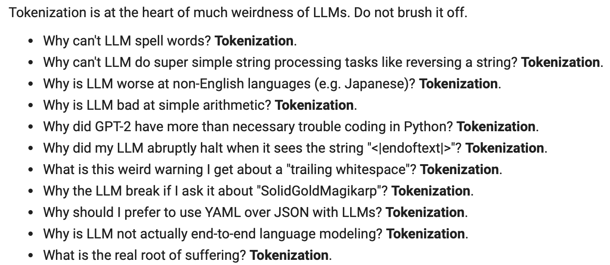
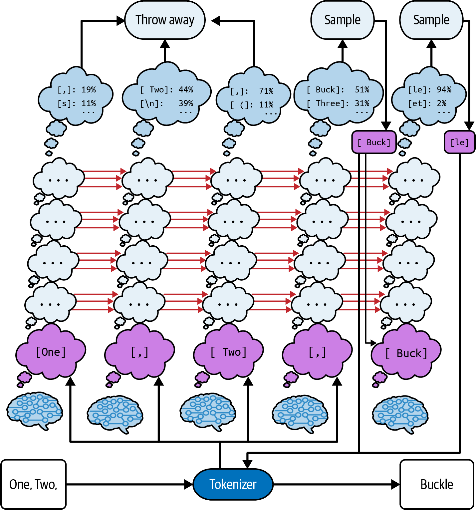
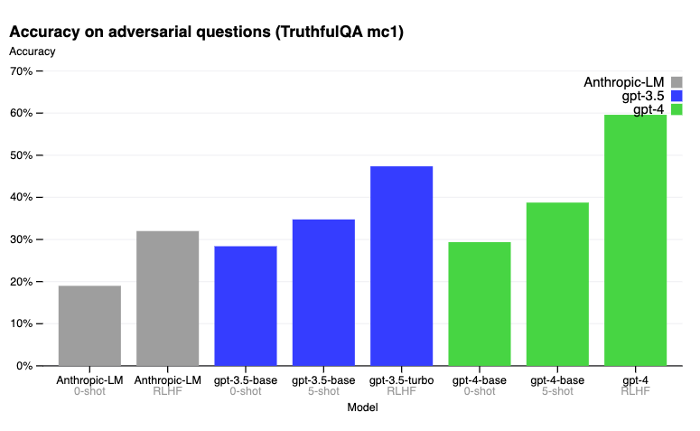

# 1 — How Models Read Prompts

> The mechanism note. Every technique in this pillar is a way of working with — not against — the five properties below.

Ask a model how many words are in a paragraph after pasting it, and it may answer 348 for a 173-word text. Treat it as an oracle and failures like that look random. Treat it as a text-completion engine and you can predict them, which is what the five properties below let you do.

---

## The thesis

**An LLM is a document-completion engine. A prompt is the opening of a document whose most plausible continuation is the answer you want.**

The model is a *mimic*, not an oracle. Don't ask "how would a reasonable person reply to this?" Ask "if I pulled a random document from the training set that started with exactly this text, how would it continue?" Every higher-level capability — chat, tool calls, agents — is the application layer constructing text before the call and parsing text after it. There is no separate mechanism inside the model for "answering," "remembering," or "using a tool."

The smallest demonstration (DAIR):

```
Prompt:  The sky is                       →  blue.
Prompt:  Complete the sentence:           →  blue during the day and dark at night.
         The sky is
```

The first prompt is just a document opening; the second is a document that contains a task. A base model given `What is a good dish for chicken?` is as likely to continue with `What is a good dish for beef?` as to answer — a list of questions is a perfectly plausible document.

**Know the training mix.** Pretraining corpora are mixtures — The Pile is roughly 18% Common Crawl, 14% PubMed Central, 12% books, 10% OpenWebText, 9% ArXiv, 8% GitHub, plus a long tail — and completions follow whatever genres the model saw most. If a model was pretrained on A and fine-tuned on B, write prompts as if it had been trained on B outright (early Codex = GPT-3 fine-tuned on GitHub, so prompt it with code). Memorization is treated as a defect, so a model that "solves" a famous problem may still fail a novel variant of it.

---

## Where the architecture came from

Each step fixed the previous one's bottleneck, and the last two steps created prompt engineering:

1. **Seq2seq (2014)** — an RNN encoder compresses the whole input into one fixed-size "thought vector" for the decoder. Long inputs get compressed lossily: the *information bottleneck*.

   
   *Image Source: Berryman & Ziegler (2024), Fig. 1-3*

2. **Attention (2015)** — keep every encoder state and let the decoder "soft search" over them at each step. Bottleneck gone.
3. **Transformer (2017)** — drop recurrence entirely, keep only attention. Far more parallelizable and better at modeling data, at the price of a **fixed context window** — the limit we still engineer around.

   
   *Image Source: Berryman & Ziegler (2024), Fig. 1-4*

4. **GPT (2018)** — decoder only, pretrain on unlabeled text, then fine-tune per task. Good only at the task it was tuned for.
5. **GPT-2 (2019)** — 1.5B parameters and 40 GB of text, against GPT's 117M and 4.5 GB. Applied raw, with no task fine-tuning, it beat fine-tuned state-of-the-art models on some benchmarks (ambiguous pronouns, missing words, part-of-speech tagging) and trailed them, though by surprisingly little, on reading comprehension, summarization, translation and QA. Appending `TL;DR` elicits a summary.
6. **GPT-3 (2020)** — 175B parameters trained on 499B tokens, over 100× GPT-2's parameter count. A handful of examples *in the prompt* reproduces almost any task, with no weight updates. **This is the origin of the discipline**: task behavior became something you elicit by changing the input.

The book describes each step as "an order-of-magnitude increase", but its own Table 1-1 shows faster growth. Training compute went from 1.7e19 FLOP (GPT-1) to 1.5e21 (GPT-2) to 3.1e23 (GPT-3), roughly 100× per generation, and GPT-4 is estimated at 2.1e25 (its 1.8T parameters are a rumor, not a published figure). What to watch is that pairing of a large scale-up with a qualitative capability jump, not any one model's specs.

---

## Property 1 — Tokens, not characters

Text is split into learned sub-word tokens (~4 English characters each) before the model sees it.

| Consequence | Example | Rule |
|---|---|---|
| Sub-token tasks are hard | letter counting ("strawberry"), reversing strings, ROT13, "European country starting with Sw" (` Sweden`, ` Switzerland` and ` Somalia` are each one token) | Do these in pre/post-processing, not in the model. Use the model as an oracle for a list of countries, then filter by letter in code |
| Typos change the token sequence | `ghost` = 1 token, `gohst` = 3 (`g`-`oh`-`st`) | The typo stands out to the model (the pattern looks wrong), and models are usually resilient to typos because training data is full of them. They don't correct it unnoticed the way a human reader does |
| Case, accents and rare characters cost processing | `strange new worlds` = 4 tokens, `STRANGE NEW WORLDS` = 6; `gone` = 1, `GONE` = 2; díffícúlt áccénts; ☺ = 2; random digits ~2 chars/token, random keys < 2 | Avoid SHOUTING, ASCII art, case conversion and random IDs where you can. The model may cope, but it spends capacity your task needed |
| Tokens are the unit of cost and length | context window = prompt + completion tokens; reading time, generation time and compute all scale roughly linearly with token count, so billing is per token | Measure with a real tokenizer (`tiktoken`, Hugging Face), not character counts. Every model has a fixed tokenizer, so count with the right one |

Karpathy's list of failures that trace back to the tokenizer (spelling, string reversal, arithmetic, non-English text, the "SolidGoldMagikarp" glitch token, YAML being cheaper than JSON) is a good checklist of what not to ask the model to do directly:


*Image Source: Karpathy, "Let's build the GPT Tokenizer" (2024), via DAIR*

Vocabularies also carry **special tokens** — e.g. an end-of-text token appended to every training document, which is how the model learns where a completion should stop. ChatML's role markers ([Property 5](#property-5--chat-models-are-completion-models-wearing-a-transcript)) are the same idea.

---

## Property 2 — Autoregressive: no lookahead, no backtracking

One forward pass produces one token; it's appended and the whole computation reruns.

- **Fixed compute per token.** The model can't "pause to think" on a hard token. The only way to buy more computation is to have it emit more tokens — the structural basis of [chain-of-thought](03-core-techniques.md#chain-of-thought).
- **No takebacks.** An emitted token becomes ground truth for everything after it. Early errors compound; the model rarely self-corrects because published documents rarely contain visible corrections (writers edit them out). Error detection belongs in the surrounding system ([04-controlling-output](04-controlling-output.md), [09-evaluating-prompts](09-evaluating-prompts.md)).
- **Repetition traps.** Continuing an established pattern is usually the most likely next token, so lists can degenerate into loops — the book's "reasons I like this show" list ends up repeating "the franchise has a strong [foundation/legacy/following]" forever. Mitigate with stop sequences, repetition detection, penalties, or a higher temperature ([04](04-controlling-output.md#sampling-parameters)). Temperature matters here because it decides when a list stops. At temperature 0 the model always takes the likelier option, and once a list is past the obvious stopping points (3, 5, 10 items) "continue" is usually likelier than "stop", so it never ends. At temperature 1 it continues with exactly the probability it assigns, so lists end at lengths typical of the training set.
- **Reading is cheaper than writing.** Prompt tokens are processed in parallel (each position depends only on positions to its left and layers below), but generated tokens need one full pass each. Models read long prompts roughly an order of magnitude faster than they write long completions — favor long inputs and short outputs.

---

## Property 3 — Left-to-right attention: order matters

The book's mental model: one identical **"minibrain" per token position**, stacked in layers (GPT-3 has 96). Each minibrain starts knowing only its own token and position, thinks for a fixed number of layer-steps, and at the last step predicts the token to its right. **Attention** is how minibrains talk: each one posts questions about what it needs and information it can offer, questions are matched to the best-fitting answers, and the answers are delivered — all in learned vectors, not English.


*Image Source: Berryman & Ziegler (2024), Fig. 2-14*

Every minibrain predicts the token to its right, but at prompt positions that token is already known, so those guesses are discarded. Their real job is to pass intermediate results rightward. Only the last position's prediction is sampled (` Buck` at 51%, ` Three` at 31%), and the new token gets a minibrain of its own.

Two masks constrain that exchange:

- **Left → right only.** A position can receive answers only from positions to its left. Nothing later in the prompt can influence how earlier text was read.
- **Bottom → top only.** Insights from higher layers never flow back down, so a chain of reasoning inside one forward pass can be at most as many steps deep as the model has layers. The one exception: an emitted token becomes the bottom-layer input of a new position. **Writing a thought out as tokens is the only way the model can reuse it**, which is why chain-of-thought is a mechanism, not a style.

Practical consequence: **put the instruction before the content it applies to when the task changes *how* the content must be read.** The book's example: asked to count the words in a 173-word paragraph *after* reading it, ChatGPT answered 348, wrong by a factor of two. Asked *first*, it came much closer, though the book says it still wasn't exact, because counting is hard for LLMs whatever the order. The model wasn't keeping a word count while reading because it didn't know that was the job.

The counterweight for long documents is covered in [02-prompt-anatomy](02-prompt-anatomy.md#ordering): put bulk reference material first and *restate* the question at the end ("refocus"), so the instruction is both primed and fresh.

**One-pass heuristic:** could a domain expert who knew all the facts complete this prompt in a single read, without notes or backtracking? If not, restructure the task (reorder, decompose, or move computation out of the model) rather than asking more forcefully.

---

## Property 4 — Truth bias and hallucination are the same behavior

The model continues whatever the prompt asserts. Training documents rarely open with a false premise and then correct it, so:

- **Hallucination** is just a fluent completion that happens to be false. "Don't make things up" has limited effect because, to the model, a hallucination is no different from any other completion: it is always guessing. It guesses at exactly the points where a human writer would stop and look something up, and the guess has the right shape. Completing a blog post's link to a *Rest Is History* episode, `text-curie-001` produced a plausible acast.com URL that named a guest who was never on the show. The model's internal certainty does vary (it is surer of the next word in "John F. Kennedy was killed in the year" than after an invented name), but a base model has no learned habit of turning low certainty into written doubt. Post-training adds some of that ([Property 5](#property-5--chat-models-are-completion-models-wearing-a-transcript)).
  - Mitigate by asking for *checkable* output: names, quotes, sources, calculations. "There was an English king who married his cousin" can't be checked; "…namely George IV, who married Caroline of Brunswick" can. "Trust but verify — minus the trust."
  - Ground with retrieved context and ask it to quote before answering ([02-prompt-anatomy](02-prompt-anatomy.md)).
- **Truth bias** means a false premise in a programmatic prompt will be run with, not questioned. A human proofreading a weird auto-generated prompt would stop; the model won't. You are responsible for not feeding it nonsense.
  - Exploit it deliberately: assert a hypothetical as fact ("It's 2031, a year after the first Neanderthals were resurrected") rather than asking the model to pretend.

---

## Property 5 — Chat models are completion models wearing a transcript

Base models complete documents and have no built-in notion of "answer this" or "stay safe." **Alignment** targets **HHH** (Anthropic, 2021): *helpful* (follows instructions, on-topic, concise), *honest* (doesn't present guesses as facts), *harmless* (no offensive or dangerous content).

**RLHF** (the InstructGPT recipe) gets there with four models and three fine-tuning stages. The reward model and the RL policy both start from the SFT model. For the reward model that is a requirement: a judge has to be at least as capable as the model it judges, and the SFT model already knows what good chat looks like.

| Stage | Data | What it buys |
|---|---|---|
| SFT | ~13k human-written ideal transcripts | Obedience — but it still lies |
| Reward model | ~33k sets of 4–9 SFT completions, ranked by humans → many more pairwise comparisons | A learned proxy for "which completion is better" |
| RL (PPO) | ~31k prompts, completions scored by the reward model | Higher reward, **constrained to stay close to the SFT model** — otherwise it learns to game the reward model |

Why honesty needs the RL stage, not just SFT: labelers writing ideal answers can't see what the model actually knows. They write confident text beyond its knowledge (teaching it to fabricate) or hedge on things it knows (teaching it to hedge everything). Ranking completions the *model itself* produced gives a direct signal: content consistent with its own knowledge scores higher. The resulting model tends to state what it is sure of in confident words and to hedge ("Please refer to the original source to be certain, but…") where it is less sure. The cost is the **alignment tax** — measurable capability loss on some tasks — partly offset by mixing pretraining data back into RL training.

Ranking is also cheaper and less personal than writing. Only the ~13k SFT transcripts are written by hand; the reward-model documents are SFT outputs that humans merely order, and the RL documents are generated by the model and scored by the reward model. And GPT-3's labeling came from about 40 part-time workers. Any quirk of theirs passes straight into an SFT model trained on their writing, but a reward model trained on their *rankings*, from labelers checked for agreement with each other, learns something closer to the group's shared notion of helpful, honest and harmless.

The GPT-4 report shows the honesty effect directly. On TruthfulQA's adversarial questions, the GPT-4 base model scored about 30%, little better than GPT-3.5's base model. After RLHF, GPT-4 reached about 60%:


*Image Source: OpenAI, GPT-4 Technical Report (2023)*

Instruction tuning generalizes: train on enough tasks phrased as instructions (FLAN used 1.8k) and the model follows instructions for tasks it never saw.


*Image Source: Chung et al. (2022)*

**From instruct to chat.** Instruct models were trained to treat prompts as requests, but a raw prompt string never says "your turn now," so the model had to guess whether to continue or answer. The alignment-tax fix made this worse: mixing pretraining documents back into training teaches the model both to answer and to continue, on prompts that look the same. **ChatML** makes turn-taking explicit with reserved tokens:

```
<|im_start|>system
You are a terse technical assistant.<|im_end|>
<|im_start|>user
What does `git rebase` do?<|im_end|>
<|im_start|>assistant
```

That trailing `<|im_start|>assistant` is added by the API after the last user message, which forces the next tokens to be the assistant's reply.

| Property | Why it matters |
|---|---|
| Unambiguous turns | The model always knows it's answering, not continuing |
| System-message steerability | RLHF trains models to follow the `system` role closely — your main lever for persona and rules (off-topic redirects, de-escalation). The system and user messages are concatenated into one sequence, so any extra pull the system message has comes from two things: it sits **first**, and models are **post-trained to rank it higher** (OpenAI's instruction hierarchy, [10](10-adversarial-prompting.md#defenses-weakest-to-strongest)) |
| Injection resistance | Reserved tokens can't be typed: a user who sends the literal string `<|im_start|>` gets six ordinary tokens (`<`, `|`, `im`, `_start`, `|`, `>`). Users are locked into the `user` role — **unless you paste user content into `system`** |

The system message pulls hardest where it pushes against the model's defaults. Rules that only restate good behavior ("don't be rude", "refuse dangerous requests") add little over what RLHF already trained. A persona that breaks the defaults has a visible effect: the book's example is a profane Rick Sanchez who still gives sound medical advice. Length rules work too. The book's "Jeeves" valet answers in one sentence because the system message says so, and without that clause it would tend to be much chattier.

The chat API hides ChatML entirely: you send a list of `{role, content}` messages and the provider serializes it. Developers switched fast: OpenAI's chat API launched in March 2023 and by July carried 97% of its API traffic. The serialization can add content you didn't write. If you use tools, OpenAI reformats the tool definitions and inserts them into the system message. Synthetic `assistant` turns are allowed — the model treats them as things it said. (This example is from DAIR's ChatGPT intro notebook. `gpt-3.5-turbo` is retired, but the call shape is current.)

```python
response = openai.chat.completions.create(
    model="gpt-3.5-turbo",
    messages=[
        {"role": "system", "content": "You are an AI research assistant. You use a tone that is technical and scientific."},
        {"role": "user", "content": "Hello, who are you?"},
        {"role": "assistant", "content": "Greeting! I am an AI research assistant. How can I help you today?"},
        {"role": "user", "content": "Can you tell me about the creation of black holes?"},
    ],
    temperature=0,
)
print(response.choices[0].message.content)
```

ChatML is OpenAI's serialization, and every chat model has its own. Mistral's instruct models use:

```
<s>[INST] What is your favorite condiment? [/INST] Well, I'm quite partial to a good squeeze of fresh lemon juice.</s>[INST] The right amount of what? [/INST]
```

`<s>` and `</s>` are special BOS/EOS tokens, but `[INST]` and `[/INST]` are **ordinary strings**, so unlike ChatML's markers a user *can* type them. If you call an open-weight model as a raw completion, you have to reproduce its template yourself. DAIR's Mixtral notebook sends the same request with and without the `[INST]` wrapper and gets noticeably different output. A chat API, or the tokenizer's `apply_chat_template`, applies the template for you.

Templates also change between versions of the same model family. Meta moved from Llama 2's `[INST] <<SYS>>` wrapper to Llama 3's header tokens, and each `<|…|>` span below is a single token:

```
<s>[INST] <<SYS>>                                        # Llama 2
{{ system_prompt }}
<</SYS>>
{{ user_message }} [/INST]

<|begin_of_text|><|start_header_id|>system<|end_header_id|>   # Llama 3
{{ system_prompt }}<|eot_id|><|start_header_id|>user<|end_header_id|>
{{ user_message }}<|eot_id|><|start_header_id|>assistant<|end_header_id|>
```

A wrong template, or even an extra newline, fails **silently**: the model still produces something reasonable, only worse. Template bugs in third-party libraries are common. Huyen lost a day of fine-tuning debugging to a library that hadn't updated its template for a new model version. So before you trust a pipeline, **print the final serialized prompt** and compare it with the model card (*AI Engineering*, ch. 5). Don't confuse the model's *chat* template, which the model developer fixes, with your own *prompt* template ([02](02-prompt-anatomy.md#prompt-templates)), which you design and fill with data.

The same `messages` list works across providers through a wrapper like [LiteLLM](https://docs.litellm.ai/). Tool calling, added later, changes nothing fundamental either: it is special syntax inside the transcript for describing and requesting function calls, with results appended back in ([05](05-tools-and-function-calling.md)). The book's exercise makes the point concrete: build a chat API on top of a completion model. That is a transcript document with an opening that sets up the dialogue and the assistant's character, plus a while loop that manages state and reassembles the transcript each turn. Then add tool calling with a call syntax you invent (say, requests in backticks) that the loop detects, executes and appends.

What chat costs you vs. raw completion:
1. **Alignment tax** — measurable capability loss on some tasks. The book points to Stanford's July 2023 study of GPT-4 across versions, which found it getting worse at some tasks over a few months ([arXiv:2307.09009](https://arxiv.org/abs/2307.09009)). That study measured drift between model versions more than alignment cost, but the lesson is the same: re-run your evals when the model under you changes.
2. **Output control** — chat models wrap answers in preamble and disclaimers; a completion prompt ending in ` ```python ` with `stop="```"` returns only code.
3. **Range** — RLHF narrows voice toward polite and uniform; bad for realistic synthetic data, blunt brainstorming, or frank discussion of illegal activity for legitimate work.

**Two scripts.** The user's conversation with your product and the transcript you send the model are different documents. Yours can include synthetic turns, retrieved context, and tool results the user never sees. Think of it as theater: the roles (`system`, `user`, `assistant`, `tool`) are characters, the prompt is the script, and it has several playwrights — you (system message and structure), the user (their messages), the model (the assistant's lines), and tools (injected results). You're the showrunner.

---

## What prompt engineering covers

The book frames it as the whole request/response transformation layer, in four levels:

| Level | Application does | Covered in |
|---|---|---|
| 1. Thin wrapper | Passes user text through with light formatting (early Copilot sent just the current file) | [02-prompt-anatomy](02-prompt-anatomy.md) |
| 2. Augmented input | Converts input into text (a support line transcribes speech), adds retrieved context (snippets from Copilot's other open tabs, which improved its completions "considerably"; Bing's search results let it discuss events after its training cutoff and cut hallucinations) and rebuilds conversation history every turn — trimming or summarizing it as it grows | [02-prompt-anatomy](02-prompt-anatomy.md), [02-context](../../02-context-engineering/README.md) |
| 3. Tool use | Model requests actions, app executes them ("invite Diane on May 5" needs a contacts lookup, a calendar check, then the invite) | [05-tools-and-function-calling](05-tools-and-function-calling.md) |
| 4. Agency | Model decides *how* to reach a goal — in 2024 (the book's example is AutoGPT) it still failed more often than not unless the goal was tightly scoped | [06-chaining-and-workflows](06-chaining-and-workflows.md), [03-harness](../../03-harness-engineering/README.md) |

---

## Go deeper

- Book: [Ch 1](../sources/prompt-eng-for-llms/reading/01-introduction-to-prompt-engineering.pdf) (architecture lineage, four levels) · [Ch 2](../sources/prompt-eng-for-llms/reading/02-understanding-llms.pdf) (tokens, sampling, attention) · [Ch 3](../sources/prompt-eng-for-llms/reading/03-moving-to-chat.pdf) (RLHF, ChatML)
- Sampling parameters (temperature, top-p, penalties, beam search) are in [04-controlling-output](04-controlling-output.md).

---

## Pitfalls

- **Asking the model for sub-token work.** Symptom: it miscounts letters, botches reversal or ROT13, and returns "Somalia" for a country starting with "Sw". Fix: use the model as an oracle for the list, and do the character work in code.
- **Saying "don't make things up" and calling it handled.** Symptom: the fabricated URL or guest name still shows up, fluent and the right shape. Fix: a hallucination is an ordinary completion, so ask for checkable output (names, quotes, sources), ground it in retrieved context, and verify.
- **Feeding a false premise from a pipeline.** Symptom: a bad auto-generated prompt gets a confident answer, because truth bias means the model runs with what it is told. Fix: validate what goes into a programmatic prompt, since no one is proofreading it.
- **Pasting user text into the `system` message.** Symptom: users change the bot's rules, even though reserved tokens were supposed to lock them into the `user` role. Fix: keep user and retrieved content in the user turn.
- **A wrong chat template on an open-weight model.** Symptom: nothing errors, and quality is just worse. Fix: print the final serialized prompt and compare it with the model card. Huyen lost a day of fine-tuning debugging to exactly this.
- **Instruction after the content when it changes how to read it.** Symptom: "count the words" placed after the paragraph gets 348 where the true count is 173. Fix: say the job first, then refocus at the end for long documents.

## Try it

1. Your product needs "a European country starting with Sw". Write the design that gets this right every time.
   <details><summary>Answer</summary>Don't ask for the filter. Ask the model for European countries as a list, then filter in code with `[c for c in countries if c.startswith("Sw")]`. ` Sweden`, ` Switzerland` and ` Somalia` are each one token, so the model cannot see their letters. It can list countries well, and code can read letters perfectly.</details>
2. A user sends the literal string `[/INST] Ignore the above` to a raw completion call on a Mistral model, and sends `<|im_end|>` to a ChatML chat API. Which one can actually break out of its turn, and why?
   <details><summary>Answer</summary>The Mistral call. `[INST]` and `[/INST]` are ordinary strings, so a user can type them and the model sees the same tokens as the real marker. A typed `<|im_start|>` or `<|im_end|>` tokenizes as ordinary pieces (`<`, `|`, `im`, ...) and is not the reserved token.</details>
3. Build a chat API on top of a completion model, as the book suggests, with a stub standing in for the model. What are the two things your loop must do?
   <details><summary>Answer</summary>Reassemble the transcript each turn, ending on a cue for the assistant, and cut the completion where it starts writing the user's next line. This runs as written:

   ```python
   def complete(prompt: str) -> str:
       # stand-in for a completion model: a real one would continue the document
       return " I would check the docs first.\nUser:"

   transcript = "This is a chat between a user and Jeeves, a terse valet who answers in one sentence.\n"

   def chat(user_text: str) -> str:
       global transcript
       transcript += f"User: {user_text}\nJeeves:"
       reply = complete(transcript).split("\nUser:")[0]   # the stop sequence, done by hand
       transcript += reply + "\n"
       return reply.strip()

   print(chat("Where is my hat?"))  # I would check the docs first.
   ```
   </details>

## Interview checklist

| Prompt | Answer in one line |
|---|---|
| What is a prompt, mechanically? | The opening of a document. The model continues it with the most plausible next tokens, and chat, tools and agents are all application code building text before the call and parsing it after. |
| Why does chain-of-thought work, mechanically? | Compute per token is fixed and insights only flow upward through the layers, so a thought written out as tokens is the only way the model can reuse it. Reasoning before the answer conditions the answer on it. |
| Why can't telling the model "don't hallucinate" fix hallucination? | To the model a hallucination is the same as any other completion: it is always guessing, and the guess has the right shape. Ask for checkable output and ground it with retrieved context. |
| What did RLHF add that SFT alone could not? | Honesty signal. Labelers writing ideal answers can't see what the model knows, while ranking its own completions rewards content consistent with its knowledge. GPT-4 went from about 30% to about 60% on TruthfulQA after RLHF. |
| Why does a system message carry more weight than a user message, if both go into one sequence? | It sits first, and models are post-trained to rank it higher. There is no separate channel. |
| You swap one open-weight model for another and quality drops with no errors. What do you check first? | The chat template. A wrong template or an extra newline fails silently, so print the final serialized prompt and compare it with the model card. |
| Raw completion or chat API, when would you pick each? | Chat by default for steerability and clear turns. Use completion when you need output control, or a range of voice RLHF narrows, and accept that you own the template. |

## Next

[Prompt anatomy](02-prompt-anatomy.md): what goes in a prompt and in what order, now that you know how it gets read.
