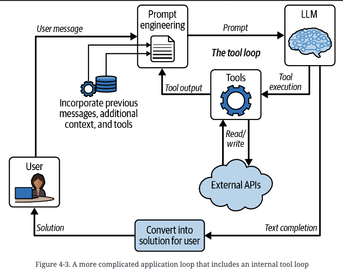
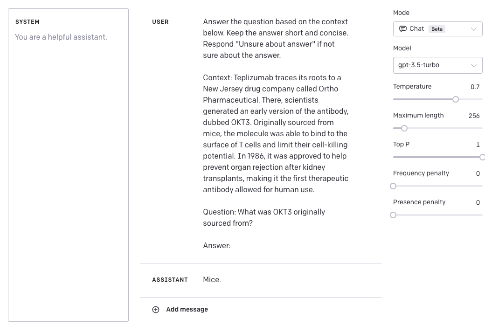
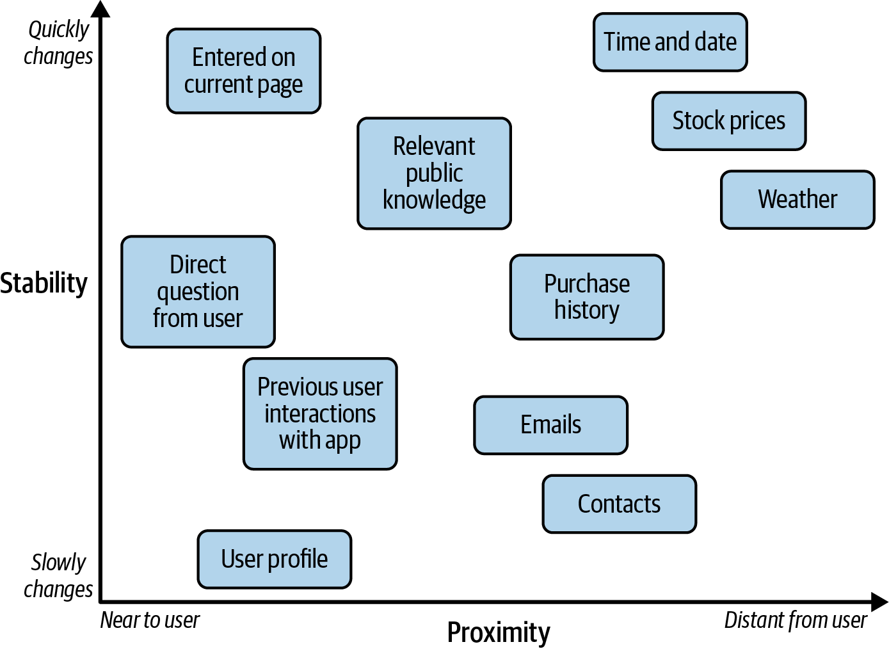

# 2 — Prompt Anatomy

> What goes in a prompt, in what order, and in what kind of document. The structural note — techniques that build on this are in [03-core-techniques](03-core-techniques.md).

A prompt is a document with a budget, and most bad prompts fail on what was put in it and where, not on wording. Without a structure, the key fact lands in the middle where models use it least, irrelevant context steers the answer, and the model has no clear place to begin or stop.

---

## The application loop

An LLM application is a translator between two domains: the **user's** (questions, clicks, files, app state) and the **model's** (a document to complete). Each request makes a round trip:

1. **User problem → prompt** (the *feedforward pass*):
   1. **Context retrieval** — gather the raw material: the user's message, conversation history, files, search results, API data.
   2. **Snippetizing** — cut it into prompt-sized pieces of text.
   3. **Scoring and prioritizing** — decide what matters most and what can be dropped.
   4. **Prompt assembly** — pack the winners into a document that fits the budget.
2. **Model → completion.**
3. **Completion → user domain** (*transform back*): parse the text into something the user can act on — an answer, a code edit, a function call, a UI update.

Once the model can call tools, the middle step becomes a loop of its own: the model asks for a tool, the app runs it against external APIs, and the result goes back into the prompt until the model produces a final completion ([05](05-tools-and-function-calling.md)).


*Image Source: Berryman & Ziegler (2024), Fig. 4-3*

The loop gets harder along four dimensions: **interaction state** (single call vs. multi-turn), **external context** (none vs. many sources), **reasoning depth** (direct answer vs. multi-step), and **tool use** (pure text vs. actions in the world). The book also rates the user's side of the problem on four axes: the medium it arrives in, its level of abstraction, the context it needs, and how stateful it is (Ch 4, Table 4-1). Proofreading is simple on every axis: the input is text, the problem is small, the user's text is all the context, and every call stands alone. IT support arrives as voice over the phone, needs searchable documentation, and has to track what has already been tried. Travel planning needs calendars, airline APIs, news and travel advisories, and has to remember weeks of planning across channels, including branches the user abandoned.

The transform back can change the medium as well as the format. A phone assistant's completion becomes speech, and a completion in a rich UI can become UI events. Even when the output is text, presentation differs: Copilot shows a code completion as grey ghost text accepted with Tab, but a chat-requested edit as a red/green diff. When a tool call would change the world (buying the ticket rather than looking it up), the app should confirm with the user before running it (book, Ch 4).

**A worked example (book, Ch 4).** A travel site wants a recommendation for whatever destination the user picked from a drop-down. Sending that raw to a completion model invites any continuation. Instead, the app casts it as a document the model has seen thousands of times, a homework assignment in markdown:

```
# Leisure, Travel, and Tourism Studies 101 - Homework Assignment
Provide answers for the following three problems. Each answer should
be concise, no more than a sentence or two.

## Problem 1
What are the top three golf destinations to recommend to customers?
## Solution 1
St. Andrews, Scotland; Pebble Beach, California; and Augusta, Georgia ...

## Problem 2
Let's say a customer approaches you to help them with travel plans for {destination}.
You check the State Department recommendations, and they advise "{advisory}"
You check the recent news and see these headlines: {headlines}
Please provide the customer with a short recommendation. What would you tell the customer?
## Solution 2
```

Each part does a job. The title points the model at the travel domain. Problem 1 is unrelated to the user's request, but it sets the `## Problem N` / `## Solution N` pattern, and its one-sentence answer sets the length and the polite voice. Problem 2 carries the dynamic context: the user's pick, the advisory, the headlines. The `## Solution 2` heading marks the problem as over; without it, the model tends to keep elaborating the problem by inventing more facts about the destination. The stop sequence `\n#` cuts generation if the model starts a confabulated Problem 3. With North Korea as the destination, the completion was *"Perhaps North Korea isn't a great destination right now. But I bet we could find some nice place to visit in South Korea."* The transform-back step takes the text under `## Solution 2`.

---

## The four criteria

Every prompt has to satisfy all four at once (book, Ch 4):

1. **Resemble training data** — the *Little Red Riding Hood principle*: stay on the path the model was trained on. Familiar document shapes (markdown reports, transcripts, homework problems, code) give predictable completions. Clean grammar in, clean grammar out. If you don't know which documents the model knows for your domain, ask it ("What types of formal documents are useful for specifying financial information about a company?"), then ask it to write an example and pattern your prompt on that.
2. **Carry all relevant information** — and *only* relevant information. Missing context fails; padding distracts (*Chekhov's gun*, Ch 5: models assume anything included must matter, so an irrelevant retrieved snippet gets worked into the answer).
3. **Lead to a solution** — point at an answer, not more elaboration of the problem.
4. **Have a natural stopping point** — the end of the assistant turn, a closing tag, or a stop sequence. The book's cautionary tale from GitHub: a misconfigured chat model that suppressed its `<|im_end|>` token answered well, signed off with "Hope you have a nice day!", then cycled through "wonderful", "festive" and every other synonym until it hit the token limit.

Chat models give you 1, 3 and 4 largely through fine-tuning: the API wraps messages in the transcript format the model was tuned on, the model is conditioned to answer the user, and it stops at the end of its turn. You still own them inside the messages. The text within the chat should look like training data (markdown `#` sections, fenced code, `*` lists), and the system message, transcript and function definitions still have to steer the model to a solution and a stop. **Criterion 2 is never automatic** — gathering and shaping context is where most of the work goes ([02-context](../../02-context-engineering/README.md)).

---

## The elements

| Element | What it is | Example |
|---|---|---|
| Instruction | The task | `Classify the text as neutral, negative, or positive.` |
| Context | Background that steers the answer | Retrieved docs, user profile, examples |
| Input data | The thing to act on | `Text: I think the food was okay.` |
| Output indicator | The shape of the answer | `Sentiment:` · `Return JSON with keys…` |

All four in one prompt — an instruction with a fallback, a context passage, the question, and `Answer:` as the output indicator (from DAIR's lecture notebook):


*Image Source: DAIR.AI prompt-engineering lecture (2023)*

Not every prompt needs all four. The split that matters for engineering is by *origin* (app logic vs. a variable source), not by what the text says:

- **Static content** — the hardcoded task definition and rules, the same for every user.
- **Dynamic content** — per-user, per-request context.

---

## Static content: clarifying the task

A programmatic call gets no conversational repair: a misunderstanding goes straight to failure. That makes clarifying the static part a bigger reliability lever than most people expect. Clarification also buys **consistency**: the model approaches every input the same way and judges by the same criteria, which is what lets you optimize the app and lets users learn it (book, Ch 5). The origin decides the category, not the wording. "I want a novel, not a self-help book" is static clarification if the app always excludes self-help, and dynamic context if the app learned this user's dislike from their message history. There are two ways to clarify:

- **Explicit** — state the task and its rules (below). Production prompts often run to long lists of dos and don'ts. The book's example is the Bing Chat ("Sydney") rule list that Marvin von Hagen got the model to reveal, sectioned into profile, information gathering, output format, limitations and safety (the book notes it was never confirmed to match the real prompt).
- **Implicit** — show examples and let the model infer the pattern. Powerful but leaky: examples carry incidental biases (length, order, label balance) the model copies. Placement is covered under [agent system prompts](02b-document-types-formatting-and-templates.md#agent-system-prompts-procedures-not-rule-piles); how many and how to choose them is in [03-core-techniques](03-core-techniques.md#few-shot).

Format examples the way the rest of the document is formatted: in a chat prompt, synthetic `user`/`assistant` turns; in a report, a worked section. You can label them as examples ("when I encounter a question like X, I will answer like Y"), or write them in as previous tasks the model already solved. The second takes more care to write but can be highly effective, especially in a chat transcript, where the model believes it solved those tasks in that style and keeps going (book, Ch 6).

### Writing instructions

**Be clear and direct.** Treat the model as a capable new colleague with zero context. *Golden rule (Anthropic): if a colleague with minimal context would be confused by the prompt, so will the model.*

| Rule | Weak | Strong |
|---|---|---|
| Be specific, not vague | "Keep it short, not too descriptive" | "Use 2–3 sentences, for a high-school student" |
| Say what to do, not what not to do | "DO NOT ASK FOR INTERESTS" (the model asked anyway) | "Recommend from the top trending movies. If none fit, reply 'Sorry, couldn't find a movie today.'" |
| Give the reason | "NEVER use ellipses" | "Don't use ellipses — a text-to-speech engine will read this aloud and can't pronounce them" |
| Avoid absolutes | "Always cite three sources" | "Cite sources where they exist; say so when they don't" |
| Specify the output | "Extract the places" | "Extract the places. Format: `Place: <comma_separated_list>`" |

Reasons generalize better than bare commands: a model that knows *why* a rule exists applies it sensibly to cases you didn't list. Modern models also follow instructions more literally than older ones, so shouting (CRITICAL, MUST) now tends to cause over-application rather than compliance.

Emotional pressure is a weak, dated lever. Li et al. appended lines such as "This is very important to my career." to the task on Instruction Induction and BIG-Bench with six 2023 models (Flan-T5-Large to GPT-4). Their headline is +8.00% and +115% relative, but that takes the best of 11 stimuli per task, chosen on the test set. Averaged over all 11, the Instruction Induction zero-shot mean moved from 51.65 to 51.98. The large BIG-Bench figure is relative on a tiny base (normalized score 2.39 to 5.20 with automatic prompts). The best stimulus differed by task, there was no neutral-filler control, and no variance was reported, so test any such line against your own eval ([arXiv:2307.11760](https://arxiv.org/abs/2307.11760) (Li et al., 2023, preprint)).

Bsharat et al. list 26 such "principles" (affirmative directives, a role, delimiters, "I'm going to tip $xxx", no "please") and scored each on 20 ATLAS questions by human side-by-side judgement, one response per question, with no rater details. They report GPT-4 gains of 57.7% in quality and 36.4% in accuracy on average, growing with model size. Each cell moves in 5-point steps and the tip and politeness lines have no separate ablation, so treat the list as hypotheses to test ([arXiv:2312.16171](https://arxiv.org/abs/2312.16171) (Bsharat et al., 2023-12, preprint)).

**Imagine the context a human would need, then supply it.** Phoenix & Taylor organize the craft as five principles: give direction, specify format, provide examples, evaluate quality, divide labor. They map onto this pillar as 02, [04](04-controlling-output.md), [03](03-core-techniques.md#few-shot), [08](08-evaluating-prompts.md) and [06](06-chaining-and-workflows.md) (*Prompt Engineering for Generative AI*, ch. 1). Two direction tactics from their chapter that this note doesn't cover elsewhere:

- **Prewarming (internal retrieval).** First ask the model for best-practice advice on the task ("what makes a good product name?"), then, in the same conversation, ask it to do the task. It writes its own direction. The alternative is pasting trusted external guidance into the prompt, which makes the prompt longer and more expensive but often better.
- **Too much direction conflicts.** Stack enough constraints (a style, a format, a base image, a camera model) and some combinations have no examples in the training data, so the model can't satisfy them all. Pick the constraint that matters most and drop the ones that clash with it. They note that too little direction is the more common failure.

**System prompt vs. user turn.** Put persona, standing rules, and output conventions in the system prompt — chat models are trained to prioritize it. Never paste untrusted user or retrieved content into it ([10-adversarial-prompting](10-adversarial-prompting.md)).

---

## Dynamic content: what to fetch and how to shrink it

Dynamic content is chosen per request, so the questions are practical ones:

| Question | Why it matters |
|---|---|
| **Latency** — how long does it take to fetch? | The trigger sets the budget. Low urgency: a background job such as email summarization, where nobody is waiting. Medium: an on-demand request such as a book recommendation, where users wait a little but multiple LLM passes are probably out. High: completions while the user types, where any delay risks the user acting again and invalidating the request, so complex retrieval is out unless prepared ahead |
| **Preparability** — can it be computed ahead of time? | Embeddings, summaries, and indexes can be built offline; live state can't. For very latency-critical apps, it can pay to prepare context speculatively before it's needed |
| **Comparability** — can it be scored against other candidates? | Assembly can only triage what it can compare: is one item more useful than another, does it depend on another, does it invalidate another? |

Gather more than you can use, then score it. In the book's recommender, "their last book was *The Tesseract* and they loved it" scores high, while "five years ago they read *The Catcher in the Rye*, no idea if they liked it" scores medium. Static items compete for the same space and get scored too, usually at or near the top, because the model understanding the question matters more than any one piece of context. In the book's words, all context is optional, and you have to quantify how optional each bit is (Ch 5).

To find candidate context, work from both ends. Top down, draw a **mind map** around the question ("What book shall I read next?" → "What did I read last?" → "How did I like it?") to list what the model would want to know. Bottom up, list what the app can actually get, sorted along two axes (book, Ch 5):

- **Proximity** to the application: what it has at its fingertips (screen state, the time), what it has saved (the user profile), what it could record but doesn't yet (past activity), what public APIs return (the weather), and what needs the user's permission (purchase history, email). The farther away, the harder it is to obtain, so it has to be more useful to be worth fetching.
- **Stability**: fixed per user (profile), slow-changing (purchase history), ephemeral (time, the user's current interaction). The less stable, the harder it is to prepare in advance, so its latency is harder to hide.


*Image Source: Berryman & Ziegler (2024), Fig. 5-9*

Start with the obvious sources and add the exotic ones as the app matures.

**Retrieval (RAG)** fetches the snippets most similar to the query. What is specific to prompts is Chekhov's gun: irrelevant snippets crowd out useful ones and get over-interpreted, because the model assumes everything it was given must matter. The book's only sure fix is to retrieve the right snippets, and to treat the search string as a miniprompt, since adding "I'm considering what book to read next" steers what comes back (book, Ch 5). Don't default to embeddings. Lexical search is cheap and debuggable, and Copilot uses plain Jaccard similarity over the files open in the IDE because it needs no index. Search methods, chunking, hybrid search and reranking are in [context engineering 04](../../02-context-engineering/notes/04-retrieval.md).

**Summarization** compresses context that's too long to include. For very long sources, summarize **hierarchically**: chunks → section summaries → a summary of summaries, recursing as deep as the corpus needs. The Bible's 1,189 chapters at 50 words each would still overflow most windows, so go chapters → its 66 books → one summary; a codebase goes files → directories → root. Split along natural borders (chapters, sections, authors) and don't mix a lot of one section with a sliver of another in one pass. Cost stays flat: as long as each summary is under about a tenth of its input, the total is set by the tokens in the original text, whatever the depth. Watch for the **rumor problem**: each level is another chance to misunderstand something, and the error carries upward. The book's judgment is that the chain is usually short enough not to matter if you aren't stingy with summary length (Ch 5).

Summaries are lossy in a task-blind way. A general summary of a vacation post keeps where the user went and drops the offhand remark about the book that made the flight bearable, which is exactly what a recommender needs. A **specific** summary written with the end task in mind keeps it (the book's prompt jots down "anything that could later help me decide which book to give them", with `N/A` for irrelevant posts). The trade-off is reuse, not timing. A specific summary can be prepared ahead as long as the question stays fixed, but if the question changes you re-summarize everything. A **general** summary can be shared across questions, apps, and even different LLMs.

Ordering, document types, formatting injected content, agent system prompts and prompt templates are in [2b — ordering, document types, formatting and templates](02b-document-types-formatting-and-templates.md).

---

## Go deeper

- Book: [Ch 4](../sources/prompt-eng-for-llms/reading/04-designing-llm-applications.pdf) (four criteria, the application loop) · [Ch 5](../sources/prompt-eng-for-llms/reading/05-prompt-content.pdf) (static vs. dynamic, RAG, summarization) · [Ch 6](../sources/prompt-eng-for-llms/reading/06-assembling-the-prompt.pdf) (Valley of Meh, archetypes, snippets, assembly)
- Worked prompts by task: [prompt-library.md](prompt-library.md)

---

## Pitfalls

- **Stuffing retrieved context in "just in case".** Symptom: answers work in an irrelevant snippet, because Chekhov's gun says anything included must matter. Fix: score everything, include only what earns its place, and treat the search string as a miniprompt.
- **Too many clashing constraints.** Symptom: outputs that ignore some requirements, because no training document satisfies them all. Fix: keep the constraint that matters most and drop those that clash, per Phoenix & Taylor.

## Try it

1. The Bible example: at 50 words per chapter summary, how many words is one flat pass over 1,189 chapters, and how many after grouping into 66 books at 50 words each? Why does the hierarchical version not cost much more to produce?
   <details><summary>Answer</summary>59,450 words, then 3,300. Cost stays flat as long as each summary is under about a tenth of its input, because the total is dominated by the tokens in the original text, whatever the depth.</details>

## Interview checklist

| Prompt | Answer in one line |
|---|---|
| What are the four criteria every prompt has to meet? | Resemble training data, carry all relevant and only relevant information, lead to a solution, and have a natural stopping point. Chat models give you 1, 3 and 4 largely through fine-tuning, and 2 is never automatic. |
| How would you decide what to fetch for a prompt? | Ask about latency, preparability and comparability for each source, sort by proximity and stability, gather more than fits, then score it. All context is optional, and you quantify how optional. |
| Should you default to embedding retrieval? | No. Lexical search is cheap and debuggable, and Copilot uses plain Jaccard over open files. Neural retrieval earns its place by matching ideas: synonyms, typos, other languages. |
| General or task-specific summary? | Specific keeps what the task needs but must be redone if the question changes. General can be shared across questions, apps and models, but may drop the offhand detail you needed. |

## Next

[2b — ordering, document types, formatting and templates](02b-document-types-formatting-and-templates.md): ordering, document types, formatting injected content, agent system prompts and templates, before [core techniques](03-core-techniques.md).
