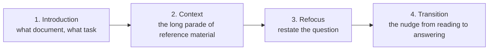

# 2 — Prompt Anatomy

> What goes in a prompt, in what order, and in what kind of document. The structural note — techniques that build on this are in [03-core-techniques](03-core-techniques.md).

---

## The application loop

An LLM application is a translator between two domains: the **user's** (questions, clicks, files, app state) and the **model's** (a document to complete). Each request makes a round trip:

1. **User problem → prompt** (the *feedforward pass*):
   1. **Context retrieval** — gather the raw material: the user's message, conversation history, files, search results, API data.
   2. **Snippetizing** — cut it into prompt-sized pieces of text.
   3. **Scoring and prioritizing** — decide what matters most and what can be dropped.
   4. **Prompt assembly** — pack the winners into a document that fits the budget.
2. **Model → completion.**
3. **Completion → user domain** (*transform back*): parse the text into something the user can act on — an answer, a code edit, a function call, a UI update.

Once the model can call tools, the middle step becomes a loop of its own: the model asks for a tool, the app runs it against external APIs, and the result goes back into the prompt until the model produces a final completion ([05](05-tools-and-function-calling.md)).


*Image Source: Berryman & Ziegler (2024), Fig. 4-3*

The loop gets harder along four dimensions: **interaction state** (single call vs. multi-turn), **external context** (none vs. many sources), **reasoning depth** (direct answer vs. multi-step), and **tool use** (pure text vs. actions in the world).

**A worked example (book, Ch 4).** A user asks a completion model for help with a math question. Sending the question raw invites any continuation. Instead, rewrite it as a document the model has seen thousands of times:

```
# Homework assignment: Algebra I

## Problem 1
A train leaves at 3pm traveling 60 mph. How far has it gone by 5:30pm?

## Solution
```

Stop sequence: `\n#`. Without it, the model correctly solves Problem 1 — and then invents Problem 2 and keeps going, because that's what homework documents do. The transform-back step pulls out the text under `## Solution`.

---

## The four criteria

Every prompt has to satisfy all four at once (book, Ch 4):

1. **Resemble training data** — the *Little Red Riding Hood principle*: stay on the path the model was trained on. Familiar document shapes (markdown reports, transcripts, homework problems, code) give predictable completions. Clean grammar in, clean grammar out.
2. **Carry all relevant information** — and *only* relevant information. Missing context fails; padding distracts (*Chekhov's gun*: models assume anything included must matter — an irrelevant retrieved review gets worked into the answer).
3. **Lead to a solution** — point at an answer, not more elaboration of the problem.
4. **Have a natural stopping point** — the end of the assistant turn, a closing tag, or a stop sequence.

Chat models give you 1, 3 and 4 almost for free through fine-tuning. **Criterion 2 is never automatic** — gathering and shaping context is where most of the work goes ([02-context](../../02-context-engineering/README.md)).

---

## The elements

| Element | What it is | Example |
|---|---|---|
| Instruction | The task | `Classify the text as neutral, negative, or positive.` |
| Context | Background that steers the answer | Retrieved docs, user profile, examples |
| Input data | The thing to act on | `Text: I think the food was okay.` |
| Output indicator | The shape of the answer | `Sentiment:` · `Return JSON with keys…` |

All four in one prompt — an instruction with a fallback, a context passage, the question, and `Answer:` as the output indicator (from DAIR's lecture notebook):


*Image Source: DAIR.AI prompt-engineering lecture (2023)*

Not every prompt needs all four. The split that matters for engineering is by *origin* (app logic vs. a variable source), not by what the text says:

- **Static content** — the hardcoded task definition and rules, the same for every user.
- **Dynamic content** — per-user, per-request context.

---

## Static content: clarifying the task

A programmatic call gets no conversational repair: a misunderstanding goes straight to failure. That makes clarifying the static part a bigger reliability lever than most people expect. There are two ways to clarify:

- **Explicit** — state the task and its rules (below).
- **Implicit** — show examples and let the model infer the pattern. Powerful but leaky: examples carry incidental biases (length, order, label balance) the model copies. Placement is covered under [agent system prompts](#agent-system-prompts-procedures-not-rule-piles); how many and how to choose them is in [03-core-techniques](03-core-techniques.md#few-shot).

Format examples the way the rest of the document is formatted: in a chat prompt, synthetic `user`/`assistant` turns; in a report, a worked section.

### Writing instructions

**Be clear and direct.** Treat the model as a capable new colleague with zero context. *Golden rule (Anthropic): if a colleague with minimal context would be confused by the prompt, so will the model.*

| Rule | Weak | Strong |
|---|---|---|
| Be specific, not vague | "Keep it short, not too descriptive" | "Use 2–3 sentences, for a high-school student" |
| Say what to do, not what not to do | "DO NOT ASK FOR INTERESTS" (the model asked anyway) | "Recommend from the top trending movies. If none fit, reply 'Sorry, couldn't find a movie today.'" |
| Give the reason | "NEVER use ellipses" | "Don't use ellipses — a text-to-speech engine will read this aloud and can't pronounce them" |
| Avoid absolutes | "Always cite three sources" | "Cite sources where they exist; say so when they don't" |
| Specify the output | "Extract the places" | "Extract the places. Format: `Place: <comma_separated_list>`" |

Reasons generalize better than bare commands: a model that knows *why* a rule exists applies it sensibly to cases you didn't list. Modern models also follow instructions more literally than older ones, so shouting (CRITICAL, MUST) now tends to cause over-application rather than compliance.

**System prompt vs. user turn.** Put persona, standing rules, and output conventions in the system prompt — chat models are trained to prioritize it. Never paste untrusted user or retrieved content into it ([10-adversarial-prompting](10-adversarial-prompting.md)).

---

## Dynamic content: what to fetch and how to shrink it

Dynamic content is chosen per request, so the questions are practical ones:

| Question | Why it matters |
|---|---|
| **Latency** — how long does it take to fetch? | A user waiting on autocomplete can't wait for a slow search; drop or cache slow sources |
| **Preparability** — can it be computed ahead of time? | Embeddings, summaries, and indexes can be built offline; live state can't |
| **Comparability** — can it be scored against other candidates? | Assembly needs a common priority scale to decide what gets cut |

To find candidate context, sort sources along two axes: **proximity** to what the user is doing right now (the open file, the current page) and **stability** (a user profile changes rarely; a cursor position changes every keystroke). Close-and-volatile sources are usually the most relevant and the most expensive to keep fresh.

**Retrieval (RAG)** fetches the snippets most similar to the query — lexical (BM25) or embedding search. Chekhov's gun applies: retrieve 2 reviews when 1 is relevant, and the model will use both. The core is short (book, Ch 5; the full pipeline is in [02-context retrieval](../../02-context-engineering/notes/04-retrieval.md)):

```python
def retrieve_reviews(index, query, reviews, k=2):
    query_vector = np.array(get_embedding(query)).reshape(1, -1)
    distances, indices = index.search(query_vector, k)   # FAISS nearest neighbors
    return [reviews[i] for i in indices[0]]
```

Chunking, hybrid search and reranking are in [02-context retrieval](../../02-context-engineering/notes/04-retrieval.md).

**Summarization** compresses context that's too long to include. For very long sources, summarize **hierarchically**: chunks → section summaries → a summary of summaries. Beware the **rumor problem** — each level can drop or distort a detail, and errors compound like a game of telephone. A **general** summary can be prepared ahead and reused; a **specific** summary ("summarize this contract with respect to termination clauses") is more useful but has to be generated per request.

---

## Ordering

Two attention effects pull against each other:

- **Recency bias** — content near the end has the most influence on the completion.
- **Lost in the middle** — models recall the beginning and end well and underweight the middle.

Together they create the **Valley of Meh**: early-to-mid prompt content is used least effectively, and the valley widens as prompts grow. There's no full fix — put your best material at the start or end, and keep the prompt short.

**The default skeleton:**



- **Introduction** frames the document so the model reads the context with the task in mind.
- **Refocus** brings the question back to the high-attention end. The introduction-plus-refocus pair is the **sandwich technique**. For long inputs (20k+ tokens), Anthropic's guidance agrees: put documents first, the query last — up to 30% better on their tests — and ask the model to pull out relevant quotes before answering.
- **Transition** ends the prompt where the answer should begin. In chat, that's the end of the user turn. In a completion prompt, it's a cue like `Answer:` or `## Solution`. The **inception** trick goes one step further: write the first words of the answer yourself (`The three main risks are 1.` or ` ```python `) so the model is already committed to the shape you want. Chat APIs that allow prefilling the assistant turn support the same move.

When the instruction changes *how* the content must be read (counting, extracting a specific field), state it in the introduction too — the model can't go back and re-read ([01-how-models-read-prompts](01-how-models-read-prompts.md#property-3--left-to-right-attention-order-matters)).

---

## Choosing the document type

| Archetype | Good for | Notes |
|---|---|---|
| **Advice conversation** | Chat, multi-turn, tool use | The default for chat models. Can include synthetic prior turns the model treats as its own. For completion models, a transcript format (`Q:`/`A:`, a forum thread, a screenplay) does the same job |
| **Analytic report** (markdown) | Analysis, reasoning-then-decision | The safest default: there's a lot of markdown in training data and it's easy to parse. A `Scope` section sets boundaries more reliably than conversational exclusions. A table of contents with `# Analysis` before `# Conclusion` gives a scratchpad; a trailing `# Appendix` heading makes a clean stop sequence |
| **Structured document** (XML / YAML / JSON) | Parseable output, complex prompts | Lets the app route parts of the output — e.g. hide a `<thinking>` block, render an `<artifact>` |

Trade-offs within structured formats: **XML** tolerates free text inside tags and closes cleanly (the closing tag is a natural stop). **YAML** is light on tokens but whitespace-sensitive. **JSON** is the easiest to parse but expensive to escape long text inside, and a missing brace breaks the whole thing.

**Case study: Claude's Artifacts prompt.** Anthropic's system prompt for Artifacts is a structured document. It explains in prose when to create an artifact and when not to, wraps each worked example in XML tags, and asks the model to emit `<antArtifact identifier="…" type="…" title="…">` blocks. The app parses those tags out of the completion and renders them in a side panel — the transform-back step done with markup.

**XML tags inside prompts** are the most robust way to separate parts of a complex prompt:

```xml
<instructions>Summarize the document for an executive audience.</instructions>
<document index="1">
  <source>q3-report.pdf</source>
  <document_content>{{DOCUMENT}}</document_content>
</document>
<constraints>Max 3 sentences. Plain prose.</constraints>
```

Use consistent, descriptive tag names and nest for hierarchy. Plain delimiters (`###`, `"""`) also work for simple prompts.

---

## Formatting injected content

How a piece of data (say, a weather API result) enters the prompt should match the document type:

- **Conversation:** `Assistant: It'll be sunny and 75 degrees.`
- **Report:** a `#### Weather` heading followed by a prose sentence.
- **Structured:** `<weather><description>sunny</description><temperature>75</temperature></weather>`

Content that doesn't fit the main flow can go in an **aside** — a clearly marked digression (a blockquote, a `Note:` paragraph, a code comment) that the document's genre already allows.

Snippet checklist: **modular** (insert or drop like list items), **natural** (reads as part of the document), **brief**, and **inert** (its token count doesn't change with its neighbors). Tokenization isn't additive — `"Hello"` + `" world"` may not tokenize the same as `"Hello world"` — so start snippets with a single leading space or end them with a newline, consistently, and don't start them with a newline.

**Assembly** is a packing problem. Each snippet gets a priority and a token cost. Two relations constrain the choice:

- **Elastic** — a snippet has several versions (full → trimmed → minimal); pick the largest that fits.
- **Mutually exclusive** — two snippets cover the same thing (a document and its summary); include at most one.

A greedy sketch:

```python
def assemble(snippets, budget):
    chosen, used, covered = [], 0, set()
    for s in sorted(snippets, key=lambda s: -s.priority):
        if s.group in covered:            # mutually exclusive with one already chosen
            continue
        for version in s.versions:        # elastic: largest first
            if used + version.tokens <= budget:
                chosen.append((s.position, version.text))
                used += version.tokens
                covered.add(s.group)
                break
    return "".join(text for _, text in sorted(chosen))   # restore document order
```

Score by priority, but emit in document order. Retrieval, scoring and packing are covered in depth in [02-context](../../02-context-engineering/notes/02-context-anatomy.md).

---

## Agent system prompts: procedures, not rule piles

A long agent system prompt is an operating manual for a capable new hire. Li's Tau-Bench ablation (Experiment 2-4: airline and retail support) shows which properties of that manual matter:

| Change (all else fixed) | Effect |
|---|---|
| Tone swapped (neutral → bombastic → emoji-casual) | Little change in completion |
| **Same rules, flattened from an ordered procedure into an unordered list** | **Success fell more than 30%**; "verify identity before refund" was skipped |
| Tool descriptions removed (signatures kept) | Tool-call errors up 45% |

**Write an SOP, not a rule pile.** Numbered stages (validate → classify → preprocess → execute → verify), each with its exception branches. The model can then tell which stage it is in and what applies there, instead of searching hundreds of rules for one that fits. When an agent underperforms, **ablate before rewriting**: switch off one component at a time and see what moves.

**Make business rules executable.** "Choose the billing type that fits the task" behaves differently on every run. Is a clothing return "savings"? Is a cancellation? Product owners have to settle each edge as a decision rule: commission only when an existing bill is negotiated down; *never* on refunds or cancellations; success-probability bands map to billing models; "savings" are computed only from the current bill, never from an avoided future increase. In mature teams, **product managers own these rules**. Engineers encode them faithfully and don't invent business logic. Give the model a clear framework and let it spend its reasoning on the parts that need judgment.

**Few-shot placement.** Use 2–3 boundary-covering examples when rules can't capture the target (style, report format, tone). Skip them when the task is easy to state. Put them either in the system prompt or as synthetic first-turn messages, and keep them **byte-stable**. Per-request "most relevant" examples break the cache ([02-context](../../02-context-engineering/notes/02-context-anatomy.md#patterns-that-break-the-cache-or-the-model)).

Lab: [2-4 prompt-engineering](https://github.com/bojieli/ai-agent-book/tree/main/chapter2/prompt-engineering) (Tau-Bench ablations; needs an API key).

---

## Prompt templates

Separate the fixed skeleton from variable slots:

```
You are a data analyst. Answer the question using only the dataset excerpt.
<question>{{USER_QUESTION}}</question>
<dataset>{{DATASET_EXCERPT}}</dataset>
```

A template is the unit you version, test and optimize — see [08-prompt-optimization](08-prompt-optimization.md).

---

## Go deeper

- Book: [Ch 4](../sources/prompt-eng-for-llms/reading/04-designing-llm-applications.pdf) (four criteria, the application loop) · [Ch 5](../sources/prompt-eng-for-llms/reading/05-prompt-content.pdf) (static vs. dynamic, RAG, summarization) · [Ch 6](../sources/prompt-eng-for-llms/reading/06-assembling-the-prompt.pdf) (Valley of Meh, archetypes, snippets, assembly)
- Worked prompts by task: [prompt-library.md](prompt-library.md)

---

→ Next: [03-core-techniques.md](03-core-techniques.md) — examples, reasoning, and the named techniques.
