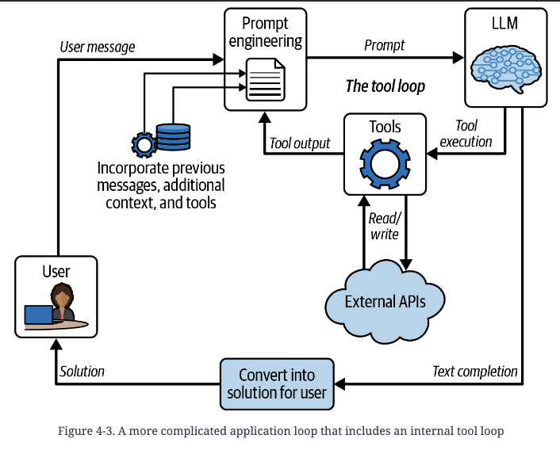
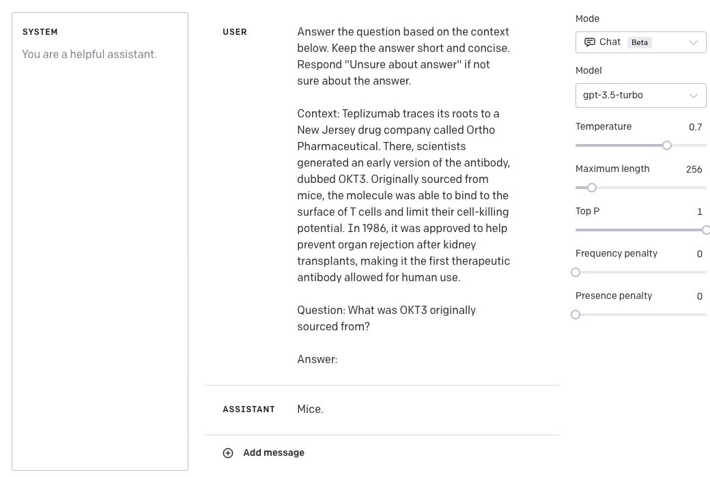
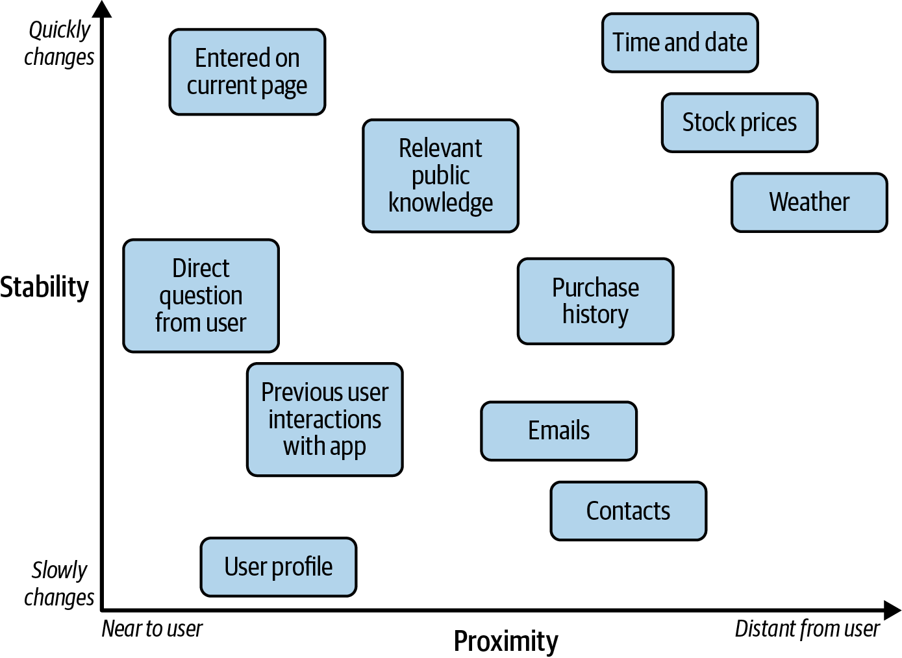
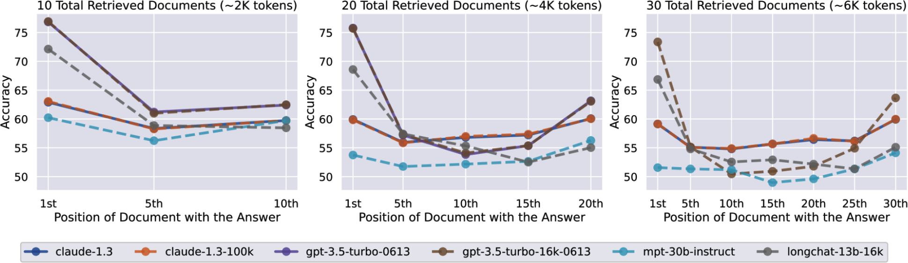
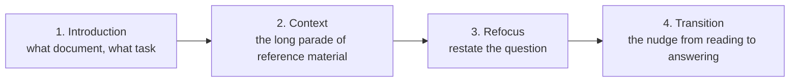
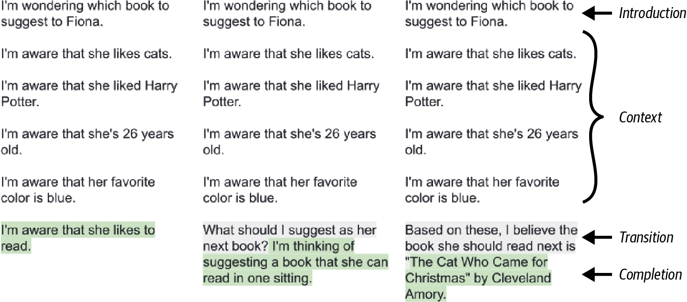

# 2 — Prompt Anatomy

> What goes in a prompt, in what order, and in what kind of document. The structural note — techniques that build on this are in [03-core-techniques](03-core-techniques.md).

A prompt is a document with a budget, and most bad prompts fail on what was put in it and where, not on wording. Without a structure, the key fact lands in the middle where models use it least, irrelevant context steers the answer, and the model has no clear place to begin or stop.

---

## The application loop

An LLM application is a translator between two domains: the **user's** (questions, clicks, files, app state) and the **model's** (a document to complete). Each request makes a round trip:

1. **User problem → prompt** (the *feedforward pass*):
   1. **Context retrieval** — gather the raw material: the user's message, conversation history, files, search results, API data.
   2. **Snippetizing** — cut it into prompt-sized pieces of text.
   3. **Scoring and prioritizing** — decide what matters most and what can be dropped.
   4. **Prompt assembly** — pack the winners into a document that fits the budget.
2. **Model → completion.**
3. **Completion → user domain** (*transform back*): parse the text into something the user can act on — an answer, a code edit, a function call, a UI update.

Once the model can call tools, the middle step becomes a loop of its own: the model asks for a tool, the app runs it against external APIs, and the result goes back into the prompt until the model produces a final completion ([05](05-tools-and-function-calling.md)).


*Image Source: Berryman & Ziegler (2024), Fig. 4-3*

The loop gets harder along four dimensions: **interaction state** (single call vs. multi-turn), **external context** (none vs. many sources), **reasoning depth** (direct answer vs. multi-step), and **tool use** (pure text vs. actions in the world). The book also rates the user's side of the problem on four axes: the medium it arrives in, its level of abstraction, the context it needs, and how stateful it is (Ch 4, Table 4-1). Proofreading is simple on every axis: the input is text, the problem is small, the user's text is all the context, and every call stands alone. IT support arrives as voice over the phone, needs searchable documentation, and has to track what has already been tried. Travel planning needs calendars, airline APIs, news and travel advisories, and has to remember weeks of planning across channels, including branches the user abandoned.

The transform back can change the medium as well as the format. A phone assistant's completion becomes speech, and a completion in a rich UI can become UI events. Even when the output is text, presentation differs: Copilot shows a code completion as grey ghost text accepted with Tab, but a chat-requested edit as a red/green diff. When a tool call would change the world (buying the ticket rather than looking it up), the app should confirm with the user before running it (book, Ch 4).

**A worked example (book, Ch 4).** A travel site wants a recommendation for whatever destination the user picked from a drop-down. Sending that raw to a completion model invites any continuation. Instead, the app casts it as a document the model has seen thousands of times, a homework assignment in markdown:

```
# Leisure, Travel, and Tourism Studies 101 - Homework Assignment
Provide answers for the following three problems. Each answer should
be concise, no more than a sentence or two.

## Problem 1
What are the top three golf destinations to recommend to customers?
## Solution 1
St. Andrews, Scotland; Pebble Beach, California; and Augusta, Georgia ...

## Problem 2
Let's say a customer approaches you to help them with travel plans for {destination}.
You check the State Department recommendations, and they advise "{advisory}"
You check the recent news and see these headlines: {headlines}
Please provide the customer with a short recommendation. What would you tell the customer?
## Solution 2
```

Each part does a job. The title points the model at the travel domain. Problem 1 is unrelated to the user's request, but it sets the `## Problem N` / `## Solution N` pattern, and its one-sentence answer sets the length and the polite voice. Problem 2 carries the dynamic context: the user's pick, the advisory, the headlines. The `## Solution 2` heading marks the problem as over; without it, the model tends to keep elaborating the problem by inventing more facts about the destination. The stop sequence `\n#` cuts generation if the model starts a confabulated Problem 3. With North Korea as the destination, the completion was *"Perhaps North Korea isn't a great destination right now. But I bet we could find some nice place to visit in South Korea."* The transform-back step takes the text under `## Solution 2`.

---

## The four criteria

Every prompt has to satisfy all four at once (book, Ch 4):

1. **Resemble training data** — the *Little Red Riding Hood principle*: stay on the path the model was trained on. Familiar document shapes (markdown reports, transcripts, homework problems, code) give predictable completions. Clean grammar in, clean grammar out. If you don't know which documents the model knows for your domain, ask it ("What types of formal documents are useful for specifying financial information about a company?"), then ask it to write an example and pattern your prompt on that.
2. **Carry all relevant information** — and *only* relevant information. Missing context fails; padding distracts (*Chekhov's gun*, Ch 5: models assume anything included must matter, so an irrelevant retrieved snippet gets worked into the answer).
3. **Lead to a solution** — point at an answer, not more elaboration of the problem.
4. **Have a natural stopping point** — the end of the assistant turn, a closing tag, or a stop sequence. The book's cautionary tale from GitHub: a misconfigured chat model that suppressed its `<|im_end|>` token answered well, signed off with "Hope you have a nice day!", then cycled through "wonderful", "festive" and every other synonym until it hit the token limit.

Chat models give you 1, 3 and 4 largely through fine-tuning: the API wraps messages in the transcript format the model was tuned on, the model is conditioned to answer the user, and it stops at the end of its turn. You still own them inside the messages. The text within the chat should look like training data (markdown `#` sections, fenced code, `*` lists), and the system message, transcript and function definitions still have to steer the model to a solution and a stop. **Criterion 2 is never automatic** — gathering and shaping context is where most of the work goes ([02-context](../../02-context-engineering/README.md)).

---

## The elements

| Element | What it is | Example |
|---|---|---|
| Instruction | The task | `Classify the text as neutral, negative, or positive.` |
| Context | Background that steers the answer | Retrieved docs, user profile, examples |
| Input data | The thing to act on | `Text: I think the food was okay.` |
| Output indicator | The shape of the answer | `Sentiment:` · `Return JSON with keys…` |

All four in one prompt — an instruction with a fallback, a context passage, the question, and `Answer:` as the output indicator (from DAIR's lecture notebook):


*Image Source: DAIR.AI prompt-engineering lecture (2023)*

Not every prompt needs all four. The split that matters for engineering is by *origin* (app logic vs. a variable source), not by what the text says:

- **Static content** — the hardcoded task definition and rules, the same for every user.
- **Dynamic content** — per-user, per-request context.

---

## Static content: clarifying the task

A programmatic call gets no conversational repair: a misunderstanding goes straight to failure. That makes clarifying the static part a bigger reliability lever than most people expect. Clarification also buys **consistency**: the model approaches every input the same way and judges by the same criteria, which is what lets you optimize the app and lets users learn it (book, Ch 5). The origin decides the category, not the wording. "I want a novel, not a self-help book" is static clarification if the app always excludes self-help, and dynamic context if the app learned this user's dislike from their message history. There are two ways to clarify:

- **Explicit** — state the task and its rules (below). Production prompts often run to long lists of dos and don'ts. The book's example is the Bing Chat ("Sydney") rule list that Marvin von Hagen got the model to reveal, sectioned into profile, information gathering, output format, limitations and safety (the book notes it was never confirmed to match the real prompt).
- **Implicit** — show examples and let the model infer the pattern. Powerful but leaky: examples carry incidental biases (length, order, label balance) the model copies. Placement is covered under [agent system prompts](#agent-system-prompts-procedures-not-rule-piles); how many and how to choose them is in [03-core-techniques](03-core-techniques.md#few-shot).

Format examples the way the rest of the document is formatted: in a chat prompt, synthetic `user`/`assistant` turns; in a report, a worked section. You can label them as examples ("when I encounter a question like X, I will answer like Y"), or write them in as previous tasks the model already solved. The second takes more care to write but can be highly effective, especially in a chat transcript, where the model believes it solved those tasks in that style and keeps going (book, Ch 6).

### Writing instructions

**Be clear and direct.** Treat the model as a capable new colleague with zero context. *Golden rule (Anthropic): if a colleague with minimal context would be confused by the prompt, so will the model.*

| Rule | Weak | Strong |
|---|---|---|
| Be specific, not vague | "Keep it short, not too descriptive" | "Use 2–3 sentences, for a high-school student" |
| Say what to do, not what not to do | "DO NOT ASK FOR INTERESTS" (the model asked anyway) | "Recommend from the top trending movies. If none fit, reply 'Sorry, couldn't find a movie today.'" |
| Give the reason | "NEVER use ellipses" | "Don't use ellipses — a text-to-speech engine will read this aloud and can't pronounce them" |
| Avoid absolutes | "Always cite three sources" | "Cite sources where they exist; say so when they don't" |
| Specify the output | "Extract the places" | "Extract the places. Format: `Place: <comma_separated_list>`" |

Reasons generalize better than bare commands: a model that knows *why* a rule exists applies it sensibly to cases you didn't list. Modern models also follow instructions more literally than older ones, so shouting (CRITICAL, MUST) now tends to cause over-application rather than compliance.

**Imagine the context a human would need, then supply it.** Phoenix & Taylor organize the craft as five principles: give direction, specify format, provide examples, evaluate quality, divide labor. They map onto this pillar as 02, [04](04-controlling-output.md), [03](03-core-techniques.md#few-shot), [09](09-evaluating-prompts.md) and [06](06-chaining-and-workflows.md) (*Prompt Engineering for Generative AI*, ch. 1). Two direction tactics from their chapter that this note doesn't cover elsewhere:

- **Prewarming (internal retrieval).** First ask the model for best-practice advice on the task ("what makes a good product name?"), then, in the same conversation, ask it to do the task. It writes its own direction. The alternative is pasting trusted external guidance into the prompt, which makes the prompt longer and more expensive but often better.
- **Too much direction conflicts.** Stack enough constraints (a style, a format, a base image, a camera model) and some combinations have no examples in the training data, so the model can't satisfy them all. Pick the constraint that matters most and drop the ones that clash with it. They note that too little direction is the more common failure.

**System prompt vs. user turn.** Put persona, standing rules, and output conventions in the system prompt — chat models are trained to prioritize it. Never paste untrusted user or retrieved content into it ([10-adversarial-prompting](10-adversarial-prompting.md)).

---

## Dynamic content: what to fetch and how to shrink it

Dynamic content is chosen per request, so the questions are practical ones:

| Question | Why it matters |
|---|---|
| **Latency** — how long does it take to fetch? | The trigger sets the budget. Low urgency: a background job such as email summarization, where nobody is waiting. Medium: an on-demand request such as a book recommendation, where users wait a little but multiple LLM passes are probably out. High: completions while the user types, where any delay risks the user acting again and invalidating the request, so complex retrieval is out unless prepared ahead |
| **Preparability** — can it be computed ahead of time? | Embeddings, summaries, and indexes can be built offline; live state can't. For very latency-critical apps, it can pay to prepare context speculatively before it's needed |
| **Comparability** — can it be scored against other candidates? | Assembly can only triage what it can compare: is one item more useful than another, does it depend on another, does it invalidate another? |

Gather more than you can use, then score it. In the book's recommender, "their last book was *The Tesseract* and they loved it" scores high, while "five years ago they read *The Catcher in the Rye*, no idea if they liked it" scores medium. Static items compete for the same space and get scored too, usually at or near the top, because the model understanding the question matters more than any one piece of context. In the book's words, all context is optional, and you have to quantify how optional each bit is (Ch 5).

To find candidate context, work from both ends. Top down, draw a **mind map** around the question ("What book shall I read next?" → "What did I read last?" → "How did I like it?") to list what the model would want to know. Bottom up, list what the app can actually get, sorted along two axes (book, Ch 5):

- **Proximity** to the application: what it has at its fingertips (screen state, the time), what it has saved (the user profile), what it could record but doesn't yet (past activity), what public APIs return (the weather), and what needs the user's permission (purchase history, email). The farther away, the harder it is to obtain, so it has to be more useful to be worth fetching.
- **Stability**: fixed per user (profile), slow-changing (purchase history), ephemeral (time, the user's current interaction). The less stable, the harder it is to prepare in advance, so its latency is harder to hide.


*Image Source: Berryman & Ziegler (2024), Fig. 5-9*

Start with the obvious sources and add the exotic ones as the app matures.

**Retrieval (RAG)** fetches the snippets most similar to the query — lexical (Jaccard, TF-IDF, BM25) or embedding search. Chekhov's gun is why precision matters. Irrelevant snippets crowd out useful ones and, worse, get over-interpreted, because the model assumes everything it was given must matter. The book's only sure fix is to retrieve the right snippets. Treat the search string as a miniprompt: adding "I'm considering what book to read next" or a line of the book's synopsis steers what comes back. The book's demo indexes a user's past reviews with FAISS, retrieves the k=2 nearest to a synopsis of *The Beach* ("I hate stories about backpacking. It's boring." and "Another bland romantic utopia. This time on a tropical island."), and asks gpt-4o-mini for a 1–5 rating. It predicts 2. The core is short (book, Ch 5; the full pipeline is in [02-context retrieval](../../02-context-engineering/notes/04-retrieval.md)):

```python
def retrieve_reviews(index, query, reviews, k=2):
    query_vector = np.array(get_embedding(query)).reshape(1, -1)
    distances, indices = index.search(query_vector, k)   # FAISS nearest neighbors
    return [reviews[i] for i in indices[0]]
```

Don't default to embeddings. Lexical search is cheap and debuggable: when a document doesn't match, you can see which tokens failed and fix the stemming or add synonyms, and you can boost fields (title over description). Copilot uses plain Jaccard similarity over the files open in the IDE because it needs no index, has almost no memory footprint, and is fast on a small search space. Neural retrieval earns its place by matching ideas rather than words: synonyms, typos, other languages (book, Ch 5). Chunking, hybrid search and reranking are in [02-context retrieval](../../02-context-engineering/notes/04-retrieval.md).

**Summarization** compresses context that's too long to include. For very long sources, summarize **hierarchically**: chunks → section summaries → a summary of summaries, recursing as deep as the corpus needs. The Bible's 1,189 chapters at 50 words each would still overflow most windows, so go chapters → its 66 books → one summary; a codebase goes files → directories → root. Split along natural borders (chapters, sections, authors) and don't mix a lot of one section with a sliver of another in one pass. Cost stays flat: as long as each summary is under about a tenth of its input, the total is set by the tokens in the original text, whatever the depth. Watch for the **rumor problem**: each level is another chance to misunderstand something, and the error carries upward. The book's judgment is that the chain is usually short enough not to matter if you aren't stingy with summary length (Ch 5).

Summaries are lossy in a task-blind way. A general summary of a vacation post keeps where the user went and drops the offhand remark about the book that made the flight bearable, which is exactly what a recommender needs. A **specific** summary written with the end task in mind keeps it (the book's prompt jots down "anything that could later help me decide which book to give them", with `N/A` for irrelevant posts). The trade-off is reuse, not timing. A specific summary can be prepared ahead as long as the question stays fixed, but if the question changes you re-summarize everything. A **general** summary can be shared across questions, apps, and even different LLMs.

---

## Ordering

Two attention effects pull against each other:

- **Recency bias** — content near the end has the most influence on the completion (the book files this under in-context learning).
- **Lost in the middle** — models recall the beginning and end well and underweight the middle.

Together they create the **Valley of Meh**: content in the early middle of the prompt is used less effectively than the beginning or the second half. Its depth and exact position vary by model, but the book says every model has one, and it matters most in large prompts. There's no full fix — put your best material at the start or end, and filter context to keep the prompt short (book, Ch 6).

The evidence is Liu et al. (2023), *Lost in the Middle*. In multi-document QA, they moved the one document that contains the answer through 10, 20 or 30 retrieved documents (about 2K, 4K and 6K tokens). Accuracy was U-shaped in every model they tested. With 20 documents, GPT-3.5-Turbo scored about 76% when the answer came first, about 63% when it came last, and dropped to about 54% in the middle. That is **below its 56.1% closed-book score with no documents at all**: an answer buried in the middle was worse than no retrieval. Extended-context versions of the same models often scored the same as the base versions, so a bigger window doesn't fix the position problem ([arXiv:2307.03172](https://arxiv.org/abs/2307.03172)):


*Image Source: Huyen, *AI Engineering* (O'Reilly, 2025), Fig. 5-4, reproducing Liu et al. (2023)*

**Test your own model.** A needle-in-a-haystack (NIAH) test inserts one fact at different depths of a long prompt and asks for it back. RULER (Hsieh et al., 2024) is a harder synthetic suite. You can also build a realistic version from your own data, such as the patient's blood type in a long visit transcript. Use **private** facts, so the model can't answer from its training data instead of the context (*AI Engineering*, ch. 5). Where the task description works best is model-specific too: GPT-4 did better with it at the start, Llama 3 at the end. The sandwich below covers both cases.

**The default skeleton:**



- **Introduction** frames the document so the model reads the context with the task in mind. The model has a fixed amount of compute per token and can't stop to reflect, so it helps to point its attention early. The same applies inside the prompt: if one block of context should be read for a particular aspect, say so at the top of that block.
- **Refocus** brings the question back to the high-attention end. The introduction-plus-refocus pair is the **sandwich technique**. The refocus can be half a line, but it's the natural place for the detailed version of the question: the introduction says "I'm thinking about book suggestions for X", the refocus asks "What's the best book to recommend next, focusing on narrative prose currently available?" (book, Ch 6). For long inputs (20k+ tokens), Anthropic's guidance agrees: put documents first, the query last — up to 30% better on their tests — and ask the model to pull out relevant quotes before answering.
- **Transition** ends the prompt where the answer should begin. In chat, a question mark at the end of the user turn is usually enough, because RLHF trained the model to answer the last question asked. In a completion prompt, it's a cue like `Answer:` or `## Solution`. Without one, the model may keep extending the input instead of answering. In Huyen's labeling example, a list of `item --> label` pairs that ends on a bare `chicken` gets continued as `chicken tacos --> edible` (*AI Engineering*, ch. 5). Choose a marker that can't occur in the inputs. The most reliable transition switches from posing the problem to solving it: start writing the answer yourself. In the book's text-davinci-002 test, a prompt with no transition got one more line of context ("I'm aware that she likes to read."). Ending on a question got the asker's musings continued ("I'm thinking of suggesting a book that she can read in one sitting."). Only the version that began the answer, `Based on these, I believe the book she should read next is "`, got a book title. That version also merges refocus and transition, because the opening words restate the question (book, Ch 6):


*Image Source: Berryman & Ziegler (2024), Fig. 6-2. Shaded text is the completion.*

The book calls writing the first words of the answer **inception** (`The three main risks are 1.` or ` ```python `): the model treats the opening as its own and continues in that shape, which also makes the output easier to parse. Chat APIs that allow prefilling the assistant turn support the same move.

When the instruction changes *how* the content must be read (counting, extracting a specific field), state it in the introduction too — the model can't go back and re-read ([01-how-models-read-prompts](01-how-models-read-prompts.md#property-3--left-to-right-attention-order-matters)).

---

## Choosing the document type

| Archetype | Good for | Notes |
|---|---|---|
| **Advice conversation** | Chat, multi-turn, tool use | The default for chat models. Can include synthetic prior turns the model treats as its own: let the assistant "ask" for each piece of context and the user "answer" with it, and the completion starts with the answer rather than another clarifying question. On a completion model the same document sidesteps unwanted RLHF habits (stylistic habits, content policing) |
| **Analytic report** (markdown) | Analysis, reasoning-then-decision | The safest default: there's a lot of markdown in training data and it's easy to parse. A `Scope` section ("This report focuses solely on novels, excluding self-help books") sets boundaries more reliably than conversational exclusions. Reports also spare the model from simulating a social exchange, but they drift: mark the switch from analysis to decision clearly. A table of contents with `# Analysis` before `# Conclusion` gives a scratchpad; a trailing `# Appendix` or `# Further Reading` heading makes a clean stop sequence |
| **Structured document** (XML / YAML / JSON) | Parseable output, complex prompts | Lets the app route parts of the output — e.g. hide a `<thinking>` block, render an `<artifact>` |

A completion model needs a transcript format as well. The book's four, each fixing the previous one's weakness: **freeform** prose with quoted speech (flexible, but hard to assemble on the fly), **script** (`Me:` / `Husband:`, easy to assemble but awkward for long or indented content such as code), **markerless** alternating paragraphs (good for long pasted text, but the model loses track of speakers and the app can't tell where the reply ends), and **structured** tags (`<me>…</me>`, which mark both speaker and end) (book, Ch 6, Table 6-2).

Trade-offs within structured formats (book, Ch 6): **XML** suits short elements where indentation doesn't matter, and the closing tag is a natural stop. Free text inside it has to escape the five entities (`&quot; &apos; &lt; &gt; &amp;`), and `<!-- comments -->` give a place for editorial hints to the model. **YAML** makes you get indentation right, which is a chore, but that precision is what you want for code: a `field: |2` block scalar preserves indentation and needs no escaping. **JSON** is escape-heavy and less readable, and the authors once advised against it. They changed their view for OpenAI models, which are trained hard on JSON because it carries their tools API, and a missing brace still breaks the whole thing.

**Case study: Claude's Artifacts prompt.** Anthropic's system prompt for Artifacts is a structured document. An `<artifacts_info>` block plays the system message and explains in prose when to create an artifact and when not to. Each worked example is an `<example>` with a `<user_query>` and an `<assistant_response>`. Inside each response, an `<antThinking>` block has the model decide whether this request deserves an artifact, and then an `<antArtifact identifier="…" type="…" language="…" title="…">` block holds the content. The app strips `antThinking` so the user never sees it and renders `antArtifact` in a side panel under its title — the transform-back step done with markup (book, Ch 6; the prompt was extracted by a user, not published by Anthropic).

**XML tags inside prompts** are the most robust way to separate parts of a complex prompt:

```xml
<instructions>Summarize the document for an executive audience.</instructions>
<document index="1">
  <source>q3-report.pdf</source>
  <document_content>{{DOCUMENT}}</document_content>
</document>
<constraints>Max 3 sentences. Plain prose.</constraints>
```

Use consistent, descriptive tag names and nest for hierarchy. Plain delimiters (`###`, `"""`) also work for simple prompts.

---

## Formatting injected content

How a piece of data (say, a weather API result) enters the prompt should match the document type:

- **Conversation:** `Assistant: It'll be sunny and 75 degrees.`
- **Report:** a `#### Weather` heading followed by a prose sentence.
- **Structured:** `<weather><description>sunny</description><temperature>75</temperature></weather>`

Content that doesn't fit the main flow can go in an **aside** — a clearly marked digression (a blockquote, a `Note:` paragraph, a code comment) that the document's genre already allows. An aside hints strongly without obliging the model to use it. Copilot's code completions pull in code from other files this way (book, Ch 6):

```go
// <consider this snippet from ../skill.go>
// type Skill interface {
//     Execute(data []byte) (refs, error)
// }
// </end snippet>
```

Snippet checklist: **modular** (insert or drop like list items), **natural** (reads as part of the document), **brief**, and **inert** (its token count doesn't change with its neighbors). Inertness matters because tokenization isn't additive. With OpenAI's GPT-3.5-and-later tokenizer, `"be"` + `"am"` is one token plus one token but `"beam"` is a single token, while `"cat"` + `"tail"` becomes three tokens (`c`, `att`, `ail`) as `"cattail"` (book, Ch 6, Table 6-4). Separate elements with whitespace so they can't merge. GPT tokenizers have many tokens that *start* with a space and few that end with one, so put the space at the start of a snippet, not the end. They also merge runs of newlines, so a snippet should either never start or never end with a newline. Never starting with one is usually easier, and ending every element with a newline also simplifies string handling and token counting.

**Assembly** is a packing problem: choose the elements that maximize the prompt's value within a budget of the context window minus the tokens reserved for the response. With a very large window, set a softer budget anyway, for compute and to keep out loosely relevant context. The book compares it to a 0-1 knapsack with dependencies and notes there is no standard solver, so you write your own (Ch 6).

Each element carries a **position**, an **importance** and its **dependencies**. Beginners conflate position and importance because recent content is often important, but the introduction outranks most of the middle. The book distinguishes **priorities**, a few integer tiers where every higher tier is used before dipping into the next, from **scores**, floats that rank elements within a tier (Ch 4). A typical tiering puts the central instructions and the output format at the top (they go in at all costs), explanations next, and context third. Pick one convention for whether importance accounts for length, and apply it everywhere. Dependencies come in three kinds:

- **Requirement** — one element needs another ("Richard is the protagonist of *The Beach*" before "He grew up in England").
- **Elastic** — a snippet has several versions (full → trimmed → minimal, e.g. a chapter with more and more paragraphs replaced by "..."); ask "what's the biggest version that fits?", not "does it fit?".
- **Mutually exclusive** — two snippets cover the same thing (a document and its summary, or overlapping passages); include at most one, with the shorter as the fallback.

Start with the **minimal prompt crafter**: order the elements and keep as many from the end as fit. It needs no scoring, and it works because models are trained to handle document suffixes, so it suits chat and apps that build on a main text. As the app grows, move to a greedy engine. **Additive** greedy starts empty and adds the highest-value element whose requirements are met and that fits. It copes when far more elements exist than fit, but breaks down with cyclical requirements or high-value elements that need low-value ones. **Subtractive** greedy starts with everything and removes the least valuable, pruning anything whose requirements are gone. It suits a manageable number of elements with few incompatibilities, and handles elastic snippets more easily (book, Ch 6).

An additive sketch:

```python
def assemble(snippets, budget):
    chosen, used, covered = [], 0, set()
    for s in sorted(snippets, key=lambda s: -s.priority):
        if s.group in covered:            # mutually exclusive with one already chosen
            continue
        if not s.requires <= covered:     # a requirement isn't in yet
            continue
        for version in s.versions:        # elastic: largest first
            if used + version.tokens <= budget:
                chosen.append((s.position, version.text))
                used += version.tokens
                covered.add(s.group)
                break
    return "".join(text for _, text in sorted(chosen))   # restore document order
```

Score by priority, but emit in document order. Retrieval, scoring and packing are covered in depth in [02-context](../../02-context-engineering/notes/02-context-anatomy.md).

---

## Agent system prompts: procedures, not rule piles

A long agent system prompt is an operating manual for a capable new hire. Li's Tau-Bench ablation (Experiment 2-4: airline and retail support) shows which properties of that manual matter:

| Change (all else fixed) | Effect |
|---|---|
| Tone swapped (neutral → bombastic → emoji-casual) | Little change in completion |
| **Same rules, flattened from an ordered procedure into an unordered list** | **Success fell more than 30%**; "verify identity before refund" was skipped |
| Tool descriptions removed (signatures kept) | Tool-call errors up 45% |

**Write an SOP, not a rule pile.** Numbered stages (validate → classify → preprocess → execute → verify), each with its exception branches. The model can then tell which stage it is in and what applies there, instead of searching hundreds of rules for one that fits. When an agent underperforms, **ablate before rewriting**: switch off one component at a time and see what moves.

**Make business rules executable.** "Choose the billing type that fits the task" behaves differently on every run. Is a clothing return "savings"? Is a cancellation? Product owners have to settle each edge as a decision rule: commission only when an existing bill is negotiated down; *never* on refunds or cancellations; success-probability bands map to billing models; "savings" are computed only from the current bill, never from an avoided future increase. In mature teams, **product managers own these rules**. Engineers encode them faithfully and don't invent business logic. Give the model a clear framework and let it spend its reasoning on the parts that need judgment.

**Few-shot placement.** Use 2–3 boundary-covering examples when rules can't capture the target (style, report format, tone). Skip them when the task is easy to state. Put them either in the system prompt or as synthetic first-turn messages, and keep them **byte-stable**. Per-request "most relevant" examples break the cache ([02-context](../../02-context-engineering/notes/02-context-anatomy.md#patterns-that-break-the-cache-or-the-model)).

Lab: [2-4 prompt-engineering](https://github.com/bojieli/ai-agent-book/tree/main/chapter2/prompt-engineering) (Tau-Bench ablations; needs an API key).

---

## Prompt templates

Separate the fixed skeleton from variable slots:

```
You are a data analyst. Answer the question using only the dataset excerpt.
<question>{{USER_QUESTION}}</question>
<dataset>{{DATASET_EXCERPT}}</dataset>
```

A template is the unit you version, test and optimize — see [08-prompt-optimization](08-prompt-optimization.md).

---

## Go deeper

- Book: [Ch 4](../sources/prompt-eng-for-llms/reading/04-designing-llm-applications.pdf) (four criteria, the application loop) · [Ch 5](../sources/prompt-eng-for-llms/reading/05-prompt-content.pdf) (static vs. dynamic, RAG, summarization) · [Ch 6](../sources/prompt-eng-for-llms/reading/06-assembling-the-prompt.pdf) (Valley of Meh, archetypes, snippets, assembly)
- Worked prompts by task: [prompt-library.md](prompt-library.md)

---

## Pitfalls

- **Stuffing retrieved context in "just in case".** Symptom: answers work in an irrelevant snippet, because Chekhov's gun says anything included must matter. Fix: score everything, include only what earns its place, and treat the search string as a miniprompt.
- **Burying the key document in the middle.** Symptom: accuracy below having no documents at all: in Liu et al., GPT-3.5-Turbo with 20 documents got about 54% with the answer in the middle against a 56.1% closed-book score. Fix: put the best material at the start or end, filter hard, and use the sandwich. A bigger window did not fix it.
- **Flattening a procedure into a rule list.** Symptom: "verify identity before refund" gets skipped. In Li's Tau-Bench ablation, the same rules without order lost more than 30% of success. Fix: write numbered stages with exception branches, and ablate one component before rewriting.
- **No transition at the end.** Symptom: the model continues your input, as in Huyen's list that ends on a bare `chicken` and comes back `chicken tacos --> edible`. Fix: end where the answer starts, with a marker that can't occur in the inputs, or write its first words.
- **Too many clashing constraints.** Symptom: outputs that ignore some requirements, because no training document satisfies them all. Fix: keep the constraint that matters most and drop those that clash, per Phoenix & Taylor.
- **Assembling in priority order.** Symptom: an instruction lands after the context it should frame. Fix: score by priority, but emit in document order. The two are separate fields.

## Try it

1. Run the `assemble` sketch on these snippets with a budget of 700: intro (priority 9, 100 tokens), refocus (8, 50), review (7, 200, requires book), book (6, elastic: 500 or 150), history (5, 300). What comes out, and what is wrong with it?
   <details><summary>Answer</summary>`intro, book-full, refocus`, 650 tokens. The review is skipped even though it fits a tighter packing, because it outranks the book it requires, so at its turn the requirement isn't in yet. This is the failure the note names for additive greedy: high-value elements that need low-value ones. The elastic book then takes its largest version, leaving no room for history. A subtractive engine starting from everything handles this case better.</details>
2. The Bible example: at 50 words per chapter summary, how many words is one flat pass over 1,189 chapters, and how many after grouping into 66 books at 50 words each? Why does the hierarchical version not cost much more to produce?
   <details><summary>Answer</summary>59,450 words, then 3,300. Cost stays flat as long as each summary is under about a tenth of its input, because the total is dominated by the tokens in the original text, whatever the depth.</details>
3. Build a needle-in-a-haystack test for the model you use: insert one private fact at 10%, 50% and 90% depth of a long prompt from your own data, and ask for it back over several runs. What makes a fact private, and what pattern should you expect?
   <details><summary>Answer</summary>The model must not be able to answer it from training data, such as a patient's blood type in a visit transcript. Expect recall worse in the early middle (the Valley of Meh), with depth and position varying by model. That variation is why you test yours.</details>

## Interview checklist

| Prompt | Answer in one line |
|---|---|
| What are the four criteria every prompt has to meet? | Resemble training data, carry all relevant and only relevant information, lead to a solution, and have a natural stopping point. Chat models give you 1, 3 and 4 largely through fine-tuning, and 2 is never automatic. |
| What is the Valley of Meh, and what is the evidence? | Early-middle content gets used less than the start or the second half. Liu et al. moved the answer document through 10 to 30 documents and accuracy was U-shaped in every model, with mid-position accuracy below closed-book for GPT-3.5-Turbo. |
| What is the sandwich technique? | An introduction that frames the task, the long context, then a refocus restating the question near the end, followed by a transition into the answer. It covers both models that do better with the task first and those that do better with it last. |
| How would you decide what to fetch for a prompt? | Ask about latency, preparability and comparability for each source, sort by proximity and stability, gather more than fits, then score it. All context is optional, and you quantify how optional. |
| Should you default to embedding retrieval? | No. Lexical search is cheap and debuggable, and Copilot uses plain Jaccard over open files. Neural retrieval earns its place by matching ideas: synonyms, typos, other languages. |
| Your support agent skips "verify identity" about a third of the time. The prompt lists all the rules. What do you try? | Rewrite it as an SOP with ordered stages. Flattening a procedure to a list cost over 30% success in Li's ablation, while tone changes hardly mattered. Ablate before rewriting. |
| General or task-specific summary? | Specific keeps what the task needs but must be redone if the question changes. General can be shared across questions, apps and models, but may drop the offhand detail you needed. |

## Next

[Core techniques](03-core-techniques.md): examples, reasoning and the named techniques that fill in this structure.
