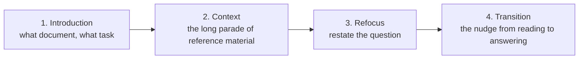
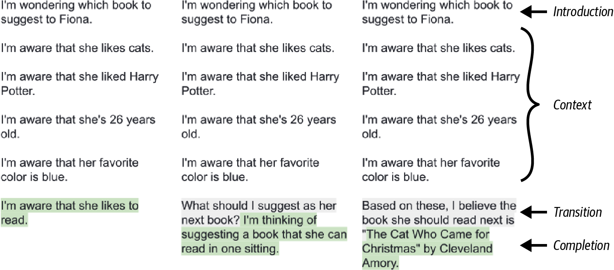

# 2b — Ordering, document types, formatting and templates

> The second half of [prompt anatomy](02-prompt-anatomy.md): where to put things, which document type to write the prompt as, how to format injected content, how to write agent system prompts, and prompt templates.

---

## Ordering

Two attention effects pull against each other:

- **Recency bias** — content near the end has the most influence on the completion (the book files this under in-context learning).
- **Lost in the middle** — models recall the beginning and end well and underweight the middle.

Together they create the **Valley of Meh**: content in the early middle of the prompt is used less effectively than the beginning or the second half. Its depth and exact position vary by model, but the book says every model has one, and it matters most in large prompts. There's no full fix — put your best material at the start or end, and filter context to keep the prompt short (book, Ch 6).

Liu et al. (2023) measured it: accuracy was U-shaped in the position of the answer document, in every model they tested, and a bigger window did not fix it. The numbers and the figure are in [context engineering 01](../../02-context-engineering/notes/01-why-context-is-finite.md#context-rot).

**Test your own model.** A needle-in-a-haystack (NIAH) test inserts one fact at different depths of a long prompt and asks for it back. RULER (Hsieh et al., 2024) is a harder synthetic suite. You can also build a realistic version from your own data, such as the patient's blood type in a long visit transcript. Use **private** facts, so the model can't answer from its training data instead of the context (*AI Engineering*, ch. 5). Where the task description works best is model-specific too: GPT-4 did better with it at the start, Llama 3 at the end. The sandwich below covers both cases.

Few-shot demos obey the same rule: the one placement to avoid is after the query. Cobbina and Zhou moved a fixed five-demo block between the start and end of the system prompt and the start and end of the user message. On MMLU, averaged over ten open-weight models from 1.5B to 72B on 200 sampled questions, the three before-the-query slots lifted accuracy from 33.6% zero-shot to about 69%, while demos after the question reached 45.2%, not significant, and flipped over 30% of predictions on QA tasks. **Put demos before the question; which earlier slot wins is model-specific**: the smallest models preferred the system prompt, Llama 3 70B the user message, and the gap shrank with scale. Five demos, eight English tasks, no CoT demos ([arXiv:2507.22887](https://arxiv.org/abs/2507.22887) (Cobbina and Zhou, 2025-07, preprint)).

**The default skeleton:**



- **Introduction** frames the document so the model reads the context with the task in mind. The model has a fixed amount of compute per token and can't stop to reflect, so it helps to point its attention early. The same applies inside the prompt: if one block of context should be read for a particular aspect, say so at the top of that block.
- **Refocus** brings the question back to the high-attention end. The introduction-plus-refocus pair is the **sandwich technique**. The refocus can be half a line, but it's the natural place for the detailed version of the question: the introduction says "I'm thinking about book suggestions for X", the refocus asks "What's the best book to recommend next, focusing on narrative prose currently available?" (book, Ch 6). For long inputs (20k+ tokens), Anthropic's guidance agrees: put documents first, the query last — up to 30% better on their tests — and ask the model to pull out relevant quotes before answering.
- **Transition** ends the prompt where the answer should begin. In chat, a question mark at the end of the user turn is usually enough, because RLHF trained the model to answer the last question asked. In a completion prompt, it's a cue like `Answer:` or `## Solution`. Without one, the model may keep extending the input instead of answering. In Huyen's labeling example, a list of `item --> label` pairs that ends on a bare `chicken` gets continued as `chicken tacos --> edible` (*AI Engineering*, ch. 5). Choose a marker that can't occur in the inputs. The most reliable transition switches from posing the problem to solving it: start writing the answer yourself. In the book's text-davinci-002 test, a prompt with no transition got one more line of context ("I'm aware that she likes to read."). Ending on a question got the asker's musings continued ("I'm thinking of suggesting a book that she can read in one sitting."). Only the version that began the answer, `Based on these, I believe the book she should read next is "`, got a book title. That version also merges refocus and transition, because the opening words restate the question (book, Ch 6):


*Image Source: Berryman & Ziegler (2024), Fig. 6-2. Shaded text is the completion.*

The book calls writing the first words of the answer **inception** (`The three main risks are 1.` or ` ```python `): the model treats the opening as its own and continues in that shape, which also makes the output easier to parse. Chat APIs that allow prefilling the assistant turn support the same move.

When the instruction changes *how* the content must be read (counting, extracting a specific field), state it in the introduction too — the model can't go back and re-read ([01-how-models-read-prompts](01-how-models-read-prompts.md#property-3--left-to-right-attention-order-matters)).

---

## Choosing the document type

| Archetype | Good for | Notes |
|---|---|---|
| **Advice conversation** | Chat, multi-turn, tool use | The default for chat models. Can include synthetic prior turns the model treats as its own: let the assistant "ask" for each piece of context and the user "answer" with it, and the completion starts with the answer rather than another clarifying question. On a completion model the same document sidesteps unwanted RLHF habits (stylistic habits, content policing) |
| **Analytic report** (markdown) | Analysis, reasoning-then-decision | The safest default: there's a lot of markdown in training data and it's easy to parse. A `Scope` section ("This report focuses solely on novels, excluding self-help books") sets boundaries more reliably than conversational exclusions. Reports also spare the model from simulating a social exchange, but they drift: mark the switch from analysis to decision clearly. A table of contents with `# Analysis` before `# Conclusion` gives a scratchpad; a trailing `# Appendix` or `# Further Reading` heading makes a clean stop sequence |
| **Structured document** (XML / YAML / JSON) | Parseable output, complex prompts | Lets the app route parts of the output — e.g. hide a `<thinking>` block, render an `<artifact>` |

A completion model needs a transcript format as well. The book's four, each fixing the previous one's weakness: **freeform** prose with quoted speech (flexible, but hard to assemble on the fly), **script** (`Me:` / `Husband:`, easy to assemble but awkward for long or indented content such as code), **markerless** alternating paragraphs (good for long pasted text, but the model loses track of speakers and the app can't tell where the reply ends), and **structured** tags (`<me>…</me>`, which mark both speaker and end) (book, Ch 6, Table 6-2).

Trade-offs within structured formats (book, Ch 6): **XML** suits short elements where indentation doesn't matter, and the closing tag is a natural stop. Free text inside it has to escape the five entities (`&quot; &apos; &lt; &gt; &amp;`), and `<!-- comments -->` give a place for editorial hints to the model. **YAML** makes you get indentation right, which is a chore, but that precision is what you want for code: a `field: |2` block scalar preserves indentation and needs no escaping. **JSON** is escape-heavy and less readable, and the authors once advised against it. They changed their view for OpenAI models, which are trained hard on JSON because it carries their tools API, and a missing brace still breaks the whole thing.

**Case study: Claude's Artifacts prompt.** Anthropic's system prompt for Artifacts is a structured document. An `<artifacts_info>` block plays the system message and explains in prose when to create an artifact and when not to. Each worked example is an `<example>` with a `<user_query>` and an `<assistant_response>`. Inside each response, an `<antThinking>` block has the model decide whether this request deserves an artifact, and then an `<antArtifact identifier="…" type="…" language="…" title="…">` block holds the content. The app strips `antThinking` so the user never sees it and renders `antArtifact` in a side panel under its title — the transform-back step done with markup (book, Ch 6; the prompt was extracted by a user, not published by Anthropic).

**XML tags inside prompts** are the most robust way to separate parts of a complex prompt:

```xml
<instructions>Summarize the document for an executive audience.</instructions>
<document index="1">
  <source>q3-report.pdf</source>
  <document_content>{{DOCUMENT}}</document_content>
</document>
<constraints>Max 3 sentences. Plain prose.</constraints>
```

Use consistent, descriptive tag names and nest for hierarchy. Plain delimiters (`###`, `"""`) also work for simple prompts.

---

## Formatting injected content

How a piece of data (say, a weather API result) enters the prompt should match the document type:

- **Conversation:** `Assistant: It'll be sunny and 75 degrees.`
- **Report:** a `#### Weather` heading followed by a prose sentence.
- **Structured:** `<weather><description>sunny</description><temperature>75</temperature></weather>`

Whole-prompt format matters too, and the best one is model-specific. He et al. wrote the same five parts (persona, instructions, examples, output format, user ask) as plain text, Markdown, YAML and JSON. On gpt-35-turbo-0613, JSON beat Markdown on MMLU 59.7% to 50.0% (14,079 questions), and JSON beat plain text on HumanEval pass@1 59.8% to 40.2%. GPT-4-1106-preview varied far less (dispersion below 0.036 on every benchmark), and GPT-4-32k fell to 21.95% on HumanEval with JSON against 76.22% with plain text because it wrote its reasoning and skipped the code (the authors' reading of the outputs). The top formats overlapped little across model families, so a format tuned on one model should be re-tested before you move it. Structure and layout were changed together, only OpenAI models from 2023 were tested, and some of the paper's headline percentages do not match its own tables ([arXiv:2411.10541](https://arxiv.org/abs/2411.10541) (He et al., 2024-11, preprint)).

Content that doesn't fit the main flow can go in an **aside** — a clearly marked digression (a blockquote, a `Note:` paragraph, a code comment) that the document's genre already allows. An aside hints strongly without obliging the model to use it. Copilot's code completions pull in code from other files this way (book, Ch 6):

```go
// <consider this snippet from ../skill.go>
// type Skill interface {
//     Execute(data []byte) (refs, error)
// }
// </end snippet>
```

Snippet checklist: **modular** (insert or drop like list items), **natural** (reads as part of the document), **brief**, and **inert** (its token count doesn't change with its neighbors). Inertness matters because tokenization isn't additive. With OpenAI's GPT-3.5-and-later tokenizer, `"be"` + `"am"` is one token plus one token but `"beam"` is a single token, while `"cat"` + `"tail"` becomes three tokens (`c`, `att`, `ail`) as `"cattail"` (book, Ch 6, Table 6-4). Separate elements with whitespace so they can't merge. GPT tokenizers have many tokens that *start* with a space and few that end with one, so put the space at the start of a snippet, not the end. They also merge runs of newlines, so a snippet should either never start or never end with a newline. Never starting with one is usually easier, and ending every element with a newline also simplifies string handling and token counting.

**Assembly** is a packing problem: choose the elements that maximize the prompt's value within the context window minus the tokens reserved for the response. Budgeting is in [context engineering 03](../../02-context-engineering/notes/03-budgeting-the-window.md#formally-assembly-under-a-constraint) and finding the candidates is in [context engineering 04](../../02-context-engineering/notes/04-retrieval.md). What is specific to a prompt is the bookkeeping. Each element carries a **position**, an **importance** and its **dependencies**. Beginners conflate position and importance because recent content is often important, but the introduction outranks most of the middle. Dependencies come in three kinds:

- **Requirement** — one element needs another ("Richard is the protagonist of *The Beach*" before "He grew up in England").
- **Elastic** — a snippet has several versions (full → trimmed → minimal, e.g. a chapter with more and more paragraphs replaced by "..."); ask "what's the biggest version that fits?", not "does it fit?".
- **Mutually exclusive** — two snippets cover the same thing (a document and its summary, or overlapping passages); include at most one, with the shorter as the fallback.

Start with the **minimal prompt crafter**: order the elements and keep as many from the end as fit. It needs no scoring, and it works because models are trained to handle document suffixes. As the app grows, move to a greedy engine, additive or subtractive (book, Ch 6). Score by priority, but emit in document order.

---

## Agent system prompts: procedures, not rule piles

A long agent system prompt is an operating manual for a capable new hire. Li's Tau-Bench ablation (Experiment 2-4: airline and retail support) shows which properties of that manual matter:

| Change (all else fixed) | Effect |
|---|---|
| Tone swapped (neutral → bombastic → emoji-casual) | Little change in completion |
| **Same rules, flattened from an ordered procedure into an unordered list** | **Success fell more than 30%**; "verify identity before refund" was skipped |
| Tool descriptions removed (signatures kept) | Tool-call errors up 45% |

**Write an SOP, not a rule pile.** Numbered stages (validate → classify → preprocess → execute → verify), each with its exception branches. The model can then tell which stage it is in and what applies there, instead of searching hundreds of rules for one that fits. When an agent underperforms, **ablate before rewriting**: switch off one component at a time and see what moves.

**When a procedure, and when a high altitude.** This advice and the warning that decision-tree prompts are brittle ([context engineering 02](../../02-context-engineering/notes/02-context-anatomy.md#system-prompt-altitude)) cover different failures. Use a procedure for the part of the job that has a fixed order and a cost for skipping a step, such as verifying identity before a refund. Flattening that order into a pile of rules cost the agent over 30% of its success. A tree of if-then rules in prose is the wrong tool for open-ended judgment: each production bug adds a branch, and the prompt still misses the next case. So write the stages as the procedure, and inside a stage give a heuristic and its signal rather than an enumeration. When you catch yourself adding a fourth conditional, move the rule into a tool or a code-level control.

**Make business rules executable.** "Choose the billing type that fits the task" behaves differently on every run. Is a clothing return "savings"? Is a cancellation? Product owners have to settle each edge as a decision rule: commission only when an existing bill is negotiated down; *never* on refunds or cancellations; success-probability bands map to billing models; "savings" are computed only from the current bill, never from an avoided future increase. In mature teams, **product managers own these rules**. Engineers encode them faithfully and don't invent business logic. Give the model a clear framework and let it spend its reasoning on the parts that need judgment.

**Few-shot placement.** Use 2–3 boundary-covering examples when rules can't capture the target (style, report format, tone). Skip them when the task is easy to state. Put them either in the system prompt or as synthetic first-turn messages, and keep them **byte-stable**. Per-request "most relevant" examples break the cache ([02-context](../../02-context-engineering/notes/02-context-anatomy.md#patterns-that-break-the-cache-or-the-model)).

Lab: [2-4 prompt-engineering](https://github.com/bojieli/ai-agent-book/tree/main/chapter2/prompt-engineering) (Tau-Bench ablations; needs an API key).

---

## Prompt templates

Separate the fixed skeleton from variable slots:

```
You are a data analyst. Answer the question using only the dataset excerpt.
<question>{{USER_QUESTION}}</question>
<dataset>{{DATASET_EXCERPT}}</dataset>
```

A template is the unit you version, test and optimize — see [09-prompt-optimization](09-prompt-optimization.md).

---

## Pitfalls

- **Burying the key document in the middle.** Symptom: accuracy below having no documents at all: in Liu et al., GPT-3.5-Turbo with 20 documents got about 54% with the answer in the middle against a 56.1% closed-book score. Fix: put the best material at the start or end, filter hard, and use the sandwich. A bigger window did not fix it.
- **Flattening a procedure into a rule list.** Symptom: "verify identity before refund" gets skipped. In Li's Tau-Bench ablation, the same rules without order lost more than 30% of success. Fix: write numbered stages with exception branches, and ablate one component before rewriting.
- **No transition at the end.** Symptom: the model continues your input, as in Huyen's list that ends on a bare `chicken` and comes back `chicken tacos --> edible`. Fix: end where the answer starts, with a marker that can't occur in the inputs, or write its first words.
- **Assembling in priority order.** Symptom: an instruction lands after the context it should frame. Fix: score by priority, but emit in document order. The two are separate fields.

## Try it

1. Run the `assemble` sketch on these snippets with a budget of 700: intro (priority 9, 100 tokens), refocus (8, 50), review (7, 200, requires book), book (6, elastic: 500 or 150), history (5, 300). What comes out, and what is wrong with it?
   <details><summary>Answer</summary>`intro, book-full, refocus`, 650 tokens. The review is skipped even though it fits a tighter packing, because it outranks the book it requires, so at its turn the requirement isn't in yet. This is the failure the note names for additive greedy: high-value elements that need low-value ones. The elastic book then takes its largest version, leaving no room for history. A subtractive engine starting from everything handles this case better.</details>
2. Build a needle-in-a-haystack test for the model you use: insert one private fact at 10%, 50% and 90% depth of a long prompt from your own data, and ask for it back over several runs. What makes a fact private, and what pattern should you expect?
   <details><summary>Answer</summary>The model must not be able to answer it from training data, such as a patient's blood type in a visit transcript. Expect recall worse in the early middle (the Valley of Meh), with depth and position varying by model. That variation is why you test yours.</details>

## Interview checklist

| Prompt | Answer in one line |
|---|---|
| What is the Valley of Meh, and what is the evidence? | Early-middle content gets used less than the start or the second half. Liu et al. moved the answer document through 10 to 30 documents and accuracy was U-shaped in every model, with mid-position accuracy below closed-book for GPT-3.5-Turbo. |
| What is the sandwich technique? | An introduction that frames the task, the long context, then a refocus restating the question near the end, followed by a transition into the answer. It covers both models that do better with the task first and those that do better with it last. |
| Your support agent skips "verify identity" about a third of the time. The prompt lists all the rules. What do you try? | Rewrite it as an SOP with ordered stages. Flattening a procedure to a list cost over 30% success in Li's ablation, while tone changes hardly mattered. Ablate before rewriting. |

## Next

[Core techniques](03-core-techniques.md): examples, reasoning and the named techniques that fill in this structure.
