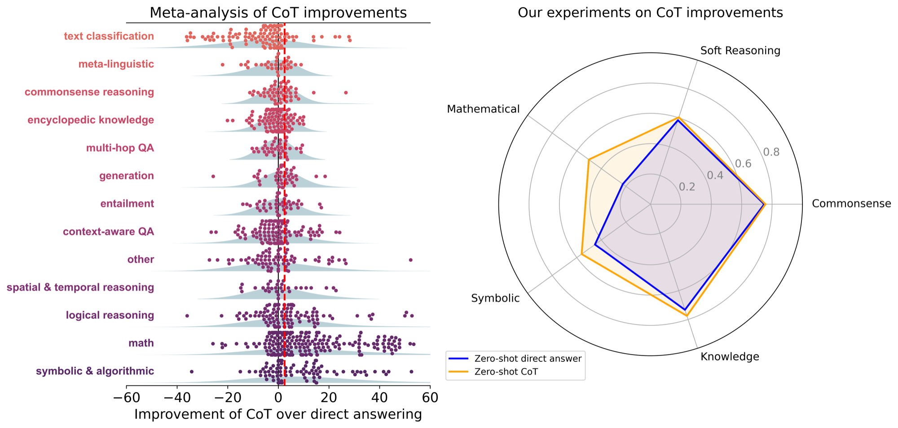

# 3 — Core Techniques

> The named techniques, grouped by what they buy you: **examples** teach the task, **reasoning** buys compute, **search** explores alternatives, **tools** reach outside the model. Each one is a way of shaping the document the model completes ([01](01-how-models-read-prompts.md)).

---

## Which technique when

| Problem | Reach for | Cost |
|---|---|---|
| Task is clear and common | Zero-shot | — |
| Format, style, or labels are non-obvious | Few-shot | Longer prompt, anchoring |
| Multi-step arithmetic, logic, planning | Chain-of-thought | More output tokens |
| Answers vary run to run on reasoning tasks | Self-consistency | N× calls |
| Model lacks the background facts | Generated knowledge, or retrieval ([02-context](../../02-context-engineering/README.md)) | Extra call |
| Search problem with dead ends (puzzles, planning) | Tree of Thoughts | Many calls + a controller |
| Exact computation | PAL (generate code, run it) | Needs a sandbox |
| Needs fresh or private information | ReAct / tool use ([05](05-tools-and-function-calling.md)) | Loop + tools |
| Can verify and retry (tests, checkers) | Reflexion | Retry budget |
| Long task with separable stages | Prompt chaining ([06](06-chaining-and-workflows.md)) | Orchestration code |

**Reasoning models change the defaults** — many of the reasoning techniques below are built in. See [07-prompting-reasoning-models](07-prompting-reasoning-models.md) before adding CoT scaffolding to one.

---

## Zero-shot

Instruction only, no examples. Instruction tuning (FLAN) and RLHF are what make this work: the model has seen enough instruction→response pairs to generalize. Before instruction tuning, zero-shot meant finding a document cue: GPT-2 would summarize a text if you appended `TL;DR` (book, Ch 4).

```
Classify the text into neutral, negative or positive.
Text: I think the vacation is okay.
Sentiment:
```

Start here. Add examples only when zero-shot fails in a way you can name.

---

## Few-shot

Demonstrations in the prompt condition the model on the task (*in-context learning*, the GPT-3 result). It emerges with scale — small models barely benefit. Structure: `introduction → Q/A pairs → the real question`.

Examples teach far more than the rule you had in mind. In the book's rating predictor, a handful of `(review title): (rating)` pairs implicitly teach that ratings are integers 1–5, the exact line format, and even the *distribution* of ratings (skewed to 4s and 5s) — structure that would be tedious to spell out. That's why few-shot is good for "I know it when I see it" categories, and why it's often worth adding just to pin down the output format cheaply. Models have a compulsion to continue patterns, so a pattern shown in the examples is often followed more reliably than the same rule stated outright: in the book's words, implicit is often better than explicit. Examples also fix the persona: two sample scores in a grumpy reviewer's voice get a grumpy reviewer every time, which helps consistency (book, Ch 5).

What actually matters in the examples (Min et al., 2022):

- **The label space and input distribution** matter more than whether each label is correct — random labels still beat no examples.
- **Format** matters a lot; even a consistent format with random labels helps.
- Sampling labels from the true distribution beats a uniform spread.

**How much few-shot still buys depends on the model and the domain.** GPT-3 gained a lot from examples. In Microsoft's 2023 analysis of GPT-4-class models, few-shot improved only a little on zero-shot, because stronger instruction-followers need fewer examples. That analysis likely undercounts domain-specific tasks. If the model rarely saw your API in pretraining (Huyen's example is the Ibis dataframe library), a few examples still make a big difference (*AI Engineering*, ch. 5). Pay for examples in tokens as well: the same three labeled items cost 38 GPT-4 tokens as `Input:/Output:` blocks and 27 as `chickpea --> edible` lines. If the scores are equal, use the compact format.

**On an unfamiliar task, "a few" can be far too few.** de Wynter tested GPT-4 Turbo, GPT-4o, Mixtral 8x7B and Phi-3.5 MoE on nine synthetic formal-language tasks (parity, pattern matching, maze solving, stack manipulation and others) with 0 to 100 exemplars, at temperature 0. In the paper's words, "peak average accuracy was at 50-100 exemplars". As the shot count grew, the gaps between models and between prompts narrowed, and a system prompt replaced with word salad came close to the real one. Two results cut the other way. Accuracy fell as the test inputs moved away from the exemplars' distribution, and the strongest prompts fell fastest: the slope was −1.4 for CoT, −0.5 for an APO-optimized prompt and −0.4 for a plain modus-ponens prompt. Closely related tasks also scored up to 31 points apart, and decision trees or kNN beat ICL's average accuracy in half the tasks ([arXiv:2509.10414](https://arxiv.org/abs/2509.10414) (de Wynter, 2025-09)). Treat a few-shot prompt as a learner fitted to its examples, and test it on inputs that don't look like them.

**More examples buy reliability and cost creativity.** Phoenix & Taylor's rule of thumb: one to three examples are easy to add and almost always help. Past three to five, outputs get more reliable and less creative, and the more alike the examples are, the more tightly the output copies them (make every sample product name an animal and you only get animal names). Beyond three, experiment with both the count and the diversity of the set. They also cite Hsieh et al. (2023) for direction working better than examples, and good examples are harder to collect, so they try a clear instruction first and add examples second (*Prompt Engineering for Generative AI*, ch. 1).

The book's three drawbacks — **use few-shot only when something is genuinely non-obvious**:

| Drawback | What happens | Mitigation |
|---|---|---|
| Scales badly with context | Each example must carry the same rich context as the real question; the prompt balloons and similar blocks confuse attention | Keep examples scoped to teaching *format* only, or move context out |
| Anchoring | The examples' range becomes the model's expectation | Cover a representative range; match the *true* outcome distribution (a representative sample of real past cases does this for free); include non-trivial edge cases but don't overweight them |
| Spurious patterns | Example *order* gets learned (ascending values, "happy path first, errors last") instead of content | Shuffle; evaluate subsets and orders; let DSPy select and order against a metric ([08](08-prompt-optimization.md)) |

Anchoring survives even perfect coverage. Give one example for each rating 1 through 5 and the model may infer the ratings are equally common, so on an uninformative review it guesses 3. In the real data 5 is by far the most common rating, and the right uninformed guess. Covering edge cases is still worth a little bias: a model that has never seen an edge case has no idea how to handle it (book, Ch 5).

Spurious patterns turn up by luck more often than you'd expect: three examples land in accidentally ascending order 1 time in 6 (17%), and descending just as often. With ten examples, a perfect ordering by chance is rarer than death by lightning (1 in 1.8 million against about 1 in 100,000 for US residents), but patterns that only mostly hold, or emerge partway through, still sway the model. Hand-written examples are the risk, because enumerating cases systematically produces ordered lists. The "happy path first, edge cases last" habit is the classic trap. In the book's apple-counting puzzles (text-davinci-003), three solvable examples come first and four "NA" cases (no integer solution, infinitely many) follow. The model continues the sequence and answers the solvable main question with "NA # no integer solutions". Swap one solvable example to the end and it gives an answer, though a wrong one ("Olive 4, Paul 5"): that puzzle needs chain-of-thought, not better examples. Shortening examples to dodge the context drawback has its own cost: it can nudge the model away from the deeper reasoning the full context would have supported, and examples much thinner than the real question have little left to teach except the output format (book, Ch 5). The same de Wynter study found that *randomly shuffling* the same exemplars barely moved accuracy, so its results count against fragility to arbitrary order at 50–100 shots. That is a different case from a systematic order such as happy path first, which teaches a pattern of its own, and the study did not test that case.

Few-shot alone doesn't fix multi-step reasoning. When examples aren't enough, add reasoning to them — that's chain-of-thought.

---

## Chain-of-thought

The model has fixed compute per token and no internal monologue ([01](01-how-models-read-prompts.md#property-2--autoregressive-no-lookahead-no-backtracking)). Without reasoning tokens, a yes/no answer is an intuitive guess, and any explanation after it is post-hoc rationalization. **CoT makes the model write the reasoning before the answer**, so the answer is conditioned on it.

**Few-shot CoT** (Wei et al., 2022): examples show reason-then-answer.

```
Q: The odd numbers in this group add up to an even number: 4, 8, 9, 15, 12, 2, 1.
A: Adding all the odd numbers (9, 15, 1) gives 25. The answer is False.

Q: The odd numbers in this group add up to an even number: 15, 32, 5, 13, 82, 7, 1.
A:
```


*Image Source: Wei et al. (2022)*

With PaLM 540B and 8 exemplars, GSM8K math rose from **17.9% to 56.9%**, past the prior best of 55% (a fine-tuned GPT-3 with a verifier). On StrategyQA, CoT reached 75.6% against a prior state of the art of 69.4%. Symbolic-reasoning tasks improve too. **The gain is an emergent ability of scale.** Below about 100B parameters, models wrote fluent but illogical chains and scored *below* standard prompting ([arXiv:2201.11903](https://arxiv.org/abs/2201.11903) (Wei et al., 2022-01)).

**Zero-shot CoT** (Kojima et al., 2022): append *"Let's think step by step."* No examples needed. With text-davinci-002 it took MultiArith from **17.7% to 78.7%** and GSM8K from **10.4% to 40.7%**. That beat standard 8-shot prompting (33.8% and 15.6%) but stayed below 8-shot CoT (93.0% and 48.7%). It works in two calls. The first generates the reasoning. The second appends an extraction prompt such as *"Therefore, the answer (arabic numerals) is"* to pull out a parseable answer. **It doesn't help where there is no chain to write.** It made no difference on single-step arithmetic (SingleEq, AddSub) and lowered CommonsenseQA from 68.8% to 64.6% ([arXiv:2205.11916](https://arxiv.org/abs/2205.11916) (Kojima et al., 2022-05)).

**Most of the gain is in math and symbolic work.** Sprague et al. pooled 1,218 CoT-versus-direct comparisons from 110 papers (ICLR 2024, EACL 2024, NAACL 2024). Symbolic reasoning, math and logical reasoning gained 14.2, 12.3 and 6.9 points on average. Across all other categories, CoT averaged 56.8 against 56.1 without it. Their own zero-shot runs (20 datasets, 14 models from Llama 2 7B to GPT-4o and Claude 3.5 Sonnet) agree. Math rose from 22.6% to 50.2% on average, and symbolic tasks from 45.2% to 56.1%, while commonsense moved only from 74.8% to 75.7%. Even inside MMLU, "as much as 95% of the total performance gain from CoT on MMLU is attributed to questions containing '=' in the question or generated output." Where CoT does help, a tool helps more. Having the model write a plan and hand it to a Python solver beat CoT on GSM8K-Hard (few-shot, Llama 3.1 70B: 47.8% with CoT, 68.0% with plan plus tool; see [PAL](#pal--program-aided-language-models)). In the authors' words, "CoT appears to be a poor (but universal) approximation to such solvers" ([arXiv:2409.12183](https://arxiv.org/abs/2409.12183) (Sprague et al., 2024-09)). Spend CoT tokens on multi-step math and logic, and make it earn its cost anywhere else on your eval.


*Each dot on the left is one reported CoT-minus-direct delta. Only math, symbolic and logical reasoning sit clearly right of zero. Image Source: Sprague et al., [To CoT or not to CoT?](https://arxiv.org/abs/2409.12183) (2024), Fig. 1*

**A chain learned in training generalizes only near its training data.** Zhao et al. trained GPT- and LLaMA-style models from scratch (62K to 3B parameters) on synthetic letter transformations such as ROT-13 and cyclic shifts, then changed the task, the input length or the format at test time. Full-chain exact match was 100% in distribution, 0.01% on new combinations of transformations the model already knew, and 0% on unseen ones. A model trained on 4-letter inputs scored 0% on 3- and 5-letter inputs. Fine-tuned LLaMA3-8B and Qwen3-14B behaved the same way, reaching at most 8.52% on new combinations. The trace and the answer also came apart: on some shifts the model copied a familiar reasoning path and got the answer wrong, and on others it reached the right answer through a wrong path. The authors conclude that CoT reasoning "is effective when applied to (near) in-distribution data, but becomes fragile and prone to failure even under moderate distribution shifts" ([arXiv:2508.01191](https://arxiv.org/abs/2508.01191) (Zhao et al., Findings of ACL 2026)). The setup is CoT trained into small models on a toy domain, not CoT prompted from a general model, so read it as a warning, not a measurement of your model. Our extrapolation: a chain that reads well is not evidence the model can do the task on inputs unlike its training data, so put off-distribution cases in the eval.


*Image Source: Kojima et al. (2022)*

**Plan-and-solve**: front-load a plan — *"Let's first understand the problem and devise a plan to solve the problem. Then, let's carry out the plan and solve the problem step by step."* Helps where zero-shot CoT skips steps. It uses no tools — it's closer to zero-shot CoT than to ReAct — but the two combine naturally: plan first, then run the think-act-observe loop.

**Auto-CoT** (Zhang et al., 2022): build the CoT examples automatically — cluster the questions, pick a representative from each cluster, generate its reasoning with zero-shot CoT. Diversity matters because hand-picked or generated demos can share the same mistakes. Simple heuristics (question ≤ 60 tokens, ≤ 5 reasoning steps) filter out bad demos.


*Image Source: Zhang et al. (2022)*

Practical notes:
- **Put reasoning in a parseable place** — a `<thinking>` block or an `# Analysis` section before `# Conclusion` ([02](02-prompt-anatomy.md#choosing-the-document-type)) — so the app can strip it before showing the answer.
- **Reasoning must come first.** "Answer, then explain" gets you rationalization, not reasoning.
- Variants worth knowing by name: **pause tokens** (fine-tune on a meaningless "pause" token, then insert ~10 after the question: the extra positions give earlier information time to integrate, buying compute without words — the model's "uh, um"), **Multimodal CoT** (two stages — generate a rationale from text + image, then infer the answer from it; a fine-tuned 738M model scored 90.5% on ScienceQA vs. ~76% for GPT-3.5 with CoT), **Graph prompting** (GraphPrompt, for graph-structured tasks — niche).


*Image Source: Zhang et al. (2023)*

The two-stage split exists because a one-stage chain hurt the small model. **A 200M text-only T5 fine-tuned on ScienceQA scored 81.63% answering directly and 69.32% writing the rationale first**: in 56% of 50 sampled errors the rationale hallucinated what the image showed. Adding image captions gained 0.8 points; fusing ViT image features into the encoder took the two-stage model from 78.57% to 85.31% ([arXiv:2302.00923](https://arxiv.org/abs/2302.00923) (Zhang et al., TMLR 2024)). The setup is fine-tuning, not prompting. Our extrapolation: when a chain has to reason about an image, give the reasoning step the image, not a caption of it.

---

## Self-consistency

Sample several CoT completions at non-zero temperature and take the **majority answer** (Wang et al., 2022). Replaces greedy decoding: different reasoning paths that converge on one answer are more trustworthy than any single path.


*Image Source: DAIR.AI, Introduction to AI Agents (task decomposition). Left: one reasoning chain. Middle: CoT-SC samples several chains and votes. Right: ToT branches at every step.*

Use it on arithmetic and commonsense tasks with a single extractable answer. The same vote works without chain-of-thought on classification: classify the same text three times and keep the most frequent label, which damps one-off misreadings at 3× the calls (*Prompt Engineering for Generative AI*, ch. 3). It's N× the cost, and it doesn't help open-ended generation, where there's nothing to vote on. The same idea underlies **branch-solve-merge**: fan out to N solvers (high temperature or different assigned perspectives), then have a merge step synthesize the result.

---

## Generated knowledge

Two calls: first ask the model to generate facts relevant to the question, then answer with those facts in the prompt (Liu et al., 2022).


*Image Source: Liu et al. (2022)*

```
Input: Part of golf is trying to get a higher point total than others. Yes or no?
Knowledge: The objective of golf is to play a set of holes in the fewest number of strokes...
```

With knowledge, the answer flips from a confident wrong "Yes" to "No." It works by putting relevant facts *before* the reasoning. It doesn't add knowledge the model lacks — for that you need retrieval.

---

## Tree of Thoughts

Generalizes CoT into **search**: generate several candidate "thoughts" (intermediate steps), have the model **evaluate** each one (sure / maybe / impossible), and explore with BFS or DFS, backtracking from dead ends (Yao et al., 2023; Long, 2023). On Game of 24, GPT-4 with CoT solved 4% and with ToT 74%.


*Image Source: Yao et al. (2023)*

The Game of 24 results also show what buys the gain. Sampling more CoT chains helps only a little (CoT-SC with 100 samples: 9%; best of 100 CoT: 49%), while a breadth of 5 kept candidates at each step reaches 74%. Most CoT failures happen at the first step, which is exactly where ToT's evaluate-and-backtrack helps:


*Image Source: Yao et al. (2023), Table 2 and Fig. 3*

Both steps are ordinary prompts. On Game of 24, a *propose* prompt generates candidate next steps and a *value* prompt rates whether the remaining numbers can still reach 24:


*Image Source: Yao et al. (2023)*

Real ToT needs a controller loop in code, so it's an orchestration pattern ([04-loop](../../04-loop-engineering/README.md)) more than a prompt. A cheap single-prompt approximation (Hulbert, 2023):

```
Imagine three different experts are answering this question.
All experts will write down 1 step of their thinking, then share it with the group.
Then all experts will go on to the next step, etc.
If any expert realises they're wrong at any point then they leave.
The question is...
```

---

## PAL — program-aided language models

The model writes code; an **interpreter** computes the answer (Gao et al., 2022). This moves exact computation out of the model, following the [tokens rule](01-how-models-read-prompts.md#property-1--tokens-not-characters): don't ask the model to do what code does reliably.


*Image Source: Gao et al. (2022)*

How it works: the few-shot examples are *code with the reasoning in comments*, so the model's completion is a program. Your app runs it and reads a variable:

```python
DATE_UNDERSTANDING_PROMPT = """
# Q: 2015 is coming in 36 hours. What is the date one week from today in MM/DD/YYYY?
# If 2015 is coming in 36 hours, then today is 36 hours before.
today = datetime(2015, 1, 1) - relativedelta(hours=36)
# One week from today,
one_week_from_today = today + relativedelta(weeks=1)
# The answer formatted with %m/%d/%Y is
answer = one_week_from_today.strftime('%m/%d/%Y')
# ...more examples...
# Q: {question}
"""
llm_out = llm(DATE_UNDERSTANDING_PROMPT.format(question=question))
exec(llm_out)    # the model wrote the program; Python does the date arithmetic
print(answer)    # Q: "Today is 27 February 2023. I was born exactly 25 years ago..." → 02/27/1998
```

The idea still pays with modern models. On GSM8K-Hard (GSM8K with larger numbers), having the model write a plan as code and running it in Python beat writing the arithmetic out as CoT (few-shot): 68.0% against 47.8% for Llama 3.1 70B, and 70.4% against 52.2% for GPT-4o Mini. On plain GSM8K, whose numbers are easier, CoT was slightly ahead (96.1% against 94.4% for Llama 3.1 70B) ([arXiv:2409.12183](https://arxiv.org/abs/2409.12183) (Sprague et al., 2024-09)).

`exec` on model output is only acceptable in a sandbox. DAIR's PAL notebook uses LangChain's legacy `OpenAI` completion class and `text-davinci-003`, both retired — swap in any current model. Today this is usually done with a code-execution tool rather than a hand-built prompt.

---

## ReAct — reason + act

Interleave **Thought → Action → Observation** steps so reasoning drives tool calls and tool results update reasoning (Yao et al., 2022). The original used three Wikipedia actions — `Search[entity]` (first 5 sentences of the matching page, or similar-entity suggestions if there's no exact match), `Lookup[string]` (the next sentence in that page containing the string) and `Finish[answer]` — set up by a preamble describing them plus ~6 worked traces.

```
Thought 1: I need to search Arthur's Magazine and First for Women, and find which was started first.
Action 1: Search[Arthur's Magazine]
Observation 1: Arthur's Magazine (1844–1846) was an American literary periodical...
Thought 2: Arthur's Magazine was started in 1844. I need to search First for Women next.
Action 2: Search[First for Women]
Observation 2: First for Women is a woman's magazine... started in 1989...
Thought 3: 1844 < 1989, so Arthur's Magazine was started first.
Action 3: Finish[Arthur's Magazine]
```

A trace that recovers from a miss — the failed `Search[Front Row]` returns suggestions, and the next thought picks the right one:


*Image Source: Yao et al. (2022)*

What the results show:
- **Knowledge tasks (HotpotQA, FEVER):** ReAct grounds answers in retrieved facts, so it hallucinates less than CoT. But it's more brittle: one uninformative search derails it. The best results combined them: **ReAct ↔ CoT-SC**, falling back from one to the other when it gets stuck or unsure (best: 35.1 EM on HotpotQA with ReAct → CoT-SC and 64.6 on FEVER with CoT-SC → ReAct, vs. 29.4 / 56.3 for CoT alone).

  
  *Image Source: Yao et al. (2022), Table 1*
- **With few-shot prompting alone, ReAct underperformed** standard and CoT prompting on HotpotQA at every model size. Fine-tuning on ~3,000 traces flipped that: a fine-tuned 8B ReAct beat a prompted 62B model, and a fine-tuned 62B beat a prompted 540B. Reasoning strategy plus light fine-tuning can stand in for scale. **Act** (tools, no Thought step) is worse than ReAct but still beats no tools.
- **Decision tasks (ALFWorld, WebShop):** reasoning is what makes acting work — 71% vs. 45% for Act-only on ALFWorld. There the thoughts decompose the goal into subgoals, inject commonsense, pull the useful detail out of observations, track progress and re-plan on exceptions.

The notebook's version is a few lines of LangChain — the framework supplies the ReAct prompt, parses `Action:` lines, runs the tool and appends `Observation:`:

```python
llm = OpenAI(model_name="text-davinci-003", temperature=0)
tools = load_tools(["google-serper", "llm-math"], llm=llm)   # web search + calculator
agent = initialize_agent(tools, llm, agent="zero-shot-react-description", verbose=True)
agent.run("Who is Olivia Wilde's boyfriend? What is his current age raised to the 0.23 power?")
```

`initialize_agent` and `text-davinci-003` are deprecated; current LangChain/LangGraph builds the same loop on native tool calling. ReAct is the ancestor of today's tool-calling agent loop. Modern APIs do the Thought/Action/Observation bookkeeping natively — see [05-tools-and-function-calling](05-tools-and-function-calling.md) and [03-harness](../../03-harness-engineering/README.md).

---

## ART — automatic reasoning and tool-use

Pick demonstrations of multi-step reasoning **and** tool use from a task library, run them with a frozen model, and **pause generation whenever a tool is called**, splice in its output, then resume (Paranjape et al., 2023). Beats few-shot and Auto-CoT on BigBench and MMLU. Humans can fix mistakes by editing the task library or adding tools. Today this is mostly what native tool calling does, so it's of historical interest ([05](05-tools-and-function-calling.md)).


*Image Source: Paranjape et al. (2023)*

---

## Active-Prompt

Auto-CoT picks *representative* questions to annotate. Active-Prompt picks the *most uncertain* ones (Diao et al., ACL 2024): sample k answers per training question, measure disagreement, have humans write CoT for the top-uncertainty questions, and use those as the examples. It's active learning applied to choosing few-shot examples. With code-davinci-002 on GSM8K it scored 82.2% against 63.1% for hand-picked CoT examples. Most of that is self-consistency voting, which Active-Prompt also uses: voting alone reaches 78.0%, so choosing the uncertain questions adds about 4 points ([arXiv:2302.12246](https://arxiv.org/abs/2302.12246)).


*Image Source: Diao et al. (2023)*

---

## Directional stimulus prompting

A small tuned **policy model** generates a hint (keywords, a "stimulus") that's added to the main LLM's prompt (Li et al., 2023). For summarization, the hint is a list of keywords to cover. The policy model is trained with supervised learning and RL, so a cheap model steers an expensive frozen one. It's a research pattern, but the idea of having a small model write part of the big model's prompt reappears in routing and query-rewriting.


*Image Source: Li et al. (2023)*

---

## Reflexion

Verbal reinforcement learning (Shinn et al., 2023). Three parts:

| Component | Role |
|---|---|
| **Actor** | Produces actions/text (CoT or ReAct) |
| **Evaluator** | Scores the trajectory — exact match, heuristics, unit tests, or an LLM judge |
| **Self-reflection** | Turns the score into natural-language feedback, stored in memory for the next attempt |


*Image Source: Shinn et al. (2023)*

Loop: attempt → evaluate → reflect → retry with the reflection in context. HumanEval pass@1 reached 91% vs. GPT-4's 80% at the time. The gain depends on the evaluator: on HumanEval the model writes its own unit tests, and on the harder LeetCode set (15% vs. 7.5%) it still roughly doubles the baseline:


*Image Source: Shinn et al. (2023)*

The same table has the counterexample. On MBPP Python, Reflexion scored **77.1% against GPT-4's 80.1%**: worse than not reflecting at all. The cause was the self-written tests. On MBPP, 16.3% of solutions that passed the agent's own tests were wrong, against 1.4% on HumanEval, so the agent stopped too early on wrong code ([arXiv:2303.11366](https://arxiv.org/abs/2303.11366)).

**It works only when you get a do-over**, ideally with an objective evaluator (tests, compilers, checkers). It's useless for irreversible actions, and with a weak evaluator it reinforces confident mistakes. Memory is a sliding window, so long retry histories get truncated. Reflexion is a loop pattern; implementation lives in [04-loop](../../04-loop-engineering/README.md), and evaluator design in [09-evaluating-prompts](09-evaluating-prompts.md).

**Why a second pass helps at all.** Phoenix & Taylor's naming example: the model proposes a list of product names, and a second call that rates them consistently picks out "OneSize Glovewalkers" as the worst. The model generated it anyway because it predicts one token at a time and can't see where an answer is going. Given the whole answer to review, judging it is an easier prediction. Their lighter version of reflection is to ask, in the same chat, whether the output missed anything and to repeat until it stops changing (*Prompt Engineering for Generative AI*, ch. 1, 3). Without an objective evaluator, the MBPP caveat above still applies.

---

## Techniques covered elsewhere

- **Prompt chaining** → [06-chaining-and-workflows](06-chaining-and-workflows.md)
- **APE, meta-prompting, DSPy** → [08-prompt-optimization](08-prompt-optimization.md)
- **RAG** → [02-context](../../02-context-engineering/README.md)

---

## Go deeper

- Book (PDF): [Ch 5](../sources/prompt-eng-for-llms/reading/05-prompt-content.pdf) (few-shot drawbacks) · [Ch 8](../sources/prompt-eng-for-llms/reading/08-conversational-agency.pdf) (CoT, ReAct, plan-and-solve, Reflexion, branch-solve-merge)
- Papers for every technique on this page: [references.md](../README.md#technique-papers)
- Worked prompts: [prompt-library.md](prompt-library.md)

---

→ Next: [04-controlling-output.md](04-controlling-output.md) — sampling, stop sequences, structured output, and getting exactly the shape you want.
