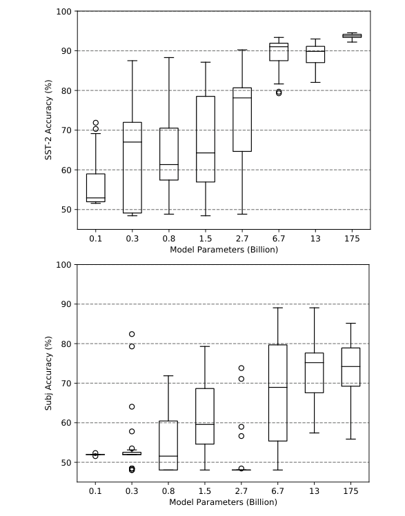
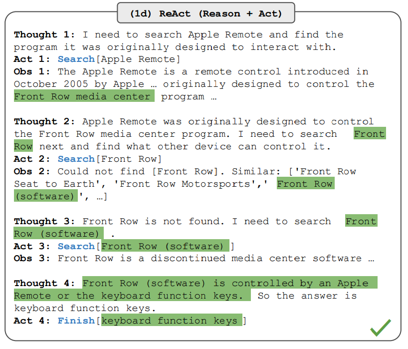
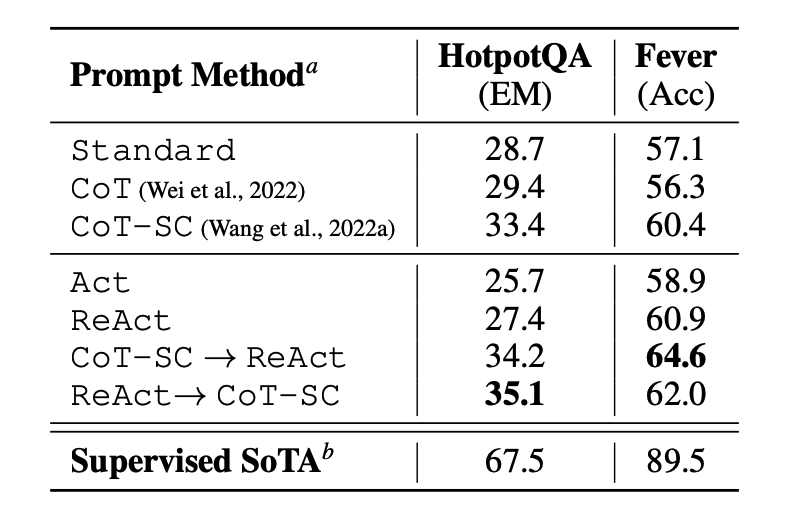
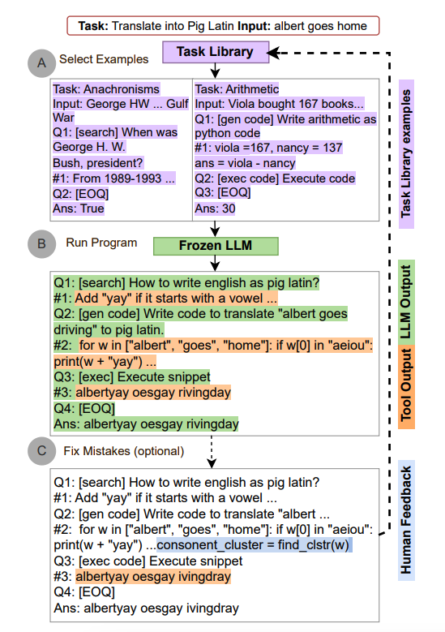
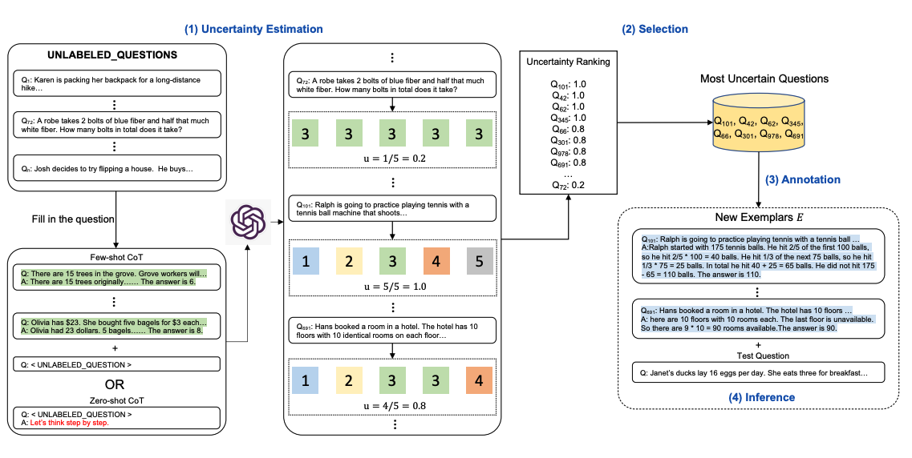
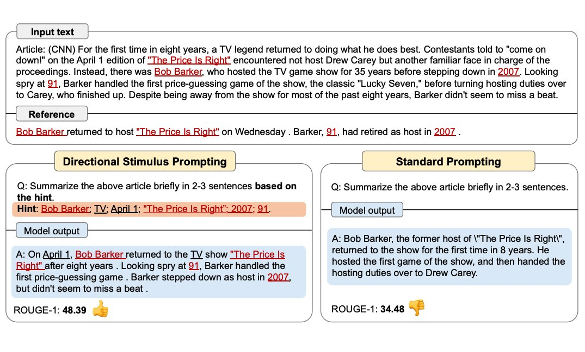
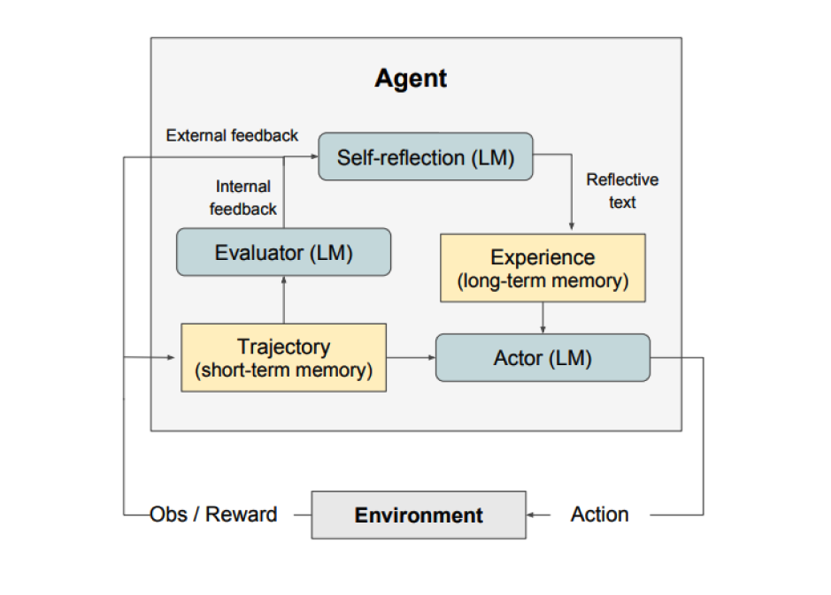
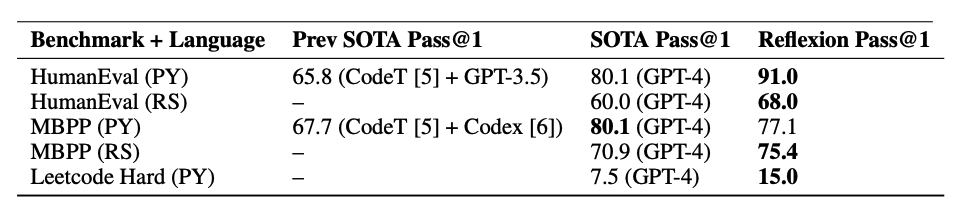

# 3 — Core Techniques

> The named techniques, grouped by what they buy you: **examples** teach the task, **reasoning** buys compute, **search** explores alternatives, **tools** reach outside the model. Each one is a way of shaping the document the model completes ([01](01-how-models-read-prompts.md)).

Teams copy a technique because a paper reported a big gain, then pay for it on tasks where it does nothing: chain-of-thought lifted GSM8K from 17.9% to 56.9% and barely moved commonsense questions. This chapter sets out what each named technique costs and which failure it fixes, so you can start zero-shot and escalate deliberately. The reasoning techniques (chain-of-thought and its variants, self-consistency, generated knowledge, Tree of Thoughts, PAL) are in [3b](03b-chain-of-thought-and-reasoning.md); this note keeps zero-shot, few-shot, ReAct, ART, Active-Prompt, directional stimulus and Reflexion.

---

## Which technique when

| Problem | Reach for | Cost |
|---|---|---|
| Task is clear and common | Zero-shot | — |
| Format, style, or labels are non-obvious | Few-shot | Longer prompt, anchoring |
| Multi-step arithmetic, logic, planning | [Chain-of-thought](03b-chain-of-thought-and-reasoning.md#chain-of-thought) | More output tokens |
| Answers vary run to run on reasoning tasks | [Self-consistency](03b-chain-of-thought-and-reasoning.md#self-consistency) | N× calls |
| Model lacks the background facts | [Generated knowledge](03b-chain-of-thought-and-reasoning.md#generated-knowledge), or retrieval ([02-context](../../02-context-engineering/README.md)) | Extra call |
| Search problem with dead ends (puzzles, planning) | [Tree of Thoughts](03b-chain-of-thought-and-reasoning.md#tree-of-thoughts) | Many calls + a controller |
| Exact computation | [PAL](03b-chain-of-thought-and-reasoning.md#pal--program-aided-language-models) (generate code, run it) | Needs a sandbox |
| Needs fresh or private information | ReAct / tool use ([05](05-tools-and-function-calling.md)) | Loop + tools |
| Can verify and retry (tests, checkers) | Reflexion | Retry budget |
| Long task with separable stages | Prompt chaining ([06](06-chaining-and-workflows.md)) | Orchestration code |

**Reasoning models change the defaults** — many of the reasoning techniques below are built in. See [07-prompting-reasoning-models](07-prompting-reasoning-models.md) before adding CoT scaffolding to one.

A survey of 44 papers on 39 methods and 29 tasks runs no experiments and relays each paper's own numbers. Its caveat is that models, metrics and dataset versions differ across papers, so the gains cannot be compared; by its labels, plain prompting still won most medical-QA sets ([arXiv:2407.12994](https://arxiv.org/abs/2407.12994) (Vatsal & Dubey, 2024-07, preprint)).

---

## Zero-shot

Instruction only, no examples. Instruction tuning (FLAN) and RLHF are what make this work: the model has seen enough instruction→response pairs to generalize. Before instruction tuning, zero-shot meant finding a document cue: GPT-2 would summarize a text if you appended `TL;DR` (book, Ch 4).

```
Classify the text into neutral, negative or positive.
Text: I think the vacation is okay.
Sentiment:
```

Start here. Add examples only when zero-shot fails in a way you can name.

---

## Few-shot

Demonstrations in the prompt condition the model on the task (*in-context learning*, the GPT-3 result). It emerges with scale — small models barely benefit *in context*. On SuperGLUE, GPT-3 primed with 32 examples averaged 56.2 on the dev set at 350M parameters and 73.2 at 175B, and going from one example to 32 helped only slightly at most sizes, sometimes hurting the smaller models. The examples can still teach a small model if they go into its weights. ALBERT (223M), fine-tuned on the same number of labelled examples written as cloze prompts, scored 74.0 on the test set against GPT-3 175B's 71.8. The comparison is not level: PET also used up to 20,000 unlabelled examples per task to distil an ensemble, different example sets, and several hand-written patterns where GPT-3 used one ([arXiv:2009.07118](https://arxiv.org/abs/2009.07118) (Schick & Schütze, NAACL 2021)). Structure: `introduction → Q/A pairs → the real question`.

Examples teach far more than the rule you had in mind. In the book's rating predictor, a handful of `(review title): (rating)` pairs implicitly teach that ratings are integers 1–5, the exact line format, and even the *distribution* of ratings (skewed to 4s and 5s) — structure that would be tedious to spell out. That's why few-shot is good for "I know it when I see it" categories, and why it's often worth adding just to pin down the output format cheaply. Models have a compulsion to continue patterns, so a pattern shown in the examples is often followed more reliably than the same rule stated outright: in the book's words, implicit is often better than explicit. Examples also fix the persona: two sample scores in a grumpy reviewer's voice get a grumpy reviewer every time, which helps consistency (book, Ch 5).

What actually matters in the examples (Min et al., 2022):

- **The label space and input distribution** matter more than whether each label is correct — random labels still beat no examples.
- **Format** matters a lot; even a consistent format with random labels helps.
- Sampling labels from the true distribution beats a uniform spread.

**How much few-shot still buys depends on the model and the domain.** GPT-3 gained a lot from examples. In Microsoft's 2023 analysis of GPT-4-class models, few-shot improved only a little on zero-shot, because stronger instruction-followers need fewer examples. That analysis likely undercounts domain-specific tasks. If the model rarely saw your API in pretraining (Huyen's example is the Ibis dataframe library), a few examples still make a big difference (*AI Engineering*, ch. 5). Pay for examples in tokens as well: the same three labeled items cost 38 GPT-4 tokens as `Input:/Output:` blocks and 27 as `chickpea --> edible` lines. If the scores are equal, use the compact format.

**On an unfamiliar task, "a few" can be far too few.** de Wynter tested GPT-4 Turbo, GPT-4o, Mixtral 8x7B and Phi-3.5 MoE on nine synthetic formal-language tasks (parity, pattern matching, maze solving, stack manipulation and others) with 0 to 100 exemplars, at temperature 0. In the paper's words, "peak average accuracy was at 50-100 exemplars". As the shot count grew, the gaps between models and between prompts narrowed, and a system prompt replaced with word salad came close to the real one. Two results cut the other way. Accuracy fell as the test inputs moved away from the exemplars' distribution, and the strongest prompts fell fastest: the slope was −1.4 for CoT, −0.5 for an APO-optimized prompt and −0.4 for a plain modus-ponens prompt. Closely related tasks also scored up to 31 points apart, and decision trees or kNN beat ICL's average accuracy in half the tasks ([arXiv:2509.10414](https://arxiv.org/abs/2509.10414) (de Wynter, 2025-09)). Treat a few-shot prompt as a learner fitted to its examples, and test it on inputs that don't look like them.

**Which examples you pick matters, and a trained retriever beats BM25.** Wang et al. trained a retriever to pick the 8 in-context examples for each query: LLaMA-7B scores candidate examples by the log-likelihood of the correct output, a cross-encoder reward model learns those scores, and an E5-base retriever is distilled from it. Over 30 datasets in 9 task categories (category-averaged task metrics, not all accuracy) it averaged 66.5 against 57.9 for random selection, 61.3 for BM25 and 62.1 for SBERT, with a ±0.2 standard deviation reported only for random over 3 runs. The paper's "+7.8%" headline is the one-iteration model (65.7); a second iteration adds 0.8 and a third nothing. Gains faded after about 4 retrieved examples. The retriever trained on LLaMA-7B also helped a 13B model (68.8 against BM25's 64.6) and GPT-Neo-2.7B, but GPT-3.5-turbo, tested on a different template and at most 1k items per dataset, moved only 75.1 against 74.7. It lost to random on SQuAD, where retrieved examples shared a passage and lacked diversity. Training needed about 12 hours of ranking on 8 V100s ([arXiv:2307.07164](https://arxiv.org/abs/2307.07164) (Wang et al., EACL 2024)).

**Few-shot works inside what pretraining covered.** Yadlowsky et al. trained a 9.5M-parameter transformer from scratch on mixtures of synthetic function classes (dense and sparse linear, sinusoids) and gave it (x, f(x)) pairs in context. Picking the right class in context cost nearly nothing for classes in the mixture. A model trained only on sparse linear functions did poorly on dense linear prompts, a mixture model failed on a blend of a linear function and a cosine neither had seen, and sinusoid predictions broke once the frequency fell outside the range covered by all but about 100 of 1 billion pretraining examples. This is one small model on synthetic regression, with no seeds and no natural language, so it supports the claim that in-context ability tracks pretraining coverage and says nothing about a particular LLM ([arXiv:2311.00871](https://arxiv.org/abs/2311.00871) (Yadlowsky et al., 2023-11, preprint)). It is consistent with de Wynter's distribution-shift slopes above.

**Demonstrations from another setting can do worse than none.** Song et al. had GPT-4 set HVAC actions in the BEAR building simulator, with the state as text and demonstrations retrieved by embedding similarity (reward mean over 5 seeds, one target office and weather). With no demonstrations GPT-4 scored 1.01. Four demonstrations from its own recent history scored 1.23, above PPO's 1.21. Two expert demonstrations from other buildings and weathers scored 0.51 and four 0.86, below no demonstrations, because expert policies differ by scenario. A demonstration set drawn only from the target scenario (1.09) was the lowest of the six Table 1 groups (the other five scored 1.16 to 1.23). Rounding numbers to integers raised the reward from 1.07 to 1.16, and a hand-written room-temperature comment from 0.99 to 1.16 while a self-generated one dropped it to 0.59. The abstract's "fewer samples" claim is unmeasured, since the expert demonstrations came from PPO policies trained for 100M steps, and the stds overlap on most comparisons ([arXiv:2308.03028](https://arxiv.org/abs/2308.03028) (Song et al., 2023-08, preprint)).

**At many shots, choose a few and cache the rest.** Similarity-selected demonstrations cost a fresh prompt per request, and their benefit shrinks as shots grow (Agarwal et al., 2024; Bertsch et al., 2024). Golchin et al. pair 20 per-query similar demos with a large random or k-means block that is identical for every query and so cacheable. On Gemini 1.5 Pro and 2.0 Flash over ANLI, TREC, GSM Plus and MetaTool (1,000 test items each), the hybrid matched or beat similarity-only selection at about 2× lower attention cost at 50 shots and 10× at 200. Cost is theoretical attention complexity, and no variance is reported ([arXiv:2507.16217](https://arxiv.org/abs/2507.16217) (Golchin et al., COLM 2025)). Put the cached block first and the per-query examples last ([02](02b-document-types-formatting-and-templates.md#ordering)).

**More examples buy reliability and cost creativity.** Phoenix & Taylor's rule of thumb: one to three examples are easy to add and almost always help. Past three to five, outputs get more reliable and less creative, and the more alike the examples are, the more tightly the output copies them (make every sample product name an animal and you only get animal names). Beyond three, experiment with both the count and the diversity of the set. They also cite Hsieh et al. (2023) for direction working better than examples, and good examples are harder to collect, so they try a clear instruction first and add examples second (*Prompt Engineering for Generative AI*, ch. 1).

The book's three drawbacks — **use few-shot only when something is genuinely non-obvious**:

| Drawback | What happens | Mitigation |
|---|---|---|
| Scales badly with context | Each example must carry the same rich context as the real question; the prompt balloons and similar blocks confuse attention | Keep examples scoped to teaching *format* only, or move context out |
| Anchoring | The examples' range becomes the model's expectation | Cover a representative range; match the *true* outcome distribution (a representative sample of real past cases does this for free); include non-trivial edge cases but don't overweight them |
| Spurious patterns | Example *order* gets learned (ascending values, "happy path first, errors last") instead of content | Shuffle; evaluate subsets and orders; let DSPy select and order against a metric ([08](08-prompt-optimization.md)) |

Anchoring survives even perfect coverage. Give one example for each rating 1 through 5 and the model may infer the ratings are equally common, so on an uninformative review it guesses 3. In the real data 5 is by far the most common rating, and the right uninformed guess. Covering edge cases is still worth a little bias: a model that has never seen an edge case has no idea how to handle it (book, Ch 5).

Spurious patterns turn up by luck more often than you'd expect: three examples land in accidentally ascending order 1 time in 6 (17%), and descending just as often. With ten examples, a perfect ordering by chance is rarer than death by lightning (1 in 1.8 million against about 1 in 100,000 for US residents), but patterns that only mostly hold, or emerge partway through, still sway the model. Hand-written examples are the risk, because enumerating cases systematically produces ordered lists. The "happy path first, edge cases last" habit is the classic trap. In the book's apple-counting puzzles (text-davinci-003), three solvable examples come first and four "NA" cases (no integer solution, infinitely many) follow. The model continues the sequence and answers the solvable main question with "NA # no integer solutions". Swap one solvable example to the end and it gives an answer, though a wrong one ("Olive 4, Paul 5"): that puzzle needs chain-of-thought, not better examples. Shortening examples to dodge the context drawback has its own cost: it can nudge the model away from the deeper reasoning the full context would have supported, and examples much thinner than the real question have little left to teach except the output format (book, Ch 5). At four shots, arbitrary order alone is enough to break a prompt. Lu et al. ran all 24 orders of one fixed, balanced set of four SST-2 examples on GPT-2 and GPT-3 models from 0.1B to 175B. **Some orders scored over 85% and others about 50%, which is chance.** Scale narrowed the spread but did not remove it on Subj, and adding examples (up to 32, GPT-2 only) raised accuracy without shrinking the variance. A good order did not transfer between models. Its rank correlation between GPT-3 175B and 2.7B was 0.05, and one order fell from 88.7% to 51.6% moving from GPT-2 XL to GPT-2 Large. Most bad orders produced highly unbalanced predictions, skewed toward one label. The authors' fix needs no labelled dev set: generate a probing set with the model itself, then keep the orders whose predicted labels on it are most evenly spread (highest [entropy](../../../generative-ai/01-llm-fundamentals/notes/06-pretraining-data-and-objectives.md#entropy-cross-entropy-kl-and-perplexity)). Across 11 classification tasks that gave a 13% relative gain, up to 30% where the variance was high. On GPT-3 175B SST-2, where the spread was already ±0.6 points, it changed nothing ([arXiv:2104.08786](https://arxiv.org/abs/2104.08786) (Lu et al., ACL 2022)). These are 2021 base models on classification. The same de Wynter study found that *randomly shuffling* the same exemplars barely moved accuracy, so its results count against fragility to arbitrary order at 50–100 shots. That is a different case from a systematic order such as happy path first, which teaches a pattern of its own, and the study did not test that case.


*Image Source: Lu et al., [Fantastically Ordered Prompts and Where to Find Them](https://arxiv.org/abs/2104.08786) (2022), Fig. 1*

**Analogical prompting** has the model write its own examples: recall three relevant problems, solve them, then solve the target. On GSM8K it scored 77.8% against 76.7% for 5-shot CoT (GPT-3.5-turbo; PaLM 2: 81.7% against 80.7%) and 37.3% against 34.9% on MATH. At text-davinci-001 and below labeled examples did as well or better, and no variance is reported ([arXiv:2310.01714](https://arxiv.org/abs/2310.01714) (Yasunaga et al., ICLR 2024)).

Few-shot alone doesn't fix multi-step reasoning. When examples aren't enough, add reasoning to them — that's [chain-of-thought](03b-chain-of-thought-and-reasoning.md#chain-of-thought).

---

## Chain-of-thought, self-consistency, generated knowledge, Tree of Thoughts and PAL

These reasoning techniques moved to [3b — chain-of-thought and reasoning techniques](03b-chain-of-thought-and-reasoning.md), with their evidence, pitfalls and interview rows. Sections there: [chain-of-thought](03b-chain-of-thought-and-reasoning.md#chain-of-thought), [self-consistency](03b-chain-of-thought-and-reasoning.md#self-consistency), [generated knowledge](03b-chain-of-thought-and-reasoning.md#generated-knowledge), [Tree of Thoughts](03b-chain-of-thought-and-reasoning.md#tree-of-thoughts) and [PAL](03b-chain-of-thought-and-reasoning.md#pal--program-aided-language-models).

---

## ReAct — reason + act

Interleave **Thought → Action → Observation** steps so reasoning drives tool calls and tool results update reasoning (Yao et al., 2022). The original used three Wikipedia actions — `Search[entity]` (first 5 sentences of the matching page, or similar-entity suggestions if there's no exact match), `Lookup[string]` (the next sentence in that page containing the string) and `Finish[answer]` — set up by a preamble describing them plus ~6 worked traces.

```
Thought 1: I need to search Arthur's Magazine and First for Women, and find which was started first.
Action 1: Search[Arthur's Magazine]
Observation 1: Arthur's Magazine (1844–1846) was an American literary periodical...
Thought 2: Arthur's Magazine was started in 1844. I need to search First for Women next.
Action 2: Search[First for Women]
Observation 2: First for Women is a woman's magazine... started in 1989...
Thought 3: 1844 < 1989, so Arthur's Magazine was started first.
Action 3: Finish[Arthur's Magazine]
```

A trace that recovers from a miss — the failed `Search[Front Row]` returns suggestions, and the next thought picks the right one:


*Image Source: Yao et al. (2022)*

What the results show:
- **Knowledge tasks (HotpotQA, FEVER):** ReAct grounds answers in retrieved facts, so it hallucinates less than CoT. But it's more brittle: one uninformative search derails it. The best results combined them: **ReAct ↔ CoT-SC**, falling back from one to the other when it gets stuck or unsure (best: 35.1 EM on HotpotQA with ReAct → CoT-SC and 64.6 on FEVER with CoT-SC → ReAct, vs. 29.4 / 56.3 for CoT alone).

  
  *Image Source: Yao et al. (2022), Table 1*
- **With few-shot prompting alone, ReAct underperformed** standard and CoT prompting on HotpotQA at every model size. Fine-tuning on ~3,000 traces flipped that: a fine-tuned 8B ReAct beat a prompted 62B model, and a fine-tuned 62B beat a prompted 540B. Reasoning strategy plus light fine-tuning can stand in for scale. **Act** (tools, no Thought step) is worse than ReAct but still beats no tools.
- **Decision tasks (ALFWorld, WebShop):** reasoning is what makes acting work — 71% vs. 45% for Act-only on ALFWorld. There the thoughts decompose the goal into subgoals, inject commonsense, pull the useful detail out of observations, track progress and re-plan on exceptions.

The notebook's version is a few lines of LangChain — the framework supplies the ReAct prompt, parses `Action:` lines, runs the tool and appends `Observation:`:

```python
llm = OpenAI(model_name="text-davinci-003", temperature=0)
tools = load_tools(["google-serper", "llm-math"], llm=llm)   # web search + calculator
agent = initialize_agent(tools, llm, agent="zero-shot-react-description", verbose=True)
agent.run("Who is Olivia Wilde's boyfriend? What is his current age raised to the 0.23 power?")
```

`initialize_agent` and `text-davinci-003` are deprecated; current LangChain/LangGraph builds the same loop on native tool calling. ReAct is the ancestor of today's tool-calling agent loop. Modern APIs do the Thought/Action/Observation bookkeeping natively — see [05-tools-and-function-calling](05-tools-and-function-calling.md) and [03-harness](../../03-harness-engineering/README.md).

---

## ART — automatic reasoning and tool-use

Pick demonstrations of multi-step reasoning **and** tool use from a task library, run them with a frozen model, and **pause generation whenever a tool is called**, splice in its output, then resume (Paranjape et al., 2023). Beats few-shot and Auto-CoT on BigBench and MMLU. Humans can fix mistakes by editing the task library or adding tools. Today this is mostly what native tool calling does, so it's of historical interest ([05](05-tools-and-function-calling.md)).


*Image Source: Paranjape et al. (2023)*

---

## Active-Prompt

Auto-CoT picks *representative* questions to annotate. Active-Prompt picks the *most uncertain* ones (Diao et al., ACL 2024): sample k answers per training question, measure disagreement, have humans write CoT for the top-uncertainty questions, and use those as the examples. It's active learning applied to choosing few-shot examples. With code-davinci-002 on GSM8K it scored 82.2% against 63.1% for hand-picked CoT examples. Most of that is self-consistency voting, which Active-Prompt also uses: voting alone reaches 78.0%, so choosing the uncertain questions adds about 4 points ([arXiv:2302.12246](https://arxiv.org/abs/2302.12246)).


*Image Source: Diao et al. (2023)*

---

## Directional stimulus prompting

A small tuned **policy model** generates a hint (keywords, a "stimulus") that's added to the main LLM's prompt (Li et al., 2023). For summarization, the hint is a list of keywords to cover. The policy model is trained with supervised learning and RL, so a cheap model steers an expensive frozen one. It's a research pattern, but the idea of having a small model write part of the big model's prompt reappears in routing and query-rewriting.


*Image Source: Li et al. (2023)*

---

## Reflexion

Verbal reinforcement learning (Shinn et al., 2023). Three parts:

| Component | Role |
|---|---|
| **Actor** | Produces actions/text (CoT or ReAct) |
| **Evaluator** | Scores the trajectory — exact match, heuristics, unit tests, or an LLM judge |
| **Self-reflection** | Turns the score into natural-language feedback, stored in memory for the next attempt |


*Image Source: Shinn et al. (2023)*

Loop: attempt → evaluate → reflect → retry with the reflection in context. HumanEval pass@1 reached 91% vs. GPT-4's 80% at the time. The gain depends on the evaluator: on HumanEval the model writes its own unit tests, and on the harder LeetCode set (15% vs. 7.5%) it still roughly doubles the baseline:


*Image Source: Shinn et al. (2023)*

The same table has the counterexample. On MBPP Python, Reflexion scored **77.1% against GPT-4's 80.1%**: worse than not reflecting at all. The cause was the self-written tests. On MBPP, 16.3% of solutions that passed the agent's own tests were wrong, against 1.4% on HumanEval, so the agent stopped too early on wrong code ([arXiv:2303.11366](https://arxiv.org/abs/2303.11366)).

**It works only when you get a do-over**, ideally with an objective evaluator (tests, compilers, checkers). It's useless for irreversible actions, and with a weak evaluator it reinforces confident mistakes. Memory is a sliding window, so long retry histories get truncated. Reflexion is a loop pattern; implementation lives in [04-loop](../../04-loop-engineering/README.md), and evaluator design in [09-evaluating-prompts](09-evaluating-prompts.md).

**Why a second pass helps at all.** Phoenix & Taylor's naming example: the model proposes a list of product names, and a second call that rates them consistently picks out "OneSize Glovewalkers" as the worst. The model generated it anyway because it predicts one token at a time and can't see where an answer is going. Given the whole answer to review, judging it is an easier prediction. Their lighter version of reflection is to ask, in the same chat, whether the output missed anything and to repeat until it stops changing (*Prompt Engineering for Generative AI*, ch. 1, 3). Without an objective evaluator, the MBPP caveat above still applies.

---

## Techniques covered elsewhere

- **Prompt chaining** → [06-chaining-and-workflows](06-chaining-and-workflows.md)
- **APE, meta-prompting, DSPy** → [08-prompt-optimization](08-prompt-optimization.md)
- **RAG** → [02-context](../../02-context-engineering/README.md)

---

## Go deeper

- Book (PDF): [Ch 5](../sources/prompt-eng-for-llms/reading/05-prompt-content.pdf) (few-shot drawbacks) · [Ch 8](../sources/prompt-eng-for-llms/reading/08-conversational-agency.pdf) (CoT, ReAct, plan-and-solve, Reflexion, branch-solve-merge)
- Papers for every technique on this page: [references.md](../references.md#technique-papers)
- Worked prompts: [prompt-library.md](prompt-library.md)

---

## Pitfalls

- **Happy path first, edge cases last.** Symptom: the book's apple-counting prompt answers a solvable question with "NA" because the examples ended in NA. Fix: shuffle, evaluate subsets and orders, or let DSPy choose against a metric.
- **Examples that anchor the distribution.** Symptom: on uninformative input the model guesses the middle, 3, because you showed one example per rating, when the real answer is the common 5. Fix: sample from the true outcome distribution, and keep a few edge cases without overweighting them.
- **Reflexion with self-written tests.** Symptom: worse than not reflecting. On MBPP Python it scored 77.1% against GPT-4's 80.1%, since 16.3% of solutions passing the agent's own tests were wrong. Fix: use an objective evaluator, and never use it for irreversible actions.

## Try it

2. Sort these into a technique from the "which technique when" table, and name the cost: (a) computing compound interest on invoices, (b) picking a support category with a house-specific label set, (c) answering about yesterday's outage.
   <details><summary>Answer</summary>(a) PAL: generate code and run it, which needs a sandbox. (b) Few-shot: a longer prompt, and anchoring. (c) ReAct or tool use, because the model lacks fresh information. It costs a loop and tools. Generated knowledge wouldn't help, since it adds no facts the model lacks.</details>
3. With three hand-written examples, how often do they land in accidentally ascending order, and how often is ten examples perfectly ordered in one given direction or the other? What should you still do at ten?
   <details><summary>Answer</summary>Ascending is 1 in 3! = 1 in 6. Ascending or descending at ten is 2 in 10!, or 1 in 1,814,400, the note's 1 in 1.8 million. Still check: patterns that only mostly hold still sway the model, and hand-written lists tend to be systematically ordered rather than random.</details>

## Interview checklist

| Prompt | Answer in one line |
|---|---|
| Zero-shot or few-shot first? | Zero-shot, then add examples only when it fails in a way you can name. Few-shot still earns its place for non-obvious format, or a domain the model rarely saw, like Huyen's Ibis example. |
| Do labels in few-shot examples have to be correct? | Less than you'd think. Min et al. found random labels still beat no examples, since label space, input distribution and format matter more. Don't take that as licence, though: correct labels aren't what's being tested there. |
| When does Reflexion fail? | With a weak evaluator or irreversible actions. On MBPP Python, its self-written tests passed wrong solutions, so it stopped early and scored below no reflection. |

## Next

[3b — chain-of-thought and reasoning techniques](03b-chain-of-thought-and-reasoning.md): chain-of-thought and its variants, self-consistency, Tree of Thoughts and PAL.
