# 3 — Core Techniques

> The named techniques, grouped by what they buy you: **examples** teach the task, **reasoning** buys compute, **search** explores alternatives, **tools** reach outside the model. Each one is a way of shaping the document the model completes ([01](01-how-models-read-prompts.md)).

---

## Which technique when

| Problem | Reach for | Cost |
|---|---|---|
| Task is clear and common | Zero-shot | — |
| Format, style, or labels are non-obvious | Few-shot | Longer prompt, anchoring |
| Multi-step arithmetic, logic, planning | Chain-of-thought | More output tokens |
| Answers vary run to run on reasoning tasks | Self-consistency | N× calls |
| Model lacks the background facts | Generated knowledge, or retrieval ([02-context](../../02-context-engineering/README.md)) | Extra call |
| Search problem with dead ends (puzzles, planning) | Tree of Thoughts | Many calls + a controller |
| Exact computation | PAL (generate code, run it) | Needs a sandbox |
| Needs fresh or private information | ReAct / tool use ([05](05-tools-and-function-calling.md)) | Loop + tools |
| Can verify and retry (tests, checkers) | Reflexion | Retry budget |
| Long task with separable stages | Prompt chaining ([06](06-chaining-and-workflows.md)) | Orchestration code |

**Reasoning models change the defaults** — many of the reasoning techniques below are built in. See [07-prompting-reasoning-models](07-prompting-reasoning-models.md) before adding CoT scaffolding to one.

---

## Zero-shot

Instruction only, no examples. Instruction tuning (FLAN) and RLHF are what make this work: the model has seen enough instruction→response pairs to generalize.

```
Classify the text into neutral, negative or positive.
Text: I think the vacation is okay.
Sentiment:
```

Start here. Add examples only when zero-shot fails in a way you can name.

---

## Few-shot

Demonstrations in the prompt condition the model on the task (*in-context learning*, the GPT-3 result). It emerges with scale — small models barely benefit. Structure: `introduction → Q/A pairs → the real question`.

Examples teach far more than the rule you had in mind. In the book's rating predictor, a handful of `(review title): (rating)` pairs implicitly teach that ratings are integers 1–5, the exact line format, and even the *distribution* of ratings (skewed to 4s and 5s) — structure that would be tedious to spell out. That's why few-shot is good for "I know it when I see it" categories, and why it's often worth adding just to pin down the output format cheaply.

What actually matters in the examples (Min et al., 2022):

- **The label space and input distribution** matter more than whether each label is correct — random labels still beat no examples.
- **Format** matters a lot; even a consistent format with random labels helps.
- Sampling labels from the true distribution beats a uniform spread.

The book's three drawbacks — **use few-shot only when something is genuinely non-obvious**:

| Drawback | What happens | Mitigation |
|---|---|---|
| Scales badly with context | Each example must carry the same rich context as the real question; the prompt balloons and similar blocks confuse attention | Keep examples scoped to teaching *format* only, or move context out |
| Anchoring | The examples' range becomes the model's expectation | Cover a representative range; match the *true* outcome distribution; include edge cases but don't overweight them |
| Spurious patterns | Example *order* gets learned (ascending values, "happy path first, errors last") instead of content | Shuffle; evaluate subsets and orders; let DSPy select and order against a metric ([08](08-prompt-optimization.md)) |

Spurious patterns turn up by luck more often than you'd expect: three examples land in accidentally ascending order 1 time in 6 (17%), and descending just as often. The "happy path first, edge cases last" habit is the classic trap — the model learns the *sequence*, so a real question that breaks it gets predicted as "no solution" regardless of its content. Shortening examples to dodge the context drawback has its own cost: it can nudge the model away from the deeper reasoning the full context would have supported.

Few-shot alone doesn't fix multi-step reasoning. When examples aren't enough, add reasoning to them — that's chain-of-thought.

---

## Chain-of-thought

The model has fixed compute per token and no internal monologue ([01](01-how-models-read-prompts.md#property-2--autoregressive-no-lookahead-no-backtracking)). Without reasoning tokens, a yes/no answer is an intuitive guess, and any explanation after it is post-hoc rationalization. **CoT makes the model write the reasoning before the answer**, so the answer is conditioned on it.

**Few-shot CoT** (Wei et al., 2022): examples show reason-then-answer.

```
Q: The odd numbers in this group add up to an even number: 4, 8, 9, 15, 12, 2, 1.
A: Adding all the odd numbers (9, 15, 1) gives 25. The answer is False.

Q: The odd numbers in this group add up to an even number: 15, 32, 5, 13, 82, 7, 1.
A:
```

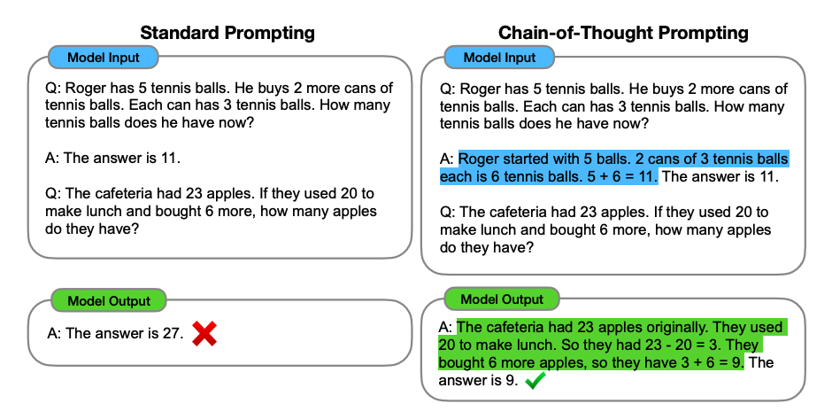
*Image Source: Wei et al. (2022)*

PaLM 540B: GSM8K math ~20% → ~60%; StrategyQA 69.4% → 75.6%; symbolic-reasoning tasks improve too. Like few-shot itself, it's an emergent ability of large models.

**Zero-shot CoT** (Kojima et al., 2022): append *"Let's think step by step."* No examples needed.

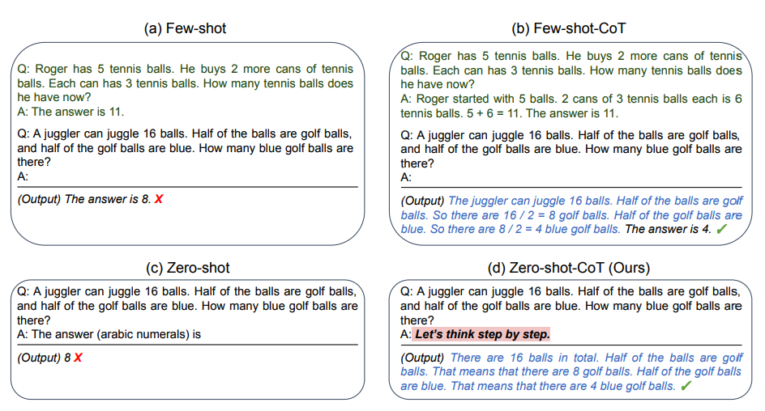
*Image Source: Kojima et al. (2022)*

**Plan-and-solve**: front-load a plan — *"Let's first understand the problem and devise a plan to solve the problem. Then, let's carry out the plan and solve the problem step by step."* Helps where zero-shot CoT skips steps. It uses no tools — it's closer to zero-shot CoT than to ReAct — but the two combine naturally: plan first, then run the think-act-observe loop.

**Auto-CoT** (Zhang et al., 2022): build the CoT examples automatically — cluster the questions, pick a representative from each cluster, generate its reasoning with zero-shot CoT. Diversity matters because hand-picked or generated demos can share the same mistakes. Simple heuristics (question ≤ 60 tokens, ≤ 5 reasoning steps) filter out bad demos.

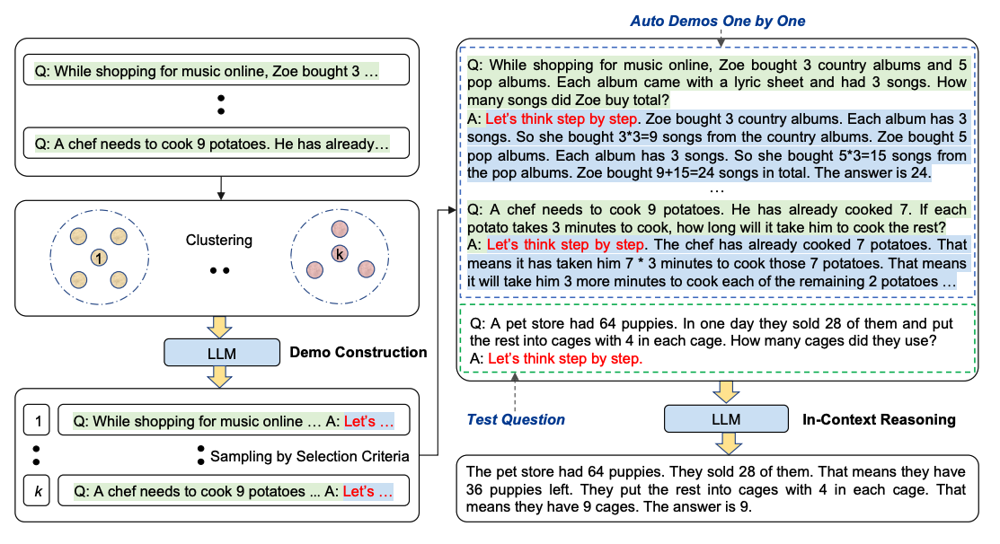
*Image Source: Zhang et al. (2022)*

Practical notes:
- **Put reasoning in a parseable place** — a `<thinking>` block or an `# Analysis` section before `# Conclusion` ([02](02-prompt-anatomy.md#choosing-the-document-type)) — so the app can strip it before showing the answer.
- **Reasoning must come first.** "Answer, then explain" gets you rationalization, not reasoning.
- Variants worth knowing by name: **pause tokens** (fine-tune on a meaningless "pause" token, then insert ~10 after the question: the extra positions give earlier information time to integrate, buying compute without words — the model's "uh, um"), **Multimodal CoT** (two stages — generate a rationale from text + image, then infer the answer from it; a 1B model beat GPT-3.5 on ScienceQA), **Graph prompting** (GraphPrompt, for graph-structured tasks — niche).

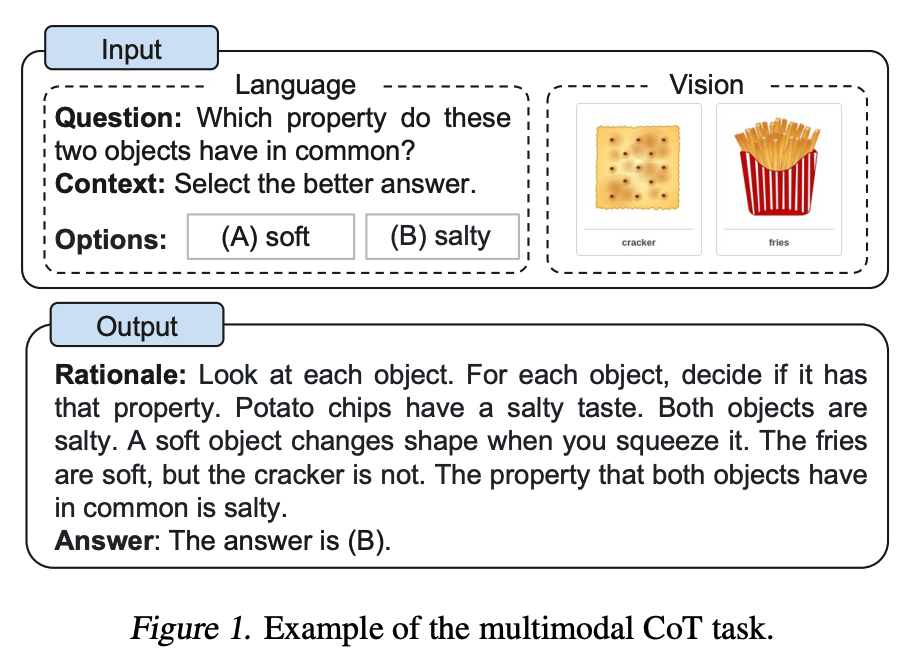
*Image Source: Zhang et al. (2023)*

---

## Self-consistency

Sample several CoT completions at non-zero temperature and take the **majority answer** (Wang et al., 2022). Replaces greedy decoding: different reasoning paths that converge on one answer are more trustworthy than any single path.

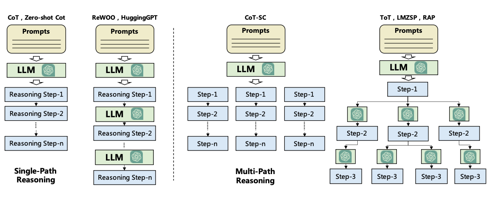
*Image Source: DAIR.AI, Introduction to AI Agents (task decomposition). Left: one reasoning chain. Middle: CoT-SC samples several chains and votes. Right: ToT branches at every step.*

Use it on arithmetic and commonsense tasks with a single extractable answer. It's N× the cost, and it doesn't help open-ended generation, where there's nothing to vote on. The same idea underlies **branch-solve-merge**: fan out to N solvers (high temperature or different assigned perspectives), then have a merge step synthesize the result.

---

## Generated knowledge

Two calls: first ask the model to generate facts relevant to the question, then answer with those facts in the prompt (Liu et al., 2022).

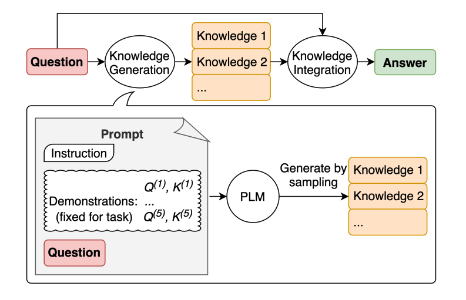
*Image Source: Liu et al. (2022)*

```
Input: Part of golf is trying to get a higher point total than others. Yes or no?
Knowledge: The objective of golf is to play a set of holes in the fewest number of strokes...
```

With knowledge, the answer flips from a confident wrong "Yes" to "No." It works by putting relevant facts *before* the reasoning. It doesn't add knowledge the model lacks — for that you need retrieval.

---

## Tree of Thoughts

Generalizes CoT into **search**: generate several candidate "thoughts" (intermediate steps), have the model **evaluate** each one (sure / maybe / impossible), and explore with BFS or DFS, backtracking from dead ends (Yao et al., 2023; Long, 2023). On Game of 24, GPT-4 with CoT solved 4% and with ToT 74%.

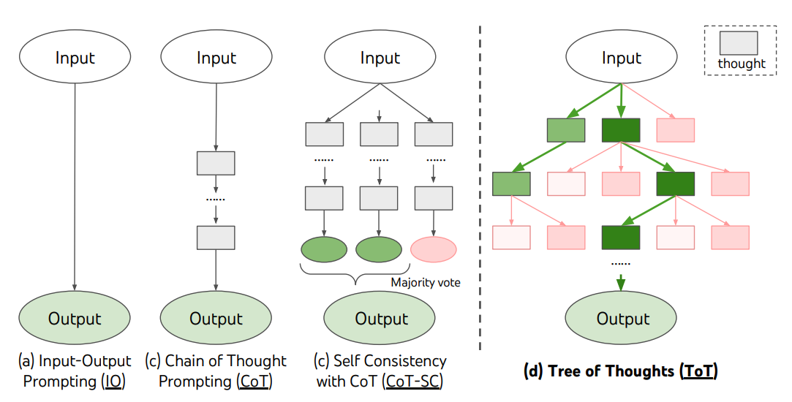
*Image Source: Yao et al. (2023)*

The Game of 24 results also show what buys the gain. Sampling more CoT chains helps only a little (CoT-SC with 100 samples: 9%; best of 100 CoT: 49%), while a breadth of 5 kept candidates at each step reaches 74%. Most CoT failures happen at the first step, which is exactly where ToT's evaluate-and-backtrack helps:

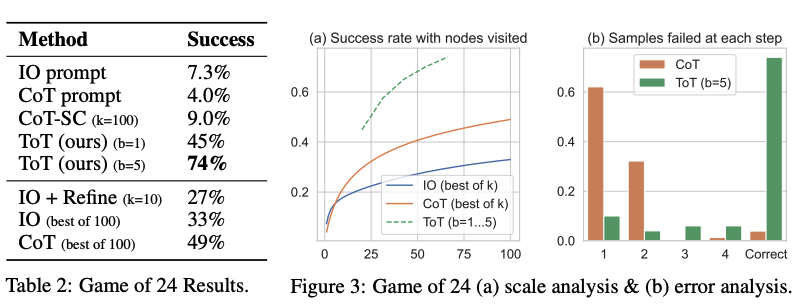
*Image Source: Yao et al. (2023), Table 2 and Fig. 3*

Both steps are ordinary prompts. On Game of 24, a *propose* prompt generates candidate next steps and a *value* prompt rates whether the remaining numbers can still reach 24:

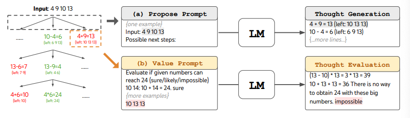
*Image Source: Yao et al. (2023)*

Real ToT needs a controller loop in code, so it's an orchestration pattern ([04-loop](../../04-loop-engineering/README.md)) more than a prompt. A cheap single-prompt approximation (Hulbert, 2023):

```
Imagine three different experts are answering this question.
All experts will write down 1 step of their thinking, then share it with the group.
Then all experts will go on to the next step, etc.
If any expert realises they're wrong at any point then they leave.
The question is...
```

---

## PAL — program-aided language models

The model writes code; an **interpreter** computes the answer (Gao et al., 2022). This moves exact computation out of the model, following the [tokens rule](01-how-models-read-prompts.md#property-1--tokens-not-characters): don't ask the model to do what code does reliably.

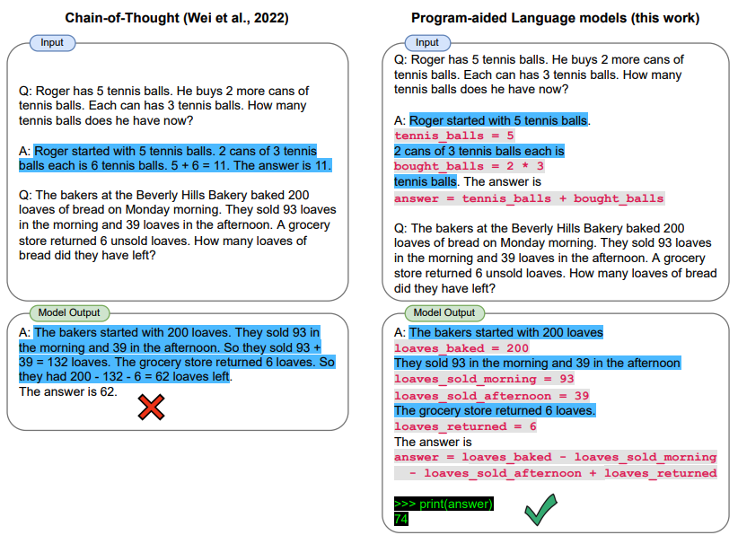
*Image Source: Gao et al. (2022)*

How it works: the few-shot examples are *code with the reasoning in comments*, so the model's completion is a program. Your app runs it and reads a variable:

```python
DATE_UNDERSTANDING_PROMPT = """
# Q: 2015 is coming in 36 hours. What is the date one week from today in MM/DD/YYYY?
# If 2015 is coming in 36 hours, then today is 36 hours before.
today = datetime(2015, 1, 1) - relativedelta(hours=36)
# One week from today,
one_week_from_today = today + relativedelta(weeks=1)
# The answer formatted with %m/%d/%Y is
answer = one_week_from_today.strftime('%m/%d/%Y')
# ...more examples...
# Q: {question}
"""
llm_out = llm(DATE_UNDERSTANDING_PROMPT.format(question=question))
exec(llm_out)    # the model wrote the program; Python does the date arithmetic
print(answer)    # Q: "Today is 27 February 2023. I was born exactly 25 years ago..." → 02/27/1998
```

`exec` on model output is only acceptable in a sandbox. DAIR's PAL notebook uses LangChain's legacy `OpenAI` completion class and `text-davinci-003`, both retired — swap in any current model. Today this is usually done with a code-execution tool rather than a hand-built prompt.

---

## ReAct — reason + act

Interleave **Thought → Action → Observation** steps so reasoning drives tool calls and tool results update reasoning (Yao et al., 2022). The original used three Wikipedia actions — `Search[entity]` (first 5 sentences of the matching page, or similar-entity suggestions if there's no exact match), `Lookup[string]` (the next sentence in that page containing the string) and `Finish[answer]` — set up by a preamble describing them plus ~6 worked traces.

```
Thought 1: I need to search Arthur's Magazine and First for Women, and find which was started first.
Action 1: Search[Arthur's Magazine]
Observation 1: Arthur's Magazine (1844–1846) was an American literary periodical...
Thought 2: Arthur's Magazine was started in 1844. I need to search First for Women next.
Action 2: Search[First for Women]
Observation 2: First for Women is a woman's magazine... started in 1989...
Thought 3: 1844 < 1989, so Arthur's Magazine was started first.
Action 3: Finish[Arthur's Magazine]
```

A trace that recovers from a miss — the failed `Search[Front Row]` returns suggestions, and the next thought picks the right one:

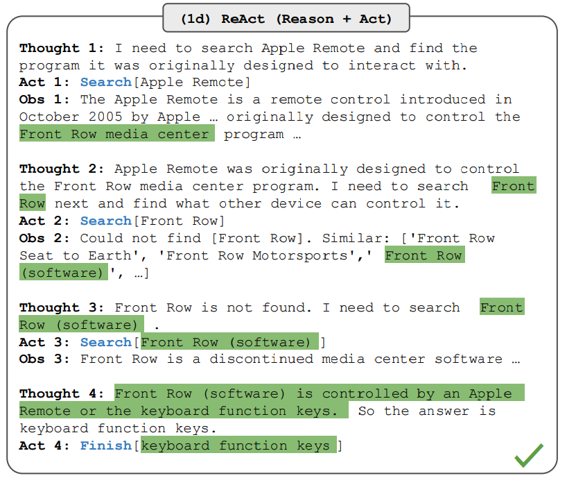
*Image Source: Yao et al. (2022)*

What the results show:
- **Knowledge tasks (HotpotQA, FEVER):** ReAct grounds answers in retrieved facts, so it hallucinates less than CoT. But it's more brittle: one uninformative search derails it. The best results combined them: **ReAct ↔ CoT-SC**, falling back from one to the other when it gets stuck or unsure (best: 35.1 EM on HotpotQA with ReAct → CoT-SC and 64.6 on FEVER with CoT-SC → ReAct, vs. 29.4 / 56.3 for CoT alone).

  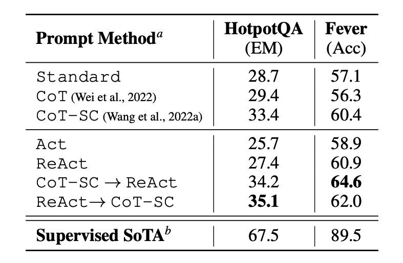
  *Image Source: Yao et al. (2022), Table 1*
- **With few-shot prompting alone, ReAct underperformed** standard and CoT prompting on HotpotQA at every model size. Fine-tuning on ~3,000 traces flipped that: a fine-tuned 8B ReAct beat a prompted 62B model, and a fine-tuned 62B beat a prompted 540B. Reasoning strategy plus light fine-tuning can stand in for scale. **Act** (tools, no Thought step) is worse than ReAct but still beats no tools.
- **Decision tasks (ALFWorld, WebShop):** reasoning is what makes acting work — 71% vs. 45% for Act-only on ALFWorld. There the thoughts decompose the goal into subgoals, inject commonsense, pull the useful detail out of observations, track progress and re-plan on exceptions.

The notebook's version is a few lines of LangChain — the framework supplies the ReAct prompt, parses `Action:` lines, runs the tool and appends `Observation:`:

```python
llm = OpenAI(model_name="text-davinci-003", temperature=0)
tools = load_tools(["google-serper", "llm-math"], llm=llm)   # web search + calculator
agent = initialize_agent(tools, llm, agent="zero-shot-react-description", verbose=True)
agent.run("Who is Olivia Wilde's boyfriend? What is his current age raised to the 0.23 power?")
```

`initialize_agent` and `text-davinci-003` are deprecated; current LangChain/LangGraph builds the same loop on native tool calling. ReAct is the ancestor of today's tool-calling agent loop. Modern APIs do the Thought/Action/Observation bookkeeping natively — see [05-tools-and-function-calling](05-tools-and-function-calling.md) and [03-harness](../../03-harness-engineering/README.md).

---

## ART — automatic reasoning and tool-use

Pick demonstrations of multi-step reasoning **and** tool use from a task library, run them with a frozen model, and **pause generation whenever a tool is called**, splice in its output, then resume (Paranjape et al., 2023). Beats few-shot and Auto-CoT on BigBench and MMLU. Humans can fix mistakes by editing the task library or adding tools. Today this is mostly what native tool calling does, so it's of historical interest ([05](05-tools-and-function-calling.md)).

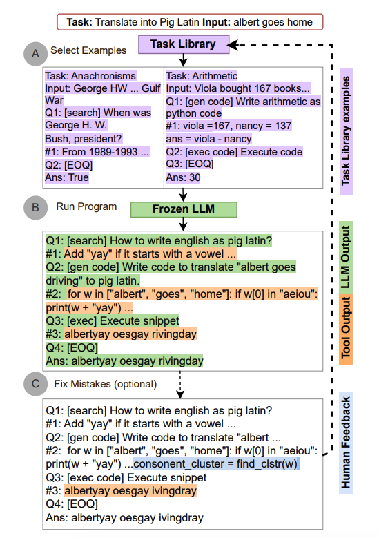
*Image Source: Paranjape et al. (2023)*

---

## Active-Prompt

Auto-CoT picks *representative* questions to annotate. Active-Prompt picks the *most uncertain* ones (Diao et al., 2023): sample k answers per training question, measure disagreement, have humans write CoT for the top-uncertainty questions, and use those as the examples. It's active learning applied to choosing few-shot examples.

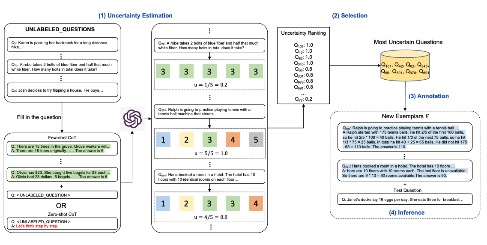
*Image Source: Diao et al. (2023)*

---

## Directional stimulus prompting

A small tuned **policy model** generates a hint (keywords, a "stimulus") that's added to the main LLM's prompt (Li et al., 2023). For summarization, the hint is a list of keywords to cover. The policy model is trained with supervised learning and RL, so a cheap model steers an expensive frozen one. It's a research pattern, but the idea of having a small model write part of the big model's prompt reappears in routing and query-rewriting.

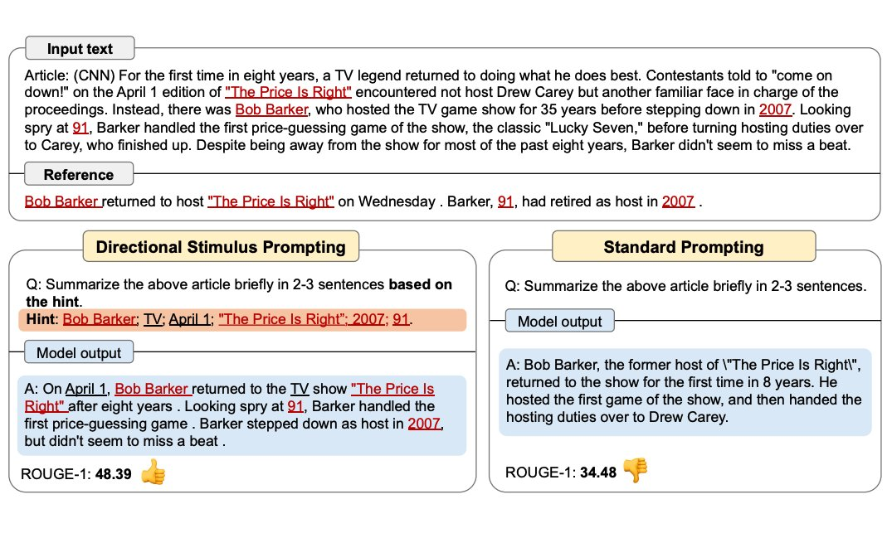
*Image Source: Li et al. (2023)*

---

## Reflexion

Verbal reinforcement learning (Shinn et al., 2023). Three parts:

| Component | Role |
|---|---|
| **Actor** | Produces actions/text (CoT or ReAct) |
| **Evaluator** | Scores the trajectory — exact match, heuristics, unit tests, or an LLM judge |
| **Self-reflection** | Turns the score into natural-language feedback, stored in memory for the next attempt |


*Image Source: Shinn et al. (2023)*

Loop: attempt → evaluate → reflect → retry with the reflection in context. HumanEval pass@1 reached 91% vs. GPT-4's 80% at the time. The gain depends on the evaluator: on HumanEval the model writes its own unit tests, and on the harder LeetCode set (15% vs. 7.5%) it still roughly doubles the baseline:


*Image Source: Shinn et al. (2023)*

**It works only when you get a do-over**, ideally with an objective evaluator (tests, compilers, checkers). It's useless for irreversible actions, and with a weak evaluator it reinforces confident mistakes. Memory is a sliding window, so long retry histories get truncated. Reflexion is a loop pattern; implementation lives in [04-loop](../../04-loop-engineering/README.md), and evaluator design in [09-evaluating-prompts](09-evaluating-prompts.md).

---

## Techniques covered elsewhere

- **Prompt chaining** → [06-chaining-and-workflows](06-chaining-and-workflows.md)
- **APE, meta-prompting, DSPy** → [08-prompt-optimization](08-prompt-optimization.md)
- **RAG** → [02-context](../../02-context-engineering/README.md)

---

## Go deeper

- Book (PDF): [Ch 5](../sources/prompt-eng-for-llms/reading/05-prompt-content.pdf) (few-shot drawbacks) · [Ch 8](../sources/prompt-eng-for-llms/reading/08-conversational-agency.pdf) (CoT, ReAct, plan-and-solve, Reflexion, branch-solve-merge)
- Papers for every technique on this page: [references.md](../README.md#technique-papers)
- Worked prompts: [prompt-library.md](prompt-library.md)

---

→ Next: [04-controlling-output.md](04-controlling-output.md) — sampling, stop sequences, structured output, and getting exactly the shape you want.
