# 3b — Chain-of-thought and reasoning techniques

> Reasoning prompts buy compute, and the evidence for them is uneven. Chain-of-thought gains are large on math and symbolic tasks and near zero elsewhere, and a chain that reads well does not prove the model used it.

[Note 03](03-core-techniques.md) covered zero-shot, few-shot and the tool and retry techniques. This chapter takes the techniques that make the model think before it answers: chain-of-thought and its variants, self-consistency, generated knowledge, Tree of Thoughts and program-aided models. Start with 03's "which technique when" table, then come here when the task is multi-step.

---

## Chain-of-thought

The model has fixed compute per token and no internal monologue ([01](01-how-models-read-prompts.md#property-2--autoregressive-no-lookahead-no-backtracking)). Without reasoning tokens, a yes/no answer is an intuitive guess, and any explanation after it is post-hoc rationalization. **CoT makes the model write the reasoning before the answer**, so the answer is conditioned on it.

Writing it first doesn't guarantee the answer depends on it. [Lanham et al.](https://arxiv.org/abs/2307.13702) (2023) found that on three of eight multiple-choice tasks a 175B model's chain changed the final answer less than 10% of the time, against more than 60% on AQuA, and on seven of the eight a 13B model changed its answer after the chain more often than the 175B model did. [Calibrating judges with checks and critiques](../../../generative-ai/08-eval/notes/14-calibrating-judges-with-checks-and-critiques.md#part-4-test-whether-a-critique-reports-what-drove-the-verdict) applies an edit test of this kind to a judge's critiques.

One fix is to build the chain so the answer can't skip it. **Selection-Inference** alternates two few-shot calls. Selection picks facts from the context by scoring each one's log-likelihood, because letting it generate the selection made up facts. Inference sees only the selected facts, not the question or earlier steps, and its output is appended to the context for the next round. With a frozen 7B Gopher model and 5-shot prompts on ten bAbI and ProofWriter tasks, it averaged 58.75% exact match against 2.94% prompting directly and 41.32% with a CoT-style prompt, and beat the 280B model with either (31.19% and 44.03%) ([arXiv:2205.09712](https://arxiv.org/abs/2205.09712) (Creswell et al., ICLR 2023); numbers from the arXiv v1 preprint). The lead shrank as ProofWriter proofs got deeper, which the authors partly put down to Selection, and the loop runs a fixed number of steps with no rule for when to stop. It is a [prompt chain](06-chaining-and-workflows.md#prompt-chaining) that trades extra calls for a trace you can check one step at a time.

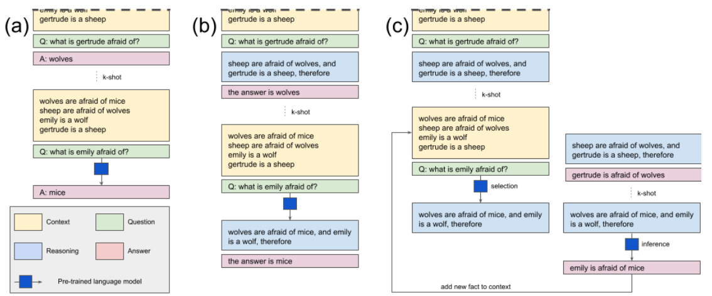
*Image Source: Creswell et al., [Selection-Inference: Exploiting Large Language Models for Interpretable Logical Reasoning](https://arxiv.org/abs/2205.09712) (2022), Fig. 1*

**Few-shot CoT** (Wei et al., 2022): examples show reason-then-answer.

The rationale-before-answer idea is older than prompting. Ling et al. trained a sequence-to-sequence model to write a natural-language rationale and only then pick one of five options, on about 100,000 algebra word problems, a third gathered from GMAT and GRE prep sites and the rest written by crowdworkers. It scored 36.4% on a 250-question test set where seq2seq baselines without the program machinery stayed near chance (20.2–20.8%), and it mostly solved one- or two-step problems ([arXiv:1705.04146](https://arxiv.org/abs/1705.04146) (Ling et al., ACL 2017)). The authors put the rationale first for the reason CoT does: generated before the answer, it is "a more faithful representation of the steps used in computing the answer" than an explanation written after. That was supervised training on human rationales with small LSTMs, not prompting.

Scratchpads came next. Nye et al. fine-tuned models to write intermediate steps between `<scratch>` tags before the answer. On 1–8-digit addition, models from 2M to 1B parameters solved the task with a scratchpad once past a critical size, and failed without one even at 1B. Only the scratchpad models could add 9- and 10-digit numbers, which were longer than anything in training. Prompted few-shot with four examples, a 137B model given a scratchpad rose from 8.8% to 20.1% on polynomial evaluation ([arXiv:2112.00114](https://arxiv.org/abs/2112.00114) (Nye et al., 2021-11, preprint)). The steps need enough data to learn: trained on only 374 programs, the scratchpad model predicted fewer program outputs correctly than direct prediction did (5% against 10%).

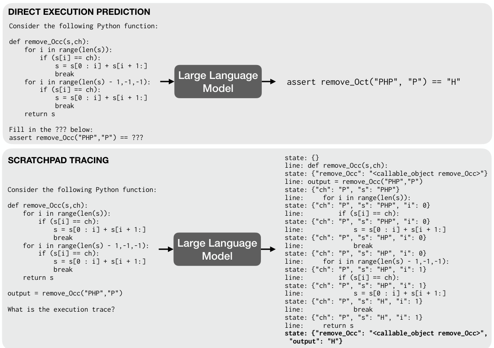
*Image Source: Nye et al., [Show Your Work: Scratchpads for Intermediate Computation with Language Models](https://arxiv.org/abs/2112.00114) (2021), Fig. 1*

```
Q: The odd numbers in this group add up to an even number: 4, 8, 9, 15, 12, 2, 1.
A: Adding all the odd numbers (9, 15, 1) gives 25. The answer is False.

Q: The odd numbers in this group add up to an even number: 15, 32, 5, 13, 82, 7, 1.
A:
```

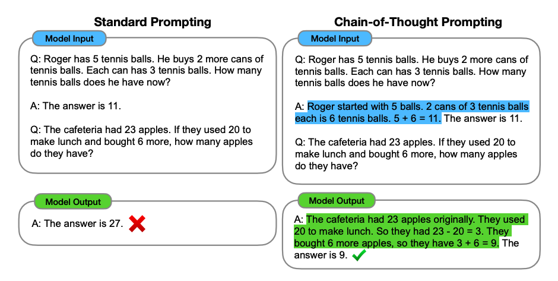
*Image Source: Wei et al. (2022)*

With PaLM 540B and 8 exemplars, GSM8K math rose from **17.9% to 56.9%**, past the prior best of 55% (a fine-tuned GPT-3 with a verifier). On StrategyQA, CoT reached 75.6% against a prior state of the art of 69.4%. Symbolic-reasoning tasks improve too. **The gain is an emergent ability of scale.** Below about 100B parameters, models wrote fluent but illogical chains and scored *below* standard prompting ([arXiv:2201.11903](https://arxiv.org/abs/2201.11903) (Wei et al., 2022-01)). A survey by the same group counts a technique as emergent when it "shows no improvement or is harmful" below some scale, and lists thresholds from 2020–2022 papers. CoT beat standard prompting on GSM8K only from about 100B parameters (LaMDA; 68B in the paper's Table 1), and zero-shot CoT and least-to-most from GPT-3 175B. Instruction tuning *hurt* LaMDA models of 8B or less on ten NLU tasks, while a fine-tuned scratchpad helped 8-digit addition from about 40M ([arXiv:2206.07682](https://arxiv.org/abs/2206.07682) (Wei et al., TMLR 2022)). The thresholds belong to those model families, not to the techniques. On 14 BIG-Bench tasks PaLM 62B was above random where GPT-3 175B was not, and later training brought instruction following down to 11B (T0) and 1.3B (InstructGPT). The authors also concede that exact-match scoring can hide steady gains in log-likelihood as a sudden jump. Our extrapolation: if you run a small model, check on your eval that CoT helps before you pay for it.

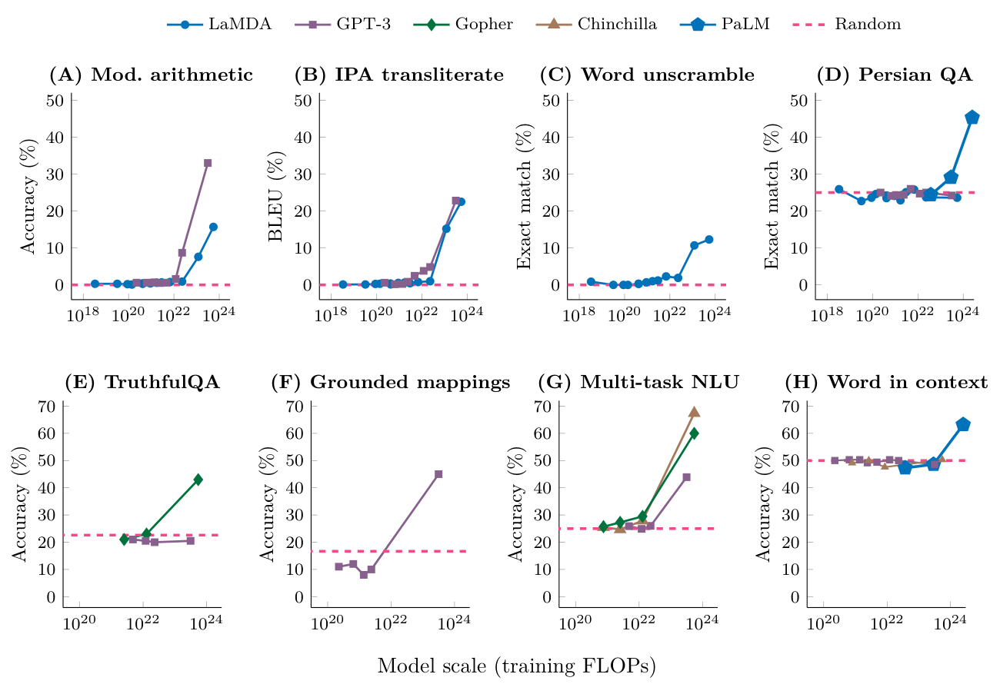
*Image Source: Wei et al., [Emergent Abilities of Large Language Models](https://arxiv.org/abs/2206.07682) (2022), Fig. 2*

**Zero-shot CoT** (Kojima et al., 2022): append *"Let's think step by step."* No examples needed. With text-davinci-002 it took MultiArith from **17.7% to 78.7%** and GSM8K from **10.4% to 40.7%**. That beat standard 8-shot prompting (33.8% and 15.6%) but stayed below 8-shot CoT (93.0% and 48.7%). It works in two calls. The first generates the reasoning. The second appends an extraction prompt such as *"Therefore, the answer (arabic numerals) is"* to pull out a parseable answer. **It doesn't help where there is no chain to write.** It made no difference on single-step arithmetic (SingleEq, AddSub) and lowered CommonsenseQA from 68.8% to 64.6% ([arXiv:2205.11916](https://arxiv.org/abs/2205.11916) (Kojima et al., 2022-05)).

**Most of the gain is in math and symbolic work.** Sprague et al. pooled 1,218 CoT-versus-direct comparisons from 110 papers (ICLR 2024, EACL 2024, NAACL 2024). Symbolic reasoning, math and logical reasoning gained 14.2, 12.3 and 6.9 points on average. Across all other categories, CoT averaged 56.8 against 56.1 without it. Their own zero-shot runs (20 datasets, 14 models from Llama 2 7B to GPT-4o and Claude 3.5 Sonnet) agree. Math rose from 22.6% to 50.2% on average, and symbolic tasks from 45.2% to 56.1%, while commonsense moved only from 74.8% to 75.7%. Even inside MMLU, "as much as 95% of the total performance gain from CoT on MMLU is attributed to questions containing '=' in the question or generated output." Where CoT does help, a tool helps more. Having the model write a plan and hand it to a Python solver beat CoT on GSM8K-Hard (few-shot, Llama 3.1 70B: 47.8% with CoT, 68.0% with plan plus tool; see [PAL](#pal--program-aided-language-models)). In the authors' words, "CoT appears to be a poor (but universal) approximation to such solvers" ([arXiv:2409.12183](https://arxiv.org/abs/2409.12183) (Sprague et al., 2024-09)). Spend CoT tokens on multi-step math and logic, and make it earn its cost anywhere else on your eval.

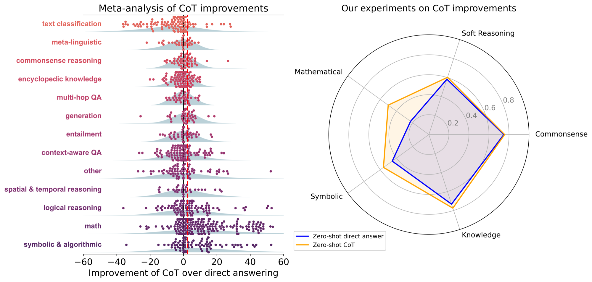
*Each dot on the left is one reported CoT-minus-direct delta. Only math, symbolic and logical reasoning sit clearly right of zero. Image Source: Sprague et al., [To CoT or not to CoT?](https://arxiv.org/abs/2409.12183) (2024), Fig. 1*

**A chain learned in training generalizes only near its training data.** Zhao et al. trained GPT- and LLaMA-style models from scratch (62K to 3B parameters) on synthetic letter transformations such as ROT-13 and cyclic shifts, then changed the task, the input length or the format at test time. Full-chain exact match was 100% in distribution, 0.01% on new combinations of transformations the model already knew, and 0% on unseen ones. A model trained on 4-letter inputs scored 0% on 3- and 5-letter inputs. Fine-tuned LLaMA3-8B and Qwen3-14B behaved the same way, reaching at most 8.52% on new combinations. The trace and the answer also came apart: on some shifts the model copied a familiar reasoning path and got the answer wrong, and on others it reached the right answer through a wrong path. The authors conclude that CoT reasoning "is effective when applied to (near) in-distribution data, but becomes fragile and prone to failure even under moderate distribution shifts" ([arXiv:2508.01191](https://arxiv.org/abs/2508.01191) (Zhao et al., Findings of ACL 2026)). The setup is CoT trained into small models on a toy domain, not CoT prompted from a general model, so read it as a warning, not a measurement of your model. Our extrapolation: a chain that reads well is not evidence the model can do the task on inputs unlike its training data, so put off-distribution cases in the eval.

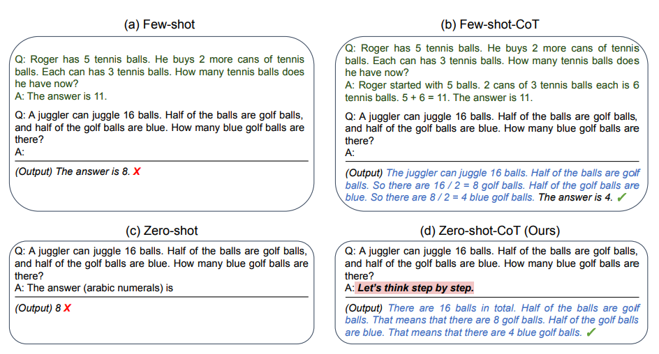
*Image Source: Kojima et al. (2022)*

**What in the demonstrations does the work, and where the chain breaks.** Four studies, all on 2020-2022 models, pull on the same question.
- **Longer exemplars beat shorter ones.** Fu et al. pick the 8 training chains with the most reasoning steps instead of hand-written ones. With code-davinci-002 and greedy decoding, GSM8K went from 61.0% to 66.6% and MathQA from 29.3% to 47.3%; with text-davinci-002 GSM8K went from 48.1% to 55.4%, an average gain of 5.3 points over three math sets for GPT-3 and 6.2 for Codex. Sampling 50 chains and voting over the top-K longest ones took Codex to 82.9% on GSM8K against 74.6% for voting over all chains of handwritten CoT. The gain vanished on 6.7B and 11B models, was -0.4 on Date Understanding with GPT-3 and +0.8 on StrategyQA with Codex, and retrieval beat it on MathQA (69.5% against 42.5%) because dev questions nearly repeat training ones. Single runs, no variance reported ([arXiv:2210.00720](https://arxiv.org/abs/2210.00720) (Fu et al., ICLR 2023)).
- **Demonstrations mostly teach the form, not the logic.** Wang et al. hand-wrote exemplars whose reasoning is invalid. With text-davinci-002 (greedy, 800 GSM8K test items) answer accuracy was 15.4% with standard prompting, 48.5% with CoT and 39.5% with invalid reasoning; the intermediate-object F1 was 43.9 against 48.3. On Bamboogle (125 items) answer F1 was 39.4 against 45.2. Corrupting the *relevance* of the steps to the question, or their *order*, hurt much more than invalid logic. The gap shrinks as the model brings more prior knowledge (Flan-PaLM was unaffected), and two tasks, single runs ([arXiv:2212.10001](https://arxiv.org/abs/2212.10001) (Wang et al., ACL 2023)).
- **Each step is usually valid; the failure is picking which one.** Saparov & He's PrOntoQA generates deduction problems from random ontologies (modus ponens only, up to 5 hops, a distractor sentence added) and parses every CoT sentence. With text-davinci-002 (8-shot, greedy, 400 examples per setting) 93.2% of steps in the 5-hop fictional setting were strictly valid and 5.9% invalid (the paper's three shares sum to 101.5%), yet proofs fell to chance at 5 hops top-down. In wrong proofs the first deviation is usually a valid step down the wrong branch. Self-consistency (40 samples) gave 0.56 valid-proof accuracy against 0.545, and in-context depth-first-search traces 0.55 (100 examples each), so neither fixed planning. Only text-davinci-002 beat chance, and only short, linear, synthetic proofs were tested ([arXiv:2210.01240](https://arxiv.org/abs/2210.01240) (Saparov & He, ICLR 2023)).
- **Fine-tuned models learn the same thing from rule text.** Clark et al. fine-tuned RoBERTa-large on synthetic facts and rules in English. It scored 99% on held-out theories, a model trained to depth 3 reached 97.6% on depth 5, but one trained to depth 2 got 71.1% on depth 3. Zero-shot on crowd-paraphrased rules the best model scored 66.6%, and 98.8% once trained on them. Deleting the one sentence a proof needs flipped the answer only 81% of the time, where a prover flips 100%. Small templated theories, trained models, not prompting, and the authors leave open whether it reasons or emulates the input-output behaviour ([arXiv:2002.05867](https://arxiv.org/abs/2002.05867) (Clark et al., IJCAI 2020)).

Practical reading: choose demonstrations that are long and on-topic, check intermediate steps and not only the answer, and expect a planning step (or search) to help more than extra samples when several moves are valid.

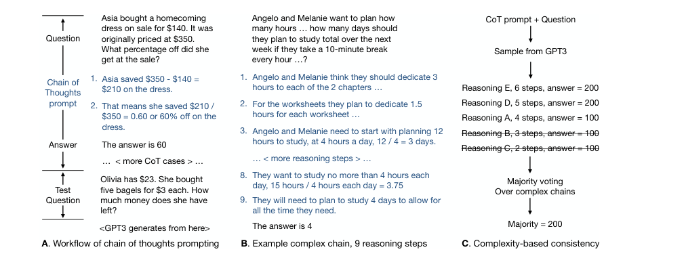
*Image Source: Fu et al., [Complexity-Based Prompting for Multi-Step Reasoning](https://arxiv.org/abs/2210.00720) (2022), Fig. 1*

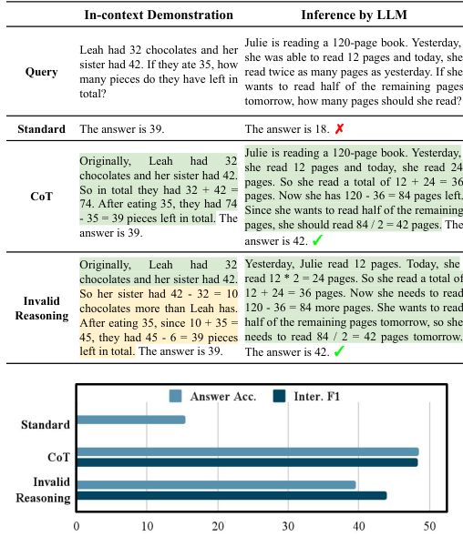
*Image Source: Wang et al., [Towards Understanding Chain-of-Thought Prompting: An Empirical Study of What Matters](https://arxiv.org/abs/2212.10001) (2022), Fig. 1*

**Plan-and-solve**: front-load a plan — *"Let's first understand the problem and devise a plan to solve the problem. Then, let's carry out the plan and solve the problem step by step."* Helps where zero-shot CoT skips steps. It uses no tools — it's closer to zero-shot CoT than to ReAct — but the two combine naturally: plan first, then run the think-act-observe loop.

**Least-to-most** goes one step further and makes the plan a separate call. The first prompt only decomposes the problem into an ordered list of subquestions. The second solves them one at a time, appending each answer before asking the next, so later steps build on earlier ones. Its exemplars show a base case and a recursive step, where CoT exemplars are independent. **It wins when the test problems are harder than the exemplars.** With code-davinci-002 and two exemplars of 2–3-word lists, last-letter concatenation of 12 words scored 74.0% against 31.8% for CoT. On the SCAN length split it scored 99.7% against 16.2%, with 14 exemplars. The gain is small where the test is no harder than the examples. On GSM8K, with a single-pass prompt holding one 2-step exemplar, it took CoT from 60.87% to 62.39% overall, mostly on problems needing five or more steps (39.07% to 45.23%; it was slightly worse on 2-step problems, 74.53% against 76.68%), and with separate, tuned decomposition and solution prompts it was no better than CoT (68.01% against 68.61%). The authors concede that "decomposition prompts typically don't generalize well across different domains" ([arXiv:2205.10625](https://arxiv.org/abs/2205.10625) (Zhou et al., ICLR 2023)). Two calls in sequence is a small [prompt chain](06-chaining-and-workflows.md#prompt-chaining).

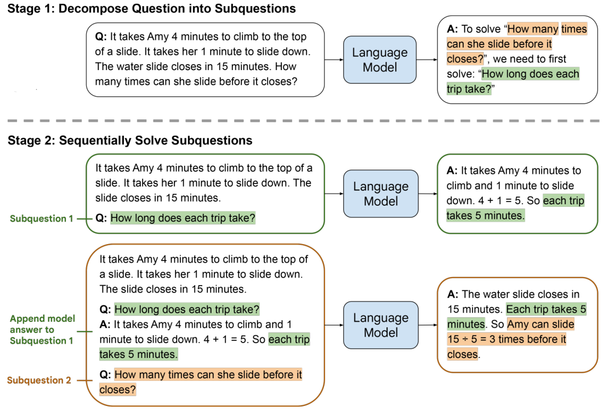
*Image Source: Zhou et al., [Least-to-Most Prompting Enables Complex Reasoning in Large Language Models](https://arxiv.org/abs/2205.10625) (2022), Fig. 1*

**Auto-CoT** (Zhang et al., 2022): build the CoT examples automatically — cluster the questions, pick a representative from each cluster, generate its reasoning with zero-shot CoT. Diversity matters because hand-picked or generated demos can share the same mistakes. Simple heuristics (question ≤ 60 tokens, ≤ 5 reasoning steps) filter out bad demos.

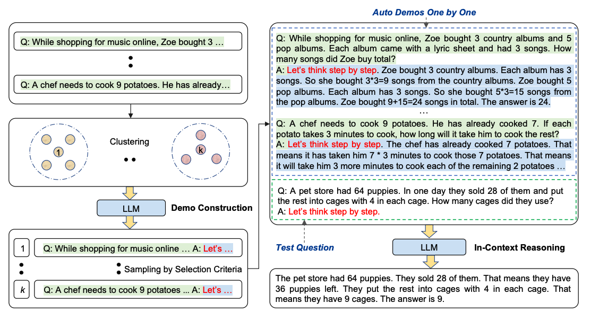
*Image Source: Zhang et al. (2022)*

Practical notes:
- **Put reasoning in a parseable place** — a `<thinking>` block or an `# Analysis` section before `# Conclusion` ([02](02b-document-types-formatting-and-templates.md#choosing-the-document-type)) — so the app can strip it before showing the answer.
- **Reasoning must come first.** "Answer, then explain" gets you rationalization, not reasoning. Forbidding the work costs most. On the 1,000 algebra word problems of DRAW-1K, ChatGPT (January–February 2023) gave only wrong answers or "No Solution" on 84% of problems when the prompt demanded "Just provide the final number", against 20% when it could show its work. Failure rose with the number of additions and subtractions in the problem ([arXiv:2302.13814](https://arxiv.org/abs/2302.13814) (Shakarian et al., AAAI-MAKE 2023)). Each condition ran once, and the answer-only prompt was long and insistent, so part of the gap may be the instruction itself.
- Variants worth knowing by name: **pause tokens** (fine-tune on a meaningless "pause" token, then insert ~10 after the question: the extra positions give earlier information time to integrate, buying compute without words — the model's "uh, um"), **Multimodal CoT** (two stages — generate a rationale from text + image, then infer the answer from it; a fine-tuned 738M model scored 90.5% on ScienceQA vs. ~76% for GPT-3.5 with CoT), **Graph prompting** (GraphPrompt, for graph-structured tasks — niche).

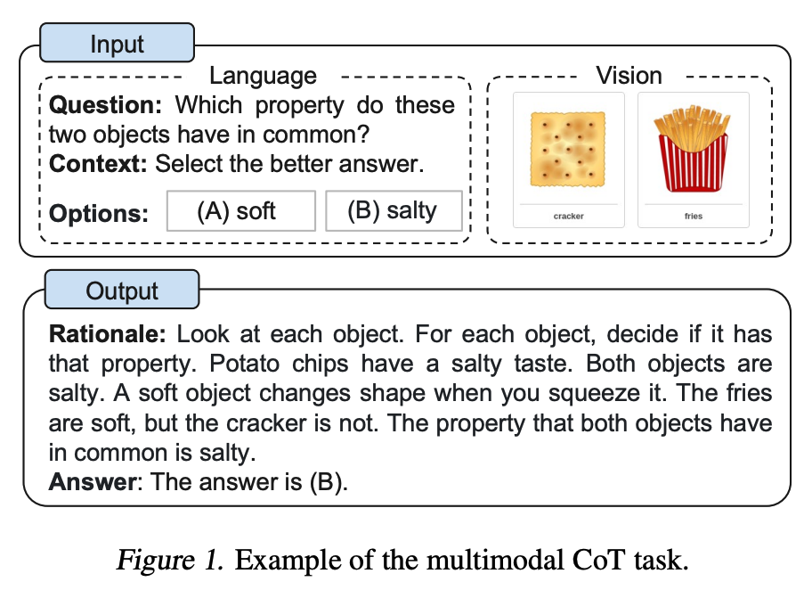
*Image Source: Zhang et al. (2023)*

The two-stage split exists because a one-stage chain hurt the small model. **A 200M text-only T5 fine-tuned on ScienceQA scored 81.63% answering directly and 69.32% writing the rationale first**: in 56% of 50 sampled errors the rationale hallucinated what the image showed. Adding image captions gained 0.8 points; fusing ViT image features into the encoder took the two-stage model from 78.57% to 85.31% ([arXiv:2302.00923](https://arxiv.org/abs/2302.00923) (Zhang et al., TMLR 2024)). The setup is fine-tuning, not prompting. Our extrapolation: when a chain has to reason about an image, give the reasoning step the image, not a caption of it.

---

## Self-consistency

Sample several CoT completions at non-zero temperature and take the **majority answer** (Wang et al., 2022). Replaces greedy decoding: different reasoning paths that converge on one answer are more trustworthy than any single path.

Xiao and Zhu write the vote as a formula and place it in a family. Sample N paths with temperature plus top-k or top-p, extract each final answer, and return the most frequent: â = argmax over a of Σₖ 1[Extract(yₖ) = a]. **Best-of-N** swaps the vote for a verifier score, ŷ = argmax over the N paths of v(x, y), so it is only as good as the verifier (a weak one is fooled by flawed logic that lands on the right answer). Both spend compute on width, and the book frames all test-time reasoning as search scaling with three questions: how to generate paths, how to search over steps, and how to check them. Two cautions, both stated without data: raising temperature buys diversity but lowers each path's quality, and search gains plateau because the model's capability sets a ceiling and path diversity falls as search effort rises. The claim that a smaller model with extra inference compute can beat a larger one answering at once is attributed to Snell et al. 2024 without numbers (*Foundations of LLMs*, ch. 6, §6.3). For verifiers see [agentic foundations 04c](../../../generative-ai/03-agentic-foundations/notes/04c-planning-architectures-and-failure.md).

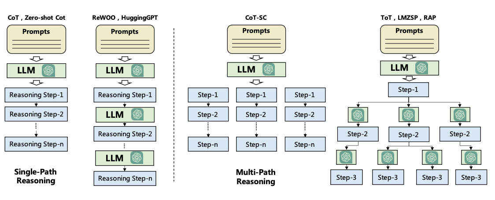
*Image Source: DAIR.AI, Introduction to AI Agents (task decomposition). Left: one reasoning chain. Middle: CoT-SC samples several chains and votes. Right: ToT branches at every step.*

Use it on arithmetic and commonsense tasks with a single extractable answer. The same vote works without chain-of-thought on classification: classify the same text three times and keep the most frequent label, which damps one-off misreadings at 3× the calls (*Prompt Engineering for Generative AI*, ch. 3). It's N× the cost, and it doesn't help open-ended generation, where there's nothing to vote on. The same idea underlies **branch-solve-merge**: fan out to N solvers (high temperature or different assigned perspectives), then have a merge step synthesize the result.

---

## Generated knowledge

Two calls: first ask the model to generate facts relevant to the question, then answer with those facts in the prompt (Liu et al., 2022).

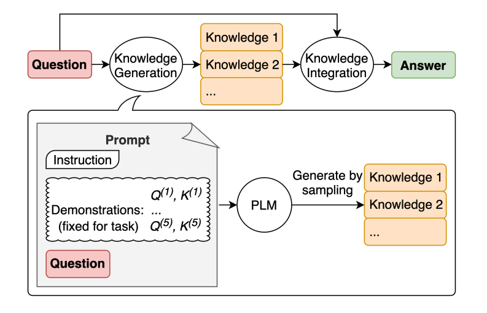
*Image Source: Liu et al. (2022)*

```
Input: Part of golf is trying to get a higher point total than others. Yes or no?
Knowledge: The objective of golf is to play a set of holes in the fewest number of strokes...
```

With knowledge, the answer flips from a confident wrong "Yes" to "No." It works by putting relevant facts *before* the reasoning. It doesn't add knowledge the model lacks — for that you need retrieval.

---

## Tree of Thoughts

Generalizes CoT into **search**: generate several candidate "thoughts" (intermediate steps), have the model **evaluate** each one (sure / maybe / impossible), and explore with BFS or DFS, backtracking from dead ends (Yao et al., 2023; Long, 2023). On Game of 24, GPT-4 with CoT solved 4% and with ToT 74%.

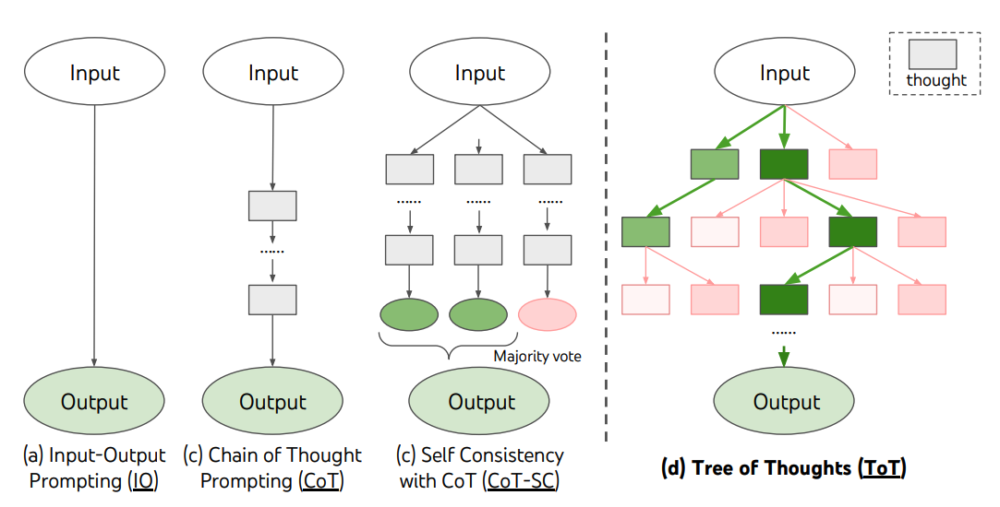
*Image Source: Yao et al. (2023)*

The Game of 24 results also show what buys the gain. Sampling more CoT chains helps only a little (CoT-SC with 100 samples: 9%; best of 100 CoT: 49%), while a breadth of 5 kept candidates at each step reaches 74%. Most CoT failures happen at the first step, which is exactly where ToT's evaluate-and-backtrack helps:

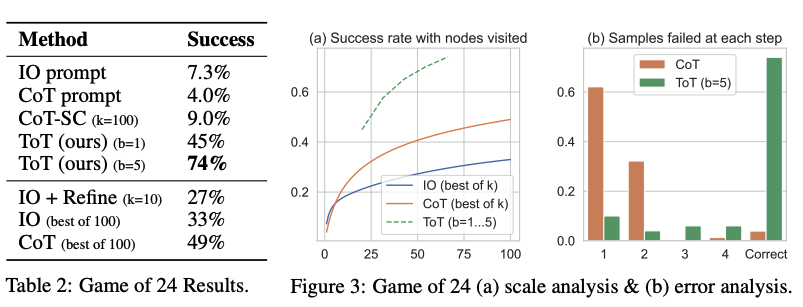
*Image Source: Yao et al. (2023), Table 2 and Fig. 3*

Both steps are ordinary prompts. On Game of 24, a *propose* prompt generates candidate next steps and a *value* prompt rates whether the remaining numbers can still reach 24:

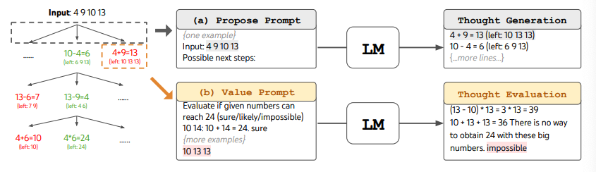
*Image Source: Yao et al. (2023)*

Real ToT needs a controller loop in code, so it's an orchestration pattern ([04-loop](../../04-loop-engineering/README.md)) more than a prompt. A cheap single-prompt approximation (Hulbert, 2023):

```
Imagine three different experts are answering this question.
All experts will write down 1 step of their thinking, then share it with the group.
Then all experts will go on to the next step, etc.
If any expert realises they're wrong at any point then they leave.
The question is...
```

---

## PAL — program-aided language models

The model writes code; an **interpreter** computes the answer (Gao et al., 2022). This moves exact computation out of the model, following the [tokens rule](01-how-models-read-prompts.md#property-1--tokens-not-characters): don't ask the model to do what code does reliably.

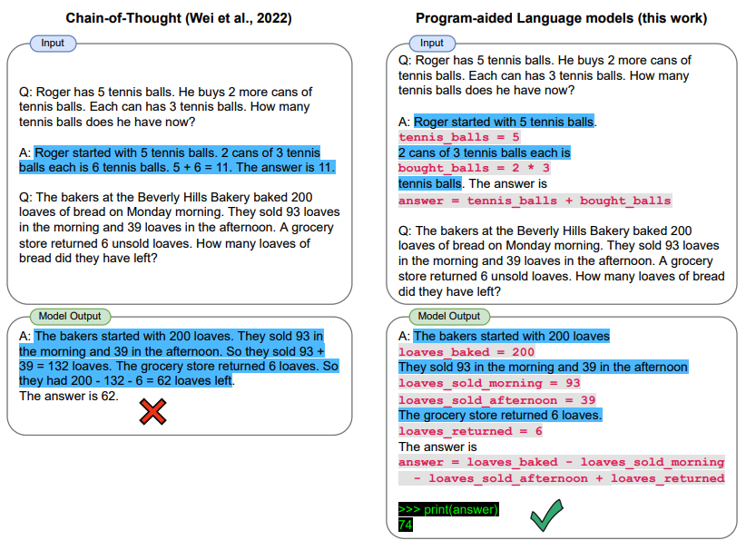
*Image Source: Gao et al. (2022)*

How it works: the few-shot examples are *code with the reasoning in comments*, so the model's completion is a program. Your app runs it and reads a variable:

```python
DATE_UNDERSTANDING_PROMPT = """
# Q: 2015 is coming in 36 hours. What is the date one week from today in MM/DD/YYYY?
# If 2015 is coming in 36 hours, then today is 36 hours before.
today = datetime(2015, 1, 1) - relativedelta(hours=36)
# One week from today,
one_week_from_today = today + relativedelta(weeks=1)
# The answer formatted with %m/%d/%Y is
answer = one_week_from_today.strftime('%m/%d/%Y')
# ...more examples...
# Q: {question}
"""
llm_out = llm(DATE_UNDERSTANDING_PROMPT.format(question=question))
exec(llm_out)    # the model wrote the program; Python does the date arithmetic
print(answer)    # Q: "Today is 27 February 2023. I was born exactly 25 years ago..." → 02/27/1998
```

The idea still pays with modern models. On GSM8K-Hard (GSM8K with larger numbers), having the model write a plan as code and running it in Python beat writing the arithmetic out as CoT (few-shot): 68.0% against 47.8% for Llama 3.1 70B, and 70.4% against 52.2% for GPT-4o Mini. On plain GSM8K, whose numbers are easier, CoT was slightly ahead (96.1% against 94.4% for Llama 3.1 70B) ([arXiv:2409.12183](https://arxiv.org/abs/2409.12183) (Sprague et al., 2024-09)).

`exec` on model output is only acceptable in a sandbox. DAIR's PAL notebook uses LangChain's legacy `OpenAI` completion class and `text-davinci-003`, both retired — swap in any current model. Today this is usually done with a code-execution tool rather than a hand-built prompt.

---

## More CoT variants

Twelve more variants report gains over plain CoT. They fall into three kinds: change the demonstrations, spend extra calls checking or voting, or add scaffolding before the answer. Every row is one run on a test set of 100 to 500 items (20 per run for AutoReason), mostly on GPT-3.5-class or 7B to 8B models, and only six were peer reviewed (the rest are preprints). Treat them as ideas to try against your own eval, with a baseline that gets the same number of calls.

| Variant | Idea | Result and setup | Catch |
|---|---|---|---|
| Contrastive CoT ([arXiv:2311.09277](https://arxiv.org/abs/2311.09277), Chia et al., 2023-11) | Show a wrong explanation beside each right one; build it by shuffling the numbers and entities in the right one | GPT-3.5-Turbo, 4-shot: GSM8K 69.2% to 79.0%, Bamboogle 40.8% to 56.8%, AQuA 53.5% to 57.5% | One model; no decoding settings or variance |
| Error-aware demonstrations ([arXiv:2410.16540](https://arxiv.org/abs/2410.16540), Cui et al., AISTATS 2025) | Demo = wrong path, why it is wrong, then the right path. Theory: a chain whose steps see the earlier ones has lower optimal loss than isolated steps | Gemini Pro, Tracking Shuffled Objects (7): 58.20% to 64.80%; temperature 0, 250 items, one run | The proof covers a one-layer linear-attention toy; wrong paths and explanations are handwritten; some cells flat or lower (GSM8K, DeepSeek 67B: 83.85% to 83.40%) |
| GeM-CoT ([arXiv:2310.06692](https://arxiv.org/abs/2310.06692), Zou et al., 2023-10) | When the task type is unknown, match each question to a demo pool by embedding; fall back to zero-shot CoT and add confident answers to the pool | Ten datasets, GPT-3.5-Turbo: 82.3% against 82.1% for Auto-CoT, 79.4% for zero-shot CoT. A pilot with mismatched demos fell from 78.0% to 19-27% | Gain over Auto-CoT is 0.2 points; the pool is seeded from the ten datasets |
| LoT ([arXiv:2309.13339](https://arxiv.org/abs/2309.13339), Zhao et al., LREC-COLING 2024) | After each step, write one review arguing it is true and one arguing it is false; if the false one wins, revise and regenerate the rest | Zero-shot, GPT-3.5-turbo GSM8K: 78.75% to 80.15%. A plain "double check" prompt scored 76.15% | Most gains are 0 to 3.5 points; Vicuna-7b AQuA fell 21.65% to 20.47%; extra calls per step, uncounted |
| RankPrompt ([arXiv:2403.12373](https://arxiv.org/abs/2403.12373), Hu et al., LREC-COLING 2024) | Sample 5 chains, then one call compares them step by step, with one auto-built comparison exemplar | gpt-3.5-turbo, mean of 8 tasks: 81.10% against 78.91% for majority voting and 76.03% for greedy CoT; AQuA 71.65% against 62.60% for voting and 58.51% for CoT | The CoT baseline is one sample, so only the voting row is matched; needs labeled questions for the exemplar; no gain on ARC |
| PEDAL ([arXiv:2408.08869](https://arxiv.org/abs/2408.08869), Prabhu, 2024-08) | Three prompts with different exemplars, one greedy answer each, an LLM call picks the final | SVAMP (300 items), Llama-3-8B 4-bit: 74.11% against 70.22% greedy and 72.99% for universal self-consistency; output tokens about 192 against 503 (Qwen2) | With Qwen2-7B universal self-consistency won (80.33% against 77.89%); more input tokens; two small datasets |
| Multi-expert prompting ([arXiv:2411.00492](https://arxiv.org/abs/2411.00492), Long et al., EMNLP 2024) | Have the model write 3 expert personas, answer as each, then merge them with a 7-step aggregation prompt | TruthfulQA, gpt-3.5-turbo-0613: 89.35% against 80.66% for the best baseline and 70.38% for zero-shot CoT | About 2,346 tokens per answer against 103 for zero-shot CoT; on reasoning multiple-choice sets it only matches CoT |
| Indirect reasoning, DIR ([arXiv:2402.03667](https://arxiv.org/abs/2402.03667), Zhang et al., COLING 2025) | Prove by contrapositive or contradiction as well as directly, then vote across both kinds of chain | LogiQA (179 questions, 16 chains, GPT-3.5-turbo): 36.3% against 29.1% for self-consistency | The indirect-only gap (ProofWriter, 50.7% against 17.3%) comes from subsets the authors picked; models rarely do it unprompted |
| Strategic CoT ([arXiv:2409.03271](https://arxiv.org/abs/2409.03271), Wang et al., 2024-09) | One prompt first states the strategy, then solves with it | Zero-shot, Llama3-8B GSM8K: 52.11% to 73.16%; mean +6.92 points over 8 datasets | Llama3-8B ARC fell 80.60% to 78.02%; output about 1.5 times as long; the workflow prompt is handwritten per domain |
| LM-guided CoT ([arXiv:2404.03414](https://arxiv.org/abs/2404.03414), Lee et al., LREC-COLING 2024) | A distilled 80M FLAN-T5 writes the rationale; a frozen 11B FLAN-T5 answers | 2WikiMultiHopQA exact match 0.506 against 0.40 for CoT, on 2,000 items, half that plain prompting got right and half it got wrong; CoT scored below plain prompting (0.50) | RL refinement added about a tenth of a point; the "large" model is only 11B |
| AutoReason ([arXiv:2412.06975](https://arxiv.org/abs/2412.06975), Sevinc and Gumus, 2024-12) | GPT-4 writes a reasoning decomposition for each question; GPT-3.5 answers with it | StrategyQA, GPT-3.5-Turbo: 76.6% against 70.3% CoT and 55.0% base; 20 questions per run, 3 runs | A stronger model is supplying the reasoning; GPT-4-Turbo on HotpotQA fell to 71.6% from 73.3% base |
| Hypotheses-to-Theories ([arXiv:2310.07064](https://arxiv.org/abs/2310.07064), Zhu et al., 2023-10) | Run CoT on training examples, keep the rules that recur and are usually right, prepend the library | GPT-4, base-16/11/9 arithmetic: 57.4% to 78.4%; CLUTRR 50.6% to 64.3%. Random rules cut CLUTRR to 9.9% | Needs a model that retrieves rules well and some training examples; GPT-3.5 gains on arithmetic are marginal (+3.3 with CoT, +2.9 even with GPT-4's rules); borrowed GPT-4 rules helped only with least-to-most prompting (+11.7) and on CLUTRR |

Two results are worth keeping from the table. First, incorrect implicit rules caused 65% of GPT-4's CoT errors on CLUTRR and 81% on base-16 arithmetic (100 test examples each), which is why a checked rule library helps where more sampling would repeat the same wrong rule. Second, the vote-or-compare variants (RankPrompt, PEDAL, multi-expert) replace [self-consistency](#self-consistency)'s majority vote with a model call, and each paper's own table shows a case where plain voting or CoT wins. Our extrapolation: add the extra calls only after a cost-matched baseline, such as the same number of self-consistency samples, loses on your eval.

---

## Pitfalls

- **Adding CoT everywhere.** Symptom: more tokens and no gain. Sprague et al. found 56.8 with CoT against 56.1 without across categories other than math, symbolic and logical reasoning, and Kojima saw CommonsenseQA fall from 68.8% to 64.6%. Fix: spend CoT on multi-step math and logic, and make it earn its cost elsewhere on your eval.
- **Trusting a chain because it reads well.** Symptom: a sound-looking chain with a wrong answer, or the reverse, as Zhao et al. saw under distribution shift. Fix: put off-distribution cases in the eval.
- **`exec` on model output outside a sandbox.** Symptom: arbitrary code runs with your app's permissions. Fix: PAL's approach needs a sandbox, and today usually a code-execution tool.

## Try it

1. A task's per-sample accuracy is 60%. Assuming samples are independent, what does self-consistency with 3 and 5 votes give? What if per-sample accuracy is 40%?
   <details><summary>Answer</summary>At 60%: 64.8% with 3 votes, 68.3% with 5. At 40%: 35.2% and 31.7%, so voting makes it worse. Voting amplifies whichever answer is already most likely, and real samples are correlated, so treat these as upper bounds on the gain.</details>

## Interview checklist

| Prompt | Answer in one line |
|---|---|
| How big are chain-of-thought's gains? | Large on math: Wei et al. took GSM8K from 17.9% to 56.9% with PaLM 540B. Near zero on commonsense: 74.8% to 75.7% in Sprague's runs, and small models scored below standard prompting. |
| Why does "Let's think step by step" use two calls? | The first generates the reasoning, and the second appends an extraction prompt such as "Therefore, the answer (arabic numerals) is" to get a parseable answer. |
| Why did Tree of Thoughts reach 74% on Game of 24 when 100 CoT samples got only 9%? | Most CoT failures come at the first step. Evaluating and backtracking fixes that, while sampling more chains doesn't. It needs a controller loop in code, so it is orchestration more than a prompt. |
| You have invoice math failing under CoT. CoT, self-consistency or PAL? | PAL, in a sandbox. On GSM8K-Hard, plan plus Python reached 68.0% against 47.8% for CoT with Llama 3.1 70B, and code is exact where voting only reduces noise. |

## Next

[Controlling output](04-controlling-output.md): sampling, stop sequences and structured output, to get the answer in exactly the shape your code expects.
