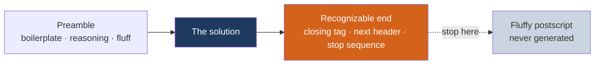
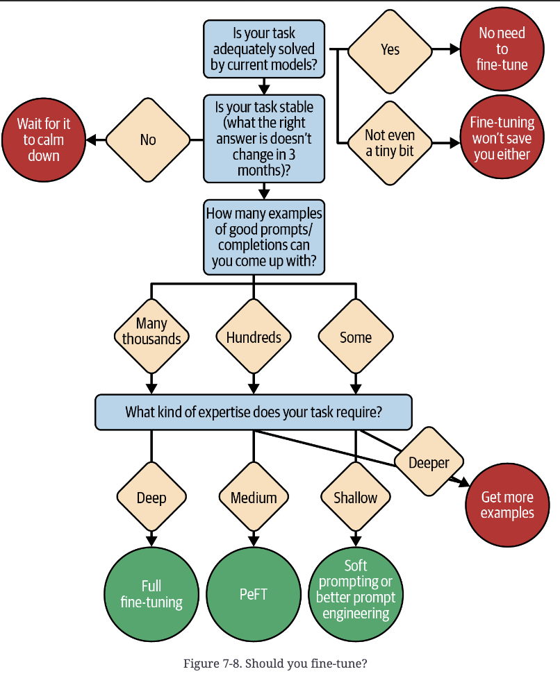

# 4 — Controlling Output

> Getting a completion your code can use: the right shape, the right length, a clean place to stop, and a signal of how confident the model was.

---

## Anatomy of the ideal completion



Every token *before* the solution costs latency and money. Nothing after the recognizable end matters if you stop generating there. So the job is to **shape the preamble** and **make the end detectable**.

| Preamble type | What to do |
|---|---|
| **Structural boilerplate** (an opening `{`, a heading) | Put it in the *prompt*. Cheaper, and it guarantees the format |
| **Reasoning** | Let it run long — this is CoT, and it buys correctness ([03](03-core-techniques.md#chain-of-thought)) |
| **Fluff** (disclaimers, "Great question!") | Few-shot examples that skip the intro, or an explicit "answer directly" instruction. Failing that, give it a slot: `1. [answer] 2. [caveats] 3. [background]`, then parse slot 1. A slot doesn't always kill the intro, so parse defensively |

---

## Sampling parameters

| Parameter | Effect | Typical use |
|---|---|---|
| `temperature` | Flattens (high) or sharpens (low) the next-token distribution. 0 ≈ always the top token | Low for extraction, classification, factual QA. Higher for brainstorming and creative writing |
| `top_p` (nucleus) | Sample only from the smallest set of tokens whose probability mass reaches p | Low = conservative. **Tune temperature *or* top_p, not both** |
| `max_tokens` | Hard cap on output length | Cost and latency control. A cut-off is not a stop — check the stop reason |
| `stop` | Strings that end generation server-side | The cheapest way to end on your recognizable end |
| `frequency_penalty` | Penalty grows with how often a token has appeared | Reduces word-level repetition |
| `presence_penalty` | Flat penalty on any token that has appeared | Pushes toward new topics. **Tune one penalty, not both** |

Caveats:
- **Temperature 0 is not deterministic** in practice (batching and floating-point effects). Tests need to tolerate variation or mock the model.
- **Reasoning models often fix or ignore these** — some don't accept temperature/top_p at all ([07](07-prompting-reasoning-models.md)).
- Provider support differs — penalties and logprobs are OpenAI-style features many APIs don't expose.

**Best-of-n:** generate n completions at moderate temperature and keep the best-scoring one. Rule of thumb from the book: `temperature ≈ sqrt(n) / 10`. At temperature 0, the n completions are identical.

**Beam search** is the decoding-side cousin: instead of committing token by token, it keeps several candidate continuations alive and looks a few tokens ahead so the model doesn't paint itself into a corner. Output is more globally coherent, but compute is much higher, so hosted APIs rarely expose it. Best-of-n is the version you control.

---

## Recognizable start and end

Decide up front how your parser will find the answer.

| Structure | Start | End | Plain substring stop? |
|---|---|---|---|
| Markdown section | the expected header | the next header (`\n#`) | Yes |
| Fenced code | ` ```lang\n ` | `\n```\n` | Yes |
| Numbered list, first item | `1.` | `\n2.` | Yes |
| XML | `<answer>` | `</answer>` | Yes |
| JSON / braced code | `{` | matching closing brace | No — count braces while streaming, or parse |
| YAML / indented languages (Python) | the key or `def` line | first line back at the starting indent | Partly — `\n` + a top-level token works if you know what comes next |

Stop-sequence tips:
- **Prefer stop sequences to streaming-and-cancel.** Stopping server-side wastes nothing; cancelling over the network always wastes some tokens.
- **Lead with a newline** (`\n#`, not `#`) so a `#` in a comment or phone number doesn't trigger a stop.
- Add *likely* continuations as extra stops — after a Python function, `\ndef` and `\nclass` are safe because method bodies are indented.
- **Use domain knowledge to sharpen stops.** If you know what *follows* the answer in this kind of document (the next section's header, the next field), stop on exactly that.

```python
resp = client.completions.create(          # legacy completions endpoint; chat APIs take `stop` too
    model=MODEL,
    prompt=prompt + "\n## Summary\n",      # boilerplate pushed into the prompt
    stop=["\n#"],                          # end at the next markdown header
    max_tokens=300,
    logprobs=1,                            # per-token logprobs, where the provider allows it
)
text = resp.choices[0].text
if resp.choices[0].finish_reason == "length":   # hit max_tokens, not the stop
    ...                                          # truncated: retry or discard
```

---

## Structured output

From weakest to strongest guarantee. Climb only as far as you need:


1. **Ask for it** — "Return JSON with keys `name`, `date`." Fine for prototypes, breaks at scale.
2. **Show it** — a schema or one complete example in the prompt. Matching the format of the prompt to the format you want also helps: markdown in, markdown out; prose in, prose out.
3. **Fence it** — XML tags (`<answer>…</answer>`) give an unambiguous parse target even inside a chatty reply.
4. **Prefill it** — start the assistant turn with `{` or `<answer>` so the model can only continue the structure. This is the book's "push boilerplate into the prompt" in chat form. **Some newer models no longer accept a prefilled last assistant turn** — check your model's docs, and use options 5–6 instead.
5. **Constrain it** — JSON mode or schema-constrained decoding (OpenAI Structured Outputs, Anthropic structured outputs, `strict` tool schemas). The decoder can't emit tokens that break the schema.
6. **Route it through a tool** — define a tool whose parameters *are* your output schema and require the model to call it ([05](05-tools-and-function-calling.md)).

A schema guarantees **shape, not truth**: a valid JSON object can still hold hallucinated values. Validate the content as well ([09](09-evaluating-prompts.md)).

Controlling *style* (Anthropic's guidance):
- Say what to do, not what not to do: "Write in flowing prose paragraphs," not "Don't use markdown."
- Explain why a constraint exists — a text-to-speech destination, a fixed-width display.
- Ask explicitly for the level of effort you want. Recent models do what's asked rather than going "above and beyond" unless prompted to.

---

## Logprobs: reading confidence

A logprob is the log-probability of each emitted token (0 = certain; `exp()` converts it to a probability). Where the API exposes them — some providers disable them, especially for newer models — they're your best instrument.

Reading the numbers: single-digit negatives are normal for free text; double-digit negatives mean something odd happened. Tokens near the *start* of a text run lower because the model has less context to go on. Expect jitter of about ±1 between identical calls (the same nondeterminism as temperature 0).

- **Quality score.** Average token probability over the completion (or its first tokens — what Copilot found most predictive). Use it to gate: show only high-confidence suggestions, warn on low ones, retry, add context, or escalate to a stronger model. The book's warning: **don't be like Clippy** — interrupting users with low-confidence output costs more trust than staying quiet.
- **Classification.** Use a format like `1. [positive | negative | neutral]` so the decision is the first token after a known start, then read the probabilities of each label.
  - **Prefix-collision pitfall:** in the book's region classifier, "Europe" scored 44% on the first token and `North` 55% — but `North` was split between North America (42%) and Northeast Asia (13%). Sampling picks `North`, then the less likely continuation can win, and the output is "Northeast Asia" when Europe was the single best label. **Give every label a distinct first token.**
  - **Calibration:** the model's 50% isn't your threshold. Shift per-label logprobs by constants fitted on labeled data (e.g. add 0.3 to "Yes" if the model under-calls it), using logistic regression or cross-entropy minimization to fit them. **Logit bias** applies the same shift at generation time where available.
- **Prompt debugging.** With `echo=true` (where supported), logprobs on the *prompt* flag surprising tokens: typos and odd phrasing show up as deep dips, below roughly −13.

---

## Choosing the model

The trade-offs, in rough order: **intelligence → speed → cost → ease of use → features** (tool use, logprobs, vision, context length) **→ special requirements** (open weights, data residency). Tightening one narrows the rest; cheap and very smart don't coexist.

- Match the model to the step, not the app: a small fast model for autocomplete, classification or routing; a frontier model for multistep reasoning; an open-weight model when data can't leave your infrastructure or you need logprobs the API hides.
- Put an abstraction layer between your code and the provider (for example [LiteLLM](https://docs.litellm.ai/)).
- Prototype on a slightly bigger model than you think you can afford. Prices fall, and your prompts will already be tuned for it.
- A prompt tuned for one model is not portable. Re-run your evals when you switch ([09](09-evaluating-prompts.md)).

---

## When prompting isn't enough: fine-tuning

Fine-tuning is prompt engineering by other means — moving what's in the prompt into the weights.

| Approach | Learns | Needs | Time |
|---|---|---|---|
| Full fine-tuning / continued pre-training | New facts, a new domain | Tens of thousands of examples | Weeks–months |
| LoRA (parameter-efficient) | *Which* existing behaviors to use; formats; priors | Hundreds–thousands | Days |
| Soft prompting | What a static prompt would say | Hundreds | Hours |

- **LoRA** freezes the base weights and trains small low-rank "diff" matrices. They're cheap to store, so one deployment can serve many LoRAs, one per customer or task. LoRA doesn't teach new tricks; it teaches *which* existing ones to use. It's good at shifting *priors*. In the book's example, a European travel app can bake "the customer is European" into the weights instead of stating it in every prompt. Trained on outcome data, it also picks up priors nobody wrote down: budget-conscious users reject "Monaco" but book after "Prague" suggestions.
- **Soft prompting** uses gradient descent over a few dozen example outputs to find an input *embedding* that reliably puts the model in the right "state of mind": a prompt made of vectors instead of words. It's the cheapest and fastest option, but many frameworks don't offer it.


*Image Source: Berryman & Ziegler (2024), Fig. 7-8*

Reach for it when the static part of your prompt is long, stable, and still not followed reliably — or when you have outcome data encoding preferences you can't articulate. The payoff: after continued pre-training or LoRA you can typically **drop the static context entirely** — instructions and examples now live in the weights, so prompts get shorter, cheaper and faster. Then **make the prompt look like the start of your fine-tuning documents**. If it resembles pre-training data instead, the model follows the old path (a modified Little Red Riding Hood principle).

---

## Go deeper

- Book (PDF): [Ch 7](../sources/prompt-eng-for-llms/reading/07-taming-the-model.pdf) (preamble types, logprobs, calibration, model choice, fine-tuning) · [Ch 2](../sources/prompt-eng-for-llms/reading/02-understanding-llms.pdf) (sampling, beam search)
- Vendor docs on structured outputs and sampling: [references.md](../README.md#vendor-guides)

---

→ Next: [05-tools-and-function-calling.md](05-tools-and-function-calling.md) — giving the model actions.
