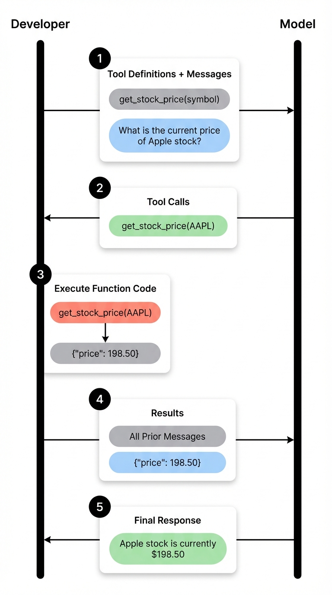
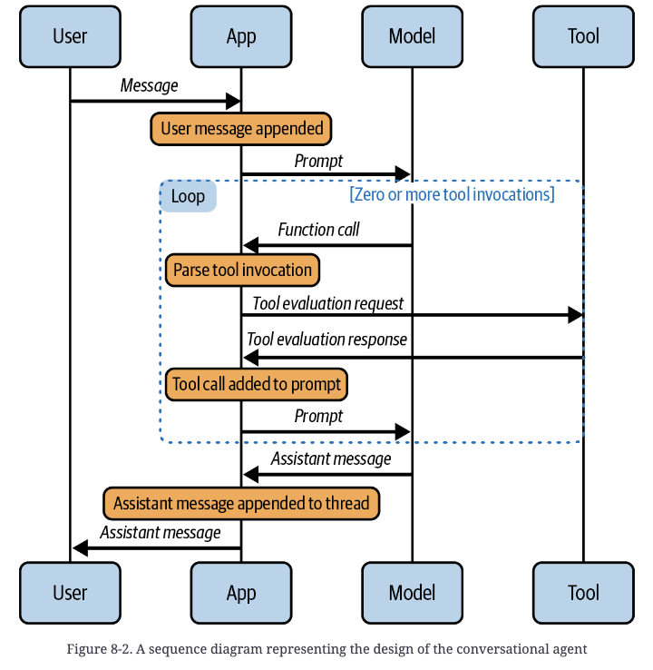

# 5 — Tools and Function Calling

> The prompt-side view of tools: how a tool definition becomes part of the prompt, and how to write one the model uses correctly. Designing the tool surface of a whole agent belongs to [03-harness-engineering/03-tool-design](../../03-harness-engineering/notes/03-tool-design.md).

---

## The loop

A bare chat model has no *agency*, meaning no ability to complete tasks on its own. It knows only its training data and what the user typed, it can't reach private or real-time information, it's unreliable at math, and it can only talk. Tools close that gap while keeping the chat experience.

The model never touches the world. It **proposes** a call, and your code **executes** it and appends the result.


*Image Source: promptingguide.ai*

```
messages + tools ──► model ──► tool_calls? ──no──► final answer
                       ▲            │yes
                       │            ▼
                       └── append {"role":"tool", tool_call_id, content} ◄── app runs the function
```

1. Define real functions.
2. Describe them as a JSON schema — `name`, `description`, typed `parameters`.
3. Keep a name → function lookup for dispatch.
4. Loop: send messages and tools → for each returned `tool_call`, parse its arguments, run the function, and append a `tool` message → send again. Stop when the reply has no tool calls.

The core of it, from the notebook (OpenAI Chat Completions; `gpt-3.5-turbo-1106` is retired, so use any current tool-calling model):

```python
tools = [{"type": "function", "function": {
    "name": "get_current_weather",
    "description": "Get the current weather in a given location",
    "parameters": {"type": "object", "properties": {
        "location": {"type": "string", "description": "The city and state, e.g. San Francisco, CA"},
        "unit": {"type": "string", "enum": ["celsius", "fahrenheit"]}},
        "required": ["location"]}}}]

msg = client.chat.completions.create(model=MODEL, messages=messages, tools=tools).choices[0].message
messages.append(msg)
for call in msg.tool_calls or []:                 # may be several: parallel calls
    args = json.loads(call.function.arguments)    # arguments arrive as a JSON *string*
    result = get_current_weather(**args)          # your code runs it, not the model
    messages.append({"role": "tool", "tool_call_id": call.id, "content": result})
final = client.chat.completions.create(model=MODEL, messages=messages, tools=tools)
```

Two knobs worth knowing:
- **`tool_choice`**: `"auto"` (default) lets the model decide, `"none"` forbids calls, and `{"type": "function", "function": {"name": "get_current_weather"}}` forces that tool. Forcing is how you get structured output via a tool ([04](04-controlling-output.md#structured-output)).
- **Parallel calls**: one reply can carry several `tool_calls` ("weather in London *and* Belmopan"). Answer every one, matched by `tool_call_id`, before calling the model again.

In a conversational agent, wrap that in an outer user-input loop. The book's `run_conversation` does it: take input, append it as a `user` message, run the tool loop, and only return to the user once the reply has no tool calls. The **observation** (tool result) becomes context for the next step, which is ReAct with the bookkeeping done by the API ([03](03-core-techniques.md#react--reason--act)).


*Image Source: Berryman & Ziegler (2024), Fig. 8-2*

The outer loop is what adds state across turns. In the book's thermostat agent, the model points out that 64°F is "actually quite cool" when the user says it's hot. It reads "LOTS cooler" as 50°F rather than something extreme. When asked to put things back, it restores the *original* 64°F, which it can do only by reading the earlier turns.

---

## Under the hood: it's still document completion

Tool calling is fine-tuning plus API sugar, not a new mechanism ([01](01-how-models-read-prompts.md)). The book's reconstruction of OpenAI's internal format:

- Tool schemas are rendered into the system message as **TypeScript-style declarations** in a `namespace functions {}` block, with descriptions as doc comments. Why TypeScript rather than raw JSON schema: it has a richer type vocabulary, doc comments attach naturally to functions and arguments, and named arguments make the model write each argument's name right before its value, which cuts mis-assignment.
- A call is just more tokens: `<|im_start|>assistant to=functions.set_room_temp\n{"temp": 76}<|im_end|>`.
- Results come back in a role created for the purpose: `<|im_start|>tool\nDONE<|im_end|>`. The API's `tool_call_id` is dropped internally once calls and results have been stitched together in order.

Token by token, the model makes a chain of decisions: *who speaks next* (forced by the API inserting `<|im_start|>assistant`) *→ tool or text? → which tool? → which argument? → what value? → done?* That's five or so hierarchical classifiers, run by one next-token predictor in 10–20 tokens. Every part of your definition — names, descriptions, enums — is prompt text that steers those decisions. **Writing a tool definition is writing a prompt.**

The book also notes the limits of that rendering (as of late 2023, OpenAI): `minimum`, `maximum`, `pattern`, `format`, `minItems` and nested descriptions **didn't make it into the internal prompt**. Validate constraints in code rather than relying on the schema to communicate them.

---

## Writing tool definitions

| Rule | Why |
|---|---|
| **Few tools that partition the domain** — cover the ground, don't overlap | Every extra tool is a distractor; overlapping tools force a coin flip |
| **Self-documenting names** (`get_current_weather`, not `retrieveemail`) | Unbroken lowercase is hard to tokenize and read. The book suggests camelCase for OpenAI, matching its TypeScript framing |
| **Descriptions say *when* to use it**, not just what it does | "Search the web for current information. Use when the user asks about recent events or data that may have changed since training." Keep them simple: legalese-style definitions overload the model's attention |
| **Mirror public APIs the model already knows** | Copilot found the model could recite GitHub's docs; matching argument names reduced errors |
| **Few, simple arguments; use `enum`s** | Complex parameter lists burn tokens and accuracy. Never paste a whole web API — design a simplified surface |
| **Avoid long free-text arguments in JSON** | Escaping newlines and quotes is error-prone at length. Claude's XML-style tool format handles this better |
| **Drop arguments the app already knows** | The model will invent plausible placeholders (`"my-org"`, `"my-repo"`) for values it can't see. If an argument must stay, give it a default your code can detect and fill in, or tell the model to ask when unsure (less reliable) |
| **Lean outputs whose shape the model can anticipate** | Say in the description what comes back, in free text or JSON. Don't pad results "just in case": it's noise in the next prompt |
| **Errors that teach** | Phrase errors in the tool's own terms ("`date` must be YYYY-MM-DD"), not raw stack traces, so the model can retry correctly |

Reinforce choices in the system prompt as well, e.g. "Prefer `knowledge_base` for company-specific questions before `web_search`." It seems redundant, but it helps when tools are close in purpose.

---

## Safety: gate in code, not in the prompt

"Always confirm with the user before booking" **will eventually be skipped.** Let the model request any call freely, then intercept side-effecting calls in the application layer and require explicit user approval showing the exact arguments. Tool results are also untrusted input — a fetched web page can carry instructions ([10-adversarial-prompting](10-adversarial-prompting.md#indirect-prompt-injection)). Execution boundaries in depth: [03-harness-engineering/04-execution-boundaries](../../03-harness-engineering/notes/04-execution-boundaries.md).

---

## Context for a tool-using agent

| Part | Contents |
|---|---|
| Preamble | System rules, tool definitions, optional examples |
| Prior conversation | Earlier turns plus attached **artifacts** (a flight list, a document) |
| Current exchange | The latest user message and the tool traffic it triggers |
| Agent response | The final message — usually the only part that stays in history verbatim |

There's no fixed recipe for this; the book's answer is "evaluate, evaluate, evaluate." Practical choices:
- **Expose only the tools relevant to the current state** of the conversation.
- **Which artifacts:** include everything (simple, but it can confuse the model) or have the model pick the relevant ones (more accurate, more code).
- **How to present them:** an `<artifact>` XML tag or an `## Attached Data` section. The format (JSON, plain text) doesn't seem to matter much. If every artifact came from a tool call, don't special-case them: leave the tool messages in history, where they also serve as tool-use examples.
- **Summarize large artifacts** rather than inlining the whole document. Use RAG over them, or a bulleted summary that points to a `details('section 5')` tool the model can call to expand a section (the authors proposed this but hadn't tested it).
- **Drop stale history** when the topic shifts: automatically after a period of user inactivity, or using a small, cheap model to judge relevance (a large one is overkill).

The trade-off cuts both ways. Too much context confuses the model and costs latency and money. Too little starves it.

Context selection is the subject of [02-context](../../02-context-engineering/README.md).

---

## Debugging tool calls

Log every step: the tool chosen, its arguments, the observation, and token counts. Most failures fall into four buckets:

| Symptom | Usual fix |
|---|---|
| Wrong tool chosen | Sharpen descriptions; remove overlapping tools; add a routing rule to the system prompt |
| Bad or invented arguments | Add enums and examples in the parameter descriptions; remove arguments the app knows |
| Tool not called when it should be | Say *when* in the description; check the tool is actually being passed |
| Observation misread | Simplify the output format; return less |

UX that helps (the book's recommendations):
- Keep the familiar chat layout, and always show a spinner while the agent works.
- Show tool activity distinctly, for example a "Tool calls" pill on the agent's message, instead of hiding it.
- Let users inspect each call and **edit its arguments and resubmit**, regenerating from that point. A derailed conversation becomes a quick correction.
- Gate side-effecting calls behind an **authorization card** that shows the exact arguments (destination, date, amount) above an "Authorize" button. This is the UI half of the gating rule in [Safety](#safety-gate-in-code-not-in-the-prompt).
- Show which artifacts the agent is attending to, so users can ask sharper follow-ups or dismiss the wrong one.

---

## Go deeper

- Book (PDF): [Ch 8](../sources/prompt-eng-for-llms/reading/08-conversational-agency.pdf) (internal format, tool guidelines, conversational agent, UX)
- Agent-level tool design, MCP, skills: [03-harness-engineering/notes/03-tool-design.md](../../03-harness-engineering/notes/03-tool-design.md)
- Vendor tool-use docs and benchmarks: [references.md](../README.md#vendor-guides)

---

→ Next: [06-chaining-and-workflows.md](06-chaining-and-workflows.md) — composing many prompts into a pipeline.
