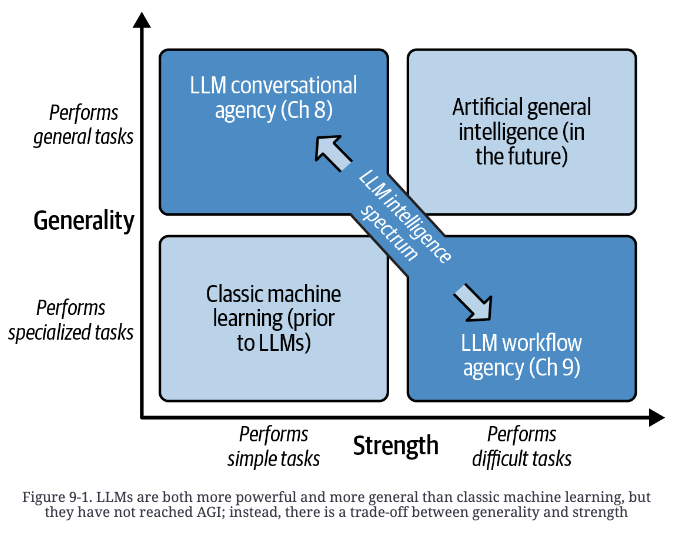
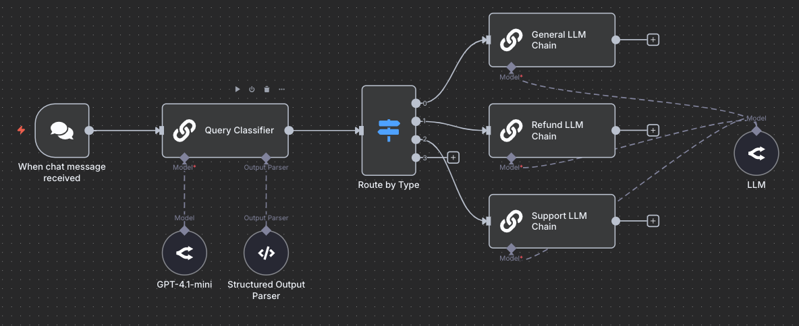
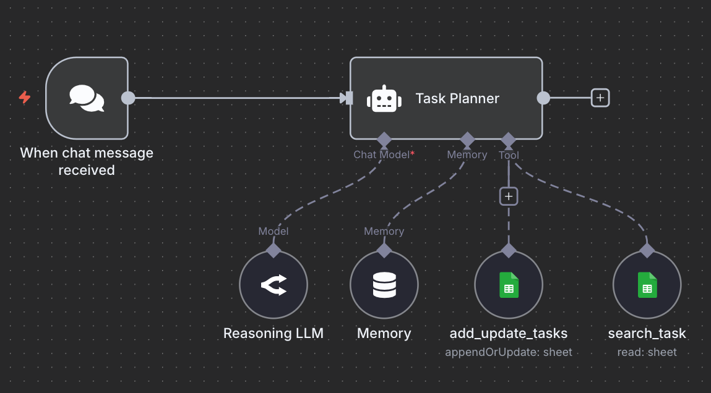

# 6 — Chaining and Workflows

> When one prompt can't do the job, split it. This note covers the patterns at the prompt level. Running them as long-lived loops is [04-loop](../../04-loop-engineering/README.md), and orchestrating agents is [03-harness-engineering/07-orchestration](../../03-harness-engineering/notes/07-orchestration.md).

---

## Why split

A single general prompt trades **strength for generality**: it will attempt anything, but it executes multi-step work poorly. A chat agent sits in the general/weak corner. Narrowing its system message and tools buys some strength, and a workflow goes all the way: one job, split into small tasks run with high fidelity, coordinated by a supervisor (LLM or plain code).


*Berryman & Ziegler, Fig 9-1.*

 The book's example (scrape Shopify stores → invent a plug-in per store → email the owner) degrades predictably as you push one agent at it:

- The system prompt grows until it distracts the model.
- There's no clean way to process work items one at a time.
- When a step fails, a system-prompt instruction is only a suggestion. There's no correction mechanism.

Splitting into steps buys back strength. Each prompt has one job, a short context, and an output you can check. It's also easier to debug, because a bad result traces to one step.

---

## Prompt chaining

The output of one prompt becomes the input of the next. The standard example is **document QA in two steps**:

```
Prompt 1 (extract)
  You are a helpful assistant. Given the document in <document></document>,
  extract the quotes relevant to the question. Output them inside <quotes></quotes>.
  If there are no relevant quotes, respond "No relevant quotes found!"
  <document>{{document}}</document>

Prompt 2 (answer)
  Given the quotes in <quotes></quotes> and the original document, compose an
  answer to the question. Be accurate, helpful, and well-written.
  <quotes>{{quotes}}</quotes>
  <document>{{document}}</document>
```

Each step can be tested and tuned separately, and you can add a third step (strip citations, translate, reformat) without touching the others. XML tags at the hand-off points make the parsing trivial ([04](04-controlling-output.md#structured-output)).

---

## Building a workflow — five steps

1. **Define the goal** — the output or change the workflow should produce.
2. **Specify tasks** — ordered steps, each with its tools, inputs and outputs.
3. **Implement each task in isolation** with defined I/O.
4. **Connect them** and adjust until they work together.
5. **Optimize** for quality, latency and cost.

**I/O contracts matter more than internals.** You can iterate on a step's prompt freely, but changing its input or output schema forces you to rearrange its neighbors. The book's email-generation task, for example:

| | Fields |
|---|---|
| **In** (plug-in concept) | `name`, `concept`, `rationale`, `store_id` (UUID, lookup key for store details) |
| **Out** (email) | `subject_line`, `body` |

Still sketch the *how* well enough to be confident the task is feasible, or you'll be back at the drawing board after implementing it.

**First question for every task: does it need an LLM?** Use plain code for scraping and writes, and a small classifier (BERT) for pure classification. LLMs are slow, costly and nondeterministic, so spend them only where they're needed. Mix model sizes too: a cheap model for easy steps, a frontier model for hard ones.

---

## Implementing an LLM task

| Approach | How | Use for |
|---|---|---|
| **Templated prompt** | Fill a template, parse the completion. A prefix and suffix bracket the output (`Dear {name},` … `We hope to hear from you soon,`), so the completion is *exactly* the body | Generation |
| **Forced tool call** | Define a tool whose parameters are the output schema; force it with `tool_choice` | Extraction into structured data |
| **Two-step with scratch work** | Brainstorm with CoT, then a clean step that writes up only the winner | Keeping reasoning out of the stored output |

A templated prompt for a completion model. The prefix ends mid-document and the suffix closes it, so the model can only fill in the letter:

```
# Research and Proposal Document
JivePlug-ins creates delightful and profitable Shopify plug-ins. ...
## Store Website Details
{storefront.details}
## Plug-in Concept
{plugin.description}
## Proposal to Storefront Owner
Dear {storefront.owner_name},
--- suffix ---
We hope to hear from you soon,
JivePlug-ins
```

The same idea in a chat framework is a message template (LangChain shown; its imports have since moved to `langchain_core` / `langchain_openai`):

```python
system = SystemMessagePromptTemplate.from_template(
    "You classify the sentiment of input texts. The labels you can use are "
    "{sentiment_labels}. Classify the following sentence:")
human = HumanMessagePromptTemplate.from_template("{user_input}")
chat_prompt = ChatPromptTemplate.from_messages([system, human])
chat.invoke(chat_prompt.format_prompt(
    sentiment_labels="positive, negative, and neutral",
    user_input="I am doing brilliant today!").to_messages())
```
*From DAIR's ChatGPT + LangChain notebook.*

A forced tool call for extraction. No database exists; the tool is only there to force the shape:

```json
{"type": "function", "function": {
  "name": "saveRestaurantDataToDatabase",
  "description": "Saves restaurant information to the database.",
  "parameters": {"type": "object",
    "properties": {"name": {"type": "string"}, "address": {"type": "string"},
                   "phoneNumber": {"type": "string"}},
    "required": ["name"]}}}
// request: "tool_choice": {"type": "function", "function": {"name": "saveRestaurantDataToDatabase"}}
```

If extraction fails, check two things. Is the source hard to parse even for a human? Then clean it. Is the target schema too big (many keys, nesting, nullable fields)? Then split it across several calls.

When quality is still short:
- **Force a planning pass.** Disable tool execution for one turn (`tool_choice: "none"`, keeping the tool specs) so the model reasons before acting.
- **Reflexion at the task level.** Check the output with a validator, tests or a judge; on failure, re-prompt with the requirements, the failed attempt and the critique ([03](03-core-techniques.md#reflexion)).
- **Conversational sub-agents** for open-ended tasks that don't fit one prompt or tool call: an "expert" agent does the work and a "user proxy" agent drives it toward the goal (the AutoGen pattern). Heavier; use it last.
- **Human-in-the-loop** for irreversible actions and for tasks that keep failing.

Reflexion and sub-agents cost a lot more compute. Try tightening the prompt first.

**Prompt functions** (DAIR) are the chat-UI version of the same idea: define a named function in the prompt (`function_name: trans_word`, `input: …`, `rule: …`), then call it, or chain several, by name. They're useful for personal workflows. In an application, write the function in code.

---

## Topologies

| Topology | Shape | Trade-off |
|---|---|---|
| **Pipeline** | A → B → C | Simplest. Information not passed along is lost downstream, so you get odd couplings |
| **DAG** | Fan-out and fan-in, no cycles | **Default choice.** Each task gets what it needs directly; dependency reasoning stays simple (the Airflow model) |
| **Cyclic** | Loops back on failure | Sometimes needed, but costly: you must carry the failure context back, every task must handle retried items, and you need an attempt cap. **Prefer hiding a retry loop inside a task** |

Run **batch** for a known set of items (simpler) and **streaming** for open-ended arrivals (lower latency, more complex). State machine, pub-sub and orchestrated graph are the same thing wired differently.

**Worked example (book's Shopify plug-in promoter, as a DAG):**

```
emit storefront HTML (code) ──► summarize storefront (LLM) ──┬──► generate plug-in concept ──► generate email ──► send (code)
                                                             └───────────────────────────────►┘
```

- *Summarize*: what they sell, tone, values, themes, anything praiseworthy.
- *Concept*: two steps. Brainstorm several ideas with CoT, then write a clean report on the best one, so the scratch work stays out of the stored output.
- *Email*: three steps. Plan a promotion strategy (CoT), then the subject line, then the body.
- The DAG edge sends the store details straight to the email step. In a pipeline they'd have to pass through the concept generator.

The optimization pass started by asking whether these were the right tasks at all. The run produced repetitive ideas (many virtual try-ons, many impact trackers), so the brainstorm needed diversity pressure and steering away from common patterns. It also needed a feasibility check, because not every idea can be built, and corrective feedback, either per task (Reflexion) or by sending failed items back to the start with the failure context.

---

## Workflow patterns (Anthropic's taxonomy)

| Pattern | What it does | Example |
|---|---|---|
| **Prompt chaining** | Sequential steps, with optional gates between them | Outline → check against criteria → draft |
| **Routing** | Classify the input, then send it to a specialized prompt or model | Support triage: billing / technical / general; small model for easy queries |
| **Parallelization** | *Sectioning* (independent subtasks) or *voting* (same task N times) | Content moderation on several axes at once; self-consistency ([03](03-core-techniques.md#self-consistency)) |
| **Orchestrator–workers** | An LLM splits the task dynamically and delegates | Multi-file code changes |
| **Evaluator–optimizer** | One prompt generates, another critiques, loop | Translation with a critic; Reflexion |


*Routing in a workflow builder (n8n): a small model classifies with a structured-output parser, and a switch sends each type to its own chain. DAIR, AI workflows vs. agents.*

---

## Workflows vs. agents

| | Workflow | Agent |
|---|---|---|
| Control flow | Predefined in code | Chosen by the model |
| Tool use | Orchestrated by code | Selected by the model |
| Predictability | High | Lower |
| Good for | Well-defined, repeatable tasks; production reliability; cost control | Open-ended tasks where the steps can't be known up front |


*An agent: the model, memory and tools hang off one node, and the model decides the order. DAIR.*

**Start with a workflow.** Move to agentic routing only when fixed topologies can't express the problem. Most production systems are hybrids: a workflow routes requests to agents that handle the open-ended subtasks.

The advanced end puts an LLM in charge of routing, trading stability for flexibility:

- **Workflow as agent.** The supervisor is a chat agent whose tools are the tasks. Push further and make each task an agent too (agent of agents). Give each nested agent a `finish` tool so it submits a definite output instead of chatting forever. At the far end, the supervisor writes new tasks on the fly (system message plus tools picked from a pool) and keeps reprioritizing a work list.
- **Stateful task agents.** Each agent owns one work item, such as one source file in a "build a website" workflow, and keeps it consistent as related items change, notifying the agents that depend on it. Watch for circular dependencies, which mean the workflow never stops. Bonus: you can talk directly to the agent that owns an asset.
- **Roles and delegation.** AutoGen pairs an **Assistant** with a **UserProxy** that holds the goal, keeps the Assistant on track and declares success; a group-chat manager delegates among several role agents. CrewAI gives each agent a role, goal, backstory and tools, and runs them `sequential` (pipeline), `hierarchical` (manager delegates) or `consensual` (peer negotiation, unreleased when the book was written).

**Try it (book exercise):** build the UserProxy/Assistant pair without a framework, say for a command-line Python math tutor. Give the `CodeAssistant` file-write and test-run tools but no knowledge of the goal. Give the `UserProxy` no tools and a clear statement of the goal. Do they converge, drift, or spiral into "thanks again!" pleasantries? Building it by hand teaches more than adopting a framework.

Orchestration at scale is covered in [03-harness](../../03-harness-engineering/notes/07-orchestration.md) and [04-loop](../../04-loop-engineering/README.md).

---

## Operating a workflow

- **Evaluate per task before end-to-end.** Modularity is the point — a failure usually lives in one task ([09](09-evaluating-prompts.md)).
- Collect each task's real inputs and outputs. They become the offline test set and the training data for prompt optimizers like DSPy ([08](08-prompt-optimization.md)).
- Run that set as a regression harness before shipping any prompt change (TextGrad also optimizes against it).
- In production, sample traffic for quality drift and A/B test competing task implementations.

---

## Go deeper

- Book: [Ch 9 PDF](../sources/prompt-eng-for-llms/reading/09-llm-workflows.pdf) (full Shopify build and prompts)
- Anthropic, *Building Effective Agents*, and the chaining docs: [references.md](../README.md#vendor-guides)

---

→ Next: [07-prompting-reasoning-models.md](07-prompting-reasoning-models.md) — what changes when the model thinks for itself.
