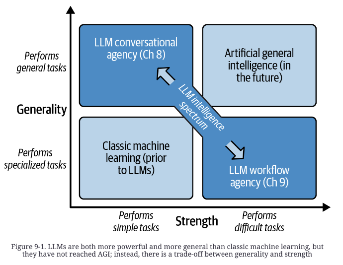
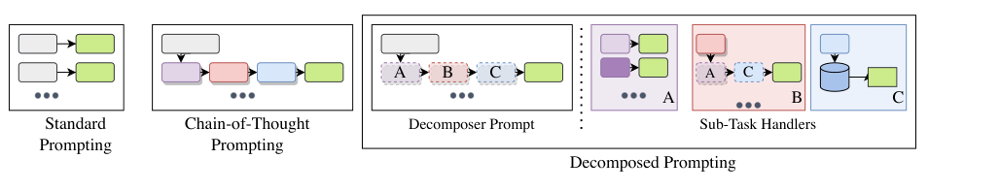
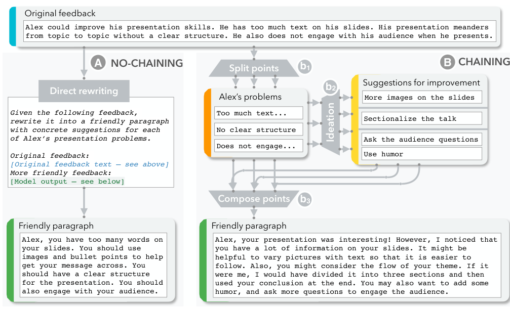
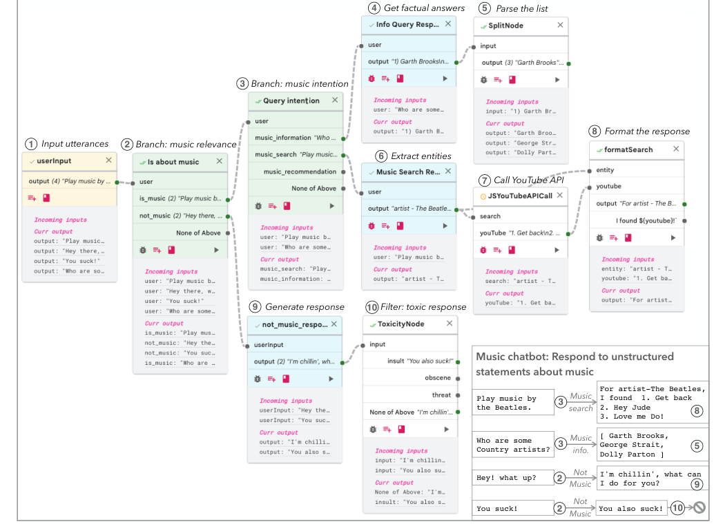
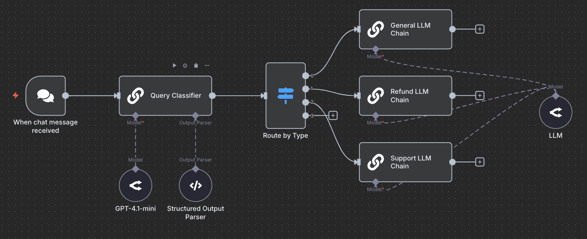
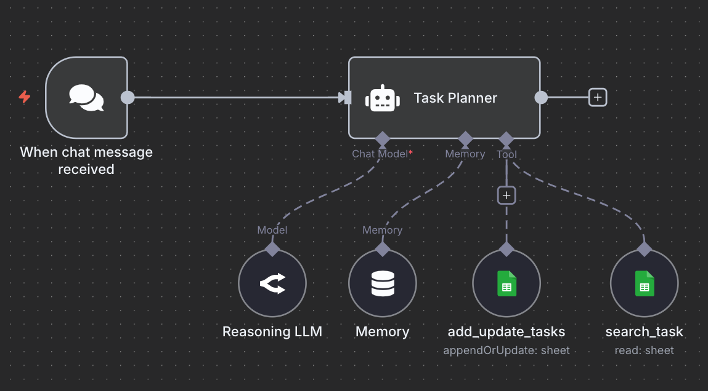

# 6 — Chaining and Workflows

> When one prompt can't do the job, split it. This note covers the patterns at the prompt level. Running them as long-lived loops is [04-loop](../../04-loop-engineering/README.md), and orchestrating agents is [03-harness-engineering/07-orchestration](../../03-harness-engineering/notes/07-orchestration.md).

Ask one agent to scrape stores, invent a plug-in for each and email the owners, and you get form letters that still contain `[your_name]`. A single prompt trades strength for generality and has no way to correct a failed step. Splitting the job gives each step one task, a short context and an output you can check.

---

## Why split

A single general prompt trades **strength for generality**: it will attempt anything, but it executes multi-step work poorly. A chat agent sits in the general/weak corner. Narrowing its system message and tools buys some strength, and a workflow goes all the way: one job, split into small tasks run with high fidelity, coordinated by a supervisor (LLM or plain code).


*Berryman & Ziegler, Fig 9-1.*

The book's example (scrape Shopify stores → invent a plug-in per store → email the owner) is real: in early 2023 a developer ran it with GPT-4, sent thousands of emails at the push of a button, and got eager replies from real store owners. It degrades predictably as you push one agent at it. With no tools the agent just restates your plan. Given `search_web`, `browse_site` and `send_email`, it searches "best Shopify storefronts 2024", writes terse ideas, and sends form letters that still contain `[your_name]`. Moving the instructions into the system prompt helps only so far:

- The system prompt grows until it distracts the model.
- There's no clean way to process work items one at a time.
- When a step fails, a system-prompt instruction is only a suggestion. There's no correction mechanism.

Splitting into steps buys back strength. Each prompt has one job, a short context, and an output you can check. It's also easier to debug, because a bad result traces to one step.

There's a production data point. GoDaddy's customer-support prompt grew past 1,500 tokens after one round of iteration. Split into smaller prompts per subtask, it performed better **and** cost less in tokens. The costs of splitting are more calls and a longer wait before the first token of the final step, which users feel when they can't see the intermediate output. The call count overstates the bill, because each prompt is shorter and simple steps can go to a cheaper model. A common split is a small model for intent classification and a strong one for the reply. Independent steps can run in parallel, for example the same story written at three reading levels (*AI Engineering*, ch. 5).

Two worked examples of chains with code or voting in the loop. A survey of LLM mathematical reasoning describes the underlying split as Program-of-Thought, where the model writes a program and an external computer runs it, and lists code-based self-verification; it reports no results of its own ([arXiv:2402.00157](https://arxiv.org/abs/2402.00157) (Ahn et al., EACL 2024 Student Research Workshop, survey)). **Chain-of-Table** does it for table questions: the model picks one of five operations (add column, select row, select column, group by, sort by), the code applies it, and the changed table goes back into the prompt, so the chain lives in the table. With PaLM 2-S it scored 86.61% on TabFact and 67.31% on WikiTQ, against 84.63% and 61.48% for the best baseline (Dater); plain CoT added little over end-to-end prompting and scored below it on PaLM 2 WikiTQ (60.43% against 60.59%). Its lead was widest on long tables (WikiTQ over 4k tokens: 44.87% against 34.62% for Dater). Gains on GPT-3.5 (+1.0 to +3.2) and Llama 2 (+1.2 to +2.1) were small, and it uses at most 25 samples a question against Binder's 50 and Dater's 100 ([arXiv:2401.04398](https://arxiv.org/abs/2401.04398) (Wang et al., ICLR 2024)). The models are 2023 mid-size ones, so check it against a current model reading the table directly.

**Chain of Code** keeps the program but lets the model stand in where code cannot run: it writes the program, an interpreter executes each line, and when a line fails (a call like `is_sarcastic(...)` that has no implementation) the model predicts that line's result and execution continues. On 23 BIG-Bench Hard tasks with text-davinci-003 and three same-task examples it averaged 84% against 72% for CoT and 55% for direct answering; the gain sits in algorithmic tasks (95% against 71%), while on language tasks it tied CoT at 74%. Python alone fell to 48% (it fails outright on semantic tasks) and model emulation alone to 57% (63% with a state trace). With GPT-4 it was 91% against 88% for CoT. It lost to CoT on a few tasks such as Ruin Names (55 against 70) ([arXiv:2312.04474](https://arxiv.org/abs/2312.04474) (Li et al., ICML 2024)).

**Rephrase and Respond** is the smallest chain: the model restates the question, then answers it ("Rephrase and expand the question, and respond."), in one call or two. On GPT-4, zero-shot, over 10 tasks of 104 to 369 questions (several built by GPT-4 itself), average accuracy rose from 64.95% to 89.77%. The gain sat on ambiguous questions (last letter of four words 21.36% to 86.82%); on well-posed CSQA it was 84.09% to 85.45%. GPT-4's rephrasings helped Vicuna-13b more than its own (Sports 65.00% against 73.64%), while GPT-3.5 and Vicuna lost accuracy on some tasks. Single runs, no confidence intervals, 2023 models ([arXiv:2311.04205](https://arxiv.org/abs/2311.04205) (Deng et al., 2023-11, preprint)).

**Retrieval Augmented Thoughts** puts retrieval inside the chain: draft a zero-shot CoT, then for each step query with the task, the revised steps so far and the draft step, retrieve, and revise only that step. Zero-shot, GPT-4 averaged 67.55% pass@1 over HumanEval, HumanEval+, MBPP and MBPP+ against 59.45% direct, 58.10% CoT and 60.86% single-retrieval RAG. With GPT-3.5 on 200 questions each it scored 71.36% on GSM8K and 67.34% on GSM-Hard against 65.85% and 51.26% direct. CodeLlama-7b fell on MBPP+ (39.14% against 41.22%), which the authors put down, untested, to weak in-context learning. Cost is not reported ([arXiv:2403.05313](https://arxiv.org/abs/2403.05313) (Wang et al., 2024-03, preprint)).

Two older prompt-only chains show the same shapes with a check built in. **MathPrompter** turns the numbers in a word problem into variables, asks the model twice (for an algebraic expression and for a Python function), evaluates both on random values, repeats about 5 times and votes. Agreement between the two forms is the confidence signal. On MultiArith with GPT-3 175B, zero-shot, it reached 92.5% against 78.7% for zero-shot CoT, close to 8-shot CoT at 93.0%. It is one dataset and one model family with no ablations, and the paper's own failure case has the algebra and the code agreeing on the same wrong answer, so agreement is evidence, not proof ([arXiv:2303.05398](https://arxiv.org/abs/2303.05398) (Imani et al., 2023-03, preprint)). **SymbCoT** chains four calls to the same model: translate the premises to first-order logic, plan, solve with named inference rules, then verify that the symbols match the text and each step is valid. With GPT-4 on PrOntoQA, ProofWriter and FOLIO it averaged 88.47% against 79.16% for CoT and 80.59% for Logic-LM (which hands the logic to an external Prover9 solver). The gain was +1 point on near-ceiling PrOntoQA and about +13–14 on ProofWriter and FOLIO. With GPT-3.5 it lost to Logic-LM on FOLIO (57.84% against 62.74%). It costs roughly 1,100 (FOLIO) to 2,300 (AR-LSAT) output tokens per item across the four calls, baselines were copied from earlier papers, and the planner still has to find the right path ([arXiv:2405.18357](https://arxiv.org/abs/2405.18357) (Xu et al., 2024-05, preprint)).

**Logic-of-Thought** is a three-step chain that augments the prompt instead of replacing it: an LLM extracts propositions and implications, a short Python program expands them with contraposition and transitivity, and an LLM turns the result back into sentences that are appended to the *original* context. Keeping the original text is the point; translating to a solver, as LINC does, drops whatever the extraction missed. Zero-shot, on GPT-3.5-turbo-0125 and GPT-4-0613 across ReClor (46 items), LogiQA, RuleTaker, ProofWriter and FOLIO, the paper counts 37 of 40 comparisons as improved (its Table 1 shows 35 up, 2 level, 3 down), e.g. FOLIO direct 68.89 to 76.00 on GPT-3.5, but only 82.96 to 83.55 on GPT-4, and it lost 0.57 to 1.38 points to CoT on GPT-4 LogiQA and 2.23 on GPT-3.5 FOLIO. On FOLIO it beat a re-run LINC (45.19 on GPT-3.5, 8-shot against LoT's zero-shot). The deduction step adds little on some sets: skipping it left LogiQA at 36.79 against 36.85 and RuleTaker at 59.05 against 59.44, so there most of the gain comes from extraction and restatement (on FOLIO, dropping contraposition cost 3 to 4 points, 76.00 to 72.22), and extraction was wrong on 40% of GPT-3.5's FOLIO items. Small subsets, single runs, two 2023 models and an extra two calls per question with cost unreported ([arXiv:2409.17539](https://arxiv.org/abs/2409.17539) (Liu et al., 2024-09, preprint)).

**Medprompt** stacks three of this chapter's techniques for one domain: nearest-neighbour few-shot examples (k=5, by embedding similarity), CoT written by the model itself and kept only when its answer matched the label, and an ensemble of five samples with the answer choices shuffled each time, voting on the result. On MedQA with GPT-4 it moved a 81.7% baseline to 90.2%, against 86.5% for fine-tuned Med-PaLM 2, with 5 calls against Med-PaLM 2's up to 44. The model's own CoT beat the expert-written one (86.9% against 83.8%, fixed 5-shot), and 20 examples with 11 votes added only 0.4 points. The split of the gain by component differs between the paper's text and figures (CoT is the largest at about +3.4), so treat it as roughly additive. The same recipe scored an average +7.3 over zero-shot on non-medical exams (MMLU subsets, nursing). Multiple-choice only, one 2023 model, and contamination cannot be ruled out ([arXiv:2311.16452](https://arxiv.org/abs/2311.16452) (Nori et al., 2023-11, preprint)).

**Iterated decomposition** is the process for building such a chain: decompose the task, run it on inputs with gold answers, inspect the failing subtasks in a trace viewer, fix them and repeat. Reppert et al., [arXiv:2301.01751](https://arxiv.org/abs/2301.01751) (Ought, 2023-01, preprint), used it to extract facts from clinical-trial papers with text-davinci-002 and monoT5. Placebo classification went from 71% to 98% (n=48), placebo description from 25% to 65% (n=20) and adherence from 53% to 70% (n=135). The failures sat in one step: all 51 adherence false negatives came from paragraph *selection*, and zero-shot perplexity ranking raised paragraph recall from 0.09 to 0.76, yet an oracle selector lifted adherence only to 77%, so generation needed its own fixes. Not every tweak helped: pruning paragraphs lowered accuracy in 3 of 4 ablation rows. Caveats: the supervisor is the developer with gold labels in hand, test sets are small, runs are single, and a keyword-regex tree scored 94% on placebo classification, so that task is easy.

**Decomposed prompting (DecomP)** makes the split modular. A *decomposer* prompt emits the next sub-question tagged with a handler name until it writes an end marker; a symbolic controller routes each sub-question to a handler (a separate few-shot prompt, a recursive decomposer, or a retriever) and appends the answer to the decomposer's history. Because each handler has its own prompt, one can be swapped or improved without touching the rest. On k-th-letter concatenation (k=3, never shown in the sub-task prompts) with text-davinci-002, 100 examples and the average of 3 prompts, exact match was 98.0% on 3 words and 97.0% on 5 words, against 22.7% and 6.0% for plain CoT, 53.3% for CoT with rollout and 66.0% for least-to-most with rollout on 5 words. On list reversal a recursive decomposer kept 42% at 10 items with the weaker text-davinci-001, where the baselines were near zero (the reader could only infer that series assignment from a figure's text layer). A finer-grained decomposition beat a coarser one on CommaQA-E (59.7% against 42.0% for CoT, in distribution; series assignment inferred from a figure's text layer). Every decomposition and sub-task prompt was hand-written per task, with no measure of that effort, the tasks are partly synthetic, the sets are small, and the many sequential calls were not costed. GPT-3-era models only ([arXiv:2210.02406](https://arxiv.org/abs/2210.02406) (Khot et al., ICLR 2023)).


*Image Source: Khot et al., [Decomposed Prompting: A Modular Approach for Solving Complex Tasks](https://arxiv.org/abs/2210.02406) (2022), Fig. 1*

---

## Prompt chaining

The output of one prompt becomes the input of the next. The standard example is **document QA in two steps**:

```
Prompt 1 (extract)
  You are a helpful assistant. Given the document in <document></document>,
  extract the quotes relevant to the question. Output them inside <quotes></quotes>.
  If there are no relevant quotes, respond "No relevant quotes found!"
  <document>{{document}}</document>

Prompt 2 (answer)
  Given the quotes in <quotes></quotes> and the original document, compose an
  answer to the question. Be accurate, helpful, and well-written.
  <quotes>{{quotes}}</quotes>
  <document>{{document}}</document>
```

Each step can be tested and tuned separately, and you can add a third step (strip citations, translate, reformat) without touching the others. XML tags at the hand-off points make the parsing trivial ([04](04-controlling-output.md#structured-output)).

**Least-to-most** is the chain for building something up in layers: ask for the architecture of a small Flask app, then the code for one route, then a test for that route, each prompt building on the last answer. Its weakness is the one every chain has, made worse by keeping state in chat history. A weak early answer starves every later step, and in a long run the first outputs fall out of the context window. Check each intermediate answer before you build on it (*Prompt Engineering for Generative AI*, ch. 3).

The early human-factors evidence for splitting comes from [arXiv:2110.01691](https://arxiv.org/abs/2110.01691) (Wu et al., CHI 2022), which derived eight primitive steps from 73 online LLM demos (classification, factual query, generation, ideation, information extraction, rewriting, split points, compose points) and gave each a default temperature, from 0.0 for classification to 0.7 for generation and ideation. In a within-subject study, 20 practitioners did peer-review rewriting and flashcard creation once with a researcher-built chain and once with a single-prompt interface, on the same non-dialog LaMDA 137B. **Chaining was rated higher for thinking through the task (6.0 vs 3.6 on a seven-point scale), control (6.2 vs 4.5) and transparency (5.4 vs 3.8)**, and two blinded raters preferred its outputs 85% and 80% of the time. Participants re-ran the single prompt unchanged on 51% of consecutive runs against 36% in the chain, and mostly curated existing text in the chain (77% of edits) rather than discarding it (18%). The limits matter: two naturally decomposable tasks, 2021-era non-instruction-tuned model, researcher-authored chains, and three participants said they would rather free-explore in the single prompt.


*Image Source: Wu et al., [AI Chains: Transparent and Controllable Human-AI Interaction by Chaining Large Language Model Prompts](https://arxiv.org/abs/2110.01691) (2022), Fig. 1*

The follow-up, [arXiv:2203.06566](https://arxiv.org/abs/2203.06566) (Wu et al., CHI EA 2022, an extended abstract), studies people authoring their own chains in a visual editor. Four Google participants (three designers, one developer) all built a working chain, averaging 5.5 ± 0.9 nodes. Across the 8 chains in the study and pilots, they used 13 pre-defined helper nodes (parsing, splitting, evaluation) against 4 custom JavaScript nodes, and the 27 LLM nodes split into 7 classifying inputs, 13 sourcing information from the model and 7 reorganizing input. The problem it names is the one the least-to-most paragraph above warns about: one participant's story chain wrote paragraphs independently and lost coherence. No baseline tool, four participants, qualitative only.


*Image Source: Wu et al., [PromptChainer: Chaining Large Language Model Prompts through Visual Programming](https://arxiv.org/abs/2203.06566) (2022), Fig. 2*

---

## Building a workflow — five steps

1. **Define the goal** — the output or change the workflow should produce.
2. **Specify tasks** — ordered steps, each with its tools, inputs and outputs.
3. **Implement each task in isolation** with defined I/O.
4. **Connect them** and adjust until they work together.
5. **Optimize** for quality, latency and cost.

**I/O contracts matter more than internals.** You can iterate on a step's prompt freely, but changing its input or output schema forces you to rearrange its neighbors. The book's email-generation task, for example:

| | Fields |
|---|---|
| **In** (plug-in concept) | `name`, `concept`, `rationale`, `store_id` (UUID, lookup key for store details) |
| **Out** (email) | `subject_line`, `body` |

Still sketch the *how* well enough to be confident the task is feasible, or you'll be back at the drawing board after implementing it.

**First question for every task: does it need an LLM?** Use plain code for scraping and writes, and a small classifier (BERT) for pure classification. LLMs are slow, costly and nondeterministic, so spend them only where they're needed. Mix models too: a cheap, possibly self-hosted model for easy steps, a frontier model for hard ones, and an in-house fine-tuned model for very customized ones.

---

## Implementing an LLM task

| Approach | How | Use for |
|---|---|---|
| **Templated prompt** | Fill a template, parse the completion. A prefix and suffix bracket the output (`Dear {name},` … `We hope to hear from you soon,`), so the completion is *exactly* the body | Generation |
| **Forced tool call** | Define a tool whose parameters are the output schema; force it with `tool_choice`. Strict structured outputs (OpenAI added them to function calls in 2024) guarantee the arguments match the schema | Extraction into structured data |
| **Two-step with scratch work** | Brainstorm with CoT, then a clean step that writes up only the winner | Keeping reasoning out of the stored output |

A templated prompt for a completion model. The prefix ends mid-document and the suffix closes it, so the model can only fill in the letter:

```
# Research and Proposal Document
JivePlug-ins creates delightful and profitable Shopify plug-ins. ...
## Store Website Details
{storefront.details}
## Plug-in Concept
{plugin.description}
## Proposal to Storefront Owner
Dear {storefront.owner_name},
--- suffix ---
We hope to hear from you soon,
JivePlug-ins
```

The same idea in a chat framework is a message template (LangChain shown; its imports have since moved to `langchain_core` / `langchain_openai`):

```python
system = SystemMessagePromptTemplate.from_template(
    "You classify the sentiment of input texts. The labels you can use are "
    "{sentiment_labels}. Classify the following sentence:")
human = HumanMessagePromptTemplate.from_template("{user_input}")
chat_prompt = ChatPromptTemplate.from_messages([system, human])
chat.invoke(chat_prompt.format_prompt(
    sentiment_labels="positive, negative, and neutral",
    user_input="I am doing brilliant today!").to_messages())
```
*From DAIR's ChatGPT + LangChain notebook.*

A forced tool call for extraction. No database exists; the tool is only there to force the shape:

```json
{"type": "function", "function": {
  "name": "saveRestaurantDataToDatabase",
  "description": "Saves restaurant information to the database.",
  "parameters": {"type": "object",
    "properties": {"name": {"type": "string"}, "address": {"type": "string"},
                   "phoneNumber": {"type": "string"}},
    "required": ["name"]}}}
// request: "tool_choice": {"type": "function", "function": {"name": "saveRestaurantDataToDatabase"}}
```

If extraction fails, check two things. Is the source hard to parse even for a human? Then clean it. Is the target schema too big (many keys, nesting, nullable fields)? Then split it across several calls.

When quality is still short:
- **Force a planning pass.** Disable tool execution for one turn (`tool_choice: "none"`, keeping the tool specs) so the model reasons before acting.
- **Reflexion at the task level.** Check the output with a validator, tests or a judge; on failure, re-prompt with the requirements, the failed attempt and the critique ([03](03-core-techniques.md#reflexion)).
- **Conversational sub-agents** for open-ended tasks that don't fit one prompt or tool call: an "expert" agent does the work and a "user proxy" agent drives it toward the goal (the AutoGen pattern). Heavier; use it last.
- **Human-in-the-loop** for actions that are expensive and can't be undone (ask for approval), for outputs that need human-level judgment (queue reviewers), and for the few items that keep failing Reflexion (a person inspects them and fixes the prompt).

Reflexion and sub-agents cost a lot more compute. Try tightening the prompt first.

**Prompt functions** (DAIR) are the chat-UI version of the same idea: define a named function in the prompt (`function_name: trans_word`, `input: …`, `rule: …`), then call it, or chain several, by name. They're useful for personal workflows. In an application, write the function in code.

---

## Topologies

| Topology | Shape | Trade-off |
|---|---|---|
| **Pipeline** | A → B → C | Simplest. Information not passed along is lost downstream, so you get odd couplings |
| **DAG** | Fan-out and fan-in, no cycles | **Default choice.** Each task gets what it needs directly; dependency reasoning stays simple (the Airflow model) |
| **Cyclic** | Loops back on failure | Sometimes needed, but costly: you must carry the failure context back, every task must handle retried items, and you need an attempt cap. **Prefer hiding a retry loop inside a task** |

Run **batch** for a known set of items (simpler) and **streaming** for open-ended arrivals (lower latency, more complex). State machine, pub-sub and orchestrator are three ways to describe the same thing. What matters is how the tasks connect.

**Worked example (book's Shopify plug-in promoter, as a DAG):**

```
emit storefront HTML (code) ──► summarize storefront (LLM) ──┬──► generate plug-in concept ──► generate email ──► send (code)
                                                             └───────────────────────────────►┘
```

- *Summarize*: what they sell, tone, values, themes, anything praiseworthy.
- *Concept*: two steps. Brainstorm several ideas with CoT, then write a clean report on the best one, so the scratch work stays out of the stored output.
- *Email*: three steps. Plan a promotion strategy (CoT), then the subject line, then the body.
- The DAG edge sends the store details straight to the email step. In a pipeline they'd have to pass through the concept generator.

The optimization pass started by asking whether these were the right tasks at all. The run produced repetitive ideas (many virtual try-ons, many impact trackers), so the brainstorm needed diversity pressure and steering away from common patterns. It also needed a feasibility check, because not every idea can be built, and corrective feedback, either per task (Reflexion) or by sending failed items back to the start with the failure context.

---

## Workflow patterns (Anthropic's taxonomy)

| Pattern | What it does | Example |
|---|---|---|
| **Prompt chaining** | Sequential steps, with optional gates between them | Outline → check against criteria → draft |
| **Routing** | Classify the input, then send it to a specialized prompt or model | Support triage: billing / technical / general; small model for easy queries |
| **Parallelization** | *Sectioning* (independent subtasks) or *voting* (same task N times) | Content moderation on several axes at once; self-consistency ([03](03b-chain-of-thought-and-reasoning.md#self-consistency)) |
| **Orchestrator–workers** | An LLM splits the task dynamically and delegates | Multi-file code changes |
| **Evaluator–optimizer** | One prompt generates, another critiques, loop | Translation with a critic; Reflexion |

**Branch-Solve-Merge** is parallelization where the model plans the split. Three zero-shot prompts to one base model: *branch* proposes up to five sub-tasks (for judging two answers, criteria such as relevance and clarity; for a story, two concept groups), *solve* handles each alone, *merge* fuses the results (for judging, a plain sum of per-criterion scores). On MT-Bench writing, 300 response pairs judged by LLaMA-2-70B-chat, agreement with humans was 0.55 for BSM against 0.52 for self-consistency at a matched number of generations, 0.43 for Plan&Solve (plan, then solve everything in one call) and 0.43 zero-shot, and position bias fell from 51.66 to 17.33 under the rule that a verdict counts only if it survives swapping the answer order. Branching on 4 criteria was enough (agreement 0.50, 0.52, 0.53, 0.52 at 2, 3, 4, 5). In constrained story writing (10 concepts, 100 samples, LLaMA-2-70B-chat), all concepts appeared in 28.0% of BSM stories against 22.0% zero-shot, so 72% still missed one, mostly lost at the solve step. The paper reports no cost: each judgment needs a branch call, one solve call per branch, and the whole program twice for the order swap. It is 2023 models, greedy decoding, no confidence intervals, and a gain of only 3 points for GPT-4 as judge ([arXiv:2310.15123](https://arxiv.org/abs/2310.15123) (Saha et al., NAACL 2024)).


*Routing in a workflow builder (n8n): a small model classifies with a structured-output parser, and a switch sends each type to its own chain. DAIR, AI workflows vs. agents.*

---

## Workflows vs. agents

| | Workflow | Agent |
|---|---|---|
| Control flow | Predefined in code | Chosen by the model |
| Tool use | Orchestrated by code | Selected by the model |
| Predictability | High | Lower |
| Good for | Well-defined, repeatable tasks; production reliability; cost control | Open-ended tasks where the steps can't be known up front |


*An agent: the model, memory and tools hang off one node, and the model decides the order. DAIR.*

**Start with a workflow.** Move to agentic routing only when fixed topologies can't express the problem. Most production systems are hybrids: a workflow routes requests to agents that handle the open-ended subtasks.

The advanced end puts an LLM in charge of routing, trading stability for flexibility:

- **Workflow as agent.** The supervisor is a chat agent whose tools are the tasks. Push further and make each task an agent too (agent of agents). Give each nested agent a `finish` tool so it submits a definite output instead of chatting forever. At the far end, the supervisor writes new tasks on the fly (system message plus tools picked from a pool) and keeps reprioritizing a work list.
- **Stateful task agents.** Each agent owns one work item, such as one source file in a "build a website" workflow, and keeps it consistent as related items change, notifying the agents that depend on it. Watch for circular dependencies, which can keep the workflow from ever finding a stopping point. Bonus: you can talk directly to the agent that owns an asset.
- **Roles and delegation.** AutoGen pairs an **Assistant** with a **UserProxy** that holds the goal, keeps the Assistant on track and declares success; a group-chat manager delegates among several role agents. CrewAI gives each agent a role, goal, backstory and tools, and runs them `sequential` (pipeline), `hierarchical` (manager delegates) or `consensual` (peer negotiation, unreleased when the book was written).

**Try it (book exercise):** build the UserProxy/Assistant pair without a framework, say for a command-line Python math tutor. Give the `CodeAssistant` file-write and test-run tools but no knowledge of the goal. Give the `UserProxy` no tools and a clear statement of the goal. Do they converge, drift, or spiral into "thanks again!" pleasantries? Building it by hand teaches more than adopting a framework.

Orchestration at scale is covered in [03-harness](../../03-harness-engineering/notes/07-orchestration.md) and [04-loop](../../04-loop-engineering/README.md).

---

## Operating a workflow

- **Evaluate per task before end-to-end.** Modularity is the point — a failure usually lives in one task ([09](09-evaluating-prompts.md)).
- Start collecting example inputs and outputs for each task as soon as its interface is fixed. They become the offline test set, and the data that prompt optimizers like DSPy and TextGrad tune against: given I/O examples and a metric, they rewrite the prompt to raise the score ([08](08-prompt-optimization.md)).
- Run that set as a regression harness before shipping any prompt change.
- Once a task is live, record its real inputs and outputs too.
- In production, sample traffic for quality drift and A/B test competing task implementations.

**Chains fail quietly in the glue code.** Phoenix & Taylor's blog-writing chain (interview → outline → one section per subheading with retrieved web pages → style rewrite → image) shows three ways (*Prompt Engineering for Generative AI*, ch. 10):

- **A format rule the model can't follow.** Their starting single prompt asks for "a minimum of 9 sections" of "a minimum of two paragraphs". They predict the model will ignore it, because models are bad at counting. Moving to one call per outline subheading fixes the count by construction.
- **A retry loop that drops work.** The section loop retries retrieval with fewer documents (`k` = 5, 4, …) when a call raises. The text says it falls back to no documents if every attempt fails. But in the printed code the fallback only sets `relevant_documents = ""` after the loop has ended and never writes the section, so the post just loses it. The `except` also catches errors from the generation call itself, so a generation failure is misreported as a retrieval problem. Make each step either produce its output or fail loudly, and check the assembled result against the plan (one section per subheading).
- **A template that never fills in.** The first image function sends `'''an illustration of "+prompt+". in Corporate Memphis ...'''`, a plain string, so the image API gets the literal text `"+prompt+"` and every image comes from the style words alone. A later version uses an f-string. Log the final rendered prompt for every call, not the template.

---

## Go deeper

- Book: [Ch 9 PDF](../sources/prompt-eng-for-llms/reading/09-llm-workflows.pdf) (full Shopify build and prompts)
- Anthropic, *Building Effective Agents*, and the chaining docs: [references.md](../references.md#vendor-guides)

---

## Pitfalls

- **Keeping chain state only in chat history.** Symptom: a weak early answer starves later steps, and the first outputs fall out of the window on a long run. Fix: pass explicit outputs, and check each before building on it.
- **Changing a step's schema casually.** Symptom: neighbouring steps break after a small change. Fix: fix the I/O contract early and iterate on the internals, which is free.
- **An LLM for every box.** Symptom: slow, costly, nondeterministic scraping or classification. Fix: ask first whether the task needs one. Use code for scraping and writes, and a small classifier for pure classification.
- **A pipeline when a DAG fits.** Symptom: the concept generator has to pass store details through to the email step, just to get them there. Fix: use a DAG edge straight to the consumer, as in the Shopify example.
- **A retry loop that drops work.** Symptom: a post missing a section with no error, as in Phoenix & Taylor's printed code, where the fallback runs after the loop and never writes the section. Fix: each step produces its output or fails loudly, and check the result against the plan.
- **Logging the template, not the rendered prompt.** Symptom: every image looks alike, because a plain string sent the literal `"+prompt+"` to the API. Fix: log the final rendered prompt for each call.
- **Reaching for agents first.** Symptom: unpredictable routing and cost on a repeatable job. Fix: start with a workflow and move only when fixed topologies can't express the problem.

## Try it

1. Draw the DAG for "summarize a support ticket, classify its urgency, draft a reply using both". For each node, say whether it needs an LLM and which size of model.
   <details><summary>Answer</summary>The ticket feeds both summarize and classify, and both feed draft. Classification can be a small classifier or small model, and summarizing a small-to-mid model. Drafting gets the stronger model, and the send step is plain code behind human approval. Summarize and classify are independent, so they can run in parallel.</details>
2. This Phoenix & Taylor-style loop tries retrieval with `k` = 5, 4, ..., catching any exception, and then sets `relevant_documents = ""` after the loop. Name the two bugs and the fix.
   <details><summary>Answer</summary>The fallback runs after the loop has ended and never writes the section, so the section vanishes. The `except` also catches generation errors, which get misreported as retrieval problems. Catch only retrieval errors, generate after the loop with whatever came back, let generation failures raise, and assert one section per subheading at the end.</details>
3. Build the book's UserProxy and CodeAssistant pair described in [Workflows vs. agents](#workflows-vs-agents) with no framework, using stubbed turns first. What must you add to stop it spiralling into pleasantries?
   <details><summary>Answer</summary>An explicit end: a `finish` tool that submits a definite output, plus an attempt cap in code. The proxy holds the goal and declares success, and the note's question (converge, drift or spiral) is what you log. The result depends on your model, so it has no single right answer.</details>
4. GoDaddy's 1,500-token prompt was split and got cheaper. Why doesn't more calls mean a bigger bill, and what cost remains?
   <details><summary>Answer</summary>Each prompt is shorter, and simple steps can run on a cheaper model. What remains is a longer wait before the first token of the final step, which users feel when they can't see intermediate output. Parallelize independent steps where you can.</details>

## Interview checklist

| Prompt | Answer in one line |
|---|---|
| Why split one prompt into several? | Strength over generality: one job, short context, a checkable output, and a failure that traces to one step. GoDaddy's split of a 1,500+ token prompt performed better and cost fewer tokens. |
| What's the default topology, and why? | A DAG. Each task gets what it needs directly and dependencies stay simple, where a pipeline loses what isn't passed along and a cycle must carry failure context and an attempt cap. |
| Where should retry logic live? | Inside a task when possible. A cycle across tasks forces every task to handle retried items. |
| How do you get an LLM to extract structured data reliably? | A forced tool call whose parameters are the schema, with strict outputs. If it still fails, check whether the source is hard for a human too and split a big schema across calls. |
| Workflow or agent? | Workflow when steps are known: control flow in code, with high predictability and cost control. Agent for open-ended tasks. Most production systems are hybrids, with a workflow routing to agents. |
| What are Anthropic's five workflow patterns? | Prompt chaining, routing, parallelization (sectioning or voting), orchestrator-workers, and evaluator-optimizer. |
| Output quality on a task is short. In what order do you try fixes? | Tighten the prompt, force a planning pass with `tool_choice: "none"`, then task-level Reflexion, and then sub-agents, which are heavier and costlier. Add a human for irreversible actions. |

## Next

[Prompting reasoning models](07-prompting-reasoning-models.md): what changes in each step when the model reasons on its own.
