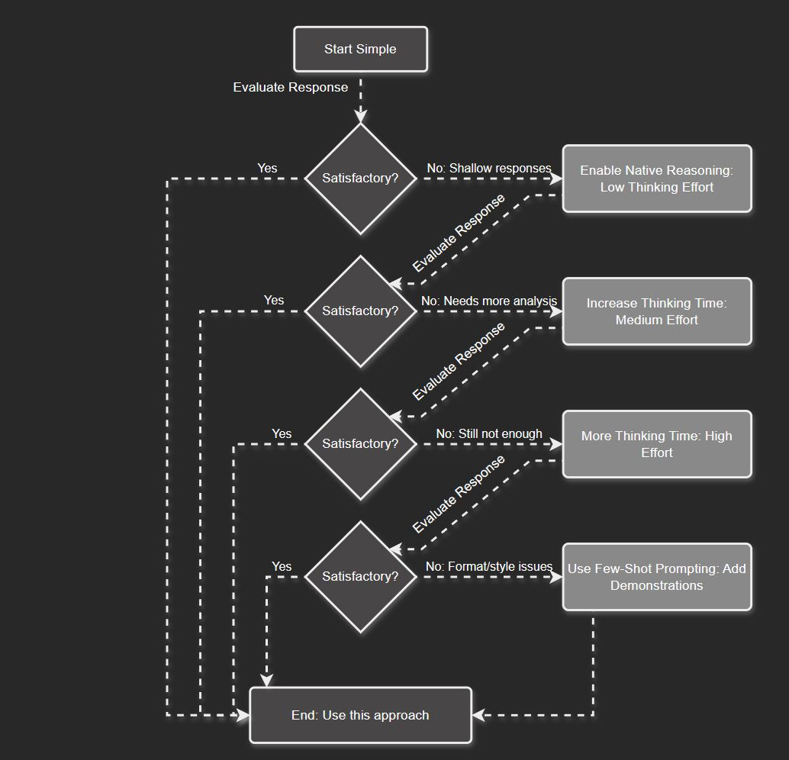
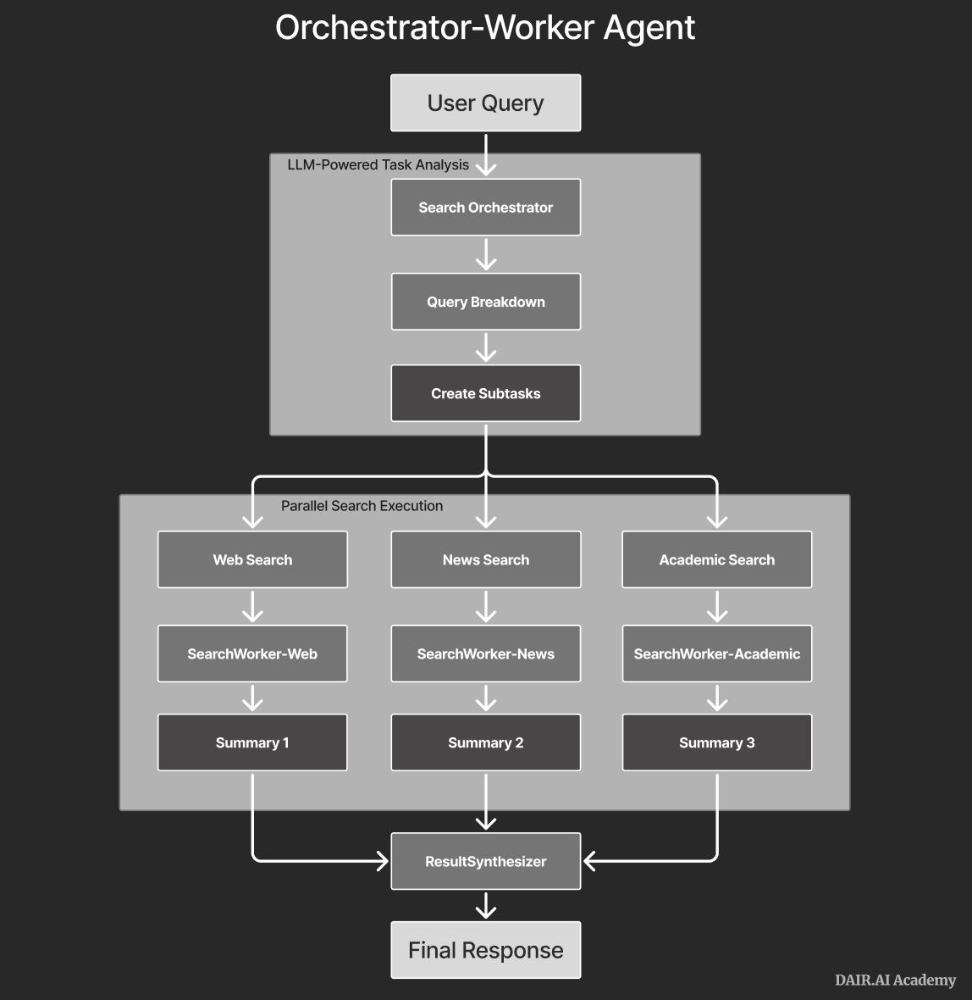
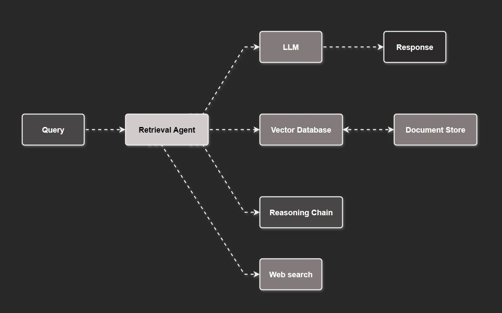
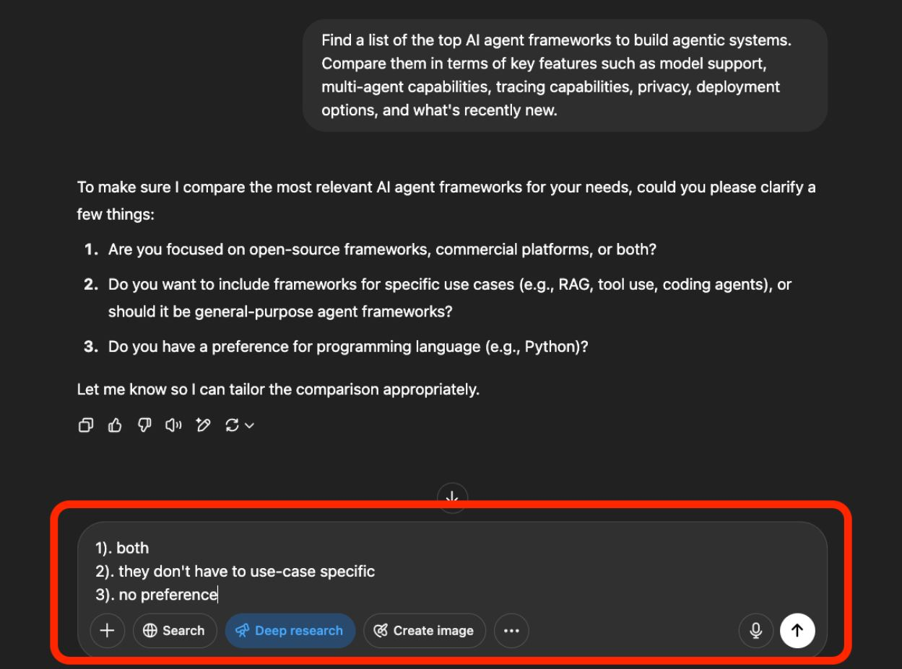
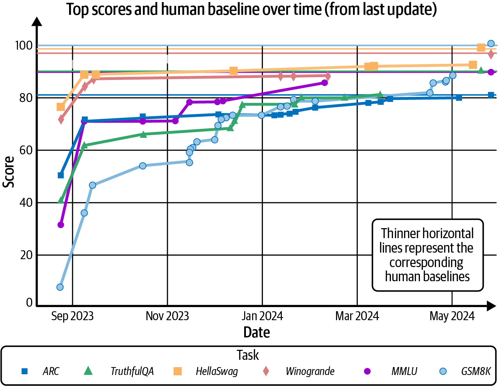

# 7 — Prompting Reasoning Models

> Reasoning models are trained to produce chain-of-thought natively before they answer. Much of [03](03-core-techniques.md) is built into them, so the prompting advice shifts from *how to think* to *what to achieve*. Model behavior here changes quickly; treat the specifics as dated, and check the vendor guides in [references.md](../references.md#vendor-guides).

Paste your carefully engineered chain-of-thought prompt into a reasoning model and you may pay more for a worse result: adding CoT lowered constraint accuracy for 13 of 14 models on IFEval. These models bring their own reasoning, so your job moves from telling them how to think to stating what to achieve and how much effort to spend.

---

## What's different

A reasoning model (o-series, Claude with extended or adaptive thinking, Gemini thinking, DeepSeek-R1) spends **test-time compute** on hidden or summarized thinking tokens before it answers. Two consequences:

- **More thinking usually means better answers** on hard tasks — but with more latency and cost. You control it with an **effort or budget** setting (low / medium / high, or a token budget), not with prompt wording. "Usually" depends on difficulty. On puzzles with a tunable difficulty (Tower of Hanoi, River Crossing, Blocks World), Claude 3.7 Sonnet and DeepSeek ran with and without thinking at matched token budgets. Without thinking they matched or beat the thinking versions on easy instances, and lost on medium ones. On the hardest, both scored zero, and the thinking models started using fewer thinking tokens even with budget left. Putting the Hanoi solution algorithm in the prompt did not move the collapse point ([arXiv:2506.06941](https://arxiv.org/abs/2506.06941) (Shojaee et al., 2025-06)). Read the collapse with its rebuttal. The scoring demanded every move written out, and 2<sup>N</sup>−1 Hanoi moves overrun the output limit at large N. Some scored River Crossing instances have no solution ([arXiv:2506.09250](https://arxiv.org/abs/2506.09250) (Lawsen, 2025-06)). The low-complexity result survives that critique and matches the overthinking row below.
- **The CoT scaffolding you'd write for a standard model is redundant at best**, and can hurt. Explicit step-by-step CoT prompting has been shown to *degrade instruction-following*. Adding CoT lowered constraint accuracy for 13 of 14 models on IFEval and for every model on ComplexBench; Llama-3-8B-Instruct fell from 75.2% to 59.0% on IFEval. The paired comparisons (Claude 3.7 Sonnet with and without thinking, DeepSeek-V3 vs. R1) point the same way, by under 2 points. Reasoning helped with formatting and exact wording but led models to drop simple constraints or add content nobody asked for ([arXiv:2505.11423](https://arxiv.org/abs/2505.11423), Li et al., NeurIPS 2025). The best mitigation was a trained classifier that decides *whether* to reason for a given instruction.
- **Structure is not always redundant: it depends on the problem and the model.** Kargupta et al. annotated about 170K reasoning traces from 16 open-weight reasoning models for 28 cognitive behaviours and found that the behaviours that go with correct answers (scoping the problem and aligning domain knowledge before forward chaining) are the ones models use least on ill-structured problems such as diagnosis, case analysis and dilemmas. A prompt that spells out the successful behaviour sequence for the problem type moved relative accuracy by +22.9% on diagnosis and +26.7% on case analysis but only +1.1% on algorithmic problems, averaged over 15 models on about 50 text problems per cell, and the sign flipped with capability: DeepSeek-R1-Distill-Qwen-32B gained 22.3% on average while the 1.5B DeepScaleR lost 52.6% and an 8B Llama 3 lost 17.5%. Design problems fell to 0% for every model under the scaffold and were dropped from the table. The guidance prompts are generated from a graph of successful traces, not written by hand, there is no plain "think step by step" baseline, and GPT-4o judged the answers, so the lesson is the direction, not the sizes: give a capable reasoning model a structure for messy problems, and leave a small one alone ([arXiv:2511.16660](https://arxiv.org/abs/2511.16660) (Kargupta et al., 2025-11, preprint)).

---

## Prompting tips

| Do | Don't |
|---|---|
| State the goal, constraints and output format clearly and at a high level | Prescribe the reasoning steps ("first do X, then Y…") |
| Use general nudges if you want more effort: "think thoroughly about this," "consider several approaches" | Bolt on "Let's think step by step" |
| Structure inputs with delimiters/XML; use XML for structured output unless JSON is required | Leave the format to chance — reasoning models are prone to formatting drift |
| Add few-shot examples **only** for style or format the model gets wrong, and keep them consistent with the instructions | Pad with examples by default |
| Ask the model to **verify** its work before finishing ("check the result against the test cases") | Assume the reasoning was correct because it was long |
| Use clear quality modifiers when you want ambition ("include as many relevant features as possible; go beyond the basics") | Expect "above and beyond" behavior without asking |

Anthropic-specific notes:
- With extended thinking, **high-level instructions beat prescriptive ones**. Read the thinking output, and only then steer it.
- Few-shot examples can include `<thinking>` blocks to show the *style* of reasoning you want, and the model will generalize from them.
- In agentic loops, **interleaved thinking** (reasoning between tool calls) lets the model reflect on each tool result before acting again.

---

## Hybrid models: escalate gradually

For models where thinking is a switch:

1. **Thinking off** first. Evaluate. A manual CoT prompt is a cheap middle step.
2. If the answers are shallow or wrong in ways that look like a reasoning failure, **enable thinking at low effort**.
3. Escalate to **medium**, then **high**, only while it keeps improving your eval scores ([09](09-evaluating-prompts.md)).
4. Use few-shot examples to fix *style and format*, not reasoning.


*Evaluate after each step and stop at the first satisfactory one. DAIR, Reasoning LLMs Guide.*

Thinking off can be stronger than it looks, especially if you sample several answers. Ma et al. switched off thinking in DeepSeek-R1-Distill-Qwen-32B by prefilling the thinking block with "Okay, I think I have finished thinking." and closing it. On math, coding and theorem-proving benchmarks, this NoThinking mode used 2.0–5.1× fewer tokens. It trailed full thinking at pass@1 on most benchmarks, but matched it once enough samples were drawn (pass@k at large k). On theorem proving it matched thinking at every k while using 3.3–3.7× fewer tokens. At an equal, small token budget it often won outright: "51.3 vs. 28.9 on AMC23 with 700 tokens." Drawing several NoThinking answers in parallel and keeping the best one beat sequential thinking on tasks with a verifier, at "7× lower latency and even 4× less total token usage." The authors tested only open-weight models, because prefilling the thinking block needs access closed APIs don't give: "we lack access for making interventions to closed-source models" ([arXiv:2504.09858](https://arxiv.org/abs/2504.09858) (Ma et al., 2025-04)). Where you can check answers automatically, try several thinking-off samples before you pay for long thinking.

The arithmetic behind both results is short. It shows why a "write out every move" score hits an output limit, and why independent samples pay off once a verifier can pick the right one. The 10 tokens per move and the values of p are assumptions for illustration, not numbers from the papers:

```python
# Hanoi: how long is the answer the scoring asked for?
for n in (5, 10, 12, 15, 20):
    moves = 2**n - 1
    print(f"N={n:>2}: {moves:>9,} moves, {moves * 10:>10,} tokens at an assumed 10 tokens per move")

# pass@k: the chance that at least one of k independent samples is right
for p in (0.3, 0.5):
    print(f"p={p}:", {k: round(1 - (1 - p) ** k, 3) for k in (1, 3, 5, 10)})
```

```text
N= 5:        31 moves,        310 tokens at an assumed 10 tokens per move
N=10:     1,023 moves,     10,230 tokens at an assumed 10 tokens per move
N=12:     4,095 moves,     40,950 tokens at an assumed 10 tokens per move
N=15:    32,767 moves,    327,670 tokens at an assumed 10 tokens per move
N=20: 1,048,575 moves, 10,485,750 tokens at an assumed 10 tokens per move
p=0.3: {1: 0.3, 3: 0.657, 5: 0.832, 10: 0.972}
p=0.5: {1: 0.5, 3: 0.875, 5: 0.969, 10: 0.999}
```

Real samples are correlated, so pass@k rises more slowly than this. And none of it helps without a verifier, because you can't take the best of k answers if you can't tell which one is right.

If you run the decoder yourself, the model's own token log-probabilities can stand in for a verifier, a little. DeepConf scores each trace by its least-confident stretch, keeps the most confident traces and votes among those. With 512 traces per problem, offline, keeping the top 10% lifted DeepSeek-8B on AIME 2025 from 82.3% (plain majority vote) to 87.4% and Qwen3-32B on AIME 2024 from 85.3% to 90.8%. Stopping low-confidence traces early cut generated tokens by 43–79% against full majority voting at about the same accuracy, on four competition-math sets with three open-weight models. The filter fails where the model is "confidently wrong": across 20 model-and-dataset settings the 10% filter helped 12 and hurt 8 (average +1.22 points), and keeping 90% was the safe setting (average +0.17). It needs log-probabilities and a patched serving stack, so hosted APIs that hide them can't use it, and the paper tests no prompt wording ([arXiv:2508.15260](https://arxiv.org/abs/2508.15260) (Fu et al., 2025-08, preprint)).

The same arithmetic explains why "think longer" stalls. Wen et al. capped a single DeepSeek-R1-Distill-Qwen-1.5B chain on AIME 2024 at 16K, 32K, 64K and 128K tokens and got 26.1%, 28.3%, 27.1% and 27.4%: **past 32K, more sequential budget bought nothing**. Their diagnosis is "Tunnel Vision": made to continue from the first 100 to 1,600 tokens of one of its own wrong chains, the model recovered less often the longer the flawed prefix. The same budget spent on width did better. Majority voting over 8 chains of 16K (the self-consistency idea of Wang et al., ICLR 2023) reached 41.0%, and ParaThinker, the same model fine-tuned on 6.2K problems to write 8 chains in parallel and fuse them in a summary that reuses their KV caches, 48.1%; at 7B the figures are 51.9% for one 16K chain and 68.8% for both maj@8 and ParaThinker 8×16K. On one A800 at batch size 1, decoding 16 paths took under twice the latency of one. Two cautions for a prompt engineer. The fusion needs the fine-tune: the untrained baseline that re-read its 8 sampled chains and wrote a summary fell to 14.2% at 1.5B and 43.3% at 7B, below a single chain (the authors blame positional decay over the long concatenation), so "sample N chains and ask the model to synthesize them" is not a free version of this. And the evidence is math benchmarks on open 1.5B and 7B models, with no coding or open-ended tasks, which is where voting cannot be used ([arXiv:2509.04475](https://arxiv.org/abs/2509.04475) (Wen et al., 2025-09, preprint)).

**Optimize for accuracy first, then latency and cost.**

**Some of the thinking budget buys procedure the domain repeats, and that part can be paid once.** Singh et al. had a coding agent read 35 to 50 existing no-think trajectories per domain and write a 40 to 130 line skill file, then put it in the non-reasoning model's system prompt. On GPT-5.4-mini (reasoning effort none against medium, 3 evaluation seeds, 40 to 50 held-out tasks), thinking cost 3.0× to 5.1× the output tokens per episode; the skill recovered 55% to over 100% of the think gap and beat thinking outright on ALFWorld (0.787 against 0.713) and τ²-bench retail (0.408 against 0.350) at 2.9× to 4.5× fewer output tokens. On ALFWorld the skill cut stall loops from 28.7% to 5.3% of episodes. Thinking still won on telecom (0.450 against 0.333) and SpreadsheetBench-Verified (0.613 against 0.560), which the authors read as instance-specific work no fixed prompt can carry. Each skill was distilled once, so distillation variance is unmeasured, no intervals are given, and on Qwen3.6-27B the skill regressed retail by 4.2 points ([arXiv:2608.07885](https://arxiv.org/abs/2608.07885) (Singh et al., COLM 2026 Efficient Reasoning Workshop)). The hybrid rule follows: distil the invariants into the prompt, and escalate to thinking for the instances that remain.

---

## Where reasoning models earn their cost

Use them for the reasoning-heavy *module* of an application, not the whole thing ([06](06-chaining-and-workflows.md) — separation of concerns):

- **Planning** in agentic systems — e.g., the planner in an orchestrator-worker deep-research agent.
- **Agentic RAG** — routing complex queries and reasoning across many sources.
- **LLM-as-judge** — evaluator-optimizer loops where the judge needs to reason ([09](09-evaluating-prompts.md#llm-as-judge)).
- Large codebases, algorithmic and scientific work, literature synthesis, ambiguous knowledge-intensive tasks.
- **Writing prompts for other models** — meta-prompting ([08](08-prompt-optimization.md)).


*The reasoning model sits in the orchestrator, breaking the query into subtasks. Cheaper models run the parallel search workers and summaries. DAIR.*


*Agentic RAG: a reasoning retrieval agent decides whether to answer directly or call the vector store, a reasoning chain, or web search. DAIR.*

Simple extraction, classification and rewriting rarely need one.

---

## Known failure modes

| Issue | Mitigation |
|---|---|
| **Overthinking** easy tasks (cost, latency) and **underthinking** hard ones | Be specific about the task and the output; route only hard subtasks to the reasoning model; tune effort |
| Output quality — mixed languages, repetition, formatting drift | Unambiguous instructions; explicit format; post-validation |
| Instruction-following degrades with explicit CoT | Drop manual CoT; use carefully chosen few-shot examples; self-reflection; let the model (or a classifier) decide when to reason |
| **The reasoning isn't faithful** — the visible chain of thought doesn't always reflect what drove the answer (*Reasoning Models Don't Always Say What They Think*, 2025) | Don't use the thinking text as an audit trail or a safety monitor on its own; evaluate outputs. A CoT monitor catches only what the chain states. OpenAI's GPT-4o monitor (92% accurate on a small internal set) flagged 0.17% of 102,443 o1-preview chains as deceptive, mostly invented policies used to withhold information ([arXiv:2412.16720](https://arxiv.org/abs/2412.16720) (OpenAI, 2024-12)). Faithfulness is a training property, not a prompt setting: Sivakumaran et al. reward a chain when three other models can continue a truncated prefix of it to the same answer, and on Qwen3-14B and Phi-4-reasoning-plus trained on 1,250 BBH pairs this raised hint-attribution faithfulness by 2.5 points with accuracy up 1.8 and 1.5 points on out-of-distribution BBEH, ZebraLogic, MuSR and FOLIO, where a faithfulness-only reward gained 4.1 and 3.7 points (Qwen3, Phi-4) and lost 3.2 and 2.2 accuracy; on Qwen3-14B sycophancy still rose from 38.6% to 41.8%, no confidence intervals ([arXiv:2602.16154](https://arxiv.org/abs/2602.16154) (Sivakumaran et al., 2026-02, preprint)) |
| Weaker tool calling in some open reasoning models | Test parallel and multi-step tool use explicitly before relying on it |
| Sampling parameters ignored or rejected | Expect fixed temperature on many reasoning endpoints; control with effort instead ([04](04-controlling-output.md#sampling-parameters)) |

Overthinking is easy to see. In a survey's example, DeepSeek-R1 spent 602 words and 42 seconds and QwQ-32B 616 words and 19 seconds comparing two decimals, re-checking after they had reached the right answer (one prompt, tested March 2025, so an illustration and not a measurement). The survey sorts the fixes by where they act: training (a length reward in RL, fine-tuning on variable-length CoT), output (latent compression, early stopping and sample selection) and input (prompt-guided budgets, routing easy queries to a fast model). Input is the part a prompt can reach. Two of its templates are a budget, `Let's think step by step and use less than <Token-Budget> tokens.`, and a per-step limit, `only keep a minimum draft for each thinking step, with 5 words at most`. The survey relays their authors' claims of token savings at held accuracy. It also relays Lee et al.'s finding, on their own compression prompts such as "use 10 words or less", that "existing prompt-based compression methods fall far short of these limits", the limits being what they compute a task needs. Both templates are also step-by-step scaffolding, which the advice above tells you to drop on a reasoning model, so score them against the effort setting on your own eval. The survey runs no experiments and gives no measured comparison across methods, so use it as a map of the methods and go to the original papers for sizes ([arXiv:2503.16419](https://arxiv.org/abs/2503.16419) (Sui et al., TMLR 2025)).

The measured version of the same problem: Chen et al. counted the solution rounds in QwQ-32B-Preview and DeepSeek-R1 answers on ASDIV, GSM8K and MATH500. On ASDIV, QwQ-32B-Preview scored 96.9% against 95.6% for Llama-3.3-70B-Instruct but used 741.8 tokens against 166.4, and on MATH500 R1 used 2,704 tokens at 96.4%. **In more than 92% of cases (the paper's aggregate over ASDIV and MATH500 and both models) the first solution round was already right**, and that round was under 60% of the tokens; QwQ's first round on ASDIV averaged 287 tokens, 38.7% of the response. Later rounds mostly re-check the first by the same method, and easier MATH500 levels got more rounds (QwQ 3.7 at levels 1 to 2 against 3.0 at levels 4 to 5). The authors' fix is training, not prompting: self-training QwQ with SimPO on its first-correct solutions plus a reflection step (FCS+Reflection) cut MATH500 tokens from 2,407.9 to 1,330.7 at 92.8% against 93.0%, and on AIME24 accuracy fell from 46.7 to 43.3 as tokens fell from 9,480.9 to 5,154.5. Keeping only the first solution was cheaper still (1,016 tokens) but dropped MATH500 to 91.0%, so some re-checking earns its cost on hard problems. All models are late-2024 and the tasks are math and science QA, so read it as the evidence for the easy-task row above, not for current models ([arXiv:2412.21187](https://arxiv.org/abs/2412.21187) (Chen et al., 2024-12, preprint)).

The survey's relay of Lee et al. can be checked at the source. They ran 31 length prompts ("Be concise", "Only use numbers or equations", "Do not use proper grammar", word, token and step limits) on GPT-4o, GPT-4o-mini, Claude 3.5 Sonnet, Claude 3.5 Haiku and Llama 3.3 70B across MATH-500, 500 GSM8K problems and 500 MMLU-Pro Math problems. **Accuracy followed the length of the chain, not its format**: bulleted, space-free, numbers-only and Chinese chains all fell on one accuracy-versus-length curve. On MMLU-Pro Math GPT-4o kept 80% accuracy at 415 tokens with "Be concise" against 81% at 586 by default, and 79% at 189 tokens with "Do not use proper grammar". No prompt won on every model: "Only use numbers or equations" suited GPT-4o and Sonnet but dropped Llama 3.3 70B to 63% against 77% for "Be concise". "Be concise" cut tokens only 1.2 to 1.5x, while an oracle that knew each question's minimum workable length would cut 3.2 to 11.2x on GSM8K and MMLU-Pro Math, so prompting leaves most of the saving unclaimed. Models did scale length with difficulty unprompted (GPT-4o on MMLU-Pro Math: Spearman 0.54 between tokens used and the question's threshold length under "Do not use proper grammar"), and an explicit "guess a budget, then reason" prompt did no better (0.51). The oracle is unreachable, and the paper tests non-reasoning instruction models on math only, so it speaks to how much a prompt can compress, not to how a reasoning model's thinking budget behaves ([arXiv:2503.01141](https://arxiv.org/abs/2503.01141) (Lee et al., 2025-03, preprint)).

The same effect reaches coding agents, where the prompt sets the budget by implication. Weinberger and Hozez ran 4,644 agent runs on PI.DEV with six open-weight models of 500B parameters or more on small tasks touching at most four files. Asking the agent to "develop several approaches, compare them, and implement the best" multiplied reasoning tokens by 2.4× to 7.4× with no gain in success (95.2% against 96.5% baseline over 878 runs), and on easy tasks success fell from 98.8% to 96.4% with about 2.5× to 3× more out-of-scope edits. "Think deeply" wording cost 1.6× to 2.2×, "make sure" certainty wording 1.3× to 1.9×, and the runs that re-verified redundantly cost 18× the clean median with 15 tool calls against 6. A verbose verbatim restatement of the task cost about 1.0×, so it is the content of the instruction, not its length. The multiple-approaches prompt cost Claude Sonnet 5 2.70× output tokens on PI.DEV and 2.52× in Claude Code, and the harness itself moved cost per success by 5× to 30×. A bounded-efficiency template was neutral or better on cost, but on one ambiguous spec it failed hidden tests in 3 of 5 runs against 0 of 5. Judge agreement was modest and the authors sell cost optimization ([arXiv:2608.01347](https://arxiv.org/abs/2608.01347) (Weinberger and Hozez, 2026-08, preprint)).

**Shorter chains, three ways.** **Chain of Draft** caps each step: `only keep a minimum draft for each thinking step, with 5 words at most`, with hand-written few-shot drafts. On GSM8K, few-shot, GPT-4o scored 91.1% against 95.4% for CoT at 43.9 output tokens against 205.1. Zero-shot, Claude 3.5 Sonnet fell to 65.5% against 90.4%. Two proprietary models, four easy tasks ([arXiv:2502.18600](https://arxiv.org/abs/2502.18600) (Xu et al., 2025-02, preprint)). **CoT-decoding** gets a chain with no CoT prompt by branching on the top 10 first tokens and keeping the path whose answer has the widest top-two probability gap. On GSM8K with a plain `Q: ... A:` prompt, pretrained Mistral-7B rose from 9.9% (greedy) to 25.1%, and PaLM 2 Large from 34.8% to 63.2%, though zero-shot CoT prompting alone reached 75.1%. It needs token probabilities that most hosted APIs do not expose ([arXiv:2402.10200](https://arxiv.org/abs/2402.10200) (Wang & Zhou, 2024-02, preprint)). **Constrained CoT** adds a word cap to a zero-shot "Let's think a bit step by step" prompt. On GSM8K with Llama2-70b-chat, accuracy went from 36.0% with CoT to 37.1% with a 30-word cap and 41.8% with 100 words, and mean generation time from 30.1 s to 19.8 s and 23.9 s. A 15-word cap lost accuracy (31.8%), the models often overran small caps, Falcon-40b-instruct did not beat CoT on GSM8K and 7B models did poorly. Word counts stand in for tokens, single runs, 2023 open models, arithmetic word problems only ([arXiv:2407.19825](https://arxiv.org/abs/2407.19825) (Nayab et al., preprint)).

A second measured case against "longer is better": Chen et al. sampled 25 answers per question from eight open-weight reasoning-model variants (GPT-OSS-20B and 120B at low, medium and high effort, a DeepSeek-R1 70B distill, Qwen3-30B-Thinking) on AIME 2024 and 2025, HMMT 2025 and GPQA-Diamond, with a neutral "reason step by step" prompt. Within a question, token count correlated with accuracy at **r = −0.59 on average** across the 32 model-and-benchmark settings (Pearson over five accuracy bins, averaged over 30 seeds). Their alternative, the share of tokens whose prediction only settles in the deepest layers, correlated at +0.687, but needs the model's per-layer hidden states, so it works only on open weights, and it was negative in 2 of the 32 settings. Used to pick which 50% of 48 samples to keep, it matched or beat majority voting at about half the tokens on the two models tried (GPT-OSS-120B-medium on AIME 2025: 94.7% against 92.7%, 155.4k tokens against 307.6k). It is correlational, math and science only, and the authors note the measure is not comparable across models or effort levels: raising GPT-OSS-120B's effort level lowered it while accuracy rose. The paper never tests a prompt-based budget or length instruction; the effort levels are a system-prompt switch used only as model variants ([arXiv:2602.13517](https://arxiv.org/abs/2602.13517) (Chen et al., ICML 2026)).

Gema et al. built tasks where more reasoning makes the answer worse, and the prompt is part of the setup. In "Misleading Math", a trivial counting question ("You have an apple and an orange... how many fruits?", answer always 2) is padded with 1 to 5 irrelevant distractors, 2,500 questions at temperature 1.0. A system prompt sets a thinking budget (`You have a thinking token budget of about {{reasoning_budget}} tokens (IMPORTANT: ... YOU MUST USE ALL OF YOUR THINKING TOKENS)`) with a keyword from "don't think" to "ultrathink". Claude Opus 4 fell from nearly 100% to about 85 to 90% as reasoning grew, and DeepSeek R1 with natural, unprompted overthinking fell from 70% to 30% at five distractors, while o3 held up or improved. When the question wore the framing of a famous paradox (a birthday-problem setup whose real answer is 1), o3 applied the memorised solution and did worse, and more distractors helped it by hiding the framing. In a regression task on student grades (500 test students, Claude Opus 4), longer reasoning moved the model's weight from study hours (correlation 0.73 with grades) to sleep and stress, so its predictions' correlation with study hours fell from 0.43 at no budget to 0.22 at 16,384 tokens. **Few-shot examples repaired this (study-hours correlation about 0.84 to 0.88 with 16 shots), but stating the prior ("study hours is the strongest predictor") did not**, because models read it as a cue to over-rely on one feature. Telling Claude it need not use its whole budget did not remove the effect on the counting tasks. On Zebra puzzles all nine models lost accuracy with natural reasoning length. The tasks are mostly synthetic, many trends are noisy, standard arithmetic benchmarks (GSM8K and others) showed no effect, and the safety-flavoured result (Claude Sonnet 4's stated willingness to be shut down falling from 60% to 47%) is one model on one task. Only sequential reasoning length was studied, and o-series traces were not available to read ([arXiv:2507.14417](https://arxiv.org/abs/2507.14417) (Gema et al., TMLR 2025)).

Wu et al. counted reasoning patterns in o1's traces on four filtered benchmarks (HotpotQA 274 problems, Collie 226, USACO bronze 139, AIME 90) and compared it with GPT-4o run with test-time-compute methods. On USACO o1-preview scored 44.60 against 5.04 for GPT-4o, and on AIME o1-preview scored 44.00 and o1-mini 62.00 against 12.22. GPT-4o with domain-specific system prompts (their "Agent Workflow") closed part of the gap (USACO 22.22), while step-wise best-of-N and Self-Refine did not (Self-Refine scored 0.00 on Collie). More reasoning was not always better: o1-mini beat o1-preview on AIME and Collie but lost on USACO (12.23 against 44.60). From 20 to 30 sampled traces per benchmark they name six patterns (systematic analysis, method reuse, divide and conquer, self-refinement, context identification, emphasizing constraints) that vary by task, and on Collie o1 restated the format constraints in its reasoning. Treat that as a description of o1, since the o1-versus-GPT-4o comparison mixes model and method, the pattern counting has no agreement check, there is one run per cell, the data is filtered to problems other models fail, and the authors' attribution of the Agent Workflow gain to its system prompts is an assumption without an ablation. It also does not test prompt wording on a reasoning model ([arXiv:2410.13639](https://arxiv.org/abs/2410.13639) (Wu et al., 2024-10, preprint)).

The underthinking half of the row is measured too. On AIME 2024, QwQ-32B-Preview, DeepSeek-R1-Preview and DeepSeek-R1-671B spent on average 225% more tokens on wrong answers than right ones, with 418% more thought switches ("Alternatively…"). On AIME 2024, MATH500 level 5 and GPQA Diamond, over 70% of the wrong answers held at least one correct thought that was dropped before it was finished (correctness judged by two R1-distilled models, checked at 82.9% and 81.8% agreement on 90 final thoughts from QwQ responses on AIME 2022–24, labelled by final-answer correctness). A prompt asking for persistence ("Try to complete every idea you think of and don't give up halfway") barely moved DeepSeek-R1 on AIME 2024: Pass@1 73.8% to 72.4% and switch tokens 13.8 to 12.0 per response, 32 samples at temperature 0.7. A decoding-time penalty on switch tokens did better (QwQ 38.3% to 44.1%; R1 73.8% to 74.8% with switch tokens down to 5.7), but it needs [logit](../../../generative-ai/01-llm-fundamentals/notes/04-decoding-and-inference-behaviour.md#decoding) access. One persistence prompt on one model is thin evidence, so read it as "wording is a weak lever here", not "wording cannot work" ([arXiv:2501.18585](https://arxiv.org/abs/2501.18585) (Wang et al., 2025-01, preprint)).

With decoding access the switch tokens work in both directions. AlphaOne inserts "Wait," after paragraph breaks with a probability that anneals linearly from 1 to 0 over the first α times the model's usual thinking length (α = 1.4, the usual length measured on 10 sample questions), then rewrites any later "Wait" as `</think>` so the model stops and answers. On six math, code and science benchmarks it lifted average pass@1 over the base model by 6.15 points on DeepSeek-R1-Distill-Qwen-1.5B with about 14% fewer tokens, by 4.65 on the 7B distill and by 5.33 on QwQ-32B (AIME24 40.0% to 53.3%, LiveCodeBench 67.0% to 75.8%). The same paper is the measured case against s1-style budget forcing applied as a pure test-time trick: appending about two "wait"s near the end, without s1's fine-tune, averaged +0.15, +1.48 and +0.63 on the three models, and Chain of Draft +2.95, +1.73 and +2.10. **Slow first, then fast beat every other schedule**, the forced stop mattered (without it the 7B distill fell to 75.0% on AMC23 against 82.5% base and 90.0% with it), and the token is model-specific: "Hmm," gave 20.0% on AIME24 against 30.0% for "Wait," at 1.5B. It is a decoder patch, so it needs open weights and a serving stack you control, and it was tested at an 8,192-token cap on 2025 open models ([arXiv:2505.24863](https://arxiv.org/abs/2505.24863) (Zhang et al., 2025-05, preprint)).

A related caution for non-reasoning models: asking for "think, reflect, backtrack, verify" produces the look of reasoning, not reliably the substance. On the MATH test set, models' explicit error acknowledgements ("I made a mistake", "let me reconsider") appeared in under 0.5% of solutions under plain or CoT prompts, 12.65% under a Think prompt and up to 25.67% under Think & Verify for Llama 3.1 70B (GPT-4o 1.52%, Claude 3.5 Sonnet 4.44%). The Think & Verify prompt costs about 2,100 input tokens against 35 for CoT, matched CoT accuracy on the easiest problems at more than double the token budget, and the authors saw backtracking go with wrong final answers. This is a small study in a position paper arguing for training, the regret count is phrase matching, it tests no actual reasoning model, and the text gives no per-prompt accuracy table ([arXiv:2501.04682](https://arxiv.org/abs/2501.04682) (Xiang et al., 2025-01, preprint)).

The converse also holds: the visible chain is not the only place the computation happens. Baherwani et al. prefilled about 200 semantically empty tokens (the numbers 1 to 100, animal names, "pause pause pause") after the question and before an `Answer:` prefix that blocks any chain of thought, with 10 few-shot examples laid out the same way. On 1,000 four-digit multiplications Claude Opus 4.5 went from 71.8% to 81.8% and on nested arithmetic from 45.8% to 57.0%; Gemini 3 Flash gained 10.7 points on arithmetic, Sonnet 4.5 8.7, and 13 frontier models in all were tested. **The filler must follow the question** (placed before it, +1.6 instead of +8.9 on multiplication), which type of filler helps depends on the model, the task and the number of shots (for Qwen3-235B the best zero-shot fillers were the worst at 10-shot, and on Qwen3.5-397B word fillers collapsed accuracy from 90.6% to near 0 by breaking the answer format), and with filler Opus 4.5 satisfied a hidden "answer N/A when the product is odd" rule 44.5% of the time against 33.5%, with no loss on the main task. The tasks are synthetic, the gains are small next to a real chain of thought, and the authors do not claim the trick evades a monitor in practice. For prompting it means two things: a no-reasoning answer can be helped a little by giving the model tokens to compute over, but the effect is model-specific, so measure it; and a chain-of-thought monitor sees only part of the work ([arXiv:2607.22925](https://arxiv.org/abs/2607.22925) (Baherwani et al., 2026-07, preprint)).

---

## Prompting deep-research agents

Deep-research products (OpenAI, Gemini and Claude Research) are reasoning models trained with RL to plan, search, browse and synthesize over minutes. Each run is slow and expensive, so **get the prompt right the first time**:

- **Give it a plan and be specific** about the scope, the time period, and the sources you trust.
- **Answer its clarifying questions thoroughly.** That's the cheapest point to steer the run.

  
  *The agent asks about scope before it starts. "Both / no preference" wastes the cheapest steering point. DAIR, Deep Research guide.*

- **Supply keywords.** The model turns your prompt into search queries, so precise terms (product names, technical terms, brands) save searches.
- **Use clear task verbs**, such as *compare*, *recommend* or *report*, to signal the kind of output you want.
- **Specify the report format**: sections, tables, columns, and length.
- **Upload the documents you already have**, especially for technical or niche topics the web covers poorly.
- **Verify the sources yourself.** Known weaknesses are citation errors, a bias toward certain domains, date-sensitive queries, and paywalled content.

Use deep research only for multi-source, time-sensitive questions that need careful synthesis. A plain reasoning model or a standard model is enough for everything else. Building your own deep agent is covered in [03-harness-engineering](../../03-harness-engineering/README.md).

---

## Intelligence trends (and what they don't fix)

The book went to press in 2024, before the first reasoning models (o1 shipped in September 2024). Its only nod to them is that better RLHF was making chat models "express their chain-of-thought reasoning" more. Read its forecasts as a 2024 baseline.

- **Benchmarks saturate.** Leading models ace MMLU, HellaSwag, GSM8K and similar benchmarks. Partly the models are better, and partly benchmark text leaks into training data (contamination). The book's fixes are refreshed leaderboards (it names the Open LLM Leaderboard 2, since retired) and tests built to resist memorization, such as ARC-AGI. The book calls ARC-AGI "algorithmically generated" and impossible to memorize. In fact its puzzles are hand-designed and protected by a private test set, and even it gave way: in December 2024 o3 scored 76% on ARC-AGI-1's semi-private set (88% at high compute), and ARC-AGI-2 replaced it in 2025. For your own app this means **public scores don't predict your task.** Build your own eval ([09](09-evaluating-prompts.md)).

  
  *Top scores on the Hugging Face Open LLM Leaderboard (v1, open models), Sep 2023 to May 2024. Thin lines are human baselines. GSM8K went from under 10 to the human line in under a year. Image Source: Berryman & Ziegler (2024), Fig. 11-2*

- **Cheaper and faster.** In **distillation**, a small student learns from a large teacher's full next-token distribution rather than from single labels. **Quantization** stores weights in fewer bits. The book says 8 bits instead of 32, but LLM weights are normally held in 16-bit formats, so in practice it is 8 or 4 bits instead of 16. Both cut cost and latency for a modest loss of accuracy.
- **Plan for the trend.** The book's 2024 bet: what is too expensive, too slow, too long for the context or too hard for the model today will not be tomorrow, so don't over-engineer around today's limits. Cost per token and window size have moved that way since. A window that holds the input is not a model that uses all of it well, though, and intelligence gains don't fill in missing context (see below).

---

## What doesn't change

The book's closing lessons hold for reasoning models too — maybe more so:

- **It's still document completion** that mimics training data. Familiar formats still win.
- **It isn't psychic.** Smarter models don't fix missing context. If *you* would need a piece of information to solve the problem, so does the model. Put it in the prompt, or give the model the tools and instructions to fetch it ([02-context](../../02-context-engineering/README.md)).
- **It's easily distracted.** Irrelevant context costs more when the model reasons over all of it.
- **It must be able to decipher the prompt.** If a human couldn't parse the fully rendered prompt, the model probably can't either.
- **It needs to be led** — on goals and constraints now, rather than on steps.
- **It has no internal monologue** unless it gets to write one. Reasoning models build this in, so you no longer prompt for CoT, but the principle is why they work.

---

## Go deeper

- DAIR *Reasoning LLMs Guide*, Anthropic extended-thinking tips, and the reasoning papers: [references.md](../references.md#reasoning-models)
- Book: [Ch 11 PDF](../sources/prompt-eng-for-llms/reading/11-looking-ahead.pdf) (intelligence trends, the two durable lessons)
- A short map of where reasoning comes from: Bandyopadhyay et al. sort the methods into reinforcement learning (verbal, reward-based, search), test-time compute (feedback-guided improvement, scaling) and self-training (STaR, v-STaR, ReFT, Self-Explore), with one diagram per family. The prompting you do in this chapter sits in the test-time branch; everything in the other two is baked into the model before you see it. The survey runs no experiments and its few numbers are relayed from the papers it cites, so use it to find the original paper, not as evidence ([arXiv:2503.10814](https://arxiv.org/abs/2503.10814) (Bandyopadhyay et al., 2025-03, preprint)).

---

## Pitfalls

- **Keeping your old CoT scaffolding.** Symptom: dropped constraints and added content. Llama-3-8B-Instruct fell from 75.2% to 59.0% on IFEval with CoT added. Fix: remove the step-by-step instructions, state goals and constraints, and decide per instruction whether to reason at all.
- **Thinking on for everything.** Symptom: cost and latency up with no gain on easy tasks, where no-thinking runs matched or beat thinking in Shojaee et al. Fix: start with thinking off, and raise effort only while your eval improves.
- **Auditing through the visible chain of thought.** Symptom: the chain looks fine and the behaviour isn't, because the chain doesn't always reflect what drove the answer. Fix: evaluate outputs, and don't make the chain your only safety monitor.
- **Reading the Hanoi collapse without its critique.** Symptom: concluding that reasoning fails at scale, when 2^N-1 moves overrun the output limit and some River Crossing cases had no solution (Lawsen). Fix: check what the scoring demands, and rely on the low-complexity result that survives the critique.
- **Sending `temperature` to a reasoning endpoint.** Symptom: a rejected or ignored parameter. Fix: control it with effort, and check what each model accepts.
- **A vague deep-research prompt.** Symptom: an expensive run on the wrong scope, sometimes after answering clarifying questions with "both / no preference". Fix: give scope, period, trusted sources, keywords and format, then verify the sources yourself.

## Try it

1. Rewrite for a reasoning model: "Think step by step. First list the invoice lines, then add them, then check the total against the footer, and output your reasoning then the answer."
   <details><summary>Answer</summary>"Find whether the invoice total matches the sum of its lines. Check your result against the footer before finishing. Output `<match>true|false</match>` and the two amounts." This keeps the goal, a verification request and a precise format, and drops the prescribed steps and manual CoT.</details>
2. Using the code above, if one thinking-off sample is right 30% of the time and answers can be verified, how many independent samples pass 80%? Why doesn't that apply to a task with no verifier?
   <details><summary>Answer</summary>Five samples give 83.2%, while three give 65.7%. Without a verifier you can't pick the right sample. You can only vote, which is a different method and fails on any task where the most common answer is wrong. Correlation between samples also lowers the real number.</details>
3. You own a document assistant with a classifier step, an extraction step and a multi-document synthesis step. Which get a reasoning model, and what do you measure as you escalate?
   <details><summary>Answer</summary>Only synthesis at first, because classification and extraction rarely need one. Start with thinking off and escalate to low, medium, then high, running your eval each time and stopping at the first satisfactory result. Get accuracy right first, then latency and cost.</details>

## Interview checklist

| Prompt | Answer in one line |
|---|---|
| What changes in prompting for a reasoning model? | From how to think to what to achieve: high-level goals, constraints and format, with effort set by a parameter. Few-shot is only for style or format it gets wrong. |
| Does explicit CoT help a reasoning-capable model? | Often not. Li et al. saw it lower constraint accuracy for 13 of 14 models on IFEval and all on ComplexBench. Reasoning helped formatting and exact wording but dropped simple constraints. |
| What does "NoThinking" show? | Ma et al. prefilled the thinking block in an open-weight model and used 2.0 to 5.1 times fewer tokens. It trailed at pass@1 but matched at large k, so with a verifier, try several thinking-off samples first. It couldn't be tested on closed models. |
| Do Shojaee et al.'s Hanoi results show reasoning collapses at scale? | Be careful. Scoring required every move, and 2^N-1 moves overrun output limits, and Lawsen found unsolvable River Crossing cases. The overthinking result on easy tasks is the part that survives. |
| Can you trust the visible chain of thought as a monitor? | Not on its own, since it catches only what the chain states and chains are not always faithful. OpenAI's GPT-4o monitor flagged 0.17% of 102,443 o1-preview chains as deceptive. |
| How do you add reasoning to a hybrid model in production? | Thinking off first, optionally manual CoT, then low, medium and high effort while eval scores keep rising. Use it for the reasoning-heavy module only, such as planning or synthesis. |

## Next

[Prompt optimization](08-prompt-optimization.md): reasoning models are good at writing prompts, so let them tune yours against a metric.
