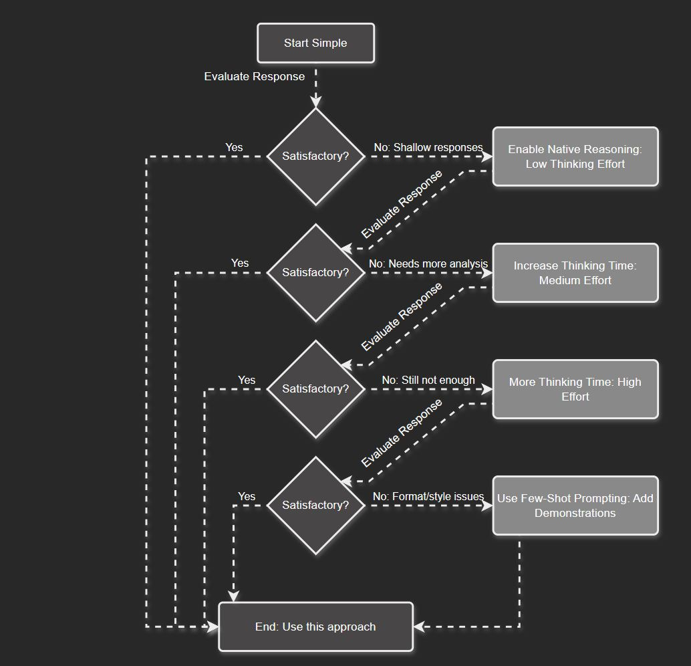
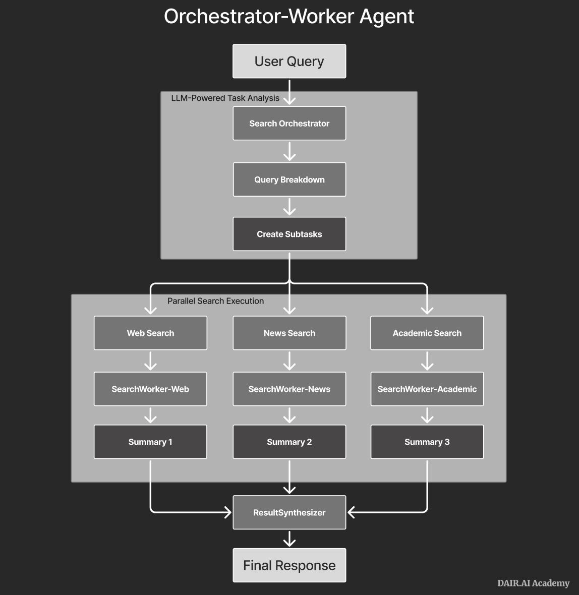
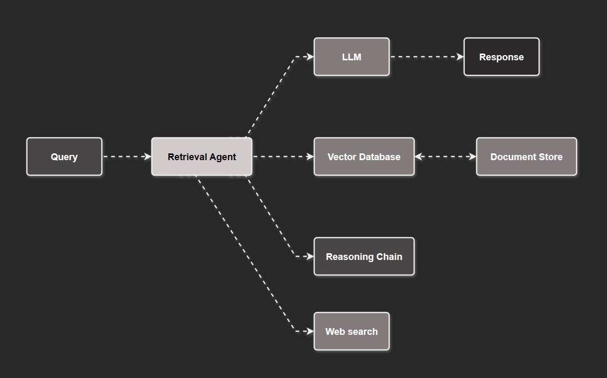
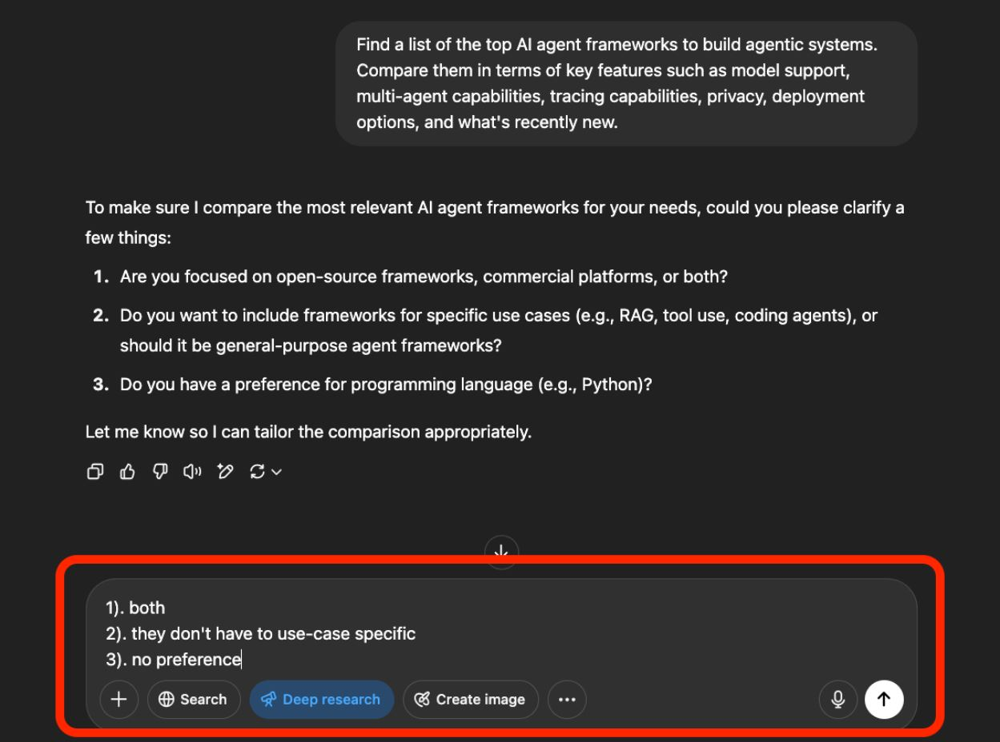

# 7 — Prompting Reasoning Models

> Reasoning models are trained to produce chain-of-thought natively before they answer. Much of [03](03-core-techniques.md) is built into them, so the prompting advice shifts from *how to think* to *what to achieve*. Model behavior here changes quickly; treat the specifics as dated, and check the vendor guides in [references.md](../README.md#vendor-guides).

---

## What's different

A reasoning model (o-series, Claude with extended or adaptive thinking, Gemini thinking, DeepSeek-R1) spends **test-time compute** on hidden or summarized thinking tokens before it answers. Two consequences:

- **More thinking usually means better answers** on hard tasks — but with more latency and cost. You control it with an **effort or budget** setting (low / medium / high, or a token budget), not with prompt wording.
- **The CoT scaffolding you'd write for a standard model is redundant at best**, and can hurt. Explicit step-by-step CoT prompting has been shown to *degrade instruction-following* in reasoning models (*The Pitfalls of Reasoning for Instruction Following*, 2025).

---

## Prompting tips

| Do | Don't |
|---|---|
| State the goal, constraints and output format clearly and at a high level | Prescribe the reasoning steps ("first do X, then Y…") |
| Use general nudges if you want more effort: "think thoroughly about this," "consider several approaches" | Bolt on "Let's think step by step" |
| Structure inputs with delimiters/XML; use XML for structured output unless JSON is required | Leave the format to chance — reasoning models are prone to formatting drift |
| Add few-shot examples **only** for style or format the model gets wrong, and keep them consistent with the instructions | Pad with examples by default |
| Ask the model to **verify** its work before finishing ("check the result against the test cases") | Assume the reasoning was correct because it was long |
| Use clear quality modifiers when you want ambition ("include as many relevant features as possible; go beyond the basics") | Expect "above and beyond" behavior without asking |

Anthropic-specific notes:
- With extended thinking, **high-level instructions beat prescriptive ones**. Read the thinking output, and only then steer it.
- Few-shot examples can include `<thinking>` blocks to show the *style* of reasoning you want, and the model will generalize from them.
- In agentic loops, **interleaved thinking** (reasoning between tool calls) lets the model reflect on each tool result before acting again.

---

## Hybrid models: escalate gradually

For models where thinking is a switch:

1. **Thinking off** first. Evaluate. A manual CoT prompt is a cheap middle step.
2. If the answers are shallow or wrong in ways that look like a reasoning failure, **enable thinking at low effort**.
3. Escalate to **medium**, then **high**, only while it keeps improving your eval scores ([09](09-evaluating-prompts.md)).
4. Use few-shot examples to fix *style and format*, not reasoning.

*Evaluate after each step and stop at the first satisfactory one. DAIR, Reasoning LLMs Guide.*

**Optimize for accuracy first, then latency and cost.**

---

## Where reasoning models earn their cost

Use them for the reasoning-heavy *module* of an application, not the whole thing ([06](06-chaining-and-workflows.md) — separation of concerns):

- **Planning** in agentic systems — e.g., the planner in an orchestrator-worker deep-research agent.
- **Agentic RAG** — routing complex queries and reasoning across many sources.
- **LLM-as-judge** — evaluator-optimizer loops where the judge needs to reason ([09](09-evaluating-prompts.md#llm-as-judge)).
- Large codebases, algorithmic and scientific work, literature synthesis, ambiguous knowledge-intensive tasks.
- **Writing prompts for other models** — meta-prompting ([08](08-prompt-optimization.md)).

*The reasoning model sits in the orchestrator, breaking the query into subtasks. Cheaper models run the parallel search workers and summaries. DAIR.*

*Agentic RAG: a reasoning retrieval agent decides whether to answer directly or call the vector store, a reasoning chain, or web search. DAIR.*

Simple extraction, classification and rewriting rarely need one.

---

## Known failure modes

| Issue | Mitigation |
|---|---|
| **Overthinking** easy tasks (cost, latency) and **underthinking** hard ones | Be specific about the task and the output; route only hard subtasks to the reasoning model; tune effort |
| Output quality — mixed languages, repetition, formatting drift | Unambiguous instructions; explicit format; post-validation |
| Instruction-following degrades with explicit CoT | Drop manual CoT; use carefully chosen few-shot examples; self-reflection; let the model (or a classifier) decide when to reason |
| **The reasoning isn't faithful** — the visible chain of thought doesn't always reflect what drove the answer (*Reasoning Models Don't Always Say What They Think*, 2025) | Don't use the thinking text as an audit trail or a safety monitor on its own; evaluate outputs |
| Weaker tool calling in some open reasoning models | Test parallel and multi-step tool use explicitly before relying on it |
| Sampling parameters ignored or rejected | Expect fixed temperature on many reasoning endpoints; control with effort instead ([04](04-controlling-output.md#sampling-parameters)) |

---

## Prompting deep-research agents

Deep-research products (OpenAI, Gemini and Claude Research) are reasoning models trained with RL to plan, search, browse and synthesize over minutes. Each run is slow and expensive, so **get the prompt right the first time**:

- **Give it a plan and be specific** about the scope, the time period, and the sources you trust.
- **Answer its clarifying questions thoroughly.** That's the cheapest point to steer the run.

  
  *The agent asks about scope before it starts. "Both / no preference" wastes the cheapest steering point. DAIR, Deep Research guide.*

- **Supply keywords.** The model turns your prompt into search queries, so precise terms (product names, technical terms, brands) save searches.
- **Use clear task verbs**, such as *compare*, *recommend* or *report*, to signal the kind of output you want.
- **Specify the report format**: sections, tables, columns, and length.
- **Upload the documents you already have**, especially for technical or niche topics the web covers poorly.
- **Verify the sources yourself.** Known weaknesses are citation errors, a bias toward certain domains, date-sensitive queries, and paywalled content.

Use deep research only for multi-source, time-sensitive questions that need careful synthesis. A plain reasoning model or a standard model is enough for everything else. Building your own deep agent is covered in [03-harness-engineering/deep-agents.md](../../03-harness-engineering/deep-agents.md).

---

## Intelligence trends (and what they don't fix)

- **Benchmarks saturate.** Frontier models ace MMLU, HellaSwag, GSM8K and similar benchmarks. Partly the models are better, and partly benchmark text leaks into training data (contamination). The fixes are rotating leaderboards and **non-memorizable** tests such as ARC-AGI, which are generated from an effectively unbounded space. For your own app this means **public scores don't predict your task.** Build your own eval ([09](09-evaluating-prompts.md)).
- **Cheaper and faster.** In **distillation**, a small student learns from a large teacher's full next-token distribution rather than from single labels. **Quantization** stores weights in 8 bits instead of 32. Both cut cost and latency for a modest loss of accuracy.
- **Plan for the trend.** Cost, latency and context-window limits keep improving, so don't over-engineer around today's limits. Intelligence gains don't fill in missing context, though (see below).

---

## What doesn't change

The book's closing lessons hold for reasoning models too — maybe more so:

- **It's still document completion** that mimics training data. Familiar formats still win.
- **It isn't psychic.** Smarter models don't fix missing context. If *you* would need a piece of information to solve the problem, so does the model ([02-context](../../02-context-engineering/README.md)).
- **It's easily distracted.** Irrelevant context costs more when the model reasons over all of it.
- **It must be able to decipher the prompt.** If a human couldn't parse the fully rendered prompt, the model probably can't either.
- **It needs to be led** — on goals and constraints now, rather than on steps.
- **It has no internal monologue** unless it gets to write one. Reasoning models build this in, so you no longer prompt for CoT, but the principle is why they work.

---

## Go deeper

- DAIR *Reasoning LLMs Guide*, Anthropic extended-thinking tips, and the reasoning papers: [references.md](../README.md#reasoning-models)
- Book: [Ch 11 PDF](../sources/prompt-eng-for-llms/reading/11-looking-ahead.pdf) (intelligence trends, the two durable lessons)

---

→ Next: [08-prompt-optimization.md](08-prompt-optimization.md) — letting models write and tune prompts.
