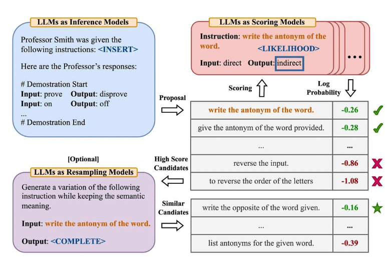
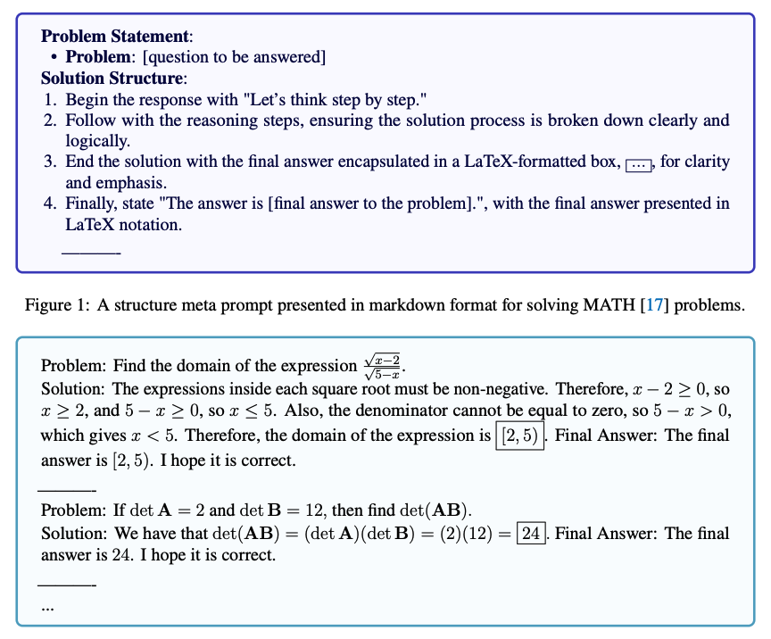

# 8 — Prompt Optimization

> Treating the prompt as an artifact you can search over, version and regression-test, and letting models do part of the writing. Everything here assumes you have an eval ([09](09-evaluating-prompts.md)). An optimizer without a metric is just a rewriter.

---

## The loop

```
template v1 ──► run on eval set ──► score ──► propose changes ──► template v2 ──► …
                        ▲                          │
                        └──── keep if it beats ◄───┘
```

The proposer can be you, an LLM (APE, OPRO, meta-prompting), or a framework (DSPy, TextGrad). The parts that matter are the same in every case: **a fixed eval set, a metric, and a record of every version.**

---

## Prompts as versioned artifacts

- **Template ≠ prompt.** Version the template (static instructions plus slots), not the rendered string ([02](02-prompt-anatomy.md#prompt-templates)).
- **Store it like code**: in the repo or a prompt registry, with an ID, a version, the model it was tuned on, and its eval score.
- **Pin the model version** next to the prompt. A prompt tuned on one model is not portable. Re-run the evals when either changes.
- **Diff behavior, not text.** A one-word change can move the scores; run the regression suite on every edit.
- **Log production I/O per prompt version** — it's your next eval set and the training data for optimizers ([06](06-chaining-and-workflows.md#operating-a-workflow)).

---

## APE — automatic prompt engineer

Zhou et al. (2022) framed instruction-writing as black-box search:

1. An LLM sees input/output demonstrations and **generates candidate instructions**.
2. Each candidate is run on a **target model** and scored.
3. Keep the best, optionally resample variants of it, and repeat.


*Propose instructions from demonstrations, score each by the log-probability of the correct outputs, and resample near the winners. Zhou et al. (2022), via DAIR.*

The famous result: APE found a better zero-shot CoT trigger than *"Let's think step by step"*. **"Let's work this out in a step by step way to be sure we have the right answer"** improved MultiArith and GSM8K.

Related work, in the same spirit:
- **OPRO** (2023) — the LLM is the optimizer, shown past prompts and their scores in its context. Found *"Take a deep breath and work on this problem step-by-step."*
- **Prompt-OIRL** — offline inverse RL to choose query-dependent prompts.
- **AutoPrompt**, **prefix tuning**, **prompt tuning** — gradient-based search over discrete tokens or continuous "soft prompts." These need model access, and are closer to fine-tuning ([04](04-controlling-output.md#when-prompting-isnt-enough-fine-tuning)).

The lesson is not the magic phrases, which are model-specific and dated, but that **search against a metric beats intuition** once you have one.

---

## Meta-prompting

The term is used in two senses.

**1. Structure-oriented prompting** (Zhang et al., 2024). Give the model an abstract *template* for solving a class of problems rather than worked content examples:

```
Problem: [question]
Solution structure:
  1. Identify the given quantities and what is asked.
  2. State the relevant formula or principle.
  3. Substitute and compute step by step.
  4. Final answer: \boxed{[answer]}
```


*Top: the structure meta-prompt. Bottom: example solutions that follow it. Zhang et al. (2024), via DAIR.*

Compared with few-shot it's token-efficient, avoids anchoring on specific example content ([03](03-core-techniques.md#few-shot)), and behaves like zero-shot. It assumes the model already knows the domain, so it degrades on genuinely novel tasks.

**2. Using a model to write prompts.** This is the common sense of the term in practice:
- Ask a strong (often reasoning) model to draft a system prompt from a task description, or to **critique and rewrite** an existing one given failing cases.
- Vendor tools do this: Anthropic's prompt generator and prompt improver, and OpenAI's playground optimizer.
- The **evaluator–optimizer** pattern automates it: a judge scores outputs, writes feedback, and a meta-prompt turns that feedback into a revised prompt ([06](06-chaining-and-workflows.md#workflow-patterns-anthropics-taxonomy), [07](07-prompting-reasoning-models.md#where-reasoning-models-earn-their-cost)).


*Each round, the judge's feedback goes to a meta-prompt that rewrites the system prompt, and the best version is logged. DAIR, Reasoning LLMs Guide.*

Generated prompts are a **first draft, not a result** — they still have to win on your eval.

---

## DSPy and programmatic optimization

**DSPy** replaces hand-written prompts with *signatures* (`question -> answer`) and *modules* (`ChainOfThought`, `ReAct`). An **optimizer** (teleprompter) then compiles the program against a metric and a training set:

- **Few-shot selection** — bootstraps demonstrations from successful runs and picks which examples to include, and in what order. This directly addresses the book's few-shot drawbacks: anchoring and spurious order patterns ([03](03-core-techniques.md#few-shot)).
- **Instruction optimization** — proposes and searches over instruction wordings (MIPRO-style).
- **Fine-tuning** — can distill the compiled program into weights.

**TextGrad** does a similar job with "textual gradients": LLM-written critiques propagated back through a pipeline to revise each component's prompt.

Use these when you have a multi-step pipeline, a scorable metric, and dozens to hundreds of labeled examples. Skip them for one-off prompts or tasks you can't score automatically.

---

## A manual optimization checklist

Before reaching for a framework:

1. **Find the failure category** in the eval results — format, missing context, wrong reasoning, instruction ignored.
2. **Fix the cheapest layer first**: clarity of the instruction ([02](02-prompt-anatomy.md#writing-instructions)) → missing context → ordering → examples → CoT → splitting the task ([06](06-chaining-and-workflows.md)) → a stronger model → fine-tuning.
3. **Change one thing at a time** and re-score.
4. **Keep the losers.** Recording what didn't work stops you re-trying it.

---

## Go deeper

- Papers (APE, OPRO, meta-prompting, DSPy, TextGrad, soft prompts): [references.md](../README.md#prompt-optimization)
- Book: [Ch 9 PDF](../sources/prompt-eng-for-llms/reading/09-llm-workflows.pdf) (collecting task I/O for optimization)

---

→ Next: [09-evaluating-prompts.md](09-evaluating-prompts.md) — the metric everything above depends on.
