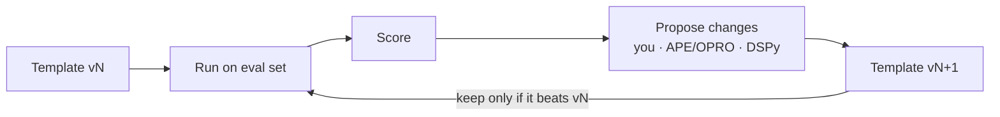
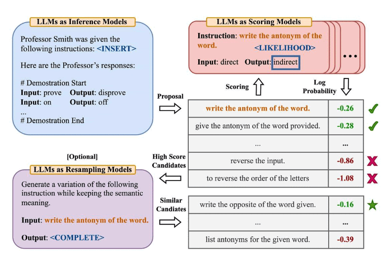
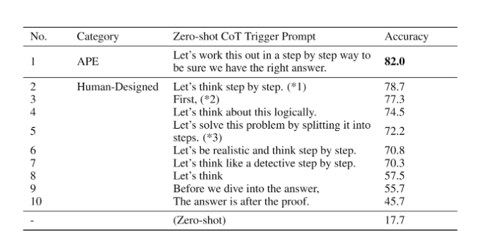
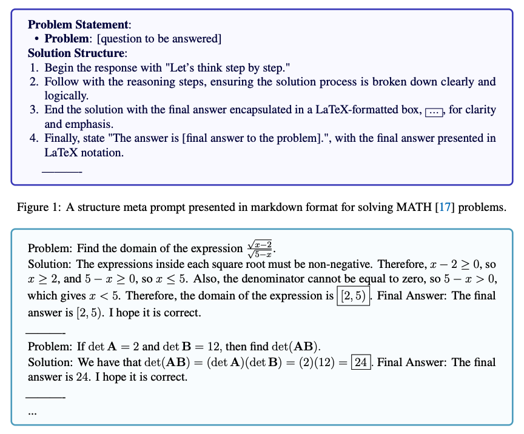
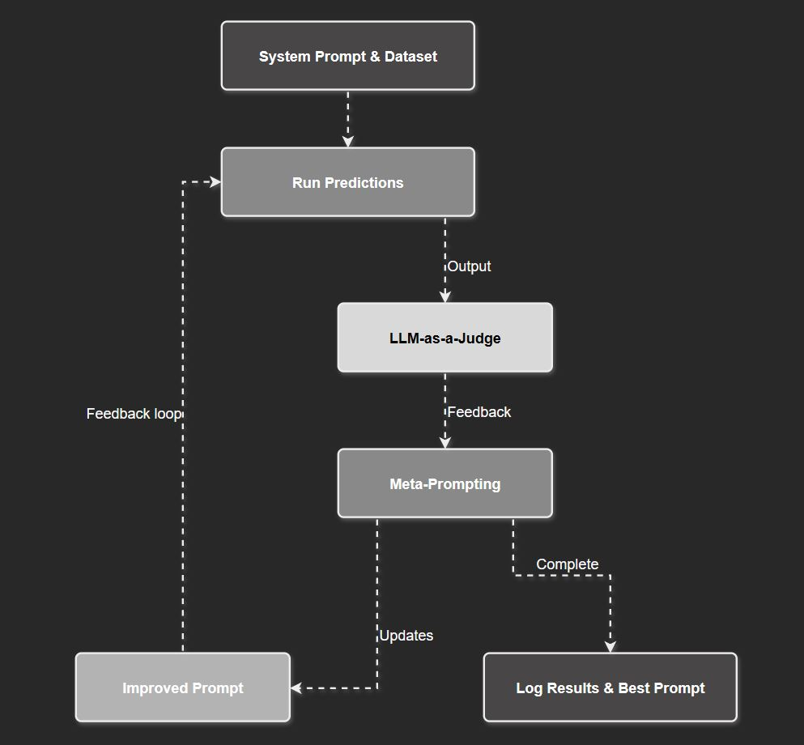

# 8 — Prompt Optimization

> Treating the prompt as an artifact you can search over, version and regression-test, and letting models do part of the writing. Everything here assumes you have an eval ([09](09-evaluating-prompts.md)). An optimizer without a metric is just a rewriter.

Tuning a prompt by feel stops working once a one-word edit can move your scores and nobody remembers which version shipped. Without versions and a metric, you re-try ideas that already failed and can't tell a real gain from noise. This chapter treats the prompt as an artifact you can search over, version and regression-test.

---

## The loop



The proposer can be you, an LLM (APE, OPRO, meta-prompting), or a framework (DSPy, TextGrad, GEPA). The parts that matter are the same in every case: **a fixed eval set, a metric, and a record of every version.**

A survey of black-box automatic prompt optimization sorts every method by five choices that map onto this loop: the seed prompt (hand-written, or induced by an LLM from demonstrations), how a run is scored (task metric, reward model, output likelihood, LLM or human feedback), how candidates are generated (edits, mutation, a trained rewriter, a metaprompt, program synthesis), how survivors are kept (top-k or a bandit such as UCB) and how deep to iterate. It frames the goal as maximising the expected metric over a validation set, which it calls intractable for discrete token search, so every method approximates it. Its cost figures are the only ones it gives: optimizing a system prompt with SPRIG took close to 60 hours against about 10 minutes per task for ProTeGi's task-prompt optimization, as the survey relays them with no model or hardware stated. It reports no experiments of its own, covers work to early 2025, and excludes gradient-based methods and soft prompts, so use it as a map and go to the primary papers for sizes ([arXiv:2502.16923](https://arxiv.org/abs/2502.16923) (Ramnath et al., EMNLP 2025)).

---

## Prompts as versioned artifacts

- **Template ≠ prompt.** Version the template (static instructions plus slots), not the rendered string ([02](02b-document-types-formatting-and-templates.md#prompt-templates)).
- **Store it like code**: in the repo or a prompt registry, with an ID, a version, the model it was tuned on, and its eval score.
- **Pin the model version** next to the prompt. A prompt tuned on one model is not portable. Re-run the evals when either changes. Jahani et al. measured how much of an upgrade's gain is the prompt catching up with the model: in a preregistered experiment with 1,893 Prolific participants writing 18,560 prompts to replicate target images, DALL-E 3 beat DALL-E 2 by 0.0164 CLIP cosine (about 0.19 SD), and replaying each arm's prompts on the other model split that gain into a model effect (51%) and a prompting effect (48%): DALL-E 3 users wrote 24% longer prompts that only paid off on DALL-E 3. Routing the same users through a hidden GPT-4 prompt rewriter cut DALL-E 3's gain by 58% (95% CI 40–76%). On a logo-design task scored by pairwise judge the prompting share fell to 7%, so the split is task-dependent. One text-to-image upgrade, memoryless interface ([arXiv:2407.14333](https://arxiv.org/abs/2407.14333) (Jahani et al., 2024-07, preprint, v7 2026-01)).
- **Diff behavior, not text.** A one-word change can move the scores; run the regression suite on every edit.
- **Log production I/O per prompt version** — it's your next eval set and the training data for optimizers ([06](06-chaining-and-workflows.md#operating-a-workflow)).

**Keep prompts out of application code.** Put them in their own module or file. That way they can be reused across apps, tested separately from the code, and edited by domain experts who don't read Python. When there are many prompts, wrap each one in a record that carries its metadata (*AI Engineering*, ch. 5):

```python
class Prompt(BaseModel):
    prompt_text: str
    model_name: str            # the model it was tuned on
    application: str
    creator: str
    date_created: datetime
    sampling: dict = {}        # temperature, top_p
    output_schema: dict | None = None
```

File formats such as Firebase's [Dotprompt](https://firebase.google.com/docs/genkit/dotprompt) put the model, input schema and output schema in YAML front matter above the template. **Git or a catalog?** Versioning prompts in the same repo as the code is simple, but when apps share a prompt, an edit forces every consumer onto the new version together. A separate **prompt catalog** versions each prompt on its own, so one team can stay pinned to v3 while another moves to v4. A good catalog also records which apps depend on each prompt and tells their owners when a new version lands.

---

## APE — automatic prompt engineer

Zhou et al. (2022) framed instruction-writing as black-box search:

1. An LLM sees input/output demonstrations and **generates candidate instructions**.
2. Each candidate is run on a **target model** and scored. The default score is execution accuracy on random subsets of the training examples (the final test uses a held-out set). It tracked test accuracy better than the log-probability of the correct output, the alternative the authors tried.
3. Keep the best, optionally resample variants of it, and repeat. Repeating gave only marginal gains, levelling off after about three rounds, so the default is a single round of 50 candidates.


*Propose instructions from demonstrations, score each on the target model, and resample near the winners. Zhou et al. (2022), via DAIR.*

With text-davinci-002, the instructions APE chose matched or beat human-written ones on all 24 Instruction Induction tasks and on 17 of 21 BIG-Bench tasks (interquartile mean 0.810 against 0.749 on the 24) ([arXiv:2211.01910](https://arxiv.org/abs/2211.01910) (Zhou et al., ICLR 2023)). The score can be gamed. On a rhyming task, 4 of the 5 best instructions told the model to echo the input word, which scores near-perfectly because every word rhymes with itself. Instructions found for InstructGPT also lost much of their gain when used on base GPT-3, and the reverse, so search on the model you will run.

The famous result: APE found a better zero-shot CoT trigger than *"Let's think step by step"*. Here the score was different: the likelihood of reasoning chains that "Let's think step by step" had produced and that reached the right answer. **"Let's work this out in a step by step way to be sure we have the right answer"** scored 82.0 on MultiArith against 78.7 for the human-written trigger, and 43.0 on GSM8K against 40.7. It helped on only 6 of the 12 reasoning tasks tried. The table also shows how much the wording alone moves accuracy: on MultiArith, human-written triggers range from 45.7 to 78.7, and no trigger at all gets 17.7:


*Image Source: Zhou et al. (2022), via DAIR*

Related work, in the same spirit:
- **OPRO** (2023) — the LLM is the optimizer, shown past prompts and their scores in its context. Found *"Take a deep breath and work on this problem step-by-step."*, which scored 80.2% on GSM8K with PaLM 2-L against 71.8% for "Let's think step by step". Across scorer models the best optimized prompts beat human-written ones by up to 8 points on GSM8K and up to 50 on Big-Bench Hard tasks ([arXiv:2309.03409](https://arxiv.org/abs/2309.03409), Yang et al., ICLR 2024). Each scorer model converged on a different best prompt, so re-run the search when you change models.
- **LM-BFF** (2021) — the earlier, pre-chat case for search. On RoBERTa-large with 16 examples per class, swapping two label words moved SST-2 from 92.7% (*great/terrible*) to 83.2% (*terrible/great*), and swapping the sentence order in an SNLI template cost more than 10 points. Templates generated by T5 and picked on a small dev set matched hand-written ones (SST-2 92.3 vs 92.7) and beat them where a manual template is hard to guess (TREC 88.2 vs 84.8). Automatic label-word search was less reliable: worse on SNLI, and it picked "Hi" for *entailment* ([DOI:10.18653/v1/2021.acl-long.295](https://doi.org/10.18653/v1/2021.acl-long.295) (Gao et al., ACL 2021)). The setup is prompt-based fine-tuning of RoBERTa-large, a masked LM, not prompting a chat model, so treat the numbers as evidence that wording matters, not as a size estimate for your model.
- **UPRISE** (2023) — picks demonstrations per input instead of rewriting the prompt. A bi-encoder retriever is trained on labels from a frozen GPT-Neo-2.7B (a prompt counts as positive if it raises the score on a training example), then prepends the top 3 prompts from a pool of other tasks' examples to a zero-shot input. On task clusters held out of training, with that same tuning model, reading-comprehension accuracy averaged 31.6 against 40.1 and paraphrase detection 47.0 against 61.6. The retriever carried over unchanged to BLOOM-7.1B, OPT-66B and the GPT-3 models (closed-book QA 26.2 to 29.8 on davinci), but it lowered coreference scores on every model tested (OPT-66B 73.1 to 68.0) and commonsense on GPT-Neo only (63.9 to 62.2) and text-davinci-001 (79.9 to 79.1). It beat a pool of raw text on every cluster. The "zero-shot" in its title still prepends three retrieved demonstrations, retriever training took 36 hours on 8 V100s, and the models are 2020 to 2022 vintage, with a ChatGPT check on 66 to 100 human-judged samples per set ([arXiv:2303.08518](https://arxiv.org/abs/2303.08518) (Cheng et al., EMNLP 2023)).
- **OpenICL** (2023) — not a method but the harness that makes demonstration-selection methods comparable. It splits in-context learning into a retriever (random, BM25, TopK, VoteK, entropy- or MDL-based) and an inferencer (direct, [perplexity](../../../generative-ai/01-llm-fundamentals/notes/06-pretraining-data-and-objectives.md#entropy-cross-entropy-kl-and-perplexity), channel, chain-of-thought), so components can be swapped independently, and its evaluation runs GPT-Neo-2.7B, XGLM-7.5B and text-davinci-003 on SST-2, PiQA, WMT16 de-en, Gigaword and GSM8K. Its evaluation is a showcase of what the toolkit can chain, with no comparison table of retrievers, so read it as tooling, not evidence that TopK beats random ([arXiv:2303.02913](https://arxiv.org/abs/2303.02913) (Wu et al., 2023-03, preprint)).
- **Mixtures of In-Context Learners** (2024) — treats subsets of the demonstrations as experts and mixes their next-token log-probabilities with learned weights, which may be negative. On Llama-3-8B-Instruct with 30 demonstrations and 5 seeds, it beat plain concatenation on 5 of 7 classification sets (TweetEval Offensive 76.44 to 81.33; Hate 53.54 to 66.52 with 10 subsets) and lost on RTE (86.43 to 79.93 to 84.12). Uniform weights did not help (Offensive 73.37), and keeping only positive weights fell to 76.05, so the learned weights, including negative ones, carry the gain. With the 30 demonstrations half drawn from SST-2, concatenation dropped to 70.67 while the mixture held 80.95; with 29 of 30 labels "offensive", concatenation collapsed to 28.49 against 77.77. It needs token [logits](../../../generative-ai/01-llm-fundamentals/notes/04-decoding-and-inference-behaviour.md#decoding), so no black-box API, labelled data to tune the weights and k forward passes per prediction, and on clean NQ-open generation it did not beat concatenation. Mostly one dataset, 8B to 70B Llama models, no significance tests ([arXiv:2411.02830](https://arxiv.org/abs/2411.02830) (Hong et al., 2024-11, preprint)).
- **Prompt-MII** — meta-learn the instruction writer instead of searching per task. Xiao et al. train Llama-3.1-8B-Instruct (and separately Qwen-2.5-7B-Instruct) with GRPO on 3,430 HuggingFace classification datasets to turn n labelled examples into one instruction in a single call, with the same model as follower. On 90 unseen classification sets (200 test items each), the instruction induced from 20 examples gave Llama-3.1-8B-Instruct 0.433 macro-F1 with 901 prompt tokens, against 0.430 for 100-shot ICL at 11,531 tokens, 12.8× fewer, and beat APE (0.278–0.358) and GEPA (0.296–0.347) that spend hundreds to thousands of calls. On Qwen-2.5-7B 100-shot ICL still won (0.482 against 0.441). Classification only, 7–8B generators and followers ([arXiv:2510.16932](https://arxiv.org/abs/2510.16932) (Xiao et al., 2025-10, preprint)).
- **Prompt-OIRL** — offline inverse RL to choose query-dependent prompts.
- **AutoPrompt**, **prefix tuning**, **prompt tuning** — gradient-based search over discrete tokens or continuous "soft prompts." These need model access, and are closer to fine-tuning ([04](04-controlling-output.md#when-prompting-isnt-enough-fine-tuning)). **PEZ** keeps a soft prompt, projects it to the nearest vocabulary tokens for each gradient step and updates the soft copy. Optimized on GPT-2 Large for SST-2 and moved to other models unchanged, its 10-token prompts reached 63.3% on T5-LM-XL against 52.8% with no prompt, and 72.4% on OPT-6.7B against 58.7%; on the source model it only matched the other hard-prompt methods (88.05% against 88.33%) and trailed the soft prompt (93.35%). The prompts are often gibberish, it was optimized on GPT-2 Large and tested on GPT-2 XL, T5-LM-XL and OPT, on three classification sets, and it needs gradients, so it is no tool for tuning an API prompt ([arXiv:2302.03668](https://arxiv.org/abs/2302.03668) (Wen et al., 2023-02, preprint)).

The lesson is not the magic phrases, which are model-specific and dated, but that **search against a metric beats intuition** once you have one.

---

## Meta-prompting

The term is used in two senses.

**1. Structure-oriented prompting** (Zhang et al., 2024). Give the model an abstract *template* for solving a class of problems rather than worked content examples:

```
Problem: [question]
Solution structure:
  1. Identify the given quantities and what is asked.
  2. State the relevant formula or principle.
  3. Substitute and compute step by step.
  4. Final answer: \boxed{[answer]}
```


*Top: the structure meta-prompt. Bottom: example solutions that follow it. Zhang et al. (2024), via DAIR.*

Compared with few-shot it's token-efficient, avoids anchoring on specific example content ([03](03-core-techniques.md#few-shot)), and behaves like zero-shot. It assumes the model already knows the domain, so it degrades on genuinely novel tasks.

**2. Using a model to write prompts.** This is the common sense of the term in practice:
- Ask a strong (often reasoning) model to draft a system prompt from a task description, or to **critique and rewrite** an existing one given failing cases.
- Vendor tools do this: Anthropic's prompt generator and prompt improver, and OpenAI's playground optimizer.
- The **evaluator–optimizer** pattern automates it: a judge scores outputs, writes feedback, and a meta-prompt turns that feedback into a revised prompt ([06](06-chaining-and-workflows.md#workflow-patterns-anthropics-taxonomy), [07](07-prompting-reasoning-models.md#where-reasoning-models-earn-their-cost)). Before you feed a judge's critique to that loop, [test whether it reports what drove the verdict](../../../generative-ai/08-eval/notes/14-calibrating-judges-with-checks-and-critiques.md#part-4-test-whether-a-critique-reports-what-drove-the-verdict).


*Each round, the judge's feedback goes to a meta-prompt that rewrites the system prompt, and the best version is logged. DAIR, Reasoning LLMs Guide.*

Generated prompts are a **first draft, not a result** — they still have to win on your eval.

**Conversational Prompt Engineering** replaces the labelled set with a chat. Ein-Dor et al., [arXiv:2408.04560](https://arxiv.org/abs/2408.04560) (IBM Research, 2024-08, preprint), use a Llama-3-70B chat that asks about the task, needs only three or more unlabelled examples and no seed prompt, drafts an instruction, shows outputs on the user's examples, takes feedback, and ends with a few-shot prompt whose examples are the outputs the user approved. In a study of 12 sessions on summarization (five small datasets, 112 test examples), blinded raters ranked the zero-shot and few-shot CPE prompts best in 53% and 47% of cases, a difference that was not significant, so the authors drop the few-shot examples as unnecessary. Sessions took about 25 minutes and 32 turns. It was not compared with APE or OPRO and no labelled metric was used, with one rater per session and prompt-savvy researchers as users, so it is a way to get a first draft when you have no eval set yet, not a replacement for the loop above.

---

## DSPy and programmatic optimization

**DSPy** replaces hand-written prompts with *signatures* (`question -> answer`) and *modules* (`ChainOfThought`, `ReAct`). An **optimizer** (teleprompter) then compiles the program against a metric and a training set:

- **Few-shot selection** — bootstraps demonstrations from successful runs and picks which examples to include, and in what order. This directly addresses the book's few-shot drawbacks: anchoring and spurious order patterns ([03](03-core-techniques.md#few-shot)).
- **Instruction optimization** — proposes and searches over instruction wordings (MIPRO-style).
- **Fine-tuning** — can distill the compiled program into weights.

**TextGrad** does a similar job with "textual gradients": LLM-written critiques propagated back through a pipeline to revise each component's prompt. Optimizing a system prompt for gpt-3.5-turbo, with GPT-4o writing the critiques on 36 training examples, lifted GSM8K from 72.9% to 81.1% with instructions alone, matching DSPy's 8-shot bootstrapped prompt; its headline GPQA gain for GPT-4o (51% to 55%) came from refining each answer at test time, not from a better prompt ([arXiv:2406.07496](https://arxiv.org/abs/2406.07496), Yuksekgonul et al., Nature 2025). **Promptbreeder** (Fernando et al., DeepMind, 2023) treats the search as evolution. An LLM mutates a seed prompt, guided by a set of *mutator prompts*, and the best mutants are mutated again until one meets the target.

**GEPA** combines the two ideas. It runs the pipeline, has an LLM read the full traces (reasoning, tool calls, tool outputs, evaluator feedback) and diagnose what went wrong, and then rewrites one module's prompt. Instead of keeping only the single best prompt, it keeps every candidate that is best on at least one training example (a Pareto front) and mutates from those. On six benchmarks (multi-hop QA, instruction following, privacy-aware delegation, retrieval-augmented claim verification and two math sets) with Qwen3 8B, GEPA improved the average over the unoptimized baseline by 9.62 points. GRPO fine-tuning with 24,000 rollouts improved it by 3.68, and MIPROv2 by 2.61. GEPA beat GRPO on every benchmark except AIME. In the authors' summary, "GEPA outperforms GRPO by 6% on average and by up to 20%, while using up to 35x fewer rollouts." With GPT-4.1 Mini, it gained 12.19 points against 5.64 for MIPROv2 and 6.11 for TextGrad. Two details matter in practice. Choosing candidates from the Pareto front gained 12.44 points where always mutating the current best gained 6.05. GEPA's prompts were also up to 9.2× shorter than MIPROv2's, because it writes instructions rather than piling in few-shot examples ([arXiv:2507.19457](https://arxiv.org/abs/2507.19457) (Agrawal et al., ICLR 2026)). The method needs a metric that can also return text feedback, such as which constraint failed or which document was missing, and not only a score.

**SkillOpt** applies this loop to an agent's skill file. A frozen target model runs a batch with the current skill, and a separate optimizer model reads the failures and successes and proposes add, delete and replace edits, clipped to an edit budget the authors call a textual learning rate. An edit stays only if it strictly beats the current skill on a held-out selection split, so ties are rejected. On GPT-5.5 in direct chat, the six-benchmark average went from 58.8 with no skill to 82.3, with the best baseline per cell at 76.9. So the gain against no skill is 23.5 points. The gain against that best-per-cell oracle is 5.4, and against the best single baseline, the curated "human skill" at 73.65, it is 8.6 (our calculation from Table 1). Compare methods on those two numbers. In agent harnesses, on GPT-5.5 and five benchmarks, the gains over no skill were 24.8 points in Codex and 19.1 in Claude Code. In the runs the authors cost out, the final skills ran 379 to 1,995 tokens from 1 to 4 accepted edits, at 20.8M to 213.8M training tokens a run and no optimizer calls at deployment. Those runs may not be the headline ones, because their cost per point doesn't reconcile with the headline gains. Skills trained on GPT-5.4 helped mini and nano but mostly fell short of skills trained on those models: nano on SpreadsheetBench scored 26.5, against 23.5 with no skill and 42.5 for its own. Treat the sizes as provisional. It is a preprint with the authors' own baselines and one split seed, with no repeats or error bars. Two table rows that both use the default edit budget of 4 (Table 2d and Table 3's "lr=4 (default)") differ by 4.8 points on LiveMath (56.5 against 61.3), which is more than 38 of its 52 per-cell margins over the best baseline (our count from Table 1). Our reading of the tables: on the three benchmarks it sweeps, the GPT-5.5 headline cells match sweep values (87.3 and 80.7 with a constant schedule, 66.9 at lr=8), not the default row (87.1, 77.5, 61.3), and the paper doesn't say how they were chosen. It also has no run without the gate, so it can't show how much of the gain the gate provides. The authors say it applies most directly with automatic verifiers or similarly reliable feedback, and that the training cost suits reused skills better than one-off tasks ([arXiv:2605.23904](https://arxiv.org/abs/2605.23904) (Yang et al., 2026-05, preprint)).

**The loop itself may be optional.** Singh et al. hand an unmodified coding agent (Claude Code with Claude Sonnet 5) a static file of agent trajectories and a one-paragraph instruction to analyse it and write a skill file, with no environment access and no fresh rollouts. The agent computes corpus-wide statistics in code (one run found 123 exact duplicates among 284 calls to one lookup tool, and a task category failing 24 of 24 attempts) and writes rules with numbers in them: 54 quantitative citations across 12 skills, none in the four GEPA prompts. With GPT-5.4-mini as the target and the same 35 to 50 rollouts for every optimizer, the one-pass skill gained 16.6 points on average over ALFWorld, τ²-bench retail and telecom and SpreadsheetBench-Verified, against 10.9 for GEPA and 5.3 for SkillOpt, at about $1.60 per prompt. GEPA still won SpreadsheetBench (60.7 against 51.3), fell below baseline on telecom when it had no held-out validation set (17.5 against 19.2), and SkillOpt won telecom once given unrestricted rollouts at $74.7. Three seeds, test sets of 40 to 50 tasks, so several gaps sit inside the standard deviations, and the distiller's $1.60 excludes the rollouts it reads ([arXiv:2609.26261](https://arxiv.org/abs/2609.26261) (Singh et al., 2026-08, preprint)). The practical reading: before paying for a search loop, let a coding agent read your traces whole.

Use these when you have a multi-step pipeline, a scorable metric, and dozens to hundreds of labeled examples. Skip them for one-off prompts or tasks you can't score automatically.

Optimized prompts can still overfit their eval set. de Wynter found an APO-optimized prompt lost accuracy as test inputs moved away from the training distribution: the slope was −0.5, against −0.4 for a plain prompt and −1.4 for CoT, on nine synthetic formal-language tasks ([arXiv:2509.10414](https://arxiv.org/abs/2509.10414) (de Wynter, 2025-09)). Hold out test cases that differ from the ones the optimizer saw.

### Before trusting a prompt tool

Huyen's three warnings (*AI Engineering*, ch. 5):

- **Hidden API calls.** Ten variants scored on 30 eval examples is already 300 calls. If each one also needs a validation call ("is this valid JSON?") and a scoring call, that's 900. A tool allowed to design its own chains can grow the bill without limit. Count the calls before you run it.
- **Tool bugs.** The tool might use the wrong chat template ([01](01-how-models-read-prompts.md#property-5--chat-models-are-completion-models-wearing-a-transcript)), concatenate tokens instead of text, or ship typos in its default prompts. LangChain's default critique prompt had several typos. Tools also change their defaults without warning.
- **Show me the prompt.** Write the first version by hand, so you learn the model and your requirements. Then read every prompt a tool generates before you trust it (Husain, [*Fuck You, Show Me the Prompt*](https://hamel.dev/blog/posts/prompt/), 2024).

---

## A manual optimization checklist

Before reaching for a framework:

1. **Find the failure category** in the eval results — format, missing context, wrong reasoning, instruction ignored.
2. **Fix the cheapest layer first**: clarity of the instruction ([02](02-prompt-anatomy.md#writing-instructions)) → missing context → ordering → examples → CoT → splitting the task ([06](06-chaining-and-workflows.md)) → a stronger model → fine-tuning. Ordering includes the assembly's knobs: the priority tiers, scores and elastic versions that decide which snippets make the cut are parameters to tune against the eval like any wording (book, Ch 6; [02](02b-document-types-formatting-and-templates.md#formatting-injected-content)). A stronger model costs money and latency. When the book was written, GPT-4 could cost 20 times as much as gpt-3.5-turbo, and early Copilot chose the small, fast Codex model because users would not wait for a bigger one (book, Ch 4).
3. **Change one thing at a time** and re-score.
4. **Keep the losers.** Recording what didn't work stops you re-trying it.

---

## Go deeper

- Papers (APE, OPRO, meta-prompting, DSPy, TextGrad, soft prompts): [references.md](../references.md#prompt-optimization)
- Book: [Ch 9 PDF](../sources/prompt-eng-for-llms/reading/09-llm-workflows.pdf) (collecting task I/O for optimization)

---

## Pitfalls

- **Running an optimizer with no real metric.** Symptom: prompts that change every run and scores that don't improve, because an optimizer without a metric is just a rewriter. Fix: fix the eval set and metric first, and keep only versions that beat the current one.
- **Copying a magic phrase.** Symptom: "Take a deep breath" gives no lift on your model. OPRO's scorers each converged on a different best prompt. Fix: copy the search, not the string, and re-run it when the model changes.
- **Overfitting the eval set.** Symptom: scores rise offline and production doesn't move. de Wynter measured accuracy falling as test inputs moved away from training, for optimized prompts too. Fix: hold out test cases that differ from what the optimizer saw.
- **Counting prompts instead of API calls.** Symptom: a surprising bill. Huyen's 10 variants on 30 examples is 300 calls, or 900 with a validation and a scoring call each. Fix: count before you run, and cap what a tool may chain.
- **Quoting the gain over no prompt as the method's gain.** Symptom: an optimizer sounds decisive and barely beats a simpler one. SkillOpt's +23.5 points over no skill on GPT-5.5 in direct chat is +5.4 over the best baseline per cell ([arXiv:2605.23904](https://arxiv.org/abs/2605.23904), preprint). Fix: compare against the best alternative, on a held-out split, with repeated runs.
- **Trusting a tool's default prompts.** Symptom: quality that shifts between versions or is oddly low, from a wrong chat template or a typo (LangChain's default critique prompt had several). Fix: write the first version by hand, then read every prompt a tool generates.
- **A score-only metric for GEPA.** Symptom: the reflection step has nothing to diagnose. Fix: return text feedback as well, such as which constraint failed or which document was missing.
- **One shared prompt across apps in a single repo.** Symptom: an edit forces every consumer onto the new version together. Fix: use a catalog that versions each prompt, so one team can stay on v3 while another moves to v4.

## Try it

1. A tool scores 5 prompt variants on 50 examples, with one validation call and one scoring call per output. How many API calls is that? Which tool setting would most worry you?
   <details><summary>Answer</summary>5 x 50 x 3 = 750 calls. The worry is any setting letting the tool design its own chains, because that removes the upper bound on calls. Cap it and count before running.</details>
2. Use the [prompt eval harness](../practice/prompt-eval-harness/README.md) to run two prompt versions on its cases, and write the record you would store for the winner. What fields does the record need beyond the text?
   <details><summary>Answer</summary>Those in the note's `Prompt` model: the model it was tuned on (pinned), application, creator, date and sampling parameters, plus the output schema, an ID and version, and its eval score. Keep the loser too, so nobody re-tries it.</details>
3. A classifier's eval shows most failures are "instruction ignored". You could add few-shot examples, split the task, or buy a stronger model. Using the checklist, what's your order, and what do you change at once?
   <details><summary>Answer</summary>Clarity of the instruction first, then missing context, ordering, examples, CoT, splitting, a stronger model and fine-tuning. Change one thing at a time and re-score, because that is the only way to attribute a gain.</details>

## Interview checklist

| Prompt | Answer in one line |
|---|---|
| How does APE work? | An LLM generates candidate instructions from demonstrations, each is scored on a target model, and the best are kept and resampled. It found a trigger scoring 82.0 on MultiArith against 78.7 for "Let's think step by step". |
| What's the lasting lesson of OPRO's "Take a deep breath"? | Not the phrase, which is model-specific: 80.2% against 71.8% on GSM8K with PaLM 2-L, with a different winner per scorer. Search against a metric beats intuition once you have one. |
| What are the two meanings of meta-prompting? | Structure-oriented templates for a class of problems (Zhang et al.), and using a model to write or critique prompts. Generated prompts are a first draft that must still win on your eval. |
| How does GEPA differ from keeping the best prompt? | An LLM reads full traces to diagnose failures, and it keeps a Pareto front of candidates best on at least one example. The front gained 12.44 points where mutating the current best gained 6.05. |
| When is DSPy worth it? | With a multi-step pipeline, a scorable metric, and dozens to hundreds of labeled examples. Skip it for one-off prompts or tasks you can't score automatically. |
| Prompts in git or a catalog? | Same-repo git is simple, but moves all consumers together. A catalog versions each prompt on its own and can tell owners when a new version lands, which pays off when apps share prompts. |
| Your team wants a stronger model because quality is short. What do you check first? | The cheaper layers: instruction clarity, context, ordering, examples, CoT, splitting. A stronger model costs money and latency, which is why early Copilot chose the small, fast Codex. |

## Next

[Evaluating prompts](09-evaluating-prompts.md): every method here depends on the metric, so that comes next.
