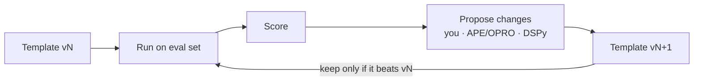
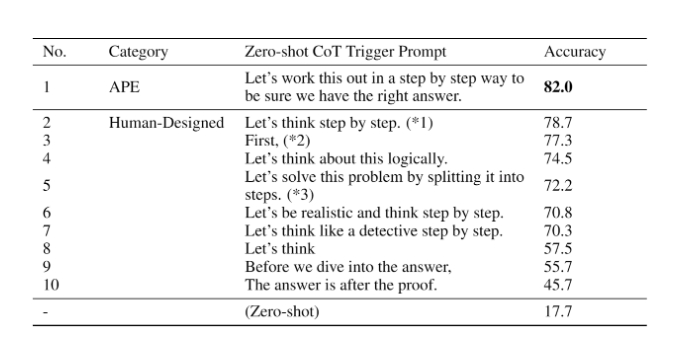
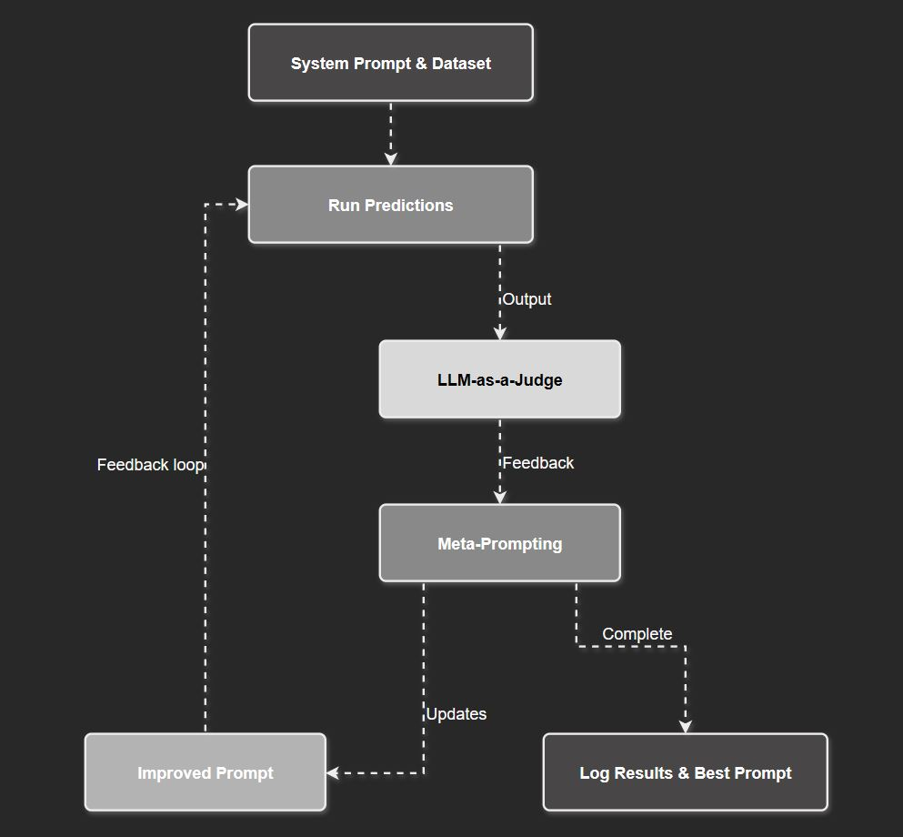

# 8 — Prompt Optimization

> Treating the prompt as an artifact you can search over, version and regression-test, and letting models do part of the writing. Everything here assumes you have an eval ([09](09-evaluating-prompts.md)). An optimizer without a metric is just a rewriter.

---

## The loop



The proposer can be you, an LLM (APE, OPRO, meta-prompting), or a framework (DSPy, TextGrad). The parts that matter are the same in every case: **a fixed eval set, a metric, and a record of every version.**

---

## Prompts as versioned artifacts

- **Template ≠ prompt.** Version the template (static instructions plus slots), not the rendered string ([02](02-prompt-anatomy.md#prompt-templates)).
- **Store it like code**: in the repo or a prompt registry, with an ID, a version, the model it was tuned on, and its eval score.
- **Pin the model version** next to the prompt. A prompt tuned on one model is not portable. Re-run the evals when either changes.
- **Diff behavior, not text.** A one-word change can move the scores; run the regression suite on every edit.
- **Log production I/O per prompt version** — it's your next eval set and the training data for optimizers ([06](06-chaining-and-workflows.md#operating-a-workflow)).

**Keep prompts out of application code.** Put them in their own module or file. That way they can be reused across apps, tested separately from the code, and edited by domain experts who don't read Python. When there are many prompts, wrap each one in a record that carries its metadata (*AI Engineering*, ch. 5):

```python
class Prompt(BaseModel):
    prompt_text: str
    model_name: str            # the model it was tuned on
    application: str
    creator: str
    date_created: datetime
    sampling: dict = {}        # temperature, top_p
    output_schema: dict | None = None
```

File formats such as Firebase's [Dotprompt](https://firebase.google.com/docs/genkit/dotprompt) put the model, input schema and output schema in YAML front matter above the template. **Git or a catalog?** Versioning prompts in the same repo as the code is simple, but when apps share a prompt, an edit forces every consumer onto the new version together. A separate **prompt catalog** versions each prompt on its own, so one team can stay pinned to v3 while another moves to v4. A good catalog also records which apps depend on each prompt and tells their owners when a new version lands.

---

## APE — automatic prompt engineer

Zhou et al. (2022) framed instruction-writing as black-box search:

1. An LLM sees input/output demonstrations and **generates candidate instructions**.
2. Each candidate is run on a **target model** and scored.
3. Keep the best, optionally resample variants of it, and repeat.


*Propose instructions from demonstrations, score each by the log-probability of the correct outputs, and resample near the winners. Zhou et al. (2022), via DAIR.*

The famous result: APE found a better zero-shot CoT trigger than *"Let's think step by step"*. **"Let's work this out in a step by step way to be sure we have the right answer"** improved MultiArith and GSM8K. On MultiArith it scored 82.0 against 78.7 for the human-written trigger. The table also shows how much the wording alone moves the score: human-written triggers range from 45.7 to 78.7, and no trigger at all gets 17.7:


*Image Source: Zhou et al. (2022), via DAIR*

Related work, in the same spirit:
- **OPRO** (2023) — the LLM is the optimizer, shown past prompts and their scores in its context. Found *"Take a deep breath and work on this problem step-by-step."*, which scored 80.2% on GSM8K with PaLM 2-L against 71.8% for "Let's think step by step". Across scorer models the best optimized prompts beat human-written ones by up to 8 points on GSM8K and up to 50 on Big-Bench Hard tasks ([arXiv:2309.03409](https://arxiv.org/abs/2309.03409), Yang et al., 2023-09). Each scorer model converged on a different best prompt, so re-run the search when you change models.
- **Prompt-OIRL** — offline inverse RL to choose query-dependent prompts.
- **AutoPrompt**, **prefix tuning**, **prompt tuning** — gradient-based search over discrete tokens or continuous "soft prompts." These need model access, and are closer to fine-tuning ([04](04-controlling-output.md#when-prompting-isnt-enough-fine-tuning)).

The lesson is not the magic phrases, which are model-specific and dated, but that **search against a metric beats intuition** once you have one.

---

## Meta-prompting

The term is used in two senses.

**1. Structure-oriented prompting** (Zhang et al., 2024). Give the model an abstract *template* for solving a class of problems rather than worked content examples:

```
Problem: [question]
Solution structure:
  1. Identify the given quantities and what is asked.
  2. State the relevant formula or principle.
  3. Substitute and compute step by step.
  4. Final answer: \boxed{[answer]}
```


*Top: the structure meta-prompt. Bottom: example solutions that follow it. Zhang et al. (2024), via DAIR.*

Compared with few-shot it's token-efficient, avoids anchoring on specific example content ([03](03-core-techniques.md#few-shot)), and behaves like zero-shot. It assumes the model already knows the domain, so it degrades on genuinely novel tasks.

**2. Using a model to write prompts.** This is the common sense of the term in practice:
- Ask a strong (often reasoning) model to draft a system prompt from a task description, or to **critique and rewrite** an existing one given failing cases.
- Vendor tools do this: Anthropic's prompt generator and prompt improver, and OpenAI's playground optimizer.
- The **evaluator–optimizer** pattern automates it: a judge scores outputs, writes feedback, and a meta-prompt turns that feedback into a revised prompt ([06](06-chaining-and-workflows.md#workflow-patterns-anthropics-taxonomy), [07](07-prompting-reasoning-models.md#where-reasoning-models-earn-their-cost)).


*Each round, the judge's feedback goes to a meta-prompt that rewrites the system prompt, and the best version is logged. DAIR, Reasoning LLMs Guide.*

Generated prompts are a **first draft, not a result** — they still have to win on your eval.

---

## DSPy and programmatic optimization

**DSPy** replaces hand-written prompts with *signatures* (`question -> answer`) and *modules* (`ChainOfThought`, `ReAct`). An **optimizer** (teleprompter) then compiles the program against a metric and a training set:

- **Few-shot selection** — bootstraps demonstrations from successful runs and picks which examples to include, and in what order. This directly addresses the book's few-shot drawbacks: anchoring and spurious order patterns ([03](03-core-techniques.md#few-shot)).
- **Instruction optimization** — proposes and searches over instruction wordings (MIPRO-style).
- **Fine-tuning** — can distill the compiled program into weights.

**TextGrad** does a similar job with "textual gradients": LLM-written critiques propagated back through a pipeline to revise each component's prompt. It took GPT-4o's zero-shot accuracy on GPQA from 51% to 55% ([arXiv:2406.07496](https://arxiv.org/abs/2406.07496), Yuksekgonul et al., 2024-06). **Promptbreeder** (Fernando et al., DeepMind, 2023) treats the search as evolution. An LLM mutates a seed prompt, guided by a set of *mutator prompts*, and the best mutants are mutated again until one meets the target.

Use these when you have a multi-step pipeline, a scorable metric, and dozens to hundreds of labeled examples. Skip them for one-off prompts or tasks you can't score automatically.

### Before trusting a prompt tool

Huyen's three warnings (*AI Engineering*, ch. 5):

- **Hidden API calls.** Ten variants scored on 30 eval examples is already 300 calls. If each one also needs a validation call ("is this valid JSON?") and a scoring call, that's 900. A tool allowed to design its own chains can grow the bill without limit. Count the calls before you run it.
- **Tool bugs.** The tool might use the wrong chat template ([01](01-how-models-read-prompts.md#property-5--chat-models-are-completion-models-wearing-a-transcript)), concatenate tokens instead of text, or ship typos in its default prompts. LangChain's default critique prompt had several typos. Tools also change their defaults without warning.
- **Show me the prompt.** Write the first version by hand, so you learn the model and your requirements. Then read every prompt a tool generates before you trust it (Husain, [*Fuck You, Show Me the Prompt*](https://hamel.dev/blog/posts/prompt/), 2024).

---

## A manual optimization checklist

Before reaching for a framework:

1. **Find the failure category** in the eval results — format, missing context, wrong reasoning, instruction ignored.
2. **Fix the cheapest layer first**: clarity of the instruction ([02](02-prompt-anatomy.md#writing-instructions)) → missing context → ordering → examples → CoT → splitting the task ([06](06-chaining-and-workflows.md)) → a stronger model → fine-tuning. Ordering includes the assembly's knobs: the priority tiers, scores and elastic versions that decide which snippets make the cut are parameters to tune against the eval like any wording (book, Ch 6; [02](02-prompt-anatomy.md#formatting-injected-content)). A stronger model costs money and latency. When the book was written, GPT-4 could cost 20 times as much as gpt-3.5-turbo, and early Copilot chose the small, fast Codex model because users would not wait for a bigger one (book, Ch 4).
3. **Change one thing at a time** and re-score.
4. **Keep the losers.** Recording what didn't work stops you re-trying it.

---

## Go deeper

- Papers (APE, OPRO, meta-prompting, DSPy, TextGrad, soft prompts): [references.md](../README.md#prompt-optimization)
- Book: [Ch 9 PDF](../sources/prompt-eng-for-llms/reading/09-llm-workflows.pdf) (collecting task I/O for optimization)

---

→ Next: [09-evaluating-prompts.md](09-evaluating-prompts.md) — the metric everything above depends on.
