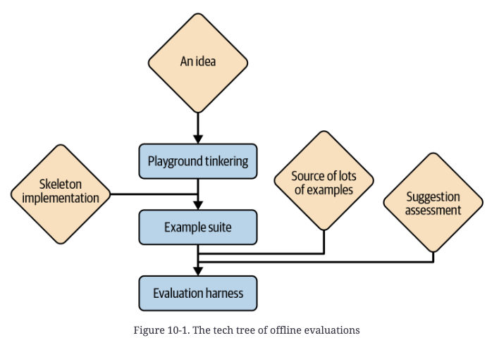
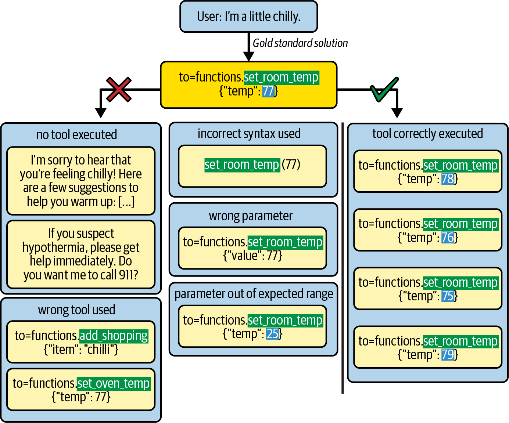
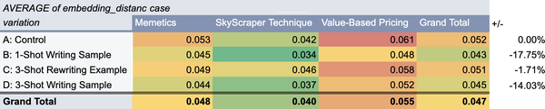

# 9 — Evaluating Prompts

> How you know a prompt change helped. This is the prompt-level view; eval systems for whole agents and harnesses are in [06-eval](../../06-eval/README.md).

---

## Build the eval first

The evaluation framework is the oldest part of the GitHub Copilot codebase — older than the prompts or the UI. Without one, every change is a guess. **Always log latency and token counts too**: they're cheap to capture and catch regressions that have nothing to do with quality.

Phoenix & Taylor tell the Copilot story differently: its builders "admit their eval process was haphazard and messy (but it got the job done!)", which they use to argue that testing doesn't have to be systematic (*Prompt Engineering for Generative AI*, ch. 10). The two accounts can both be true, since a harness can exist early and still be messy. Berryman was on the Copilot team. Take the shared point, that some testing beats none, and build the harness anyway.

What you're testing determines the shape of the eval:

| Target | Decision | Test style |
|---|---|---|
| **The model** | Swap or upgrade | Broad regression suite |
| **A single prompt** | Wording, examples, parameters | Small unit tests on one model call |
| **The composition** (chain, loop) | Architecture | End-to-end regression — no unit-level substitute |

For a model swap, test across as wide a regression span as you can. If different steps use different models, test each step on its own. Prompt-level regression runs work too, but noise can hide the effect of a single change.

If you can build only one, build the **end-to-end** one, then add unit tests on the critical path.

There are two settings. **Offline** eval runs on example cases, needs no users and not even a working app, and is the one you build first. **Online** eval runs on live users. The stakes are higher and you need enough traffic for a clean signal, but it's the only fully valid data.

---

## Offline: the tech tree


*Berryman & Ziegler, Fig 10-1.*

**Level 1 — the example suite.** 5–20 realistic inputs, plus a script that renders each one into your prompt, calls the model, and writes prompt + completion to files. Commit them and review with `git diff`. It isn't pass/fail — you eyeball each change. It works from your very first draft, and repeated exposure to the same examples teaches you the failure modes. GitHub's PR summarizer was tuned this way. Eyeballing a few dozen mined PRs showed outputs that were too terse ("add *detailed*"), then too verbose ("cap at 1–2 paragraphs"), plus wild guesses about why the PR was written. The fix for those was to ask for a paragraph on the functionality and a second on how it fits the project's goals, then show only the first ([04](04-controlling-output.md)). The suite stops scaling at the number of diffs you're willing to read per change.

Phoenix & Taylor's version of level 1 is a blind A/B in a notebook. They run each prompt variant 5 times, shuffle the 10 outputs, and rate each one thumbs-up or thumbs-down without seeing which prompt produced it. It surfaces problems fast. In their run the zero-shot prompt returned a numbered list where they wanted a comma-separated line, and they find a deviation in fewer than 10 runs as a rule (*Prompt Engineering for Generative AI*, ch. 1). It's a bug finder, not a way to pick a winner. Five samples per arm from one rater, who also wrote the prompts, can't separate two decent prompts ([06-eval/09](../../06-eval/notes/09-reading-results.md#how-many-tasks)). Their other observation is worth keeping: iterating against even a crude check often shows that much of a long prompt is superfluous or counterproductive, and the shorter prompt is cheaper and faster at the same quality.

**Level 2 — the harness.** Hundreds to thousands of examples with **automatic scoring**, needed to see subtle effects. It has two independent problems: **where samples come from** and **how outputs are scored**.

### Sourcing samples

| Source | Strength | Watch out for |
|---|---|---|
| **Existing records** — data from people solving the same problem without AI | Realistic and plentiful | Similarity vs. scale. Copilot stripped function bodies out of open-source repos to simulate "cursor here" |
| **App telemetry** | Real inputs | Doesn't exist before launch; app changes invalidate it; consent and privacy; outputs are biased by what your app suggested |
| **Synthetic** (LLM-generated) | Cheap, controllable coverage — combine aspects (n × m × l) for spread | Tropes and misconceptions; **bias toward the generating model** if it's also a candidate under test |

For existing records, balance **ubiquity** (enough data to scale) against **similarity** (close enough to your problem for valid conclusions). Copilot had no corpus of "what the user types next," so it built one from open-source repos: pick a function, delete its body, ask for a completion. The result was imperfect (function bodies skew long, and later edits such as new imports are missing) but nearly infinite. Telemetry captures good *inputs*, but what users did afterward was shaped by your suggestions, so it's weak as a gold standard; keep it for online eval.

Synthetic data works best when you can **start from the solution and invent the problem backward**, or when you only need situations without a gold answer. Generate hierarchically: get a topic list, or enumerate aspects yourself, then ask for several examples per topic in one generation. That gives more variety than repeated calls at temperature > 0.

### Scoring outputs

From easiest to hardest to set up (the book's order, which is not an order of rigor; a repo's own unit tests can be stricter than a gold string):

1. **Gold-standard match.** Exact match for labels; *partial* match on the one aspect that matters for free text. For yes/no or classification, counting matches is enough. If you want more statistical power from the same samples, score the label's **logprob** instead ([04](04-controlling-output.md)). Free-text exact match gets rarer the longer the answer, until the metric is meaningless, and before that it rewards phrasing over correctness. Pick an aspect that separates breaking from benign divergence, and that's neither so narrow it's unattainable nor so broad it's meaningless. For example, for "I'm chilly" the gold answer sets the heat to 77°F. Check *did it adjust the heating at all?*, because 76°F is a sane miss, while chatting about blankets, setting the oven or adding chilli to the shopping list is a real failure. A sensible tool call with an absurd value (0°F) is possible but less likely. For code, check for an exact match after stripping comments and whitespace. For tool calls, score the first decision with a real chance of going wrong and treat the later ones as void if it fails: *called a tool? → right tool? → valid syntax?* Stop before exact values, where a different answer is often still reasonable. The aspect you pick comes from watching where your current setup fails, which is circular, but still better than a weak or misleading aspect.

   
   *No tool, the wrong tool, bad syntax, a wrong parameter name or an out-of-range value make the suggestion useless. A correct call with a different value (75–79°F) is probably fine. Image Source: Berryman & Ziegler (2024), Fig. 10-3*
2. **Functional test.** Does it parse, compile, pass the repo's own unit tests, and call only tools that exist with correctly typed arguments? The domain supplies the oracle. Copilot replayed function bodies in open-source repos and ran each repo's test suite. A weaker version checks only that linters accept the code. Often too weak alone, but sometimes surprisingly strong.
3. **LLM-as-judge** — for qualities like helpfulness and tone. See below.

Cheap programmatic checks belong next to these. Phoenix & Taylor's list: cost and latency per prompt, the number of calls per task, classification accuracy against labels, hallucination measured as terms that appear in the output but nowhere in the context, refusal rate by matching known refusal phrases, resistance to known injection strings, and similarity to a reference (*Prompt Engineering for Generative AI*, ch. 1).

**Similarity to a reference is the weakest of these, so read its results carefully.** Phoenix & Taylor score four prompts for rewriting text in Mike Taylor's style (the text says "five different prompt approaches" but lists four). The metric is the cosine distance between ada-002 embeddings of the output and of a hand-rewritten reference, on three topics (*Prompt Engineering for Generative AI*, ch. 10):


*Image Source: Phoenix & Taylor, *Prompt Engineering for Generative AI* (O'Reilly, 2024), Fig. 10-1*

The one-shot "describe this writing sample" prompt (B) wins overall, 0.043 against the control's 0.052 (−17.75%). Before you act on a table like this, notice what it leaves out. It has three cases. It doesn't give the number of runs, though the text recommends 10 or more per case. It shows no spread, so a 0.009 difference has no error bar. And the winner changes with the case: D is best on Memetics, B on the other two. An embedding distance also rewards matching the topic and wording, and style is what's being tested. The authors' general advice is right: run several cases, many times each. The table just doesn't show that it was followed. For the same style task they suggest fine-tuning if you have enough samples (OpenAI recommends at least 50), or DSPy to search instructions and examples against your metric ([08](08-prompt-optimization.md)).

**Decision checklist** (pick one of each):

| Source | Ask | Scorer | Ask |
|---|---|---|---|
| Existing records | Can you find plenty? | Gold match | Is a full or partial match realistic *and* meaningful? |
| App usage | Is the trickle fast enough, given app changes? | Functional test | Can you isolate an automatable critical aspect? |
| Synthetic | Worth the synthesis effort? | LLM judge | Can people tell good from bad outputs? |

**Multi-turn:** use **canned conversations** (score each turn against a scripted history — isolates turns but misses compounding errors) or an **LLM-mocked user** played from a user profile, like an improv brief (end-to-end, but inherits the mock's misreadings of the domain and its assumptions about how users behave; often the best you can do).

---

## LLM-as-judge

**Never let the model know it's grading its own work.** The book ranks the framings: a judge is most accurate grading a third party, a bit worse grading "the user", and much worse grading itself. Self-grading gets pulled two ways at once: forum-style pretraining data isn't known for objective self-reflection, and RLHF trains the model to recant at any hint of doubt. Frame the work as a third party's.

**SOMA** — a rubric recipe:

| | Rule | Why |
|---|---|---|
| **S**pecific questions | "Did it pick the heating system?" — not "Is this right?" | A generic question is as hard as the task, and more ambiguous. The exception is a task that is much easier to check than to do (is this poem a limerick?) |
| **O**rdinal scale | 1–5, with each level described | Yes/no leaves the bar to the judge, so it drifts between runs. Five levels is a psychometrics default (the book cites Redford, *Machine Psychometrics*) |
| **M**ulti-**A**spect | Score each dimension separately — e.g. **intent** (right plan?) vs. **execution** (carried out correctly?); Copilot used relevance / truth / completeness | One composite score lets the judge silently switch criteria |

Copilot Chat's split was **RTC**: relevance, truth and completeness. Avoid **Goldilocks questions** that fold "enough" and "not too much" into one axis ("Is the length right?"). Split them into "complete?" and "concise?". A bare "is it right?" also invites systematic bias: the judge may hold ambitious answers to a stricter bar than safe ones, or pass mostly-right answers while failing near-perfect ones that aren't completely right.

One aspect of a SOMA judge, condensed from the book's Example 10-1. The task and scale come before the transcript, every level is described, and the analysis comes before the score. Run one such prompt per aspect:

```
I need your help evaluating a smart home assistant. Grade each interaction for
effectiveness: whether the assistant's attempted action would remedy the user's problem.
1 = would do nothing to address the problem, or make it worse
2 = might address a small part, leaving the main part unaddressed
3 = good chance of addressing a substantial part
4 = not guaranteed to work completely, but should solve most of it
5 = will definitely solve the problem completely

User: I'm a bit chilly.
Assistant: to=functions.set_room_temp {"temp": 77}

Give a thorough analysis, then end with "Effectiveness: X", where X is 1 to 5.
```

Also:
- **Rubric before content.** The judge reads once, forward only ([01](01-how-models-read-prompts.md#property-3--left-to-right-attention-order-matters)), so put the aspects first, then the example.
- **Scores are relative.** "81% correct" means little alone; "B is judged correct more often than A" is the valid claim.
- **Calibrate against humans.** Use several annotators, not one. The bar is that adding the model (temperature 0) to the pool *doesn't increase* disagreement (e.g., Kendall's τ).
- Reasoning models make strong judges ([07](07-prompting-reasoning-models.md#where-reasoning-models-earn-their-cost)), and pairing a judge with a prompt rewriter gives you an optimizer ([08](08-prompt-optimization.md)).

---

## Online evaluation

Offline eval is a lab. Live traffic is the only valid test — but its bandwidth is scarce, so **whittle candidates down offline first**.

**A/B testing:** define **success metrics** (e.g., acceptance rate) and **guardrail metrics** (e.g., error or complaint rate) *before* starting. Off-the-shelf tools (Optimizely, VWO, AB Tasty) handle assignment and statistics. Your app only has to run in either mode behind a flag. Client-side apps must ship the new logic to most users before the test can start. Compare randomly assigned users only. "Already updated" vs. "not yet" is a biased split, because people who update quickly behave differently. Instead, randomize among users who already have the update and leave the rest out of the analysis.

Metrics, from most direct to most incidental:

| Kind | Example | Note |
|---|---|---|
| Direct feedback | 👍/👎, "which is better?" (contrastive) | High quality and reusable as fine-tuning data, but intrusive. It captures frustration more than delight. Contrastive feedback is clearest, but nobody wants an ambient app asking after every action. **Delayed** feedback ("how was the trip?") often beats immediate |
| Functional correctness | Compiled, booked, sent | Concrete, often binary |
| **User acceptance** | Suggestion kept, link clicked | For Copilot, acceptance correlated with users' self-reported productivity gains more strongly than fancier impact measures did |
| Achieved impact | Share of the final email written by the assistant | Outcome-side |
| Incidental | Latency, conversation length | Ambiguous alone; track them to catch shifts |

**Where to start:** find an acceptance or impact metric you trust, and fall back to direct feedback if there isn't one. Keep acceptance or impact as a standing guardrail, along with functional correctness and incidental metrics, especially latency and errors.

---

## Case study: small changes, large effects

Clavié et al. (2023) classified job postings as "graduate-suitable" with `gpt-3.5-turbo`, adding one prompt modification at a time:

| Prompt | F1 | Template adherence |
|---|---|---|
| Baseline (posting + question) | 65.6 | 79% |
| Few-shot CoT | 78.4 | 87% |
| Zero-shot CoT | 81.4 | 65% |
| + role in system, task in user | 87.5 | 71% |
| + mocked acknowledgement turn + reiterated key points | 89.3 | 75% |
| + **strict output template** | 86.3 ↓ | **98%** |
| + "reach the right conclusion" + info on common failures | 90.3 | 77% |
| + give the model a name + positive feedback | **91.7** | 81% |

Lessons:
- **Prompt wording moved F1 by 26 points** — more than the gap to a strong fine-tuned DeBERTa baseline, which the LLM beat.
- **Zero-shot CoT beat few-shot CoT** on a task that needed no expert knowledge. The examples anchored the model ([03](03-core-techniques.md#few-shot)).
- **Forcing a strict template lowered accuracy** while raising adherence. Parse loosely, or constrain the format in a separate step ([04](04-controlling-output.md#structured-output)).
- Instructions plus **reiteration** of the key points was the biggest single driver.
- The tiny gains (a name, +0.6) are model-specific and dated. **The methodology is the lesson: change one thing, re-score.**

---

## Go deeper

- Book: [Ch 10 PDF](../sources/prompt-eng-for-llms/reading/10-evaluating-llm-applications.pdf) (the original chapter; everything above stands alone)
- Eval systems and grounding methodology: [06-eval](../../06-eval/README.md) · [maturity ladder](../../06-eval/notes/11-production-and-the-maturity-ladder.md#the-ladder)
- Papers and tools: [references.md](../README.md#evaluation)

**Continue in 06-eval.** This chapter is the prompt-level view. Chapters 01–05 of [06-eval](../../06-eval/README.md) go deeper on the same ground and can be read right after this topic:
- Defining pass/fail from error analysis → [02-defining-correct.md](../../06-eval/notes/02-defining-correct.md)
- Building the dataset → [03-eval-datasets.md](../../06-eval/notes/03-eval-datasets.md)
- Code graders and combining scores → [04-graders.md](../../06-eval/notes/04-graders.md)
- Calibrating an LLM judge (TPR/TNR, bias correction) → [05-llm-as-judge.md](../../06-eval/notes/05-llm-as-judge.md#calibrate-against-human-labels)
- Whether a prompt change actually helped (error bars, paired comparison) → [09-reading-results.md](../../06-eval/notes/09-reading-results.md)

---

→ Next: [10-adversarial-prompting.md](10-adversarial-prompting.md) — prompts that attack your prompts.
