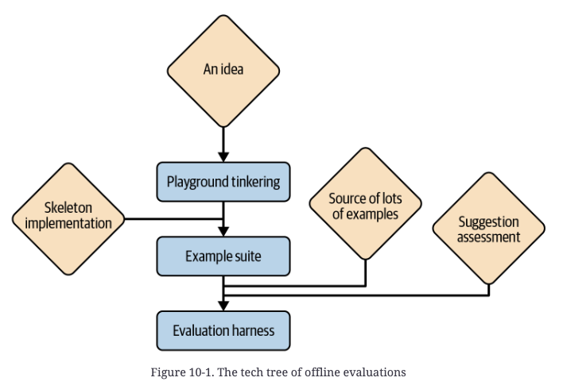
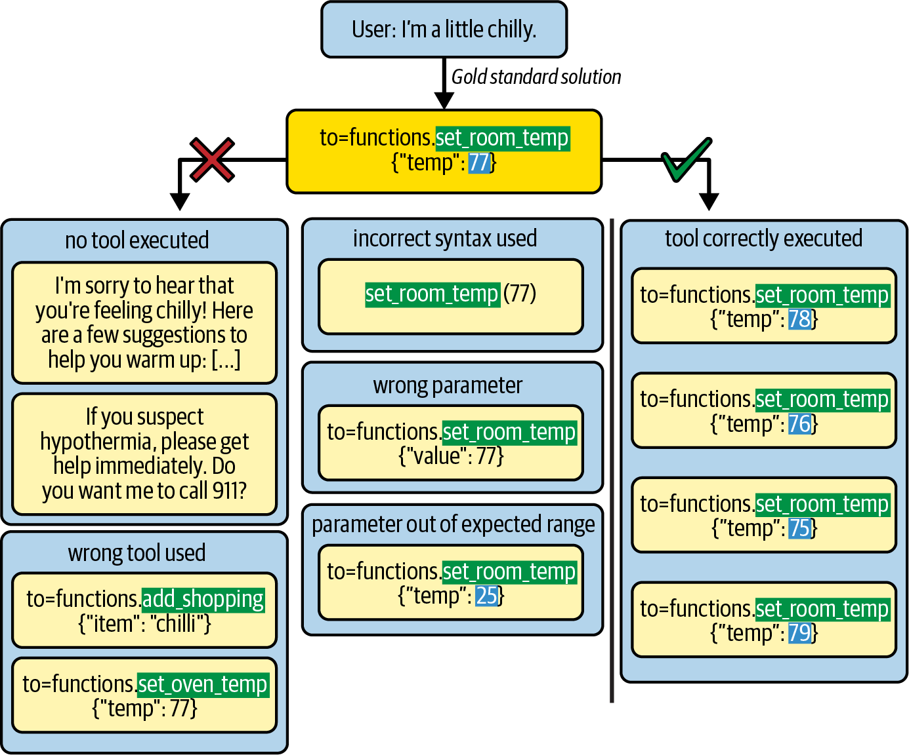
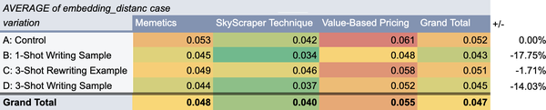

# 9 — Evaluating Prompts

> How you know a prompt change helped. This is the prompt-level view; eval systems for whole agents and harnesses are in [the Eval pillar](../../../generative-ai/08-eval/README.md).

Without an eval, every prompt change is a guess: Clavié et al. moved F1 by 26 points through wording alone, and a strict output template that lifted adherence to 98% quietly lowered accuracy. You can't see effects like these by reading a few outputs, so this chapter builds up from a diffable example suite to scored harnesses and live tests.

---

## Build the eval first

The evaluation framework is the oldest part of the GitHub Copilot codebase — older than the prompts or the UI. Without one, every change is a guess. **Always log latency and token counts too**: they're cheap to capture and catch regressions that have nothing to do with quality.

Phoenix & Taylor tell the Copilot story differently: its builders "admit their eval process was haphazard and messy (but it got the job done!)", which they use to argue that testing doesn't have to be systematic (*Prompt Engineering for Generative AI*, ch. 10). The two accounts can both be true, since a harness can exist early and still be messy. Berryman was on the Copilot team. Take the shared point, that some testing beats none, and build the harness anyway.

What you're testing determines the shape of the eval:

| Target | Decision | Test style |
|---|---|---|
| **The model** | Swap or upgrade | Broad regression suite |
| **A single prompt** | Wording, examples, parameters | Small unit tests on one model call |
| **The composition** (chain, loop) | Architecture | End-to-end regression — no unit-level substitute |

For a model swap, test across as wide a regression span as you can. If different steps use different models, test each step on its own. Prompt-level regression runs work too, but noise can hide the effect of a single change.

If you can build only one, build the **end-to-end** one, then add unit tests on the critical path.

There are two settings. **Offline** eval runs on example cases, needs no users and not even a working app, and is the one you build first. **Online** eval runs on live users. The stakes are higher and you need enough traffic for a clean signal, but it's the only fully valid data.

---

## Offline: the tech tree


*Berryman & Ziegler, Fig 10-1.*

**Level 1 — the example suite.** 5–20 realistic inputs, plus a script that renders each one into your prompt, calls the model, and writes prompt + completion to files. Commit them and review with `git diff`. It isn't pass/fail — you eyeball each change. It works from your very first draft, and repeated exposure to the same examples teaches you the failure modes. GitHub's PR summarizer was tuned this way. Eyeballing a few dozen mined PRs showed outputs that were too terse ("add *detailed*"), then too verbose ("cap at 1–2 paragraphs"), plus wild guesses about why the PR was written. The fix for those was to ask for a paragraph on the functionality and a second on how it fits the project's goals, then show only the first ([04](04-controlling-output.md)). The suite stops scaling at the number of diffs you're willing to read per change.

Phoenix & Taylor's version of level 1 is a blind A/B in a notebook. They run each prompt variant 5 times, shuffle the 10 outputs, and rate each one thumbs-up or thumbs-down without seeing which prompt produced it. It surfaces problems fast. In their run the zero-shot prompt returned a numbered list where they wanted a comma-separated line, and they find a deviation in fewer than 10 runs as a rule (*Prompt Engineering for Generative AI*, ch. 1). It's a bug finder, not a way to pick a winner. Five samples per arm from one rater, who also wrote the prompts, can't separate two decent prompts ([Eval chapter 09](../../../generative-ai/08-eval/notes/09-reading-results.md#how-many-tasks)). Their other observation is worth keeping: iterating against even a crude check often shows that much of a long prompt is superfluous or counterproductive, and the shorter prompt is cheaper and faster at the same quality.

**Level 2 — the harness.** Hundreds to thousands of examples with **automatic scoring**, needed to see subtle effects. It has two independent problems: **where samples come from** and **how outputs are scored**.

### Sourcing samples

| Source | Strength | Watch out for |
|---|---|---|
| **Existing records** — data from people solving the same problem without AI | Realistic and plentiful | Similarity vs. scale. Copilot stripped function bodies out of open-source repos to simulate "cursor here" |
| **App telemetry** | Real inputs | Doesn't exist before launch; app changes invalidate it; consent and privacy; outputs are biased by what your app suggested |
| **Synthetic** (LLM-generated) | Cheap, controllable coverage — combine aspects (n × m × l) for spread | Tropes and misconceptions; **bias toward the generating model** if it's also a candidate under test |

For existing records, balance **ubiquity** (enough data to scale) against **similarity** (close enough to your problem for valid conclusions). Copilot had no corpus of "what the user types next," so it built one from open-source repos: pick a function, delete its body, ask for a completion. The result was imperfect (function bodies skew long, and later edits such as new imports are missing) but nearly infinite. Telemetry captures good *inputs*, but what users did afterward was shaped by your suggestions, so it's weak as a gold standard; keep it for online eval.

Synthetic data works best when you can **start from the solution and invent the problem backward**, or when you only need situations without a gold answer. Generate hierarchically: get a topic list, or enumerate aspects yourself, then ask for several examples per topic in one generation. That gives more variety than repeated calls at temperature > 0.

### Scoring outputs

From easiest to hardest to set up (the book's order, which is not an order of rigor; a repo's own unit tests can be stricter than a gold string):

1. **Gold-standard match.** Exact match for labels; *partial* match on the one aspect that matters for free text. For yes/no or classification, counting matches is enough. If you want more statistical power from the same samples, score the label's **logprob** instead ([04](04-controlling-output.md)). Free-text exact match gets rarer the longer the answer, until the metric is meaningless, and before that it rewards phrasing over correctness. Pick an aspect that separates breaking from benign divergence, and that's neither so narrow it's unattainable nor so broad it's meaningless. For example, for "I'm chilly" the gold answer sets the heat to 77°F. Check *did it adjust the heating at all?*, because 76°F is a sane miss, while chatting about blankets, setting the oven or adding chilli to the shopping list is a real failure. A sensible tool call with an absurd value (0°F) is possible but less likely. For code, check for an exact match after stripping comments and whitespace. For tool calls, score the first decision with a real chance of going wrong and treat the later ones as void if it fails: *called a tool? → right tool? → valid syntax?* Stop before exact values, where a different answer is often still reasonable. The aspect you pick comes from watching where your current setup fails, which is circular, but still better than a weak or misleading aspect.

   
   *No tool, the wrong tool, bad syntax, a wrong parameter name or an out-of-range value make the suggestion useless. A correct call with a different value (75–79°F) is probably fine. Image Source: Berryman & Ziegler (2024), Fig. 10-3*
2. **Functional test.** Does it parse, compile, pass the repo's own unit tests, and call only tools that exist with correctly typed arguments? The domain supplies the oracle. Copilot replayed function bodies in open-source repos and ran each repo's test suite. A weaker version checks only that linters accept the code. Often too weak alone, but sometimes surprisingly strong.
3. **LLM-as-judge** — for qualities like helpfulness and tone. See below.

Cheap programmatic checks belong next to these. Phoenix & Taylor's list: cost and latency per prompt, the number of calls per task, classification accuracy against labels, hallucination measured as terms that appear in the output but nowhere in the context, refusal rate by matching known refusal phrases, resistance to known injection strings, and similarity to a reference (*Prompt Engineering for Generative AI*, ch. 1).

[CheckList](https://arxiv.org/abs/2005.04118) (Ribeiro et al., ACL 2020) adds two tests that need no gold answers: an invariance test changes something that shouldn't alter the output (swap a place name, add a typo), and a directional test changes something that should move it a known way. It tested NLP models rather than prompts, but adding a random URL or handle changed 24.8% of one commercial sentiment model's predictions.

**Formatting is a variable too, so a score belongs to a format.** Sclar et al. kept the wording and few-shot examples fixed and changed only casing, separators, spacing and enumeration. On 53 classification and multiple-choice tasks from Super-NaturalInstructions, 10 random formats per task gave a median gap of 7.5 accuracy points between best and worst (LLaMA-2 and Falcon, 1 and 5 shots, ranking the options by probability). Their headline gap is 76 points on LLaMA-2-13B, and the largest they report is 87.6, on 1-shot LLaMA-2-70B over 320 formats. GPT-3.5 reached 56 with a median of 6.4 across 320 formats, though it was scored by exact prefix match, so that median doesn't compare directly. The ordering of models moved as well: given that one of LLaMA-2-13B and -70B led by at least 2 points under one format, the other led by at least 2 under a different format with probability 0.141. A format that beat another on one model had under a 0.62 chance of beating it on a second, against 0.5 for chance, so there is no format to copy. Read the gap with its limits. It is a maximum minus a minimum, the paper applies no noise floor to it, it grows as you sample more formats (about 17% of tasks are expected to gain at least 5 points going from 10 to 20, over 31 tasks with 500 formats at 250 samples each), and these are few-shot runs on 2023 models. The authors don't ask you to test every format when you are building an app: "choosing a single prompt format that works sufficiently well for use in this larger system is a valid methodological choice." The cost falls on comparisons. When you claim one model or system beats another, score both over several formats and report the range. The paper doesn't test comparing two prompts, but our extrapolation is that the same care applies there. Thompson sampling keeps that affordable, getting within 1 point of the true gap on average with 51,200 evaluations per task over 320 formats (31 tasks), where naive sampling averaged within 4 ([arXiv:2310.11324](https://arxiv.org/abs/2310.11324) (Sclar et al., ICLR 2024)).

**Wrong labels hurt more as models get stronger.** Wei et al. flipped every in-context label (16 per class, six binary tasks, 100 test examples each): **text-davinci-002 fell from 90.3% to 22.5%**, below chance, so it followed the examples over its prior, while GPT-3 and small PaLM only reached chance. Instruction-tuned Flan-PaLM never went below chance. 2020-2022 models on classification only ([arXiv:2303.03846](https://arxiv.org/abs/2303.03846) (Wei et al., 2023-03, preprint)). Our extrapolation: with a strong model, wrong labels in your examples are not harmless, and a score for a few-shot prompt belongs to its example set ([03](03-core-techniques.md#few-shot)).

**With a long context window, "a few" becomes hundreds, and the order of the examples matters.** Bertsch et al. put 10 to 1,000 random demonstrations into Llama-2 (up to 80k windows), Mistral and Qwen models on five classification sets with varied label spaces (250 test examples each). Accuracy rose by up to 50.8 points, and by 36.8 on average for Llama2-80k. Retrieving similar demonstrations helped at short context but the gap closed: BM25's gain on Banking-77 fell from 51.5 points at 1 shot to 4.9 at 1,500, so one cached random set costs little at length (never more than 5 points). Sorting examples by label cost 25.7 points at 1,169 shots on Clinic-150. Mostly not instruction-tuned models, classification only ([arXiv:2405.00200](https://arxiv.org/abs/2405.00200) (Bertsch et al., 2024, preprint)).

Two cheap baselines show whether a benchmark tests what you think it does. The SVAMP paper trained solvers on full math word problems from ASDiv-A and MAWPS, then deleted the question from the test problems and kept only the story, and the best solver (Graph2Tree with RoBERTa embeddings) still answered 64.4% and 77.7% correctly. A model that ignored word order entirely scored 77.9% on MAWPS. On 1,000 variations of 100 ASDiv-A problems (change the question, invert the operation, add an irrelevant number, reorder phrases), the same solver (trained on MAWPS plus ASDiv-A) scored 43.8% against 82.2% and 88.7% on the originals ([arXiv:2103.07191](https://arxiv.org/abs/2103.07191) (Patel et al., NAACL 2021)). These were 2021 solvers trained on the data, not prompted LLMs. The baselines carry over to prompt evals: blank out the part of the input that should matter, and if the score holds, the eval is measuring a shortcut.

**Similarity to a reference is the weakest of these, so read its results carefully.** Phoenix & Taylor score four prompts for rewriting text in Mike Taylor's style (the text says "five different prompt approaches" but lists four). The metric is the cosine distance between ada-002 embeddings of the output and of a hand-rewritten reference, on three topics (*Prompt Engineering for Generative AI*, ch. 10):


*Image Source: Phoenix & Taylor, *Prompt Engineering for Generative AI* (O'Reilly, 2024), Fig. 10-1*

The one-shot "describe this writing sample" prompt (B) wins overall, 0.043 against the control's 0.052 (−17.75%). Before you act on a table like this, notice what it leaves out. It has three cases. It doesn't give the number of runs, though the text recommends 10 or more per case. It shows no spread, so a 0.009 difference has no error bar. And the winner changes with the case: D is best on Memetics, B on the other two. An embedding distance also rewards matching the topic and wording, and style is what's being tested. The authors' general advice is right: run several cases, many times each. The table just doesn't show that it was followed. For the same style task they suggest fine-tuning if you have enough samples (OpenAI recommends at least 50), or DSPy to search instructions and examples against your metric ([08](08-prompt-optimization.md)).

**A reference metric can rank systems backwards when the references carry one model's style.** Goyal et al. asked crowd annotators to pick the best of three summaries for 100 CNN and 100 BBC articles from March–June 2022, chosen to postdate the standard test sets because GPT-3's training data is unknown. Zero-shot GPT-3 (text-davinci-002) was picked best 58% and 57% of the time, against 36% and 20% for BRIO, a summarizer fine-tuned on those datasets' reference summaries. On 500-article samples of the standard test sets, ROUGE-L put GPT-3 about 7 points behind BRIO on average (24.71 against 31.44 on the CNN split), below even the Lead-3 baseline reported in earlier work. Reference-free factuality metrics also scored GPT-3 low (except on XSum), though the authors rarely found factual errors in its summaries ([arXiv:2209.12356](https://arxiv.org/abs/2209.12356) (Goyal et al., 2022-09, preprint)). The human verdict was a majority, not a consensus: all three annotators agreed on the best system for fewer than 30% of articles. Our extrapolation: when you move from a fine-tuned model to a prompted one, check the metric against human judgments before you trust a drop.

**Decision checklist** (pick one of each):

| Source | Ask | Scorer | Ask |
|---|---|---|---|
| Existing records | Can you find plenty? | Gold match | Is a full or partial match realistic *and* meaningful? |
| App usage | Is the trickle fast enough, given app changes? | Functional test | Can you isolate an automatable critical aspect? |
| Synthetic | Worth the synthesis effort? | LLM judge | Can people tell good from bad outputs? |

**Multi-turn:** use **canned conversations** (score each turn against a scripted history — isolates turns but misses compounding errors) or an **LLM-mocked user** played from a user profile, like an improv brief (end-to-end, but inherits the mock's misreadings of the domain and its assumptions about how users behave; often the best you can do).

---

## LLM-as-judge

**Never let the model know it's grading its own work.** The book ranks the framings: a judge is most accurate grading a third party, a bit worse grading "the user", and much worse grading itself. Self-grading gets pulled two ways at once: forum-style pretraining data isn't known for objective self-reflection, and RLHF trains the model to recant at any hint of doubt. Frame the work as a third party's. [Calibrating judges with checks and critiques](../../../generative-ai/08-eval/notes/14-calibrating-judges-with-checks-and-critiques.md#part-4-test-whether-a-critique-reports-what-drove-the-verdict) tests whether a judge's written reason reports what drove its verdict.

The model's own confidence number is no better a score. Li et al. asked ChatGPT (official API, April 2023) for a 0 to 100 confidence with each of its information-extraction answers, over whole test sets of 14 datasets, and compared calibration with fine-tuned BERT-style models. Its expected calibration error was 0.204 against 0.052 on CoNLL03 NER, 0.460 against 0.023 on SemEval relation classification and 0.699 against 0.154 on argument extraction, and on that last task it reported about the same confidence for wrong answers (0.910) as for right ones (0.956). Asked to rate its own explanations for its correct answers, it called nearly 100% reasonable, while three experts on roughly 200 samples per dataset gave 74.1% for argument extraction and 47.1% for event extraction. One concise, zero-shot-style prompt on a 2023 model, with verbalised confidence compared against other models' softmax probabilities, so score it against labels or an independent judge rather than trusting its self-report ([arXiv:2304.11633](https://arxiv.org/abs/2304.11633) (Li et al., 2023-04, preprint)).

**Checking a chain step by step** is a different use of extra samples. Asking a model to review its own answer in one go carries almost no signal: answers checked that way are deemed correct more than 90% of the time whether or not they are (as reported from Ling et al.), and on 100 MathQA questions with GPT-3.5 the whole-chain check scored 55.0% verification accuracy against 50.0% for guessing. SelfCheck instead makes four separate calls per step (extract what the step does, collect the context it uses, regenerate the step without seeing the original, compare), so the checker's errors are less tied to the generator's, and weights votes by the result. With GPT-3.5 and two solutions per question, weighted voting beat plain majority voting by 2.8 points on GSM8K (71.7 to 74.3), 5.4 on MathQA and 2.2 on MATH. With GPT-4 as the generator the gains were -0.2 to 3.4 points on 500-question samples. It costs about four calls per step and was tested on math only ([arXiv:2308.00436](https://arxiv.org/abs/2308.00436) (Miao et al., 2023, preprint)).

**SOMA** is the rubric recipe: **S**pecific questions, an **O**rdinal scale with each level described, and **M**ulti-**A**spect scoring, one judge per dimension. Copilot Chat's split was relevance, truth and completeness. The full recipe, with a worked one-aspect judge from the book's Example 10-1, is in [GA 08/05 — SOMA](../../../generative-ai/08-eval/notes/05-llm-as-judge.md#soma-a-rubric-recipe), the authoritative note on judges.

The shape of one aspect's prompt, in the order that recipe uses:

```text
<the task, and the one aspect being graded>
1 = <what the worst level looks like>
...
5 = <what the best level looks like>

<the transcript>

Give a thorough analysis, then end with "<Aspect>: X", where X is 1 to 5.
```

Also:
- **Rubric before content.** The judge reads once, forward only ([01](01-how-models-read-prompts.md#property-3--left-to-right-attention-order-matters)), so put the aspects first, then the example.
- **Scores are relative.** "81% correct" means little alone; "B is judged correct more often than A" is the valid claim.
- **Calibrate against humans.** Use several annotators, not one. The bar is that adding the model (temperature 0) to the pool *doesn't increase* disagreement (e.g., Kendall's τ).
- Reasoning models make strong judges ([07](07-prompting-reasoning-models.md#where-reasoning-models-earn-their-cost)), and pairing a judge with a prompt rewriter gives you an optimizer ([08](08-prompt-optimization.md)).

**Match the humans' spread, not only their majority.** AlpacaFarm built a pool of 13 simulated judges from GPT-4, ChatGPT and Davinci003 prompts and compared it with the majority of three crowdworkers on pairwise preferences. The pool agreed with that majority 65% of the time, against 66% for a held-out human, at $12 instead of $300 per 1,000 comparisons, and methods trained and ranked entirely in the simulator came out in nearly the same order as when trained and ranked with human feedback (Spearman 0.98 over 11 systems). One GPT-4 prompt reached 68% agreement, but the authors kept the pool for its spread: a single fixed GPT-4 prompt varied far less than people did (0.1 against 0.35), and reward models trained on its labels showed none of the over-optimization seen with human labels, so best-of-1024 wrongly looked much better than PPO. The simulated judges shared the human preference for longer answers (64% against 62%), and added biases of their own: they favoured the output shown first and outputs from their own model ([arXiv:2305.14387](https://arxiv.org/abs/2305.14387) (Dubois et al., NeurIPS 2023)). The judges were 2023 models grading simple single-turn instructions. Randomize the order of the two outputs, and when a judge's labels will train something, check its variance as well as its agreement.

---

## Online evaluation

Offline eval is a lab. Live traffic is the only valid test — but its bandwidth is scarce, so **whittle candidates down offline first**.

**A/B testing:** define **success metrics** (e.g., acceptance rate) and **guardrail metrics** (e.g., error or complaint rate) *before* starting. Off-the-shelf tools (Optimizely, VWO, AB Tasty) handle assignment and statistics. Your app only has to run in either mode behind a flag. Client-side apps must ship the new logic to most users before the test can start. Compare randomly assigned users only. "Already updated" vs. "not yet" is a biased split, because people who update quickly behave differently. Instead, randomize among users who already have the update and leave the rest out of the analysis. Prompt A against prompt B online is an ordinary A/B test, so see [A/B testing](../../../data-analytics/03-experimentation-and-causality/notes/01-ab-testing.md#how-many-users) in data analytics for the sample-size arithmetic.

Metrics, from most direct to most incidental:

| Kind | Example | Note |
|---|---|---|
| Direct feedback | 👍/👎, "which is better?" (contrastive) | High quality and reusable as fine-tuning data, but intrusive. It captures frustration more than delight. Contrastive feedback is clearest, but nobody wants an ambient app asking after every action. **Delayed** feedback ("how was the trip?") often beats immediate |
| Functional correctness | Compiled, booked, sent | Concrete, often binary |
| **User acceptance** | Suggestion kept, link clicked | For Copilot, acceptance correlated with users' self-reported productivity gains more strongly than fancier impact measures did |
| Achieved impact | Share of the final email written by the assistant | Outcome-side |
| Incidental | Latency, conversation length | Ambiguous alone; track them to catch shifts |

**Where to start:** find an acceptance or impact metric you trust, and fall back to direct feedback if there isn't one. Keep acceptance or impact as a standing guardrail, along with functional correctness and incidental metrics, especially latency and errors.

---

## Case study: small changes, large effects

Clavié et al. (2023) classified job postings as "graduate-suitable" with `gpt-3.5-turbo`, adding one prompt modification at a time:

| Prompt | F1 | Template adherence |
|---|---|---|
| Baseline (posting + question) | 65.6 | 79% |
| Few-shot CoT | 78.4 | 87% |
| Zero-shot CoT | 81.4 | 65% |
| + role in system, task in user | 87.5 | 71% |
| + mocked acknowledgement turn + reiterated key points | 89.3 | 75% |
| + **strict output template** | 86.3 ↓ | **98%** |
| + "reach the right conclusion" + info on common failures | 90.3 | 77% |
| + give the model a name + positive feedback | **91.7** | 81% |

Lessons:
- **Prompt wording moved F1 by 26 points** — more than the gap to a strong fine-tuned DeBERTa baseline, which the LLM beat.
- **Zero-shot CoT beat few-shot CoT** on a task that needed no expert knowledge. The examples anchored the model ([03](03-core-techniques.md#few-shot)).
- **Forcing a strict template lowered accuracy** while raising adherence. Parse loosely, or constrain the format in a separate step ([04](04-controlling-output.md#structured-output)).
- Instructions plus **reiteration** of the key points was the biggest single driver.
- The tiny gains (a name, +0.6) are model-specific and dated. **The methodology is the lesson: change one thing, re-score.**

A second before/after, with human graders: Yeadon et al. had three blind markers score 14 plots from a Durham Python lab course (10 submissions per condition, 50 student submissions, 300 scored items). Rewriting the assignment as a prompt (concise function definitions, a task preamble, a marked insertion point) lifted `gpt-4-1106-preview` from 71.9% to 81.1% and `gpt-3.5-turbo` from 30.9% to 48.8%, still short of the students' 91.9%. The markers agreed (ICC 0.932) and picked AI from human work 85.3% of the time. Treat it as a template for the method, not as evidence about prompting: one course, no ablation of which rewrite step mattered, failed generations were regenerated without a reported failure rate, only plot quality was graded, and the abstract's 91.9% student mean is 91.1% in the body ([arXiv:2403.16977](https://arxiv.org/abs/2403.16977) (Yeadon et al., 2024-03, preprint)).

---

## Go deeper

- Book: [Ch 10 PDF](../sources/prompt-eng-for-llms/reading/10-evaluating-llm-applications.pdf) (the original chapter; everything above stands alone)
- Eval systems and grounding methodology: [the Eval pillar](../../../generative-ai/08-eval/README.md) · [maturity ladder](../../../generative-ai/08-eval/notes/11-production-and-the-maturity-ladder.md#the-ladder)
- Papers and tools: [references.md](../references.md#evaluation)

**Continue in the Eval pillar.** This chapter is the prompt-level view. Chapters 01–05 of [the Eval pillar](../../../generative-ai/08-eval/README.md) go deeper on the same ground and can be read right after this topic:
- Defining pass/fail from error analysis → [02-defining-correct.md](../../../generative-ai/08-eval/notes/02-defining-correct.md)
- Building the dataset → [03-eval-datasets.md](../../../generative-ai/08-eval/notes/03-eval-datasets.md)
- Code graders and combining scores → [04-graders.md](../../../generative-ai/08-eval/notes/04-graders.md)
- Calibrating an LLM judge (TPR/TNR, bias correction) → [15-calibration-against-human-labels.md](../../../generative-ai/08-eval/notes/15-calibration-against-human-labels.md#calibrate-against-human-labels)
- Whether a prompt change actually helped (error bars, paired comparison) → [09-reading-results.md](../../../generative-ai/08-eval/notes/09-reading-results.md)

---

## Pitfalls

- **Using an exact match on free text.** Symptom: the score falls as answers grow, and it rewards phrasing over correctness. Fix: partial match on the aspect separating breaking from benign divergence: "did it adjust the heating at all?" rather than "was it exactly 77°F?"
- **Asking one composite question of the judge.** Symptom: scores drift because the judge silently switches criteria. Fix: use SOMA: specific questions, an ordinal scale with each level described, and multiple aspects scored separately.
- **Letting the model grade itself.** Symptom: inflated or easily swayed scores. Fix: frame the work as a third party's. The book ranks this framing most accurate and self-grading much worse.
- **Goldilocks questions.** Symptom: "is the length right?" yields a score you can't act on. Fix: split it into "complete?" and "concise?".
- **Picking a winner from a small blind A/B.** Symptom: you ship a prompt on five samples per arm. It's a bug finder, and one rater who also wrote the prompts can't separate two decent prompts. Fix: use it to find deviations, then decide with a harness.
- **Comparing two models under one prompt format.** Symptom: a ranking that flips when someone changes a separator. In Sclar et al., given a lead of at least 2 points under one format, a different format reversed it by at least 2 with probability 0.141 (LLaMA-2-13B and -70B). Fix: score both over several formats and report the range.
- **Reading a table of averages as a result.** Symptom: acting on Phoenix & Taylor's 0.043 against 0.052 with no run count or spread, on three cases where the winner changes by case. Fix: report runs and error bars, and check whether the metric measures what you're testing.
- **Comparing "already updated" with "not yet" users.** Symptom: an effect that is really self-selection, since quick updaters behave differently. Fix: randomize among users who have the update, and leave the rest out.
- **Patching the examples you read.** Symptom: the score rises because the prompt now names those cases, and the gain doesn't carry to new inputs. Fix: fix a class of failure and score the change on rows you didn't read ([Reading the errors](../../../data-science/01-classical-ml/notes/12-reading-the-errors.md#learning-from-errors-without-fitting-to-them) in data science).
- **Generating eval data with a candidate model.** Symptom: that model wins. Fix: use a different generator, or record the bias.

## Try it

1. Your blind A/B gives prompt A 4 of 5 thumbs up and prompt B 3 of 5. What's the standard error on the difference, and what may you conclude?
   <details><summary>Answer</summary>sqrt(0.8 x 0.2 / 5 + 0.6 x 0.4 / 5) = 0.283, against a difference of 0.2, so less than one standard error. You may not conclude A is better. You can still note any format deviation you saw, since that's what the method is for. See [how many tasks](../../../generative-ai/08-eval/notes/09-reading-results.md#how-many-tasks).</details>
2. Write the tool-call scorer for "I'm chilly" with gold `set_room_temp(77)`. Grade these: no tool, `set_oven(77)`, `set_room_temp(temp="warm")`, `set_room_temp(76)`, `set_room_temp(0)`.
   <details><summary>Answer</summary>Score the first decision with a real chance of going wrong, and void the rest: called a tool? right tool? valid syntax? So the first three fail at those stages, and 76 passes as a sane miss. The note stops before exact values, so 0°F passes this scorer: add an out-of-range check if that matters, since Fig. 10-3 treats an out-of-range value as useless.</details>
3. Write one SOMA aspect for a meeting summarizer, in the [Example 10-1 form](../../../generative-ai/08-eval/notes/05-llm-as-judge.md#soma-a-rubric-recipe). What goes first, and where does the score go?
   <details><summary>Answer</summary>Task and aspect first, for example "Coverage: does the summary include every decision made?", with each of levels 1 to 5 described, then the transcript and summary framed as someone else's work, then "Give a thorough analysis, then end with 'Coverage: X'". The rubric comes before the content since the judge reads forward only, and analysis comes before the score. Run a separate prompt for conciseness.</details>
4. Add a level-2 check to the [prompt eval harness](../practice/prompt-eval-harness/README.md). Which scorer type would you use for a classifier and for a helpfulness rating, and how would you validate the second against people?
   <details><summary>Answer</summary>A gold match (or the label's logprob, for more power) for the classifier, and an LLM judge for helpfulness. Calibrate against several human annotators. The bar is that adding the model at temperature 0 to the pool doesn't increase disagreement, measured for example by Kendall's τ.</details>

## Interview checklist

| Prompt | Answer in one line |
|---|---|
| You can only build one eval. Which? | End-to-end, then unit tests on the critical path. Composition has no unit-level substitute. |
| Offline or online? | Offline first, because it needs no users. Online is the only fully valid data, but live traffic is scarce, so whittle candidates offline first. |
| Where can eval samples come from, and what's the trap in each? | Existing records (ubiquity against similarity), telemetry (doesn't exist before launch, and outcomes are biased by your own suggestions), and synthetic (tropes, plus bias toward the generating model). |
| What is SOMA? | A judge rubric: Specific questions, an Ordinal scale with described levels, and Multi-Aspect scoring such as Copilot's relevance, truth and completeness. |
| What can you claim from "81% correct" from an LLM judge? | Little alone. Scores are relative, so "B is judged correct more often than A" is the valid claim. |
| Which online metric would you start with for a coding assistant? | User acceptance. For Copilot it correlated with self-reported productivity gains more strongly than fancier impact measures. Set guardrails like latency and errors before the test starts. |
| What did Clavié et al. show? | With `gpt-3.5-turbo`, F1 rose from 65.6 to 91.7 by wording alone, zero-shot CoT beat few-shot, and a strict template raised adherence to 98% while cutting F1 from 89.3 to 86.3. Change one thing, re-score. |

## Next

[Adversarial prompting](10-adversarial-prompting.md): your evals have assumed honest inputs, and this chapter covers prompts written to break yours.
