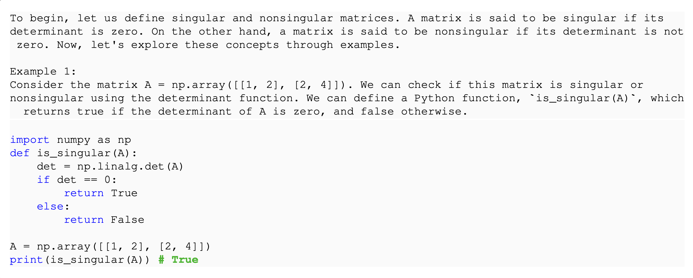
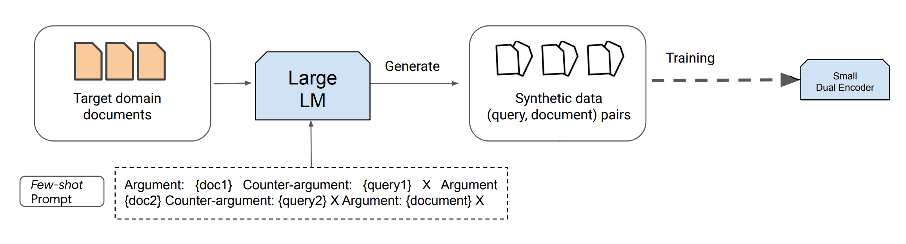
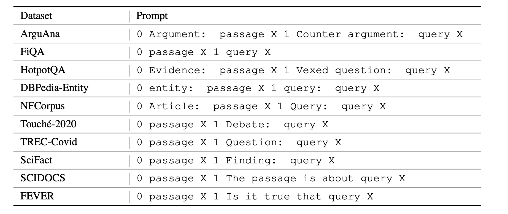
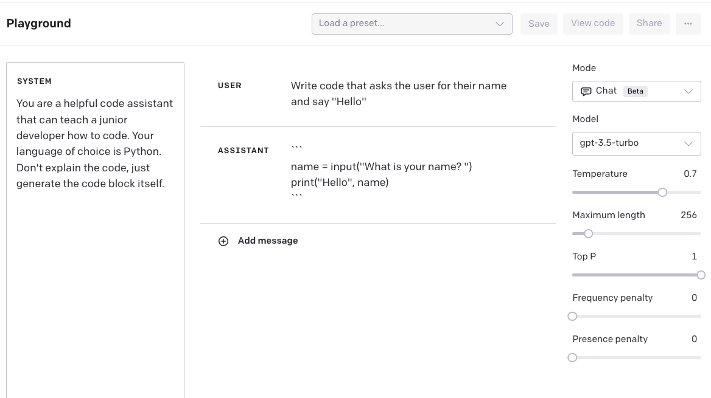

# 11 — Applications

> Prompting patterns for three recurring jobs: **generating data**, **writing code**, and **working with images**. Task-by-task prompt examples are in [prompt-library.md](prompt-library.md).

Ask a model for a thousand training stories and you get a thousand near-duplicates, even at high temperature. Each recurring job, generating data, writing code or working with images, has its own failure like this and a pattern that fixes it, and TinyStories fixed this one by putting the randomness into the prompt.

---

## Synthetic data generation

The use cases: eval sets ([09](09-evaluating-prompts.md#sourcing-samples)), training data for a small local model (distilling a big model into a cheap one), fine-tuning documents when you can't collect enough real successes ([04](04-controlling-output.md#when-prompting-isnt-enough-fine-tuning)), and test fixtures.

**The core problem is diversity.** Even at high temperature, models produce repetitive, trope-heavy samples. Raising the temperature isn't enough — **inject the randomness into the prompt**.

### Pattern 1 — combinatorial seeding (TinyStories)

Eldan & Li (2023) took a ~1,500-word child vocabulary split into nouns, verbs and adjectives, plus a list of story features, and sampled them into every prompt:

```
Write a short story (3-5 paragraphs) which only uses very simple words that a
3 year old child would likely understand. The story should use the verb "{verb}",
the noun "{noun}" and the adjective "{adjective}". The story should have the
following features: {feature_1}, {feature_2}. Remember to only use simple words!
```

The seeding is what made the data usable. Asking for "a story a child would understand" with no seeds gives near-duplicates, even at high temperature. On the seeded dataset, models **under 10M parameters** wrote fluent, consistent stories, and a 28M model's completions held up against GPT2-XL, which is about 50× larger ([arXiv:2305.07759](https://arxiv.org/abs/2305.07759) (Eldan & Li, 2023-05, preprint)).

The recipe:
1. Identify the dimensions that should vary (topic, audience, length, tone, **label**).
2. Build a list of values for each dimension, by hand or generated.
3. Sample a combination per request. Use a temperature above the default but below the maximum.
4. **A seeded label is a free label.** If the prompt says "negative review," the output is labeled negative.

### Pattern 2 — hierarchical generation

Generate the intermediate pieces first (a summary, a sentence that must appear, a feature list), then feed them into the final request. Each level adds variety and control.

```
Summary: {LLM-generated summary}
Features: Dialogue, Foreshadowing, Twist
Sentence: {LLM-generated sentence that must appear}
Words: disagree, network, beautiful
Story:
```

### Pattern 3 — textbook-quality data (phi-1)

Gunasekar et al. (2023) generated ~1B tokens of "textbook" Python material with GPT-3.5, varying **topic** and **target audience**. They mixed it with 6B tokens of web code filtered for textbook quality, so the synthetic part is a seventh of the data. The resulting 1.3B-parameter phi-1 reached **50.6% pass@1 on HumanEval** after under 4 days of pretraining on 8 A100s plus 7 hours of fine-tuning on ~180M tokens of synthetic exercises (the pretrained base scored 29%), ahead of every open model ten times its size except WizardCoder 16B (57.3%) ([arXiv:2306.11644](https://arxiv.org/abs/2306.11644) (Gunasekar et al., 2023-06, preprint)). **The target audience is a cheap diversity lever**: a high-school student, an undergraduate, and a PhD candidate produce very different text on the same topic.


*A generated "textbook" passage: a definition, a worked example, then runnable code. Gunasekar et al. (2023), via DAIR.*

### Pattern 4 — synthetic queries for retrieval (Promptagator)

Retrievers degrade in niche domains and low-resource languages. Dai et al. (2022) showed that **8 labeled examples plus an unlabeled corpus** are enough: few-shot prompt an LLM to write a query for each document, then train the retriever on the (query, document) pairs.


*A few-shot prompt turns domain documents into synthetic (query, document) pairs, which train a small dual encoder. Dai et al. (2022), via DAIR.*

```
Task: Identify a counter-argument for the given argument.
Argument #1: {passage}
A concise counter-argument query related to the argument #1: {query}
...
Argument #N: {new document}
A concise counter-argument query related to the argument #N:
```

- "Relevance" depends on the search intent (supporting vs. counter-argument, etc.) — say which one. The paper used a different prompt label per dataset:

  
  *The same passage → query template, relabeled per intent ("Counter argument:", "Vexed question:", "Is it true that"). Dai et al. (2022).*
- Label ~20 examples and **randomly sample 2–8 per prompt** for diversity.
- In the paper, ~50k synthetic pairs matched the quality of a model trained on a comparable amount of human labels.

Retrieval itself belongs to [02-context](../../02-context-engineering/notes/04-retrieval.md).

---

## Code

| Pattern | Prompt shape | Notes |
|---|---|---|
| Instruction → code | System: language, style, "code only." User: the task | Specify the language and version; ask for code only if you'll parse it |
| Comments → code | A docstring or numbered comments describing steps | Models often omit imports and setup — **always run the result** |
| Completion | A function signature plus a comment; let it continue | The Copilot pattern; stop on `\ndef` / `\nclass` ([04](04-controlling-output.md#recognizable-start-and-end)) |
| Schema → SQL | Table and column definitions, then the question | Include the actual schema; generate fixtures to test against |
| Explain code | Code first, then "Explain the above" | A narrow system prompt ("Python only") can make the model refuse adjacent tasks |


*The system prompt fixes the language and "code only," and the user turn is the task. DAIR, Code generation.*

A debugging prompt from the Code Llama notebook. The system role sets the job, and the user turn gives the code, the observed output and the expected output:

```python
messages = [
    {"role": "system",
     "content": "You are an expert programmer that helps to review Python code for bugs."},
    {"role": "user", "content": """This function should return a list of lambda functions
that compute successive powers of their input, but it doesn't work:

def power_funcs(max_pow):
    return [lambda x:x**k for k in range(1, max_pow+1)]

[h(2) for h in power_funcs(3)] should give [2, 4, 8], but it currently gives [8, 8, 8].
What is happening here?"""},
]
```
*From DAIR's Code Llama notebook, run through Together's OpenAI-compatible endpoint. CodeLlama-70b-Instruct is superseded, but the prompt shapes in this section still apply.*

**Unit tests.** Ask for a fixed number of tests, wrap the output in tags you can parse, and fix the comment format so each test can be identified:

```python
messages = [
    {"role": "system", "content": "You are an expert programmer that helps write unit tests. "
                                  "Don't explain anything just write the tests."},
    {"role": "user", "content": """Your task is to write 2 tests to check the correctness of a
function that solves a programming problem.
The tests must be between [TESTS] and [/TESTS] tags.
You must write the comment "#Test case n:" on a separate line directly above each assert
statement, where n represents the test case number, starting from 1.

Problem: Write a Python function to get the unique elements of a list."""},
]
```

**Infilling (fill-in-the-middle, FIM).** You give the code before and after a gap, and the model writes the middle. Editor completion, docstring generation and type inference all work this way:

```python
prefix = """
def two_largest_numbers(list: List[Number]) -> Tuple[Number]:
  max = None
  second_max = None
  """
suffix = """
  return max, second_max
"""
```

Code models trained for FIM take these through dedicated prefix/suffix/middle tokens or a `suffix` API parameter. The notebook's call is marked broken, and sending prefix and suffix as plain chat text only approximates FIM.

**Over-refusal.** With a broad safety system prompt ("Always assist with care, respect, and truth… Avoid harmful, unethical, prejudiced, or negative content"), Code Llama refused *"Can you tell me how to kill a process?"*. Removing the system prompt fixed it. Generic safety wording in a domain system prompt costs you legitimate answers, so scope it to the domain and test for false refusals ([09](09-evaluating-prompts.md)).

The biggest lever for code is the same as everywhere: **context** — the relevant files, types, and tests. The second is **verification**: compile, lint, run the tests, and feed failures back (Reflexion, [03](03-core-techniques.md#reflexion)). Agentic coding is a harness problem ([03-harness](../../03-harness-engineering/README.md)).

---

## Images and multimodal prompts

**How it works** (the likely design; vendors don't publish specifics): a vision encoder turns image patches into vectors (the book describes a convolutional network; current models mostly use a ViT-style encoder over patches) of the same size as text-token embeddings. Positional information is added so spatial layout survives, and the image vectors are concatenated with the text and run through the same transformer. Video is the naive extension, sampled frames fed in as a sequence of images. To the model, an image is just more context tokens, so the same rules apply:

- **Include only relevant images.** Irrelevant images distract just like irrelevant text.
- **Introduce each image in the text**: say what it is and what it's for ("The screenshot below is the failing checkout page").
- **Use familiar visual conventions.** Standard chart types and diagram formats work better than invented ones — the Little Red Riding Hood principle for images.
- For long documents with images, the long-context ordering advice still holds: content first, question last ([02](02-prompt-anatomy.md#ordering)).

Multimodal CoT (rationale first, then answer) is in [03](03-core-techniques.md#chain-of-thought).

Images also matter for training. Text-only pretraining is approaching "the whole public internet" as a ceiling, and images and video add a different kind of signal (spatial reasoning, physical common sense, social cues), not just more of the same.

### Prompting image generators

The inverse job, writing prompts *for* a diffusion model, has its own conventions. Phoenix & Taylor's are written against Midjourney v5 (2023), so the syntax is dated, but the ideas carry over to other image models (*Prompt Engineering for Generative AI*, ch. 8):

- **Format first.** "Stock photo", "oil painting" and "Egyptian hieroglyphs" change everything, including the content: an oil painting of a business meeting has no computers in it, because oil paintings rarely contain them.
- **Quality boosters leak style.** "4k" or "trending on artstation" lifts quality because those labels went with good images in training. They bring the source's habits too: their "space whale, trending on artstation" comes out looking like a spaceship.
- **Negative prompts help, unreliably.** `--no frame, wall` removes the frame that tends to come with "oil painting", but it often fails when the two concepts are too strongly correlated in training. In Midjourney, `--no` is shorthand for a weight of `::-0.5`. Weights (`::2`, `::-1`) dial a concept up or down, and a grid search over weight pairs maps the blend. Older negative-prompt fixes for hands and extra fingers are mostly unnecessary from Midjourney v5 and SDXL on.
- **Rewrite the user's prompt.** A `{subject} in the style of {artist}` template gave a dachshund standing *next to* a Banksy mural. Asking an LLM for the artist's medium first and rendering `{medium} of a {subject} in the style of {artist}` put the dog in the street art. This is meta-prompting ([08](08-prompt-optimization.md)) to fix garbage in, garbage out from non-expert users.
- **Unbundle a style instead of naming the artist.** Have an LLM describe the style without naming the artist or the work, shorten that into prompt terms ("surrealist landscape", "melting objects"), then remix them. The result is more original, and it avoids the legal and ethical grey zone of imitating a living artist, which the authors advise caution on (and legal counsel for commercial use).
- **Measure what the prompt actually uses.** `/describe` reverse-engineers a prompt from an image. `/shorten` shows per-token weights, which often reveal that most of a long prompt does nothing. That's the same lesson as for text prompts ([09](09-evaluating-prompts.md)).
- **Inpainting for consistency.** To keep a character consistent, generate two images side by side at 2:1, then inpaint one half (Midjourney's Vary Region) with a new pose. The other half anchors the features.

Diffusion internals and Stable Diffusion workflows belong to the multimodal pillar.

---

## Interfaces: stateful objects of discourse

When people collaborate, they talk *about* a persistent thing, such as a file, change it, and discuss how it changed. Plain chat UIs don't work this way. Ask for a function and then a change, and you get two full copies in the transcript, and it becomes ambiguous which one "it" refers to. **Claude's Artifacts** separate the object, kept in its own pane and updated in place, from the conversation about it. The book's critique, which works as a design checklist for your own app:

- **Regeneration isn't editing.** The model still rewrites the whole object on every change, so it doesn't scale to long documents. Prefer diffs and edit tools.
- **Support several objects**, each with a short name the user and the prompt can both use. Otherwise a new topic overwrites the only slot.
- **Let the user edit directly** and feed that diff into the next prompt, so the model knows what changed.

The critique dates from mid-2024. Products have since moved on some of it (ChatGPT's Canvas, October 2024, lets the user edit the object directly), so read the list as design requirements, not as a description of current tools.

The prompt-side half of this is the book's ch. 8 **artifact**: a piece of data attached to a user or assistant message, kept in the context and shown in the UI so the user can see what the agent is attending to and dismiss what it shouldn't be ([05](05-tools-and-function-calling.md#context-for-a-tool-using-agent)).

Conversational UI also keeps a human in the loop who can catch drift before it compounds ([06](06-chaining-and-workflows.md)). Without a designed object layer, a chat wrapper is just a gimmick.

---

## Go deeper

- Papers (TinyStories, phi-1, Promptagator, Codex/HumanEval): [references.md](../README.md#applications)
- Book: [Ch 11 PDF](../sources/prompt-eng-for-llms/reading/11-looking-ahead.pdf) (multimodality, Artifacts)
- Worked prompts by task: [prompt-library.md](prompt-library.md)

---

## Pitfalls

- **Raising temperature for diversity.** Symptom: near-duplicates and tropes persist at high temperature. Fix: inject randomness into the prompt with seeded words, features, topics and audiences.
- **Distribution mismatch.** Symptom: a request for "2 negative, 8 positive" yields exactly that, then biases any few-shot use of the data ([10](10-adversarial-prompting.md#bias-from-the-prompt-itself)). Fix: set the seed distribution deliberately from the true one.
- **Model bias.** Symptom: data generated by model A favors model A in your evals ([09](09-evaluating-prompts.md#sourcing-samples)). Fix: generate with a model that isn't a candidate.
- **Quality drift.** Symptom: duplicates and off-brief samples in a big batch. Fix: dedupe, filter with a judge, and spot-check by hand.
- **Using an aligned model's voice for user-like text.** Symptom: every "user" sounds alike, as RLHF flattens style. Fix: consider a base model or a strong persona ([01](01-how-models-read-prompts.md#property-5--chat-models-are-completion-models-wearing-a-transcript)).
- **Trusting generated code unrun.** Symptom: missing imports and setup. Fix: always run it, and feed failures back.
- **A broad safety system prompt on a code assistant.** Symptom: Code Llama refused "how to kill a process". Fix: scope it to the domain and test for false refusals.
- **Regenerating the whole object per edit.** Symptom: long documents get slow and drift, as in the book's critique of Artifacts. Fix: use diffs or edit tools, and feed the user's direct edits into the next prompt.

## Try it

1. Run the bug from the debugging prompt above. What does it print, why, and what is the fix? Use it to test any model's answer.
   <details><summary>Answer</summary>This runs as written:

   ```python
   def power_funcs(max_pow):
       return [lambda x: x**k for k in range(1, max_pow + 1)]
   print([h(2) for h in power_funcs(3)])   # [8, 8, 8]

   def fixed(max_pow):
       return [lambda x, k=k: x**k for k in range(1, max_pow + 1)]
   print([h(2) for h in fixed(3)])         # [2, 4, 8]
   ```

   The closures share one `k`, looked up when called, by which time it is 3. Binding it as a default argument captures each value.</details>
2. You need a labeled synthetic set of support tickets: 50 product topics, 4 customer personas, 3 lengths and 2 labels. How many distinct seed combinations do you have, and what does the seeded label give you?
   <details><summary>Answer</summary>50 x 4 x 3 x 2 = 1,200. A seeded label is a free label: if the prompt says "negative", the output is labeled negative. Spot-check, since the model can drift from the seed.</details>
3. Write the Promptagator-style prompt to generate queries for a retriever over internal runbooks where searchers ask "how do I fix X?". How many examples do you label, and how many go in each prompt?
   <details><summary>Answer</summary>Use a `Runbook #N: {passage}` then `A question an on-call engineer would ask that this runbook answers:` template, since relevance depends on search intent and you must say which. The paper's recipe: label about 20 and sample 2 to 8 per prompt at random for diversity.</details>
4. A user asks your image tool for "a dachshund in the style of Banksy" and gets a dog next to a mural. What's the fix, and which chapter does it come from?
   <details><summary>Answer</summary>Rewrite the prompt: ask an LLM for the artist's medium first, then render `{medium} of a {subject} in the style of {artist}`. That is meta-prompting ([08](08-prompt-optimization.md)), applied to garbage in, garbage out from non-expert users.</details>

## Interview checklist

| Prompt | Answer in one line |
|---|---|
| How do you get diverse synthetic data? | Seed the prompt with sampled values per dimension, as TinyStories did with a ~1,500-word vocabulary and story features. Temperature alone gives near-duplicates. |
| What made phi-1 notable, and what's the caveat? | 1.3B parameters reached 50.6% pass@1 on HumanEval with textbook-quality data. But synthetic text was only about 1B of 7B tokens, the rest filtered web code, and fine-tuning used about 180M tokens of synthetic exercises. |
| How can you train a retriever with almost no labels? | Promptagator: 8 labeled examples and an unlabeled corpus, where an LLM writes a query per document, and you train on the pairs. About 50k synthetic pairs matched a comparable amount of human labels. |
| What are the two biggest levers for code generation? | Context (relevant files, types, tests) and verification (compile, lint, run tests, feed failures back). |
| What is FIM and how do you request it? | Fill-in-the-middle: prefix and suffix given, middle generated. Code models use dedicated tokens or a `suffix` parameter, while chat text only approximates it. |
| How does a model read an image? | Likely as patch vectors of the same size as text-token embeddings, with positional information, in the same transformer, so include only relevant images and introduce each in the text. Vendors don't publish specifics. |
| What would you change about plain chat for editing a long document? | Separate the object from the conversation, edit by diff rather than regeneration, support several named objects, and feed the user's direct edits into the next prompt. |

## Next

[Prompt library](prompt-library.md): small, copyable prompts for these and other tasks. Or return to the [pillar README](../README.md).
