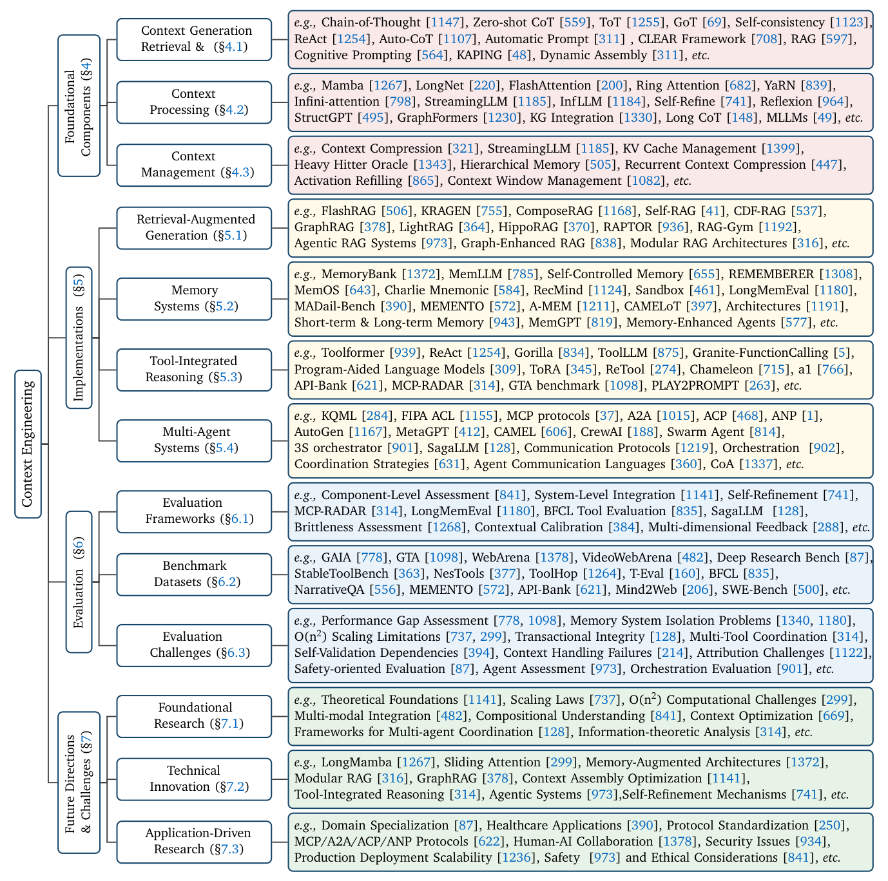

# 1 — Why Context Is a Finite Resource

> The mechanism note. Everything else in this pillar is a response to the constraint described here.

---

## The thesis

**Find the smallest set of high-signal tokens that maximize the likelihood of your desired outcome.**

That single sentence is Anthropic's framing of the whole discipline. It is a *minimization* objective, which is counterintuitive: the instinct with a 200k or 1M window is to fill it. The instinct is wrong, and the rest of this note explains why.

The field around that sentence is now large. Mei et al.'s survey sorts about 1,400 papers into foundational components (retrieval and generation, processing, management) and the implementations built from them (RAG, memory, tool use, multi-agent), plus evaluation and open problems. This pillar covers both halves: retrieval in [04](04-retrieval.md); processing in [05](05-compression-compaction.md), [07](07-structured-context.md) and [08](08-cognitive-tools.md); management in [03](03-budgeting-the-window.md); and the implementations in [06](06-memory.md) (memory) and [10](10-tools-and-multi-agent.md) (tools and multi-agent).

The survey's headline conclusion is an **asymmetry**. With good context engineering, models understand long, complex inputs well, but they are much weaker at *producing* equally long and coherent output: long-form generation, factual consistency over thousands of tokens, and planning. That is a reading of the literature, not a measurement, but it matches practice. Almost everything in this pillar is about the input side ([arXiv:2507.13334](https://arxiv.org/abs/2507.13334) (Mei et al., 2025-07)).


*Image Source: Mei et al. (2025)*

---

## Attention budget

Every token you add costs something even when it is harmless. LLMs have a finite **attention budget** — the pool of representational capacity the model draws on when processing a window. Adding tokens does not expand the budget; it divides the existing budget across more claimants.

The mechanism is architectural. In a transformer, every token attends to every other token, producing **n² pairwise relationships** for n tokens. Doubling the context quadruples the attention pairs the model must resolve, while the parameters that resolve them stay fixed. Attention gets thinner, not just slower.

Two consequences follow:

- Token cost is **not** the binding constraint. A 150k-token window that fits comfortably in budget and latency can still degrade output quality.
- "It fits in the window" is not an argument for including something. Window capacity is an upper bound on what is *possible*, not a target.

---

## Context rot

**Context rot** is the empirically observed decline in a model's ability to accurately recall and use information as window occupancy grows. It is not a cliff at the window limit; it is gradual degradation that begins well before it.

Observed failure shapes:

| Shape | What it looks like |
|---|---|
| Middle neglect | Information at the start and end is recalled; the middle is not — "lost in the middle" |
| Distractor sensitivity | Plausible-but-wrong content nearby pulls the answer off target more as the window grows |
| Instruction decay | System-prompt constraints obeyed early in a session are quietly dropped later |
| Needle degradation | Exact-match retrieval of a planted fact degrades as surrounding filler increases, even when the fact is verbatim present |

The last one is the important one. The fact is *there*, unmodified, and the model still misses it. This is why "include it just in case" is a real cost rather than free insurance — filler actively degrades retrieval of the signal it surrounds.

Long-context handling techniques (**position encoding interpolation**, letting a model address sequences longer than it trained on) extend the addressable range. They do not repeal rot — they move where it starts.

---

## Diminishing marginal returns

Treat context like any finite budget with a declining return curve:

```
signal
  ^
  |        ....----____
  |     ..'            ''--___          <- each added token returns less,
  |   .'                      '--__        then returns negative
  | .'
  +-------------------------------> tokens in window
     ^ high-signal      ^ filler
```

The curve turns *negative*, not merely flat. Past a point, adding a marginally relevant document makes output worse than omitting it, because it competes for attention with the tokens that mattered.

This is the economic argument for every technique in chapters 03–10: budgeting, retrieval strategy, compaction, memory offloading, structure, and sub-agent isolation all exist to keep the window on the left side of that curve.

---

For the formal version of this argument (context as an optimisation under a token budget), see [03](03-budgeting-the-window.md#formally-assembly-under-a-constraint).

---

## What this implies for practice

1. **Curate, don't accumulate.** The default action on a new piece of context is to justify it, not to include it.
2. **Measure occupancy, not just cost.** Track percentage of window used as a health metric independent of dollars.
3. **Position matters.** If content must be included, order it — stable and high-priority material where attention is strongest. See [02-context-anatomy.md](02-context-anatomy.md).
4. **Prefer a pointer to a payload.** A file path the agent can read on demand costs a handful of tokens; the file costs thousands. See [04-retrieval.md](04-retrieval.md).
5. **Plan for sessions that outlive the window.** Long-horizon work needs compaction and external memory, not a bigger window. See [05-compression-compaction.md](05-compression-compaction.md) and [06-memory.md](06-memory.md).

---

## Working reference

`~/.claude/refs/agent-context.md` — the four-lever model (Write → Select → Compress → Isolate) is the operational response to this constraint. Apply in order; isolate is highest cost.

Practical instance: `~/.claude/rules/context-health.md` sets the 150k threshold as a compaction trigger and treats phase boundaries as compaction boundaries — a direct application of "curate, don't accumulate."

---

→ Next: [02-context-anatomy.md](02-context-anatomy.md) — what to put in the window, and in what order.
