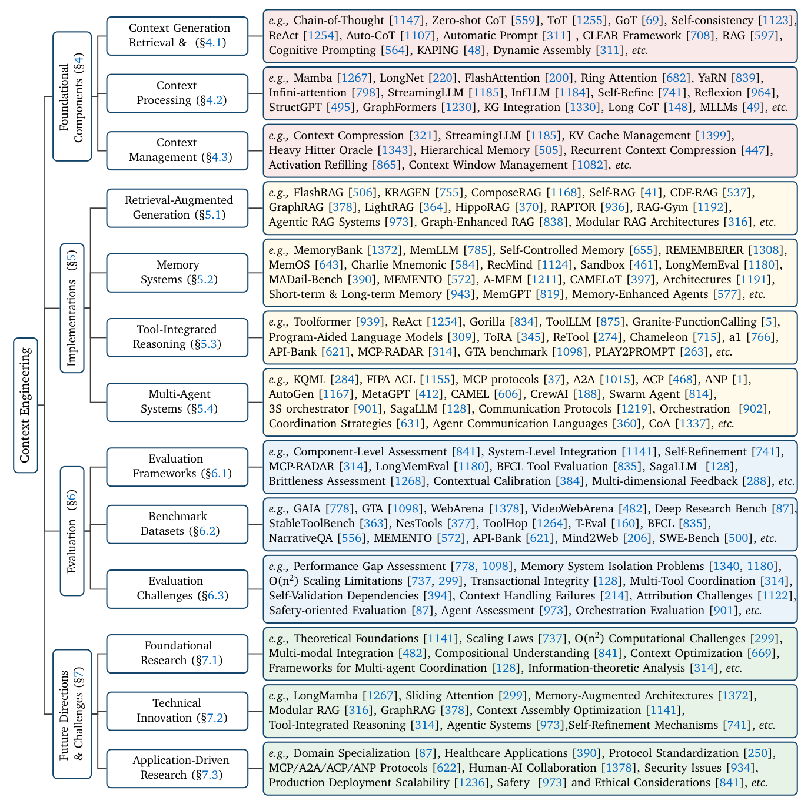
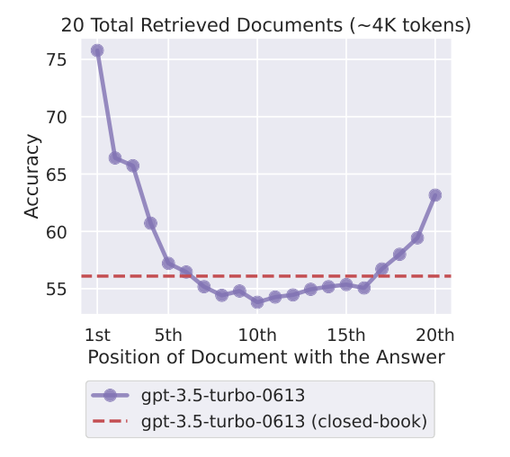
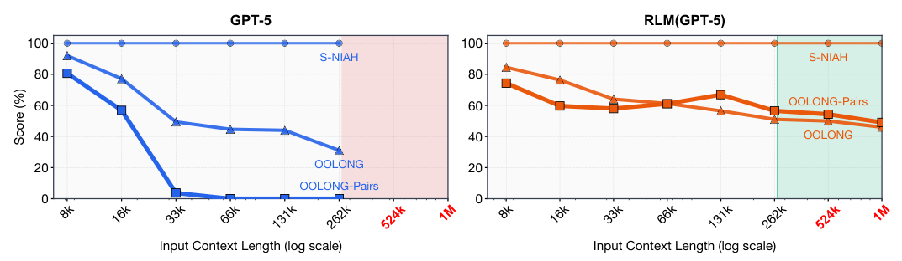
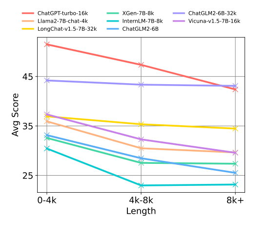

# 1 — Why Context Is a Finite Resource

> The mechanism note. Everything else in this pillar is a response to the constraint described here.

A model with a one-million-token window can still fail a question whose answer is in plain sight. Stuffing the window with everything the agent might need feels safe, and on a single-needle lookup it even looks safe, then the same model scores about zero on a pairs task at a fraction of that length. This chapter explains why the window behaves like a budget rather than a container, so you stop judging a design by whether it fits and start judging it by what each token costs.

---

## The thesis

**Find the smallest set of high-signal tokens that maximize the likelihood of your desired outcome.**

That single sentence is Anthropic's framing of the whole discipline. It is a *minimization* objective, which is counterintuitive: the instinct with a 200k or 1M window is to fill it. The instinct is wrong, and the rest of this note explains why. Hua et al. state the same objective as a design principle, **minimal sufficiency**: "The context value lies in sufficiency, not volume." They trace context engineering back to pre-LLM context-aware computing, with Dey's 2001 definition of context as information that characterizes the situation of an entity (a person, place or object relevant to the user-application interaction) ([arXiv:2510.26493](https://arxiv.org/abs/2510.26493) (Hua et al., 2025-10, preprint)). It is a position paper with no experiments, useful for the lineage, not as evidence.

The field around that sentence is now large. Mei et al.'s survey sorts about 1,400 papers into foundational components (retrieval and generation, processing, management) and the implementations built from them (RAG, memory, tool use, multi-agent), plus evaluation and open problems. This pillar covers both halves: retrieval in [04](04-retrieval.md); processing in [05](05-compression-compaction.md), [07](07-structured-context.md) and [08](08-cognitive-tools.md); management in [03](03-budgeting-the-window.md); and the implementations in [06](06-memory.md) (memory) and [10](10-tools-and-multi-agent.md) (tools and multi-agent).

The survey's headline conclusion is an **asymmetry**. With good context engineering, models understand long, complex inputs well, but they are much weaker at *producing* equally long and coherent output: long-form generation, factual consistency over thousands of tokens, and planning. That is a reading of the literature, not a measurement, but it matches practice. Almost everything in this pillar is about the input side ([arXiv:2507.13334](https://arxiv.org/abs/2507.13334) (Mei et al., 2025-07)).


*Image Source: Mei et al. (2025)*

---

## Attention budget

Every token you add costs something even when it is harmless. LLMs have a finite **attention budget** — the pool of representational capacity the model draws on when processing a window. Adding tokens does not expand the budget; it divides the existing budget across more claimants.

The mechanism is architectural. In a transformer, every token attends to every other token, producing **n² pairwise relationships** for n tokens. Doubling the context quadruples the attention pairs the model must resolve, while the parameters that resolve them stay fixed. Attention gets thinner, not just slower.

Two consequences follow:

- Token cost is **not** the binding constraint. A 150k-token window that fits comfortably in budget and latency can still degrade output quality.
- "It fits in the window" is not an argument for including something. Window capacity is an upper bound on what is *possible*, not a target.

The cost side of that arithmetic is why some work gives up full attention. [arXiv:2304.11062](https://arxiv.org/abs/2304.11062) (Bulatov et al., AAAI 2024) adds recurrent memory tokens to a BERT backbone and passes them between 512-token segments, so compute grows linearly and inference memory stays constant. It used memory on synthetic fact-retrieval tasks out to **4,096 segments (about 2M tokens)**. By the authors' analytic FLOP estimate at 2,048,000 tokens, that is 29x fewer FLOPs than OPT-175B, and a plain GPT-2 ran out of memory at 8K tokens on an 80GB GPU without FlashAttention. The result is narrow: single and two-fact lookups among off-distribution filler, small backbones (BERT, GPT-2), no long-context benchmark and no full-attention comparison at length. The authors call full attention an upper bound, since the memory is compressed state, not the exact past.

A quick way to feel the n² point: hold the useful material at 2,000 tokens and grow only the filler. The share of attention pairs that join two useful tokens collapses long before the window is full. This is arithmetic about pairs, not a measured accuracy curve, so read it as the shape of the problem and take the accuracy numbers from the benchmarks above.

```python
# Share of attention pairs that connect two signal tokens as filler grows.
signal = 2_000
for total in (2_000, 10_000, 50_000, 200_000, 1_000_000):
    pairs = total ** 2
    signal_share = (signal / total) ** 2
    print(f"{total:>9,} tokens  {pairs:>17,} pairs  signal-to-signal {signal_share:8.4%}")
```

Output:

```text
    2,000 tokens          4,000,000 pairs  signal-to-signal 100.0000%
   10,000 tokens        100,000,000 pairs  signal-to-signal  4.0000%
   50,000 tokens      2,500,000,000 pairs  signal-to-signal  0.1600%
  200,000 tokens     40,000,000,000 pairs  signal-to-signal  0.0100%
1,000,000 tokens  1,000,000,000,000 pairs  signal-to-signal  0.0004%
```

The same dilution has been measured on the attention weights themselves. Bansal et al. ([arXiv:2512.13898](https://arxiv.org/abs/2512.13898) (Bansal et al., Meta, 2025-12, preprint)) prove that if many distractors score close to the needle, [softmax](../../../generative-ai/01-llm-fundamentals/notes/02-attention-and-the-transformer-block.md#matrix-products-transpose-and-rank) attention on the needle falls toward zero. To hold a fixed share of attention, the needle's score has to beat the distractors by a gap that grows with the log of the context length. A survey of LLM limits derives the same ln N margin under stylized assumptions (one relevant token, independent distractors, one head) and adds no experiments of its own ([arXiv:2511.12869](https://arxiv.org/abs/2511.12869) (Mohsin et al., 2025-11, preprint, under review at TMLR)). On a synthetic bank-transaction lookup with Qwen3-4B in thinking mode, **the attention mass on the target fell from 0.46 at 512 tokens to 0.04 at about 9.5K, and accuracy fell from 36% to 1%**. Their argument is that more thinking tokens cannot fix this, because each new token reads through the same diluted attention. Their fix changes the attention instead: a few gradient steps on the query projections only, over spans of the context itself. At the same FLOPs as 8,192 thinking tokens, that lifted Qwen3-4B's LongBench-v2 average from 27.0 (no thinking) and 33.5 (thinking) to 39.6. Caveats:
- One run per configuration, with no sample sizes or intervals.
- The learning rate is tuned per dataset, and bad rates fail badly.
- Qwen3 models only (1.7B–32B), with synthetic contexts of about 10K tokens.
- Summarization gains were no bigger than thinking's.
- Baselines are only thinking, best-of-n and beam search, with no retrieval or compression.

---

## Context rot

**Context rot** is the empirically observed decline in a model's ability to accurately recall and use information as window occupancy grows. It is not a cliff at the window limit; it is gradual degradation that begins well before it.

Observed failure shapes:

| Shape | What it looks like |
|---|---|
| Middle neglect | Information at the start and end is recalled; the middle is not — "lost in the middle". GPT-3.5 with the answer mid-context scored below its own no-documents baseline ([prompt 02](../../01-prompt-engineering/notes/02b-document-types-formatting-and-templates.md#ordering)) |
| Distractor sensitivity | Plausible-but-wrong content nearby pulls the answer off target more as the window grows |
| Instruction decay | System-prompt constraints obeyed early in a session are quietly dropped later |
| Needle degradation | Exact-match retrieval of a planted fact degrades as surrounding filler increases, even when the fact is verbatim present |


*Image Source: Liu et al., [Lost in the Middle](https://arxiv.org/abs/2307.03172) (2023), Fig. 1*

Needle degradation is the easiest of these to measure, and it is no longer where frontier models break. Zhang, Kraska and Khattab report that "frontier models can now reliably solve these tasks in RULER [...] in the 1M+ token settings but struggle at far shorter lengths on OOLONG, a task where the answer depends explicitly on almost every line in the prompt" ([arXiv:2512.24601](https://arxiv.org/abs/2512.24601) (Zhang et al., 2025-12)). The effective window depends on the task, not just on the model. It shrinks as the answer comes to depend on more of the input. GPT-5 (272K window) stays near 100% on single-needle retrieval out to 262K tokens. On OOLONG, where the answer needs a linear pass over the input, it falls to about 30% by 262K. On OOLONG-Pairs, where the answer needs pairs of lines, it is near 0% by 33K. So ask how much of the context the answer depends on, not only how much context there is. A "1M window" claim usually rests on a needle test, which says little about a task that has to aggregate. Qwen2.5-1M is a clear case. Its headline figure is passkey retrieval, perfect to 1M tokens at 14B, but RULER is reported only up to 128K. On LV-Eval, which needs many evidence fragments at once, Qwen2.5-14B-Instruct-1M falls from 54.5 at 16K to 43.3 at 256K. Qwen's own evaluation runs no aggregation test beyond 256K ([arXiv:2501.15383](https://arxiv.org/abs/2501.15383) (Yang et al., 2025-01)). Filler is still a real cost rather than free insurance. Rot shows up wherever attention has to spread across the window, and a dense task makes every line part of the signal.



*Image Source: Zhang, Kraska & Khattab, [Recursive Language Models](https://arxiv.org/abs/2512.24601) (2025), Fig. 1*

A multitask benchmark shows the same task-and-model dependence on ordinary documents. LongBench ([arXiv:2308.14508](https://arxiv.org/abs/2308.14508) (Bai et al., ACL 2024)) splits its English tasks by input length into 0-4k, 4-8k and 8k+ words (13 datasets, about 100 items per bin, eight 2023 models, greedy decoding, one run each). GPT-3.5-Turbo-16k fell **17%, from 51.5 to 42.4**, while ChatGLM2-6B-32k fell 4% and LongChat-v1.5-7B-32k 7%. The same paper cut GPT-3.5-Turbo-16k's input to 4k and its average dropped from 44.7 to 39.1, so the longer window was used, and Vicuna-16k stayed flat at about 30 whatever the cut. A bigger window is not the same as using it. Scores are F1, ROUGE and edit similarity, with no significance tests.


*Image Source: Bai et al., [LongBench](https://arxiv.org/abs/2308.14508) (2024), Fig. 3*

Long-context handling techniques (**position encoding interpolation**, letting a model address sequences longer than it trained on) extend the addressable range. They do not repeal rot — they move where it starts. Architectural changes show the same pattern. Infini-attention adds a fixed-size compressive memory to each attention layer. A 1B model with it solved passkey retrieval out to 1M tokens, but only after fine-tuning on 5K-token passkey inputs. Zero-shot, it found passkeys hidden at the start or middle of the filler only 3–14% of the time at 32K–1M ([arXiv:2404.07143](https://arxiv.org/abs/2404.07143) (Munkhdalai et al., 2024-04)). Reach measured on the easiest needle test, after training on that test, is not an effective window for real work. Test-time training moves the window into the weights instead. TTT-E2E pairs an 8K sliding window with MLPs that keep training on the context as it is read. At 3B parameters and 164B training tokens, its language-modelling loss improves with context as full attention's does, and prefill at 128K is 2.7× faster on an H100. But passkey retrieval falls to 0.46 at 16K and 0.06 at 128K, against 0.99 for full attention and about what the bare sliding window scores. Compressing the context into weights keeps its gist and loses the needle ([arXiv:2512.23675](https://arxiv.org/abs/2512.23675) (Tandon et al., 2025-12)).

---

## Diminishing marginal returns

Treat context like any finite budget with a declining return curve:

```
signal
  ^
  |        ....----____
  |     ..'            ''--___          <- each added token returns less,
  |   .'                      '--__        then returns negative
  | .'
  +-------------------------------> tokens in window
     ^ high-signal      ^ filler
```

The curve turns *negative*, not merely flat. Past a point, adding a marginally relevant document makes output worse than omitting it, because it competes for attention with the tokens that mattered.

This is the economic argument for every technique in chapters 03–10: budgeting, retrieval strategy, compaction, memory offloading, structure, and sub-agent isolation all exist to keep the window on the left side of that curve.

---

For the formal version of this argument (context as an optimisation under a token budget), see [03](03-budgeting-the-window.md#formally-assembly-under-a-constraint).

---

## What this implies for practice

1. **Curate, don't accumulate.** The default action on a new piece of context is to justify it, not to include it.
2. **Measure occupancy, not just cost.** Track percentage of window used as a health metric independent of dollars.
3. **Position matters.** If content must be included, order it — stable and high-priority material where attention is strongest. See [02-context-anatomy.md](02-context-anatomy.md).
4. **Prefer a pointer to a payload.** A file path the agent can read on demand costs a handful of tokens; the file costs thousands. See [04-retrieval.md](04-retrieval.md).
5. **Plan for sessions that outlive the window.** Long-horizon work needs compaction and external memory, not a bigger window. See [05-compression-compaction.md](05-compression-compaction.md) and [06-memory.md](06-memory.md).

---

## Pitfalls

- **Trusting the advertised window.** Symptom: a design passes a needle test at 200k and then fails on real questions. GPT-5's single-needle score stays near 100% to 262K while OOLONG-Pairs is near 0% by 33K. Fix: test with the task shape you ship, including multi-hop and aggregation questions, and set your limit from that.
- **Reading a passkey score as a capability.** Symptom: a long-context model is chosen because its passkey result holds to 1M, then it disappoints. Qwen2.5-1M does this while its LV-Eval falls from 54.5 at 16K to 43.3 at 256K. Fix: ask for a reasoning benchmark at your length before believing a recall one.
- **Assuming more input can only help.** Symptom: adding retrieved documents leaves quality flat or lower, and the team adds more. The returns curve eventually goes negative. Fix: plot quality against token count and stop at the knee.
- **Tracking the bill but not occupancy.** Symptom: a long session degrades slowly and nobody can say when it started. Fix: log the share of the window in use on every call and alert on it, as the practice list above recommends.
- **Loading a payload when a pointer would do.** Symptom: most of the window holds file contents the agent never quoted. Fix: put an identifier in the window and fetch on demand ([04](04-retrieval.md)).
- **Expecting long output because long input worked.** Symptom: a model that read the whole corpus well writes a 30-page report that drifts and contradicts itself. Mei et al.'s survey reads the literature as an asymmetry: models understand long inputs far better than they produce long, coherent outputs. Fix: generate in sections from a plan and a compact running state ([13](13-putting-it-together.md#1-long-form-document-generation)).

## Try it

1. Change the worked example to 5,000 useful tokens in a 100,000-token window. What share of pairs is signal to signal?

   <details><summary>Answer</summary>

   (5,000 / 100,000)² = 0.25% of 10,000,000,000 pairs. Doubling the useful material quadruples the share, and doubling the filler divides it by four.

   </details>

2. You must answer questions that join two facts from a 200k-token contract set, and your candidate model shows near-perfect needle recall at that length. Which result from this chapter should stop you shipping on that evidence alone, and what do you do instead?

   <details><summary>Answer</summary>

   GPT-5's OOLONG-Pairs result: near 0% by 33K, on a model whose single-needle score holds to 262K. A join is a pairs task. Retrieve or decompose so that each call sees a small relevant set, then evaluate on join questions at that smaller size.

   </details>

3. An agent's window is 200k. It holds a 5k system prompt, 8k of tool schemas and 120k of history. What is its occupancy, and which token group would you cut first?

   <details><summary>Answer</summary>

   133k / 200k = 66.5%, which is past the ~50% line where [11](11-failure-modes.md#diagnostic-flow) says to suspect rot and distraction. History is 90% of what's loaded and is the only part that keeps growing, so compact it first ([05](05-compression-compaction.md)).

   </details>

## Interview checklist

| Prompt | Answer in one line |
|---|---|
| What is the goal of context engineering? | Find the smallest set of high-signal tokens that makes the desired outcome likely. A bigger window changes the ceiling, not the goal. |
| Why isn't a bigger window a fix? | Attention relates every token to every other, so pairs grow as n², and benchmarks fall well before the limit: GPT-5 (272K) is near 0% on OOLONG-Pairs by 33K while needle recall holds to 262K. |
| Name the shapes context rot takes. | The middle of the window gets neglected, distractors pull answers away, instructions decay over a long session, and needle-style recall hides all of this because it stays high. |
| A vendor shows 100% passkey recall at 1M tokens. Do you buy it for long-document analysis? | Not on that evidence. Qwen2.5-1M holds passkey to 1M while its LV-Eval falls from 54.5 at 16K to 43.3 at 256K, so I'd test on reasoning questions at my real length. |
| Does a new architecture that reads 1M tokens end context limits? | It moves where rot starts. Infini-attention solved passkey out to 1M only after fine-tuning on 5K-token passkey inputs, and zero-shot it found start or middle passkeys only 3-14% of the time. |
| Pointer or payload in the window? | A pointer, unless the content is needed on nearly every turn: it costs a few tokens and the payload stays one tool call away. |

## Next

[02-context-anatomy.md](02-context-anatomy.md): the window is a budget, so the next question is what to put in it and in what order.
