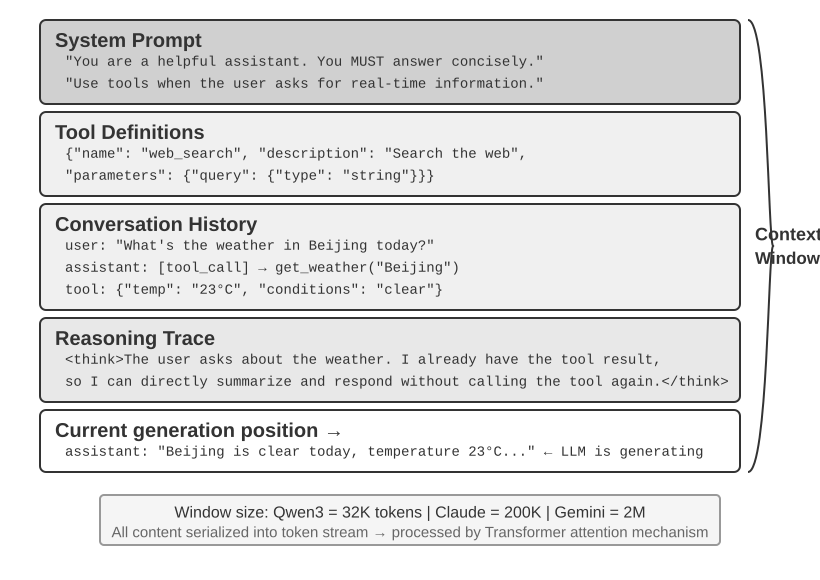
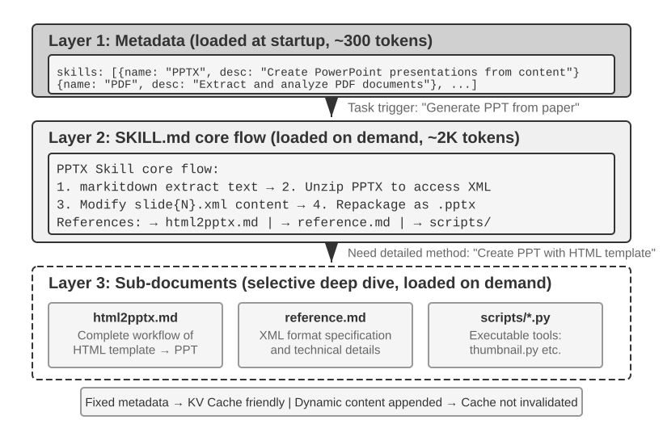
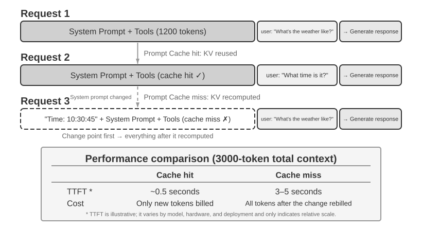
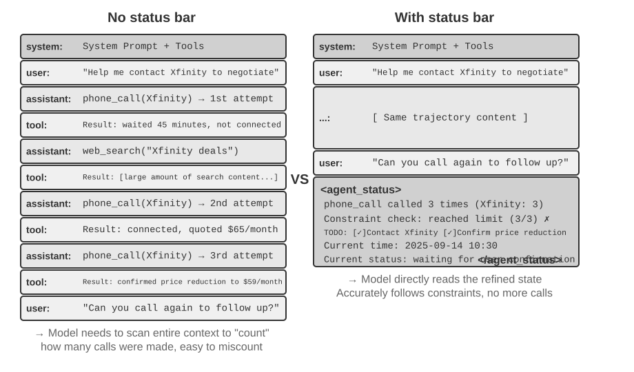

# 2 — The Anatomy of Effective Context

> What goes in the window, in what order, and which layer each piece belongs to.

---

## The components


*Figure 2-1, Overview of the Context Window Composition. From Li, [*AI Agents in Depth*](https://github.com/bojieli/ai-agent-book/blob/main/book-en/chapter2.md) (Apache-2.0).*

A context window at inference time is composed of, roughly in order:

1. **System prompt** — role, task framing, behavioral constraints
2. **Tool definitions** — names, descriptions, parameter schemas
3. **Retrieved knowledge** — documents, search results, RAG chunks
4. **Memory** — summaries and facts carried across sessions
5. **Runtime state** — date, user, environment, permissions
6. **Message history** — the conversation, including tool calls and results
7. **The current turn** — what the user just asked

Context engineering is the discipline of deciding, per call, what occupies each of these and at what size.

---

## System prompt altitude

Anthropic's framing: system prompts must be calibrated to the **right altitude** — a Goldilocks zone between two failure modes.

| Too low | Right altitude | Too high |
|---|---|---|
| Hardcoded if/else logic in prose | Specific enough to guide, flexible enough to generalize | Vague guidance assuming context the model lacks |
| Brittle — breaks on any case not enumerated | Heuristics with clear signals | Under-specified — model invents its own interpretation |
| "If the user says X, reply Y. If Z, reply W…" | "Prefer X when the signal is A; escalate when uncertain." | "Be helpful and use good judgment." |

The low-altitude failure is more common in engineered systems, because each production bug tempts you to add one more rule. The result is a system prompt that reads like a decision tree, is unmaintainable, and still misses the next edge case. When you catch yourself adding a fourth conditional to a prompt, the fix is usually a **tool or a code-level control**, not a fifth conditional. See layer 5 below.

---

## The five layers

Organize context by **usage frequency, stability, and enforcement requirement** — not by topic. Keep the active window small and inject the rest only when relevant.

### Layer 1 — Persistent instruction

Must be valid in every session: agent identity and role, project-wide conventions, architectural invariants, safety constraints, prohibited actions.

Properties: short, explicit, stable, operational, easy to follow. In Claude Code this is `CLAUDE.md`.

Test for this layer: *if it isn't true in nearly every task, it doesn't belong here.*

### Layer 2 — On-demand knowledge


*Figure 2-11, Skills Progressive Disclosure Mechanism. From Li, [*AI Agents in Depth*](https://github.com/bojieli/ai-agent-book/blob/main/book-en/chapter2.md) (Apache-2.0).*

Reusable procedures and domain knowledge relevant only to certain tasks: skills, playbooks, deployment procedures, evaluation methodologies, debugging checklists, API-specific instructions, long reference docs.

Governed by **progressive disclosure** — only a short name and description (*what* + *when*) stay permanently visible; full content loads when the task activates it. The `skills/` directory is this pattern made concrete: ~10 tokens of description resident, thousands of tokens of procedure loaded on demand.

**Write the description as a routing rule, not a feature summary.** Use "Use when … / Do not use when …" and include negative examples. "Help with backend" fires on unrelated tasks. Explicit exclusions are what make routing precise.

**Where the full content lands** is a trade-off between the cache and instruction-following (Li, ch. 2):

| Placement | Cache | Instruction-following |
|---|---|---|
| Append to the system prompt | Breaks the prefix on every load | Strongest; system position is heavily trained |
| Read as an ordinary file (mid-context tool result) | Untouched | Model-dependent; many models treat it as reference material, not orders |
| **Metadata resident, full `SKILL.md` via a dedicated Skill tool** (Claude Code) | Write once, then cached | Good. Routing and execution are separate steps |

"Cache-friendly" means *write once, benefit repeatedly*, not zero cost. The first insertion still pays a cache write. Which role carries the metadata (`<system-reminder>` in a user turn, or a mid-conversation system block) is a harness implementation detail, not part of the Skills mechanism. Lab: [2-6 agent-skills-ppt](https://github.com/bojieli/ai-agent-book/tree/main/chapter2/agent-skills-ppt) (generate a deck from a paper with the PPTX Skill).

### Layer 3 — Runtime injection

Dynamic values that change between sessions, turns, users, or environments: current date/time, user or tenant ID, channel ID, environment variables, permission state, task status.

Assemble programmatically at request time rather than storing in the system prompt. Two benefits: the information stays current, and irrelevant dynamic data doesn't consume context on every interaction.

Date/time is the canonical case — without injection the model guesses, and every relative date ("last quarter", "recent") resolves wrong.

### Layer 4 — Long-term memory

Knowledge accumulated across sessions: user preferences, repeated corrections, project discoveries, effective workflows, prior decisions, known failure patterns.

Never a full transcript pasted forward. Organize as a **compact index plus retrievable detail** — Claude Code's auto-memory loads the `MEMORY.md` index (first 200 lines / 25 KB) at session start; topic files are read only when needed.

Memory must be **editable and auditable**. Wrong, outdated, or contradictory entries have to be removable rather than accumulating. See [06-memory.md](06-memory.md).

### Layer 5 — Deterministic system

Behavior that must be reliable belongs in **code**, not context: hooks, permissions, schemas, validators, tool constraints. Blocking dangerous commands, enforcing allowed paths, validating structured output, checking argument schemas.

The rule: a model may ignore, misunderstand, or inconsistently follow a textual instruction. A code-level control cannot be talked out of enforcing itself.

This layer is the answer to prompt-altitude drift. "The agent keeps doing X" is usually a hook, not a stronger sentence.

---

## Ordering: stable before dynamic


*Figure 2-10, Prompt Cache: Reusing the Prefix KV Cache Across Requests. From Li, [*AI Agents in Depth*](https://github.com/bojieli/ai-agent-book/blob/main/book-en/chapter2.md) (Apache-2.0).*

Ordering is not cosmetic — it determines cache economics and attention placement.

**Prompt caching works by prefix matching.** The cache hits only on an exact-match prefix; the first differing token invalidates everything after it. So:

```
[ system prompt ] [ tools ] [ stable memory ]   <- static, cacheable prefix
[ retrieved docs ] [ history ] [ runtime state ] <- dynamic, changes per call
[ current query ]                                <- last
```

Put a timestamp at the top of the system prompt and you have destroyed cache reuse for the entire window on every single call.

This aligns with a second effect: for long-document work, **put longform data above the query**. Anthropic measures up to 30% quality improvement when the query appears at the end rather than the beginning. Cache economics and attention placement point the same direction.

### Patterns that break the cache (or the model)

A production incident shows the stakes. Someone added `Current time: {{now}}` to a 100k-conversation/day agent's system prompt, and TTFT went from 0.5 s to 3–5 s while the bill nearly doubled. Li's Experiment 2-3 catalogues the usual culprits:

| Pattern | What breaks | Fix |
|---|---|---|
| Timestamp in the system prompt | Prefix changes on every request | Append time as a late message, or offer a clock tool |
| Per-request user config (quota, balance) | Same | State channel at the end ([status bar](#runtime-state-the-agent-status-bar)) |
| Reordering tools by usage frequency | Hundreds of tokens per tool re-prefilled | Fixed order; accuracy barely changes |
| Sliding-window history | Prefix shifts and old tool results vanish, so the agent re-runs calls and loops | Compaction ([05](05-compression-compaction.md)), not truncation |
| Flattening messages into `USER: … ASSISTANT: …` text | Cache only if it's unstable. The real damage is leaving the trained format: ignored tool results, repeated actions, text where a call was needed | Use the API's structured roles |
| Per-request "most relevant" few-shot examples | Examples sit early, so every swap breaks the prefix | A fixed example set per task type |

Cached reads cost about **one-tenth** of fresh prefill at Anthropic, DeepSeek and OpenAI's GPT-5 family. Anthropic needs explicit `cache_control` breakpoints, a minimum length (about 1024 tokens) and a TTL of about 5 minutes. OpenAI caches prefixes automatically. KV cache works within a request inside the engine. Prompt cache works across requests at the API layer. Both need the prefix to stay byte-stable. Lab: [2-3 kv-cache](https://github.com/bojieli/ai-agent-book/tree/main/chapter2/kv-cache).

### Caching as an architectural constraint

Once prompt caching carries real money, cache-key consistency shapes design decisions that seem unrelated. Claude Code shows three:

- **The prompt is ordered by cache boundary first, meaning second.** A marker splits globally cacheable content from per-user/session content. Each binary runtime condition placed *before* the marker doubles the cache-key variants (N conditions → 2^N), so fragments are tagged *cacheable* or *cache-breaking*.
- **Sub-agents are byte-aligned with the parent.** Same prompt, tools, model config and message prefix, so side queries hit the parent's cache.
- **Tool-result replacements are frozen at first use.** When a large output is swapped for a preview, that exact string is persisted and reused after a session restore, so the replayed history stays byte-identical.

Design this in from the start; retrofitting cache consistency is expensive.

### Chat templates, and why thinking is state

The server turns API messages into one token stream through the model's **chat template** (`<|im_start|>system … <|im_end|>`, which differs by family). Two consequences follow:

- **Mislabelled roles change behaviour, not just formatting.** Qwen3's template keeps `<think>` content across tool calls but resets it on a new user turn. If tool results are sent as user messages, the reasoning resets in the middle of a task.
- **Pass reasoning back.** In the DeepSeek-R1 era the guidance was to strip historical reasoning (it was out of distribution). DeepSeek V4 reversed this: `reasoning_content` must be returned verbatim on every assistant message, including tool-call turns. Kimi K2 and GLM-5 follow the same protocol. Claude requires signed thinking blocks to be passed back inside the tool loop. For agents, reasoning carries *why this tool was called and which hypotheses were ruled out*, so stripping it makes the model repeat mistakes. Check each model's current template docs.

Position bias, the attention sink on the first token, and the "triangle" patterns of reasoning and output are all visible in [2-2 attention_visualization](https://github.com/bojieli/ai-agent-book/tree/main/chapter2/attention_visualization). [2-1 local_llm_serving](https://github.com/bojieli/ai-agent-book/tree/main/chapter2/local_llm_serving) shows a 0.6B model doing reliable tool calls, and the TTFT jump when you edit one character of the prefix.

---

## Runtime state: the agent status bar


*Figure 2-14, Agent Status Bar Architecture. From Li, [*AI Agents in Depth*](https://github.com/bojieli/ai-agent-book/blob/main/book-en/chapter2.md) (Apache-2.0).*

The **status bar** is a short, structured block that the *harness* appends at the end of the context each turn, much like a phone's clock, battery and signal row. It is distinct from the system prompt, which is the fixed manual. The status bar is the live dashboard.

**Why it works:** *in-context learning is closer to retrieval than reasoning.* Attention finds an existing record easily ("what's in cage 37?") but is poor at aggregating in one forward pass ("how many black cats?"). An agent told "call each merchant at most 3 times" miscounts its own calls. Put "This is call #3 to this merchant (3/3)" in the tool result or status bar and the violation disappears. The status bar is the **distillation layer** that raw attention lacks. Its place at the end puts it next to the tokens being generated.

```xml
<agent_status>
- phone_call: 3 invocations (Xfinity: 3/3 max)
- Current time: 2025-09-14 10:30:45
- TODO: [1] Cancel plan (in_progress)
</agent_status>
```

**Evidence** (Li & Shi, *Distill, Don't Retrieve*: 11 models, about 24k evaluations):

- Weak models gain 40–54 points, and a 2B model with a status bar matches a frontier model without one.
- Strong models keep their accuracy and cut reasoning tokens by 80–90%.
- Without a status bar, reasoning effort per query grows with context length. With one, it stays flat.
- Key–value entries (`Clothes: 9 (Pass 7, Defect 2)`) beat the same facts written as prose.

**Three rules:**

1. **Maintain it in code, not with an LLM.** A 20-line regex matched ground truth. A frontier model summarizing the whole history at once did *worse than having no status bar*. If an LLM has to be involved, have it extract items one at a time and aggregate them in code.
2. **It is a lossy projection.** Delete raw history only if the bar covers every question that will be asked. When a question needed triple intersections and the bar stored only pairs, Claude fell from 100% to 7.6%. Treat a new question type like a schema change.
3. **Monitor its accuracy as a first-line metric.** Models trust it almost unconditionally. Errors under about 10% are tolerated; larger ones are worse than no bar. Source it only from real observations. If an attacker can write to it, it becomes an injection channel ([11](11-failure-modes.md)).

**Contents:** a TODO plan (Li's lab: 15 vs. 21 iterations with fewer missed subtasks); per-event side-channel data (timestamps, time since last reply); environment (cwd, updated after `cd`, plus OS and shell); per-tool call counters ("call #3 for `read_file`" prompts a change of strategy); detailed errors with fix hints (recovery rose from 60% to 95%); and the available-Skills list.

**Update strategy.** *Replace* the old status each turn when trajectories are short or the status is large: you lose the cache only for the last few turns, and there's a single unambiguous status. *Append persistently* when updates are frequent and trajectories are long: this is fully cache-friendly, at the cost of stale copies the model has to ignore. Claude Code's `<system-reminder>` appends.

**Readings need a strategy.** Raw timestamps alone barely move pass rates (about 2–3 points) on tasks that need a sense of time. Pairing them with a short operating rule ("deliver when time is short; investigate slow calls; route around hard blockers") lifts them from roughly 10% to 40–50% across six models. Time sense has three axes: **urgency** (match effort to the clock), **persistence** (tell permanent blockers from transient ones; don't retry a 410 five times) and **vigilance** (treat a 5 s call that should take 500 ms, or a 1 ms empty success, as evidence). A status bar that reports *external* facts the model couldn't infer, such as test results, render checks or real system state, is the "interaction" axis of test-time compute, beyond longer reasoning or more samples. Lab: [2-8 system-hint](https://github.com/bojieli/ai-agent-book/tree/main/chapter2/system-hint).

---

## Context types taxonomy

A useful cross-cut, orthogonal to the five layers:

| Type | Source | Volatility |
|---|---|---|
| **Static** | Role, instructions, rules, constraints | Stable across sessions |
| **Dynamic** | Date/time, user input, environment | Changes per turn |
| **Retrieved** | Vector store, search, file reads | Changes per query |
| **Historical** | Prior states, revisions, agent outputs | Grows monotonically |

Historical is the one that gets away from you — it is the only type that grows without an explicit bound. Everything in [05-compression-compaction.md](05-compression-compaction.md) exists to bound it.

---

## Structure within the window

- **Delimit untrusted content.** Wrap user input and retrieved documents in tags (`<user_query>`, `<document index="1">`) so the model can distinguish instructions from data. This is also the first line of prompt-injection defense — see [11-failure-modes.md](11-failure-modes.md).
- **Structured outputs are context engineering.** A JSON schema or typed field list constrains what comes back, which determines what the *next* turn's context contains. Schema discipline compounds across a loop.
- **Few-shot examples: diverse and canonical.** A handful of well-chosen examples outperforms an exhaustive rule list, and costs fewer tokens. Prefer examples over enumerated edge cases.

---

## Worked example: tuning a deep-research agent

DAIR's case study (Saravia, n8n) is a planner agent that writes search tasks, plus a worker agent that runs them. Each failure it hit was fixed by changing the context, not the model:

| Symptom | Context fix |
|---|---|
| Planned 3 searches, ran 2, and gave no reason | State the completion rule. **Flexible** — "skip a task only if it overlaps another, and say why" — while developing and observing; **strict** — "execute every planned task" — in production |
| Status values drifted between runs (`pending` / `to-do`, `done` / `completed` / `finished`) | **Enumerate the allowed values** in the tool instructions. Every free-text field that code reads needs a closed set |
| Searched for stale news ("latest" meant last year) | **Inject the current date** as dynamic context, after the stable prefix so it doesn't break the cache (see [Ordering](#ordering-stable-before-dynamic)) |
| One agent managed tasks, memory, search and the report; it forgot steps as the context grew | Split out a **search worker** that receives *only the query text* and returns results plus an error state. Run it on a cheaper model ([10](10-tools-and-multi-agent.md#what-a-sub-agent-receives)) |
| Unclear why it made a decision | Write the task list to external state (id, query, status, result summary, timestamp), so every decision is inspectable ([06](06-memory.md#structured-note-taking)) |
| Undefined behavior when a search failed | Add **error-path instructions**: retry once, then record the failure and continue |

Before shipping, check the context against four questions: **completeness** (does it cover every scenario?), **clarity** (could any part be read two ways?), **consistency** (do the system prompt and the tool descriptions agree?), and **testability** (can you check the behavior with an eval?). Then track task-completion rate, behavioral consistency across similar inputs, and error rate as the context changes. Avoiding over-constraint (rules that break on edge cases) and under-specification (vague goals) is a calibration problem. Evals settle it ([06-eval](../../06-eval/README.md)).

---

## The formal view

The Mei et al. survey (2507.13334) writes context as an assembly of typed components rather than a single string:

```
C = A(c_instr, c_know, c_tools, c_mem, c_state, c_query)
```

| Component | Is | Layer above |
|---|---|---|
| `c_instr` | System instructions and rules | Instructions |
| `c_know` | Retrieved external knowledge | Retrieved |
| `c_tools` | Tool definitions and signatures | Tools |
| `c_mem` | Persistent memory from prior sessions | Memory |
| `c_state` | Dynamic state: user, world, task progress | Dynamic |
| `c_query` | The immediate request | Query |

`A` is the assembly function: selection, ordering, formatting. The framing makes one point worth keeping: **context engineering is designing `A`**, not writing any single component. Optimising the assembly under a token budget is [03](03-budgeting-the-window.md).

### Examples: how many, which ones

The upstream "molecule" material comes down to three rules:

- **Two to five examples** usually capture most of the gain. Measure before adding more ([03](03-budgeting-the-window.md)).
- **Select by similarity to the query** when you have an example pool. Retrieved examples beat a fixed set on heterogeneous traffic.
- **Cover the output space.** Include at least one example of each output class (including "none" or "refuse"), or the model will under-produce the missing ones.

---

## Working reference

`~/.claude/refs/agent-context.md` — content priority ordering: stable content (system prompt, memory summaries) before ephemeral content (history, tool results, scratch reasoning). Also covers prompt versioning (`PROMPT_VERSION` identifiers; version bumps invalidate eval baselines).

---

→ Next: [03-budgeting-the-window.md](03-budgeting-the-window.md) — how much of each component the window can afford.
