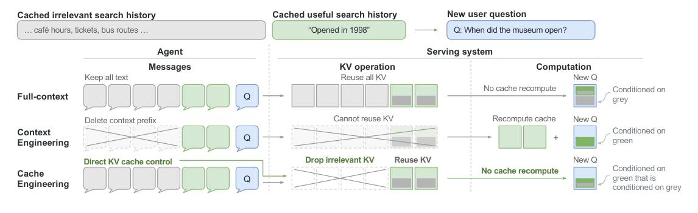

# 3 — Budgeting the Window

> Every component in the window competes for the same finite budget ([01](01-why-context-is-finite.md)). Budgeting means deciding the split *before* the window fills, so the important pieces are never the ones that get squeezed out.

---

## The window as an economy

Tokens are the currency, and there are three things you're spending them on:

| Spend | What it buys | Failure if over-spent | Failure if under-spent |
|---|---|---|---|
| **Instructions** (system prompt, rules, examples) | Behaviour you can rely on | Diluted attention; rules contradict | The model guesses at the task |
| **Evidence** (retrieved docs, tool results, memory) | Grounding in facts it doesn't have | Distraction, context rot | Hallucination |
| **Working space** (history, scratch reasoning, the output itself) | Room to think and answer | Truncated output, lost recent turns | No room for reasoning |

The upstream course calls this "the budget model". The useful reframe is that some spending is an **investment** (a 60-token rule that prevents a class of errors on every call) and some is an **expense** (a 3,000-token tool result consulted once). Investments belong in the stable prefix. Expenses should be cleared once they've been used ([05](05-compression-compaction.md)).

---

## Formally: assembly under a constraint

The Mei et al. survey writes context as an assembly of components:

```
C = A(c_instr, c_know, c_tools, c_mem, c_state, c_query)
```

Context engineering is then an optimisation over the assembly function `A`:

```
A* = argmax_A  E[ Reward(LLM(C), Y*) ]   subject to  |C| ≤ L_max
```

There are two consequences worth remembering:

1. **The constraint binds before `L_max`.** Quality starts to fall long before the hard limit ([01](01-why-context-is-finite.md)), so the *effective* budget is smaller than the advertised window. Budget against the effective size.
2. **The value of a component is marginal, not absolute.** In information-theoretic terms, a chunk is worth what it adds about the answer *given everything already in the window*: `I(Y*; c | C_rest)`. A second document that restates the first has close to zero marginal value, even though it is "relevant". Redundancy is the most common way budget gets wasted.

---

## Allocation frameworks

Start with a fixed split, then measure. The upstream reference gives these as starting points. They're heuristics, not measured optima:

**Pyramid** (general purpose)

| Level | Share | Contents |
|---|---|---|
| 1 — base | ~20% | Core instructions and constraints |
| 2 | ~30% | Critical context and examples |
| 3 | ~30% | Recent interaction history |
| 4 | ~15% | Auxiliary information |
| 5 — top | ~5% | Reserve buffer |

**By task type**

| Task | System | Examples | History | Input | Reserve |
|---|---|---|---|---|---|
| Simple Q&A | 10% | 0% | 70% | 15% | 5% |
| Creative writing | 15% | 20% | 40% | 15% | 10% |
| Complex reasoning | 15% | 25% | 30% | 20% | 10% |

These numbers matter less than two rules:

- **Reserve the output first.** `max_tokens`, plus the thinking budget on reasoning models, comes off the top. A window filled to the limit with input leaves the model no room to answer.
- **Give every growing component a ceiling.** History, tool results and retrieved chunks grow without bound unless something caps them. The cap is what triggers compaction ([05](05-compression-compaction.md)).

---

## Spending less per component

### System prompt — progressive reduction

Write the full version, then cut elements one at a time while re-running your eval set. Remove anything whose deletion doesn't move a score.

```
Before (~350 tokens): You are a financial analyst with a PhD from Stanford and 15 years at
Goldman Sachs and Morgan Stanley. You specialise in technology sector analysis with deep
knowledge of SaaS business models, semiconductor dynamics… [continues]

After (~90 tokens): You are a senior financial analyst specialising in tech stocks.
Cover: 1. Fundamentals (P/E, growth, competition) 2. Industry context 3. Macro factors
(rates, regulation). Balance quantitative data with strategic insight.
```

Two patterns account for most of the savings:

- **Task guidance over persona biography.** "Provide efficient, production-ready Python with comments on key decisions" (~15 tokens) does more than a 90-token résumé.
- **Minimal scaffolding.** Ask for three output sections, not seven. Each extra section is an instruction the model has to track.

### Examples

Few-shot returns diminish quickly: the step from 0 to 1 example is the largest, and each one after that adds less. Starting points by task:

| Task | Examples |
|---|---|
| Classification | 1–3 per class |
| Generation | 2–5 |
| Structured extraction | 2–4, covering every field |
| Reasoning | 2–3, with the steps shown |

Pick examples that are diverse and include near-misses at the boundary, rather than more of the typical case. See [02](02-context-anatomy.md) and the prompt-engineering [core techniques](../../01-prompt-engineering/notes/03-core-techniques.md).

### History

| Strategy | Mechanism | Keeps | Loses |
|---|---|---|---|
| **Windowing** | Keep the system message plus the last N turns | Recency | Anything older than N, abruptly |
| **Summarisation** | Replace older turns with a model-written summary | The gist | Detail, exact wording |
| **Key-value state** | Extract facts (`budget: $40k`, `deadline: Fri`) into a structured block | Decisions and facts | Conversational nuance |

Production systems combine all three: structured state for decisions, a rolling summary for narrative, and a short raw window for the most recent turns. Details in [05](05-compression-compaction.md) and [06](06-memory.md).

Windowing in its simplest form reserves the output first, then drops the oldest turn until the rest fits. This is the core of the upstream course's `ContextManager` (`control_loop.py`):

```python
def fit_history(fixed, history, count, max_tokens=4000, reserved=1000):  # count: str -> int tokens
    budget = max_tokens - reserved                 # output tokens come off the top
    while history and count(fixed + "".join(history)) > budget:
        history.pop(0)                             # drop_oldest
    return history
```

The upstream version estimates tokens by word count. Pass the model's tokenizer (or the provider's token-count endpoint) as `count` instead: words undercount tokens by about a quarter on English prose, and by more on code and non-English text.

### Evidence

- Retrieve fewer, better chunks. Reranking the top 20 down to the best 5 usually beats passing all 20 ([04](04-retrieval.md)).
- Return **identifiers before contents**: a file list, then the file the model asks for.
- Truncate or paginate tool results at the tool boundary, not after they've landed in the window ([10](10-tools-and-multi-agent.md)).

---

## Budgeting with a cache

Prompt caching changes the cost side of the budget without changing the attention side. A stable 20k-token prefix that hits the cache is cheap and fast, but it still occupies attention. So:

- **Cost budget:** stable content is close to free once cached, so order stable before dynamic ([02](02-context-anatomy.md#ordering-stable-before-dynamic)).
- **Quality budget:** every token still competes for attention, cached or not. A cache hit doesn't make bloat harmless.

### Cache engineering: edit the KV cache, not the text

The catch with editing context is that most context edits destroy the cache. Summarizing an old tool result or dropping a turn changes the text, so everything after the edit is prefilled again. In agent workloads that bill is large: Fu et al. (Tsinghua, 2026, [arXiv:2610.28577](https://arxiv.org/abs/2610.28577)) measure **KV-cache reads at 82.4% of API cost**. History dependence also means matching on prefixes alone misses most of the reuse that is available.


*Image Source: Fu et al. (2026)*

Their alternative, **cache engineering** (implemented as AKV), lets the agent act on the KV cache directly. It drops or repositions cached entries rather than rewriting the text, so nothing is re-prefilled:

- A **rolling-drop policy for tool responses** beats threshold summarization by **+1.7 points at 27.7% lower cost**.
- Serving gains reach **1.2× throughput and 1.5× P95 latency**.
- Letting the agent refine its own cache policy (recursive self-improvement) cuts a further **7.1%** of cost.

This needs control of the serving stack, so it's not something you can do through a hosted API today. The budgeting lesson carries over anyway. Decide edits with the cache in mind: batch them, make them at stable boundaries, and prefer dropping whole blocks over rewriting text in the middle of the prefix.

---

## Measuring token efficiency

1. **Log tokens per component** on every call: system, tools, retrieved, memory, history, input, output. You can't budget what you don't measure.
2. **Ablate.** Drop one component, re-run the eval set and record the change in quality. Components whose removal costs nothing are candidates to cut.
3. **Track quality per 1k tokens** alongside absolute quality. Two configurations with equal scores aren't equal if one uses half the window.
4. **Watch for cliff edges.** Plot score against total context length. Where it bends down is your effective budget for that model and task.

The upstream course's first experiment makes step 2 concrete. It starts from an atomic prompt and adds one layer at a time, logging what each layer costs and what it returns:

```python
import tiktoken
enc = tiktoken.get_encoding("o200k_base")
base = "Write a paragraph about climate change."
layers = {
    "role":        "You are a climate scientist writing for the public.",
    "examples":    "Example of the register wanted: ...",
    "constraints": "Under 120 words. Cite one quantitative fact. No jargon.",
    "audience":    "Readers are high-school students.",
}
prompt = base
for name, text in [("base", "")] + list(layers.items()):
    prompt = f"{text}\n\n{prompt}" if text else prompt
    out = llm(prompt)
    p, r = len(enc.encode(prompt)), len(enc.encode(out))
    print(f"{name:12} prompt={p:4} response={r:4} score={judge(out):.2f}")
```

Read the `score` column, not response length. The original reported `response_tokens / prompt_tokens` as "token efficiency", which rewards verbosity. Quality per prompt token is the number that tells you whether a layer earned its place.

---

## Checklist

- [ ] Output and thinking tokens reserved before anything else
- [ ] Every growing component (history, tool results, retrieval) has a ceiling
- [ ] System prompt trimmed by ablation, not by intuition
- [ ] Redundant evidence de-duplicated before insertion
- [ ] Stable content first, so the cache works
- [ ] Per-component token counts logged

---

→ Next: [04-retrieval.md](04-retrieval.md) — how content gets *into* the window in the first place.
