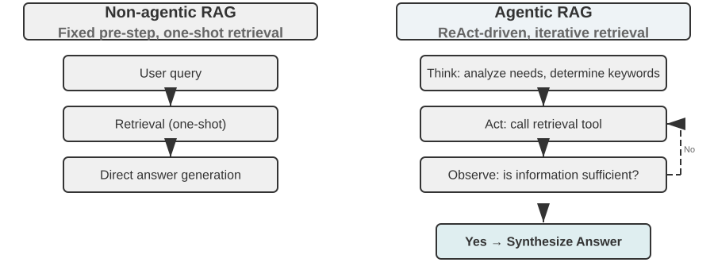
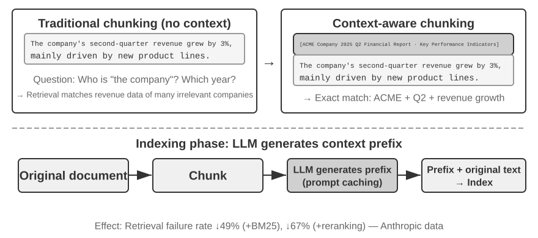

# 4 — Retrieval: One Lever on the Window

> Select is the lever that decides what comes back into the window, and when. This note covers retrieval as a context decision: whether to retrieve at all, who decides what to load, how much to send, and where it lands. The retrieval pipeline itself (parsing, chunking, hybrid search, reranking, RAG architectures, Text-to-SQL) is in the RAG module: [generative-ai/02-rag-retrieval/notes/01-rag-pipeline.md](../../../generative-ai/02-rag-retrieval/notes/01-rag-pipeline.md).

---

## The shift

The RAG-era assumption was: **retrieve before inference**. Embed the corpus, embed the query, pull top-k chunks, stuff them in the window, generate. All retrieval happens before the model does anything.

The agentic assumption is: **retrieve during inference**. Give the model tools and lightweight identifiers, and let it decide what to load, when, based on what it has learned so far. Anthropic calls this **just-in-time context**.

The difference is who decides relevance. Pre-computed retrieval makes an embedding-similarity guess about relevance *before seeing the model's reasoning*. Just-in-time lets relevance be determined by an agent that has already read the first file and now knows which one it actually needs.

One test of the shift treats the corpus as a file system. Off-the-shelf Codex (GPT-5) with no retriever beat the best published result on four of five long-context benchmarks, for example BrowseComp-Plus **88.50 vs 80.00** and Oolong-Real 33.73 vs 24.09, but not LongBench-v2 (61.50 vs 63.30) ([arXiv:2603.20432](https://arxiv.org/abs/2603.20432) (Cao et al., 2026-03, preprint)). Setup: 200 sampled examples per benchmark, where the BrowseComp-Plus and LongBench published numbers come from full sets and the Oolong ones are not marked so. Top-k RAG with the same generator scored 65.00 on BrowseComp-Plus. Adding a retriever to the agent did not help: 84.00 with Gemini embeddings and 78.50 with BM25 on BrowseComp-Plus, and fewer native grep and find calls per run (14.92 without, 8.33 with embeddings). The authors guess the retriever displaces broader exploration, which they did not test. One file per document beat one JSON file (89.0 vs 83.0, 100 examples). It costs more than RAG ($0.703 vs $0.111 per BrowseComp-Plus query), and the evidence is one agent, with Claude Code on two benchmarks.

---

## Retrieve, cache, or load it all

Retrieval is one of three ways to get a corpus in front of the model. Pick by corpus size, how often it's queried, and whether access differs per user:

| Option | How it works | Use when | Costs |
|---|---|---|---|
| **Long context** | Put the whole corpus in the window | It fits well inside the *effective* window ([01](01-why-context-is-finite.md)), and you ask once or twice | Full prefill per call; rot as occupancy grows |
| **Prompt / context cache** | Put the corpus in a stable prefix (implicit) or a named cache object (explicit), then ask many questions against it | It fits, and the same corpus serves many queries in a session | Storage per hour (explicit); any prefix change misses ([02](02-context-anatomy.md#ordering-stable-before-dynamic)) |
| **Retrieval** | Index once, fetch the relevant slice per query | The corpus doesn't fit, changes often, or permissions differ per user | Pipeline to build and tune; relevance can be guessed wrong |
| **Just-in-time tools** | The agent searches and reads on demand (below) | Agents over codebases, file systems, APIs | Latency, wandering, non-determinism |

How far long context stretches depends on the task. On Google DeepMind's LOFT benchmark, Gemini 1.5 Pro was given a 128k-token corpus (roughly 300 to 1,200 passages, depending on the dataset) in its prompt. It matched specialized retrievers on text retrieval (0.77 vs. Gecko's 0.76) and on RAG (0.53 vs. 0.52). It fell well short on SQL-like reasoning over tables (0.38 vs. 0.65), and the authors note performance "does degrade when scaling the corpus to millions of tokens" ([arXiv:2406.13121](https://arxiv.org/abs/2406.13121) (Lee et al., 2024-06)). Without caching, the Gemini 1.5 Pro API had a median latency of about 4 s at 32k input tokens, 12 s at 128k, and 100 s at 1M. That is the per-call bill a cache exists to cut.

When the corpus fits, the choice need not be all-or-nothing. Averaged over seven LongBench sets, reading the full context beat top-5 RAG by 7.6 points for Gemini-1.5-Pro and 13.1 for GPT-4o, at about 6× the tokens. But the two gave identical answers on 63% of queries, so routing pays. In **Self-Route**, RAG answers first and says "unanswerable" when the chunks fall short, and only those queries go to full context. Over all nine sets this matched long context for GPT-4o (48.89 vs. 48.67) on 61% of the tokens ([arXiv:2407.16833](https://arxiv.org/abs/2407.16833) (Li et al., 2024-07)). For inputs beyond the window, RAG still won (GPT-3.5-Turbo with a 16K window, on ~147K-word ∞Bench documents). A larger comparison by a different team agrees on direction, after first removing the questions a model answers without context. Over 13,628 such questions from 12 QA sets, with the same GPT-4-class reader in both arms and RAPTOR's summary-tree retriever (the best of six they tried), long context answered **56.3% correctly against 49.0% for RAG** under strict exact match ([arXiv:2501.01880](https://arxiv.org/abs/2501.01880) (Li et al., 2024-12, preprint)). The gap was widest on Wikipedia and stories and nearly closed on papers and reports. RAG won on dialogue and yes/no questions. Still, 1,294 questions, almost 10%, were answered only by RAG, so routing keeps its value. Average context length per dataset, before the padding, ran from 0.7K to 67K words, so this says nothing about million-token windows. The Wikipedia contexts were padded with distractor passages, which the authors concede may bias the result against RAG. They give no cost figure and no confidence intervals.

The cache option has been pushed to a replacement for retrieval. **Cache-augmented generation** (CAG) puts the whole corpus in the prompt once, keeps its precomputed KV cache, and answers each query with no retrieval step ([arXiv:2412.15605](https://arxiv.org/abs/2412.15605) (Chan et al., WWW Companion 2025)). On HotPotQA with Llama 3.1 8B and a 21K-token corpus, CAG scores BERTScore 0.7951 against 0.7676 for the best sparse RAG (BM25, top-5) and 0.7582 for the best dense run; at 43K tokens it is 0.7821 against 0.7633. The edge does not last: at 85K tokens CAG scores 0.7407, below sparse top-3 (0.7463) and top-5 (0.7535). On latency CAG generates in 2.26 s at 85K tokens against 92.1 s for putting the text in the prompt without a cache, but that is only faster than uncached long context and dense top-10 (about 3.05 s). Sparse top-3 answers in about 0.67 s, sparse top-10 in about 1.5 s and dense top-3 in about 1.35 s, so the saving is not over cheap retrieval. One model, two QA sets, BERTScore only, and plain top-k RAG baselines with no reranking; the authors judge the datasets easy enough that sparse retrieval beats dense. A corpus change would presumably mean re-encoding the cache; the paper does not say. Read it as support for the "fits and is static" row above, not for dropping retrieval.

A third option moves retrieval inside the model. **Unlimiformer** replaces a pretrained encoder-decoder's cross-attention with a kNN index over the encoder states of every input token, so each decoder head fetches its own top-k keys instead of reading a truncated window; a single index serves all heads and layers because the query-key product can be rearranged, and it costs about 2 GB per million tokens at 16-bit, hidden size 1024 ([arXiv:2305.01625](https://arxiv.org/abs/2305.01625) (Bertsch et al., NeurIPS 2023)). On GovReport with BART-base (139M), adding it at test time with no training lifts ROUGE-1 from 48.7 to 49.7, and with long-input training 56.6 against 54.7 for SLED. On BookSum (about 143K-token books) ROUGE is flat or worse (35.5 vs 36.4) while entity recall doubles, 10.0 to 21.9, which shows how little ROUGE sees of the truncated input. It gave nothing on WikiSum, where paragraphs were already ranked by TF-IDF and the first 1,024 tokens did as well: **upstream selection can make the long window unnecessary**. Evidence is small 2023 encoder-decoders, single runs, summarisation mostly, and no comparison with chunk-level RAG.

These combine. A common shape is a cached prefix (instructions, tool definitions, a corpus index) plus retrieval or tool calls for the long tail. Albada reaches the same verdict from practice, without measurements: a million-token window costs compute and latency and doesn't guarantee the model finds the one relevant passage, so production systems pair long context with selective retrieval (*Building Applications with AI Agents*, ch. 6). Retrieval also wins whenever **permissions** matter, whatever the size: a cached corpus is visible to everyone who hits the cache.

---

## Just-in-time context


*Image Source: Li, [AI Agents in Depth](https://github.com/bojieli/ai-agent-book/blob/main/book-en/chapter3.md) (2026), Figure 3-12: Comparison of Agentic RAG and Non-Agentic RAG (Apache-2.0)*

Instead of loading data, maintain **lightweight identifiers** and load at runtime:

- File paths
- Stored queries
- Web links
- Record IDs, table names
- Search commands

A file path costs ~10 tokens. The file costs 5,000. If the agent needs three of the fifty files a pre-retrieval step would have loaded, the identifier approach spends ~500 tokens on the index and 15,000 on the three files it actually reads (about 15.5k in all), instead of 250,000 on all fifty.

**Progressive disclosure** is the behavioral pattern: the agent discovers relevant context incrementally through exploration, each read informing the next. It mirrors how a human engineer approaches an unfamiliar codebase: `ls`, then `grep`, then read the three files that matter. Nobody reads the repo front to back first.

Metadata carries signal for free. A path like `tests/integration/test_auth_retry.py` tells the agent about scope, purpose, and relationship before a single byte of content is read. Naming conventions are a retrieval optimization.

The figure's agentic side is ReAct applied to retrieval: *assess what's missing → plan a query → retrieve → reason → check whether the question is answered*. Li's Experiment 3-9 shows when it pays: a simple legal question gives the same answer either way and the single pass is faster; a compound one (several sub-questions joined by a missing link) needs the agent's second, targeted round. The full comparison is in [rag.md](../../../generative-ai/02-rag-retrieval/notes/01-rag-pipeline.md#agentic-vs-single-pass-li-experiment-3-9).

Whether grep alone is enough depends on the corpus. [arXiv:2605.15184](https://arxiv.org/abs/2605.15184) (Sen et al., 2026-05, preprint) gave agent harnesses (Chronos, Claude Code, Codex, Gemini CLI) either a regex grep tool or dense vector search over LongMemEval-S conversation memory (116 questions, GPT-4o grader, no repeats reported). With results returned inline, **grep beat vector on all 10 harness-model pairs**, by 86.2 vs 62.9 at the widest (Chronos with Gemini 3.1 Flash-Lite) and 76.7 vs 75.0 at the narrowest (Claude Code with Opus 4.6). Swapping the harness moved accuracy as much as swapping the retriever: the same Opus 4.6 scored 93.1 on Chronos and 76.7 on Claude Code, both with grep. When the agent had to write results to a file and read it back, vector won 5 of 10 pairs and Codex with GPT-5.4 fell from 93.1 to 55.2 on grep. The authors read it as LongMemEval answers being literal spans, which favours lexical match, and they do not claim grep wins in general; their own scaling tables disagree with Table 1 on some cells, and there is no hybrid condition.

A skill pack is progressive disclosure built ahead of time: one `SKILL.md` holds an index of the chunks, and the agent opens the chunk it needs. On ∞Bench books, its value depended on corpus size ([arXiv:2607.17598](https://arxiv.org/abs/2607.17598) (He et al., UC Davis, 2026-07, preprint)). For a single book, Codex with gpt-5.4-mini scored the same with or without the pack, because the bare agent grepped for the question's entities and rebuilt the index itself. With 20 books in the file system, on English open QA, **the bare agent scored 0.257 against 0.462 with a flat pack**, while the flat pack read about half the tokens (32.5M vs 68.3M per question, an uncached upper bound). Adding a second routing level, one skill per chunk with every description always loaded, scored 0.267 and on a single book in the Pi harness (gpt-5.4-mini, multiple choice) scored 0.64 against the flat pack's 0.91: the descriptions recreate the context pressure disclosure was meant to remove. The authors' summary: disclosure "buys context, not intelligence". Caveats:
- Narrative books only, three small or mid-size models, and many gaps within one standard error.
- No gain on Chinese QA. On the Pi harness at 20 books, the two-level pack was the best on one task.
- The hybrid BM25-plus-dense retriever was tried on one harness only, where the flat pack beat it in nearly every cell.

Loading every skill up front does not substitute for choosing. On 75 SkillsBench tasks with a 196-skill library (GPT-5.2-Codex and Gemini-3-Pro, 3 attempts each), **loading the whole library lifted the pass rate only from 22.2% to 29.3% on Codex, against 44.0% for plain top-3 embedding retrieval**, and it took the most input tokens (1.27M vs 1.09M) ([arXiv:2606.32025](https://arxiv.org/abs/2606.32025) (Zhao et al., UNC, Honda Research Institute, 2026-06, preprint)). The paper's own trained skill selector, a 3.9M-parameter decoder that picks which skills, how many and in what order, reached 45.3% against 51.1% with hand-picked gold skills. Its 1.3-point lead over top-3 retrieval has no significance test. Skills were loaded before the task started rather than on demand. The training data is mostly synthetic, generated by Gemini.

What a retrieved skill does once loaded is a separate question. Jiang et al. distilled skills automatically from agent trajectories and compared them with Agent Workflow Memory ([arXiv:2409.07429](https://arxiv.org/abs/2409.07429) (Wang et al., ICML 2025)) built from the same trajectories. The experiments used Codex with GPT-5.3-Codex and Gemini CLI with Gemini-3.1-Pro-Preview. The comparison covers 528 matched task-setting triples from Terminal-Bench 2.0 (186), SkillsBench (144) and Terminal-Bench-Pro (198) ([arXiv:2608.14036](https://arxiv.org/abs/2608.14036) (Jiang et al., Princeton et al., 2026-08, preprint)). **Skills beat workflow memory by 6.1 points (95% CI +0.8 to +11.4), but their 2.8-point lead over no memory at all has a CI that spans zero.** An LLM judge labelled 65.7% of skill cases as procedural anchoring, where the skill keeps the agent on a known sequence of steps, and only 4.5% as supplying a missing fact. A separate SkillsBench experiment ran Gemini CLI with Gemini-3.1-Pro-Preview and Codex with GPT-5.4. As the pool grew from 5 to 100 skills, the share of skills the agent used that were the annotated right one fell from 29.6% to 3.3%, averaged over the two pairings, while average task success moved only from 36.4% to 39.3%. The authors conclude that "exact ground-truth skill invocation is neither sufficient nor strictly necessary for success". Caveats:
- The skills were LLM-distilled, not hand-written.
- Only terminal and tool-use benchmarks were tested.
- The mechanism labels come from an LLM judge.
- Loading the description alone was never compared with loading the full skill body.

### Costs

Just-in-time is not free:

- **Latency.** Sequential tool calls are slower than one upfront retrieval. Each exploration round-trip is a full inference.
- **Wandering.** The agent can explore unproductively, burning context on the search itself rather than the answer.
- **Non-determinism.** Two runs may load different files, complicating evals and reproducibility ([12](12-evaluating-context.md)).

---

## The hybrid strategy

The practical default. Pre-load what is cheap and near-certainly needed; leave the long tail to runtime exploration.

```
Pre-load (fixed cost, high hit rate)      Just-in-time (variable, long tail)
-----------------------------------      ---------------------------------
CLAUDE.md / project conventions          Any specific source file
Directory tree / file index              Full API reference sections
Schema summaries                         Historical records
Recently touched files                   Log output, test output
```

Claude Code is this pattern: `CLAUDE.md` loads every session; everything else is `Read`, `Grep`, `Glob` on demand.

**Design question that decides it:** *Is this needed on ≥80% of turns?* Yes → pre-load. No → identifier plus a tool to fetch it.

---

## How much to retrieve

When you do retrieve upfront, the window-side decisions are the same whatever the pipeline looks like.

**Retrieve wide, rerank, send narrow.** Recall and precision are different jobs. A fast first stage pulls a wide candidate set (tens of chunks); a slower, more accurate reranker picks the few that reach the window. Bayer's PRINCE pipeline narrows millions of vectors to 7 chunks this way; the mechanics, with its 0.7/0.3 hybrid weighting, are in [rag.md](../../../generative-ai/02-rag-retrieval/notes/01-rag-pipeline.md#a-tuned-pipeline-bayers-prince).

**Scale depth to the task, not a fixed k:**

| Task shape | Chunks |
|---|---|
| Simple factual lookup | few — more is pure dilution |
| Comparison / synthesis across sources | more — needs breadth |
| Ambiguous or exploratory | retrieve wide, rerank hard, send narrow |

Fixed k is a bug for both directions: it over-fills simple queries (rot) and under-fills complex ones (missing evidence).

**Compress per query, not per document.** Reduce each retrieved document to the part that answers *this* question. A generic summary discards the specific detail the query needed ([05](05-compression-compaction.md)).

**Treat repeats as signal.** A chunk retrieved by several sub-queries is often the *most* relevant one. Collapse the duplicates, but let the repetition raise its rank.

**Hierarchical retrieval.** For large corpora, retrieve in tiers: search summaries or section headers first, then fetch full content only for the sections that matched. This is just-in-time applied inside a pre-retrieval pipeline: the tier-1 index is the lightweight identifier.

---

## Where retrieved content lands

Retrieved text is dynamic, so it goes **after** the cacheable prefix and **before** the history and the query ([02](02-context-anatomy.md#ordering-stable-before-dynamic)):

```
[ system prompt ] [ tools ] [ stable memory ]   <- cached prefix
[ retrieved docs ]                               <- per query
[ history ] [ runtime state ] [ current query ]  <- last
```

Three placement rules follow:

- **Never interleave retrieval into the prefix.** Swapping "most relevant" documents into the system prompt breaks the cache on every request ([02](02-context-anatomy.md#patterns-that-break-the-cache-or-the-model)).
- **Long documents above the query.** Anthropic measures up to 30% better answers when the question comes after the material. LOFT found the same: putting the query before the corpus "led to a significant and consistent performance decrease across tasks and models" ([arXiv:2406.13121](https://arxiv.org/abs/2406.13121)).
- **Best evidence at the edges.** Recall dips in the middle of a long block ([01](01-why-context-is-finite.md#context-rot)). With many chunks, put the top-ranked ones first and last, not in rank order down the middle.

When the evidence is already in the prompt and still gets missed, it can be repeated next to the question. ReContext reads the model's own attention from the last prompt tokens, copies the sentences holding the top-scoring tokens into an evidence pool, and replays that pool between the full context and the question. It does this twice and never prunes the context ([arXiv:2607.02509](https://arxiv.org/abs/2607.02509) (Zhao et al., UIUC, 2026-07, preprint)). On eight HELMET 128K tasks with Qwen3-4B, Qwen3-8B and Llama3.1-8B, mean accuracy rose from 0.24 to 0.30. The absolute numbers are low (Qwen3-4B on NQ, 0.02 to 0.08), the per-task gaps to the next method are often 0.01–0.03 with no variance reported, and on CLIPPER with Llama3-8B a run took 62 minutes against 44. It needs attention scores, so it works only on open models, and its baselines are attention methods, an agentic-memory retriever (A-MEM) and a prompt compressor, with no standard RAG pipeline.

### Framing retrieved content

How retrieved text is presented matters as much as which text arrives:

```
<retrieved_documents>
<document id="3" source="runbook.md" updated="2026-09-02">…</document>
</retrieved_documents>

Answer using only the documents above. Cite document ids.
If the documents don't contain the answer, say so.
```

Source and date metadata let the model resolve conflicts. The "say so" line is the cheapest hallucination guard there is. The tags also keep retrieved text distinguishable from instructions, which matters for injection ([11](11-failure-modes.md#prompt-injection)).

---

## Contextual retrieval


*Image Source: Li, [AI Agents in Depth](https://github.com/bojieli/ai-agent-book/blob/main/book-en/chapter3.md) (2026), Figure 3-14: Contextual Retrieval (Apache-2.0)*

Every chunking strategy cuts a fragment off from its context. "The company's Q2 revenue grew 3%": which company, which year? Anthropic's **contextual retrieval** has an LLM write a short prefix for each chunk *at index time* ("From the KPI section of ACME Corp's 2025 Q2 financial report"), then indexes prefix + chunk. One step improves both retrieval paths: BM25 gains exact keywords to match (ACME, 2025 Q2), and the embedding gains the missing context.

Anthropic reports that top-20 retrieval failures fall **49%** with contextual embeddings + contextual BM25, and **67%** once a reranker is added. With prompt caching, the indexing cost is about **$1 per million document tokens**, since every chunk of one document shares the document as a cached prefix.

Don't confuse it with *contextual compression* ([05](05-compression-compaction.md)). That runs at query time and removes content. Contextual retrieval runs at index time and adds it. It is context engineering applied to the index: the chunk is the window the embedder sees, and it was missing context.

A minimal version, using the document as the cached prefix:

```python
PREFIX_PROMPT = """<document>{doc}</document>
Here is a chunk from that document:
<chunk>{chunk}</chunk>
Write one short sentence situating this chunk within the document, to improve search retrieval.
Answer with the sentence only."""

def contextualize(doc, chunks, llm):
    # Same doc text first in every call, so the provider's prompt cache hits after the first chunk.
    return [llm(PREFIX_PROMPT.format(doc=doc, chunk=c)) + "\n" + c for c in chunks]
```

Labs: upstream [3-11 contextual-retrieval](https://github.com/bojieli/ai-agent-book/tree/main/chapter3/contextual-retrieval); the sparse half as a worked example in [BM25 from scratch](../../../generative-ai/02-rag-retrieval/notes/01-rag-pipeline.md#bm25-from-scratch).

---

## Distill at index time: beyond flat chunks

Naive RAG, meaning raw documents chunked and indexed unprocessed, fails on two question shapes, however good the retriever:

- **Aggregation.** Take 100 case files (90 black cats, 10 white) and ask for the ratio. Top-k truncation, uneven scores and the basic mismatch ("count across everything" vs. "find the few most relevant") leave the model reasoning from a sample of 15 and 3. One indexed summary, "100 cats: 90 black (90%), 10 white", answers it in a single retrieval.
- **Rule induction.** Three cases: a veteran got the discount, a doctor got it, a teacher was refused. A nurse asks. "Nurse" sits near "doctor", so the doctor case ranks first and the teacher case is missed. The model concludes nurses qualify. The indexed rule "discount for veterans and doctors only" answers every profession.

Attention is soft retrieval, not a summarizer. Spend compute **at index time** to turn cases into statistics and rules, so the window receives the conclusion rather than the evidence it would have to reason over. It's the same "distill, don't retrieve" idea as the status bar ([02](02-context-anatomy.md#runtime-state-the-agent-status-bar)), applied to a corpus.

The structured indexes that do this at scale (RAPTOR summary trees, GraphRAG, OpenViking's L0/L1/L2 filesystem, knowledge discovery) and when they're worth their up-front LLM cost are in [rag.md — index-time structures](../../../generative-ai/02-rag-retrieval/notes/01-rag-pipeline.md#index-time-structures-raptor-graphrag-filesystems). OpenViking's three tiers are the context-engineering idea in its purest form: a ~100-token abstract, a ~2k-token overview and the full text per resource, so most queries resolve at the overview and never load the rest.

GraphReader is the agent-side version. It builds a graph of atomic facts per document, then lets an agent walk it from a few start nodes ([arXiv:2406.14550](https://arxiv.org/abs/2406.14550) (Li et al., 2024-06, v2 2024-11, preprint)). With a 4K window and GPT-4, it beat GPT-4-128k full-text reading on LV-Eval HotpotWikiQA-mixup (250 samples) at every length: LR-1 **28.0 vs 16.0 at 128K and 30.0 vs 14.0 at 256K** (the baseline truncated at those lengths, which widens the gap). BM25 and embedding top-k scored lower on the LongBench QA sets (HotpotQA LR-1: BM25 57.7 to 74.7 and Ada-002 63.0 to 72.0 across top-1 and top-3, against 84.3). Choosing nodes at random cost about 18% on average. On the short LongBench sets the margin over full read is about 1 to 1.5 points on HotpotQA and NarrativeQA (+6 to +7 on 2Wiki and MuSiQue), with no variance reported. Graph construction (one GPT-4 call per 2K chunk) is not counted in the per-question token cost.

---

## Caching

Two distinct caches, often confused:

- **Prompt caching** (inference-level) caches the prefill computation for a token prefix. Prefix-match only, so ordering governs hit rate ([02](02-context-anatomy.md#ordering-stable-before-dynamic)). Vendors expose it two ways: **implicit** (automatic prefix reuse, or a breakpoint marker in the request) and **explicit** (a named cache object you create with a TTL, then reference by name, e.g. [Gemini context caching](https://ai.google.dev/gemini-api/docs/caching)). Explicit caches suit "upload a corpus once, ask many questions" sessions: the cache row in the [table above](#retrieve-cache-or-load-it-all). The explicit flow, in the current `google-genai` SDK:

  ```python
  from google import genai
  from google.genai import types

  client = genai.Client()
  doc = client.files.upload(file="a11.txt")            # upload once
  cache = client.caches.create(
      model="gemini-2.5-flash",
      config=types.CreateCachedContentConfig(
          display_name="apollo-11-transcript",
          system_instruction="Answer questions about the attached transcript.",
          contents=[doc],
          ttl="900s",                                   # you pay storage per hour; set it short
      ),
  )
  for q in ["Who spoke first?", "List the course corrections."]:
      r = client.models.generate_content(
          model="gemini-2.5-flash", contents=q,
          config=types.GenerateContentConfig(cached_content=cache.name),
      )
      print(r.usage_metadata.cached_content_token_count, r.text)  # confirm the hit
  ```

  **Deprecated:** the DAIR notebook this replaces used the old `google-generativeai` package (`caching.CachedContent.create`, `GenerativeModel.from_cached_content`) and `gemini-1.5-flash-001`. That SDK is superseded by `google-genai` and that model is retired.
- **Retrieval caching** (application-level) caches the *results* of expensive retrieval keyed by query similarity. A near-duplicate query reuses the prior result set instead of re-running search, planning, or sub-query generation. Cuts cost and latency on hot queries. Design notes: [semantic-cache.md](../../../generative-ai/02-rag-retrieval/notes/10-semantic-cache.md).

---

## Context validation

Retrieved content is not trustworthy by default. Validate before injecting:

- Remove outdated documents (freshness threshold)
- Enforce permissions — never surface content the requester cannot access
- Detect conflicting information across sources; surface the conflict rather than silently picking one
- Verify citations resolve to real, retrievable sources

Conflict detection matters most. Two retrieved documents contradicting each other, both injected silently, is a reliable path to a confidently wrong answer. This is **context clash** — see [11-failure-modes.md](11-failure-modes.md).

**Governance pushes these checks into the index** (Li, ch. 3):

- **Expiry.** Tag each chunk with a version and effective/expiry dates, and filter at query time. A superseded policy left in the index gets retrieved *alongside* its replacement. The index type matters: some support incremental updates, some need a full rebuild ([vector-databases.md](../../../generative-ai/02-rag-retrieval/notes/09-vector-database-comparison.md#ann-index-types-hnsw-vs-annoy)).
- **Permissions at the retrieval layer, not after it.** Push the permission filter *into* the vector query. Once an unauthorized document is in the context, nothing guarantees it stays out of the answer. Multi-tenant systems also isolate vector indexes and metadata per tenant.
- **Retrieved text is the main indirect-injection channel.** Tag its source ([framing](#framing-retrieved-content)), and never let retrieved content alone trigger a side-effecting action (transfer, delete, send). Those need their own authorization check ([harness 04](../../03-harness-engineering/notes/04-execution-boundaries.md)). *Knowledge poisoning* is the same attack, made before indexing.

---

## The pipeline, in the RAG module

Everything that decides *which* chunks a retriever can return lives in [generative-ai/02-rag-retrieval/notes/01-rag-pipeline.md](../../../generative-ai/02-rag-retrieval/notes/01-rag-pipeline.md):

- the pre-retrieval pipeline (filter → search → rerank → dedup → compress → format) and a production Bedrock example,
- ingestion and parser tiers (retrieval can only return what parsing extracted),
- chunking strategies, with an overlap chunker,
- hybrid search: BM25, dense, RRF and weighted fusion, cross-encoder reranking, and the metrics (recall@k, MRR, nDCG),
- Bayer's PRINCE pipeline and its Text-to-SQL path,
- RAG architectures, from naive to agentic and graph-enhanced, and conversational (multi-turn) RAG.

Worked examples: [BM25 from scratch](../../../generative-ai/02-rag-retrieval/notes/01-rag-pipeline.md#bm25-from-scratch) (offline) and [retrieved few-shot examples](../../../generative-ai/02-rag-retrieval/notes/01-rag-pipeline.md#text-to-sql-is-a-retrieval-strategy) (DAIR `pe-rag`).

---

## Working reference

Tool design determines whether just-in-time retrieval is viable; a tool returning 50k tokens of raw output defeats the purpose. See [10-tools-and-multi-agent.md](10-tools-and-multi-agent.md) for token-efficient tool design.

---

## Pitfalls

- **Pre-loading what the agent could fetch.** Symptom: 250,000 tokens of files in the window when the agent reads three, a job that costs about 15.5k with paths and a read tool. Fix: apply the ≥80%-of-turns rule, and otherwise give an identifier plus a tool.
- **Long context as the answer to every question.** Symptom: reasoning over tables stays weak, as on LOFT's SQL-like task, where Gemini 1.5 Pro with 128k in the prompt scored .38 against .65 for the specialized system, and latency reaches about 100 s at 1M. Fix: route by question shape and answerability, as Self-Route does.
- **Sending the top-k directly.** Symptom: high recall in the retriever, and answers that still miss, because the best evidence sits mid-list. Fix: retrieve wide, rerank, narrow, and put the best evidence at the edges of the block.
- **Retrieval for an aggregation question.** Symptom: asked for the ratio across 100 case files (90 black cats, 10 white), the model reasons from a top-k sample of 15 and 3. Fix: distill aggregates and rules at index time rather than retrieving them at query time.
- **Filtering permissions after retrieval.** Symptom: a user sees, or the model quotes, a document they shouldn't. A cached corpus is visible to everyone sharing it. Fix: filter inside the query, and scope caches to the audience.
- **Cached retrieval with no expiry.** Symptom: answers cite a policy changed last week. Fix: set an expiry, and distinguish prompt caching, which is safe by construction, from retrieval caching, which can serve stale content.
- **No way for the model to say the evidence is missing.** Symptom: fluent answers invented when retrieval comes back empty. Fix: add the say-so line that lets it report the gap.

## Try it

1. An agent has 40 files of 5,000 tokens each, and a task needs 8 of them. Using this chapter's costs (a path is ~10 tokens), compare identifiers with pre-loading.

   <details><summary>Answer</summary>

   Identifiers: 400 for the index + 8 × 5,000 = 40,400 tokens. Pre-load: 200,000. Identifiers spend about a fifth, and the gap widens as the corpus grows.

   </details>

2. Over 20 turns, the style guide is used on 18 and the database schema on 3. Which do you pre-load?

   <details><summary>Answer</summary>

   The style guide, at 90% of turns, clears the ≥80% rule. The schema, at 15%, stays behind an identifier and a fetch tool.

   </details>

3. Suppose your top-20 retrieval fails on 10% of questions (an illustrative baseline, not a measurement). What failure rate do you expect from the 49% and 67% contextual retrieval reductions?

   <details><summary>Answer</summary>

   10% × 0.51 = 5.1%, and 10% × 0.33 = 3.3%. Those are Anthropic's reductions from its own test, so measure on your own corpus before relying on them.

   </details>

4. Route each one: "Quote clause 12", "What's the total of all invoices above 10k?", "Does a nurse qualify for the discount?"

   <details><summary>Answer</summary>

   The clause goes to a plain lookup with retrieval or a read tool. The invoice total goes to a structured query or an aggregate computed at index time. The discount question goes to a rule distilled at index time, because "nurse" sits near "doctor" in embedding space and retrieval misses the teacher case that shows the limit.

   </details>

## Interview checklist

| Prompt | Answer in one line |
|---|---|
| Pre-load or fetch just in time? | Pre-load only what's needed on about ≥80% of turns. Otherwise a path costing about 10 tokens beats a 5,000-token file. |
| RAG or long context for a document set? | Depends on the query: on LOFT with 128k in the prompt, Gemini 1.5 Pro matched specialized retrievers on text retrieval (.77 vs .76) and RAG (.53 vs .52) but not SQL-like reasoning (.38 vs .65). |
| How do you combine them? | Route. Full context and top-5 RAG gave identical answers on 63% of LongBench queries, so Self-Route lets RAG answer first and escalate on "unanswerable": 48.89 against 48.67 for GPT-4o on 61% of the tokens. |
| What does latency look like at long context? | LOFT saw roughly 4 s, 12 s and 100 s at 32k, 128k and 1M. A long-context design has to be acceptable at that latency before accuracy matters. |
| When does retrieval structurally fail? | On aggregation and rule induction, where the answer isn't in any chunk. Distill those at index time, for example the count of 90 black cats or the nurse rule. |
| Why add context to chunks before embedding? | Anthropic reports top-20 retrieval failures down 49% with contextual embeddings and contextual BM25, and 67% with a reranker, at about $1 per million document tokens with prompt caching. A chunk alone often lacks the identifier that makes it findable. |
| Two retrieved documents contradict each other. What do you do? | Surface the conflict rather than silently picking one. To stop it recurring, tag chunks with a version and effective and expiry dates and filter at query time, since a superseded policy left in the index gets retrieved alongside its replacement. |

## Next

[05-compression-compaction.md](05-compression-compaction.md): selection controls what enters the window, and the next lever covers what to do when it fills anyway.
