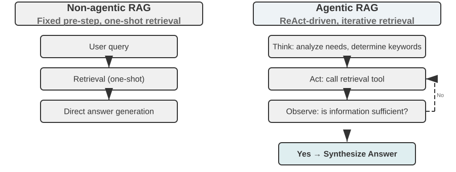
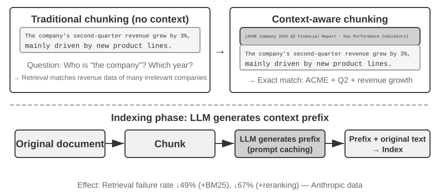

# 4 — Retrieval: One Lever on the Window

> Select is the lever that decides what comes back into the window, and when. This note covers retrieval as a context decision: whether to retrieve at all, who decides what to load, how much to send, and where it lands. The retrieval pipeline itself (parsing, chunking, hybrid search, reranking, RAG architectures, Text-to-SQL) is in the RAG module: [generative-ai/02-rag-retrieval/notes/01-rag-pipeline.md](../../../generative-ai/02-rag-retrieval/notes/01-rag-pipeline.md).

---

## The shift

The RAG-era assumption was: **retrieve before inference**. Embed the corpus, embed the query, pull top-k chunks, stuff them in the window, generate. All retrieval happens before the model does anything.

The agentic assumption is: **retrieve during inference**. Give the model tools and lightweight identifiers, and let it decide what to load, when, based on what it has learned so far. Anthropic calls this **just-in-time context**.

The difference is who decides relevance. Pre-computed retrieval makes an embedding-similarity guess about relevance *before seeing the model's reasoning*. Just-in-time lets relevance be determined by an agent that has already read the first file and now knows which one it actually needs.

---

## Retrieve, cache, or load it all

Retrieval is one of three ways to get a corpus in front of the model. Pick by corpus size, how often it's queried, and whether access differs per user:

| Option | How it works | Use when | Costs |
|---|---|---|---|
| **Long context** | Put the whole corpus in the window | It fits well inside the *effective* window ([01](01-why-context-is-finite.md)), and you ask once or twice | Full prefill per call; rot as occupancy grows |
| **Prompt / context cache** | Put the corpus in a stable prefix (implicit) or a named cache object (explicit), then ask many questions against it | It fits, and the same corpus serves many queries in a session | Storage per hour (explicit); any prefix change misses ([02](02-context-anatomy.md#ordering-stable-before-dynamic)) |
| **Retrieval** | Index once, fetch the relevant slice per query | The corpus doesn't fit, changes often, or permissions differ per user | Pipeline to build and tune; relevance can be guessed wrong |
| **Just-in-time tools** | The agent searches and reads on demand (below) | Agents over codebases, file systems, APIs | Latency, wandering, non-determinism |

These combine. A common shape is a cached prefix (instructions, tool definitions, a corpus index) plus retrieval or tool calls for the long tail. Retrieval also wins whenever **permissions** matter, whatever the size: a cached corpus is visible to everyone who hits the cache.

---

## Just-in-time context


*Image Source: Li, [AI Agents in Depth](https://github.com/bojieli/ai-agent-book/blob/main/book-en/chapter3.md) (2026), Figure 3-12: Comparison of Agentic RAG and Non-Agentic RAG (Apache-2.0)*

Instead of loading data, maintain **lightweight identifiers** and load at runtime:

- File paths
- Stored queries
- Web links
- Record IDs, table names
- Search commands

A file path costs ~10 tokens. The file costs 5,000. If the agent needs three of the fifty files a pre-retrieval step would have loaded, the identifier approach spends ~500 tokens on the index and 15,000 on the three files it actually reads (about 15.5k in all), instead of 250,000 on all fifty.

**Progressive disclosure** is the behavioral pattern: the agent discovers relevant context incrementally through exploration, each read informing the next. It mirrors how a human engineer approaches an unfamiliar codebase: `ls`, then `grep`, then read the three files that matter. Nobody reads the repo front to back first.

Metadata carries signal for free. A path like `tests/integration/test_auth_retry.py` tells the agent about scope, purpose, and relationship before a single byte of content is read. Naming conventions are a retrieval optimization.

The figure's agentic side is ReAct applied to retrieval: *assess what's missing → plan a query → retrieve → reason → check whether the question is answered*. Li's Experiment 3-9 shows when it pays: a simple legal question gives the same answer either way and the single pass is faster; a compound one (several sub-questions joined by a missing link) needs the agent's second, targeted round. The full comparison is in [rag.md](../../../generative-ai/02-rag-retrieval/notes/01-rag-pipeline.md#agentic-vs-single-pass-li-experiment-3-9).

### Costs

Just-in-time is not free:

- **Latency.** Sequential tool calls are slower than one upfront retrieval. Each exploration round-trip is a full inference.
- **Wandering.** The agent can explore unproductively, burning context on the search itself rather than the answer.
- **Non-determinism.** Two runs may load different files, complicating evals and reproducibility ([12](12-evaluating-context.md)).

---

## The hybrid strategy

The practical default. Pre-load what is cheap and near-certainly needed; leave the long tail to runtime exploration.

```
Pre-load (fixed cost, high hit rate)      Just-in-time (variable, long tail)
-----------------------------------      ---------------------------------
CLAUDE.md / project conventions          Any specific source file
Directory tree / file index              Full API reference sections
Schema summaries                         Historical records
Recently touched files                   Log output, test output
```

Claude Code is this pattern: `CLAUDE.md` loads every session; everything else is `Read`, `Grep`, `Glob` on demand.

**Design question that decides it:** *Is this needed on ≥80% of turns?* Yes → pre-load. No → identifier plus a tool to fetch it.

---

## How much to retrieve

When you do retrieve upfront, the window-side decisions are the same whatever the pipeline looks like.

**Retrieve wide, rerank, send narrow.** Recall and precision are different jobs. A fast first stage pulls a wide candidate set (tens of chunks); a slower, more accurate reranker picks the few that reach the window. Bayer's PRINCE pipeline narrows millions of vectors to 7 chunks this way; the mechanics, with its 0.7/0.3 hybrid weighting, are in [rag.md](../../../generative-ai/02-rag-retrieval/notes/01-rag-pipeline.md#a-tuned-pipeline-bayers-prince).

**Scale depth to the task, not a fixed k:**

| Task shape | Chunks |
|---|---|
| Simple factual lookup | few — more is pure dilution |
| Comparison / synthesis across sources | more — needs breadth |
| Ambiguous or exploratory | retrieve wide, rerank hard, send narrow |

Fixed k is a bug for both directions: it over-fills simple queries (rot) and under-fills complex ones (missing evidence).

**Compress per query, not per document.** Reduce each retrieved document to the part that answers *this* question. A generic summary discards the specific detail the query needed ([05](05-compression-compaction.md)).

**Treat repeats as signal.** A chunk retrieved by several sub-queries is often the *most* relevant one. Collapse the duplicates, but let the repetition raise its rank.

**Hierarchical retrieval.** For large corpora, retrieve in tiers: search summaries or section headers first, then fetch full content only for the sections that matched. This is just-in-time applied inside a pre-retrieval pipeline: the tier-1 index is the lightweight identifier.

---

## Where retrieved content lands

Retrieved text is dynamic, so it goes **after** the cacheable prefix and **before** the history and the query ([02](02-context-anatomy.md#ordering-stable-before-dynamic)):

```
[ system prompt ] [ tools ] [ stable memory ]   <- cached prefix
[ retrieved docs ]                               <- per query
[ history ] [ runtime state ] [ current query ]  <- last
```

Three placement rules follow:

- **Never interleave retrieval into the prefix.** Swapping "most relevant" documents into the system prompt breaks the cache on every request ([02](02-context-anatomy.md#patterns-that-break-the-cache-or-the-model)).
- **Long documents above the query.** Anthropic measures up to 30% better answers when the question comes after the material.
- **Best evidence at the edges.** Recall dips in the middle of a long block ([01](01-why-context-is-finite.md#context-rot)). With many chunks, put the top-ranked ones first and last, not in rank order down the middle.

### Framing retrieved content

How retrieved text is presented matters as much as which text arrives:

```
<retrieved_documents>
<document id="3" source="runbook.md" updated="2026-09-02">…</document>
</retrieved_documents>

Answer using only the documents above. Cite document ids.
If the documents don't contain the answer, say so.
```

Source and date metadata let the model resolve conflicts. The "say so" line is the cheapest hallucination guard there is. The tags also keep retrieved text distinguishable from instructions, which matters for injection ([11](11-failure-modes.md#prompt-injection)).

---

## Contextual retrieval


*Image Source: Li, [AI Agents in Depth](https://github.com/bojieli/ai-agent-book/blob/main/book-en/chapter3.md) (2026), Figure 3-14: Contextual Retrieval (Apache-2.0)*

Every chunking strategy cuts a fragment off from its context. "The company's Q2 revenue grew 3%": which company, which year? Anthropic's **contextual retrieval** has an LLM write a short prefix for each chunk *at index time* ("From the KPI section of ACME Corp's 2025 Q2 financial report"), then indexes prefix + chunk. One step improves both retrieval paths: BM25 gains exact keywords to match (ACME, 2025 Q2), and the embedding gains the missing context.

Anthropic reports that top-20 retrieval failures fall **49%** with contextual embeddings + contextual BM25, and **67%** once a reranker is added. With prompt caching, the indexing cost is about **$1 per million document tokens**, since every chunk of one document shares the document as a cached prefix.

Don't confuse it with *contextual compression* ([05](05-compression-compaction.md)). That runs at query time and removes content. Contextual retrieval runs at index time and adds it. It is context engineering applied to the index: the chunk is the window the embedder sees, and it was missing context.

A minimal version, using the document as the cached prefix:

```python
PREFIX_PROMPT = """<document>{doc}</document>
Here is a chunk from that document:
<chunk>{chunk}</chunk>
Write one short sentence situating this chunk within the document, to improve search retrieval.
Answer with the sentence only."""

def contextualize(doc, chunks, llm):
    # Same doc text first in every call, so the provider's prompt cache hits after the first chunk.
    return [llm(PREFIX_PROMPT.format(doc=doc, chunk=c)) + "\n" + c for c in chunks]
```

Labs: upstream [3-11 contextual-retrieval](https://github.com/bojieli/ai-agent-book/tree/main/chapter3/contextual-retrieval); the sparse half as a worked example in [BM25 from scratch](../../../generative-ai/02-rag-retrieval/notes/01-rag-pipeline.md#bm25-from-scratch).

---

## Distill at index time: beyond flat chunks

Naive RAG, meaning raw documents chunked and indexed unprocessed, fails on two question shapes, however good the retriever:

- **Aggregation.** Take 100 case files (90 black cats, 10 white) and ask for the ratio. Top-k truncation, uneven scores and the basic mismatch ("count across everything" vs. "find the few most relevant") leave the model reasoning from a sample of 15 and 3. One indexed summary, "100 cats: 90 black (90%), 10 white", answers it in a single retrieval.
- **Rule induction.** Three cases: a veteran got the discount, a doctor got it, a teacher was refused. A nurse asks. "Nurse" sits near "doctor", so the doctor case ranks first and the teacher case is missed. The model concludes nurses qualify. The indexed rule "discount for veterans and doctors only" answers every profession.

Attention is soft retrieval, not a summarizer. Spend compute **at index time** to turn cases into statistics and rules, so the window receives the conclusion rather than the evidence it would have to reason over. It's the same "distill, don't retrieve" idea as the status bar ([02](02-context-anatomy.md#runtime-state-the-agent-status-bar)), applied to a corpus.

The structured indexes that do this at scale (RAPTOR summary trees, GraphRAG, OpenViking's L0/L1/L2 filesystem, knowledge discovery) and when they're worth their up-front LLM cost are in [rag.md — index-time structures](../../../generative-ai/02-rag-retrieval/notes/01-rag-pipeline.md#index-time-structures-raptor-graphrag-filesystems). OpenViking's three tiers are the context-engineering idea in its purest form: a ~100-token abstract, a ~2k-token overview and the full text per resource, so most queries resolve at the overview and never load the rest.

---

## Caching

Two distinct caches, often confused:

- **Prompt caching** (inference-level) caches the prefill computation for a token prefix. Prefix-match only, so ordering governs hit rate ([02](02-context-anatomy.md#ordering-stable-before-dynamic)). Vendors expose it two ways: **implicit** (automatic prefix reuse, or a breakpoint marker in the request) and **explicit** (a named cache object you create with a TTL, then reference by name, e.g. [Gemini context caching](https://ai.google.dev/gemini-api/docs/caching)). Explicit caches suit "upload a corpus once, ask many questions" sessions: the cache row in the [table above](#retrieve-cache-or-load-it-all). The explicit flow, in the current `google-genai` SDK:

  ```python
  from google import genai
  from google.genai import types

  client = genai.Client()
  doc = client.files.upload(file="a11.txt")            # upload once
  cache = client.caches.create(
      model="gemini-2.5-flash",
      config=types.CreateCachedContentConfig(
          display_name="apollo-11-transcript",
          system_instruction="Answer questions about the attached transcript.",
          contents=[doc],
          ttl="900s",                                   # you pay storage per hour; set it short
      ),
  )
  for q in ["Who spoke first?", "List the course corrections."]:
      r = client.models.generate_content(
          model="gemini-2.5-flash", contents=q,
          config=types.GenerateContentConfig(cached_content=cache.name),
      )
      print(r.usage_metadata.cached_content_token_count, r.text)  # confirm the hit
  ```

  **Deprecated:** the DAIR notebook this replaces used the old `google-generativeai` package (`caching.CachedContent.create`, `GenerativeModel.from_cached_content`) and `gemini-1.5-flash-001`. That SDK is superseded by `google-genai` and that model is retired.
- **Retrieval caching** (application-level) caches the *results* of expensive retrieval keyed by query similarity. A near-duplicate query reuses the prior result set instead of re-running search, planning, or sub-query generation. Cuts cost and latency on hot queries. Design notes: [semantic-cache.md](../../../generative-ai/02-rag-retrieval/notes/10-semantic-cache.md).

---

## Context validation

Retrieved content is not trustworthy by default. Validate before injecting:

- Remove outdated documents (freshness threshold)
- Enforce permissions — never surface content the requester cannot access
- Detect conflicting information across sources; surface the conflict rather than silently picking one
- Verify citations resolve to real, retrievable sources

Conflict detection matters most. Two retrieved documents contradicting each other, both injected silently, is a reliable path to a confidently wrong answer. This is **context clash** — see [11-failure-modes.md](11-failure-modes.md).

**Governance pushes these checks into the index** (Li, ch. 3):

- **Expiry.** Tag each chunk with a version and effective/expiry dates, and filter at query time. A superseded policy left in the index gets retrieved *alongside* its replacement. The index type matters: some support incremental updates, some need a full rebuild ([vector-databases.md](../../../generative-ai/02-rag-retrieval/notes/09-vector-database-comparison.md#ann-index-types-hnsw-vs-annoy)).
- **Permissions at the retrieval layer, not after it.** Push the permission filter *into* the vector query. Once an unauthorized document is in the context, nothing guarantees it stays out of the answer. Multi-tenant systems also isolate vector indexes and metadata per tenant.
- **Retrieved text is the main indirect-injection channel.** Tag its source ([framing](#framing-retrieved-content)), and never let retrieved content alone trigger a side-effecting action (transfer, delete, send). Those need their own authorization check ([harness 04](../../03-harness-engineering/notes/04-execution-boundaries.md)). *Knowledge poisoning* is the same attack, made before indexing.

---

## The pipeline, in the RAG module

Everything that decides *which* chunks a retriever can return lives in [generative-ai/02-rag-retrieval/notes/01-rag-pipeline.md](../../../generative-ai/02-rag-retrieval/notes/01-rag-pipeline.md):

- the pre-retrieval pipeline (filter → search → rerank → dedup → compress → format) and a production Bedrock example,
- ingestion and parser tiers (retrieval can only return what parsing extracted),
- chunking strategies, with an overlap chunker,
- hybrid search: BM25, dense, RRF and weighted fusion, cross-encoder reranking, and the metrics (recall@k, MRR, nDCG),
- Bayer's PRINCE pipeline and its Text-to-SQL path,
- RAG architectures, from naive to agentic and graph-enhanced, and conversational (multi-turn) RAG.

Worked examples: [BM25 from scratch](../../../generative-ai/02-rag-retrieval/notes/01-rag-pipeline.md#bm25-from-scratch) (offline) and [retrieved few-shot examples](../../../generative-ai/02-rag-retrieval/notes/01-rag-pipeline.md#text-to-sql-is-a-retrieval-strategy) (DAIR `pe-rag`).

---

## Working reference

`~/.claude/refs/agent-context.md` — the Select lever. `~/.claude/refs/agent-tools.md` — tool design determines whether just-in-time retrieval is viable; a tool returning 50k tokens of raw output defeats the purpose. See [10-tools-and-multi-agent.md](10-tools-and-multi-agent.md) for token-efficient tool design.

---

→ Next: [05-compression-compaction.md](05-compression-compaction.md) — what to do when the window fills anyway.
