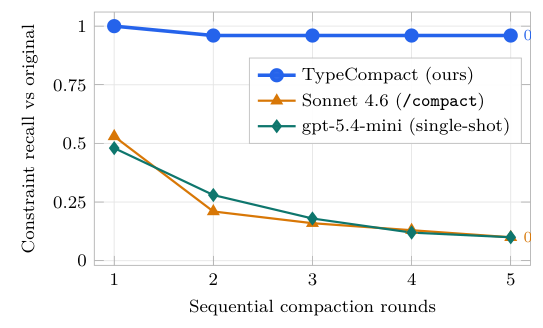
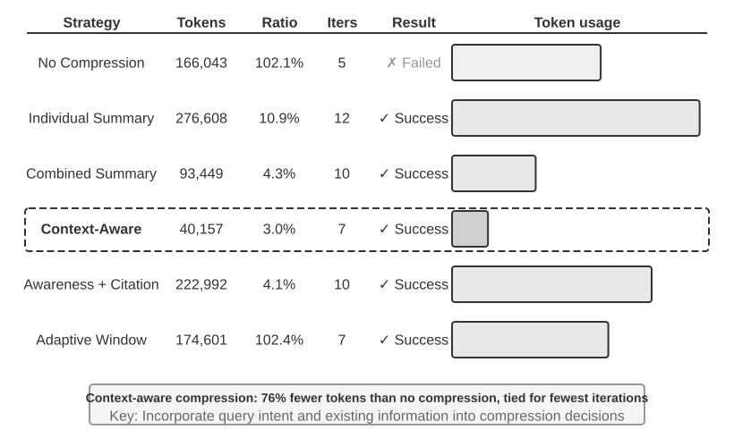
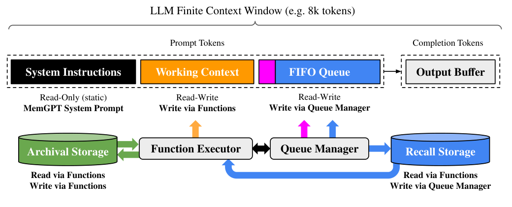

# 5 — Compression and Compaction

> What to do when the window fills anyway. The technique that makes long-horizon agents possible.

Compaction lets a long-running agent keep going, and it's also how an agent forgets the rule that mattered. In one test, Sonnet 4.6 kept 53% of its safety rules after one `/compact` round and 10% after five, and in another, agents deleted without approval in 30 of 100 runs once a constraint had been summarized away. This chapter covers what to compress, when to trigger it and which items must stay verbatim, so that long sessions keep their guardrails along with their budget.

---

## Compaction

**Compaction** is an orchestration process that transforms a large interaction history into a smaller continuation state. Near the context limit, summarize what has happened, reinitialize the window with the summary, and continue.

It is the difference between an agent that dies at the window limit and one that runs for hours. Without it, a long task ends when the window fills. With it, the task continues at a fraction of the token cost.

### Compress for quality, not only for length

The second reason to compress applies before the window fills. **In-context learning behaves more like retrieval than reasoning.** Ten searches scattered across 50k tokens make the model hunt for fragments at every decision. One structured summary ("Known: A…, B…; still missing: C") turns a conclusion that had to be reasoned into one that can be looked up. The usual failure is not a window that is too small but **information density that is too low**: occasionally needed knowledge loaded on every call, stable rules mixed in with dynamic state. That is *context rot*: everything fits, but the key fact can't be found ([11](11-failure-modes.md#context-rot)). The status bar *adds* distilled conclusions; compression *replaces* raw records with them ([02](02-context-anatomy.md#runtime-state-the-agent-status-bar)).

### The pipeline

```
Raw interaction history
        ↓
Prune irrelevant content          <- abandoned branches, superseded attempts
        ↓
Replace bulky tool outputs        <- keep the conclusion, drop the payload
        ↓
Extract structured task state     <- files touched, decisions, open TODOs
        ↓
Summarize older reasoning         <- compress the middle, lossy but bounded
        ↓
Preserve recent messages verbatim <- the last N turns stay untouched
        ↓
Compact continuation context
```

The final step matters most. Recent turns stay **verbatim** because the agent's immediate working state lives there — half-finished edits, the error it is currently debugging. Summarizing the last three turns is how a compaction loses the thread.

### Retention priority

What survives compaction, in order:

1. **Architectural decisions — do not summarize.** "We chose X over Y because Z" must survive verbatim. Lose the reasoning and the agent re-litigates a settled decision, or silently contradicts it.
2. **User constraints and safety rules — pin verbatim, outside the summary.** "Don't delete emails until I confirm." "Patient is allergic to penicillin." A rule stops being enforceable once it is paraphrased.
3. **Modified files and critical changes.** The diff-so-far is state, not history.
4. **Verification status — pass/fail.** Which tests ran and what happened.
5. **Unresolved TODOs and rollback notes.** Everything not yet done.
6. **Tool output — deletable.** Retain the pass/fail conclusion, discard the payload.

The asymmetry between 1–2 and 6 is the core insight. A 40k-token test output compresses to "17 passed, 2 failed: `test_auth_retry`, `test_token_refresh`" with essentially no loss. A one-sentence architectural rationale cannot be compressed at all without losing what makes it useful.

Item 2 is the one that general-purpose compactors drop. A summarizer cannot tell which sentence is a rule, so it compresses rules at the same rate as everything around them. On 20 production agent configurations, "Claude Code's /compact prompt on Sonnet 4.6 preserves 53% of safety rules after one compaction round and 10% after five" at 50% compression per round. No type-blind strategy the authors tested beat 0.53 recall in a single round ([arXiv:2608.22752](https://arxiv.org/abs/2608.22752) (Zerhoudi et al., 2026-08)). A separate study of several compactors found they keep only 17% of injected user constraints on average. In one inbox test (gpt-oss-120b, compacting at 100K tokens), the agent deleted emails without approval in 30 of 100 sessions after compaction, against none before it ([arXiv:2608.11242](https://arxiv.org/abs/2608.11242) (Wang et al., 2026-08)). Having the user restate the rule in the first turn after compaction only got that down to 13 of 100.

Both papers fix it the same way: take the rules out of the summary's hands.
- **Wang et al.** use a small extractor (Qwen3.5-9B) to build a constraint registry and append it verbatim after the summary. Retention rose to 90–95%, and compliance came within a few points of the uncompacted upper bound.
- **Zerhoudi et al.** classify each line by type and pin constraints and procedures unchanged. Their TypeCompact held 0.96 recall over five rounds. A deterministic check then confirms every pinned rule survived. That check matters: without it, configurations that reported 1.00 recall had silently dropped a mean 57% of the constraints. Classification has its own blind spot. Rules phrased as plain facts, like the penicillin allergy, were recognized only 62% of the time by gpt-5.4-mini.



*Image Source: Zerhoudi, Mitrović & Granitzer, [The Compaction Cliff in Long-Running AI Agent Memory](https://arxiv.org/abs/2608.22752) (2026), Fig. 3*

### Trigger points

- Approaching the window limit (~80% is a common threshold)
- **Phase boundaries** — a completed plan step, a finished skill invocation, a focus switch
- Before spawning subagents that will re-derive context
- After large reads that won't be needed again
- **Per input, before the call.** Count an input's tokens before it reaches a generation agent. Above a set budget, route it through the summarizer first (*Context Engineering for Multi-Agent Systems*, ch. 10). This compresses the payload rather than the history, so nothing overflows in the first place

Phase boundaries are the better trigger. Compacting at a natural seam produces a clean summary; compacting mid-edit at 95% occupancy forces a summary of an incoherent state.

A model can learn to pick the seam itself, but prompting alone does not get it there. In AutoCompact's experiments, "the base model rarely invoked compact() before the context limit, even when compaction rules were specified." After SFT and RL on when and what to compact, Qwen3-Coder-30B-A3B scored 39.6% on SWE-bench Verified. The same model scored 30.4% keeping full history in a 256K window, and 28.8% compacting at a fixed 16K length ([arXiv:2610.02163](https://arxiv.org/abs/2610.02163) (Zhang et al., 2026-10)). Proactive compaction helped even in the 256K setting, where nothing overflows. Dropping stale context is worth doing for quality, not only for room.

ACM gets the same result with an offload that loses nothing. The agent has two tools: `manage_context` summarizes everything since its last call and saves the raw messages to disk under an id, and `query_memory` reads them back by id ([arXiv:2607.23809](https://arxiv.org/abs/2607.23809) (Li et al., 2026-07, preprint)). Untrained, GPT-5.5 almost never called either tool. Post-trained by distillation from Qwen3.5-397B-A17B, Qwen3.5-9B scored **0.727 Pass@1 on BrowseComp-Plus against 0.570 for ReAct** (150 test questions, 4 runs), and 0.608 and 0.614 for the authors' re-implementations of ReSum and ACON, with peak context 54K against ReAct's 63K. Most of the gain is consistency: Pass^4 (all four runs right) rose from 34.1 to 59.3, Pass@4 only from 73.5 to 82.0. Gains elsewhere were smaller: DeepSearchQA 0.367 to 0.425, SWE-bench Verified 0.489 to 0.530. Caveats:
- One student size (9B). A 4B model collapsed to two-turn rollouts and never compressed.
- The fixed-threshold baselines did not get the lossless store, so trigger timing and recoverability are not separated.
- No confidence intervals and no cost or latency figures.

**Identifiers survive verbatim.** UUIDs, hashes, IPs, ports, URLs, filenames, PR numbers. Change one digit and the next tool call fails. Summarizers also tend to drop what *looks* re-acquirable: early decisions, the reasons behind constraints, and failed paths. Those are exactly what retention items 1–5 protect.

A working rule codifies this: sessions past 150k cost ~5× per turn with no cache benefit on the overflow. Compaction is one turn; carrying stale context is a cost on every subsequent turn.

---

## The component techniques

Compaction composes these; each is usable independently.

| Technique | What it does | Loss profile |
|---|---|---|
| **Sliding window** | Keep the last N turns, drop older | Total loss of dropped content |
| **Summarization** | LLM-compress a span into prose | Lossy, unpredictable — depends on the summarizer |
| **Pruning** | Delete content by rule (dead branches, superseded attempts) | Total but targeted; safest when rule-driven |
| **State extraction** | Pull structured facts into a compact record | Lossless for what's extracted, total for what isn't |
| **Tool-result clearing** | Replace raw tool output with its conclusion | Near-lossless for verbose output |

**Tool-result clearing** is the highest-value / lowest-risk of these — a lightweight compaction that strips raw tool outputs from history while keeping the fact that the call happened and what it concluded. Tool output is usually the largest and least reusable content in an agent's window. Clear it first, before reaching for lossy summarization. Clear it **in batches**, though, not every turn: each clearing rewrites the prefix ([below](#prompt-caching-interaction)).

### Six strategies compared


*Image Source: Li, [AI Agents in Depth](https://github.com/bojieli/ai-agent-book/blob/main/book-en/chapter2.md) (2026), Figure 2-16: Comparison of Context Compression Strategies (Apache-2.0)*

Li's Experiment 2-9 tracks OpenAI co-founders' current roles with Kimi K3 capped at a 128K window. Seven searches returned about 367k characters.

| Strategy | Result |
|---|---|
| No compression | Overflowed at iteration 5. Task failed |
| Summarize each result separately (10.9%) | Done in 12 iterations, 277k tokens; repeated facts across pages |
| One combined summary (4.3%) | 10 iterations, 93k tokens; very long inputs truncated at the tail |
| **Context-aware** (prompt includes the query and the known state) (~3.0%) | **7 iterations, 40k tokens**. One 148k-char page compressed to 2k chars and kept every name and role change |
| Context-aware + citations (4.1%) | 223k tokens. Lossy content, lossless index back to the sources |
| Adaptive window: batch at 80%, `[COMPRESSED]` marker so nothing is compressed twice | 175k tokens; full fidelity during the early broad-gathering phase |

The design principles: information value is uneven (decision points > evidence > noise). Keep semantics intact ("Sutskever left OpenAI in May 2024", not "Sutskever left"). The same text should compress differently for different tasks. And *compression is understanding*, so the compressor needs near-main-model capability. Context-aware compression cut tokens by more than 75%. Rothman builds the same idea into an agent's interface: his Summarizer takes a required `summary_objective` alongside the text. An objective like "Extract the names of all involved parties, the key financial figures…" replaces "Summarize this text". His demo takes one 253-token paragraph to 110 tokens (56.5%). That is a single example, not a measurement (*Context Engineering for Multi-Agent Systems*, ch. 6). Lab: [2-9 context-compression](https://github.com/bojieli/ai-agent-book/tree/main/chapter2/context-compression).

### The production ladder

Claude Code layers five mechanisms, cheapest and most cache-controllable first:

1. **Tool-result budget.** Large outputs go to disk and the model sees a preview. The replacement is frozen so the cache stays consistent.
2. **Delete noise outright.** Summarizing junk wastes tokens.
3. **API-level micro-compaction** (server-side context editing). Free to implement, but it still breaks the cache after the edit point, so save it for near-overflow.
4. **Archival per-turn summaries** ("`git log`, not `git squash`"), which keep the thread of the conversation.
5. **Full LLM compaction**, as a last resort. Session memory is tried first, and a **circuit breaker** stops sessions stuck in compaction-failure loops.

Lossless Context Management (LCM) applies the same ideas outside Claude Code ([papers.voltropy.com/LCM](https://papers.voltropy.com/LCM) (Ehrlich & Blackman, 2026-02)). Every message and tool result goes to an immutable store. The summaries the model sees are "a derived cache; the immutable history remains the sole source of truth", and the agent can grep or expand back into the originals. Its compaction escalates through three levels, and the last one is a deterministic 512-token truncation with "No LLM involved". That guarantees each pass shrinks the context, which is the same job Claude Code's circuit breaker does. LCM's authors are a vendor, and they report a single benchmark. On OOLONG with Opus 4.6, their agent averaged 74.8 against Claude Code's 70.3 across 8K–1M tokens. Claude Code was slightly ahead at 8K and 16K. The paper also concedes that "we cannot deterministically guarantee that the agent will always" recover what it needs from the store.

### Letting the model edit its own context

The ladder above is a harness deciding what the model sees. **Context Language Models** (CLMs) hand that job to the model. The live context is exposed as a file, which the model reads and rewrites with ordinary shell commands. It decides when to drop, summarize, or restore a span ([arXiv:2609.37725](https://arxiv.org/abs/2609.37725) (Shao et al., 2026-09)). Run zero-shot on Qwen3.6-27B with a 32K limit, CLMs scored 59.4% on BrowseComp-Plus. That was 11.4% (relative) above the strongest baseline, Codex-style summarization, and used 21.5% fewer prefix-reuse FLOPs. Three caveats:
- A small model needs training first. Qwen3.5-9B as a CLM trailed the summary harness until online RL.
- An edit in the middle of the context invalidates the prefix cache from that point ([below](#prompt-caching-interaction)). The authors' serving fix, Suffix Cache Reuse, cut server compute by 35% but needs a self-served engine.
- "Editable context can become another channel through which prompt injections or self-generated instructions persist across turns."

**Prompting is the weak point.** Focus gives a ReAct coding agent `start_focus` and `complete_focus` tools: on completion the agent writes what it tried, learned and concluded into a persistent knowledge block, and every message since the checkpoint is deleted ([arXiv:2601.07190](https://arxiv.org/abs/2601.07190) (Verma, 2026-01, preprint)). On five hand-picked SWE-bench Lite instances with Claude Haiku 4.5 and a 150-step cap, total tokens fell 22.7% (14.9M to 11.5M) at the same 3/5 resolved. That took a prompt that forced compression every 10 to 15 tool calls plus reminders: a passive prompt gave 1 to 2 compressions and about 6% savings. Savings ranged from 57% on one instance to 110% *more* tokens on another (pylint, 4.3M vs 2.1M), where discarded context forced re-exploration. N=5, one run each, so read it as a mechanism demo; it shows that models do not compress unprompted, not how much it saves.

**A trained external manager.** AdaCoM puts a small trained model, not the agent, in charge of the edits. A Qwen3-4B-Instruct manager, trained with SFT then GRPO against the final-answer reward plus rule-based process rewards, emits a list of edits (ids, new content, empty to delete) before each step of a frozen agent ([arXiv:2605.30785](https://arxiv.org/abs/2605.30785) (Yi et al., 2026-05, preprint)). On BrowseComp-Plus (150 test tasks, 35 steps, mean@3), it lifted four agents' average from **24.17 to 33.60 (+39.0% relative)**, with +95.0% on Kimi-K2. A fixed summarize-every-step manager (SumCoM) averaged 29.39 and *hurt* GLM-4.5-Air (32.56 to 26.44), and the untrained manager averaged 22.01, below ReAct. The learned strategy differed by agent: the agent with the weakest ReAct score (DeepSeek-V3) had its context cut to about 1.9K tokens on average, nearly every round, while the strongest (GLM-4.5-Air) kept about 7.0K and was edited rarely. The authors read this as an effective-context-length effect, which is inferred from four agents and not tested. Caveats: the managed agents were capped at 32K against native 128K-256K windows for ReAct, so cap and edits are not separated; there is no cost or latency figure; edits to earlier context break prefix caching; and no confidence intervals are given.

### Isolation beats compression

Compression removes bulk after it has landed. **Sub-agent isolation** keeps it out of the window altogether. "Find the payment-callback handler" done in the main loop drags in dozens of files. Delegated, it costs two messages: the task, and "`handle_callback` in `src/payment/callbacks.py`, plus 2 call sites". It needs no extra summarizer call and leaves the parent's prefix untouched. The price is a self-contained brief, because the sub-agent doesn't see the parent's context ([10](10-tools-and-multi-agent.md)).

The same idea applies to the input itself. A **Recursive Language Model** (RLM) never puts a long prompt in the window. The prompt sits as a variable in a Python REPL. The model writes code to inspect and slice it, and calls sub-models on the pieces ([arXiv:2512.24601](https://arxiv.org/abs/2512.24601) (Zhang et al., 2025-12)). On OOLONG-Pairs at 32K tokens, where the answer depends on pairs of lines throughout the input, GPT-5 scored 0.1 F1 both alone and with a summarize-on-overflow agent. As an RLM, with GPT-5-mini handling the sub-calls, it scored 58.0. On BrowseComp-Plus over 1,000 documents (6–11M tokens), the RLM reached 91.3% against the compaction agent's 70.5%. The authors' conclusion: "compaction is rarely expressive enough for tasks that require dense access throughout the prompt." Compaction decides once what to keep. An RLM keeps everything and decides per query what to read. The costs are latency (the sub-calls run one after another), a long tail of expensive runs, and weaker results with weaker models.

Scroll brings the REPL to agent sessions and adds LCM's immutable log ([arXiv:2608.21690](https://arxiv.org/abs/2608.21690) (Lin et al., Alibaba, 2026-08, preprint)). History goes to an append-only event log, working state lives in a sandboxed Python kernel, and only what the code prints enters the window. When the view goes over budget, spans are evicted rather than summarized: "eviction changes only the view, never the underlying record". The evicted text stays verbatim under a stable address, and a tiered index of model-written headlines tells the agent what it can no longer see. In the BEAM 10M ablation (Qwen3.8-Max), summarizing at ingestion and discarding the originals scored **19.9 against 73.1 for full Scroll**. On LOCA, with the same backbone and tools, going from a 128K to a 256K environment cost a summarization agent 21.4 points (86.7 to 65.3) and Scroll 2.6 (89.3 to 86.7). Each task ran once, and the published baselines it beats on BEAM were not reproduced and use different reader models. Scroll is weaker on summarization and preference questions, because it rebuilds condensed views per query. Weaker backbones fall far behind: Qwen3.6-35B-A3B scored 22.7 on LOCA at 256K. Cost is reported in tokens only.

**State extraction** is what makes compaction safe. If task state lives in a structured record — files touched, decisions, open items — rather than being implicit in the prose of the conversation, then summarizing the prose costs little. Agents that write their state down survive compaction; agents that keep it in the transcript do not.

Code Researcher applies this to long codebase exploration. Each action's result goes into a memory of (action, result) pairs, and before writing the patch the agent filters that memory down to what is relevant. On 200 Linux kernel crashes, with GPT-4o, a 50K-token limit and 5 trajectories each, it resolved 48% against 31.5% for a customized SWE-agent ([Code Researcher](https://www.microsoft.com/en-us/research/wp-content/uploads/2025/06/Code_Researcher-1.pdf) (Singh et al., 2025-06)). The comparison is to another agent, not to the same agent with summary compaction, so it shows the design works rather than that it beats summarizing.

DeepCode does the same for generating a whole repository from a research paper ([arXiv:2512.07921](https://arxiv.org/abs/2512.07921) (Li et al., HKU, 2025-12, preprint)). The paper is first distilled into a structured blueprint: file hierarchy, component specs, verification protocol and a staged plan. Each file is then written in a fresh context that holds the blueprint plus selected memory entries. After a file is done the context is cleared, and a summarizer records the file's purpose, public interface and dependency edges as a new entry. With Claude Sonnet 4.5 on five PaperBench Code-Dev papers, this structured memory **raised scores from 0.33–0.43 to 0.70–0.92 on the three tasks where a sliding window had cut dependencies**, and from 0.62–0.66 to 0.72–0.76 on the other two (ranges as stated in the paper's text; its Fig. 6b bar chart has no error bars). The baseline is a naive sliding window, not summary compaction. The blueprint is not ablated on its own. The paper's text and tables disagree on several headline figures.

---

## Compression vs. compaction

Different scopes, often conflated:

- **Compression** — reducing an individual artifact before it enters the window (a query-conditional document summary, a truncated tool result). Applies per-item, pre-injection. See [04-retrieval.md](04-retrieval.md).
- **Compaction** — reducing the accumulated *history* into a continuation state. Applies to the whole window, mid-session.

You need both. Compression bounds what each item costs; compaction bounds what the session costs.

---

## API-level support

OpenAI's Responses API exposes compaction directly: after appending output items, drop items preceding the most recent compaction item. The latest compaction item carries the context needed to continue, so earlier items are dead weight — removing them shrinks requests and cuts long-tail latency.

The general pattern: **the compaction item is a checkpoint**, and everything before a checkpoint is discardable.

---

## Crash recovery

Related failure mode with the same solution. For long-running tasks, write task progress **to disk**, not just to context. Then a crash, a context overflow, or a deliberate restart resumes from the last checkpoint instead of restarting the task.

Rule of thumb: past roughly thirty minutes of agent runtime, crash recovery is mandatory rather than optional. The probability of *some* interruption over a long run approaches one.

This is the same mechanism as structured note-taking — see [06-memory.md](06-memory.md). State on disk survives everything that happens to a context window.

---

## Prompt caching interaction

Compaction **invalidates the cache from the compaction point forward** — you have rewritten the prefix. That is fine and worth it, but it means:

- Don't compact more often than necessary; each compaction pays a full re-prefill
- Structure the post-compaction window so the stable parts (system prompt, tools) still lead, preserving a cacheable prefix for subsequent turns
- Compacting at phase boundaries amortizes this cost across the phase that follows

**Rolling edits are the expensive case.** Trimming text on every turn, for example keeping only the last 12 tool responses, rewrites the prefix each round. With GPT-OSS-120B on 100 BrowseComp-Plus tasks, that cost **1.85× the full-context baseline**, because every turn re-prefilled. Summarizing at a 48K threshold was about 7% cheaper than full context but lost 5 accuracy points ([arXiv:2610.28577](https://arxiv.org/abs/2610.28577) (Fu et al., 2026-10)). The same rolling drop done on the KV cache instead of the text came out ahead on both: **+1.7 points at 27.7% lower cost** than threshold summarization, averaged over 3 open-weight models and 4 agent benchmarks. That requires a self-served engine ([03](03-budgeting-the-window.md#cache-engineering-edit-the-kv-cache-not-the-text)). On a hosted API the lesson runs the other way: rewrite the history rarely and in large blocks.

---

## Memory hierarchies

The upstream management module borrows the CPU cache model. Context lives at levels of decreasing cost and immediacy:

| Level | Holds | Access | Analogy |
|---|---|---|---|
| **L1: window** | Current task, recent turns, active evidence | Free; always attended | Registers / L1 cache |
| **L2: session store** | Compacted summaries, tool results, scratch files | One tool call | RAM |
| **L3: long-term** | Memory store, indexed corpus | Retrieval | Disk |

MemGPT made this design concrete: the agent manages its own tiers through tool calls, and summarized history is evicted to a searchable recall store. In its multi-session recall test, GPT-4 went from 32.1% to 92.5%, against a baseline that saw only a summary of past sessions ([arXiv:2310.08560](https://arxiv.org/abs/2310.08560) (Packer et al., 2023-10); mechanics and caveats in [agentic foundations 03](../../../generative-ai/03-agentic-foundations/notes/03-memory-as-an-operating-system.md#the-os-analogy)).


*Image Source: Packer et al., [MemGPT](https://arxiv.org/abs/2310.08560) (2023), Fig. 3*

The useful habit is thinking in **promotion and demotion**. Compaction demotes content from L1 to L2. Retrieval promotes it back. A good design makes both moves cheap and explicit, rather than letting the window be the only tier ([06](06-memory.md)).

---

**AgentFold** moves the same decision into a trained policy for web agents. Each step the model emits a folding directive alongside its tool call: either condense just the latest step into a one-line summary, or merge the latest step with a run of earlier summaries into one coarse block, so a dead-end of many steps becomes one conclusion. The latest interaction stays verbatim ([arXiv:2510.24699](https://arxiv.org/abs/2510.24699) (Ye et al., 2025-10, preprint)). On 200 BrowseComp trajectories with a 100-turn cap, context grew from about 3.5K to 7K tokens, which the authors put at 92% (over 84K tokens) below a ReAct agent at turn 100 (their Fig. 1). The 30B-A3B model, trained by SFT only, scores 36.2 on BrowseComp and 67.0 on GAIA text-only, trailing o3 (49.7) and OpenAI Deep Research (51.5) on BrowseComp. Over 20% of tasks hit the turn cap at only 7K tokens of context, so space was not the limit there. There is no ablation of folding against no folding, and a fold is irreversible: a detail dropped in a coarse block is gone.

## Compression techniques beyond summarisation

| Technique | How | Notes |
|---|---|---|
| **Extractive** | Keep the sentences that matter verbatim | Faithful; cites cleanly; less compression |
| **Abstractive** | Rewrite into a shorter form | Higher ratio; can introduce errors |
| **Hierarchical summarisation** | Summarise chunks, then summarise the summaries | Scales to very long inputs; detail lost at each level |
| **Token pruning** (LLMLingua) | A small LM drops [low-perplexity](../../../generative-ai/01-llm-fundamentals/notes/06-pretraining-data-and-objectives.md#entropy-cross-entropy-kl-and-perplexity) tokens under a per-section budget | On GSM8K chain-of-thought prompts for GPT-3.5-Turbo, 20× cost 1.5 EM, but on BBH 7× cost 13.2. Output is hard for humans to read, though GPT-4 can mostly reconstruct it ([arXiv:2310.05736](https://arxiv.org/abs/2310.05736), Jiang et al., EMNLP 2023) |
| **Query-conditioned** | Compress *relative to the current question* | Highest relevance per token; must be redone per query |
| **Soft tokens** (gisting) | Fine-tune the model so a short prompt is encoded into a few learned "gist" tokens whose cached state replaces it | Not readable text. On short instruction prompts (about 26 tokens) the LLaMA-7B model with a single gist token won 45.8% of ChatGPT-judged comparisons against the uncompressed model (50% is parity) on out-of-distribution human prompts, while keeping one keyword got 24.6%. Gains over ordinary KV-cache reuse are mostly storage (about 26× more cached prompts), not FLOPs (0.11%). Needs fine-tuning, loses verbatim detail ([arXiv:2304.08467](https://arxiv.org/abs/2304.08467), Mu et al., NeurIPS 2023) |

**Compressing the model's own reasoning.** LightThinker ([arXiv:2502.15589](https://arxiv.org/abs/2502.15589) (Zhang et al., EMNLP 2025)) trains a model to replace each finished thought with a few gist tokens and drop the original text. Fine-tuned on 17K reasoning traces, Qwen2.5-7B (R1-Distill) averages 62.80 against 62.90 uncompressed over GSM8K, MMLU, GPQA and BBH, with 70% fewer peak tokens (1,289 vs. 4,336) and 26% less time. On Llama3.1-8B accuracy falls from 71.25 to 66.85 and the time saving is 1%. Splitting at thought boundaries beat compressing every six tokens by 6.2% on Qwen (the paper's figure; the table's average gap is 3.9 points, 62.80 vs. 58.89). It fails on exact values: in the authors' GSM8K case one compression step dropped the figure 8,000, so the final sum used 4,000 + 4,000 + 24,000 and answered 18,000 instead of 14,000, an error the authors call frequent on GSM8K. It needs fine-tuning and a custom attention mask, so it applies to open models you train, not API calls, and the gist tokens do not transfer between models.

LightThinker++ makes the compression reversible ([arXiv:2604.03679](https://arxiv.org/abs/2604.03679) (Zhu et al., 2026-04, preprint)). Instead of gist tokens the model gets three explicit actions: `commit` archives a step as a summary, `expand` restores the raw step and `fold` hides it again. It is trained by SFT on teacher trajectories (DeepSeek-V3.2-Thinking). On Qwen2.5-7B (R1-Distill), in the paper's Throughput setting (a small fixed per-round token cap), averaged over GSM8K, MMLU, GPQA and BBH (3 runs at temperature 0.7; MMLU and BBH are subsets of unstated size), accuracy was 60.02 against 59.62 for plain SFT on the same teacher data, with peak tokens down 69.9% (3,120 to 940). Its Budget setting trades differently: 2.42 points more accuracy, peak down 45.0%. Allowed only `commit`, one-way like the original, accuracy fell to 53.6%: **the way back to the raw step is where the accuracy comes from**. In a deep-research agent (Qwen3-30B-A3B-Thinking), context stayed at 30–40K tokens past 80 rounds, while the SFT baseline reached about 100K within 60. Pass@1 rose on xBench-DeepSearch (38.3 to 44.0), BrowseComp-ZH (31.5 to 36.9) and BrowseComp-EN (16.0 to 18.1). The only comparison is with its own SFT baseline, not with other context managers such as AgentFold or MEM1, and there is no RL.

**Hierarchical summaries as a tree the model walks.** MemWalker builds the summary-of-summaries tree once, ahead of any query, then lets the model navigate it: at each node it reads the child summaries, reasons, and picks one to descend into, or reverts to the parent if the leaf does not answer ([arXiv:2310.05029](https://arxiv.org/abs/2310.05029) (Chen et al., 2023-10, preprint)). Zero-shot on Stable Beluga 2 (70B, 4,096-token window), accuracy on the long subsets was 73.6 / 64.5 / 60.4 (QuALITY / SummScreenFD / GovReport; the full sets hold 187 / 306 / 101 examples and the long subsets are smaller, size not stated) against 56.0 / 45.4 / 33.8 for a rolling-summary recurrence and 64.8 / 62.2 / 52.1 for Contriever retrieval, so the summary is a map, not a replacement for the text. Without carrying content from visited nodes into the leaf prompt (working memory), accuracy fell 5 to 13 points. Wrong turns are survivable: about 15 to 19% of paths reverted, and 59 to 79% of those still ended correct. It is not free of limits. On the full datasets, which include short texts, plain truncation matched or beat it (QuALITY 70.1 vs 67.4), the gain appears only when the text is much longer than the window, it needed a 70B instruction-tuned model (13B models did worse with reasoning on), and tree-building cost is not reported.

### Moving the document into the weights

Gisting compresses a short prompt into soft tokens. Doc-to-LoRA ([arXiv:2602.15902](https://arxiv.org/abs/2602.15902) (Charakorn et al., 2026-02, preprint)) goes further: a trained hypernetwork reads a document once and emits a LoRA adapter, so later queries run with no document in the window. On gemma-2-2b-it it takes under a second, against about 40 s for context distillation on the target query and over 100 s with generated queries. On SQuAD it reaches **82.5% of the in-context score**, about what LLMLingua-2 gets at 40% of the original length. On a needle test it stays near perfect to about 40K tokens, with under 50 MB of extra generation memory where the base model needs over 12 GB at 128K. The costs are real. A gap to in-context reading remains, and the hypernetwork needs about 5 days on 8 H200s per target model. The tests are small models and mostly extractive QA. The paper also shows interference: when the stored document is irrelevant to the query, the score falls below the base model's (0.096 vs. 0.201 on SQuAD with a placeholder context). What is stored cannot be read or edited the way a summary can, so this suits a stable corpus, not compaction of a live agent history.

### Self-refinement as a compaction pass

The upstream processing module describes self-refinement (generate → critique → revise) as a quality technique. It also works as a compaction step: ask the model to rewrite its working notes into the state schema ([07](07-structured-context.md#2-state-schemas--what-carries-across-turns)), then verify that the required facts survived ([12](12-evaluating-context.md)).

---

## Pitfalls

- **Trusting a summary to keep safety rules.** Symptom: an agent follows a constraint early and breaks it after compaction. Zerhoudi found 53% of rules kept after one round and 10% after five, and Wang et al. saw deletion without approval in 30 of 100 runs against 13 of 100 with a restatement. Fix: hold constraints in a registry outside the compacted text and restate them each time.
- **Trusting a reported retention score.** Symptom: a configuration reports 1.00 recall while silently dropping a mean 57% of its constraints, as Zerhoudi et al. found. Fix: check retention with a deterministic test, not the compressor's own report.
- **Paraphrasing identifiers.** Symptom: after compaction the agent edits the wrong file or queries an ID that doesn't exist. Fix: keep paths, IDs, numbers and error strings verbatim in the summary template.
- **Compacting only at overflow.** Symptom: quality falls late in a run, then a hard failure; with no compression, Li's agent overflowed at iteration 5. Fix: trigger near ~80% occupancy or at phase boundaries, whichever comes first.
- **Rolling trim on every turn.** Symptom: fewer tokens yet a higher bill. Keeping the last 12 tool responses cost 1.85× full context on 100 BrowseComp-Plus tasks with GPT-OSS-120B, because each turn re-prefilled. Fix: compact in batches.
- **Summarizing tool results you could clear.** Symptom: compaction costs a model call to condense data the agent can read again. Fix: clear old tool results first, keeping a pointer, and summarize only what can't be re-fetched.
- **No crash-recovery story.** Symptom: a process dies and hours of work are gone, because state lived only in the window. Fix: use the 30-minute rule in this chapter and persist state outside the window.

## Try it

1. A 200k window compacts at 80%. A session begins at 40k and adds 6k per turn. When does compaction first fire? After it fires, the baseline is 40k plus a 15k summary, so when does it fire next?

   <details><summary>Answer</summary>

   First: (160k − 40k) / 6k = 20 turns. Next: (160k − 55k) / 6k = 17.5, so during the 18th turn. Each surviving summary shortens the interval, which is why a summary needs its own cap.

   </details>

2. Sort these for a compaction template into keep verbatim, summarize or clear: the rule "never delete without approval", `billing/client.py`, a 4,000-line log already on disk, the reasoning behind the retry decision, the exact error `E1105`.

   <details><summary>Answer</summary>

   Verbatim: the rule, the path and the error. Summarize: the reasoning, keeping the decision itself. Clear: the log, leaving a pointer, since it can be read again.

   </details>

3. Design the smallest test that would have caught Zerhoudi's result in your own agent.

   <details><summary>Answer</summary>

   Plant N known rules, run the compactor for one round and for five, and check for each rule with a deterministic search (see the fact-retention code in [12](12-evaluating-context.md#metrics-by-lever)). Then follow up with a behavioural probe such as a task that tempts a deletion, because Wang et al. measured the behaviour itself, not just the text.

   </details>

## Interview checklist

| Prompt | Answer in one line |
|---|---|
| What should survive compaction word for word? | Constraints, identifiers, numbers, error strings and open decisions. A summary can paraphrase reasoning, not these. |
| How safe is `/compact` for safety rules? | Not safe alone: Zerhoudi measured 53% kept after one round and 10% after five on Sonnet 4.6. Wang et al.'s constraint registry, appended verbatim after the summary, reached 90-95%. |
| When do you trigger compaction? | Near ~80% occupancy or at a phase boundary, and the boundary is usually the better moment because state is clean there. |
| Why might per-turn trimming cost more than no trimming at all? | Each edit rewrites the prefix so the cache misses: 1.85× the full-context baseline for last-12-responses on 100 BrowseComp-Plus tasks. A 48K summarization threshold was about 7% cheaper than full context but lost 5 accuracy points. |
| You have a 1M-token codebase task. Summarize or use recursion? | If the answer depends on dense access throughout, try an RLM: GPT-5 scored 58.0 as one against 0.1 F1 alone or with summarize-on-overflow on OOLONG-Pairs, and 91.3% against 70.5% on BrowseComp-Plus. The costs are latency and a long tail of expensive runs. |
| How do you test a compressor? | Plant known facts, compress, and check deterministically. TypeCompact shows why: a reported recall of 1.00 hid a mean drop of 57%. |
| When does crash recovery stop being optional? | Past roughly thirty minutes of agent runtime, as a rule of thumb, because the probability of some interruption over a long run approaches one. |

## Next

[06-memory.md](06-memory.md): compaction loses something every time, so the next step is persisting state outside the window entirely.
