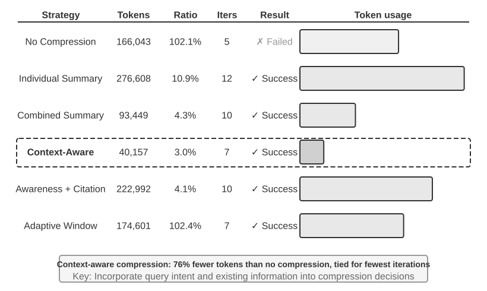

# 5 — Compression and Compaction

> What to do when the window fills anyway. The technique that makes long-horizon agents possible.

---

## Compaction

**Compaction** is an orchestration process that transforms a large interaction history into a smaller continuation state. Near the context limit, summarize what has happened, reinitialize the window with the summary, and continue.

It is the difference between an agent that dies at the window limit and one that runs for hours. Without it, a long task ends when the window fills. With it, the task continues at a fraction of the token cost.

### Compress for quality, not only for length

The second reason to compress applies before the window fills. **In-context learning behaves more like retrieval than reasoning.** Ten searches scattered across 50k tokens make the model hunt for fragments at every decision. One structured summary ("Known: A…, B…; still missing: C") turns a conclusion that had to be reasoned into one that can be looked up. The usual failure is not a window that is too small but **information density that is too low**: occasionally needed knowledge loaded on every call, stable rules mixed in with dynamic state. That is *context rot*: everything fits, but the key fact can't be found ([11](11-failure-modes.md#context-rot)). The status bar *adds* distilled conclusions; compression *replaces* raw records with them ([02](02-context-anatomy.md#runtime-state-the-agent-status-bar)).

### The pipeline

```
Raw interaction history
        ↓
Prune irrelevant content          <- abandoned branches, superseded attempts
        ↓
Replace bulky tool outputs        <- keep the conclusion, drop the payload
        ↓
Extract structured task state     <- files touched, decisions, open TODOs
        ↓
Summarize older reasoning         <- compress the middle, lossy but bounded
        ↓
Preserve recent messages verbatim <- the last N turns stay untouched
        ↓
Compact continuation context
```

The final step matters most. Recent turns stay **verbatim** because the agent's immediate working state lives there — half-finished edits, the error it is currently debugging. Summarizing the last three turns is how a compaction loses the thread.

### Retention priority

What survives compaction, in order:

1. **Architectural decisions — do not summarize.** "We chose X over Y because Z" must survive verbatim. Lose the reasoning and the agent re-litigates a settled decision, or silently contradicts it.
2. **Modified files and critical changes.** The diff-so-far is state, not history.
3. **Verification status — pass/fail.** Which tests ran and what happened.
4. **Unresolved TODOs and rollback notes.** Everything not yet done.
5. **Tool output — deletable.** Retain the pass/fail conclusion, discard the payload.

The asymmetry between 1 and 5 is the core insight. A 40k-token test output compresses to "17 passed, 2 failed: `test_auth_retry`, `test_token_refresh`" with essentially no loss. A one-sentence architectural rationale cannot be compressed at all without losing what makes it useful.

### Trigger points

- Approaching the window limit (~80% is a common threshold)
- **Phase boundaries** — a completed plan step, a finished skill invocation, a focus switch
- Before spawning subagents that will re-derive context
- After large reads that won't be needed again

Phase boundaries are the better trigger. Compacting at a natural seam produces a clean summary; compacting mid-edit at 95% occupancy forces a summary of an incoherent state.

**Identifiers survive verbatim.** UUIDs, hashes, IPs, ports, URLs, filenames, PR numbers. Change one digit and the next tool call fails. Summarizers also tend to drop what *looks* re-acquirable: early decisions, the reasons behind constraints, and failed paths. Those are exactly what retention items 1–4 protect.

`~/.claude/rules/context-health.md` codifies this: sessions past 150k cost ~5× per turn with no cache benefit on the overflow. Compaction is one turn; carrying stale context is a cost on every subsequent turn.

---

## The component techniques

Compaction composes these; each is usable independently.

| Technique | What it does | Loss profile |
|---|---|---|
| **Sliding window** | Keep the last N turns, drop older | Total loss of dropped content |
| **Summarization** | LLM-compress a span into prose | Lossy, unpredictable — depends on the summarizer |
| **Pruning** | Delete content by rule (dead branches, superseded attempts) | Total but targeted; safest when rule-driven |
| **State extraction** | Pull structured facts into a compact record | Lossless for what's extracted, total for what isn't |
| **Tool-result clearing** | Replace raw tool output with its conclusion | Near-lossless for verbose output |

**Tool-result clearing** is the highest-value / lowest-risk of these — a lightweight compaction that strips raw tool outputs from history while keeping the fact that the call happened and what it concluded. Tool output is usually the largest and least reusable content in an agent's window. Clear it first, before reaching for lossy summarization.

### Six strategies compared


*Figure 2-16, Comparison of Context Compression Strategies. From Li, [*AI Agents in Depth*](https://github.com/bojieli/ai-agent-book/blob/main/book-en/chapter2.md) (Apache-2.0).*

Li's Experiment 2-9 tracks OpenAI co-founders' current roles with Kimi K3 capped at a 128K window. Seven searches returned about 367k characters.

| Strategy | Result |
|---|---|
| No compression | Overflowed at iteration 5. Task failed |
| Summarize each result separately (10.9%) | Done in 12 iterations, 277k tokens; repeated facts across pages |
| One combined summary (4.3%) | 10 iterations, 93k tokens; very long inputs truncated at the tail |
| **Context-aware** (prompt includes the query and the known state) (~3.0%) | **7 iterations, 40k tokens**. One 148k-char page compressed to 2k chars and kept every name and role change |
| Context-aware + citations (4.1%) | 223k tokens. Lossy content, lossless index back to the sources |
| Adaptive window: batch at 80%, `[COMPRESSED]` marker so nothing is compressed twice | 175k tokens; full fidelity during the early broad-gathering phase |

The design principles: information value is uneven (decision points > evidence > noise). Keep semantics intact ("Sutskever left OpenAI in May 2024", not "Sutskever left"). The same text should compress differently for different tasks. And *compression is understanding*, so the compressor needs near-main-model capability. Context-aware compression cut tokens by more than 75%. Lab: [2-9 context-compression](https://github.com/bojieli/ai-agent-book/tree/main/chapter2/context-compression).

### The production ladder

Claude Code layers five mechanisms, cheapest and most cache-controllable first:

1. **Tool-result budget.** Large outputs go to disk and the model sees a preview. The replacement is frozen so the cache stays consistent.
2. **Delete noise outright.** Summarizing junk wastes tokens.
3. **API-level micro-compaction** (server-side context editing). Free to implement, but it still breaks the cache after the edit point, so save it for near-overflow.
4. **Archival per-turn summaries** ("`git log`, not `git squash`"), which keep the thread of the conversation.
5. **Full LLM compaction**, as a last resort. Session memory is tried first, and a **circuit breaker** stops sessions stuck in compaction-failure loops.

### Isolation beats compression

Compression removes bulk after it has landed. **Sub-agent isolation** keeps it out of the window altogether. "Find the payment-callback handler" done in the main loop drags in dozens of files. Delegated, it costs two messages: the task, and "`handle_callback` in `src/payment/callbacks.py`, plus 2 call sites". It needs no extra summarizer call and leaves the parent's prefix untouched. The price is a self-contained brief, because the sub-agent doesn't see the parent's context ([10](10-tools-and-multi-agent.md)).

**State extraction** is what makes compaction safe. If task state lives in a structured record — files touched, decisions, open items — rather than being implicit in the prose of the conversation, then summarizing the prose costs little. Agents that write their state down survive compaction; agents that keep it in the transcript do not.

---

## Compression vs. compaction

Different scopes, often conflated:

- **Compression** — reducing an individual artifact before it enters the window (a query-conditional document summary, a truncated tool result). Applies per-item, pre-injection. See [04-retrieval.md](04-retrieval.md).
- **Compaction** — reducing the accumulated *history* into a continuation state. Applies to the whole window, mid-session.

You need both. Compression bounds what each item costs; compaction bounds what the session costs.

---

## API-level support

OpenAI's Responses API exposes compaction directly: after appending output items, drop items preceding the most recent compaction item. The latest compaction item carries the context needed to continue, so earlier items are dead weight — removing them shrinks requests and cuts long-tail latency.

The general pattern: **the compaction item is a checkpoint**, and everything before a checkpoint is discardable.

---

## Crash recovery

Related failure mode with the same solution. For long-running tasks, write task progress **to disk**, not just to context. Then a crash, a context overflow, or a deliberate restart resumes from the last checkpoint instead of restarting the task.

Rule of thumb: past roughly thirty minutes of agent runtime, crash recovery is mandatory rather than optional. The probability of *some* interruption over a long run approaches one.

This is the same mechanism as structured note-taking — see [06-memory.md](06-memory.md). State on disk survives everything that happens to a context window.

---

## Prompt caching interaction

Compaction **invalidates the cache from the compaction point forward** — you have rewritten the prefix. That is fine and worth it, but it means:

- Don't compact more often than necessary; each compaction pays a full re-prefill
- Structure the post-compaction window so the stable parts (system prompt, tools) still lead, preserving a cacheable prefix for subsequent turns
- Compacting at phase boundaries amortizes this cost across the phase that follows

---

## Memory hierarchies

The upstream management module borrows the CPU cache model. Context lives at levels of decreasing cost and immediacy:

| Level | Holds | Access | Analogy |
|---|---|---|---|
| **L1: window** | Current task, recent turns, active evidence | Free; always attended | Registers / L1 cache |
| **L2: session store** | Compacted summaries, tool results, scratch files | One tool call | RAM |
| **L3: long-term** | Memory store, indexed corpus | Retrieval | Disk |

The useful habit is thinking in **promotion and demotion**. Compaction demotes content from L1 to L2. Retrieval promotes it back. A good design makes both moves cheap and explicit, rather than letting the window be the only tier ([06](06-memory.md)).

---

## Compression techniques beyond summarisation

| Technique | How | Notes |
|---|---|---|
| **Extractive** | Keep the sentences that matter verbatim | Faithful; cites cleanly; less compression |
| **Abstractive** | Rewrite into a shorter form | Higher ratio; can introduce errors |
| **Hierarchical summarisation** | Summarise chunks, then summarise the summaries | Scales to very long inputs; detail lost at each level |
| **Token pruning** (LLMLingua-style) | A small model drops low-information tokens | 2–5× with modest loss on many tasks; output is unreadable to humans |
| **Query-conditioned** | Compress *relative to the current question* | Highest relevance per token; must be redone per query |

### Self-refinement as a compaction pass

The upstream processing module describes self-refinement (generate → critique → revise) as a quality technique. It also works as a compaction step: ask the model to rewrite its working notes into the state schema ([07](07-structured-context.md#2-state-schemas--what-carries-across-turns)), then verify that the required facts survived ([12](12-evaluating-context.md)).

---

## Working reference

`~/.claude/refs/agent-context.md` — the Compress lever, compaction triggers, and what must survive.
`~/.claude/rules/context-health.md` — the 150k threshold and phase-boundary discipline.

---

→ Next: [06-memory.md](06-memory.md) — persisting state outside the window entirely.
