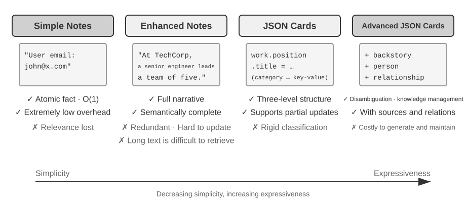
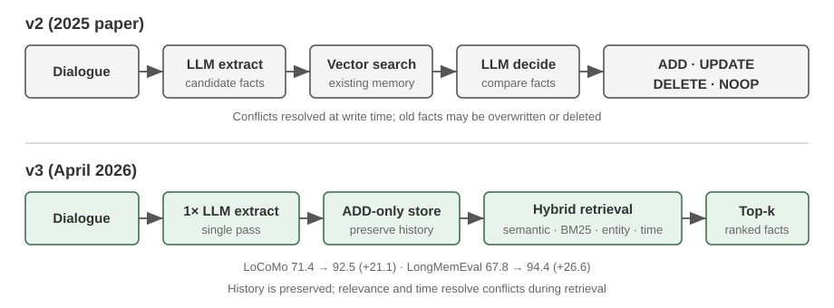
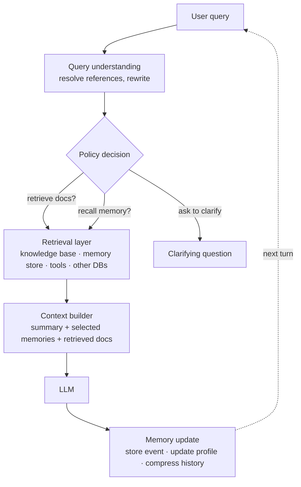

# 6 — Memory as a Context Sub-Component

> Memory is not a sibling pillar of context engineering. It is the mechanism by which context outlives a window.

An agent that forgets between sessions makes the user repeat themselves, and an agent that remembers badly is worse, because it acts on the old address or the rule from last quarter with full confidence. Memory only ever helps by entering a window, so every stored fact competes for the same budget as everything else. This chapter covers what to distil, how to store and update it, and how to measure it, using systems from Mem0 and ChatGPT's four layers to a plain `MEMORY.md` file.

---

## Framing

Every source that enumerates the foundations treats memory as a context primitive, not a top-level discipline. The reason is structural: memory has no effect on a model except by **entering a context window**. A memory store the agent never reads is inert. So every memory design decision is really a context decision — what gets written, what gets selected back in, at what size.

This reframes the design question from "what should the agent remember?" to **"what should occupy the window three sessions from now, and how does it get there?"**

---

## Memory types


*Image Source: Li, [AI Agents in Depth](https://github.com/bojieli/ai-agent-book/blob/main/book-en/chapter3.md) (2026), Figure 3-2: Comparison of Four Memory Strategies (Apache-2.0)*

| Type | Scope | Lifetime | Example |
|---|---|---|---|
| **In-context / working** | Current window | The session | The conversation so far |
| **Short-term** | Session or workflow | Hours | Task state, prior revisions in a multi-shot refinement |
| **Long-term** | Cross-session | Indefinite | User preferences, project decisions, known failure patterns |
| **Episodic** | Specific past events | Indefinite | "Last Tuesday's deploy failed because of X" |
| **Semantic** | Distilled facts | Indefinite | "This project uses pnpm, not npm" |

Episodic vs. semantic is the distinction that matters in practice. Episodic memory accumulates linearly with time and rots — most of what happened is not worth carrying. Semantic memory is *distilled from* episodes and stays roughly constant in size. A memory system that only stores episodes grows without bound; one that distills episodes into semantic facts converges.

Lakshmanan and Hapke split the same ground into four types: working (the current session's messages), episodic (all messages kept as they are and searched at run time), procedural (system instructions and user-profile attributes) and semantic (facts and knowledge extracted from earlier conversations). Their advice is to **prefer semantic over episodic**: storage is cheap, but retrieving the right raw messages adds latency, and cache-miss errors are hard to debug, so extract the memorable facts and search those. They also suggest writing memories in a background thread so the user does not wait, and deploying a framework like Mem0, which combines a vector store, a relational store and several LLM calls, as a microservice (*Generative AI Design Patterns*, ch. 8, Pattern 28). No measurement backs the advice. It is a design rule from the authors, and episodic search is still what you want when a task needs the exact earlier message. The type-by-type mapping onto MemGPT and LangMem is in [gen-AI memory](../../../generative-ai/03-agentic-foundations/notes/03-memory-as-an-operating-system.md#memory-types-in-other-frameworks).

The distillation step is the whole design. "The user corrected me about commit format three times" (episodic, ×3) becomes "commit format is `type(scope): desc (#num)`" (semantic, ×1).

**The trajectory is a log; long-term memory is an archive.** The trajectory is append-only and never rewritten. Long-term memory is rewritten, merged and pruned. Working memory is neither: it is the *filtered, activated subset* of both that is in the window right now. A third store, **business state** ("awaiting payment"), records the task's stage for event-driven agents ([harness 07](../../03-harness-engineering/notes/07-orchestration.md)).

Extraction after a session should be **selective** (skip "the search returned 3 options"), **abstract** ("prefers window seats", not tied to this flight) and **typed** (preference, restriction, account number).

### Three questions, three axes

Li separates three independent design choices:

| Axis | Question | Options |
|---|---|---|
| Hierarchy | *Where* is it stored? | Trajectory · long-term memory · business state |
| Format | *How* is it stored? | Simple notes · enhanced notes · JSON cards · advanced JSON cards |
| Cognitive type | *What* is stored? | Episodic · semantic · procedural |

The axes combine freely. A procedural memory ("search direct flights → confirm seat → apply frequent-flyer number → order meal") can live in a JSON card in long-term memory.

### A survey taxonomy: forms, functions, dynamics

The survey *Memory in the Age of AI Agents* organises the field along three different axes, useful when reading papers that each use their own vocabulary:

| Axis | Question | Categories |
|---|---|---|
| **Forms** | What carries the memory? | **Token-level**, as text in an external buffer: *flat* (logs, rolling windows, retrieved snippets), *planar* (graphs such as Zep or A-Mem), *hierarchical* (summaries at several levels). **Parametric**, in the weights: pretraining knowledge, or fine-tuning / LoRA adapters on accumulated experience. **Latent**, as activations: generated, reused (cached KV states) or transformed |
| **Functions** | Why does the agent need it? | **Factual** (user facts such as preferences and identity; environment facts such as world and task state). **Experiential** (case-based, strategy-based, skill-based, or a mix). **Working** (single-turn scratchpads; multi-turn dialogue state and partial plans) |
| **Dynamics** | How does it operate over time? | **Formation** (summarise, distil, build triples or schemas, encode, fine-tune). **Evolution** (consolidate, update, forget). **Retrieval** (timing, query construction, strategy — sparse, dense, graph, hybrid — and post-processing before injection) |

Almost everything in this note is token-level memory. Parametric and latent memory are where the research is heading ([gen-AI 05](../../../generative-ai/05-RL/README.md)); the KV-cache reuse in [02](02-context-anatomy.md#ordering-stable-before-dynamic) is the one latent form already in production.

**Latent memory in practice: MemLong.** MemLong ([arXiv:2408.16967](https://arxiv.org/abs/2408.16967) (Liu et al., 2024-08, preprint)) is the cached-KV end of that table. It freezes the lower layers of OpenLLaMA-3B and stores each past chunk's key-value pairs at one memory layer. A frozen retriever picks the top chunks by similarity, and the upper layers, the only ones LoRA trains, attend over them directly instead of reading retrieved text. Training took 0.5B tokens on eight 3090 GPUs for eight hours, about 200M trainable parameters against 0.3B for LongLLaMA at 5B tokens. With 18 demonstrations held in memory it averaged 73.4 on five classification tasks against 69.0 for OpenLLaMA and 72.7 for LongLLaMA, and kept PG19 perplexity flat at 9.73 for 16K tokens (OpenLLaMA-3B exceeds 10^3 at 4K). Retrieving in every upper layer was worse (PG19 2K perplexity 11.43 against 9.85). It is a single 3B model, classification and perplexity only, with the optimizer, chunk size and top-k unreported, and the paper contradicts itself on the retrieval layers and the headline gain (10.2 versus 10.4 points). It is memory for one model's own context, not agent memory.

**Which personalization technique?** The personalization survey ([arXiv:2411.00027](https://arxiv.org/abs/2411.00027) (Zhang et al., TMLR 2025, survey)) looks at user profiles as the thing being remembered and gives a selection rule, without experiments of its own: retrieval-augmented prompting for large or changing profiles, plain prompting for short histories, and fine-tuning or user embeddings when data and compute are plentiful, noting that prompting degrades as the window saturates and fine-tuning overfits sparse per-user data. One cited result is that BM25 plus LLM-written user summaries improved LaMP while retrieving 75% less user data (Richardson et al., 2023, reported only). The survey has nothing on write policies, forgetting or consolidation, and stops around mid-2024.

The idea of a model reading an external store by attention is older than LLMs. **Neural Turing Machines** coupled a neural controller to a memory matrix that it read and wrote with soft attention. The controller found a slot either by matching a key against the contents or by shifting from the slot it used last. Trained on copy sequences of up to 20 random 8-bit vectors, it still copied sequences of length 120 nearly correctly (a few errors, one a duplicated vector), while an LSTM degraded past 20. The authors name the 128-slot memory as the limiting factor: past it, writes wrap around and overwrite earlier ones ([arXiv:1410.5401](https://arxiv.org/abs/1410.5401) (Graves et al., 2014-10, preprint)). **End-To-End Memory Networks** kept only the content read: a [softmax](../../../generative-ai/01-llm-fundamentals/notes/04-decoding-and-inference-behaviour.md#decoding) of the query against every memory slot, a weighted sum, repeated over several hops. They trained it from question–answer pairs alone. On the synthetic bAbI tasks with 1k training examples, for the jointly trained model, **going from one hop to three cut mean error from 25.8% to 13.3%**. The best variant (12.6% in the text, 12.4% in Table 1) still trailed a Memory Network that was told which facts to read (6.7%) ([arXiv:1503.08895](https://arxiv.org/abs/1503.08895) (Sukhbaatar et al., NeurIPS 2015)). Both papers use toy tasks with memories of 128 slots or 50 sentences, and the MemN2N authors warn that smooth lookups "may not scale well" to larger memories. Two lessons carry over to token-level memory. The store sits outside the model, read by similarity to the query. And the store's size, not the reader, is often what breaks first. Infini-attention's compressive memory ([01](01-why-context-is-finite.md#context-rot)) puts the same idea inside a transformer layer.

### Storage formats

| Format | Shape | Wins | Loses |
|---|---|---|---|
| **Simple notes** | One atomic fact per entry | Cheapest; passes most basic recall | Links between facts ("Senior Engineer at TechCorp, leads recsys" becomes three unrelated facts) |
| **Enhanced notes** | A narrative paragraph per topic | Nuance ("suggest a project from my background") | Redundant; one change means rewriting several paragraphs; long text weakens the embedding |
| **JSON cards** | `category.subcategory.key` | Partial updates; predictable | Rigid: "Python side projects on weekends" fits three categories at once |
| **Advanced JSON cards** | Facts plus `backstory`, `person`, `relationship`, timestamp | Disambiguation: "Dr. Zhang" the user's dentist vs. their father's cardiologist | Expensive to generate and maintain |

Mix them: **advanced cards for critical, low-volume facts** (preferences, key relationships); **simple notes for high-volume, low-stakes ones**.

**Beyond text.** *User as Code* (Li, [arXiv:2606.16707](https://arxiv.org/abs/2606.16707)) keeps an append-only fact log and periodically regenerates **typed Python state** from it: write-ahead log plus checkpoint. Aggregations ("international trips in 2025") become one expression instead of mental arithmetic: about 99% accuracy, vs. 6–43% for retrieval-based memory. Conflict checks (drug class × allergy) and constraints (passport expires < 180 days after an international departure) run as code on every update. A `notes: list[str]` field holds what won't type. Further inward, facts can be written into the model's own parameters (*User as Engram*: hash N-gram slots, no gradient updates) or kept as perceptual vectors (faces, voices). Those are research directions, previewing [gen-AI 05](../../../generative-ai/05-RL/README.md).

---

## Structured note-taking

Anthropic's term for the pattern: the agent **writes notes to persistent storage outside the context window**, and retrieves them later.

This is agentic memory in its simplest usable form — no vector store, no embedding, just files the agent maintains. A `NOTES.md` or `progress.md` the agent updates as it works survives compaction, crashes, and session boundaries, because it never depended on the window.

Why it works so well relative to its complexity:

- **Write is cheap, read is selective.** Writing costs one tool call; the note only re-enters context when needed.
- **It is the state extraction from compaction, done eagerly.** An agent already keeping structured notes is trivially compactable — the state is on disk.
- **It is auditable.** A human can read the notes, correct them, delete wrong entries.
- **It doubles as crash recovery.** See [05-compression-compaction.md](05-compression-compaction.md).

The discipline: write the note **when the decision is made**, not when the window fills. Notes written under compaction pressure are reconstructions; notes written in the moment are records.

---

## Index-plus-detail

The core architecture for long-term memory. Never load the full memory store; load an **index** and fetch detail on demand.

```text
MEMORY.md (index)                      memory/*.md (detail)
- [Topic A](a.md) — one-line hook  -->  full content, loaded only when relevant
- [Topic B](b.md) — one-line hook
- [Topic C](c.md) — one-line hook
```

Claude Code's auto-memory is exactly this: `MEMORY.md` (first 200 lines / 25 KB) loads at session start; topic files are read only when a hook line signals relevance.

This is **progressive disclosure applied to memory** — the same pattern as skills in layer 2, and the same pattern as lightweight identifiers in retrieval. One idea, three applications: keep a cheap pointer resident, load the payload on demand.

Design consequence: **the one-line hook is the highest-leverage text in the system.** It is the only thing that decides whether the detail ever loads. A vague hook makes a correct memory unreachable — the memory is present and useless, which is worse than absent because it creates false confidence that the fact is available.

---

## Memory hygiene


*Image Source: Li, [AI Agents in Depth](https://github.com/bojieli/ai-agent-book/blob/main/book-en/chapter3.md) (2026), Figure 3-3: Mem0 Memory Management Architecture (Apache-2.0)*

Memory must be **editable and auditable**. Wrong, outdated, and contradictory entries have to be removable rather than accumulating indefinitely. Append-only memory is a slow-motion failure: contradictions accumulate, and the model gets two conflicting facts with no basis to choose — **context poisoning** (see [11-failure-modes.md](11-failure-modes.md)).

Practices:

- **Update over append.** Before writing, check whether an existing entry covers it. Revise that one.
- **Delete what proved wrong.** A memory falsified by later evidence is worse than no memory.
- **Pick a contradiction policy on purpose.** Keep the newer fact, have a model judge, or keep both as perspectives. Which is right depends on the use case. Liu et al. (2023) have the agent reflect after each action and choose to insert, merge or replace; Bae et al. (2022) merge a summary back into the memory with a sentence-level classifier (*AI Engineering*, ch. 6).
- **One fact per file.** Granular files can be individually revised or deleted; a monolith cannot.
- **Absolute dates, not relative.** "Last week" written six months ago is now false. Timestamps must resolve independently of read time.
- **Don't store what's derivable.** Code structure, git history, and file layout are already in the repo. Memory holds what the artifacts *don't* record — decisions, preferences, corrections, and the reasons behind them.
- **Verify before relying.** A memory naming a file, function, or flag reflects what was true when written. Check that it still exists before acting on it.
- **Scope memory to the agent's audience.** A team agent that recalls something said in a private one-to-one chat is a breach. Personal agents default to isolated memory and share only when explicitly allowed. Team agents use shared, access-controlled spaces. Org-wide agents run under retention rules, logging and audit. At every scope, users can see what the agent remembers, and why, and can delete it or turn memory off (*Building Applications with AI Agents*, ch. 13).

The last two are the difference between memory that compounds and memory that decays. Memory should hold what cannot be re-derived; anything re-derivable should be re-derived, because the source of truth stays current and the memory does not.

**Production reconciliation: Mem0's write path.** After each conversation segment, an LLM extracts candidate facts. Each one is vector-matched against existing memories, and the LLM chooses one of four operations: **ADD** (new), **UPDATE** (refines or corrects), **DELETE** (contradicted) or **NOOP** (duplicate). "I moved to Shanghai" finds "lives in Beijing" and UPDATEs it, rather than storing two contradictory facts. This is update-over-append, automated. **Memobase** takes a different design: configurable profile slots (`basic_info.name`, `work.title`) plus a timeline of events. It extracts in **buffered batches**, triggered by size or time, so LLM cost is amortized and reads stay fast. Labs: upstream [mem0](https://github.com/bojieli/ai-agent-book/tree/main/chapter3/mem0) · [memobase](https://github.com/bojieli/ai-agent-book/tree/main/chapter3/memobase).

**Compaction for the store** works in tiers:

1. Score importance (access frequency, age decay, emotional weight, uniqueness) and archive what falls below the threshold.
2. Cluster similar entries into one representative summary ("often asks about weather, especially rain").
3. Generalize episodes into semantic or procedural rules ("prefers value-for-money products and reads reviews").

Keep version history for conflicts. Some fields keep only the latest value (current address); others keep the whole history (job history).

**Make consolidation rollback-friendly.** Once memory is tiered, the question is no longer whether to store but when to consolidate, and what happens when consolidation fails. OpenClaw's answer: consolidation only **moves a pointer** to mark which messages have been folded into the curated store; it never deletes the originals. If the summarising call fails, the original messages are written to `archive/`, so nothing is lost and the next run starts from the archive. How elegant the summary is matters less than this property.

**Memory is an injection surface that persists.** A payload in a memory file is read as the user's own instruction in every later session, the way stored XSS outlives reflected XSS. Gadgil et al. planted one payload per trial in a synthetic workspace (10 trials per cell; Claude Code with Haiku 4.5 and Opus 4.7, Codex with GPT-5.2 and GPT-5.5). Mean attack success ran from 23.3% (GPT-5.2) to 63.3% (Haiku 4.5). Refusing the attack didn't remove it: **Opus 4.7 never exfiltrated the SSH key, yet left the instruction in memory in all ten sequences**, and its mean persistence across goals was 96.7%. A later session on a weaker model would then read it ([arXiv:2607.14611](https://arxiv.org/abs/2607.14611) (Gadgil et al., 2026-07, preprint)). The payload was planted by hand. The authors could not reliably get an agent to write one into its own memory from untrusted content. The study used one workspace and three payloads, each tied to one file, and tested no defences. Its proposals match the hygiene list above: treat memory files as unequally trusted, review edits to the auto-loaded ones, and validate them at session start.

**Sanitize logs locally.** Memory and logs collect PII. Li's lab runs a 0.6B local model (Ollama Qwen3) that returns JSON spans of type, location and confidence. It catches PII written in natural language ("my password is abc123") that regex misses, with recall above 95%. For high throughput, run regex first and send the remainder to the LLM. Don't send logs to a cloud API to be cleaned; that defeats the purpose. Lab: upstream [3-3 log-sanitization](https://github.com/bojieli/ai-agent-book/tree/main/chapter3/log-sanitization).

---

## Short-term memory: state and history

Within a session, prior states and agent outputs are a memory tier too. **Multi-shot refinement** — where an agent revises its own earlier output — depends on having those prior states available.

The tension: prior revisions are exactly the content that fills a window fastest, and superseded drafts are prime pruning candidates. The resolution is usually to keep the *latest* state verbatim plus a compact record of what changed and why, rather than the full revision chain. The rejected drafts rarely matter; the reason for rejection often does.

Frameworks draw the same line. LangGraph's [memory docs](https://docs.langchain.com/oss/javascript/langgraph/memory) split **thread-scoped** state (message history and working state, persisted per thread by a checkpointer) from **long-term** memory in a store, organised by **namespaces** (per user, per org) and shared across threads. The docs carry the warning this pillar is built on: long histories distract the model, raise cost and latency, and degrade quality, so short-term memory needs its own forgetting and compression ([05](05-compression-compaction.md)).

Oshin and Campos list what a production chat history needs beyond "append the messages" (*Learning LangChain*, ch. 4):

- **Atomic updates.** Record the question and the answer together, so a failure doesn't leave half a turn.
- **Durable storage.** A checkpointer backed by SQLite or Postgres, keyed by `thread_id`.
- **Control** over what is stored and what is sent.
- **State you can inspect and edit outside a model call** (`get_state` / `update_state`).

The trimming defaults that keep a cut history valid:

```python
trim_messages(messages, max_tokens=N, strategy="last",  # keep the newest
              token_counter=model,      # count with the target model's tokenizer
              include_system=True,      # never trim the system message
              allow_partial=False,      # drop a message whole rather than cut it
              start_on="human")         # never keep an answer without its question
```

Two related helpers clean the list before it is sent. `filter_messages` keeps messages by type, name or id. `merge_message_runs` joins consecutive messages of the same type, which some providers (Anthropic among them) reject.

`strategy="last"` is FIFO eviction, and FIFO assumes early turns matter least. Huyen calls that assumption "fatally wrong" in long conversations, where the first turns often hold the task definition. Pin those turns (the system message, the original request) or summarize them; don't let them age out. She also frames the budget as a split. If 30% of the window is reserved for what is retrieved from long-term memory, short-term history gets at most 70%, and overflow moves to the store (*AI Engineering*, ch. 6). The 30% is her illustration, not a recommendation.

---

## The memory loop

Memory touches every call twice: once before the model runs (read) and once after (write). A memory-augmented agent adds a **policy step** in front of retrieval, because in multi-turn settings retrieving every turn is wasteful and can displace evidence that is still valid:


*Image Source: memory-augmented agent architecture, after the author's Notion notes and the Azure / LangGraph memory docs*

The loop is **dual retrieval**: one path reads static knowledge (the RAG index), the other reads history and user memory, and a reasoning step merges the two before generation. Albada names the two paths:

- **Knowledge** is external, verifiable content, fetched at generation time.
- **Memory** is the agent's own history: prior exchanges, tool outputs and state updates.

His "semantic experience memory" embeds each new user input and searches all past interactions with it. A **fixed slice of the window is reserved** for the top matches, and the rest goes to the system message, the latest input and the most recent turns. The reservation is the useful part: experience memory gets a budget line of its own ([03](03-budgeting-the-window.md)), rather than competing with recent turns for whatever room is left (*Building Applications with AI Agents*, ch. 6). After the answer, the memory store is updated with the new interaction (session summary, extracted facts, feedback).

Read as a lifecycle, every memory system makes five decisions, and most failures trace to one of them:

| Step | Decision | Options |
|---|---|---|
| **A. Represent** | What form is a memory? | Raw history, summaries, structured objects (facts, triples, cards) |
| **B. Store** | Where does it live? | Vector DB, structured store (SQL, NoSQL, graph), files |
| **C. Retrieve** | How is it selected? | Query rewriting, history-aware retrieval, recency weighting |
| **D. Use** | How does it enter the call? | Prompt construction, tool choice, planning |
| **E. Update / forget** | How does it change? | Summarise, compress, filter, consolidate, expire |

Microsoft's Foundry agent memory service implements A–E as three managed stages: **extraction** (an LLM pulls preferences and facts such as "allergic to dairy" from the conversation), **consolidation** (an LLM merges duplicates and resolves conflicts, e.g. a new allergy), and **retrieval** (search the store for the most relevant memories; load the stable user profile early in the conversation so personalisation starts on turn one).

---

## Conversational memory: the corpus includes the conversation

In multi-turn RAG the retrieval corpus is no longer only a knowledge base. It also holds prior user turns, assistant outputs, tool results and memories distilled from them. That changes the hard problem from relevance to **continuity and intent resolution**: follow-ups carry pronouns, ellipsis ("what about the second one?") and topic drift.

Three controls matter more than the choice of retriever:

| Control | Options | Trade-off |
|---|---|---|
| **Query construction** | Concatenate recent turns; rewrite into a standalone question (CONQRR trains the rewriter against retrieval quality); decompose into parallel subqueries from the whole thread (agentic retrieval) | Concatenation is cheap but drags irrelevant history into the query. A single rewrite loses context in long dialogues, which is why systems move to summaries or structured memory objects. |
| **When to retrieve** | Every turn; only if needed; reuse the previous turn's evidence; ask a clarifying question first | Retrieving every turn is wasteful and can displace evidence that is still valid. |
| **Recency vs. relevance** | Weight retrieved memories by age, e.g. Memoria's exponential decay `wᵢ = e^(−α·xᵢ)` over normalised age | Newer facts win contradictions automatically ("changed jobs"). The risk is that a stable old fact gets down-weighted below a recent, trivial one. |

Recency weighting is a cheap partial answer to **memory hygiene**. It does not replace update-over-append, because both conflicting facts still occupy the window.

The four common strategies, from cheapest to most engineered:

| Strategy | How | Wins | Loses |
|---|---|---|---|
| **History-based** | All history, or the last N turns, in the prompt | Trivial; low latency (NVIDIA's RAG blueprint still ships it as "simple multi-turn" mode) | Irrelevant history drifts the retrieval query; grows without bound |
| **Compression** | Rolling summary updated each turn, or structured extraction (preferences, key facts, task state); LangChain summary memory, LangGraph compression | Bounded tokens; better relevance | Lossy; summary quality depends on the model |
| **Retrieval-based** | Store user messages, replies, tool outputs and extracted memories in a vector store; retrieve by semantic, hybrid, or recency + relevance search | Scales; crosses sessions | Retrieval noise; **embedding drift** when the embedding model changes; added latency |
| **Query rewriting** | Use memory to rewrite the turn into a standalone query ("what about the second one?" → "what about the second product you mentioned earlier?") rather than injecting memory directly | Better retrieval for multi-turn RAG (NVIDIA's recommended mode for accuracy); datasets CANARD, QReCC | Can drop context; rewrites are unstable |

The retrieval side of these (history-aware retrieval, CONQRR, agentic retrieval) is in [rag 01b — conversational RAG](../../../generative-ai/02-rag-retrieval/notes/01b-index-structures-and-agentic-rag.md#conversational-multi-turn-rag).

---

## Pitfalls

- **Append-only memory.** Symptom: "lives in Beijing" and "I moved to Shanghai" are both retrieved, and the agent picks one. Fix: use Mem0's ADD, UPDATE, DELETE, NOOP decision, and update rather than append.
- **Relative dates.** Symptom: "last week" means nothing a month later, and the agent acts on it. Fix: store absolute dates.
- **Storing what can be derived.** Symptom: memory says a function lives in one file after it has moved. Fix: don't store what the code or the tools can answer, and verify any remembered fact before relying on it.
- **FIFO as a memory policy.** Symptom: the agent forgets the task after a long conversation, because the first turns often hold its definition. Huyen calls FIFO's assumption "fatally wrong" for this reason. Fix: pin the system message and the original request, or summarize them.
- **An oversized index.** Symptom: the memory file itself eats the budget, or lines past its limit are never loaded. `MEMORY.md` is capped at 200 lines or 25 KB. Fix: one-line hooks in an index, with the detail in files fetched on demand.
- **Memory that crosses audiences.** Symptom: one user's fact shows up in another user's session. Fix: scope each entry to its audience and sanitize logs before they become memory.
- **Consolidation with no way back.** Symptom: a bad nightly merge corrupts everything. Fix: keep a pointer to the old version so you can roll back, as OpenClaw does, and keep the trajectory log.

## Try it

1. `MEMORY.md` allows 200 lines or 25 KB. What average line length uses both limits at once, and what does this say about how to write an index line?

   <details><summary>Answer</summary>

   25,000 / 200 = 125 bytes per line. An index line is a one-line hook and a pointer, not the memory itself.

   </details>

2. Choose a Mem0 operation for each new message, given stored facts "lives in Beijing" and "prefers pnpm": "I moved to Shanghai", "I still use pnpm", "I started learning Rust", "Please forget my package preference".

   <details><summary>Answer</summary>

   UPDATE, NOOP, ADD, DELETE.

   </details>

3. Rewrite this as a good memory entry: "Yesterday we decided the deploy script is in `scripts/deploy.sh` and the team prefers small PRs."

   <details><summary>Answer</summary>

   Drop the script location, which the repo can answer. Keep the preference with an absolute date, its scope and the reason, if known: "Team prefers small PRs (decided 2026-11-01, applies to this repo)." The date here stands in for whatever day "yesterday" was.

   </details>

## Interview checklist

| Prompt | Answer in one line |
|---|---|
| Episodic or semantic memory? | Episodic records what happened, semantic records what's true, and the useful step distils the first into the second, such as three commit-format corrections into one rule. |
| How would you handle "I moved to Shanghai" when "lives in Beijing" is stored? | Run a write-time decision between ADD, UPDATE, DELETE and NOOP, then UPDATE. Append-only leaves two contradictory facts for retrieval to choose between. |
| How do you structure user facts for reliability? | When questions aggregate, use typed state: User as Code regenerates typed Python from a fact log and reached about 99% on aggregation against 6-43% for retrieval-based memory, because a count becomes one expression. |
| What's the highest-leverage part of an index-plus-detail memory? | The one-line hook, because it decides whether the detail file ever gets opened. |
| How do short-term and long-term memory differ? | The trajectory is an append-only log that is never rewritten, while long-term memory is an archive that gets rewritten, merged and pruned. Working memory is the filtered subset of both that is in the window right now. |

## Next

[06b-memory-architectures.md](06b-memory-architectures.md): production memory designs, research architectures, the case for searching the raw record, and how to evaluate a memory system.
