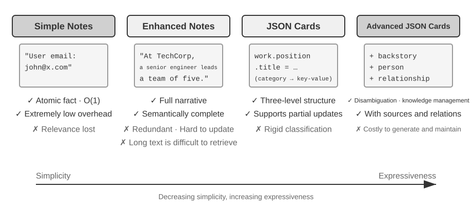
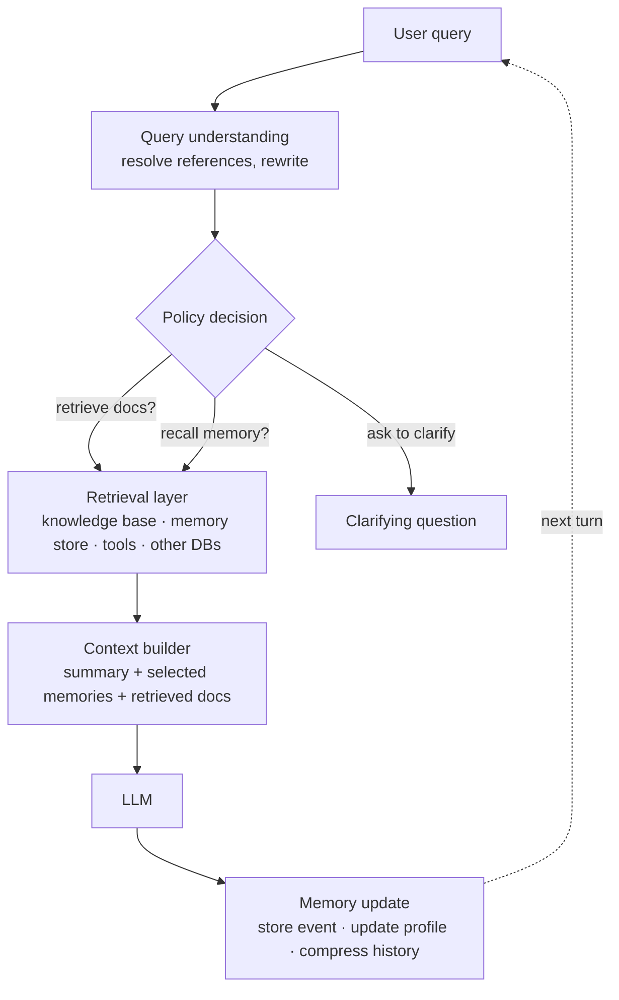
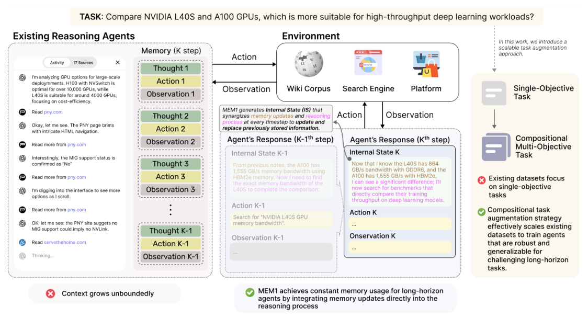
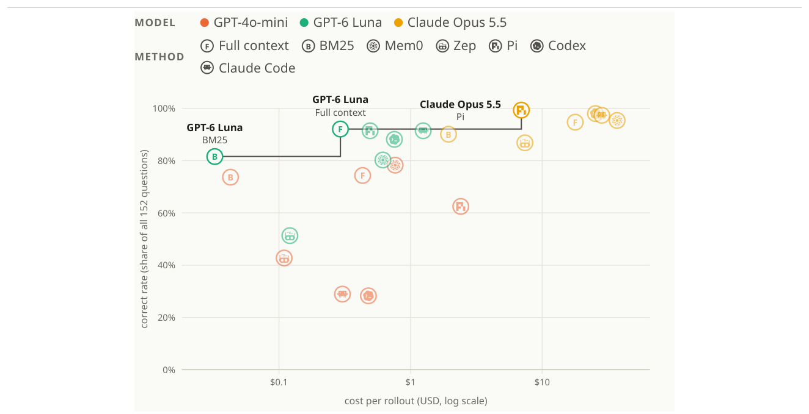

# 6 — Memory as a Context Sub-Component

> Memory is not a sibling pillar of context engineering. It is the mechanism by which context outlives a window.

---

## Framing

Every source that enumerates the foundations treats memory as a context primitive, not a top-level discipline. The reason is structural: memory has no effect on a model except by **entering a context window**. A memory store the agent never reads is inert. So every memory design decision is really a context decision — what gets written, what gets selected back in, at what size.

This reframes the design question from "what should the agent remember?" to **"what should occupy the window three sessions from now, and how does it get there?"**

---

## Memory types


*Image Source: Li, [AI Agents in Depth](https://github.com/bojieli/ai-agent-book/blob/main/book-en/chapter3.md) (2026), Figure 3-2: Comparison of Four Memory Strategies (Apache-2.0)*

| Type | Scope | Lifetime | Example |
|---|---|---|---|
| **In-context / working** | Current window | The session | The conversation so far |
| **Short-term** | Session or workflow | Hours | Task state, prior revisions in a multi-shot refinement |
| **Long-term** | Cross-session | Indefinite | User preferences, project decisions, known failure patterns |
| **Episodic** | Specific past events | Indefinite | "Last Tuesday's deploy failed because of X" |
| **Semantic** | Distilled facts | Indefinite | "This project uses pnpm, not npm" |

Episodic vs. semantic is the distinction that matters in practice. Episodic memory accumulates linearly with time and rots — most of what happened is not worth carrying. Semantic memory is *distilled from* episodes and stays roughly constant in size. A memory system that only stores episodes grows without bound; one that distills episodes into semantic facts converges.

The distillation step is the whole design. "The user corrected me about commit format three times" (episodic, ×3) becomes "commit format is `type(scope): desc (#num)`" (semantic, ×1).

**The trajectory is a log; long-term memory is an archive.** The trajectory is append-only and never rewritten. Long-term memory is rewritten, merged and pruned. Working memory is neither: it is the *filtered, activated subset* of both that is in the window right now. A third store, **business state** ("awaiting payment"), records the task's stage for event-driven agents ([harness 07](../../03-harness-engineering/notes/07-orchestration.md)).

Extraction after a session should be **selective** (skip "the search returned 3 options"), **abstract** ("prefers window seats", not tied to this flight) and **typed** (preference, restriction, account number).

### Three questions, three axes

Li separates three independent design choices:

| Axis | Question | Options |
|---|---|---|
| Hierarchy | *Where* is it stored? | Trajectory · long-term memory · business state |
| Format | *How* is it stored? | Simple notes · enhanced notes · JSON cards · advanced JSON cards |
| Cognitive type | *What* is stored? | Episodic · semantic · procedural |

The axes combine freely. A procedural memory ("search direct flights → confirm seat → apply frequent-flyer number → order meal") can live in a JSON card in long-term memory.

### A survey taxonomy: forms, functions, dynamics

The survey *Memory in the Age of AI Agents* organises the field along three different axes, useful when reading papers that each use their own vocabulary:

| Axis | Question | Categories |
|---|---|---|
| **Forms** | What carries the memory? | **Token-level**, as text in an external buffer: *flat* (logs, rolling windows, retrieved snippets), *planar* (graphs such as Zep or A-Mem), *hierarchical* (summaries at several levels). **Parametric**, in the weights: pretraining knowledge, or fine-tuning / LoRA adapters on accumulated experience. **Latent**, as activations: generated, reused (cached KV states) or transformed |
| **Functions** | Why does the agent need it? | **Factual** (user facts such as preferences and identity; environment facts such as world and task state). **Experiential** (case-based, strategy-based, skill-based, or a mix). **Working** (single-turn scratchpads; multi-turn dialogue state and partial plans) |
| **Dynamics** | How does it operate over time? | **Formation** (summarise, distil, build triples or schemas, encode, fine-tune). **Evolution** (consolidate, update, forget). **Retrieval** (timing, query construction, strategy — sparse, dense, graph, hybrid — and post-processing before injection) |

Almost everything in this note is token-level memory. Parametric and latent memory are where the research is heading ([gen-AI 05](../../../generative-ai/05-RL/README.md)); the KV-cache reuse in [02](02-context-anatomy.md#ordering-stable-before-dynamic) is the one latent form already in production.

### Storage formats

| Format | Shape | Wins | Loses |
|---|---|---|---|
| **Simple notes** | One atomic fact per entry | Cheapest; passes most basic recall | Links between facts ("Senior Engineer at TechCorp, leads recsys" becomes three unrelated facts) |
| **Enhanced notes** | A narrative paragraph per topic | Nuance ("suggest a project from my background") | Redundant; one change means rewriting several paragraphs; long text weakens the embedding |
| **JSON cards** | `category.subcategory.key` | Partial updates; predictable | Rigid: "Python side projects on weekends" fits three categories at once |
| **Advanced JSON cards** | Facts plus `backstory`, `person`, `relationship`, timestamp | Disambiguation: "Dr. Zhang" the user's dentist vs. their father's cardiologist | Expensive to generate and maintain |

Mix them: **advanced cards for critical, low-volume facts** (preferences, key relationships); **simple notes for high-volume, low-stakes ones**.

**Beyond text.** *User as Code* (Li, [arXiv:2606.16707](https://arxiv.org/abs/2606.16707)) keeps an append-only fact log and periodically regenerates **typed Python state** from it: write-ahead log plus checkpoint. Aggregations ("international trips in 2025") become one expression instead of mental arithmetic: about 99% accuracy, vs. 6–43% for retrieval-based memory. Conflict checks (drug class × allergy) and constraints (passport expires < 180 days after an international departure) run as code on every update. A `notes: list[str]` field holds what won't type. Further inward, facts can be written into the model's own parameters (*User as Engram*: hash N-gram slots, no gradient updates) or kept as perceptual vectors (faces, voices). Those are research directions, previewing [gen-AI 05](../../../generative-ai/05-RL/README.md).

---

## Structured note-taking

Anthropic's term for the pattern: the agent **writes notes to persistent storage outside the context window**, and retrieves them later.

This is agentic memory in its simplest usable form — no vector store, no embedding, just files the agent maintains. A `NOTES.md` or `progress.md` the agent updates as it works survives compaction, crashes, and session boundaries, because it never depended on the window.

Why it works so well relative to its complexity:

- **Write is cheap, read is selective.** Writing costs one tool call; the note only re-enters context when needed.
- **It is the state extraction from compaction, done eagerly.** An agent already keeping structured notes is trivially compactable — the state is on disk.
- **It is auditable.** A human can read the notes, correct them, delete wrong entries.
- **It doubles as crash recovery.** See [05-compression-compaction.md](05-compression-compaction.md).

The discipline: write the note **when the decision is made**, not when the window fills. Notes written under compaction pressure are reconstructions; notes written in the moment are records.

---

## Index-plus-detail

The core architecture for long-term memory. Never load the full memory store; load an **index** and fetch detail on demand.

```text
MEMORY.md (index)                      memory/*.md (detail)
- [Topic A](a.md) — one-line hook  -->  full content, loaded only when relevant
- [Topic B](b.md) — one-line hook
- [Topic C](c.md) — one-line hook
```

Claude Code's auto-memory is exactly this: `MEMORY.md` (first 200 lines / 25 KB) loads at session start; topic files are read only when a hook line signals relevance.

This is **progressive disclosure applied to memory** — the same pattern as skills in layer 2, and the same pattern as lightweight identifiers in retrieval. One idea, three applications: keep a cheap pointer resident, load the payload on demand.

Design consequence: **the one-line hook is the highest-leverage text in the system.** It is the only thing that decides whether the detail ever loads. A vague hook makes a correct memory unreachable — the memory is present and useless, which is worse than absent because it creates false confidence that the fact is available.

---

## Memory hygiene


*Image Source: Li, [AI Agents in Depth](https://github.com/bojieli/ai-agent-book/blob/main/book-en/chapter3.md) (2026), Figure 3-3: Mem0 Memory Management Architecture (Apache-2.0)*

Memory must be **editable and auditable**. Wrong, outdated, and contradictory entries have to be removable rather than accumulating indefinitely. Append-only memory is a slow-motion failure: contradictions accumulate, and the model gets two conflicting facts with no basis to choose — **context poisoning** (see [11-failure-modes.md](11-failure-modes.md)).

Practices:

- **Update over append.** Before writing, check whether an existing entry covers it. Revise that one.
- **Delete what proved wrong.** A memory falsified by later evidence is worse than no memory.
- **One fact per file.** Granular files can be individually revised or deleted; a monolith cannot.
- **Absolute dates, not relative.** "Last week" written six months ago is now false. Timestamps must resolve independently of read time.
- **Don't store what's derivable.** Code structure, git history, and file layout are already in the repo. Memory holds what the artifacts *don't* record — decisions, preferences, corrections, and the reasons behind them.
- **Verify before relying.** A memory naming a file, function, or flag reflects what was true when written. Check that it still exists before acting on it.

The last two are the difference between memory that compounds and memory that decays. Memory should hold what cannot be re-derived; anything re-derivable should be re-derived, because the source of truth stays current and the memory does not.

**Production reconciliation: Mem0's write path.** After each conversation segment, an LLM extracts candidate facts. Each one is vector-matched against existing memories, and the LLM chooses one of four operations: **ADD** (new), **UPDATE** (refines or corrects), **DELETE** (contradicted) or **NOOP** (duplicate). "I moved to Shanghai" finds "lives in Beijing" and UPDATEs it, rather than storing two contradictory facts. This is update-over-append, automated. **Memobase** takes a different design: configurable profile slots (`basic_info.name`, `work.title`) plus a timeline of events. It extracts in **buffered batches**, triggered by size or time, so LLM cost is amortized and reads stay fast. Labs: upstream [mem0](https://github.com/bojieli/ai-agent-book/tree/main/chapter3/mem0) · [memobase](https://github.com/bojieli/ai-agent-book/tree/main/chapter3/memobase).

**Compaction for the store** works in tiers:

1. Score importance (access frequency, age decay, emotional weight, uniqueness) and archive what falls below the threshold.
2. Cluster similar entries into one representative summary ("often asks about weather, especially rain").
3. Generalize episodes into semantic or procedural rules ("prefers value-for-money products and reads reviews").

Keep version history for conflicts. Some fields keep only the latest value (current address); others keep the whole history (job history).

**Make consolidation rollback-friendly.** Once memory is tiered, the question is no longer whether to store but when to consolidate, and what happens when consolidation fails. OpenClaw's answer: consolidation only **moves a pointer** to mark which messages have been folded into the curated store; it never deletes the originals. If the summarising call fails, the original messages are written to `archive/`, so nothing is lost and the next run starts from the archive. How elegant the summary is matters less than this property.

**Sanitize logs locally.** Memory and logs collect PII. Li's lab runs a 0.6B local model (Ollama Qwen3) that returns JSON spans of type, location and confidence. It catches PII written in natural language ("my password is abc123") that regex misses, with recall above 95%. For high throughput, run regex first and send the remainder to the LLM. Don't send logs to a cloud API to be cleaned; that defeats the purpose. Lab: upstream [3-3 log-sanitization](https://github.com/bojieli/ai-agent-book/tree/main/chapter3/log-sanitization).

---

## Short-term memory: state and history

Within a session, prior states and agent outputs are a memory tier too. **Multi-shot refinement** — where an agent revises its own earlier output — depends on having those prior states available.

The tension: prior revisions are exactly the content that fills a window fastest, and superseded drafts are prime pruning candidates. The resolution is usually to keep the *latest* state verbatim plus a compact record of what changed and why, rather than the full revision chain. The rejected drafts rarely matter; the reason for rejection often does.

Frameworks draw the same line. LangGraph's [memory docs](https://docs.langchain.com/oss/javascript/langgraph/memory) split **thread-scoped** state (message history and working state, persisted per thread by a checkpointer) from **long-term** memory in a store, organised by **namespaces** (per user, per org) and shared across threads. The docs carry the warning this pillar is built on: long histories distract the model, raise cost and latency, and degrade quality, so short-term memory needs its own forgetting and compression ([05](05-compression-compaction.md)).

---

## The memory loop

Memory touches every call twice: once before the model runs (read) and once after (write). A memory-augmented agent adds a **policy step** in front of retrieval, because in multi-turn settings retrieving every turn is wasteful and can displace evidence that is still valid:


*Image Source: memory-augmented agent architecture, after the author's Notion notes and the Azure / LangGraph memory docs*

The loop is **dual retrieval**: one path reads static knowledge (the RAG index), the other reads history and user memory, and a reasoning step merges the two before generation. After the answer, the memory store is updated with the new interaction (session summary, extracted facts, feedback).

Read as a lifecycle, every memory system makes five decisions, and most failures trace to one of them:

| Step | Decision | Options |
|---|---|---|
| **A. Represent** | What form is a memory? | Raw history, summaries, structured objects (facts, triples, cards) |
| **B. Store** | Where does it live? | Vector DB, structured store (SQL, NoSQL, graph), files |
| **C. Retrieve** | How is it selected? | Query rewriting, history-aware retrieval, recency weighting |
| **D. Use** | How does it enter the call? | Prompt construction, tool choice, planning |
| **E. Update / forget** | How does it change? | Summarise, compress, filter, consolidate, expire |

Microsoft's Foundry agent memory service implements A–E as three managed stages: **extraction** (an LLM pulls preferences and facts such as "allergic to dairy" from the conversation), **consolidation** (an LLM merges duplicates and resolves conflicts, e.g. a new allergy), and **retrieval** (search the store for the most relevant memories; load the stable user profile early in the conversation so personalisation starts on turn one).

---

## Conversational memory: the corpus includes the conversation

In multi-turn RAG the retrieval corpus is no longer only a knowledge base. It also holds prior user turns, assistant outputs, tool results and memories distilled from them. That changes the hard problem from relevance to **continuity and intent resolution**: follow-ups carry pronouns, ellipsis ("what about the second one?") and topic drift.

Three controls matter more than the choice of retriever:

| Control | Options | Trade-off |
|---|---|---|
| **Query construction** | Concatenate recent turns; rewrite into a standalone question (CONQRR trains the rewriter against retrieval quality); decompose into parallel subqueries from the whole thread (agentic retrieval) | Concatenation is cheap but drags irrelevant history into the query. A single rewrite loses context in long dialogues, which is why systems move to summaries or structured memory objects. |
| **When to retrieve** | Every turn; only if needed; reuse the previous turn's evidence; ask a clarifying question first | Retrieving every turn is wasteful and can displace evidence that is still valid. |
| **Recency vs. relevance** | Weight retrieved memories by age, e.g. Memoria's exponential decay `wᵢ = e^(−α·xᵢ)` over normalised age | Newer facts win contradictions automatically ("changed jobs"). The risk is that a stable old fact gets down-weighted below a recent, trivial one. |

Recency weighting is a cheap partial answer to **memory hygiene**. It does not replace update-over-append, because both conflicting facts still occupy the window.

The four common strategies, from cheapest to most engineered:

| Strategy | How | Wins | Loses |
|---|---|---|---|
| **History-based** | All history, or the last N turns, in the prompt | Trivial; low latency (NVIDIA's RAG blueprint still ships it as "simple multi-turn" mode) | Irrelevant history drifts the retrieval query; grows without bound |
| **Compression** | Rolling summary updated each turn, or structured extraction (preferences, key facts, task state); LangChain summary memory, LangGraph compression | Bounded tokens; better relevance | Lossy; summary quality depends on the model |
| **Retrieval-based** | Store user messages, replies, tool outputs and extracted memories in a vector store; retrieve by semantic, hybrid, or recency + relevance search | Scales; crosses sessions | Retrieval noise; **embedding drift** when the embedding model changes; added latency |
| **Query rewriting** | Use memory to rewrite the turn into a standalone query ("what about the second one?" → "what about the second product you mentioned earlier?") rather than injecting memory directly | Better retrieval for multi-turn RAG (NVIDIA's recommended mode for accuracy); datasets CANARD, QReCC | Can drop context; rewrites are unstable |

The retrieval side of these (history-aware retrieval, CONQRR, agentic retrieval) is in [rag.md — conversational RAG](../../../generative-ai/02-rag-retrieval/notes/01-rag-pipeline.md#conversational-multi-turn-rag).

---

## Production memory designs

Four shipped designs, from simplest to most engineered. Note how little machinery the most widely used one needs.

**ChatGPT: four layers, no vector database.** Viewed from outside, ChatGPT's memory does no RAG at all:

| Layer | Content | Persistent? |
|---|---|---|
| Session metadata | Device, location, usage patterns | No |
| User memory | About 33 key preference facts, **injected every time** | Yes |
| Conversation summary | Lightweight summaries of about 15 recent conversations | Yes |
| Current session | A sliding window over the current conversation | No |

It works because the resident tier is tiny and curated. That's the resident half of [two-tier memory](#two-tier-memory-overview-plus-details), without the retrieved half.

**OpenClaw: logs plus curated facts plus hybrid search.** Three pieces: `memory/YYYY-MM-DD.md`, append-only daily logs that keep the original detail; `MEMORY.md`, curated facts the agent maintains itself; and `memory_search`, a hybrid search weighted **70% vector similarity + 30% keyword**. That's the same split Bayer found by experiment for document retrieval (0.7/0.3, [rag.md](../../../generative-ai/02-rag-retrieval/notes/01-rag-pipeline.md#a-tuned-pipeline-bayers-prince)). Its rollback-friendly consolidation is described under [hygiene](#memory-hygiene).

**Memoria: a summary plus a decayed user graph.** Memoria (Sarmah, Sarin et al., BlackRock; Python package announced as forthcoming) wraps an existing chat app with four modules:

1. **Structured logging.** Every message goes to SQLite with timestamp, session ID, the raw user and assistant messages, extracted triples, the session summary and token usage. A queryable, time-indexed record that survives sessions.
2. **Session summary (short-term).** After each exchange, the user message and reply go to an LLM that *updates* the session's running summary (creates it the first time). Retrieval is a deterministic lookup by session ID.
3. **Knowledge-graph user model (long-term).** After every user message, an LLM extracts `(subject, predicate, object)` triples such as `(user, prefers, equity stocks)`. **Only user messages** are mined, so the graph reflects the user's intent and identity, not the assistant's words. Each triple is stored twice: as text in SQL for traceability, and as an embedding in ChromaDB with timestamp, source message and username.
4. **Weighted retrieval.** The query is embedded, the top-20 triples for that username are retrieved, and each gets an exponential-decay weight by age.

The weighting is the distinctive part:

```text
x_norm = (x − x_min) / (x_max − x_min)     # x = minutes since the triple was created; normalise first
wᵢ     = e^(−α · xᵢ)                        # α = 0.02 (their setting)
w̃ᵢ     = wᵢ / Σⱼ wⱼ                         # weights sum to 1
```

Normalising the ages first stops very old triples decaying to zero, so they still contribute softly. Recent triples dominate, and a contradicted fact (a new job, a changed preference) loses to the newer one with no explicit conflict resolution. **Tuning α**: higher means steeper decay, good for fast-changing preferences; lower keeps old context relevant, good for stable traits like profession or long-term goals.

The prompt is `system + session summary + weighted triples + user message`; afterwards new triples are extracted and the summary updated. With `text-embedding-ada-002` and GPT-4.1-mini, top-20 kept the memory context **under 400 tokens on average, against about 115K for full context**. A sketch of the wrapper pattern (the package isn't released, so the names are illustrative):

```python
mem = Memoria(user_id="alice", session_id="s001")          # illustrative API
summary  = mem.get_session_summary()                         # SQL lookup by session id
triples  = mem.get_weighted_triplets(query=msg, top_k=20)    # vector search + decay weights
reply    = llm(build_prompt(system, summary, triples, msg))  # your existing call
mem.update_summary(msg, reply)                               # update, don't replace
mem.extract_and_store_triplets(msg)                          # user message only
```

The core is small enough to replicate: SQLite, ChromaDB, one extraction call and the decay formula.

**Microsoft Foundry:** a managed extraction → consolidation → retrieval service ([above](#the-memory-loop)).

### Operating a memory store

The production concerns are the ones of any datastore, plus a few specific to memory:

- **Performance.** Cache hot entries (recent session data) with write-through or write-back updates. Index metadata fields (`user_id`, `session_id`). Update vector indexes asynchronously. Use async I/O for lookups; precompute embeddings and summaries so the context builder isn't waiting on them.
- **Observability.** Track **memory hit rate** (share of queries that used a relevant memory), latency per stage (memory lookup, fusion, generation) and update frequency. Log which memory entries went into each answer and trace the request end to end (e.g. OpenTelemetry).
- **Maintenance.** Scheduled pruning of stale entries; store deltas rather than full copies; re-embed when the embedding model changes, or retrieval drifts.
- **Security and compliance.** RBAC/ABAC on read and write; encryption at rest (AES-256) and in transit (TLS); anonymise or tokenise sensitive fields; support **deletion and consent** (GDPR, CCPA), which an index without per-user scope makes very hard.
- **Common failures.** *Overload*: summarise or relevance-score to keep memory concise. *Stale context*: TTL and decay policies, archiving with version history rather than deleting. *Conflicts*: newer supersedes older, or higher-confidence sources beat ambiguous ones.

---

## Memory architectures

### Episodic, semantic, procedural

The upstream course adds a third long-term type to the table above:

- **Procedural memory:** *how* to do things. Learned workflows, successful tool sequences, prompts that worked. In practice this is a skills or playbook library that the agent retrieves by task type.

### MemOS-style management

Treating memory as an operating-system concern means each memory item has **metadata and a lifecycle**, not just content:

| Field | Why |
|---|---|
| Source and timestamp | Resolve conflicts; expire stale items |
| Confidence | Down-weight inferences relative to stated facts |
| Access count / last used | Promote hot items, archive cold ones |
| Scope (user, project, global) | Prevent one user's facts leaking into another's context |

### MEM1: constant-size memory

ReAct-style agents append every thought, action and observation, so context grows without bound. Zhou et al. (2506.15841) instead train agents to keep a single **internal state that is overwritten every turn**, merging new observations with what's worth keeping and discarding the rest. On long multi-hop QA it matches or beats larger models while using a near-constant amount of memory. The engineering takeaway doesn't need training: a fixed-size, rewritten state block outperforms an ever-growing log ([07](07-structured-context.md#2-state-schemas--what-carries-across-turns)).


*Image Source: Zhou et al. (2025)*

### Reconstructive memory

Store **fragments** (facts, events, procedures) with source pointers, and assemble a task-specific memory at retrieval time rather than replaying stored transcripts. The risk is confabulated connections between fragments ([13](13-putting-it-together.md#a-note-on-reconstructive-memory)).

### Designed memory vs. searching the raw record

Extraction-based memory (Mem0's fact store, Zep's temporal graph) decides what to keep *before any question arrives*. [arXiv:2610.29823](https://arxiv.org/abs/2610.29823) (Peng, 2026-10) asks whether that still pays once the model can search the raw history with its own tools. On one LoCoMo conversation (419 turns, 152 questions), **Mem0 beats full context only with the weakest model** (GPT-4o-mini, 78% vs. 74%). With GPT-6 Luna and Claude Opus 5.5 it ties or loses, and its build alone costs more than a whole full-context run. Two findings travel as design rules:

- **The writer caps every reader.** A stronger reader on a store a weaker model wrote barely helps: on Zep's GPT-4o-mini graph, Opus 5.5 scores 45% against GPT-4o-mini's 43%. Extraction loses information for good; a verbatim record doesn't.
- **With a strong model, keep the raw record and give it search tools.** A coding agent (Pi) reading the raw history as one file scored 99% at under half full context's cost.


*Image Source: Peng (2026)*

The paper's own caveats: one conversation, one run per cell, a GPT-4o-mini judge, and most of the agents' lead came from photo captions only they could read — on questions without photo evidence, Pi and full context differ by one answer. Read it as a direction, not a benchmark result. It points the same way as [index-plus-detail](#index-plus-detail): keep the source, make it searchable, and let the model decide what to load.

### Two-tier memory: overview plus details

Li's chapter ends with an architecture that combines the two threads:

- **Resident tier.** A few critical facts as advanced JSON cards, always in context ("passport expires 2025-02-18").
- **Retrieved tier.** Raw conversation chunks with **contextual-retrieval prefixes** ("[Husband James is modifying the earlier wire transfer]"), searched on demand ([04](04-retrieval.md#contextual-retrieval)).

Either tier alone fails. Resident context can't hold the details. Retrieval alone misses cross-session connections because it has no overall view. Without prefixes, three chunks recording a transfer set by one spouse, changed by the other, then changed back look like three contradictory instructions. With the who, when and intent in each prefix, the latest valid one is clear. The combination enables proactive service: the agent sees "Tokyo flight in January" next to "passport expires February", retrieves the original conversations to confirm, and warns the user without being asked. Labs: upstream [3-10 agentic-rag-for-user-memory](https://github.com/bojieli/ai-agent-book/tree/main/chapter3/agentic-rag-for-user-memory) · [3-12 contextual-retrieval-for-user-memory](https://github.com/bojieli/ai-agent-book/tree/main/chapter3/contextual-retrieval-for-user-memory).

### Evaluating memory

**Grade it in three levels** (Li's framework, used in [user-memory-evaluation](https://github.com/bojieli/ai-agent-book/tree/main/chapter3/user-memory-evaluation)):

1. **Basic recall.** "My membership number is 12345" comes back exact.
2. **Multi-session retrieval.** Find *all* the relevant records across entities and channels. Two cars means asking "which one?", not guessing. Use the active contract, not a quote that never took effect. Cancelling a trip means finding every linked booking.
3. **Proactive service.** Connect old, unrelated-looking memories without being asked: the expiring passport, every warranty and insurance that covers a broken phone, a year's tax documents.

The protocol: the agent writes memory from session 1, revises it after each later session *seeing only memory, not the raw transcript*, then answers a new question; an LLM judge scores the answer against a reference. LoCoMo (about 300 turns over up to 35 sessions) is the public benchmark in this space. Lab: upstream [3-1/3-2 user-memory](https://github.com/bojieli/ai-agent-book/tree/main/chapter3/user-memory) compares the four formats on this framework.

Memory failures are slow and silent. Test recall across sessions, update correctness and stale-memory rate ([12](12-evaluating-context.md#write-memory)). In production, also track **memory hit rate** (the share of queries where a retrieved memory was actually relevant) and log which memory entries went into each answer, so a bad answer can be traced back to the memory that caused it.

Public multi-turn benchmarks stress later turns, questions that aren't standalone, topic switches and unanswerable questions: **CAsT** (query understanding, with a large gap between automatic and oracle rewrites), **QReCC** (rewrite, retrieve, read), **TopiOCQA** (topic switching), **CORAL** (retrieval, generation and citation) and **mtRAG** (human-written, multi-domain). Mixed-initiative sets such as **InSCIt** and **OR-ShARC** test the decision to ask a clarifying question instead of answering.

---

## Working reference

`~/.claude/refs/agent-memory.md` — memory tier conventions, what belongs in each, and retention rules.
`~/.claude/refs/agent-context.md` — the Write lever (writing context out of the window) and memory summaries as stable, cache-friendly content.

---

→ Next: [07-structured-context.md](07-structured-context.md) — giving context a shape.
