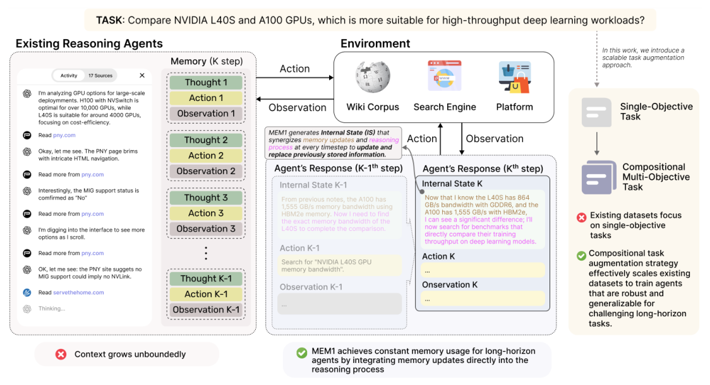
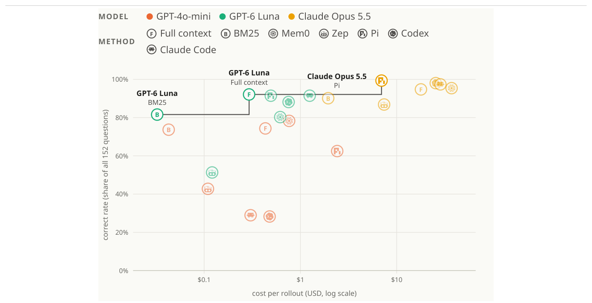

# 6b — Memory Designs, Architectures and Evaluation

> Part two of the memory chapter: what shipped systems do, what research architectures add, and how to tell whether any of it works.

[Part one](06-memory.md) covered what to distil, how to store it, and how to keep a store clean. This part looks at four memory designs in production, from ChatGPT's four layers with no vector database to Memoria's weighted triples. It then covers the research architectures (MEM1, MemAgent, memory inside the attention layers, RL-trained memory operations), the evidence that searching the raw record often beats designed memory, and how to grade a memory system at three levels.

---

## Production memory designs

Four shipped designs, from simplest to most engineered. Note how little machinery the most widely used one needs.

**ChatGPT: four layers, no vector database.** Viewed from outside, ChatGPT's memory does no RAG at all:

| Layer | Content | Persistent? |
|---|---|---|
| Session metadata | Device, location, usage patterns | No |
| User memory | About 33 key preference facts, **injected every time** | Yes |
| Conversation summary | Lightweight summaries of about 15 recent conversations | Yes |
| Current session | A sliding window over the current conversation | No |

It works because the resident tier is tiny and curated. That's the resident half of [two-tier memory](#two-tier-memory-overview-plus-details), without the retrieved half.

**OpenClaw: logs plus curated facts plus hybrid search.** Three pieces: `memory/YYYY-MM-DD.md`, append-only daily logs that keep the original detail; `MEMORY.md`, curated facts the agent maintains itself; and `memory_search`, a hybrid search weighted **70% vector similarity + 30% keyword**. That's the same split Bayer found by experiment for document retrieval (0.7/0.3, [rag.md](../../../generative-ai/02-rag-retrieval/notes/01-rag-pipeline.md#a-tuned-pipeline-bayers-prince)). Its rollback-friendly consolidation is described under [hygiene](06-memory.md#memory-hygiene).

**Memoria: a summary plus a decayed user graph.** Memoria (Sarmah, Sarin et al., BlackRock; Python package announced as forthcoming) wraps an existing chat app with four modules:

1. **Structured logging.** Every message goes to SQLite with timestamp, session ID, the raw user and assistant messages, extracted triples, the session summary and token usage. A queryable, time-indexed record that survives sessions.
2. **Session summary (short-term).** After each exchange, the user message and reply go to an LLM that *updates* the session's running summary (creates it the first time). Retrieval is a deterministic lookup by session ID.
3. **Knowledge-graph user model (long-term).** After every user message, an LLM extracts `(subject, predicate, object)` triples such as `(user, prefers, equity stocks)`. **Only user messages** are mined, so the graph reflects the user's intent and identity, not the assistant's words. Each triple is stored twice: as text in SQL for traceability, and as an embedding in ChromaDB with timestamp, source message and username.
4. **Weighted retrieval.** The query is embedded, the top-20 triples for that username are retrieved, and each gets an exponential-decay weight by age.

The weighting is the distinctive part:

```text
x_norm = (x − x_min) / (x_max − x_min)     # x = minutes since the triple was created; normalise first
wᵢ     = e^(−α · xᵢ)                        # α = 0.02 (their setting)
w̃ᵢ     = wᵢ / Σⱼ wⱼ                         # weights sum to 1
```

Normalising the ages first stops very old triples decaying to zero, so they still contribute softly. Recent triples dominate, and a contradicted fact (a new job, a changed preference) loses to the newer one with no explicit conflict resolution. **Tuning α**: higher means steeper decay, good for fast-changing preferences; lower keeps old context relevant, good for stable traits like profession or long-term goals.

The prompt is `system + session summary + weighted triples + user message`; afterwards new triples are extracted and the summary updated. With `text-embedding-ada-002` and GPT-4.1-mini, top-20 kept the memory context **under 400 tokens on average, against about 115K for full context**. A sketch of the wrapper pattern (the package isn't released, so the names are illustrative):

```python
mem = Memoria(user_id="alice", session_id="s001")          # illustrative API
summary  = mem.get_session_summary()                         # SQL lookup by session id
triples  = mem.get_weighted_triplets(query=msg, top_k=20)    # vector search + decay weights
reply    = llm(build_prompt(system, summary, triples, msg))  # your existing call
mem.update_summary(msg, reply)                               # update, don't replace
mem.extract_and_store_triplets(msg)                          # user message only
```

The core is small enough to replicate: SQLite, ChromaDB, one extraction call and the decay formula.

**Microsoft Foundry:** a managed extraction → consolidation → retrieval service ([part one](06-memory.md#the-memory-loop)).

### Operating a memory store

The production concerns are the ones of any datastore, plus a few specific to memory:

- **Performance.** Cache hot entries (recent session data) with write-through or write-back updates. Index metadata fields (`user_id`, `session_id`). Update vector indexes asynchronously. Use async I/O for lookups; precompute embeddings and summaries so the context builder isn't waiting on them.
- **Observability.** Track **memory hit rate** (share of queries that used a relevant memory), latency per stage (memory lookup, fusion, generation) and update frequency. Log which memory entries went into each answer and trace the request end to end (e.g. OpenTelemetry).
- **Maintenance.** Scheduled pruning of stale entries; store deltas rather than full copies; re-embed when the embedding model changes, or retrieval drifts.
- **Security and compliance.** RBAC/ABAC on read and write; encryption at rest (AES-256) and in transit (TLS); anonymise or tokenise sensitive fields; support **deletion and consent** (GDPR, CCPA), which an index without per-user scope makes very hard.
- **Common failures.** *Overload*: summarise or relevance-score to keep memory concise. *Stale context*: TTL and decay policies, archiving with version history rather than deleting. *Conflicts*: newer supersedes older, or higher-confidence sources beat ambiguous ones.

---

## Memory architectures

### Episodic, semantic, procedural

The upstream course adds a third long-term type to the [memory types](06-memory.md#memory-types) of part one:

- **Procedural memory:** *how* to do things. Learned workflows, successful tool sequences, prompts that worked. In practice this is a skills or playbook library that the agent retrieves by task type.

### MemOS-style management

Treating memory as an operating-system concern means each memory item has **metadata and a lifecycle**, not just content:

| Field | Why |
|---|---|
| Source and timestamp | Resolve conflicts; expire stale items |
| Confidence | Down-weight inferences relative to stated facts |
| Access count / last used | Promote hot items, archive cold ones |
| Scope (user, project, global) | Prevent one user's facts leaking into another's context |

### MEM1: constant-size memory

ReAct-style agents append every thought, action and observation, so context grows without bound. Zhou et al. (2506.15841) instead train agents to keep a single **internal state that is overwritten every turn**, merging new observations with what's worth keeping and discarding the rest. On a 16-question multi-hop QA task, MEM1-7B answered **3.5× more questions than Qwen2.5-14B while using 3.7× less peak memory**, and its memory stayed nearly flat as the number of questions grew ([arXiv:2506.15841](https://arxiv.org/abs/2506.15841)). The paper also tests the prompt without the training. Given MEM1's rewrite-the-state prompt, an untrained Qwen2.5-7B scored 0.40 exact matches against 0.17 with the full log, at a third of the peak tokens. So a fixed-size, rewritten state block beats an ever-growing log even without training ([07](07-structured-context.md#2-state-schemas--what-carries-across-turns)). Most of the gain still came from RL: the trained model scored 1.97, and fine-tuning on GPT-4o trajectories did much worse than RL.


*Image Source: Zhou et al. (2025)*

### MemAgent: overwrite a memory while reading a long document

MEM1 overwrites state across a trajectory; [arXiv:2507.02259](https://arxiv.org/abs/2507.02259) (Yu et al., ICLR 2026) does the same across a long *document*. It reads 5,000-token chunks and rewrites a 1,024-token memory after each, so the window stays at 8K and compute grows linearly. Trained with RL on Qwen2.5-7B and 14B over documents up to 60K tokens, on RULER-HQA (128 synthetic multi-hop questions per length) the 14B scores **80.47 at 7K tokens and 71.09 at 3.5M**, while Qwen2.5-14B-Instruct-1M falls from 60.16 at 7K to 0.00 at 896K. **The RL is the point:** without it, needle retrieval at 512K averages 40.10 against 98.18 with it. The memory is lossy and single-pass: a fact can be overwritten, and a first hop that looks irrelevant is dropped before the second appears. Tests are mostly synthetic, one model family; this is working memory inside one task, not across sessions.

InfMem targets that single-pass weakness. MemAgent pushes every chunk through the same overwrite and cannot look back or stop early. InfMem adds a control step that looks only at the question and the memory and decides to stop or search. If it searches, it runs BM25 over the same document, earlier or later parts, and then writes memory, chunk and retrieved text back into the same 1K budget ([arXiv:2602.02704](https://arxiv.org/abs/2602.02704) (Wang et al., 2026-02, preprint)). At 1M tokens with Qwen3-4B after RL, it scored **56.86 vs. 35.91 on padded MuSiQue and 66.39 vs. 35.18 on padded 2Wiki** (128 samples per task). Across three backbones the average gain was 8–12 points, and latency fell 3.9× on average because it stops once the memory suffices. The comparison isn't budget-matched: InfMem gets up to 4K extra retrieved tokens per step and a document index that MemAgent lacks, and the authors turned off MemAgent's thinking mode. The long tests are synthetic, and on LongBench, the one natural set, untrained MemAgent beats untrained InfMem at 7B. So the evidence supports **control over when to read and when to stop**, not a larger memory.

### Memory in the attention layers

The memory above is text the harness stores and re-reads. LongMem ([arXiv:2306.07174](https://arxiv.org/abs/2306.07174) (Wang et al., 2023-06, preprint)) puts it inside the model instead: a frozen backbone caches the attention keys and values of past segments in a first-in-first-out bank (65K tokens), and a small trainable side network retrieves from it. On a 407M GPT-2 backbone (558M with the side network) it reaches 40.5% on ChapterBreak suffix identification at 8K tokens of prefix (GPT-3 28%, a figure cited from another paper), and with 2,000 extra demonstrations in memory it gains 8.0 points on average over five classification sets at 20 shots (66.7 vs. 58.7; per-task standard deviation up to about 14). The memory is vectors, so it cannot be read or edited, it needs a white-box model and 26B tokens of adapter training, and the evidence is one small model, so treat it as the architectural end of the spectrum rather than something to deploy. LM2 builds the memory into pretraining. Every decoder block gets a 2,048-slot memory bank that tokens read by cross-attention and that input, forget and output gates update ([arXiv:2502.06049](https://arxiv.org/abs/2502.06049) (Kang et al., Convergence Labs, 2025-02, preprint)). At 1.7B parameters it averaged 92.5% on bAbI with no haystack, against 76.4% for a recurrent-memory baseline. From 8K to 128K tokens of BABILong padding it averaged only 39.9% against 35.5%, and about 85% of that lead came from two tasks, counting (qa7, +19.5 points) and qa5 (+18.5), while RMT led on qa9 by 8.7. The baselines were trained differently, the MMLU check sits near chance (29.4%), and there is one model size and one run per setting.

δ-mem shrinks the in-model store to an **8×8 matrix per layer**. A frozen backbone gets a state that a gated delta rule updates, and the state's readout becomes a [low-rank](../../../generative-ai/01-llm-fundamentals/notes/02-attention-and-the-transformer-block.md#matrix-products-transpose-and-rank) correction to attention's query and output. The read cost doesn't grow with the history ([arXiv:2605.12357](https://arxiv.org/abs/2605.12357) (Lei et al., NeurIPS 2026)). On Qwen3-4B-Instruct, with 4.9M trainable parameters trained for one epoch on 2,219 QASPER samples, the average over five benchmarks rose from 46.79 to 51.66, and LoCoMo from 40.79 to 49.12 (best variant per metric: the average is the TSW variant, LoCoMo the MSW variant, whose own average is 50.74). Every text-memory baseline in the same table (BM25 RAG, LLMLingua-2, MemoryBank) scored *below* the bare backbone. The state is not a substitute for the history. With the history removed and only the state left, HotpotQA exact match goes from 0.08 to 6.48. The gains shrink on Qwen3-8B (+3.7), the tests use one seed and models of 8B or smaller, and decoding slows because the state updates every step. *Do Language Models Need Sleep?* asks when that consolidation should happen. Before clearing the KV cache, a hybrid SSM–attention model makes N extra passes over the context it is about to drop, folding it into the SSM blocks' fast-weight state. It then answers in one pass with no looping ([arXiv:2605.26099](https://arxiv.org/abs/2605.26099) (Lee et al., CMU, UMD, 2026-06, preprint)). On GSM-Infinite problems longer than the window (Ouro 1.4B with six added layers, 1,600 held-out problems, no chain of thought), four sleep passes lifted 6-operation accuracy from 0.419 to 0.615. Easy problems were saturated either way. The authors' reading is that **the bottleneck is the compute spent turning context into state, not memory capacity**. All tasks are synthetic and the models are 2B or smaller. Training cost grows with N and is unstable, and nothing tests forgetting across repeated consolidations.

The limit all of these share is **exact recall**. Artificial Hippocampus Networks keep a 32K sliding window as lossless memory and fold every key–value pair that leaves it into a fixed-size recurrent state ([arXiv:2510.07318](https://arxiv.org/abs/2510.07318) (Fang et al., ByteDance Seed, 2025-10, preprint)). On Qwen2.5-3B at 128K, that cut FLOPs by 40.5% and the cache by 74%, and the LV-Eval average rose from 4.41 to 5.88, though full attention scores very low there. On RULER needle retrieval (NIAH single_1) at 128K (Qwen2.5-7B), **the compressed memory scored 26.8% against 98.6% for full attention, the same as dropping the old tokens outright (26.8%)**. The authors say so: fixed-size memory "may impair performance on tasks that require exact recall". A compressed state helps with gist and hurts with needles, and the needle is the case that text memory with search handles well.

### Reconstructive memory

Store **fragments** (facts, events, procedures) with source pointers, and assemble a task-specific memory at retrieval time rather than replaying stored transcripts. The risk is confabulated connections between fragments ([13](13-putting-it-together.md#a-note-on-reconstructive-memory)).

### Designed memory vs. searching the raw record

Extraction-based memory (Mem0's fact store, Zep's temporal graph) decides what to keep *before any question arrives*. [arXiv:2610.29823](https://arxiv.org/abs/2610.29823) (Peng, 2026-10) asks whether that still pays once the model can search the raw history with its own tools. On one LoCoMo conversation (419 turns, 152 questions), **Mem0 beats full context only with the weakest model** (GPT-4o-mini, 78% vs. 74%). With GPT-6 Luna and Claude Opus 5.5 it ties or loses, and its build alone costs more than a whole full-context run. Two findings travel as design rules:

- **The writer caps every reader.** A stronger reader on a store a weaker model wrote barely helps: on Zep's GPT-4o-mini graph, Opus 5.5 scores 45% against GPT-4o-mini's 43%. Extraction loses information for good; a verbatim record doesn't.
- **With a strong model, keep the raw record and give it search tools.** A coding agent (Pi) reading the raw history as one file scored 99% at under half full context's cost.


*Image Source: Peng (2026)*

The paper's own caveats: one conversation, one run per cell, a GPT-4o-mini judge, and most of the agents' lead came from photo captions only they could read — on questions without photo evidence, Pi and full context differ by one answer. Read it as a direction, not a benchmark result. It points the same way as [index-plus-detail](06-memory.md#index-plus-detail): keep the source, make it searchable, and let the model decide what to load.

A controlled grid points the same way at larger scale. Yuan et al. crossed three write strategies (raw 3-turn chunks, Mem0-style extracted facts, MemGPT-style summaries) with three retrievers on all ten LoCoMo conversations (1,540 questions, GPT-5-mini, top-5). **The retriever moved average accuracy by 20 points (BM25 57.1%, cosine 73.4%, hybrid with rerank 77.2%). The write strategy moved it by 3–8 points.** Raw chunks, which need no LLM call to write, scored highest with hybrid retrieval (81.1%, against 77.3% for extracted facts and 73.3% for summaries). Retrieval failures accounted for 11–46% of all questions and failures to use a retrieved memory for 4–8% ([arXiv:2603.02473](https://arxiv.org/abs/2603.02473) (Yuan et al., ICLR 2026)). The write strategies are prompt reimplementations, not the shipped systems. The grid uses one model and one benchmark, reports no variance, and has an LLM judge assign the failure labels. Write-time information loss isn't measured on its own, so a fact that was never stored in enough detail can also show up as a retrieval failure. So invest in retrieval before write-time cleverness. The authors expect the raw-chunk advantage to shrink when the budget forces compression.

Over a long task rather than a long conversation, the same choice shows up as **fidelity versus tractability**. Summarizing at write time makes reading easy but "can discard details whose relevance is evident only in hindsight". PRO-LONG gives the agent an append-only `log.txt` of every observation, action and outcome, and has it read the log with grep and Python instead of loading it ([arXiv:2607.20064](https://arxiv.org/abs/2607.20064) (Fox et al., 2026-10, preprint)). On 25 public ARC-AGI-3 games (500-action cap, five runs or fewer per model), the log lifted pass@1 by **15.7–21.0 points over the same coding agent without it**, across three frontier models (GPT-5.5: 41.2% vs. 24.0%). Each step up the tool ladder added accuracy: read-only 23.1%, plus grep 27.2%, plus Python 38.3%, plus write and edit 41.2%. Cutting the loaded context from 244K to 64K tokens left PRO-LONG unchanged (44.3%, within its interval), while the no-log agent fell steadily. The evidence is two game benchmarks with small samples and wide run-to-run variance (best@5 60.1% against pass@1 41.2%). Each log covers one task, so this is history within a task, not memory across users or sessions, and no Mem0-style store was run against it. The design is the coding-agent long-context result from [04](04-retrieval.md#the-shift) applied to the agent's own trajectory. JAZ makes the same case against a shipped memory system ([arXiv:2609.26891](https://arxiv.org/abs/2609.26891) (Li et al., MIT, 2026-09, preprint)). Its agent keeps every input and its own history as REPL variables. When the window fills, it hands the whole history by reference to a subagent, which searches it with code. On the far-recall subset of StuLife (207 graded tasks in a 1,284-task sequence, GPT-5.4 nano, three runs), this passed **69.9% against 61.8% for Letta (MemGPT), at $18.3 per run against $42.1**. Over all 939 graded tasks the gap shrinks to 72.6% vs. 70.9%. The case behind the gap is exact recall. Letta's semantic `conversation_search` returned near-misses where an exact substring match was needed. The authors configured Letta themselves: its default search backend returned mostly empty results, and only one of their prompts avoided infinite loops. The history is lossless within one long episode, so nothing is distilled, updated or forgotten.

### Learning the memory operations with RL

Mem0-style stores decide with a prompt when to ADD, UPDATE, DELETE or ignore an entry. [arXiv:2508.19828](https://arxiv.org/abs/2508.19828) (Yan et al., 2025, preprint) trains that decision instead. A Memory Manager picks the operation and is rewarded only by whether a frozen Answer Agent then gets the question exactly right, so no operation labels are needed; **152 training questions** from LoCoMo were enough. With LLaMA-3.1-8B-Instruct on 1,307 LoCoMo test questions (adversarial subset excluded, baselines re-implemented by the authors), the GRPO-trained system reaches **F1 45.02 against 35.04 for the strongest baseline, MemoryOS**. It beats supervised imitation of GPT-5 trajectories (judge score 62.74 vs. 58.76), though on Qwen-2.5-7B the two nearly tie (61.51 vs. 61.13). The paper reports no seeds or variance, and the abstract names Mem0 as the baseline while Table 1 shows MemoryOS ahead of it, so cite the table. Readers are 8B-class only. To try this, MemFactory packages extractor, updater and retriever modules with a GRPO trainer and ships re-implementations of Memory-R1, MemAgent and RMM ([arXiv:2603.29493](https://arxiv.org/abs/2603.29493) (Guo et al., MemTensor, 2026-04, preprint)). The paper tests only the MemAgent agent, against its own untrained checkpoint. On the authors' shortened in-distribution sets, the average rose 14.8% relative (0.31 to 0.36) at Qwen3-1.7B and 7.3% at Qwen3-4B, with four trials per question and no variance reported. The 1.7B score on the out-of-distribution set fell. Treat it as a scaffold, not as evidence that the earlier results reproduce.

**Learning from the user's corrections.** PAHF asks before acting when a preference is ambiguous and corrects memory after a wrong action, with notes merged by similarity ([arXiv:2602.16173](https://arxiv.org/abs/2602.16173) (Liang et al., 2026-02, preprint)). With simulated users and GPT-4o on an embodied task, using both channels gave 70.5% success after learning and 68.8% after the preferences flipped; asking-only memory fell to 35.7% after the flip, below no memory (44.8%), because confident notes stopped it asking. Correction-only was close behind (68.3%, within noise). Simulated users only.

**Revising stored lessons against later outcomes.** Reflection memories are usually written once and never corrected, so an overgeneralised lesson ("put larger numbers first") keeps being retrieved after it starts doing harm. ReHarness adds a backward step. After each task, a revision agent rewrites the reflections it retrieved for that task, using the new trajectory as feedback, and each revision has to stay grounded in the reflection's own source trajectory ([arXiv:2610.12668](https://arxiv.org/abs/2610.12668) (Xiao et al., 2026-10, preprint)). Over three continual-learning benchmarks, three frontier backbones and three stream orderings, it reached a **normalized gain of 0.240, against 0.168 for top-5 raw trajectories, 0.164 for the full raw history and 0.131 for Mem0**. Turning revision off on one benchmark dropped it from 0.217 to 0.144. The lead over raw history is modest: the adjusted p-values were 0.039 and 0.043, and full raw history tied it in some cells. The method needs a reward that says what went wrong; it did poorly on noisy-reward poker. It also keeps raw trajectories for later revision, and one CL-Bench stream with Claude cost about $254 against $85 for top-5 raw (with prompt caching). This is update-over-append ([hygiene](06-memory.md#memory-hygiene)) driven by later outcomes rather than by new statements.

### Two-tier memory: overview plus details

Li's chapter ends with an architecture that combines the two threads:

- **Resident tier.** A few critical facts as advanced JSON cards, always in context ("passport expires 2025-02-18").
- **Retrieved tier.** Raw conversation chunks with **contextual-retrieval prefixes** ("[Husband James is modifying the earlier wire transfer]"), searched on demand ([04](04-retrieval.md#contextual-retrieval)).

Either tier alone fails. Resident context can't hold the details. Retrieval alone misses cross-session connections because it has no overall view. Without prefixes, three chunks recording a transfer set by one spouse, changed by the other, then changed back look like three contradictory instructions. With the who, when and intent in each prefix, the latest valid one is clear. The combination enables proactive service: the agent sees "Tokyo flight in January" next to "passport expires February", retrieves the original conversations to confirm, and warns the user without being asked. Labs: upstream [3-10 agentic-rag-for-user-memory](https://github.com/bojieli/ai-agent-book/tree/main/chapter3/agentic-rag-for-user-memory) · [3-12 contextual-retrieval-for-user-memory](https://github.com/bojieli/ai-agent-book/tree/main/chapter3/contextual-retrieval-for-user-memory).

### Evaluating memory

**Grade it in three levels** (Li's framework, used in [user-memory-evaluation](https://github.com/bojieli/ai-agent-book/tree/main/chapter3/user-memory-evaluation)):

1. **Basic recall.** "My membership number is 12345" comes back exact.
2. **Multi-session retrieval.** Find *all* the relevant records across entities and channels. Two cars means asking "which one?", not guessing. Use the active contract, not a quote that never took effect. Cancelling a trip means finding every linked booking.
3. **Proactive service.** Connect old, unrelated-looking memories without being asked: the expiring passport, every warranty and insurance that covers a broken phone, a year's tax documents.

The protocol: the agent writes memory from session 1, revises it after each later session *seeing only memory, not the raw transcript*, then answers a new question; an LLM judge scores the answer against a reference. LoCoMo (about 300 turns over up to 35 sessions) is the public benchmark in this space. Lab: upstream [3-1/3-2 user-memory](https://github.com/bojieli/ai-agent-book/tree/main/chapter3/user-memory) compares the four formats on this framework.

**Memory over a million tokens.** BEAM builds synthetic dialogues of 100K to 10M tokens with probes for ten memory abilities, and its LIGHT scheme adds a running scratchpad of facts and a working-memory buffer to top-5 retrieval ([arXiv:2510.27246](https://arxiv.org/abs/2510.27246) (Tavakoli et al., ICLR 2026)). Whole-history models fall from 0.24 to 0.28 average score at 100K to 0.104 to 0.133 at 10M (four backbones; at 10M, the latest window that fits). LIGHT beats plain RAG by only a few points (Qwen2.5-32B: 0.238 vs 0.211 at 10M) and loses to it with Gemini-2.0-flash (0.192 vs 0.216). Contradiction resolution stays near zero for every system. One run, small 2025 models.

Memory failures are slow and silent. Test recall across sessions, update correctness and stale-memory rate ([12](12-evaluating-context.md#write-memory)). In production, also track **memory hit rate** (the share of queries where a retrieved memory was actually relevant) and log which memory entries went into each answer, so a bad answer can be traced back to the memory that caused it.

Public multi-turn benchmarks stress later turns, questions that aren't standalone, topic switches and unanswerable questions: **CAsT** (query understanding, with a large gap between automatic and oracle rewrites), **QReCC** (rewrite, retrieve, read), **TopiOCQA** (topic switching), **CORAL** (retrieval, generation and citation) and **mtRAG** (human-written, multi-domain). Mixed-initiative sets such as **InSCIt** and **OR-ShARC** test the decision to ask a clarifying question instead of answering.

## Pitfalls

- **Reading a benchmark as a verdict.** Symptom: picking a memory system from one table. Peng's LoCoMo result rests on 419 turns and 152 questions, one conversation and one run. Fix: run your own three-level eval, including memory hit rate.
- **Write-time cleverness before retrieval.** Symptom: an elaborate extraction pipeline in front of a weak retriever. In Yuan et al.'s grid the retriever moved average accuracy by 20 points and the write strategy by 3–8. Fix: tune retrieval first, and start from raw chunks.
- **A weak writer under a strong reader.** Symptom: upgrading the answering model barely helps. On Zep's GPT-4o-mini graph, Opus 5.5 scored 45% against GPT-4o-mini's 43%. Fix: keep the verbatim record, so a better model can recover what extraction dropped.
- **Compressed state for exact recall.** Symptom: needle lookups fail after the window slides. Artificial Hippocampus Networks scored 26.8% on NIAH at 128K (Qwen2.5-7B) against 98.6% for full attention. Fix: keep exact facts as text with search, and use a compressed state for gist.

## Try it

1. Memoria reports top-20 triples under 400 tokens against about 115K of full history. What's the rough compression ratio, and what do you still need to check?

   <details><summary>Answer</summary>

   More than 115,000 / 400 ≈ 288×. Ratio alone says nothing about usefulness, so check retention and answer quality, as in [12](12-evaluating-context.md).

   </details>

2. You have budget for one improvement to a LoCoMo-style memory: a better fact extractor or a hybrid retriever with a reranker. Using Yuan et al.'s grid, which do you choose?

   <details><summary>Answer</summary>

   The retriever. It moved average accuracy by 20 points (BM25 57.1% to hybrid with rerank 77.2%), while the write strategy moved it by 3–8, and raw chunks scored highest with hybrid retrieval. That holds for one model and one benchmark.

   </details>

## Interview checklist

| Prompt | Answer in one line |
|---|---|
| Does a good memory system need a vector database? | Not always. ChatGPT's memory, as analysed here, has four layers with about 33 facts and about 15 summaries and no vector DB, and Peng found a coding agent searching raw history hit 99% at under half full context's cost, on one conversation and one run. |
| Do you evaluate a memory system on overall answer accuracy only? | No. Evaluate at three levels, including hit rate. In Peng's test Opus 5.5 reading Zep's GPT-4o-mini graph scored 45% against GPT-4o-mini's 43%, so a stronger reader can't recover what a weak writer never stored. |
| Extract facts at write time, or keep raw chunks? | Keep raw chunks and invest in retrieval: in Yuan et al.'s grid (ten LoCoMo conversations, GPT-5-mini) the retriever moved accuracy by 20 points and the write strategy by 3–8. |
| How does MEM1 keep memory constant? | It overwrites one internal state each turn instead of appending. On 16-question multi-hop QA, MEM1-7B answered 3.5× more questions than Qwen2.5-14B at 3.7× less peak memory, with most of the gain from RL. |
| When does a fixed-size compressed memory fail? | On exact recall: Artificial Hippocampus Networks scored 26.8% on NIAH at 128K (Qwen2.5-7B), the same as dropping the old tokens, against 98.6% for full attention. |

## Next

[07-structured-context.md](07-structured-context.md): memory keeps facts between windows, and next comes giving the context a shape that the model and your code can both rely on.
