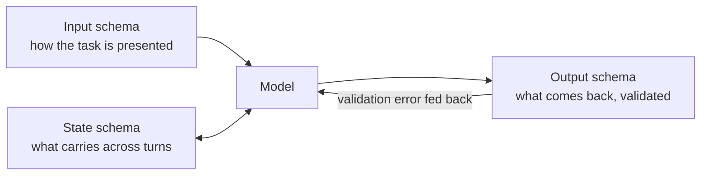
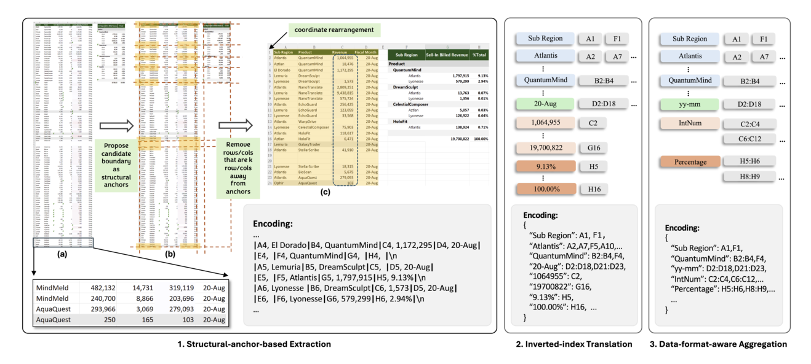

# 7 — Structured Context and Schemas

> Structure is a way of compressing *meaning* rather than tokens. When the shape of the content is consistent, the model spends less of its attention working out what each part is.

---

## Why structure helps

A model reading unstructured context has to infer the role of each span: whether it's an instruction or data, a fact or an example, current or stale. Structure answers those questions in the layout itself.

- **Separation of instructions from data.** Tagged sections (`<document>`, `<instructions>`) make it harder for retrieved text to be read as a command. This is a partial mitigation for injection, not a guarantee ([11](11-failure-modes.md)).
- **Addressability.** "Use the `<constraints>` block" is a reference the model can resolve. "Use the constraints mentioned above" is not.
- **Consistency across calls.** The same schema every turn means the model sees a familiar document, and your code can parse, diff and validate it.

There's also some mechanistic background. Yang et al. (ICML 2025) find a three-stage circuit in LLMs: abstraction to symbolic variables, induction over them, then retrieval of concrete values. Content laid out as consistent slots fits that circuit. This is a plausible explanation for why schemas help, not a proven design rule.

---

## Choosing a format

| Format | Best for | Watch out for |
|---|---|---|
| **XML-style tags** | Wrapping documents, separating sections, nesting | Verbose closing tags; keep tag names meaningful |
| **Markdown headings and lists** | Instructions, human-readable system prompts | Weak boundaries; a retrieved doc's `##` collides with yours |
| **JSON** | Machine state, tool I/O, anything code reads back | Token-heavy (quotes, braces); escaping inside strings |
| **YAML** | Config-like state, readable nested data | Whitespace sensitivity; ambiguous types |
| **Tables** | Comparable records, small datasets | Wide tables lose column alignment over tokens |

The rule of thumb: **tags for boundaries, markdown for prose, JSON for anything a program reads back.** Mixing is fine. A typical system prompt is markdown with XML-wrapped documents and a JSON state block.

---

## Three places schemas go



### 1. Input schemas — how a task is presented

The upstream "context schema" is a fixed skeleton for a task prompt:

```markdown
## Task
{one-sentence objective}

## Context
### Background
{what the model needs to know}
### Constraints
{hard limits: length, scope, prohibited actions}
### Examples
{1–3 worked examples}

## Data
<document id="1">…</document>

## Output Format
{schema or template for the answer}
```

The value is in the fixed order and the empty slots. A missing `Constraints` section is visible at a glance, and every task in a system looks the same to the model. The upstream course also ships the same idea as a YAML context file with a token budget and a history policy. Trimmed:

```yaml
metadata:
  token_budget: 800              # target ceiling for the whole context
system:
  role: assistant
  constraints: [provide accurate information, acknowledge uncertainty, avoid unnecessary verbosity]
memory:
  enabled: true
  max_turns: 3                   # raw window
  pruning_strategy: drop_oldest  # or: summarize, prioritize
```

Writing the budget and pruning policy into the context spec, rather than leaving them implicit in code, makes them reviewable ([03](03-budgeting-the-window.md#history)).

### 2. State schemas — what carries across turns

State that persists (task progress, decisions, user facts) should be **structured, small and overwritten**, not appended:

```json
{
  "goal": "migrate billing service to v2 API",
  "decisions": ["keep retries at 3", "drop legacy webhook"],
  "open_questions": ["who owns the cron job?"],
  "files_touched": ["billing/client.py"],
  "next_step": "update integration tests"
}
```

This is the compaction target ([05](05-compression-compaction.md)) and the memory format ([06](06-memory.md)). MEM1's finding generalises here: a constant-size, overwritten state beats an ever-growing transcript for long-horizon tasks.

SKILL.state takes this to its limit. On each step the model sees only the task spec, a JSON state and the latest observation, and its reasoning is discarded once a validated patch updates the state ([arXiv:2608.26263](https://arxiv.org/abs/2608.26263) (Badhe et al., Google, Purdue, 2026-08, accepted at EMNLP per its arXiv comment)). On the authors' own 100-step warehouse task with Gemini-3-Flash, **it scored 0.94 on 65K tokens, against 0.91 on 1.06M for a stateful transcript agent**. Given the same budget, a truncated transcript scored 0.18, a capped summary 0.52 and LLMLingua compression 0.22. Caveats:
- The design assumes the state is a sufficient statistic of the past.
- It was tested on single agents only.
- The main benchmark is the authors' own, with one main model.
- Smaller open models broke it by overwriting state too early (Gemma-4-31B scored 0.42 at 100 steps).
- Under injected noise, the memory and transcript baselines held up as well as SKILL.state did.

### 3. Output schemas — what comes back

Use the provider's structured-output mode (a JSON schema enforced at decode time) when code consumes the answer. When it isn't available, put the schema in the prompt plus one filled example, and validate on receipt. See [controlling output](../../01-prompt-engineering/notes/04-controlling-output.md).

The fallback loop, condensed from the upstream course's `06_schema_design.py`. The validator's error message goes back into the context, so the retry knows what to fix:

````python
import json, re, jsonschema

def query_with_schema(task, schema, max_attempts=3):
    prompt = (f"{task}\n\nRespond with a single JSON object that conforms to this schema, "
              f"and nothing else:\n{json.dumps(schema, indent=2)}")
    for _ in range(max_attempts):
        raw = llm(prompt)
        fenced = re.search(r"```(?:json)?\s*(.*?)```", raw, re.DOTALL)
        try:
            obj = json.loads(fenced.group(1) if fenced else raw)
            jsonschema.validate(obj, schema)
            return obj
        except (json.JSONDecodeError, jsonschema.ValidationError) as e:
            prompt += f"\n\nYour previous response did not conform. Error: {e}. Try again."
    raise ValueError("no schema-valid response")
````

With decode-time enforcement, the parse step can't fail, but `jsonschema.validate` still earns its place for constraints the provider's schema subset doesn't support (patterns, cross-field rules).

Here is that loop run end to end, with `llm` replaced by a stub that replays three scripted replies: truncated JSON, a wrong type, then a valid object. It needs only `jsonschema`, with no API key.

```python
import json, re, jsonschema

REPLIES = iter([
    'Sure! Here is the state: {"goal": "migrate billing"',                     # truncated JSON
    '```json\n{"goal": "migrate billing", "next_step": 3}\n```',               # wrong type
    '```json\n{"goal": "migrate billing", "next_step": "update tests"}\n```',
])
prompts = []
def llm(prompt):              # stub: replays three scripted replies, records what it was sent
    prompts.append(prompt)
    return next(REPLIES)

def query_with_schema(task, schema, max_attempts=3):
    prompt = (f"{task}\n\nRespond with a single JSON object that conforms to this schema, "
              f"and nothing else:\n{json.dumps(schema, indent=2)}")
    for _ in range(max_attempts):
        raw = llm(prompt)
        fenced = re.search(r"```(?:json)?\s*(.*?)```", raw, re.DOTALL)
        try:
            obj = json.loads(fenced.group(1) if fenced else raw)
            jsonschema.validate(obj, schema)
            return obj
        except (json.JSONDecodeError, jsonschema.ValidationError) as e:
            prompt += f"\n\nYour previous response did not conform. Error: {e}. Try again."
    raise ValueError("no schema-valid response")

schema = {"type": "object", "required": ["goal", "next_step"],
          "properties": {"goal": {"type": "string"}, "next_step": {"type": "string"}}}
print(query_with_schema("Write the state block.", schema))
print("attempts:", len(prompts), " prompt grew from", len(prompts[0]), "to", len(prompts[-1]), "chars")
```

Output:

```text
{'goal': 'migrate billing', 'next_step': 'update tests'}
attempts: 3  prompt grew from 292 to 600 chars
```

The third call succeeds, but the prompt has more than doubled. Each failed attempt stays in the window, so a retry loop is a context cost as well as a latency one, and that's why `max_attempts` stays small.

---

## Structured knowledge: graphs and tables

When the evidence is relational (who reports to whom, which service calls which), passing it as prose forces the model to rebuild the graph. Passing it as structure skips that step:

```
(billing-svc) -[calls]-> (payments-api)
(payments-api) -[owned_by]-> (team-payments)
(billing-svc) -[deployed_in]-> (eu-west-1)
```

Tables need a different kind of structure. SpreadsheetLLM ([arXiv:2407.09025](https://arxiv.org/abs/2407.09025) (Dong et al., 2024-07, preprint)) compresses a sheet before it enters the window in three steps: keep only the rows and columns near structural anchors (k=4 neighbours keeps over 97% of true table borders and drops 75% of cells), index by value to address instead of by cell, and merge runs of identical cells. On 188 test spreadsheets the full encoder cut tokens **24.79 times** (1,548,577 to 62,469) (a lossy step: the anchors are a heuristic), and fine-tuned GPT-4 table detection went from 0.520 to 0.759 F1. The merge step is the one that costs accuracy: without it F1 is 0.789, so the 25x figure and the 78.9% headline come from different configurations. On sheets over 32K tokens, plain encoding scored 0.000 and the compressed one 0.690. A two-stage "detect the table, then answer from it" run reached 0.743 against 0.466 for plain GPT-4 on 307 questions over 64 sheets, single runs.


*Image Source: Dong et al., [SpreadsheetLLM](https://arxiv.org/abs/2407.09025) (2024), Fig. 2*

Triples or adjacency lists are compactTriples or adjacency lists are compact and make multi-hop questions ("who owns what billing calls?") a lookup rather than an inference. Retrieving from a knowledge graph is covered in [04](04-retrieval.md) and in depth in [05-graph](../../05-graph-engineering/README.md).

---

## Schema design principles

From the upstream cookbook, condensed:

| Principle | Means | Test |
|---|---|---|
| **Clarity** | Field names say what they hold; no overloaded fields | Could a new engineer fill it in without asking? |
| **Consistency** | Same names, order and types everywhere the schema appears | Do two prompts in the system disagree on a field name? |
| **Flexibility** | Optional fields and an explicit `notes`/`other` escape hatch | Does an unusual case force you to break the schema? |
| **Efficiency** | No field the model or code never reads | Ablate the field. Does anything change? |

Two operational habits matter more than the principles:

- **Version schemas.** A schema change invalidates eval baselines just as a prompt change does. Put a `schema_version` in state blocks.
- **Validate at the boundary.** Parse model-written state before writing it back. A malformed state block that gets re-injected compounds every turn (context poisoning, [11](11-failure-modes.md)).

---

## Upstream schema library

The upstream `cognitive-schemas/` library defines schemas per domain (user model, task, agent coordination, domain knowledge). Each is a long YAML spec. The useful idea is the **user schema**: a structured profile of goals, expertise, preferences and history, kept outside the window and selectively injected. It is the same pattern as structured memory in [06](06-memory.md).

---

## Pitfalls

- **Using JSON where a person's prose belongs.** Symptom: long instructions in escaped JSON strings that nobody can review and the model reads poorly. Fix: tags for boundaries, markdown for prose, JSON for anything a program reads back.
- **Parsing with no validation.** Symptom: `json.loads` succeeds and a later step crashes on `next_step: 3`, far from the call that caused it. Fix: validate at the boundary, as `query_with_schema` does, and retry there.
- **Treating decode-time enforcement as complete.** Symptom: the output parses and still breaks a pattern or cross-field rule, because the provider supports only a schema subset. Fix: keep `jsonschema.validate` after the call.
- **Unbounded retries.** Symptom: cost spikes on one bad schema, and the prompt keeps growing, from 292 to 600 characters over three attempts in the worked example. Fix: cap attempts and raise an error your harness can handle.
- **Changing a schema with no version.** Symptom: stored state from yesterday fails today's validation, or a downstream agent silently reads the wrong field. Fix: version schemas and migrate at the boundary.
- **Appending state instead of overwriting it.** Symptom: three versions of `next_step` in the window, and the model follows an old one. Fix: treat the state block as overwritten on each update.
- **Reading structure as proof of causation.** Symptom: claiming that tags help because of a known mechanism. Yang et al.'s circuit makes this plausible, but not proven. Fix: justify a format by measured results on your task.

## Try it

1. Change the worked example's schema to add `"enum": ["update tests", "ship"]` on `next_step`, and change the third reply to `"run tests"`. What happens?

   <details><summary>Answer</summary>

   All three attempts fail validation, so `query_with_schema` raises `ValueError: no schema-valid response`. The bound is working as intended: your harness now decides what to do, rather than the loop retrying forever.

   </details>

2. Choose a format for each one: the role description for a reviewer, the boundary between a user's upload and your instructions, an agent's handoff state read by code.

   <details><summary>Answer</summary>

   Markdown for the role description, XML-style tags for the boundary, and JSON with a schema for the handoff state, following this chapter's rule.

   </details>

3. Write the smallest YAML task spec for an agent that summarizes a ticket, in the shape used earlier (with a token budget and a turn limit). Which fields would you validate in code?

   <details><summary>Answer</summary>

   ```yaml
   task: summarize_ticket
   input: {ticket_id: "T-1042"}
   output: {summary: string, severity: "low|medium|high"}
   constraints: {token_budget: 800, max_turns: 3}
   ```

   Validate `severity` against the allowed set and `summary` as a non-empty string after the call, and enforce `token_budget` and `max_turns` in the harness, because the model can't enforce its own budget.

   </details>

## Interview checklist

| Prompt | Answer in one line |
|---|---|
| Why does structure help a model at all? | It gives separation, addressability and consistency, so less attention goes to working out what each part is. Yang et al.'s symbolic circuit makes this plausible but doesn't prove it. |
| JSON, XML tags or markdown? | Tags for boundaries, markdown for prose, JSON for anything a program reads back. |
| If the provider enforces a schema at decode time, do you still validate? | Yes. Enforcement stops parse failures, but `jsonschema.validate` still catches constraints the provider's subset doesn't support, such as patterns and cross-field rules. |
| A model returns invalid JSON one time in ten. What's your design? | A small retry loop that appends the validation error and caps attempts, then fails loudly to the harness. In the worked example three attempts took the prompt from 292 to 600 characters, so retries also cost context. |
| How should agent state be stored in the window? | As a single block that's overwritten on each update, not an appended log, so there is only one current `next_step` for the model to follow. |
| When do you use triples rather than prose? | When the facts are relationships that the task will traverse or check, and a table or graph gives the model and your code one consistent, addressable form. |

## Next

[08-cognitive-tools.md](08-cognitive-tools.md): schemas shape the content, and the next step is structuring the reasoning as well.
