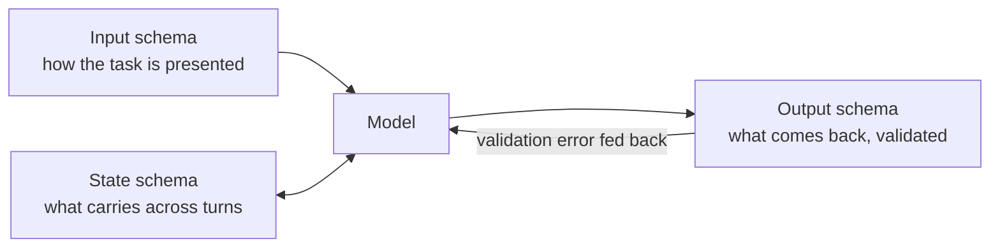

# 7 — Structured Context and Schemas

> Structure is a way of compressing *meaning* rather than tokens. When the shape of the content is consistent, the model spends less of its attention working out what each part is.

---

## Why structure helps

A model reading unstructured context has to infer the role of each span: whether it's an instruction or data, a fact or an example, current or stale. Structure answers those questions in the layout itself.

- **Separation of instructions from data.** Tagged sections (`<document>`, `<instructions>`) make it harder for retrieved text to be read as a command. This is a partial mitigation for injection, not a guarantee ([11](11-failure-modes.md)).
- **Addressability.** "Use the `<constraints>` block" is a reference the model can resolve. "Use the constraints mentioned above" is not.
- **Consistency across calls.** The same schema every turn means the model sees a familiar document, and your code can parse, diff and validate it.

There's also some mechanistic background. Yang et al. (ICML 2025) find a three-stage circuit in LLMs: abstraction to symbolic variables, induction over them, then retrieval of concrete values. Content laid out as consistent slots fits that circuit. This is a plausible explanation for why schemas help, not a proven design rule.

---

## Choosing a format

| Format | Best for | Watch out for |
|---|---|---|
| **XML-style tags** | Wrapping documents, separating sections, nesting | Verbose closing tags; keep tag names meaningful |
| **Markdown headings and lists** | Instructions, human-readable system prompts | Weak boundaries; a retrieved doc's `##` collides with yours |
| **JSON** | Machine state, tool I/O, anything code reads back | Token-heavy (quotes, braces); escaping inside strings |
| **YAML** | Config-like state, readable nested data | Whitespace sensitivity; ambiguous types |
| **Tables** | Comparable records, small datasets | Wide tables lose column alignment over tokens |

The rule of thumb: **tags for boundaries, markdown for prose, JSON for anything a program reads back.** Mixing is fine. A typical system prompt is markdown with XML-wrapped documents and a JSON state block.

---

## Three places schemas go



### 1. Input schemas — how a task is presented

The upstream "context schema" is a fixed skeleton for a task prompt:

```markdown
## Task
{one-sentence objective}

## Context
### Background
{what the model needs to know}
### Constraints
{hard limits: length, scope, prohibited actions}
### Examples
{1–3 worked examples}

## Data
<document id="1">…</document>

## Output Format
{schema or template for the answer}
```

The value is in the fixed order and the empty slots. A missing `Constraints` section is visible at a glance, and every task in a system looks the same to the model. The upstream course also ships the same idea as a YAML context file with a token budget and a history policy. Trimmed:

```yaml
metadata:
  token_budget: 800              # target ceiling for the whole context
system:
  role: assistant
  constraints: [provide accurate information, acknowledge uncertainty, avoid unnecessary verbosity]
memory:
  enabled: true
  max_turns: 3                   # raw window
  pruning_strategy: drop_oldest  # or: summarize, prioritize
```

Writing the budget and pruning policy into the context spec, rather than leaving them implicit in code, makes them reviewable ([03](03-budgeting-the-window.md#history)).

### 2. State schemas — what carries across turns

State that persists (task progress, decisions, user facts) should be **structured, small and overwritten**, not appended:

```json
{
  "goal": "migrate billing service to v2 API",
  "decisions": ["keep retries at 3", "drop legacy webhook"],
  "open_questions": ["who owns the cron job?"],
  "files_touched": ["billing/client.py"],
  "next_step": "update integration tests"
}
```

This is the compaction target ([05](05-compression-compaction.md)) and the memory format ([06](06-memory.md)). MEM1's finding generalises here: a constant-size, overwritten state beats an ever-growing transcript for long-horizon tasks.

### 3. Output schemas — what comes back

Use the provider's structured-output mode (a JSON schema enforced at decode time) when code consumes the answer. When it isn't available, put the schema in the prompt plus one filled example, and validate on receipt. See [controlling output](../../01-prompt-engineering/notes/04-controlling-output.md).

The fallback loop, condensed from the upstream course's `06_schema_design.py`. The validator's error message goes back into the context, so the retry knows what to fix:

````python
import json, re, jsonschema

def query_with_schema(task, schema, max_attempts=3):
    prompt = (f"{task}\n\nRespond with a single JSON object that conforms to this schema, "
              f"and nothing else:\n{json.dumps(schema, indent=2)}")
    for _ in range(max_attempts):
        raw = llm(prompt)
        fenced = re.search(r"```(?:json)?\s*(.*?)```", raw, re.DOTALL)
        try:
            obj = json.loads(fenced.group(1) if fenced else raw)
            jsonschema.validate(obj, schema)
            return obj
        except (json.JSONDecodeError, jsonschema.ValidationError) as e:
            prompt += f"\n\nYour previous response did not conform. Error: {e}. Try again."
    raise ValueError("no schema-valid response")
````

With decode-time enforcement, the parse step can't fail, but `jsonschema.validate` still earns its place for constraints the provider's schema subset doesn't support (patterns, cross-field rules).

---

## Structured knowledge: graphs and tables

When the evidence is relational (who reports to whom, which service calls which), passing it as prose forces the model to rebuild the graph. Passing it as structure skips that step:

```
(billing-svc) -[calls]-> (payments-api)
(payments-api) -[owned_by]-> (team-payments)
(billing-svc) -[deployed_in]-> (eu-west-1)
```

Triples or adjacency lists are compact and make multi-hop questions ("who owns what billing calls?") a lookup rather than an inference. Retrieving from a knowledge graph is covered in [04](04-retrieval.md) and in depth in [05-graph](../../05-graph-engineering/README.md).

---

## Schema design principles

From the upstream cookbook, condensed:

| Principle | Means | Test |
|---|---|---|
| **Clarity** | Field names say what they hold; no overloaded fields | Could a new engineer fill it in without asking? |
| **Consistency** | Same names, order and types everywhere the schema appears | Do two prompts in the system disagree on a field name? |
| **Flexibility** | Optional fields and an explicit `notes`/`other` escape hatch | Does an unusual case force you to break the schema? |
| **Efficiency** | No field the model or code never reads | Ablate the field. Does anything change? |

Two operational habits matter more than the principles:

- **Version schemas.** A schema change invalidates eval baselines just as a prompt change does. Put a `schema_version` in state blocks.
- **Validate at the boundary.** Parse model-written state before writing it back. A malformed state block that gets re-injected compounds every turn (context poisoning, [11](11-failure-modes.md)).

---

## Upstream schema library

The upstream `cognitive-schemas/` library defines schemas per domain (user model, task, agent coordination, domain knowledge). Each is a long YAML spec. The useful idea is the **user schema**: a structured profile of goals, expertise, preferences and history, kept outside the window and selectively injected. It is the same pattern as structured memory in [06](06-memory.md).

---

→ Next: [08-cognitive-tools.md](08-cognitive-tools.md) — structuring the reasoning, not just the content.
