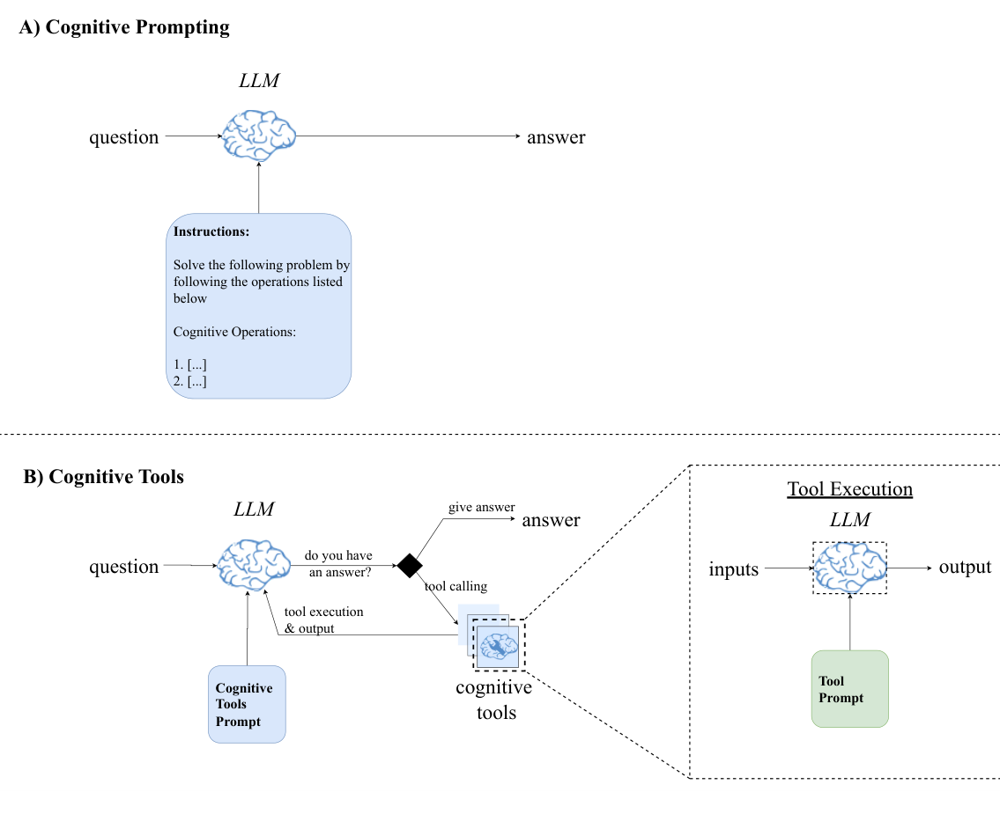

# 8 — Cognitive Tools and Prompt Programs

> A cognitive tool is a reasoning step packaged like a function: a named prompt with inputs and outputs that the model, or your code, can call. It brings the reusability of code to the way context is structured for reasoning.

---

## The evidence: Ebouky et al. (IBM Research Zurich, 2025)

*Eliciting Reasoning in Language Models with Cognitive Tools* tests the idea directly. Four tools, each a separate prompt the model can call like a tool:

| Tool | What it does |
|---|---|
| `understand_question` | Break the problem down: identify the core concepts, the givens, the goal and relevant techniques |
| `recall_related` | Retrieve analogous solved problems and their solution steps |
| `examine_answer` | Check the current reasoning trace for errors, unmet constraints and miscalculations |
| `backtracking` | When stuck, find where the reasoning went wrong and propose an alternative path |

The key design choice is that **each tool runs in its own context**. The tool call goes out with only what that step needs, and only the result comes back into the main trace. That is context isolation ([10](10-tools-and-multi-agent.md)) applied to reasoning.


*Image Source: Ebouky et al. (2025)*

Result: GPT-4.1 on AIME 2024 rises from **26.7% to 43.3%**, approaching o1-preview, with similar gains on open-weight models. No training is involved, only structured prompting.

Two caveats. These gains are on maths benchmarks with non-reasoning models. On reasoning models (o-series, extended thinking) the model already runs something like this loop internally, so explicit scaffolding adds less and can get in the way ([prompting reasoning models](../../01-prompt-engineering/notes/07-prompting-reasoning-models.md)).

---

## The four families of templates

The upstream library sorts cognitive templates by the job they do. The families are more useful than any individual template:

| Family | Templates | Use before / after |
|---|---|---|
| **Understanding** | Question analysis, information extraction, structure analysis | *Before* solving: make sure the task is understood |
| **Reasoning** | Step-by-step, compare-and-contrast, causal analysis, hypothesis testing, decision matrix, argument construction | *During*: impose a method on the work |
| **Verification** | Solution check, fact check, consistency check, error analysis, alternative perspective | *After*: catch errors before they ship |
| **Composition** | Sequential, conditional, iterative chains of the above | Orchestrating several tools |

### An understanding template

```markdown
Task: Analyse the following question before answering it.

Question: {{question}}

Provide:
1. Question type (factual, conceptual, analytical…)
2. Core task: what specific thinking is required?
3. Key components to address
4. Implicit assumptions
5. Constraints, stated or implied
6. Restatement in your own words

Then stop. Do not answer yet.
```

The final line matters. Separating understanding from answering is the point. A template that analyses and answers in one pass collapses back into ordinary chain-of-thought.

### A verification template

```markdown
Problem: {{problem}}
Proposed solution: {{solution}}

Verify:
1. Does the solution address what was asked?
2. Check each step. Mark any error with the step number.
3. Are all constraints satisfied?
4. Test against one edge case.

Verdict: CORRECT | ERRORS_FOUND
If ERRORS_FOUND, list each error and the fix.
```

The machine-readable verdict line is what lets code drive a loop.

---

## The self-correction loop

```
solve → verify ─┬─ CORRECT ───────────────► done
                └─ ERRORS_FOUND → correct → verify (max N iterations)
```

```python
def self_correct(problem, max_iter=3):
    solution = llm(f"Solve: {problem}")
    for _ in range(max_iter):
        check = llm(VERIFY.format(problem=problem, solution=solution))
        if "Verdict: CORRECT" in check:
            break
        solution = llm(f"Problem: {problem}\nSolution: {solution}\nErrors: {check}\nRevise.")
    return solution
```

Bound the loop. Verification by the same model shares its blind spots, so loops beyond 2–3 iterations rarely help, and the model can "fix" a correct answer into a wrong one. Where a ground-truth check exists (tests, a calculator, a schema validator), use it instead of a model verifier. See [loop engineering](../../04-loop-engineering/loop-engineering.md).

The swap is small. Here the verifier is Python's own compiler, from the upstream course's `03_control_loops.py`:

````python
import re

def python_validator(response):
    blocks = re.findall(r"```python(.*?)```", response, re.DOTALL)
    if not blocks:
        return False, "No Python code block found."
    for i, block in enumerate(blocks, 1):
        try:
            compile(block, "<llm>", "exec")       # syntax only; tests would check behaviour
        except SyntaxError as e:
            return False, f"Syntax error in block {i}: {e}"
    return True, "ok"

def generate_checked(task, validate=python_validator, max_attempts=3):
    prompt = task
    for _ in range(max_attempts):
        out = llm(prompt)
        ok, feedback = validate(out)
        if ok:
            return out
        prompt = f"{task}\n\nYour previous answer:\n{out}\n\nProblem: {feedback}\nFix it."
    raise ValueError(f"still failing after {max_attempts} attempts: {feedback}")
````

The opposite design is a weak one. The upstream `07_recursive_patterns.py` stops its self-reflection loop when the model's *own* quality score (parsed by regex, default 0.5) clears 0.8. A self-graded stop condition inherits the blind spots the loop was meant to catch, so treat it as a demo, not a pattern.

---

## Prompt programs

A prompt program applies programming structure to a prompt: **named operations with parameters, composed with control flow.**

```
function analyze_tradeoffs(options, criteria, weight_by="impact") {
  1. For each option, score it against each criterion (1–5) with one-line justification.
  2. Weight scores by {weight_by}.
  3. Rank options; flag any criterion where the top option scores ≤ 2.
  return: ranked table + recommendation + flagged risks
}

analyze_tradeoffs(
  options=["Postgres", "DynamoDB", "SQLite"],
  criteria=["ops burden", "query flexibility", "cost at 10k rps"]
)
```

Why this works when it does:

- **Explicit steps** turn an open-ended request into a procedure the model follows.
- **Parameters** make the same program reusable: swap the options, keep the method.
- **A declared return** fixes the output shape.

Programs compose: `understand → analyze_tradeoffs → verify`. They can branch ("if fewer than two options survive step 3, expand the search") and loop (refine until the verifier passes).

In code, a program is a list of operations plus shared state that later templates can read. This is the shape of the upstream `05_prompt_programs.py` `MultiStepProgram`:

```python
program = [
    {"name": "reason",  "system": "You are a careful analyst.",
     "template": "Solve step by step:\n{problem}"},
    {"name": "verify",  "system": "You are a critical reviewer.",
     "template": "Problem: {problem}\nSolution:\n{reason}\nList any errors, or say NONE."},
    {"name": "correct", "system": "You are a careful analyst.",
     "template": "Problem: {problem}\nDraft:\n{reason}\nReview:\n{verify}\nGive the final answer."},
]

def run(program, **inputs):
    state = dict(inputs)
    for op in program:
        state[op["name"]] = llm(op["template"].format(**state), system=op["system"])
    return state                       # every intermediate output, for audit
```

Because the steps are data, you can log, diff and eval each one, and reorder or drop steps without touching the runner.

### Cognitive tools vs. prompt programs

| | Cognitive tool | Prompt program |
|---|---|---|
| Unit | One reasoning operation | A procedure of several steps |
| Who calls it | The model, as a tool, when it decides it needs it | Your code, or the prompt itself |
| Context | Ideally isolated per call | Usually one window |
| Strength | Model chooses *when* to think harder | Repeatable, auditable method |

The IBM result favours the tool version. The best results came when **the model chose which tool to call and when**, not from a fixed sequence.

---

## When to reach for this

- **Yes:** multi-step reasoning on non-reasoning models; tasks where a check is cheap and errors are expensive; procedures you run repeatedly and want to audit.
- **No:** simple lookups (the scaffolding costs more than it buys); reasoning models on tasks they already handle; anywhere a deterministic check (code, tests, a parser) can replace a model judgment.

---

## Upstream library (what was condensed here)

The upstream `cognitive-tools/` held about 100k words: the template families above, a program library (basic and advanced programs), domain schemas ([07](07-structured-context.md)) and "architectures" that compose tools into solver, tutor and research agents ([13](13-putting-it-together.md)). The upstream repo keeps copyable versions of the core templates (chain of thought, few-shot, minimal context, verification loop) and a `prompt_program_template.py`: [davidkimai/Context-Engineering](https://github.com/davidkimai/Context-Engineering/tree/main/20_templates).

---

→ Next: [09-protocols.md](09-protocols.md) — the same ideas without code.
