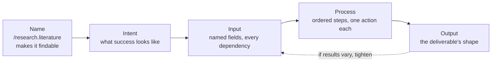

# 9 — Protocols: Context Engineering Without Code

> A protocol shell is a structured prompt written in pseudo-code: an intent, the inputs, an ordered process and a declared output. The model doesn't execute it. The structure is useful because it is explicit, reusable and easy to share.

"Protocol" here means a prompt pattern. Wire protocols that carry context between programs, such as the Model Context Protocol (MCP), are in [10](10-tools-and-multi-agent.md#mcp-a-protocol-for-moving-context).

---

## What a protocol shell is

The upstream NOCODE track brings the discipline of [prompt programs](08-cognitive-tools.md#prompt-programs) to people who don't write code. Every shell has the same four parts:

```
/protocol.name{
    intent="Clear statement of purpose",
    input={ param1="value1", param2="value2" },
    process=[
        /step1{action="do something"},
        /step2{action="do something else"}
    ],
    output={ result1="expected output 1", result2="expected output 2" }
}
```

| Part | Job | Common mistake |
|---|---|---|
| **Name** (`/research.literature`) | Category and variant; makes it findable and reusable | Generic names like `/do.task` |
| **Intent** | One sentence on what success looks like | A list of activities instead of a goal |
| **Input** | Everything the task depends on, as named fields | Hiding constraints inside the process steps |
| **Process** | Ordered steps, each with one action | Steps that each do three things |
| **Output** | The shape of the deliverable | "A good summary", with no structure |

This maps directly onto the input schema in [07](07-structured-context.md#1-input-schemas--how-a-task-is-presented). A protocol shell is the same idea with the process made explicit.

The parts form a pipeline, and each one is responsible for a mistake that the others can't fix.



---

## Pareto-lang: the operation vocabulary

Process steps use a small, consistent grammar, `/operation.modifier{parameters}`:

```
/compress.summary{target="history", method="key_points", max_tokens=200}
```

The upstream reference groups operations into families. Only the vocabulary needs learning, not the exact syntax:

| Family | Operations | Context lever |
|---|---|---|
| **Information management** | `/extract`, `/filter`, `/prioritize`, `/group` | Select |
| **Transformation** | `/compress`, `/expand`, `/restructure`, `/format` | Compress |
| **Analysis** | `/analyze`, `/evaluate`, `/compare`, `/synthesize` | (reasoning) |

Operations nest and sequence:

```
process=[
    /filter.relevance{threshold=0.7, against="key_questions"},
    /extract.key_points{focus=["claims", "evidence"], max_points=7},
    /synthesize.themes{min_sources_per_theme=2}
]
```

The model has no parser for this. It reads `/filter.relevance{threshold=0.7}` as a compact, unambiguous instruction ("keep only what's clearly relevant"), and the brevity is the point: it is denser than the equivalent prose.

---

## A complete example

Trimmed from the upstream research protocols:

```
/research.literature{
    intent="Develop a structured understanding of existing work on a topic",
    input={
        research_topic="Context compaction for long-running agents (2024–2026)",
        key_questions=[
            "What compaction strategies are used in production agents?",
            "What is lost under each, and how is it measured?"
        ],
        scope_boundaries={
            include: "papers, engineering blogs from model providers",
            exclude: "tutorials, pre-2024 work"
        }
    },
    process=[
        /map{action="Build a conceptual map: foundations, research streams, terminology"},
        /explore{action="For each stream: key works, methods, results, limitations"},
        /synthesize{action="Patterns, competing approaches, consensus, open questions"},
        /evaluate{action="Rate evidence quality: rigour, empirical support"}
    ],
    output={
        map="Themed outline of the field",
        findings="Per-question answer with citations",
        gaps="Open questions worth investigating",
        confidence="High/medium/low per finding, with reason"
    }
}
```

Compare it with the prose version of the same request. The shell makes the scope, the steps and the deliverable impossible to leave out.

Because a shell is data before it's a prompt, the mistakes in the table above can be checked by a script before anyone spends a token. This small lint runs on a deliberately bad shell, written as a Python dictionary so that no parser is required. It reflects the table's rules and is not part of any upstream tool. The note's assessment below is the reason it's this simple: there is no shell interpreter to rely on, so the checks are yours.

```python
# A protocol shell is data before it is a prompt, so its design rules can be checked.
shell = {
    "name": "/do.task",
    "intent": "Read the papers, compare the methods and write a summary",
    "input": {"research_topic": "context compaction"},
    "process": [
        {"map": "Build a conceptual map of the field"},
        {"explore": "Read each stream and rate its evidence"},
        {"synthesize": "State consensus and open questions for the {audience}"},
    ],
    "output": {"summary": "A good summary"},
}

def lint(s):
    problems = []
    if s["name"].split(".")[-1] in {"task", "thing", "stuff"}:
        problems.append(f"generic name {s['name']}")
    if "," in s["intent"] or " and " in s["intent"]:
        problems.append("intent lists activities, not a goal")
    for step in s["process"]:
        for op, action in step.items():
            if " and " in action:
                problems.append(f"/{op} does two things: {action!r}")
            for word in action.split():
                if word.startswith("{") and word.strip("{}") not in s["input"]:
                    problems.append(f"/{op} uses undeclared input {word}")
    for field, shape in s["output"].items():
        if shape.lower().startswith("a good"):
            problems.append(f"output {field!r} names no structure")
    return problems

for p in lint(shell):
    print("-", p)
```

Output:

```text
- generic name /do.task
- intent lists activities, not a goal
- /explore does two things: 'Read each stream and rate its evidence'
- /synthesize does two things: 'State consensus and open questions for the {audience}'
- /synthesize uses undeclared input {audience}
- output 'summary' names no structure
```

---

## The protocol catalogue

The upstream `20_practical_protocols/` holds about 50 ready-made shells in nine families. These are the ones worth knowing exist:

| Family | Protocols | Use for |
|---|---|---|
| **Conversation** | `/extract.information`, `/decision.analyze`, `/debate.structured`, `/feedback.progressive`, `/align.mutual` | Structuring a dialogue |
| **Document** | `/document.executive_brief`, `/document.article`, `/document.instructional`, `/document.persuasive` | Producing written artefacts |
| **Research** | `/research.literature`, `/research.analyze`, `/research.compare`, `/research.problem`, `/research.foresight` | Investigations |
| **Knowledge** | `/knowledge.extract`, `/knowledge.base`, `/knowledge.decision`, `/knowledge.learning` | Building and querying a knowledge store |
| **Creative** | `/creative.concept`, `/creative.adapt`, `/creative.remix`, `/creative.collaborate` | Ideation |
| **Meta-recursive** | `/meta.correct`, `/meta.improve`, `/meta.goal` | Self-critique and refinement ([08](08-cognitive-tools.md#the-self-correction-loop)) |
| **Interpretability** | `/interpret.confidence`, `/interpret.attribution`, `/interpret.process` | Asking the model to expose its reasoning and certainty |
| **Collaborative** | `/collaborate.human_loop`, `/collaborate.complement` | Human-in-the-loop work division |
| **Cross-modal** | `/cross.synthesize`, `/cross.augment` | Combining text, image and data inputs |

---

## Design principles

The upstream list of seven, condensed to the tests that matter:

- **One action per step.** If a step needs "and", split it.
- **Inputs, not assumptions.** Anything the task depends on is a named input field.
- **Declared output.** Name every field of the deliverable.
- **Modular.** A step that's useful elsewhere should be its own protocol you can call.
- **Proportionate.** A three-line request doesn't need a shell. The structure has to pay for its tokens ([03](03-budgeting-the-window.md)).

---

## Honest assessment

**What's real:** explicit intent, inputs, steps and output measurably improve consistency. That is ordinary prompt engineering ([02-prompt-anatomy](../../01-prompt-engineering/notes/02-prompt-anatomy.md)), and the shell is a disciplined way to make sure you do it. It works well for repeatable workflows, prompt libraries and handing a procedure to a non-engineer.

**What's oversold:** the syntax has no special power. A well-structured markdown prompt with the same four sections performs about the same. The upstream claims about "field operations" (`/attractor.*`, `/resonance.*`) belong to the speculative track ([99](99-speculative-field-track.md)).

**Use it when** you want a reusable, shareable procedure and the people using it don't write code. If they do write code, the same structure belongs in a prompt template with variables ([08 — prompt programs](08-cognitive-tools.md#prompt-programs)).

---

## Pitfalls

- **Believing the syntax has power.** Symptom: the team expects `/attractor.scan{}` to do something, then blames the model when it doesn't. No parser exists, and the model reads the shell as text. Fix: treat it as a template, and expect about the same result from markdown with the same four sections.
- **Hiding constraints in steps.** Symptom: a result changes between runs because the audience was mentioned only in one step. Fix: every dependency becomes a named input, the "inputs, not assumptions" principle.
- **Steps that do several things.** Symptom: the model does the first half of a step and skips the rest. Fix: if a step needs "and", split it, as the lint flags on `/explore` and `/synthesize`.
- **An output with no structure.** Symptom: "A good summary" yields a different shape each time. Fix: name every field of the deliverable.
- **Wrapping a three-line request in a shell.** Symptom: the structure costs more tokens than the task and adds nothing. Fix: apply the proportionate test: the shell has to pay for its tokens.
- **Using the whole catalogue.** Symptom: a user hunts through about 50 shells in nine families for a job that needs a simple one. Fix: copy the four-part form, and adopt individual shells only for repeating workflows.
- **Keeping a shell once code is available.** Symptom: developers hand-edit shell text and copy values between versions. Fix: move it to a prompt template with variables ([08](08-cognitive-tools.md#prompt-programs)).

## Try it

1. Fix the bad shell in the worked example so that the lint prints nothing.

   <details><summary>Answer</summary>

   Rename it `/research.compaction`; make the intent one goal ("Give a practitioner a defensible view of context compaction"); split `/explore` into `/read` and `/rate`, and `/synthesize` into `/consensus` and `/gaps`; add `"audience": "practitioners"` to `input`; change the output to `{"summary": "Three sections: consensus, open questions, reading list"}`.

   </details>

2. Add one more rule to `lint` for the table's "hiding constraints inside the process steps" mistake. What simple signal could you use?

   <details><summary>Answer</summary>

   Flag step text containing words like "only", "must", "under" or a number, since these usually state a constraint that belongs in `input`. It will produce false positives, which is fine for a review aid.

   </details>

3. Rewrite the `/research.literature` example as plain markdown with Intent, Input, Process and Output headings, then run both on the same paper set if you have model access. What difference should you expect?

   <details><summary>Answer</summary>

   About none, according to this chapter's assessment: a well-structured markdown prompt with the same four sections performs about the same. If you do see a large gap, check whether the two versions really hold the same content before crediting the syntax.

   </details>

## Interview checklist

| Prompt | Answer in one line |
|---|---|
| What's a protocol shell? | A structured prompt in pseudo-code with a name, intent, inputs, ordered process and declared output. The model doesn't execute it, and no parser exists. |
| Is Pareto-lang a real language? | It's a shared vocabulary of operations such as filtering and compression, read by the model as text, so its value is consistency and not special syntax. |
| Shell or markdown? | Results should be about the same with the same four sections. Pick the shell for a reusable, shareable procedure among non-coders, and a prompt template with variables if the users code. |
| How does "protocol" here differ from MCP? | A shell is a prompt pattern read by a model, while MCP is a wire protocol carrying context between programs ([10](10-tools-and-multi-agent.md#mcp-a-protocol-for-moving-context)). |
| Name a test for a good step. | If it needs "and", split it, because one action per step keeps the model from doing only half of it. |
| A colleague wants to adopt the full catalogue of about 50 shells. What's your advice? | Adopt the four-part form and only the shells that match repeating workflows, and treat the `/attractor.*` and `/resonance.*` shells as the speculative material covered in [99](99-speculative-field-track.md). |

## Next

[10-tools-and-multi-agent.md](10-tools-and-multi-agent.md): shells structure one window, and the next step is isolating context across several agents.
