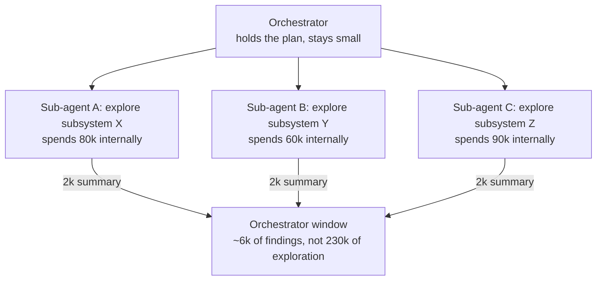

# 10 — Multi-Agent Context and Tool Design

> Isolation is the highest-cost context lever. Use it when compression is not enough.

Your agent's window is full at 100k tokens, so you split the work among sub-agents and the orchestrator now holds 2k. The window looks cured, but the same job may now spend 240k tokens to produce 6k of visible output, and every sub-agent's summary has become untrusted data that the next agent reads as fact. This chapter covers when isolation earns that price, how to define the tool and agent boundaries, and how to stop a schema change or a noisy tool from breaking the whole chain.

---

## Sub-agent architectures

The pattern: specialized agents handle focused tasks with **clean context windows**, returning condensed summaries to a lead coordinator.

The economics are the point. A sub-agent may burn 100k tokens exploring a codebase and return a 2k-token summary. The orchestrator pays 2k for work that would have cost it 100k of its own window — and, more importantly, would have left 98k of exploration debris polluting the window it needs for synthesis.



The sub-agent's window is **discarded**, not merged. That discarding is the feature.

ParSer pushes this to the whole document. The lead agent never sees the text. It broadcasts each query to frozen 4B subagents, one per 4,096-token chunk, and each subagent returns either a verbatim quote with an answer or the single word "Unknown". The "Unknown" replies are dropped before anything reaches the lead ([arXiv:2609.06702](https://arxiv.org/abs/2609.06702) (Li et al., CUHK, 2026-09, preprint)). On padded HotpotQA, with the same 128 questions at every length, **a 4B lead trained with RL held 84.6% on average from 7K to 896K tokens. Full-context prompting with the same model (non-thinking mode) fell from 75.8% to 34.4%**, and the best sequential-memory agent averaged 78.9%. Feeding one subagent the whole document instead of a chunk cut the average to 73.8%. The costs of isolation showed up too. The lead cannot see where a finding came from, so it sometimes adopted a wrong answer from a chunk about a different person with a similar name. The authors give no rate for this. The benchmark is synthetic multi-hop QA, the training budgets of the methods were not matched, and the Agentic RAG baseline they describe has no reported numbers.

### Orchestrator-holds-plan

The settled default: the **orchestrator owns the plan and the synthesis**; sub-agents own bounded investigations.

Sub-agents should not decide overall strategy, because each sees only its slice. An agent that explored one subsystem will over-weight that subsystem — it has no basis for comparison. Cross-cutting judgment requires the window that saw all the summaries.

### What a sub-agent receives

The prompt is the entire interface. A sub-agent gets:

- Its specific task, scoped and bounded
- The minimum context needed to do it
- The expected return shape

And does *not* get:

- The full conversation history
- The overall plan
- The other sub-agents' findings

That last exclusion is what makes isolation work, and it is also the failure mode — see below.

### Costs

Isolation is the **most expensive** of the four levers (Write → Select → Compress → Isolate), and it is last in that ordering for a reason:

- **Lost shared context.** Sub-agents can't coordinate, can duplicate work, or reach contradictory conclusions from disjoint evidence.
- **Summary is lossy.** Whatever the sub-agent doesn't include is gone. If its judgment about relevance was wrong, the orchestrator never learns what it missed.
- **Prompt is the whole interface.** An under-specified sub-agent prompt yields an off-target investigation, discovered only after it burned its budget.
- **Token multiplier.** Three sub-agents spending 80k each is 240k of real tokens for 6k of visible output. Cheap for the *orchestrator's window*, expensive in absolute spend.

Try Compress before reaching for Isolate. Sub-agents are the right answer for genuinely parallel, genuinely separable investigation — not for work that a compaction would have handled.

---

## Tool design is context engineering

Tools consume context twice: their **definitions** sit in the window permanently, and their **results** enter it per call. Both are context-engineering surfaces.

### Token-efficient results

A tool returning 50k tokens of raw output defeats just-in-time retrieval — you've reintroduced the bulk-loading problem through the tool layer. Tools should return what the agent needs to *decide*, not everything they could produce.

- Paginate or truncate large outputs with an explicit continuation affordance
- Return structured summaries with drill-down identifiers rather than full payloads
- Filter at the tool boundary, where filtering is cheap and deterministic — not in the model, where it costs attention

### Tool overlap

**Tool overlap** — multiple tools covering similar functionality — creates ambiguous decision points. The agent must spend attention choosing, and may choose inconsistently across runs.

Test: *given this task, is there exactly one obviously correct tool?* If two plausibly apply, either merge them or sharpen their descriptions until the boundary is unambiguous.

### Self-contained and robust to error

Each tool should be usable without knowledge of the others, handle its own errors, and return **structured errors** the agent can act on. `{"error_code": "not_found", "is_fatal": false}` is actionable; a stack trace is 500 tokens of noise the agent cannot use.

### Descriptive parameters

Parameter names and descriptions should be unambiguous and play to model strengths. `query: str` tells the model nothing; `search_query: natural-language description of the code you're looking for` tells it what to generate.

Tool descriptions follow the same **routing-logic** discipline as skill descriptions:

- When should I use this?
- When should I *not* use this?
- What are the outputs and success criteria?

Terse descriptions beat verbose ones. These tokens are resident in every window:

```
# bad (~45 tokens)
description: |
  This skill handles the complete deployment process to production.
  It covers environment checks, rollback procedures, and post-deploy
  verification. Use this before deploying any code to production.

# good (~9 tokens)
description: Use when deploying to production or rolling back.
```

Negative examples reduce misfires: "Don't call this when…" plus what to do instead.

---

## Context isolation as a security boundary

Isolation is also a containment mechanism. A sub-agent processing untrusted content — scraped web pages, user uploads, third-party API responses — has a window that gets discarded. An injection landing in that window cannot reach the orchestrator except through the **summary**, which is a narrow, inspectable channel.

This only holds if the summary is treated as data, not instructions. A sub-agent summary interpolated directly into an orchestrator prompt is an injection path — see [11-failure-modes.md](11-failure-modes.md).

Skills plus open network access is a high-risk combination. Skills make procedures more capable; network access makes exfiltration possible. Together they are a data-exfiltration path that is easy to introduce and hard to retrofit against. A defensible default posture:

- Skills: **allowed**
- Shell: **allowed**
- Network: **enabled only with a minimal allowlist**, per request, for narrowly scoped tasks

Assume tool output is untrusted regardless of source.

---

## Tool integration patterns

The upstream tool-reasoning module gives four levels of tool use. Each is a different shape of context flow:

| Level | Pattern | Context implication |
|---|---|---|
| **Sequential** | A → B → C, each output feeds the next | Intermediate results pile up; clear them after use ([05](05-compression-compaction.md)) |
| **Parallel** | Independent calls at once, results merged | Fast; merged results can be large, so summarise at the merge |
| **Conditional** | The model picks the tool from the situation | Tool descriptions must be distinct enough to choose between |
| **Recursive** | A tool call spawns its own tool loop (a sub-agent) | This is isolation; see above |

Most production agents are conditional loops with occasional parallel batches. Pipeline and DAG architectures are worth it only when the order is known in advance. Then they belong in code, not in the model's decisions ([03-harness](../../03-harness-engineering/README.md)).

---

## MCP: a protocol for moving context

The Model Context Protocol standardises how context from outside the agent reaches the window. Harness 03 is the authoritative note. It covers [when to choose MCP over an in-process tool](../../03-harness-engineering/notes/03-tool-design.md#mcp-vs-in-process), [the protocol itself](../../03-harness-engineering/notes/03-tool-design.md#the-protocol), its supply-chain risks, and the cost of loading every server's definitions eagerly ([tool discovery at scale](../../03-harness-engineering/notes/03-tool-design.md#tool-discovery-at-scale)). This section reads the protocol as context plumbing: who decides what enters the window, and what each hop costs.

**Why a protocol.** The idea is borrowed from the Language Server Protocol. Without a shared interface, M models and N tools need M×N connectors; with one, M+N. Three models and four tools is 12 integrations without MCP and 7 with it (*AI Agents with MCP*, ch. 1).

**Who controls each primitive** is the context-engineering question. The spec assigns each primitive to a different party:

| Primitive | Controlled by | How it enters the window |
|---|---|---|
| **Tools** | The model | The model pulls context by calling them |
| **Resources** | The application | The host decides what to attach. Read-only, addressed by URI, with `{var}` templates |
| **Prompts** | The user | The user picks a template. It can be multi-turn and can embed resource links |

The book's ch. 2 calls prompts application-controlled. Its own ch. 5 and the spec say user-controlled.

**MCP is the context-facing kind of protocol.** A taxonomy of nine open agent protocols, built from the authors' reading of the specs with no experiments, separates protocols whose counterparty is context from those whose counterparty is another agent, with one protocol (LMOS) classed as hybrid ([arXiv:2606.19135](https://arxiv.org/abs/2606.19135) (Sander et al., TUM, 2026-06, preprint)). MCP is the context kind. It is stateless, and its discovery is static: a client can list a server's tools at run time, but it must know the server's address first. The seven protocols that support agent-to-agent communication, A2A among them, all keep session state. That makes the context-engineering split concrete. With MCP, whatever must persist between calls is the host's job, so it lands in the window or in [memory](06-memory.md). The paper classifies mid-2025 specs.

Everything else about the protocol is in [harness 03](../../03-harness-engineering/notes/03-tool-design.md#the-protocol): the architecture, server-initiated requests, transports and a minimal server.

### Designing MCP servers for the window

- **Don't auto-generate a server from a REST API.** REST endpoints are granular, so one user action becomes several tool choices, and the errors compound. At 95% accuracy per choice, five choices succeed about 77% of the time (0.95⁵). Each call also re-sends the previous turns. A back-of-envelope estimate on the book's ch. 3 example server puts that at about 8× the tokens and nearly 7× the cost. If you start from a generated server, "aggressively curate" it (Jeremiah Lowin, Prefect). Better, build from **agent stories**: user stories written for the agent, each mapped to one end-to-end tool (*AI Agents with MCP*, ch. 5).
- **Keep the tool count per context small, and expose a subset when there are more.** One voice-AI vendor's production logs give the only per-model numbers we hold, though they come from one company with a conflict of interest and one tool surface. With 200 operator-checked turns per bucket, **Claude Haiku 4.5 chose the right tool 91% of the time with 10 tools and 87% with 15. Claude Sonnet 4 held 90% or better up to 20 tools and fell below it at 30** ([arXiv:2606.30317](https://arxiv.org/abs/2606.30317) (Rodrigues and Vas, 2026-06, preprint)). The CIs are ±4 points, so the 10-to-15 line is not firm, and the descriptions were never varied. The authors recommend 10–15 tools per context. Past that, they suggest a proxy that retrieves the relevant tools for each request, because statically merging several servers' tools makes the problem worse. That recommendation was not tested. The retrieval step has been measured on its own. Indexing tools and their parent servers together, then mapping each retrieved tool to its server, reached a Recall@5 of 0.83 on the server labels of LiveMCPBench, against 0.70 for server-first routing (MCP-Zero), with one embedding model (OpenAI ada-002); across eight embedding models the authors report 0.80–0.87 against 0.65–0.74. That is 95 questions over 70 servers, and only retrieval recall was measured, not task success or tokens saved ([arXiv:2511.01854](https://arxiv.org/abs/2511.01854) (Lumer et al., PwC, 2025-11, preprint)).
- **Generating a tool at run time is a different bet.** Alita ([arXiv:2505.20286](https://arxiv.org/abs/2505.20286) (Qiu et al., 2025-05, preprint)) ships almost no predefined tools: when the manager finds a capability gap, a web agent finds code on GitHub, a script is generated, run in its own Conda environment and, if it works, stored for reuse as an "MCP". It scores 75.15% pass@1 on the GAIA validation set (Claude-Sonnet-4 manager, GPT-4o); the baselines are single runs and its 87.27% pass@3 is best of three. Handing its stored tools to another agent lifted ODR-smolagents (GPT-4o) from 27.88% to 33.94%, but the tools were collected on the same GAIA questions, and the paper does not say they were held out. With GPT-4o-mini generating its own tools it scores 43.64%, so the method needs a strong coder. These are packaged scripts, not protocol-level servers, with no sandbox beyond Conda, and the tool store grows with no stated pruning, which adds to the [tool-overlap](#tool-overlap) problem.

- **Measure tool choice before and after you change descriptions.** The book suggests Promptfoo or PromptBench. This is the [tool-overlap](#tool-overlap) test, run as an eval.
- **Resources carry hints for the host.** Annotations are `audience` (user, assistant), `priority` (0.0–1.0) and `lastModified`. They need FastMCP 2.11+ or the low-level API. Resource reads should be lazy and free of side effects. Three patterns from the book:
  - Documentation servers (Context7, AWS).
  - A discovery resource that lists entities, paired with a query tool, for large or changing sets.
  - A cache keyed by resource reference (Tim Kellogg's tupac).
- **Application control has a cost.** The book's ch. 3 client spends an extra LLM call every turn just to choose which resources and prompts to attach. That is [retrieval](04-retrieval.md) by another name, and it needs its own budget.

---

## Orchestration and coordination

The upstream multi-agent module has an orchestration progression and a coordination one. Only a few rungs are common in practice:

| Pattern | How it works | Good for | Watch out for |
|---|---|---|---|
| **Orchestrator–workers** | Lead plans, workers execute bounded tasks, lead synthesises | Research, broad search | The default; see above |
| **Pipeline** | Fixed stages, each a specialist | Repeatable workflows (draft → review → edit) | Errors propagate forward |
| **Debate / critique** | Two or more agents argue, a judge decides | Reducing single-model blind spots on judgment calls | Cost; agents converge on confident wrong answers |
| **Shared blackboard** | Agents read and write a common state store | Long-running collaborative tasks | Write conflicts; needs schema and ownership ([07](07-structured-context.md)) |

The upstream "emergent behaviour" and "field orchestration" material claims that collective intelligence arises from simple agent rules. In LLM systems, emergence mostly shows up as *unplanned* behaviour: agents duplicating work, echoing each other or drifting off-task. Treat it as a failure mode to monitor, not a feature to design for ([11](11-failure-modes.md), [99](99-speculative-field-track.md)).

DocAgent shows ordering as a context-control device. To document a repository it sorts components so callees come first, which means each writer needs only its one-hop dependencies' finished docs ([arXiv:2504.08725](https://arxiv.org/abs/2504.08725) (Yang et al., Meta, 2025-04, preprint)). Reader, Searcher, Writer and Verifier agents run under an orchestrator that truncates the largest context sections once a token threshold is passed. In a random-order ablation (366 components from 9 Python repos, GPT-4o judge), helpfulness fell from 3.88 to 3.44 with GPT-4o mini and from 2.35 to 2.18 with CodeLlama-34B. The share of named repo entities that exist fell from 94.64% to 86.75% and 87.76% to 83.06% (50 components). The paper's tables contradict its prose and its own count columns in places, there is no per-agent ablation, and the baselines are single-shot with no retrieval, so the gain cannot be credited to the multi-agent roles.

### Inter-agent messages are context

Every hand-off is a prompt someone else will read. Give messages a schema (task, constraints, evidence, return shape), keep them self-contained, and log them. Cognition's warning applies: agents that share no context make decisions that conflict. Pass the decisions, not just the task.

**A hand-off is a data contract.** Rothman's build shows two ways it breaks (*Context Engineering for Multi-Agent Systems*, ch. 2, 6):

- **A changed shape.** Inserting a Summarizer between Researcher and Writer broke the pipeline. The Writer expected a `facts` key and received `summary`. Validate the shape at every boundary, not only at the end.
- **An unbounded review loop.** A writer–validator loop needs a cap. His validator returns pass/fail plus feedback, the feedback is appended to the writer's next attempt, and revisions stop at 2.

The book's ch. 2 calls its envelope `{protocol_version, sender, content, metadata}` "MCP". It is a homemade dict checked by key, not the Model Context Protocol ([above](#mcp-a-protocol-for-moving-context)).

**Make plan dependencies explicit.** In the same book's engine, the planner emits a JSON plan whose steps refer to earlier outputs by placeholder (`$$STEP_1_OUTPUT$$`). The executor resolves the placeholders, and the trace logs both the **planned** input and the **resolved** one. A bad step can then be traced either to the plan or to the data it received. The engine also keeps its instructions (style and structure "blueprints") in a separate vector namespace and retrieves them by intent. That is [procedural memory](06-memory.md#episodic-semantic-procedural) retrieved like documents (*Context Engineering for Multi-Agent Systems*, appendix A).

**Hand-offs without text.** LatentMAS passes the hand-off as the previous agent's layer-wise KV cache instead of a message: each agent runs a tuned number of auto-regressive steps (swept 0 to 80; accuracy peaks around 40 to 80) on its last-layer hidden states, a one-off linear map keeps those states in the input-embedding range, and only the last agent decodes text ([arXiv:2511.20639](https://arxiv.org/abs/2511.20639) (Zou et al., ICML 2026)). Across 9 benchmarks, five open backbones (Qwen3 4B to 14B, Llama3 3B and 8B) and sequential and hierarchical set-ups (mean of 3 runs), it used 59.4 to 87.9% fewer output tokens than a text multi-agent baseline and ran 2.6 to 7 times faster than that baseline on vLLM. **Most of the gain is cost, not accuracy**: it averaged 2.8 and 4.6 points above text agents but tied or lost on some cells (Qwen3-4B GSM8K 88.2 vs 89.8; Qwen3-8B HumanEval+ 80.5 vs 80.5). Passing the cache without latent reasoning, or latent reasoning with the last 128 text tokens passed on, each scored lower than the full method (GSM8K 90.1 and 85.5 vs 93.8, Qwen3-8B). The price is that it needs white-box access and identical model shapes across agents, so it cannot join API-only models, and the messages are unreadable. A debug mode that decodes a text probe per agent was right about the answer's correctness in 96.2% of 80 correct and 90.0% of 20 wrong cases (100 GSM8K cases, Qwen3-14B). Nothing was tested beyond 3 to 4 agents, 14B models or tool use.

---

## Pitfalls

- **Reaching for agents before compression.** Symptom: token spend multiplies with no quality gain: three sub-agents at 80k each is 240k real tokens for 6k of output. Fix: try compaction and retrieval first, and split only when tasks are truly independent.
- **Thin agent descriptions.** Symptom: the orchestrator routes tasks to the wrong sub-agent, or to none. A ~9-token description gives it little to choose on, and a ~45-token one states when to use the agent. Fix: spend the extra tokens on the description.
- **Treating a sub-agent's summary as fact.** Symptom: a wrong claim is repeated with growing confidence, or an injected instruction crosses agents. Fix: treat the summary as data, and verify what matters.
- **Renaming a field between agents.** Symptom: downstream agents silently use empty input, as in Rothman's `facts` to `summary` breakage. Fix: define the contract in code and pass values with placeholders such as `$$STEP_1_OUTPUT$$`, not model memory.
- **Auto-generating an MCP server from a REST API.** Symptom: one user action needs several tool choices, and 0.95⁵ ≈ 77% of runs succeed, at about 8× the tokens in the book's estimate. Fix: design tools around user actions.
- **Treating MCP roots as a security boundary.** Symptom: a server reads outside the declared roots because nothing forced it not to. Fix: enforce access outside the protocol, with OS or sandbox controls.
- **An unbounded review loop.** Symptom: a reviewer and a writer revise forever. Fix: cap revisions at 2, as in Rothman's design, then escalate.

## Try it

1. A workflow needs 8 tool choices at 95% accuracy each. What's the chance that all are right? How much accuracy per choice would you need for 90% overall?

   <details><summary>Answer</summary>

   0.95⁸ ≈ 66.3%. For 90% overall you need 0.90^(1/8) ≈ 98.7% per choice, which is why fewer, higher-level tools usually beat better routing.

   </details>

2. You have 5 AI applications and 6 tool sources. How many integrations do you need with and without MCP?

   <details><summary>Answer</summary>

   Without: M×N = 30. With: M+N = 11. Same reasoning as this chapter's 12 against 7 example.

   </details>

3. Five research sub-agents use 60k tokens each and return 1.5k each, where a single-agent version takes 90k. Compare the orchestrator's window and the absolute spend.

   <details><summary>Answer</summary>

   The orchestrator holds 7.5k of results against up to 90k, so its window is 12× smaller. Absolute spend is at least 300k against 90k, so 3.3× higher before you count the orchestrator's own tokens. You'd pay that only if parallelism or isolation lifts quality or latency.

   </details>

## Interview checklist

| Prompt | Answer in one line |
|---|---|
| When do you use sub-agents? | When the tasks are independent and the window is the constraint, after compression has been tried, since isolation has the highest cost: 240k real tokens for 6k visible in this chapter's example. |
| What does the orchestrator hold? | The plan and summaries, about 2k rather than 100k, and that is the benefit of isolation. |
| How long should an agent's description be? | Long enough to route on. A ~45-token description that says when to use it beats a ~9-token label, and the cost is small compared with a wrong delegation. |
| Why does MCP help at scale? | It turns an M×N integration problem into M+N: 12 integrations become 7 in this chapter's example. |
| Your team wants to auto-generate an MCP server from your REST API. What do you say? | No: granular endpoints mean several tool choices per action, and at 95% each five choices succeed only about 77% of the time, at around 8× the tokens in the book's estimate. |
| An agent's output is passed to the next agent and a schema field is renamed. What should happen? | The pipeline should fail at the boundary rather than continue on empty input, as in Rothman's `facts` versus `summary` case. Pass outputs by reference and validate them in code. |

## Next

[11-failure-modes.md](11-failure-modes.md): every lever so far can fail, and the next step is recognizing how context goes wrong.
