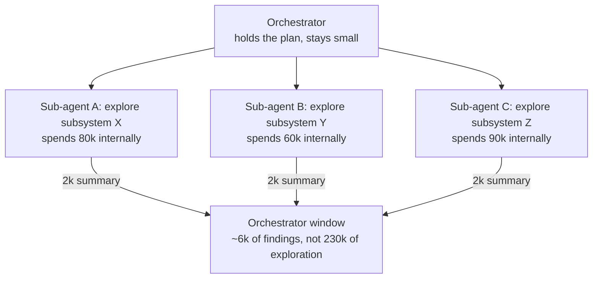
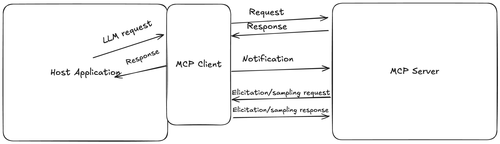

# 10 — Multi-Agent Context and Tool Design

> Isolation is the highest-cost context lever. Use it when compression is not enough.

---

## Sub-agent architectures

The pattern: specialized agents handle focused tasks with **clean context windows**, returning condensed summaries to a lead coordinator.

The economics are the point. A sub-agent may burn 100k tokens exploring a codebase and return a 2k-token summary. The orchestrator pays 2k for work that would have cost it 100k of its own window — and, more importantly, would have left 98k of exploration debris polluting the window it needs for synthesis.



The sub-agent's window is **discarded**, not merged. That discarding is the feature.

### Orchestrator-holds-plan

The settled default: the **orchestrator owns the plan and the synthesis**; sub-agents own bounded investigations.

Sub-agents should not decide overall strategy, because each sees only its slice. An agent that explored one subsystem will over-weight that subsystem — it has no basis for comparison. Cross-cutting judgment requires the window that saw all the summaries.

### What a sub-agent receives

The prompt is the entire interface. A sub-agent gets:

- Its specific task, scoped and bounded
- The minimum context needed to do it
- The expected return shape

And does *not* get:

- The full conversation history
- The overall plan
- The other sub-agents' findings

That last exclusion is what makes isolation work, and it is also the failure mode — see below.

### Costs

Isolation is the **most expensive** of the four levers (Write → Select → Compress → Isolate), and it is last in that ordering for a reason:

- **Lost shared context.** Sub-agents can't coordinate, can duplicate work, or reach contradictory conclusions from disjoint evidence.
- **Summary is lossy.** Whatever the sub-agent doesn't include is gone. If its judgment about relevance was wrong, the orchestrator never learns what it missed.
- **Prompt is the whole interface.** An under-specified sub-agent prompt yields an off-target investigation, discovered only after it burned its budget.
- **Token multiplier.** Three sub-agents spending 80k each is 240k of real tokens for 6k of visible output. Cheap for the *orchestrator's window*, expensive in absolute spend.

Try Compress before reaching for Isolate. Sub-agents are the right answer for genuinely parallel, genuinely separable investigation — not for work that a compaction would have handled.

---

## Tool design is context engineering

Tools consume context twice: their **definitions** sit in the window permanently, and their **results** enter it per call. Both are context-engineering surfaces.

### Token-efficient results

A tool returning 50k tokens of raw output defeats just-in-time retrieval — you've reintroduced the bulk-loading problem through the tool layer. Tools should return what the agent needs to *decide*, not everything they could produce.

- Paginate or truncate large outputs with an explicit continuation affordance
- Return structured summaries with drill-down identifiers rather than full payloads
- Filter at the tool boundary, where filtering is cheap and deterministic — not in the model, where it costs attention

### Tool overlap

**Tool overlap** — multiple tools covering similar functionality — creates ambiguous decision points. The agent must spend attention choosing, and may choose inconsistently across runs.

Test: *given this task, is there exactly one obviously correct tool?* If two plausibly apply, either merge them or sharpen their descriptions until the boundary is unambiguous.

### Self-contained and robust to error

Each tool should be usable without knowledge of the others, handle its own errors, and return **structured errors** the agent can act on. `{"error_code": "not_found", "is_fatal": false}` is actionable; a stack trace is 500 tokens of noise the agent cannot use.

### Descriptive parameters

Parameter names and descriptions should be unambiguous and play to model strengths. `query: str` tells the model nothing; `search_query: natural-language description of the code you're looking for` tells it what to generate.

Tool descriptions follow the same **routing-logic** discipline as skill descriptions:

- When should I use this?
- When should I *not* use this?
- What are the outputs and success criteria?

Terse descriptions beat verbose ones. These tokens are resident in every window:

```
# bad (~45 tokens)
description: |
  This skill handles the complete deployment process to production.
  It covers environment checks, rollback procedures, and post-deploy
  verification. Use this before deploying any code to production.

# good (~9 tokens)
description: Use when deploying to production or rolling back.
```

Negative examples reduce misfires: "Don't call this when…" plus what to do instead.

---

## Context isolation as a security boundary

Isolation is also a containment mechanism. A sub-agent processing untrusted content — scraped web pages, user uploads, third-party API responses — has a window that gets discarded. An injection landing in that window cannot reach the orchestrator except through the **summary**, which is a narrow, inspectable channel.

This only holds if the summary is treated as data, not instructions. A sub-agent summary interpolated directly into an orchestrator prompt is an injection path — see [11-failure-modes.md](11-failure-modes.md).

Skills plus open network access is a high-risk combination. Skills make procedures more capable; network access makes exfiltration possible. Together they are a data-exfiltration path that is easy to introduce and hard to retrofit against. A defensible default posture:

- Skills: **allowed**
- Shell: **allowed**
- Network: **enabled only with a minimal allowlist**, per request, for narrowly scoped tasks

Assume tool output is untrusted regardless of source.

---

## Tool integration patterns

The upstream tool-reasoning module gives four levels of tool use. Each is a different shape of context flow:

| Level | Pattern | Context implication |
|---|---|---|
| **Sequential** | A → B → C, each output feeds the next | Intermediate results pile up; clear them after use ([05](05-compression-compaction.md)) |
| **Parallel** | Independent calls at once, results merged | Fast; merged results can be large, so summarise at the merge |
| **Conditional** | The model picks the tool from the situation | Tool descriptions must be distinct enough to choose between |
| **Recursive** | A tool call spawns its own tool loop (a sub-agent) | This is isolation; see above |

Most production agents are conditional loops with occasional parallel batches. Pipeline and DAG architectures are worth it only when the order is known in advance. Then they belong in code, not in the model's decisions ([03-harness](../../03-harness-engineering/README.md)).

---

## MCP: a protocol for moving context

The Model Context Protocol standardises how context from outside the agent reaches the window. Harness 03 covers [when to choose MCP over an in-process tool](../../03-harness-engineering/notes/03-tool-design.md#mcp-vs-in-process), its supply-chain risks, and the cost of loading every server's definitions eagerly ([tool discovery at scale](../../03-harness-engineering/notes/03-tool-design.md#tool-discovery-at-scale)). This section reads the protocol as context plumbing: who decides what enters the window, and what each hop costs.

**Why a protocol.** The idea is borrowed from the Language Server Protocol. Without a shared interface, M models and N tools need M×N connectors; with one, M+N. Three models and four tools is 12 integrations without MCP and 7 with it (*AI Agents with MCP*, ch. 1).


*Image Source: Stratis, *AI Agents with MCP* (O'Reilly, 2025), Fig. 2-3*

**Architecture.** The host is the application that holds the LLM. It runs **one client per server**, 1:1. Messages are JSON-RPC requests, responses and notifications. Each connection has a lifecycle of initialize (protocol version and capability negotiation), operate, shut down. The Python SDK's `ClientSessionGroup` drives several servers as if they were one, so two primitives with the same name raise an exception. Prefix tool names per server (`grader_…`), which also helps the model choose (*AI Agents with MCP*, ch. 4–5).

**Who controls each primitive** is the context-engineering question. The spec assigns each primitive to a different party:

| Primitive | Controlled by | How it enters the window |
|---|---|---|
| **Tools** | The model | The model pulls context by calling them |
| **Resources** | The application | The host decides what to attach. Read-only, addressed by URI, with `{var}` templates |
| **Prompts** | The user | The user picks a template. It can be multi-turn and can embed resource links |

The book's ch. 2 calls prompts application-controlled. Its own ch. 5 and the spec say user-controlled.

**Server-initiated requests.** Three client features let the server reach back through the client:

- **Sampling** (`sampling/createMessage`) lets a server borrow the host's model. The spec says clients SHOULD keep a human in the loop and rate-limit.
- **Elicitation** asks the user for structured input. The user can accept, decline or cancel, and the schema is limited to a flat subset of JSON Schema.
- **Roots** (`file://` URIs) tell a server where it may work. They are advisory. The server is trusted to respect them, so **roots are not a security boundary** ([isolation](#context-isolation-as-a-security-boundary)).

**Transports.**

- **stdio** for local servers.
- **Streamable HTTP** for remote ones. It uses one endpoint: POST carries client messages, and an optional GET opens an SSE stream. Streams resume via `Last-Event-ID`, auth is OAuth 2.1, and local servers should bind to localhost.
- The older HTTP+SSE transport is superseded.

The book's ch. 2 describes Streamable HTTP as "GETs and PUTs". The spec uses POST and GET.

> **Version-dependent.** These details follow the 2025-03-26 spec that the book cites, plus the 2025-06-18 revision, which added elicitation and structured tool output. Check the current spec before relying on a detail. Drop the book's ecosystem counts; they date from mid-2025.

A minimal server has one primitive of each kind (FastMCP, now the default in the Python SDK; it derives the output schema from type hints):

```python
from mcp.server.fastmcp import FastMCP

mcp = FastMCP("grader")

@mcp.tool()                          # model-controlled
def grader_report_card(student: str) -> ReportCard: ...

@mcp.resource("file:///rubric.md")   # application-controlled: lazy, no side effects
def rubric() -> str: ...

@mcp.prompt()                        # user-controlled
def review(student: str) -> str: ...

if __name__ == "__main__":
    mcp.run()                        # stdio; mcp.run("streamable-http") for remote
```

The book's runnable clients and servers (ch. 3 onward) are in its upstream repo.

### Designing MCP servers for the window

- **Don't auto-generate a server from a REST API.** REST endpoints are granular, so one user action becomes several tool choices, and the errors compound. At 95% accuracy per choice, five choices succeed about 77% of the time (0.95⁵). Each call also re-sends the previous turns. A back-of-envelope estimate on the book's ch. 3 example server puts that at about 8× the tokens and nearly 7× the cost. If you start from a generated server, "aggressively curate" it (Jeremiah Lowin, Prefect). Better, build from **agent stories**: user stories written for the agent, each mapped to one end-to-end tool (*AI Agents with MCP*, ch. 5).
- **Measure tool choice before and after you change descriptions.** The book suggests Promptfoo or PromptBench. This is the [tool-overlap](#tool-overlap) test, run as an eval.
- **Resources carry hints for the host.** Annotations are `audience` (user, assistant), `priority` (0.0–1.0) and `lastModified`. They need FastMCP 2.11+ or the low-level API. Resource reads should be lazy and free of side effects. Three patterns from the book:
  - Documentation servers (Context7, AWS).
  - A discovery resource that lists entities, paired with a query tool, for large or changing sets.
  - A cache keyed by resource reference (Tim Kellogg's tupac).
- **Application control has a cost.** The book's ch. 3 client spends an extra LLM call every turn just to choose which resources and prompts to attach. That is [retrieval](04-retrieval.md) by another name, and it needs its own budget.

---

## Orchestration and coordination

The upstream multi-agent module has an orchestration progression and a coordination one. Only a few rungs are common in practice:

| Pattern | How it works | Good for | Watch out for |
|---|---|---|---|
| **Orchestrator–workers** | Lead plans, workers execute bounded tasks, lead synthesises | Research, broad search | The default; see above |
| **Pipeline** | Fixed stages, each a specialist | Repeatable workflows (draft → review → edit) | Errors propagate forward |
| **Debate / critique** | Two or more agents argue, a judge decides | Reducing single-model blind spots on judgment calls | Cost; agents converge on confident wrong answers |
| **Shared blackboard** | Agents read and write a common state store | Long-running collaborative tasks | Write conflicts; needs schema and ownership ([07](07-structured-context.md)) |

The upstream "emergent behaviour" and "field orchestration" material claims that collective intelligence arises from simple agent rules. In LLM systems, emergence mostly shows up as *unplanned* behaviour: agents duplicating work, echoing each other or drifting off-task. Treat it as a failure mode to monitor, not a feature to design for ([11](11-failure-modes.md), [99](99-speculative-field-track.md)).

### Inter-agent messages are context

Every hand-off is a prompt someone else will read. Give messages a schema (task, constraints, evidence, return shape), keep them self-contained, and log them. Cognition's warning applies: agents that share no context make decisions that conflict. Pass the decisions, not just the task.

**A hand-off is a data contract.** Rothman's build shows two ways it breaks (*Context Engineering for Multi-Agent Systems*, ch. 2, 6):

- **A changed shape.** Inserting a Summarizer between Researcher and Writer broke the pipeline. The Writer expected a `facts` key and received `summary`. Validate the shape at every boundary, not only at the end.
- **An unbounded review loop.** A writer–validator loop needs a cap. His validator returns pass/fail plus feedback, the feedback is appended to the writer's next attempt, and revisions stop at 2.

The book's ch. 2 calls its envelope `{protocol_version, sender, content, metadata}` "MCP". It is a homemade dict checked by key, not the Model Context Protocol ([above](#mcp-a-protocol-for-moving-context)).

**Make plan dependencies explicit.** In the same book's engine, the planner emits a JSON plan whose steps refer to earlier outputs by placeholder (`$$STEP_1_OUTPUT$$`). The executor resolves the placeholders, and the trace logs both the **planned** input and the **resolved** one. A bad step can then be traced either to the plan or to the data it received. The engine also keeps its instructions (style and structure "blueprints") in a separate vector namespace and retrieves them by intent. That is [procedural memory](06-memory.md#episodic-semantic-procedural) retrieved like documents (*Context Engineering for Multi-Agent Systems*, appendix A).

---

## Working reference

`~/.claude/refs/agent-context.md` — sub-agent context isolation: what the sub-agent receives vs. what it does not; orchestrator-holds-plan as the settled default.
`~/.claude/refs/agent-tools.md` — the four tool design questions (reversible, idempotent, observable, parallel-safe), tool schema rules, MCP vs. in-process decision table.
`~/.claude/refs/agent-safety.md` — trust zones and the five protection layers.

---

→ Next: [11-failure-modes.md](11-failure-modes.md) — how context goes wrong.
