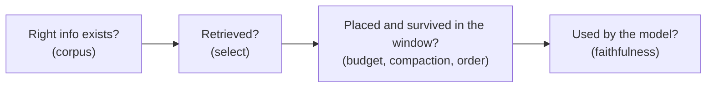

# 12 — Evaluating Context

> Prompt evals ask whether the instructions work. Context evals ask whether the *right material reached the window*, and whether the model used it. They need different measurements.

---

## What makes context evaluation different

When an answer is wrong, the cause usually sits in one of four places:



An end-to-end score tells you that something failed, but not where. Context evaluation instruments each stage so a failure points at a lever ([the four levers](../README.md#the-mental-model)).

---

## Evaluate at three levels

The upstream course frames this as a progression from component to system:

| Level | Question | Example measurements |
|---|---|---|
| **Component** | Does each piece work in isolation? | Retriever recall@k; compactor retains required facts; schema validates |
| **Integration** | Do the pieces work together? | Retrieved chunks survive budgeting; memory writes are read back correctly |
| **System** | Does the whole pipeline produce good outcomes at acceptable cost? | Task success rate, groundedness, tokens per task, latency |

Fix from the bottom up. A system-level regression is usually a component regression you didn't measure.

---

## Metrics by lever

### Select (retrieval)

| Metric | Measures | Needs |
|---|---|---|
| **Recall@k** | Did the needed chunk make the top k? | Labelled relevant chunks per query |
| **Precision@k / MRR** | How much of the top k is noise; how high the first hit ranks | Same |
| **Context precision / recall** (RAGAS-style) | LLM-judged relevance of the retrieved set to the question and reference answer | Reference answers |

Low recall means you need better retrieval. Low precision means you're spending budget on distractors ([04](04-retrieval.md), [11](11-failure-modes.md)). In [confusion matrix](../../../data-science/01-classical-ml/notes/04-model-evaluation.md#confusion-matrix-precision-recall-f1) terms, a chunk you needed and missed is a false negative, a distractor in the top k is a false positive, and k is the threshold. [Choosing a metric](../../../data-science/01-classical-ml/notes/11-choosing-a-metric.md#ranking-the-table-swept-along-the-list) in data science sweeps that table along the list.

These metrics fit in a few lines. Here a retriever returned `d7, d2, d9, d4, d1, d8`, and only `d2` and `d1` are relevant.

```python
def recall_at_k(ranked, relevant, k):
    return len(set(ranked[:k]) & relevant) / len(relevant)

def precision_at_k(ranked, relevant, k):
    return len(set(ranked[:k]) & relevant) / k

def mrr(ranked, relevant):
    return next((1 / (i + 1) for i, d in enumerate(ranked) if d in relevant), 0.0)

ranked = ["d7", "d2", "d9", "d4", "d1", "d8"]
relevant = {"d2", "d1"}
for k in (1, 3, 5):
    print(f"k={k}  recall {recall_at_k(ranked, relevant, k):.2f}  precision {precision_at_k(ranked, relevant, k):.2f}")
print(f"MRR {mrr(ranked, relevant):.2f}")
```

Output:

```text
k=1  recall 0.00  precision 0.00
k=3  recall 0.50  precision 0.33
k=5  recall 1.00  precision 0.40
MRR 0.50
```

### Use (generation over context)

| Metric | Measures |
|---|---|
| **Faithfulness / groundedness** | Is every claim in the answer supported by the supplied context? |
| **Answer relevance** | Does the answer address the question? |
| **Context utilisation** | Did the answer actually draw on the evidence supplied, or ignore it? |
| **Citation accuracy** | Do the cited sources support the cited claims? |

Faithfulness and correctness are different. An answer can be faithful to a wrong document. Measure both.

### Compress (compaction and summarisation)

- **Fact retention:** plant N required facts (decisions, constraints, file paths) in the history, compact, then ask for each one. Report retention as a percentage.
- **Task continuity:** run a long task with compaction forced at a fixed point. Does it finish with the same outcome as the uncompacted run?
- **Compression ratio** against both of the above. A ratio is meaningless without the retention number next to it.

The rule is easier to see with two toy compactors on the same history. Five facts are planted among tool logs. The stubs stand in for a lossy summary and for a decision registry, so these numbers describe this script and not any real system.

```python
# Fact retention: plant required facts, compact, then look for each one.
FACTS = {
    "package manager": "pnpm",
    "retry limit": "3 retries",
    "owner of the cron job": "team-payments",
    "file changed": "billing/client.py",
    "no deletion rule": "never delete without approval",
}
HISTORY = " ".join(f"Turn {i}: we decided the {k} is {v}." for i, (k, v) in enumerate(FACTS.items(), 1))
HISTORY += " " + " ".join(f"Turn {i}: tool output, 40 lines of logs." for i in range(6, 40))

def summary_compactor(text):   # stub: keeps a fixed-length gist, as a lossy summary does
    return text[:120]

def registry_compactor(text):  # stub: keeps decisions verbatim and drops tool output
    return " ".join(s for s in text.split("Turn ") if "we decided" in s)

def report(name, compact):
    out = compact(HISTORY)
    kept = [k for k, v in FACTS.items() if v in out]
    print(f"{name:10} ratio {len(HISTORY) / len(out):5.1f}x  retention {len(kept)}/{len(FACTS)}  lost {sorted(set(FACTS) - set(kept))}")

report("summary", summary_compactor)
report("registry", registry_compactor)
```

Output:

```text
summary    ratio  13.7x  retention 2/5  lost ['file changed', 'no deletion rule', 'owner of the cron job']
registry   ratio   6.1x  retention 5/5  lost []
```

Judged on ratio alone, the summary wins by more than double, yet it lost three of the five facts, including the deletion rule.

### Write (memory)

- **Recall across sessions:** facts stated in session 1 are used correctly in session 5.
- **Update correctness:** when a fact changes, the new value wins and the old one stops appearing.
- **Hygiene:** the rate of stale or contradictory memories surfaced. Benchmarks such as LoCoMo and LongMemEval test this at scale ([06](06-memory.md)).

### Isolate (multi-agent)

- **Hand-off completeness:** does the sub-agent's brief contain what it needs? Score sub-agent failures caused by missing context.
- **Token multiplier:** total tokens across agents divided by the single-agent baseline, set against the quality gain ([10](10-tools-and-multi-agent.md)).

---

## Long-context behaviour

Advertised window size is not effective window size. Test your model on your task:

- **Needle-in-a-haystack** is the floor, not the ceiling. Most frontier models pass literal-match needles. Chroma's *Context Rot* shows that degradation appears once the needle needs semantic matching or distractors are present.
- **Synthesis, not lookup.** SummHay swaps the needle for a task that needs many scattered facts and citations: 10 synthetic Haystacks of about 100 documents (about 93K tokens), each with planted insights repeated across 5+ documents, and the model must write a bullet summary for a query, citing the documents ([arXiv:2407.01370](https://arxiv.org/abs/2407.01370) (Laban et al., 2024-07, preprint)). Coverage scores the insights found, citation scores the cited documents (F1), and the joint score multiplies them. With the whole haystack in the window, GPT-4o scored 11.4 joint and Claude 3 Opus 18.0, while Gemini-1.5-pro reached 37.8, against a human estimate of 56.1 (two annotators, ten summaries, oracle documents). Put the relevant documents at the bottom and GPT-4o rose to 24.1, so position bias shows here too. Coverage was held up without retrieval (Opus 76.2 full context vs 81.4 oracle) but citation was not (22.3 vs 50.7), and a Cohere Rerank 3 retriever with a 15K-token budget lifted joint scores to 30.8 to 36.0 for the top three models. The GPT-4o judge overstates coverage by about 5 points and agrees with humans at 0.716 correlation. The documents are synthetic and independent, models are mid-2024, and only closed models were run.
- **Multi-fact needles and generated data.** BABILong hides bAbI reasoning facts (single-fact lookup up to five-fact chains) in PG19 book text, so the haystack can be regenerated at any length and cannot leak into training data ([arXiv:2402.10790](https://arxiv.org/abs/2402.10790) (Kuratov et al., 2024-02, preprint)). GPT-4-Turbo **fails across about 75% of its 128K window** on these tasks (qa1 to qa5, 25 samples per cell). A RAG baseline (ada-002, top 5 chunks) fails qa2 and qa3, which need a second fact that is not similar to the question, so a retrieval-only haystack score can hide a reasoning failure. The paper's own recurrent-memory GPT-2 (137M, fine-tuned per task at about 16K tokens) beats both out to 10M tokens, though with 100 samples at 10M and single runs. The conclusion says GPT-4 relies on the first 25% of the input while Appendix C finds the middle hardest, and the paper does not reconcile the two.
- **Length sweep:** run the same task at 10%, 25%, 50% and 75% of the window with realistic filler. Plot score against length. The knee in the curve is the effective budget ([03](03-budgeting-the-window.md)).
- **Position sweep:** put the key evidence at the start, middle and end. A large middle dip means you should move important content to the edges ([02](02-context-anatomy.md)).

---

## Ablation: the core context experiment

For each component (system prompt section, memory block, retrieved set, tool definitions):

1. Remove it, holding everything else fixed.
2. Re-run the eval set.
3. Record the change in quality and tokens.

| Δ quality | Δ tokens | Action |
|---|---|---|
| ≈ 0 | large | Cut it |
| Small drop | large | Compress it |
| Large drop | any | Keep it; protect it from compaction |

Ablation is how a budget gets set by evidence rather than habit.

---

## Building the eval set

The upstream checklist's four principles, made operational:

- **Measurable:** every case has a pass condition a script or rubric can check.
- **Representative:** sample from real traffic. Include the long-session, many-tool and stale-memory cases, not only clean single-turn questions.
- **Reproducible:** pin the model version, temperature, retrieval index snapshot and prompt version. A context change without a pinned baseline can't be attributed.
- **Actionable:** each metric maps to a lever. A metric you can't act on is a dashboard decoration.

Grow the set from failures: every production context bug becomes a regression case.

---

## Cost is a quality metric

Report **tokens per successful task** and **latency** next to accuracy. Context engineering is a minimisation problem ([01](01-why-context-is-finite.md)), so a pipeline that matches quality with half the context is better.

---

## Related

- [Evaluating prompts](../../01-prompt-engineering/notes/09-evaluating-prompts.md): rubric design, LLM-as-judge, regression suites.
- [the Eval pillar](../../../generative-ai/08-eval/README.md): the evaluation pillar in depth, including harnesses, judges and observability. Most relevant here:
  - [07 — Evaluating RAG and grounding](../../../generative-ai/08-eval/notes/07-evaluating-rag-and-grounding.md): retrieval metrics, claim-by-claim faithfulness, grounding tiers.
  - [03 — Eval datasets](../../../generative-ai/08-eval/notes/03-eval-datasets.md#row-eligibility-is-this-row-fair-for-this-gate): which rows are fair for a retrieval gate vs. a generation gate.
  - [09 — Reading results](../../../generative-ai/08-eval/notes/09-reading-results.md#compare-on-the-same-tasks-paired-differences): is an ablation's difference real or noise?
  - [08 — Tracing](../../../generative-ai/08-eval/notes/08-tracing-and-observability.md#cost-and-latency-attribution): where the context tokens go.

---

## Pitfalls

- **Scoring only the final answer.** Symptom: a system-level number dips and you can't tell which piece caused it. Fix: evaluate at component, integration and system level, and fix from the bottom up, since a system regression is usually a component regression you didn't measure.
- **Treating a faithful answer as a correct one.** Symptom: faithfulness is high and users still get wrong answers, because the answer faithfully followed a stale document. Fix: score correctness against ground truth as well.
- **Reporting compression ratio alone.** Symptom: a compactor looks 13.7× better while retaining 2 of 5 facts, as in the toy above. Fix: pair every ratio with fact retention.
- **Testing long-context behaviour at one length.** Symptom: an eval passes at 10% fill and production fails at 75%. Fix: sweep lengths at 10, 25, 50 and 75%, and sweep the evidence position too.
- **Adding components without ablating.** Symptom: a system prompt that only grows, because nobody knows what's safe to remove. Fix: remove each component in turn, and use the action table to keep, trim or drop it.
- **Measuring cost per call.** Symptom: compaction looks cheap, while retries and failed tasks make the true cost rise. Fix: report tokens per successful task.

## Try it

1. In the retrieval example, what are recall@5 and MRR if the ranking becomes `d2, d7, d9, d4, d8, d1`?

   <details><summary>Answer</summary>

   Recall@5 is 0.50, because `d1` moved to sixth and only `d2` is in the top 5, and MRR rises to 1.00, because `d2` is first. A better MRR with worse recall means the first hit improved, while the set got worse. If the answer needs both documents, recall is the number to watch.

   </details>

2. In the retention example, change `summary_compactor` to keep 300 characters instead of 120. What changes, and what does it show?

   <details><summary>Answer</summary>

   The summary now retains 5 of 5, at a ratio of 5.5× against 13.7×. Retention moves with the budget, so plot the trade-off and set a threshold rather than guess. Here the registry still wins: 5 of 5 at 6.1×.

   </details>

3. Removing the examples block lowers task success by 1 point and frees 3,000 tokens. Removing tool descriptions lowers it by 20 points and frees 2,500 tokens. What do you do?

   <details><summary>Answer</summary>

   Drop or shrink the examples, subject to a retest on hard cases, and keep the tool descriptions. That's 0.33 points per 1k tokens against 8 points per 1k.

   </details>

## Interview checklist

| Prompt | Answer in one line |
|---|---|
| How do context evals differ from prompt evals? | Prompt evals ask if the instructions work. Context evals ask if the right material reached the window and whether the model used it, so they need separate metrics. |
| What are the three levels of a context eval? | Component (retriever recall@k, compactor retention), integration (retrieved chunks survive budgeting, memory writes are read back) and system (task success, groundedness, tokens per task). |
| Compression ratio 13.7× against 6.1×: which compactor do you ship? | Ask for retention first. In this chapter's toy, the 13.7× one kept 2 of 5 facts and the 6.1× one kept all 5, so I'd ship the second. |
| What's ablation? | Removing one component at a time and measuring the change, so that each part of the window has to justify its tokens. |
| Quality falls as sessions get longer. How do you test it? | Sweep occupancy at 10, 25, 50 and 75% with the evidence at different positions, which separates a length effect from a position effect. |
| Which cost metric do you report? | Tokens per successful task, because a per-call number makes cheap failed runs look good. |

## Next

[13-putting-it-together.md](13-putting-it-together.md): with measurement in place, the last step is combining the levers into systems.
