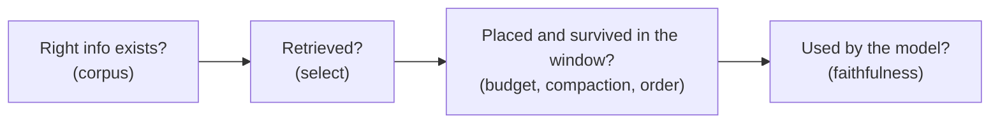

# 12 — Evaluating Context

> Prompt evals ask whether the instructions work. Context evals ask whether the *right material reached the window*, and whether the model used it. They need different measurements.

---

## What makes context evaluation different

When an answer is wrong, the cause usually sits in one of four places:

An end-to-end score tells you that something failed, but not where. Context evaluation instruments each stage so a failure points at a lever ([the four levers](../README.md#the-mental-model)).

---

## Evaluate at three levels

The upstream course frames this as a progression from component to system:

| Level | Question | Example measurements |
|---|---|---|
| **Component** | Does each piece work in isolation? | Retriever recall@k; compactor retains required facts; schema validates |
| **Integration** | Do the pieces work together? | Retrieved chunks survive budgeting; memory writes are read back correctly |
| **System** | Does the whole pipeline produce good outcomes at acceptable cost? | Task success rate, groundedness, tokens per task, latency |

Fix from the bottom up. A system-level regression is usually a component regression you didn't measure.

---

## Metrics by lever

### Select (retrieval)

| Metric | Measures | Needs |
|---|---|---|
| **Recall@k** | Did the needed chunk make the top k? | Labelled relevant chunks per query |
| **Precision@k / MRR** | How much of the top k is noise; how high the first hit ranks | Same |
| **Context precision / recall** (RAGAS-style) | LLM-judged relevance of the retrieved set to the question and reference answer | Reference answers |

Low recall means you need better retrieval. Low precision means you're spending budget on distractors ([04](04-retrieval.md), [11](11-failure-modes.md)).

### Use (generation over context)

| Metric | Measures |
|---|---|
| **Faithfulness / groundedness** | Is every claim in the answer supported by the supplied context? |
| **Answer relevance** | Does the answer address the question? |
| **Context utilisation** | Did the answer actually draw on the evidence supplied, or ignore it? |
| **Citation accuracy** | Do the cited sources support the cited claims? |

Faithfulness and correctness are different. An answer can be faithful to a wrong document. Measure both.

### Compress (compaction and summarisation)

- **Fact retention:** plant N required facts (decisions, constraints, file paths) in the history, compact, then ask for each one. Report retention as a percentage.
- **Task continuity:** run a long task with compaction forced at a fixed point. Does it finish with the same outcome as the uncompacted run?
- **Compression ratio** against both of the above. A ratio is meaningless without the retention number next to it.

### Write (memory)

- **Recall across sessions:** facts stated in session 1 are used correctly in session 5.
- **Update correctness:** when a fact changes, the new value wins and the old one stops appearing.
- **Hygiene:** the rate of stale or contradictory memories surfaced. Benchmarks such as LoCoMo and LongMemEval test this at scale ([06](06-memory.md)).

### Isolate (multi-agent)

- **Hand-off completeness:** does the sub-agent's brief contain what it needs? Score sub-agent failures caused by missing context.
- **Token multiplier:** total tokens across agents divided by the single-agent baseline, set against the quality gain ([10](10-tools-and-multi-agent.md)).

---

## Long-context behaviour

Advertised window size is not effective window size. Test your model on your task:

- **Needle-in-a-haystack** is the floor, not the ceiling. Most frontier models pass literal-match needles. Chroma's *Context Rot* shows that degradation appears once the needle needs semantic matching or distractors are present.
- **Length sweep:** run the same task at 10%, 25%, 50% and 75% of the window with realistic filler. Plot score against length. The knee in the curve is the effective budget ([03](03-budgeting-the-window.md)).
- **Position sweep:** put the key evidence at the start, middle and end. A large middle dip means you should move important content to the edges ([02](02-context-anatomy.md)).

---

## Ablation: the core context experiment

For each component (system prompt section, memory block, retrieved set, tool definitions):

1. Remove it, holding everything else fixed.
2. Re-run the eval set.
3. Record the change in quality and tokens.

| Δ quality | Δ tokens | Action |
|---|---|---|
| ≈ 0 | large | Cut it |
| Small drop | large | Compress it |
| Large drop | any | Keep it; protect it from compaction |

Ablation is how a budget gets set by evidence rather than habit.

---

## Building the eval set

The upstream checklist's four principles, made operational:

- **Measurable:** every case has a pass condition a script or rubric can check.
- **Representative:** sample from real traffic. Include the long-session, many-tool and stale-memory cases, not only clean single-turn questions.
- **Reproducible:** pin the model version, temperature, retrieval index snapshot and prompt version. A context change without a pinned baseline can't be attributed.
- **Actionable:** each metric maps to a lever. A metric you can't act on is a dashboard decoration.

Grow the set from failures: every production context bug becomes a regression case.

---

## Cost is a quality metric

Report **tokens per successful task** and **latency** next to accuracy. Context engineering is a minimisation problem ([01](01-why-context-is-finite.md)), so a pipeline that matches quality with half the context is better.

---

## Related

- [Evaluating prompts](../../01-prompt-engineering/notes/09-evaluating-prompts.md): rubric design, LLM-as-judge, regression suites.
- [06-eval](../../06-eval/README.md): the evaluation pillar in depth, including harnesses, judges and observability. Most relevant here:
  - [07 — Evaluating RAG and grounding](../../06-eval/notes/07-evaluating-rag-and-grounding.md): retrieval metrics, claim-by-claim faithfulness, grounding tiers.
  - [03 — Eval datasets](../../06-eval/notes/03-eval-datasets.md#row-eligibility-is-this-row-fair-for-this-gate): which rows are fair for a retrieval gate vs. a generation gate.
  - [09 — Reading results](../../06-eval/notes/09-reading-results.md#compare-on-the-same-tasks-paired-differences): is an ablation's difference real or noise?
  - [08 — Tracing](../../06-eval/notes/08-tracing-and-observability.md#cost-and-latency-attribution): where the context tokens go.

---

→ Next: [13-putting-it-together.md](13-putting-it-together.md) — combining the levers into systems.
