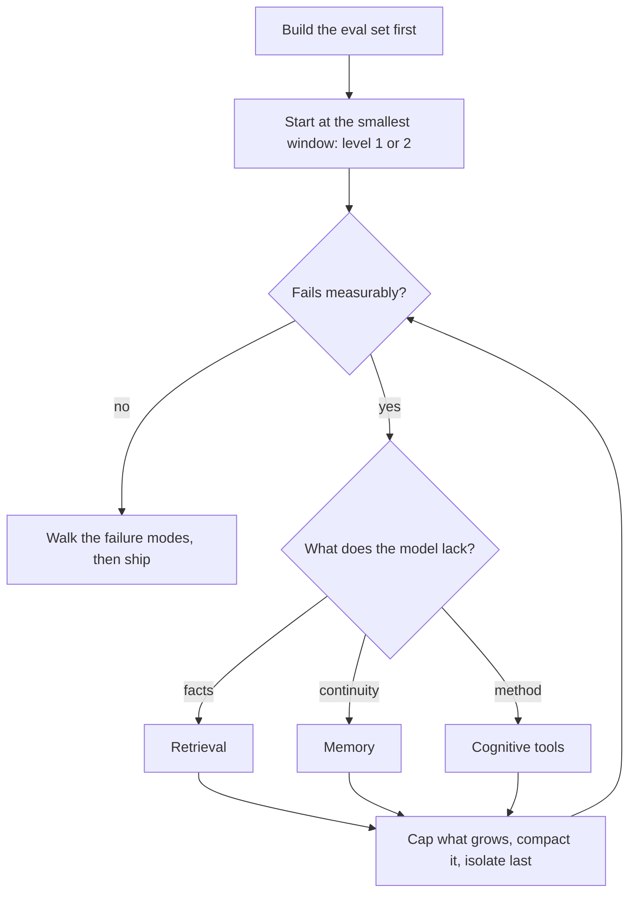

# 13 — Putting It Together

> The previous chapters each cover one lever. This one covers how they combine: a maturity ladder for context systems, the recurring design patterns, and four reference architectures.

---

## The maturity ladder

The upstream course is built on a biological metaphor. Read as a maturity ladder, it's a useful way to tell how much machinery a problem actually needs:

| Level | Upstream name | What's in the window | Chapter |
|---|---|---|---|
| 1 | **Atom** | One instruction: task + constraints + output format | [02](02-context-anatomy.md) |
| 2 | **Molecule** | Instruction + examples (few-shot) | [02](02-context-anatomy.md), [03](03-budgeting-the-window.md) |
| 3 | **Cell** | + memory: state carried across turns | [05](05-compression-compaction.md), [06](06-memory.md) |
| 4 | **Organ** | Several specialised contexts coordinated by an orchestrator | [10](10-tools-and-multi-agent.md) |
| 5 | **Cognitive system** | + reasoning tools, schemas, verification loops | [07](07-structured-context.md), [08](08-cognitive-tools.md) |

**Climb only when the level below fails measurably.** Most production failures at level 4 are level-2 problems: the examples or instructions were never right. Each rung multiplies cost and failure modes ([11](11-failure-modes.md)).

---

## Recurring design patterns

Across the upstream applications and the reference `patterns.md`, the same seven patterns recur:

| Pattern | What it does | Lever |
|---|---|---|
| **Structured state** | A small, overwritten state block (goal, decisions, next step) instead of raw history | Write / Compress |
| **Progressive context** | Start minimal; add context only when a step needs it (identifiers first, contents on demand) | Select |
| **Verification loop** | Generate → check → revise, bounded, with a machine-readable verdict | (reasoning) |
| **Structured schemas** | Fixed input, state and output shapes | (all) |
| **Template programs** | Parameterised, reusable prompt procedures | (all) |
| **Personalisation** | A user model kept outside the window, selectively injected | Write / Select |
| **Phased processing** | Split a long task into phases with a compaction point between them | Compress / Isolate |

---

## Four reference architectures

### 1. Long-form document generation

```
outline (schema) → for each section: retrieve → draft → verify against outline → store summary
                                     ↑                                       │
                                     └──── running summary of prior sections ┘
```

- The **outline** is the persistent state. Each section is written with the outline, a summary of prior sections and its own evidence. It never sees the full prior text.
- Levers: structured state + phased processing. The window stays constant-size however long the document gets.

The running summary is what keeps this architecture viable. With assumed sizes (a 300-token outline, 1,500 tokens of evidence per section, 2,000-token sections, and a summary capped at 1,000 tokens that adds 100 per section), compare the window at each section with and without it:

```python
# Architecture 1: window size per section with a running summary vs. with the full prior text.
OUTLINE, EVIDENCE, SUMMARY_PER_SECTION, SECTION = 300, 1_500, 100, 2_000
print("section  full prior text  running summary")
for n in (1, 5, 10, 20, 40):
    full = OUTLINE + EVIDENCE + (n - 1) * SECTION
    rolled = OUTLINE + EVIDENCE + min((n - 1) * SUMMARY_PER_SECTION, 1_000)   # summary capped at 1k
    print(f"{n:>7}  {full:>15,}  {rolled:>15,}")
```

Output:

```text
section  full prior text  running summary
      1            1,800            1,800
      5            9,800            2,200
     10           19,800            2,700
     20           39,800            2,800
     40           79,800            2,800
```

Full prior text passes a 32k window between sections 10 and 20, where a capped summary stays under 3k. The cost is that the summary has to carry what later sections need, which is why fact retention ([12](12-evaluating-context.md#metrics-by-lever)) applies here too.

### 2. Problem solver with memory

```
understand_question → recall_related (memory of solved problems) → solve
      → examine_answer ─┬─ ok → store (problem, method, outcome) → done
                        └─ error → backtrack → solve
```

- This is the IBM cognitive-tool loop ([08](08-cognitive-tools.md)) with a memory write at the end, so solved problems become future `recall_related` hits.
- Levers: cognitive tools in isolated calls + a write-to-memory step.

### 3. Research assistant

```
plan (questions, scope) → orchestrator
     ├─ sub-agent per question: search → read → extract findings (own context)
     └─ collect condensed findings → synthesise → cite → verify claims against sources
```

- Each sub-agent burns tokens exploring and returns only a condensed result. The orchestrator holds the plan and the synthesis ([10](10-tools-and-multi-agent.md)).
- Levers: isolate + compress at the hand-off. This is the shape of Anthropic's multi-agent research system.

### 4. Adaptive tutor

```
learner model (stored) → select next concept → explain at learner's level → check understanding
      ↑                                                                          │
      └──────────────── update mastery estimates, misconceptions ────────────────┘
```

- The learner model (mastery per concept, known misconceptions, preferences) is a structured memory ([06](06-memory.md), [07](07-structured-context.md)), injected as a short summary each turn.
- Levers: write + select. The model never sees the full interaction history, only the current estimate of the learner.

### A note on "reconstructive memory"

The upstream architecture of the same name stores **fragments** (facts, episodes, procedures) and reassembles a context-specific memory at retrieval time, rather than replaying stored transcripts. Stripped of the field-theory framing, that's retrieval over atomised memories plus model-written synthesis. It's a sound pattern, with a real risk: the synthesis step can confabulate connections between fragments. Keep source pointers on every fragment so a reconstructed memory can be checked.

---

## Designing a context system: the order of questions

1. **What does success look like, and how will you measure it?** Build the eval set first ([12](12-evaluating-context.md)).
2. **What's the smallest window that could work?** Start at level 1 or 2 of the ladder.
3. **What does the model lack?** Facts → retrieval ([04](04-retrieval.md)). Continuity → memory ([06](06-memory.md)). Method → cognitive tools ([08](08-cognitive-tools.md)).
4. **What grows?** Give every growing component a ceiling and a compaction rule ([03](03-budgeting-the-window.md), [05](05-compression-compaction.md)).
5. **What can live outside the window?** Write before you select. Select before you compress. Isolate last.
6. **What can go wrong?** Walk the failure modes ([11](11-failure-modes.md)) against your design before shipping.

The questions form a loop rather than a single pass, because you add a lever only after a measurement says the level below has failed.



---

## Capstone exercise

Take an agent you've built, or the research-assistant shape above, and produce:

- [ ] A per-component token budget with ceilings, measured on real traffic
- [ ] An ablation table: each component's Δ quality and Δ tokens
- [ ] A compaction rule, with a fact-retention score
- [ ] One failure mode from [11](11-failure-modes.md) reproduced, fixed and added to the eval set
- [ ] A one-page design doc stating which lever each component serves

When the loop that assembles this context becomes stateful and conditional, you've crossed into the harness layer → [03-harness](../../03-harness-engineering/README.md).

## Pitfalls

- **Climbing the ladder by fashion.** Symptom: a multi-agent memory system for a task one good prompt could do. Fix: climb only when the level below fails measurably.
- **Applying a pattern because it has a name.** Symptom: seven patterns in one design, and no one can say which lever each serves. Fix: state in the design doc which lever each component serves, as the capstone asks.
- **Passing full prior text in long-form generation.** Symptom: section 15 reaches the budget and contradicts section 2. Fix: use the outline and a running summary, then check the summary for fact retention.
- **Reconstructive memory with no source pointers.** Symptom: the synthesis step confabulates a connection between fragments, and the agent acts on it. Fix: keep a pointer from each fragment to its source so that the reassembled memory can be checked.
- **Answering the six questions in the wrong order.** Symptom: a vector database is chosen before anyone has an eval set or knows what the model lacks. Fix: define success and its measurement first, and isolate last.
- **Shipping with no failure analysis.** Symptom: the first incident is also the first time anyone thinks about clash or injection. Fix: walk the design through [11](11-failure-modes.md) before launch.

## Try it

1. Change the worked example's section size to 1,000 tokens. At which section does full prior text pass 32k, and what does the summary column do?

   <details><summary>Answer</summary>

   Full text is 1,800 + (n − 1) × 1,000, which passes 32,000 at n = 32. The summary column doesn't change, because it depends on the cap and not on the section size.

   </details>

2. Choose a reference architecture for an internal support assistant that answers from a changing wiki and remembers a user's product. What would you leave out at first?

   <details><summary>Answer</summary>

   Start with the research assistant shape, reduced to retrieval with a say-so line, plus a small scoped memory. Leave out multi-agent work and a knowledge graph until an eval shows that simple retrieval fails.

   </details>

3. Do the [capstone](#capstone-exercise) above for a system you own. Which of its deliverables will you find hardest to write, and what does that tell you?

   <details><summary>Answer</summary>

   Usually it's the lever-per-component statement. A component you can't assign to a lever is a candidate for removal, so run an ablation ([12](12-evaluating-context.md#ablation-the-core-context-experiment)) on it first.

   </details>

## Interview checklist

| Prompt | Answer in one line |
|---|---|
| What's the rule for moving up the maturity ladder? | Climb only when the level below fails measurably, because each level adds tokens and failure modes. |
| How would you generate a 40-section report? | Outline, evidence per section, and a capped running summary. With this chapter's assumed sizes, section 40 is 2.8k tokens that way against about 79.8k with full prior text. |
| What's reconstructive memory, in practical terms? | Retrieval over atomised fragments plus model-written synthesis, rather than replaying transcripts. It's sound, but synthesis can confabulate connections, so keep source pointers. |
| What's the first question when designing a context system? | What success looks like and how you'll measure it, so the eval set comes first. Then the smallest window that could work, and only then what the model lacks. |
| A stakeholder asks for a research agent with memory, graph and four agents. How do you respond? | Start with the lowest level that could work, build the baseline eval, then add each lever only for a measured gap. |
| When have you left context engineering behind? | When the loop that assembles context becomes stateful and conditional, you're in the harness layer. |

## Next

[99-speculative-field-track.md](99-speculative-field-track.md): an appendix on the field vocabulary you'll meet upstream, before the next pillar, [03 Harness Engineering](../../03-harness-engineering/README.md).
