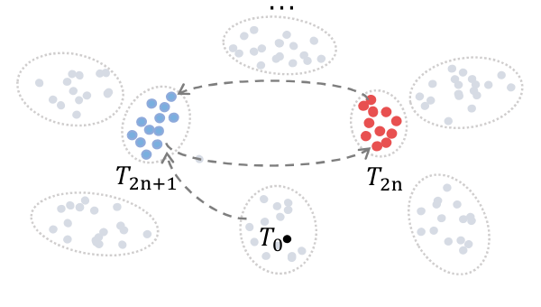
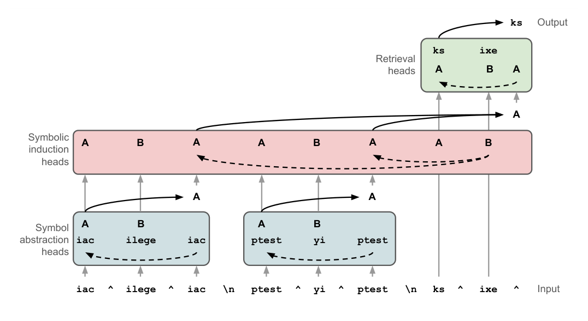

# 99 — Appendix: The Speculative Field Track

> About a third of the upstream course treats context as a continuous "semantic field" with attractors, resonance and boundaries. It is a metaphor, not an engineering method. This appendix summarises it so you can recognise the vocabulary and pull out the few practical ideas.

---

## How to read this appendix

Chapters 01–13 cover techniques with evidence behind them. Nothing here does in the same way. The upstream field-theory material:

- borrows terms from physics and dynamical systems (fields, attractors, resonance, quantum superposition),
- cites a handful of real papers, then extrapolates well beyond what they show,
- offers "protocols" (`/attractor.co.emerge`, `/field.resonance.scaffold`) whose effect is that of an ordinary structured prompt ([09](09-protocols.md)).

Treat every claim below as **hypothesis or metaphor** unless it's tied to a paper.

---

## The core claims, and what's under them

| Upstream concept | Claim | Grounded reading |
|---|---|---|
| **Neural field** | Context is a continuous field, not a sequence of tokens; information persists through resonance rather than position | Attention spreads influence across the whole window, so content can stay relevant without being recent. True, and already covered by positional effects ([02](02-context-anatomy.md), [11](11-failure-modes.md)) |
| **Attractors** | Stable patterns of meaning that the conversation falls into and is hard to leave | Models do settle into recurring framings, and early framing biases later turns. Wang et al. (2502.15208) find that successive paraphrasing converges to stable 2-cycles. Practical version: an early mistake keeps pulling later turns back ([context poisoning](11-failure-modes.md)) |
| **Resonance** | Related concepts reinforce each other; "tuning" the field strengthens desired patterns | Repeating and cross-referencing key constraints raises their salience. That's ordinary emphasis and recency |
| **Boundaries** | Permeable membranes control what enters and leaves the field | Gating what gets into the window. This is the Select lever ([04](04-retrieval.md)) |
| **Persistence / decay** | Field patterns fade unless reinforced | Older content loses influence and is lost first under compaction ([05](05-compression-compaction.md)) |
| **Symbolic mechanisms** | LLMs implement abstraction → induction → retrieval | **Real result** (Yang et al., ICML 2025): identified attention heads for each stage. Applied in [07](07-structured-context.md) |
| **Quantum semantics** | Meaning is undetermined until "observed" by an interpretive context; Bell-style tests show non-classical contextuality | Agostino et al. (2506.10077) report CHSH-style violations in LLM interpretation of ambiguous phrases. Practical version: an ambiguous prompt has no fixed meaning, so disambiguate with context. The quantum framing adds no technique |
| **Unified field theory** | Combines symbolic, field and quantum views into one framework | No testable content beyond the parts above |

Two of the rows rest on real papers, and their figures show how modest the grounded versions are. Wang et al.'s "attractor" is a 2-cycle: paraphrase a text over and over and it alternates between two clusters of near-identical outputs.

*Image Source: Wang et al. (2025)*

Yang et al.'s "symbolic mechanism" is a three-stage circuit of attention heads. Abstraction heads map tokens to variables, induction heads find the pattern over variables, and retrieval heads map the predicted variable back to a token.

*Image Source: Yang et al. (2025)*

---

## The NOCODE advanced modules

The NOCODE track continues past protocols into six more modules. Their practical cores:

| Module | Practical core | Where it lives now |
|---|---|---|
| **Field theory** | Keep a few anchor concepts stated explicitly and repeat them | [02](02-context-anatomy.md) |
| **Meta-recursion** | Ask the model to critique and improve its own output or prompt | [08](08-cognitive-tools.md#the-self-correction-loop) |
| **Interpretability** | Ask for confidence, sources and reasoning alongside the answer. Treat self-reports as unreliable | [12](12-evaluating-context.md) |
| **Collaboration** | Divide work explicitly between human and model; checkpoint for review | [10](10-tools-and-multi-agent.md) |
| **Cross-modal** | Describe how text, image and data inputs relate before asking for synthesis | [07](07-structured-context.md) |
| **Cross-model** | Write prompts that don't depend on one model's quirks; test on several | [12](12-evaluating-context.md) |

---

## The mental models

The upstream offers five metaphors for thinking about a context window. They are teaching aids, not methods:

| Model | Picture | Useful for |
|---|---|---|
| **Garden** | Context is cultivated: plant (add), prune (remove), weed (fix errors), tend over time | Long-lived system prompts and memory hygiene |
| **Budget** | Tokens are a fixed budget to allocate and spend | Allocation ([03](03-budgeting-the-window.md)). The most directly useful of the five |
| **River** | Context flows; information has a source, a current and tributaries | Pipelines and multi-step flows |
| **Biopsychosocial** | Consider the foundational (facts), the experiential (user's state) and the contextual (social setting) layers | User-facing assistants and tutoring |
| **Alchemy** | Combine ingredients (instructions, examples, data) in the right order to transform them | Prompt assembly and ordering |

Pick whichever helps you explain a design to someone else. Don't design from them.

---

## What to keep

Three ideas from this track survive translation into engineering:

1. **Early framing is sticky.** Get the first turns and the system prompt right, and restart rather than argue a model out of a wrong framing.
2. **Salience is earned by structure and repetition.** If a constraint matters, state it clearly, place it at the edges of the window and restate it at decision points.
3. **Ambiguity is resolved by context, not by the words alone.** When outputs vary unpredictably, look for the underspecified term.

Everything else is vocabulary. If you meet "attractor", "resonance" or "field" in an agent design discussion, ask what the measurable behaviour is, and map it to a chapter above.

---

## Papers behind the track

- Wang et al., *Unveiling Attractor Cycles in Large Language Models: A Dynamical Systems View of Successive Paraphrasing* (2025). [arXiv:2502.15208](https://arxiv.org/abs/2502.15208)
- Agostino et al., *A Quantum Semantic Framework for Natural Language Processing* (2025). [arXiv:2506.10077](https://arxiv.org/abs/2506.10077)
- Yang et al., *Emergent Symbolic Mechanisms Support Abstract Reasoning in LLMs* (ICML 2025). [arXiv:2502.20332](https://arxiv.org/abs/2502.20332) · [OpenReview](https://openreview.net/forum?id=y1SnRPDWx4)

PDFs are in [../sources/](../sources/).
