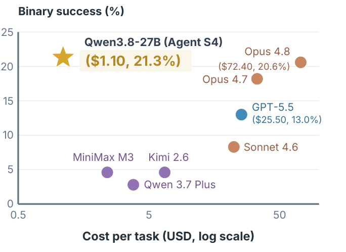

# 1 — What a Harness Is

> The definition, the four load-bearing parts, and why the same failure keeps being a configuration problem.

---

## The equation

> **Agent = Model + Harness.**

A raw model is a text transformer. It becomes an *agent* only when something gives it durable state, tool execution, feedback loops, and enforceable constraints. That something is the harness: **every line of code, configuration, and execution logic beyond the weights themselves**.

The formal version (harness-engineering.ai): harness engineering is *"the discipline of designing, building, and operating the infrastructure that constrains, informs, verifies, and corrects AI agents in production."*

Four verbs worth keeping — a harness **constrains** (boundaries), **informs** (context), **verifies** (checks), and **corrects** (recovery). Most incomplete harnesses have the first two and are missing the last two.

### The expanded equation

Li's version takes the component formula from [gen-AI 03](../../../generative-ai/03-agentic-foundations/agent-fundamentals.md), *Agent = LLM + Context + Tools*, and wraps three safeguard layers around the two non-model terms:

> **Agent = LLM + [Context + Tools + Constrain + Verify + Correct] = Model + Harness**

LLM + Context + Tools is the demo view. The bracket is the production view, which contains the demo view and adds the safety net. The boundary between the five functions is easiest to see on one refund:

| Function | In the refund example | Core design principle |
|---|---|---|
| Context | The 7-day refund policy is in the system prompt | *Information sufficiency* at every decision point |
| Tools | `query_order`, `process_refund` | *Clear interface*: intuitive names, examples in params, stated boundaries |
| Constrain | Refund ≤ order total, checked by the framework | *Fail-safe defaults*: every capability off until explicitly enabled |
| Verify | Confirm in the DB that the refund landed | *Input isolation*: check structured tool fields, never model prose, which injection can steer |
| Correct | Retry automatically on API timeout | *Don't expose intermediate state* until failure is confirmed unrecoverable |

Without the harness, the same model gets no policy, picks no tool, invents a success message, and the user finds out later. The five functions form a closed loop. Context and tools drive decisions, constrain prevents errors, verify detects deviations and correct closes the loop. Leave any one out and there is a reliability gap.

The centre of gravity shifts as products mature. Early frameworks were mostly context and tools. In Claude Code, most of the harness code goes on constrain/verify/correct: process-state tracking, multi-layer compaction, permission tiers, circuit breakers, rollback-and-retry. The tools themselves are a small fraction.

---

## Observation and action spaces

The observation space (context) and the action space (tools) are the model's whole interface to the world. With the model fixed, **redefining or expanding them is the main systems lever**. A task that looks like it needs a smarter model often needs the right data in context or the right operation exposed as a tool. Manus generalized by uniting the spaces of research, coding and computer-use agents. OpenClaw widened them again to messaging channels and local files.

Expansion must be **on-demand, relevant and controlled**. Retrieval brings in what matters, tool discovery exposes only what is needed now ([note 03](03-tool-design.md)), and permissions plus result verification bound what the new actions can do ([note 04](04-execution-boundaries.md)).

---

## Where the metaphor comes from

Horse tack. A harness directs a powerful animal's energy toward useful work without letting it bolt.

Rob Earlam's framing is the most beginner-legible: *"you think of AI like a horse, it's fast and it's powerful"* — but ad-hoc prompting means fighting it every time. The shift is **from continuous prompting to upfront orchestration**: build the harness once, then "repeatedly ride the horse to different destinations, but with the same ease."

That's the economic argument for the whole discipline. Prompting cost is linear in tasks; harness cost is paid once and amortized.

---

## The four parts

The minimal decomposition — a harness comprises at least:

| Part | Question it answers |
|---|---|
| **Acceptance baseline** | What does "done and correct" mean, checkably? |
| **Execution boundary** | Where does the agent run, and what can it touch? |
| **Feedback signals** | How does the agent learn its last action was wrong? |
| **Rollback mechanisms** | How do we undo a bad action? |

A system missing any one of these is not a harness — it is a prompt with tools attached. The most commonly missing part is **rollback**, and the most commonly *faked* one is the acceptance baseline (a vibes-based "looks good" instead of a binary check).

Contrast this with the classic **agent = LLM + planning + tools + memory** decomposition (Weng 2023, the DAIR agents guide). That framing describes what the *model* does. These four parts describe what the *system around it* has to guarantee. Planning, tools and memory map onto harness components ([note 02](02-harness-anatomy.md)). None of the four parts above appear in the classic framing, and that gap is why agents built from it alone are unreliable.

---

## Why the harness dominates the model

**Reliability compounds negatively.** A step that succeeds 90% of the time, chained five times, lands near 60%. Real agents exceed five steps as soon as you count tool calls, output parses, and handoffs. Model quality shifts per-step accuracy a few points; harness structure changes *how many steps must succeed in a row* and *what happens when one doesn't*.

Three data points:

- **LangChain DeepAgents**: 52.8% → 66.5% on Terminal Bench 2.0 (~rank 30 → top five), harness-only changes, fixed model.
- **Osmani's observation**: Claude Opus 4.6 performs far below its ceiling in a loose harness and far above it in one with tighter tool design and prompts.
- **Agent S4 (Agashe et al., 2026)**: model and harness loop held fixed, only the *interfaces* (tools, observation formats and the notes on when to use each) evolved from experience. Qwen3.8-27B went from 5.6% to **21.3%** binary success on OSWorld V2 (3.8×). That is above GPT-5.5 (13.0%) and Claude Opus 4.8 (20.6%) at about **4.3% and 1.5% of their cost per task**. On ScienceBoard the same model went from 41.4% to 58.6%.

*Image Source: Agashe et al. (2026)*

The Agent S4 gain came from what the model can see and do, not from what it knows. That is the observation/action-space lever above, automated: a meta-agent reads the task agent's trajectories, without success labels, and rewrites the interface repository. Validation tasks the meta-agent never sees decide which versions survive.

The same pattern shows up in Li's nesting of engineering scopes: **prompt ⊂ context ⊂ harness ⊂ loop**. Each scope widens what the engineer controls: the instruction, then the working set, then the system the model runs in, then sustained operation across runs. *Graph engineering* (a mid-2026 label) is an orchestration view across these scopes, not a sixth one: a loop is a graph with a back edge, and a graph node can run its own loop ([05-graph](../../05-graph-engineering/README.md)).

Hence the slogan: *a decent model with a great harness beats a great model with a bad harness.* And the diagnostic order that falls out of it — when an agent fails, **audit the orchestration layer first** (tool descriptions, retry budgets, handoff schemas), **then the context layer** (data quality, coverage, recency). In a mature setup the model is rarely the bottleneck.

### Where context ends and the harness begins

| Context engineering | Harness engineering |
|---|---|
| What goes in the window on *this* call | The loop that decides *whether and when* to call |
| Which documents, memory, tool results to inject | Which tools exist at all, and what they're allowed to do |
| Token budget within one assembly | Cost envelope across a whole run |
| Compaction as a technique | Compaction as middleware that fires on a trigger |

Once assembly becomes **stateful and conditional**, with a loop deciding when to retrieve, compact, verify or spawn, you have crossed from context into harness. harness-engineering.ai's five-component checklist states the same scope: **context engineering** ([02-context](../../02-context-engineering/README.md)), **tool orchestration** ([03](03-tool-design.md)), **verification loops** ([05](05-verification-loops.md)), **cost-envelope management** ([04](04-execution-boundaries.md#cost-envelope)) and **observability and evaluation** ([08](08-maturity-and-failure-modes.md#runtime-vs-process-observability), [06-eval](../../06-eval/README.md)). The same source puts the claimed reliability impact at **5–15%** for prompt engineering, **15–30%** for context engineering and **50–80%** for harness engineering. Treat those numbers as directional, not measured. The ordering is what matters.

LangChain draws the line between product categories the same way. A **framework** (LangChain, Vercel AI SDK, OpenAI Agents SDK, Google ADK) gives you abstractions and integrations. A **runtime** (LangGraph, Temporal, Inngest) gives you durable execution, streaming, HITL and persistence. A **harness** (Deep Agents SDK, Claude Agent SDK, Manus, coding CLIs) is batteries-included: predefined tools, prompts, a to-do planner, a virtual filesystem, subagents and history summarization. Pick a harness when the task is long and non-deterministic. Pick a runtime when you need low-level control of a workflow that mixes deterministic and agentic steps.

### Why coding agents matured first

Li's explanation (ch. 5) is a two-by-two of goal clarity against verification automation:

| | Verified automatically | Verified by a human |
|---|---|---|
| **Clear goal** | Sweet spot: fix a bug that has a failing test | Throughput-limited: a refactor that needs review |
| **Vague goal** | Efficiently off track: "improve code quality" scored by a linter | Hard to start: "make the UI look better" |

Coding agents are mature not because code models are unusually strong, but because decades of tests, type checkers, linters, CI and Git already form a harness that puts most coding tasks in the top-left cell. The harness's job in any other domain is to push tasks into that cell.

Karpathy's **car-wash test** (AISN 2026, relayed by a secondary YouTube breakdown) is the bottom-left cell in one line. Asked whether to drive or walk to a car wash 50 metres away, a model reasons about distance and says walk. It misses that the car has to be at the car wash. Models are brilliant at what can be measured and blind to unstated context. The harness supplies the missing context (a spec, the environment) and the check (a verification signal) that the model can't supply itself. His summary: *"You can outsource your thinking, but you can't outsource your understanding."*

**Harness thickness depends on the model.** On a weak model, offloading logic puzzles to a constraint solver lifts accuracy dramatically; on a strong reasoning model, the gain converges to near zero. The same harness can support opposite conclusions depending on which model it's paired with, so state the model whenever you report a harness result.

---

## The "skill issue" reframe

Most agent failures are **configuration problems, not model limitations**. HumanLayer's reframe, mapped to fixes:

| Failure | Not this | But this |
|---|---|---|
| Ignored a convention | "The model is dumb" | The convention isn't in `AGENTS.md` |
| Ran `rm -rf` | "The model is unsafe" | There's no blocking hook |
| Lost the thread at step 40 | "Context window too small" | No planner/executor split, no plan file |
| Shipped broken code | "It can't code" | No typecheck back-pressure in the loop |
| Rated its own work 9/10 | "It's sycophantic" | Generator and evaluator are the same agent |

Each right-hand cell is a build task. That's the whole discipline in one table.

### Five ways a capable model fails without a harness

For a coding agent working in a real repo, the failures fall into five recurring shapes. Each one maps to a harness fix, not a model upgrade:

| Failure | What it looks like | Harness fix |
|---|---|---|
| **Vague requirements** | Builds something plausible that isn't what you meant | Feature list with verifiable behaviors ([note 10](10-scope-and-done.md)) |
| **Implicit conventions** | Breaks rules that live only in people's heads | Repo as system of record ([note 09](09-repo-as-system-of-record.md)) |
| **Incomplete environment** | Spends the session fighting setup, or "fixes" the wrong thing | `init.sh` plus a startup-readiness check ([note 06](06-long-horizon-execution.md#phase-0-initialization-is-its-own-session)) |
| **No verification** | Claims done when it isn't | Termination checks ([note 05](05-verification-loops.md#the-three-layer-termination-check)) |
| **Cross-session loss** | Each session re-derives or undoes the last one | Progress log plus handoff ([note 06](06-long-horizon-execution.md#the-session-lifecycle)) |

### Fix the harness first

The working loop that comes out of the reframe:

1. **Run** the task on a fixed model.
2. **Attribute** the failure to one subsystem: instructions, tools, environment, state or feedback ([note 02](02-harness-anatomy.md#the-five-subsystems)).
3. **Fix that subsystem**, and only that one.
4. **Re-run** the same task and compare.

Change the model only after several rounds of this stop helping. Swapping models first hides which part of the harness was missing, so the same failure comes back under the next model.

---

## The ratchet

The operating principle that makes a harness improve monotonically:

> Anytime an agent makes a mistake, engineer a solution such that the agent **never makes that mistake again**.

Each failure becomes a permanent signal — a hook, a lint rule, a line in the instruction file, a new gate. The harness *tightens every time the agent slips*.

The corollary is a strong test for instruction files:

> **Every line in a good `AGENTS.md` should be traceable back to a specific thing that went wrong.**

Osmani's rules for that file:
- Keep it **under ~60 lines** — a pilot's checklist, not a style guide.
- Every rule traces to an actual failure or an external constraint.
- Bias toward the load-bearing basics: package manager, test framework, formatting conventions.

Lines that can't name their originating failure are speculative, and speculative rules are what turn a checklist into an ignored wall of text. See [02-context-engineering/notes/02](../../02-context-engineering/notes/02-context-anatomy.md) on system-prompt altitude — the same drift, one layer down.

---

## Convergent design as evidence

Claude Code, Cursor, Codex, Aider, and Cline **"look more like each other than their underlying models do."**

Independent teams, different models, different companies — converging on filesystem access, bash, sandboxes, hooks, subagents, progressive disclosure, plan files, and verification loops. That convergence is the field's best evidence that these specific primitives are load-bearing rather than stylistic. [Note 02](02-harness-anatomy.md) enumerates them.

OpenClaw's design notes, written for an always-on personal agent rather than a coding CLI, arrive at the same place: keep one stable perception → decision → action → feedback loop and add capability through tools, prompts and state, not by changing the loop. Their summary of where the stability comes from is a fair checklist for any harness: **message decoupling, state externalization, layered hints, memory integration and security boundaries**.

---

## The co-training loop

Harness complexity doesn't shrink as models improve — it **shifts**. Better models eliminate the scaffolding built to mitigate old weaknesses (context anxiety, myopic planning) and unlock new capabilities that expose new failure modes needing different constraints.

Meanwhile the useful primitives get standardized into products, then embedded into the next generation's training data, which makes models better at exactly those primitives. Harness design and model development co-train.

This is the harness's answer to Sutton's *Bitter Lesson*: general methods that scale with compute beat hand-encoded priors. Li's stance is to **endorse the direction but stay pragmatic about the pace**. Models do absorb harness layers; tool calling and long-horizon planning both used to be external orchestration. But training cycles take months, and no model internalizes every business's constraints at once. The harness covers what the model can't yet do reliably, drops each layer the model absorbs, and moves to the next frontier. Updates also have more than one home: in-context adaptation, external artifacts (docs, prompts, code) and weights each persist on a different timescale ([gen-AI 03](../../../generative-ai/03-agentic-foundations/agent-fundamentals.md#how-agents-learn)).

Practical consequence: **a harness needs periodic subtraction, not just addition.** See [note 08](08-maturity-and-failure-modes.md#iterative-simplification).

---

## Working reference

`~/.claude/refs/agent-architecture.md` — where responsibility sits between model, loop, and scaffolding; when a capability belongs in the harness rather than the prompt.

---

→ Next: [02-harness-anatomy.md](02-harness-anatomy.md) — the component inventory.
