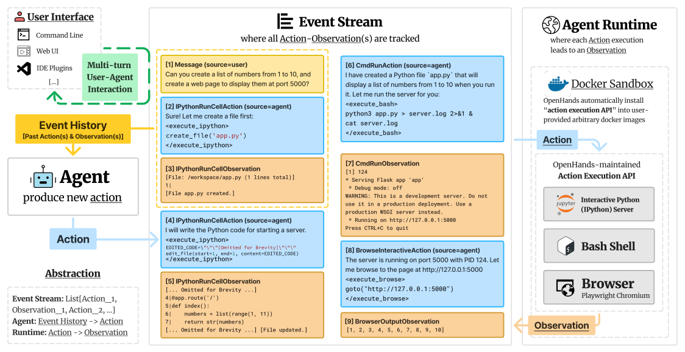

# 2 — Harness Anatomy

> The component inventory: what ships inside a harness, and which primitives are foundational.

"Improve the harness" is not an actionable instruction until you can name the parts. Without an inventory, a failing agent gets another paragraph of prompt because that is the one part everyone can see, while the real gap sits in a missing log file, a boot script or a test the agent can't read. This chapter lists the nine components, sorts them into five subsystems you can diagnose against, and shows the build order that follows.

---

## The nine components

LangChain's anatomy, grouped by the job each does:

### Knowledge & configuration

**1. System prompts and context policies** — behavioral framing, plus the *rules for what gets assembled* per call. The policy is harness; the assembled result is context.

**2. Tools, skills, and MCPs — and their descriptions** — the action surface. Descriptions are load-bearing: they are the *only* thing the model sees at selection time. Skills add **progressive disclosure** so a large capability library doesn't flood the window at startup. See [note 03](03-tool-design.md).

### Infrastructure

**3. Filesystem abstractions** — *"arguably the most foundational harness primitive."* Durable storage, context offloading, cross-session persistence, and a shared medium for multi-agent handoff.

**4. Bash + code execution** — the general-purpose escape hatch.

**5. Sandboxes** — safe execution environments with pre-configured tooling (runtimes, CLIs, browsers). See [note 04](04-execution-boundaries.md).

**6. Memory systems** — file-based standards (`AGENTS.md`, `MEMORY.md`) for continual learning across sessions. See [02-context-engineering/notes/06](../../02-context-engineering/notes/06-memory.md).

### Orchestration & control

**7. Orchestration logic** — subagent spawning, handoffs, model routing, HITL feedback loops. See [note 07](07-orchestration.md).

**8. Hooks / middleware** — deterministic control flow: compaction, continuation, lint checks, verification gates. The part of the harness that **cannot be talked out of enforcing itself**.

**9. Context management tools** — web search, retrieval, and MCP access for information past the training cutoff; plus compaction and tool-output offloading.

Supporting: git versioning, planning files, test runners, self-verification hooks.

LangChain's Deep Agents docs group the same parts by the capability a user sees:

| Capability group | Parts |
|---|---|
| **Execution environment** | Tools, a virtual filesystem, permissions, code execution |
| **Context management** | Skills, memory, summarization and tool-output offloading, prompt caching |
| **Delegation** | A to-do list, subagents |
| **Steering** | Human-in-the-loop interrupts |

---

## The five subsystems

The nine components describe what *ships*. For diagnosing a failing agent, a coarser cut works better. Every component serves one of five subsystems, and every failure can be attributed to one of them:

| Subsystem | Question it answers | Components |
|---|---|---|
| **Instructions** | What should I do, and by what rules? | 1 system prompt / `AGENTS.md`, 6 memory |
| **Tools** | What can I act with? | 2 tools/skills/MCPs, 4 bash, 9 context tools |
| **Environment** | Where do I run, and does it start? | 3 filesystem, 5 sandbox, `init.sh` |
| **State** | What has happened so far? | Plan file, progress log, feature list, git |
| **Feedback** | Did it work? | 8 hooks, test runners, verification gates, traces |

Two of these map onto Norman's two gulfs from interaction design. The **gulf of execution** (the agent knows what it wants but can't act on it) is a tools or environment gap. The **gulf of evaluation** (it acted but can't tell whether that worked) is a feedback gap. Agents usually fail on evaluation. They are rarely stuck; they are confidently wrong.

**Ablation** turns the table into a method. Remove one subsystem at a time on a fixed task and watch what breaks, and you learn which parts of *your* harness are load-bearing.

Test the combination as well as the parts, because the effects don't add up. Agentic Harness Engineering ([arXiv:2604.25850](https://arxiv.org/abs/2604.25850) (Lin et al., 2026-04, preprint)) swapped evolved components one at a time into a bash-only seed on Terminal-Bench 2 (89 tasks, GPT-5.4 high, seed 69.7%): memory alone reached 75.3%, tools 73.0%, middleware 71.9%, and the system prompt alone fell to 67.4%. The three gains sum to +11.1 points, but the full set gained only +7.3. This is one campaign with no confidence intervals, and an add-one test rather than a removal.

A removal ablation in a different domain points the same way. LIFE-Harness ([arXiv:2605.22166](https://arxiv.org/abs/2605.22166) (Xu et al., 2026-10, preprint)) evolves four layers around a frozen Qwen3-4B-Instruct (a contract that states the tool rules, a retrieved skill, an action check that blocks calls that would deterministically fail, and a loop regulator that detects repetition) and lifts mean Pass@1 from 27.9% to 59.5% on four AgentBench environments and from 36.3% to 71.0% on the tau-bench suites. Leave-one-layer-out drops depend on the environment: without the action check, Airline falls 61.7% and OS 59.6% (relative); without the loop regulator, ALFWorld falls 86.5%. The harness is evolved per environment with one run per method, tau test sets of 20 to 40 tasks and no confidence intervals, and it carries heavy environment-specific code, so it shows that interface layers matter, not how much is generic.

Harness-R1 ([arXiv:2608.02276](https://arxiv.org/abs/2608.02276) (Shao et al., 2026-08, preprint)) makes the editable surface explicit: four hooks around a frozen model (episode start, before the decision, before the action, after the feedback), written by a separate 9B model trained on how much the frozen target's success improves. On WebShop, ALFWorld and DBBench with a frozen Qwen3.5-9B (single run, no confidence intervals), average success rises from 44.3% to 53.6%. In a removal ablation with fixed patches (three reruns per benchmark), dropping the before-action guard or the after-feedback recovery costs 3.9 and 3.3 points, while dropping the episode-start or before-decision edits costs under 1. Prompting frontier models to write the patches was unreliable (best 48.8%). The tasks are short text environments with hooks designed per benchmark, so it does not show the result carries to coding harnesses.

The editing skill can transfer to tasks it was not trained on. In Harness Learning ([arXiv:2609.35738](https://arxiv.org/abs/2609.35738) (Zhang et al., 2026-09, preprint)), a Qwen3.5-4B proposer reads the harness code and its execution report and writes an edit, and is trained with GRPO on five Reasoning Gym task families while the solver stays frozen. On 21 families held out from training, the mean score of a single revision rose from 0.32 to 0.62, above the 0.56 of the 35B model whose revisions it was first fine-tuned on (the teacher still won on best of eight). Trained only on HotpotQA, a Qwen3-4B proposer raised a Qwen3-8B solver's exact match on unseen MuSiQue from 0.14 to about 0.27 over ten rounds of revision. In Reasoning Gym the harness is one code file whose seed is a single solver call, so much of the gain is an interpreter loop added to it. The models are small, the tasks are puzzles and multi-hop QA, and the ten-round comparison isn't compute-matched. It shows the editor can be learned, not that it works on coding agents.

JIT-Agent ([arXiv:2608.25593](https://arxiv.org/abs/2608.25593) (Zhang et al., 2026-09, preprint)) factors a harness into four modules (memory, planning, capability selection, action) and trains a 27B generator to write one harness per task instead of fixing it in advance. Against each model's default scaffold on nine benchmarks, average score rises from 74.1 to 81.8 (GLM-5.2) and from 66.7 to 75.5 (DeepSeek-V4-Flash), with all 18 matched backbone-benchmark pairs improving. With the backbone fixed on three benchmarks and two models, its harnesses had the lowest cost in all six settings (14.9 to 54.1% below the cheapest of five fixed harnesses: Claude Code, Codex, OpenCode, Hermes and NanoBot) and the best score in four. The paper has no ablation of its training stages or modules, the six-backbone comparison uses 50 to 100 examples per benchmark, and no variance is reported, so the gain mixes harness and default-scaffold differences.

Harness² ([arXiv:2610.14224](https://arxiv.org/abs/2610.14224) (Xu et al., 2026-10, preprint)) splits the harness into eight files (system prompt, guardrails, memory, skills, tool guidance, scripts, subagents and a middleware plugin) and edits them per task with no labels: an editor (Claude Opus 4.8) proposes two edits, runs both, and keeps what the contrast with a reference run supports. A library of adopted edits and lessons carries over to later tasks. With Gemini 3.5 Flash under OpenCode on WorkBuddy-Bench, the average across domains rose from 72.4 to 77.5 after one step, against 76.4 for Meta-Harness, and to 80.8 with five candidates per step (means of 3 runs, per-cell SDs up to about 4.5, no significance tests). Removing parts from that final harness cost most for **skills (80.8 to 75.5)** and scripts (77.1), and least for the prompt group (79.3), the same ordering as AHE's prompt finding. The authors say the removals "do not establish additive effects". Its failure log is the useful caution: the editor once picked a candidate scoring 55 over one scoring 95, a wrong premise the editor wrote spread to all four candidates, and in another case a checker script the editor wrote passed a broken cache, because "a checker written by the editor cannot catch the editor's assumption".

### One harness, read through the five subsystems

DeepMind's Minecraft run (Faldor et al., 2026) is a compact example because the harness is small and fully described. Four general-purpose Gemini 4 Argon coding agents, with nothing Minecraft-specific, beat the game in 27 h 14 min.


*Image Source: Faldor et al. (2026)*

| Subsystem | In the Minecraft harness |
|---|---|
| Instructions | A one-paragraph objective plus a general part reused across environments: observe before acting, verify after, validate new tools on short tasks, record lessons, report honestly, don't exploit the evaluation |
| Tools | One action: write and run a JavaScript program through the Mineflayer bot, with a timeout the agent picks (60 s by default). Plus the usual coding tools: shell, file editing, version control, web search |
| Environment | Each agent on its own cloud machine. Programs can't start processes or write files. The server saves the world every 5 minutes and restarts from the last save |
| State | Memory with a private and a team-shared part; values on the bot's global object persist between programs; compaction with an instruction to keep work in progress and next steps |
| Feedback | Text back after every program (position, health, inventory, what it found, or the error); game chat; an independent Observer agent that checks claims against the server log |

The action space is the interesting choice. There are no pixels and no keyboard. The agent acts by writing code, which makes bash-style composition ([below](#bash-as-a-general-purpose-tool)) the whole action space.

### The same split as two function types

OpenHands, formerly OpenDevin ([arXiv:2407.16741](https://arxiv.org/abs/2407.16741) (Wang et al., ICLR 2025)), separates the agent's decision step from execution as two types: `Agent: Event History -> Action` and `Runtime: Action -> Observation`. This isn't quite model versus harness, because the `Agent` side also assembles the prompt and parses the response, and this note counts those as harness. An **event stream** records both. In the subsystem table, the event stream is State and the runtime is Tools plus Environment. Each task session gets its own Docker container with a bash shell, an IPython server and a Playwright browser, reached through an API server running inside it.


*Image Source: Wang et al., [OpenHands](https://arxiv.org/abs/2407.16741) (ICLR 2025), Fig. 2*

Its evaluation supports generality, not this design. One CodeAct agent reached 26.0% on SWE-Bench Lite (300 issues, no hints, Claude 3.5 Sonnet), against 18.0–27.3% for specialist agents, 15.3% on WebArena (812 tasks, browsing delegated to a sub-agent) and 52.0% on GPQA diamond (198 questions). The baselines mostly used other models and there are no repeat runs, so the 26.0 vs. 27.3 gap, about 4 issues, means little. The paper has no ablation either, so nothing ties a score to the event stream or the runtime. Model choice moved one result far more than that gap: an earlier version of the same agent scored 2.3% on ToolQA (800 questions) with gpt-3.5-turbo and 47.2% with gpt-4o.

OpenDev ([arXiv:2603.05344](https://arxiv.org/abs/2603.05344) (Bui, 2026-03, preprint)), a single-author report on a terminal coding agent, draws the line this note draws: *scaffolding* builds the agent (prompt, tool schemas, subagent registry) before the first prompt, and the *harness* orchestrates tool dispatch, context and safety at runtime. Its safety rule is structural: the planner subagent is given a schema with no write tools, because "the model cannot reason about capabilities it does not know exist". The paper states it "lacks systematic quantitative evaluation", so its figures (for example tool outputs taking 70 to 80% of context, MCP schemas costing up to 40% before the first message) are the author's experience, not measurements.

---

## Why the filesystem is foundational

The filesystem is the primitive that the others lean on, because it solves four problems at once:

| Problem | Filesystem answer |
|---|---|
| Context window is finite | Offload large outputs to disk; keep a reference in-window |
| Sessions end | Plans, notes, and state survive as files |
| Subagents need to hand off | A file is a shared, inspectable medium |
| Work needs auditing | Git gives you history, diff, and rollback for free |

This is the mechanism behind **state externalization** ([note 06](06-long-horizon-execution.md)) — progress lives in files, so the loop becomes re-entrant and independent of any single context window. It's also the mechanism behind **tool-call offloading**: keep the head and tail of a large tool output in-window above a token threshold, write the full output to disk, and let the model read it back only if needed. A 2,000-line log becomes ~40 lines plus a path.

An automated search for cheaper harnesses kept both versions of this idea. SoL-Pi ([arXiv:2609.20519](https://arxiv.org/abs/2609.20519) (Liu et al., 2026-09, preprint)) ran an agent loop that proposed and tested changes to the Pi coding harness, and kept four. Two are filesystem moves: tool output over 10 KiB is archived locally and later shown only as a handle plus head and tail, with exact pages fetchable on demand, and build and test logs are summarised by a cheaper model whose summary a deterministic checker validates against the exit code and quoted lines. The others fuse an edit and its follow-up command into one call and compact at plan-step boundaries. On EdgeBench with GPT-5.6 Sol (51 public tasks, 40 of them reserved for final evaluation, though the results tables don't state the count), the full set cut tokens 49.0% and cost from $1,339 to $894, and **score fell from 44.8 to 42.0**. On Opus 5, which the search never saw, tokens fell 44.7% and cost 33.5%. No variance or repeat count is reported, and on Terminal-Bench 4 it solved 15 tasks to Pi's 18. So it buys cost, not capability. Its method point carries further: held-out results never fed back into the search, the overfitting guard [note 08](08-maturity-and-failure-modes.md#an-early-step-a-family-of-harnesses-and-a-router) asks for.

Git deserves separate mention: it is the only rollback mechanism most harnesses have. Branch-per-agent turns parallel experimentation into a safe operation with a free undo.

**The filesystem is an interface, not a disk.** Deep Agents makes the backend pluggable behind the same file tools: in-memory agent state (the default, scoped to one thread), local disk, a LangGraph store that persists across threads, a composite that routes paths to different backends (for example `/memories/` to the store and everything else to state), or a custom backend. This is the filesystem version of "swap the backend, the tools don't change" ([below](#curriculum-view-the-causal-build-order)).

**State across messages.** An always-on ("sessionless") agent, like OpenClaw reached over a chat app, may get its next message minutes or days later. Li splits the state in two:

- **File state is persistent by construction.** Mount the workspace on storage outside the sandbox.
- **Process state is kept warm, then rebuilt.** Keep the sandbox and terminal alive while the agent is active. On idle timeout, write the serializable parts (working directory, environment variables, background tasks) to a workspace file before destroying it, and rebuild from that file on the next wake-up.

Persist *auditable descriptions* of state (files, scripts, manifests), never opaque long-lived processes. Within a single task the same idea is the **persistent terminal session**: `cd`, an activated venv and env vars survive between commands, rather than each command starting from a fresh shell.

**Environment status bar.** Before every inference, append the working directory, Git branch, recent commits and a staged/unstaged summary **at the end of the context**, never in the system prompt, where changing values would break the KV cache.

How much these context moves are worth is mostly a cost question, and one vendor has measured it. The Harness Effect ([arXiv:2607.06906](https://arxiv.org/abs/2607.06906) (Ali et al., 2026-10, preprint, Writer)) swapped a production agent loop for a rebuilt harness, with a byte-stable cacheable prefix, structured compaction, output offload and subagents returning summaries capped at 8 KB. Across 22 enterprise tasks and six models, **cost per task fell 41% ($0.21 to $0.12)** and tokens 38%, while task completion went from 0.78 to 0.81. Per model the cut ranged from 33% to 61%, against the 36% saved by moving from the dearest model to the cheapest under the old loop. Hence the authors' line, "the harness fixes the floor, and the model determines the ceiling." It is a whole-system swap with no ablation, the baseline ran once, quality is LLM-judged at n=22, and the authors sell the harness. Seven of 48 capability-by-model cells got worse, all on the three smaller models, which the authors read as a capability floor below which exposing a feature "produces failures rather than function."

**Environment snapshot.** The same idea applied once at startup was the main change automated search found for a coding harness. Meta-Harness ([arXiv:2603.28052](https://arxiv.org/abs/2603.28052) (Lee et al., 2026-03, preprint)) added about 80 lines to Terminus-KIRA that run one shell command before the first model call and inject the result: working directory, a `/app` listing cut to 20 entries, available languages and package managers, and memory. The command has a 15-second timeout and fails silently. On Terminal-Bench 2 the new harness gained on 7 of 89 tasks, which the authors say all need specialist tools whose presence can't be assumed. Its 76.4% on Opus 4.6 was searched and scored on the same 89 tasks. The 74.7% it is set against is Terminus-KIRA's leaderboard entry, and the search log's own Terminus-KIRA baseline is 64.4% (model not stated). The snapshot has no ablation of its own, the paper lists no tasks lost, and the claim that it saves 2–4 turns is asserted rather than measured.

---

## Bash as a general-purpose tool

The design bet: **you cannot pre-design every tool an agent will need.**

Harnesses ship a bash tool so the model can compose solutions by writing and executing code, rather than being limited to the API surface someone anticipated. A curated tool set handles known operations well; bash handles the long tail.

The tension is real — bash is maximally capable and maximally dangerous, which is exactly why it must be paired with a sandbox and hooks ([note 04](04-execution-boundaries.md)). The promote-from-bash heuristic resolves it: **start with shell, promote to a typed tool when you need a gate, a rendered result, an audit record, parallelism, or a retry policy.**

OpenHands sets a similar bar for its tool library, on what the model can already do: "We only add a new skill when: (1) it is not readily achievable for LLM to write code directly (e.g., edit code and replace certain lines), and/or (2) it involves calling an external model" (Wang et al., ICLR 2025). The model already knows `pandas`, so nobody writes it a CSV reader. This is a stated policy, not a measured result, and the file editor it names as an exception is still weak: the authors report the agent "suffers a lot when editing long files".

Li's minimal coding kit is seven tools: code interpreter, bash, read, write, edit, glob and grep. With them, code becomes a **meta-capability**, a way of making the capabilities you didn't build. In ch. 5 he applies it in six directions:

1. **Thinking:** formalize math or logic for SymPy or a constraint solver.
2. **Rules:** encode policy as executable checks.
3. **Content:** slides, video and charts as code, for example Slidev, FFmpeg or the Blender API instead of a GUI.
4. **Adapters:** generate glue for undocumented APIs or drifting log formats.
5. **UI:** forms and views generated on demand.
6. **Agents:** create or repair agents. Start from a known-good agent implementation and modify it; generating from scratch reproduces outdated APIs and ad hoc context handling.

---

## The layered mental model

Reading the components as concentric layers:

```
┌─ Deterministic shell ──────────────────────────┐  hooks, permissions,
│  ┌─ Orchestration ──────────────────────────┐  │  schema validation
│  │  ┌─ The loop ─────────────────────────┐  │  │  (cannot be argued with)
│  │  │  ┌─ Context assembly ──────────┐   │  │  │
│  │  │  │   [ model call ]            │   │  │  │
│  │  │  └─────────────────────────────┘   │  │  │
│  │  │   tool execution · verification    │  │  │
│  │  └────────────────────────────────────┘  │  │
│  │   subagents · handoffs · model routing   │  │
│  └──────────────────────────────────────────┘  │
│   sandbox · filesystem · git · observability   │
└────────────────────────────────────────────────┘
```

Two rules read straight off the diagram:

1. **Reliability requirements move outward.** Anything that must hold every time belongs in the deterministic shell, not in a sentence inside the model call. A prompt can be ignored; a hook cannot.
2. **Cost and blast radius grow outward too.** Adding a sentence is cheap and reversible; adding a subagent tier multiplies tokens and loses cross-agent context. Reach for the innermost layer that can actually hold the requirement.

---

## Curriculum view: the causal build order

Vercel Academy's 38-lesson harness build is organized so that *"each step exists because the previous one broke something."* That ordering is the best available answer to **what to build first**:

| # | Module | The break it answers |
|---|---|---|
| 1 | The agent loop | A chatbot can't act |
| 2 | Tool design | The model picks the wrong tool |
| 3 | System prompt | Behavior is inconsistent across runs |
| 4 | Sandbox abstraction | Execution is unsafe / environment-coupled |
| 5 | Context management | Tokens grow unbounded in long sessions |
| 6 | Subagent delegation | One context can't hold the whole task |
| 7 | Sandbox lifecycle | Cloud sandboxes cost money while idle |
| 8 | Human-in-the-loop | The agent guesses when it should ask |
| 9 | Planning & verification | Work is declared done without being checked |
| 10 | Surfaces | The same agent needs CLI and web |
| 11 | Extensibility | Adding a tool means editing the core |

Note the shape: **capability first (1–4), then the constraints that make capability survivable at scale (5–9), then productization (10–11).** Teams that invert this — building orchestration before verification — produce the Stage-0-claiming-Stage-2 failure in [note 08](08-maturity-and-failure-modes.md).

Two design principles worth lifting out:

- **"Swap the backend, the tools don't change."** The `Sandbox` interface is uniform; local `fs`/`child_process`, in-memory copy-on-write, and remote cloud sandboxes are interchangeable behind it. Tools bind to the interface, never the backend.
- **Extensibility without core edits.** Event buses, a tool registry, and progressive skill disclosure mean adding capability is registration, not surgery.

---

## Minimum viable harness

Cutting the inventory to what a first real harness needs:

1. A **tool loop** with typed schemas
2. A **sandbox** (even just a working-directory boundary)
3. A **filesystem** the agent can read and write
4. A **plan file** for anything past ~5 steps
5. One **verification gate** with a binary pass/fail
6. **Structured traces** of every step

Six items. Everything else in this note is elaboration on those.

---

## Pitfalls

- **Fixing an evaluation gap with more tools.** Symptom: the agent acts confidently and is wrong, and adding capability doesn't help. Fix: separate the two gulfs. Agents are rarely stuck on execution; most need a feedback signal that shows whether the action worked.
- **Keeping progress only in the context window.** Symptom: a compaction or crash loses the run, and a 2,000-line log crowds out the task. Fix: use the filesystem for state, and leave the head and tail of large output plus a path in the window.
- **Putting changing values in the system prompt.** Symptom: cache hit rate falls, because the branch or recent-commit list changes the prefix. Fix: append the environment status bar at the end of the context, before each inference.
- **Holding a must-always rule in the innermost layer.** Symptom: "never push to main" holds until it doesn't. Fix: reliability requirements move outward to the deterministic shell, since a prompt can be ignored and a hook cannot. Then use the innermost layer that can hold the requirement, because cost and blast radius also grow outward.
- **Typing every tool on day one.** Symptom: a large catalog with overlapping tools before anyone knows which get used. Fix: start with bash and promote to a typed tool when you need a gate, a rendered result, an audit record, parallelism or a retry policy.
- **Guessing which parts are load-bearing.** Symptom: components nobody dares remove and nobody can justify. Fix: run an ablation, removing one subsystem at a time on a fixed task and watching what breaks.

## Try it

1. Attribute each failure to one of the five subsystems: (a) a new session spends its first 20 minutes finding out how to start the app; (b) the agent says the tests pass and it never ran them; (c) a resumed run redoes work already finished.

   <details><summary>Answer</summary>

   (a) Environment: the subsystem table puts `init.sh` there. (b) Feedback: a gulf of evaluation, closed by a verification gate or hook. (c) State: no progress log or feature list for the new session to read.

   </details>

2. Plan an ablation for a harness you use. Name the fixed task, the five removals, and the signal you will read each time.

   <details><summary>What a good plan has</summary>

   One task with a binary pass check, run several times per condition since a single run proves little. Remove instructions, tools, environment help, state files and feedback in turn. Read pass rate and the point where it fails, and treat a removal that changes nothing as a candidate for deletion ([note 08](08-maturity-and-failure-modes.md#iterative-simplification)).

   </details>

3. A team needs an audit record of every database write. Their agent writes through bash. Apply promote-from-bash and say what stays in bash.

   <details><summary>Answer</summary>

   Promote the database write to a typed tool, since an audit record is one of the five named reasons, and the typed call also gives you a place for a gate. Ordinary shell work such as builds and greps stays in bash, because none of the five reasons applies to it.

   </details>

## Interview checklist

| Prompt | Answer in one line |
|---|---|
| What are the five subsystems of a harness? | Instructions, tools, environment, state and feedback. Every failure can be attributed to one of them, which is why this cut is for diagnosis while the nine components describe what ships. |
| What are the gulfs of execution and evaluation, and which do agents hit more? | Execution is knowing what to do but being unable to act, a tools or environment gap. Evaluation is acting but being unable to tell if it worked, a feedback gap; agents usually fail here, confidently wrong rather than stuck. |
| Why does the filesystem matter so much in a harness? | It lets state outlive one context window, so the loop becomes re-entrant, and it gives large tool output a home: a 2,000-line log can leave only its head, tail and a path in the window. |
| Where do you put the current branch and recent commits, and why? | At the end of the context, before each inference. In the system prompt the changing values would break the KV cache. |
| Bash or typed tools? | Start with bash, and promote when you need a gate, a rendered result, an audit record, parallelism or a retry policy. Bash is maximally capable and dangerous, so pair it with a sandbox and hooks. |
| A requirement must hold on every run. Which layer does it go in? | The deterministic shell, because reliability requirements move outward. Otherwise use the innermost layer that can hold it, because a sentence is cheap and reversible while a subagent tier multiplies tokens and loses shared context. |

## Next

[03-tool-design.md](03-tool-design.md): the component with the highest failure rate.
