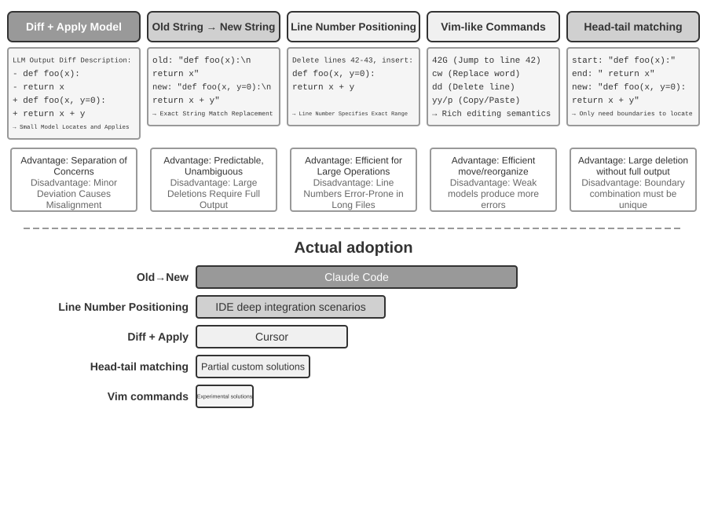
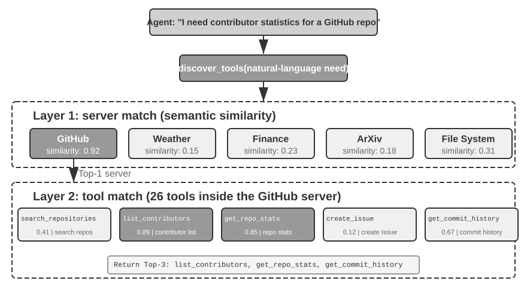

# 3 — Tool Design as Harness Surface

> Tools are the agent's action surface, and their descriptions are the routing logic. This is where most harnesses leak.

The tool interface is the part of an agent that most often decides whether the model's ability reaches the task. SWE-agent resolved 18.0% of SWE-bench Lite with a purpose-built interface and 11.0% through a plain shell, with the same GPT-4 Turbo. A vague description sends calls to the wrong tool, a silent truncation makes the model believe it saw a whole file, and an unguarded retry on a write charges a customer three times. This chapter covers how to design the agent-computer interface so those failures stop at the boundary.

---

## ACI, not API

Tool design follows **ACI principles — Agent-Computer Interface, not Application Programming Interface.** A tool is designed for a reader that has no documentation, no type hints, no autocomplete, and no ability to ask a follow-up question. It sees a name, a description, and a parameter schema.

The term comes from SWE-agent ([arXiv:2405.15793](https://arxiv.org/abs/2405.15793), Yang et al., 2024-05), which measured it: the same GPT-4 Turbo resolved 18.0% of SWE-bench Lite through a purpose-built interface (a windowed file viewer, summarized search, an editor that lints every edit) against 11.0% through a plain Linux shell.

Consequences:

- **Boundaries must be explicit.** Where one tool ends and the next begins has to be legible from descriptions alone.
- **Parameters must be error-proof.** Prefer enums over free strings, absolute paths over relative, required over optional-with-surprising-default.
- **Examples belong inside the definition**, not in external docs. Content invisible to the agent is non-existent.

The debugging heuristic that follows:

> When a tool is used wrongly, **check the tool description before questioning the model's capability.**

Guo et al. ([arXiv:2602.20426](https://arxiv.org/abs/2602.20426), 2026-02, preprint, Intuit AI Research) measured how much this matters. Their opening case is a tool that "Fetches the year a particular scientific work was published": the agent passed "Law of Universal Gravitation" as `work_title`, and adding the words "full title" fixed it. On the multi-step queries of StableToolBench (764 solvable queries in all), with GPT-4.1 choosing the tools (teacher-forced, run count not stated), rewriting the original developer descriptions raised query-level success **from 33.5 to 41.5 with a guideline-based prompted rewrite** (the paper's D1, no execution traces, though its guidelines were tuned against agent performance) and to 44.6 with their fine-tuned 4B rewriter. On single-step queries there was almost nothing to gain (59.2 to 61.6). The rewrites kept adding the same five things, which work as a checklist: the scope, including when *not* to use the tool; dependencies on other tools; what the output contains; constraints on each parameter; and parameters that must or must not appear together. The test set is REST APIs only, the larger-catalog results are read off a figure where 90% of the extra tools are random, and the authors warn that the rewriter "may occasionally hallucinate constraints" the server doesn't enforce.

---

## The clarity test

Anthropic's test for a tool set:

> **"If a human engineer can't definitively say which tool should be used in a given situation, an AI agent can't be expected to do better."**

Hand your tool list to a colleague with no context, describe three realistic tasks, and ask which tool they'd reach for. Every hesitation is a bug in a description or an overlap that needs collapsing.

Tools should be **"self-contained, robust to error, and extremely clear with respect to their intended use."** The dominant failure mode is **bloated tool sets with overlapping functionality**. LangChain's Terminal Bench gain came partly from *reducing* tools. Subtraction is a legitimate optimization.

---

## Capability form and granularity

First decide what *kind* of capability this is. Li gives three calls:

| Decision | Default | Exception |
|---|---|---|
| **Form:** dedicated tool vs. Skill + general executor (bash, code interpreter) | Skill + executor when parameters are complex, the procedure changes often, or the model is strong enough to compose it | A dedicated tool when the call is frequent, the parameters are simple, or a smaller model has to get it right every time |
| **Granularity:** one tool per format vs. one tool with a type parameter | One `read_document(path, file_type)` beats `read_pdf` / `read_docx` / `read_xlsx` | Split only when the formats need genuinely different arguments |
| **Generality:** a general `code_interpreter` vs. a narrow tool | General: it covers the long tail for free | Narrow when security, permissions or performance demand it, or when the general route is unreliable. `grep` is dedicated because its flags differ across operating systems |

Selection accuracy falls off once a model faces more than roughly a hundred tools, so every dedicated tool spends a shared budget. That is the quantitative case for the subtraction rule above.

For strong current models the default has moved further toward the general executor. Mak et al. ([arXiv:2609.11999](https://arxiv.org/abs/2609.11999), 2026-09) ran Opus-4.8 and GPT-5.5 on TheAgentCompany and APEX-Agents under five interfaces. Bash alone beat a typed-tool catalog by 21.8–24.5 pp on TheAgentCompany and 4.8–7.4 pp on APEX-Agents "while using 19–72% fewer total tokens"; Opus-4.8 on TheAgentCompany went from 44.9% at $1.20 per task with typed tools to 69.4% at $0.37 with bash. Adding the typed tools on top of bash changed nothing (−0.6 pp, 95% CI [−3.0, +1.9]). Their rule: "favor bash alone when arbitrary execution can be isolated and PTC when security or compliance policies require a fixed tool catalog," where PTC (programmatic tool calling) means the model writes code against the fixed tools. This doesn't overturn SWE-agent. Its 2024 win was over a *bare* shell for GPT-4 Turbo, and the principles behind it (bounded output, feedback on every action) still hold; what has changed is that a frontier model no longer needs bespoke commands to apply them. The authors warn their results "may not carry over to later releases," so re-run the comparison when you change models.

An earlier result points the same way. OpenHands-Versa ([arXiv:2506.03011](https://arxiv.org/abs/2506.03011) (Soni et al., 2025-06, preprint, CMU / All Hands AI)) added general tools to OpenHands: API web search, visual browsing with a condenser that keeps only the latest page, and a file viewer that converts files to Markdown. It also added a periodic planning prompt. Holding claude-3.7-sonnet fixed, GAIA rose **from 37.21% to 51.16%** and TheAgentCompany from 26.29% to 30.86%, while SWE-Bench Multimodal stayed flat (31.72% vs. 31.33%). Results are pass@1 at temperature 0, and the run count isn't stated. The changes were never ablated one at a time, so the 13.9-point GAIA gain isn't attributed to any of them. What the paper does isolate is how much one tool's output quality matters. Swapping the search API from Brave's raw page snippets to Tavily's LLM-written summaries moved GAIA validation from 56.96% to 64.24%. Its comparisons against specialist multi-agent systems mix models, so they don't show that the architecture caused the gap.

How well PTC works depends on how recent the model is. Patel et al. ([arXiv:2608.06370](https://arxiv.org/abs/2608.06370), 2026-08, preprint, PwC) exposed tools as typed Python stubs, had the model write one script calling them, and compared that with native JSON calls. The test was a 309-entry sample of BFCL v4 across 14 models, at temperature 0 (one pass per cell as far as the paper reports). PTC matched or beat JSON for 11 of the 14 models, including all five Anthropic models. GPT-4o, GPT-4.1 and GPT-5.4-mini fell 19.7 to 26.9 points behind, all for the same reason: they wrote a literal `\n` into multiline scripts, a syntax error the single-script setup couldn't recover from. **Averaged over all 14 models, the two were level (JSON 78.6, PTC 77.0).** Wide fan-out is where PTC helped. Claude Sonnet 5 making JSON calls fell from 100% at 70 parallel calls to 0% at 100, while one PTC script stayed at 100%. GPT-5.6-Sol held 100% under JSON, so the cliff isn't universal. Above about 26 calls, the script was also cheaper in tokens. The stubs only echo their arguments back, so the scorer checks serialization, not task success. In the authors' words, "we measure argument serialization accuracy, not end-to-end tool-use correctness".

---

## The five-section tool contract

Vercel Academy's tool description structure, which turns a one-liner into a decision procedure:

| Section | Purpose |
|---|---|
| **What it does** | The operation, plainly |
| **WHEN TO USE** | Positive triggers — the situations this tool owns |
| **WHEN NOT TO USE** | Boundary cases that belong to a neighboring tool |
| **DO NOT USE FOR** | Hard negatives — misuse patterns seen in practice |
| **EXAMPLES** | Concrete invocations with realistic arguments |

The two negative sections do the heavy lifting: positives alone leave the model to infer boundaries, and explicit negatives disambiguate `search` from `grep` from `read`. Each entry in `DO NOT USE FOR` should be **ratchet output** — traceable to an actual observed misuse ([note 01](01-what-a-harness-is.md#the-ratchet)).

Li adds three things the description must carry:

- **Concrete formats, not types.** "Phone number in E.164, e.g. `+14155550123`" and "RFC 3339 timestamp" leave no room for guessing; "a string" leaves all of it.
- **Return value and cost.** Say what comes back, how large it can be, and whether the call is slow, paid, or rate-limited, so the model can plan around it.
- **One to five invocation examples.** In the book's measurement, adding examples moved tool-call accuracy from about 72% to 90%. Negative boundaries ("don't use this for X") matter more than restating capabilities.

Structurally, separate the **contract** (schema + description) from the **execution logic** via a factory pattern. Contracts are prompt-engineering artifacts that get iterated on and versioned; implementations are code. Coupling them means every wording change touches executable code.

---

## The four gating questions

Before a tool ships:

1. **Reversible?** — can its effect be undone?
2. **Idempotent?** — is calling it twice the same as once?
3. **Observable?** — does it emit a trace the harness can inspect?
4. **Parallel-safe?** — can two instances run concurrently without corruption?

**A tool that fails #1 needs a confirmation gate.** A tool that fails #2 must not be retried without an idempotency key. A tool that fails #3 cannot be debugged. A tool that fails #4 must be serialized in the orchestrator.

---

## Schema rules

- `snake_case` **verb-noun** names — `read_file`, `create_issue`, `send_email`. The name is the first routing signal.
- **Side effects declared in the description**, not just implied by the name.
- **Typed return structure** — never a bare string when the next step needs to branch on the result.
- **Structured errors** with a stable `error_code`, plus `is_fatal` and `retry_after` where relevant. An error the agent can classify is an error it can recover from; a stringly-typed one forces guessing.
- **Token-efficient returns.** Tools should "encourage efficient agent behavior by returning token-efficient information." Return the answer and offload the raw dump to disk with a path reference.

### Parameter fidelity

The world the model sees and the world the tool acts on must not drift apart systematically. Two failure shapes:

- **Silent input transformation.** The harness "helpfully" normalizes arguments. Li's example: a coding tool converted curly quotes to straight quotes before an exact-match edit, so edits to files that genuinely contained curly quotes failed in a way the model could not see or diagnose.
- **Silent parameter injection.** The tool adds flags or behaviour the model didn't ask for, such as an extra option on `git commit`. The model's mental model of what happened is now wrong, and so is every later step built on it.

If a transformation is necessary, return it in the result ("normalized 3 quote characters") so the model's picture stays true.

### Parameters as a checklist; ground truth as the gate

Li's τ-bench airline example (ch. 5) puts the policy check **inside** the execution tool, in two layers:

```python
def cancel_reservation(reservation_id, reason,
                       expected_cabin_class=None,    # model's belief, for audit only
                       expected_has_insurance=None):
    """Cancel a reservation. Policy (enforced server-side): no used segments;
    always OK within 24h of booking, if the airline cancelled, or for business;
    economy needs insurance. Look up the reservation and check each rule first."""
    r = db.get_reservation(reservation_id)   # facts from the DB, never from args
    now = server_clock.now()                 # time from the server, never from args
    if expected_cabin_class not in (None, r.cabin_class):
        log_mismatch(...)                    # wrong belief, or injection
    ...                                      # rules evaluated on r and now only
```

- **The optional `expected_*` parameters are a forced checklist.** To fill them in, the model has to look the facts up first, and it often notices the violation and offers an alternative ("economy without insurance can't be cancelled; you could rebook") without making the call at all.
- **They carry no authority.** Every policy fact comes from the database and the server clock. A model-supplied `current_time` or `has_insurance` would be one hallucination or one injection away from bypassing the gate. Log mismatches between belief and ground truth; the mismatch rate is the argument for keeping the server check.

Keep the rules in the system prompt as well, so the model can *explain* the policy and suggest compliant alternatives. Prompt rules are for understanding; code rules are the gate. Lab: [5-3 codified rules for a small model](https://github.com/bojieli/ai-agent-book/tree/main/chapter5/small-model-codified-rules) (upstream; Chinese).

Zod (or Pydantic) schemas give you validation and the model-facing schema from one definition. Pin versions deliberately — Vercel's course notes Zod v3 specifically for AI SDK v6 compatibility, since v4 introduces type breaks.

---

## Output discipline

The return path is as much a part of the tool as the call. Rules by tool type:

| Tool type | Rule |
|---|---|
| **Search** | Structured results (title, location, snippet, score) with pagination; never one unbounded blob. |
| **Read** | `offset`/`limit` windows, and **visible** truncation ("lines 1–200 of 4,812"). Silent truncation is the dangerous case: the model believes it saw the whole file. |
| **Read-only, generally** | Safe to cache and to run in parallel. Mark them so the orchestrator can. |
| **Execution** | Fail fast on invalid input. For long output, return the head 50 and tail 50 lines and save the full output to a file whose path is in the result. |
| **File writes** | Run the linter automatically after the write and return its findings with the result, so errors are fixed while the context is still fresh. |
| **Multimodal input** | Choose deliberately between passing the image and passing OCR text. Layout-heavy content needs the image; dense text is cheaper and more reliable as OCR. |
| **Bulk data** | Use the **artifact pattern**. The model writes the SQL (and optionally the chart code); the system executes it and renders rows straight to the user. Data never passes through the model, which is slow and error-prone at transcribing thousands of rows. |

SWE-agent's ablations (GPT-4 Turbo, SWE-bench Lite, 18.0% for the full interface) put numbers on several of these rules. Search that returned a summary of which files matched scored 18.0%; search that paged through matches one at a time scored 12.0%, worse than no search tool at all (15.7%), because agents "tend to look through every match exhaustively." A 100-line file window scored 18.0%, a 30-line window 14.3%, and showing the whole file 12.7%. Dropping the lint-on-edit check cost 3 points (15.0%), and keeping full history instead of collapsing all but the last five observations cost 3 more (15.0%). Failed edits compound: any edit attempt had a 90.5% chance of eventually succeeding, but after one failed edit that fell to 57.2%, so a check that catches a bad write immediately is worth more than it looks.

**Parallel calls need fault boundaries.** Each tool declares whether it is concurrency-safe (default: no). Execution of a call can begin as soon as its arguments finish streaming and validate. A failure aborts only the calls in the same batch that depend on it; the independent calls and the parent task carry on.

**`tool_choice` turns tool use from the model's call into yours** (*Building Applications with AI Agents*, ch. 4). `auto` lets the model decide, which suits general use. `required` (`any` on some APIs) forces at least one call, for steps whose answer has to come from a tool. `none` blocks calls, which is useful in tests or for a final prose turn. Pinning a named tool makes a step deterministic. A pipeline step that must extract into a schema should pin the tool rather than hope the model chooses it.

### Coding-agent search and edit tools


*Image Source: Li, [AI Agents in Depth](https://github.com/bojieli/ai-agent-book/blob/main/book-en/chapter5.md) (2026), Fig. 5-4 (Apache-2.0)*

Search, from coarse to fine:

| Method | Good for | Blind spot |
|---|---|---|
| **glob** | Mapping the project by path | Content |
| **grep / ripgrep** | Exact names, error strings, regex structure | Synonyms: "auth" won't find `check_credentials` |
| **Semantic search** (AST-aware chunks, hybrid BM25 + embeddings, reranker) | Exploring an unfamiliar codebase | An index to keep fresh; code sent to an embedding service |
| **LSP definitions and references** | Renames and call chains | Needs a language server |

Claude Code deliberately builds no index and relies on agentic grep and glob; Cursor pays for an index to get cross-file semantic recall. The choice weighs infrastructure cost and data egress against recall.

Editing schemes:

| Scheme | Trade-off |
|---|---|
| **Old string → new string** (Claude Code) | Predictable: it fails loudly if the match isn't unique. The cost: deleting a large block means reproducing all of it |
| **Start + end anchors → new string** | Same reliability, but a large deletion only needs its boundaries. The economical compromise |
| **Line ranges** | Cheap, but models miscount and the numbers shift after every edit. Viable only with an IDE that keeps a live line map |
| **Diff or skeleton + apply model** (Cursor) | High throughput with a trained fast-apply model; a naive merge lands in the wrong place |
| **Vim-like commands** | Efficient for moving code; small models struggle with the syntax |

Default to old→new string, and return line-numbered reads so references are precise.

---

## Progressive disclosure: skills

Loading every tool and MCP server at startup **degrades performance before the agent starts working** — context is consumed and selection accuracy drops as the candidate set grows.

Skills invert this. A short name and description (*what* + *when*, ~10 tokens) stay resident; the full procedure loads only when the task activates it. A capability library of dozens of skills costs a few hundred tokens at rest.

### Tool discovery at scale


*Image Source: Li, [AI Agents in Depth](https://github.com/bojieli/ai-agent-book/blob/main/book-en/chapter4.md) (2026), Fig. 4-2 (Apache-2.0)*

The cost of eager loading is concrete. Li measures five typical MCP servers at about 55K tokens of definitions, roughly 30% of a 200K window, before the first user message. The fixes, from heaviest to lightest:

1. **Retrieval pre-filter.** Embed tool descriptions and inject the top-k for the user's query. The limitation is that it matches **once**, against the opening request; "debug the file" can turn into a cross-domain tool chain nobody predicted.
2. **Proactive discovery.** The agent declares a capability gap mid-task, and the system matches and injects tools. MCP-Zero matches in two levels, server first and then tool, and reports about 98% fewer tokens than full injection across ~2,800 tools. Dynamic discovery took Opus 4 from 49% to 74% on Anthropic's tool-selection eval. The production form is a resident `tool_search` meta-tool: OpenAI's `defer_loading`, and Claude Code deferring MCP tools by default. When nothing scores above threshold, return an explicit **"not found"**, so the agent rephrases, improvises with basic tools, or builds a new one.
3. **Skills.** A thin resident catalog, read with ordinary file tools, with no embedding index to maintain. Cursor's version, a folder of tool descriptions the agent greps, cut tokens by 46.9%. Pi Coding Agent keeps MCP out of its core entirely and exposes it through a single ~200-token proxy tool.

Albada's comparison of selection strategies (*Building Applications with AI Agents*, ch. 5, Table 5-2) adds the trade-offs:

| Strategy | Strength | Weakness |
|---|---|---|
| **Standard** (all descriptions in the prompt, the model picks) | Simple; few-shot examples help | Scales poorly as tools are added |
| **Semantic** (embed descriptions, retrieve) | Scales to many tools; low latency | Worse accuracy from **semantic collisions** between similar descriptions |
| **Hierarchical** (pick a group, then a tool within it) | Scales, and more accurate when many tools look alike | Slower: sequential model calls |

For a step that may need several tools at once, his pattern retrieves a fixed maximum (say five) semantically, then has the model filter that shortlist down to what the task needs, and runs the survivors in parallel. Two description habits reduce collisions: **include an example invocation** with typical inputs and outputs, and **state type and range constraints** ("x and y must be integers between 0 and 1,000") so the model can rule a tool out.

When one request needs several skills, getting the decomposition right comes before getting the retrieval right. Gao ([arXiv:2606.18051](https://arxiv.org/abs/2606.18051) (Gao, 2026-06, preprint, Alibaba Cloud)) routed 300 synthetic multi-skill queries over 2,209 real MCP server descriptions. A Qwen2.5-7B decomposer splits each query into sub-tasks, and a MiniLM bi-encoder retrieves skills for each one. Plain decomposition got the number of sub-tasks right only **51.0%** of the time. A second pass that re-decomposes with the retrieved skill names as hints raised that to **67.7%**. Told the true count, the same 7B model reached 99.3%. Retrieval accuracy on the correct skill category barely moved (34.2% to 37.0%, not significant), and on queries where both methods split correctly it was identical. So the hints fix granularity, not vocabulary. Listing 100 skill names in a qwen-max prompt split well but picked the right category only 21.1% of the time (n=50). The setup has limits. The queries are templated, the metric is category recall rather than execution, the results come from one run of one 7B model, and the "99%" context saving assumes about 400 tokens per skill rather than measuring them.

The tool set can also be grown by the agent. [arXiv:2402.07456](https://arxiv.org/abs/2402.07456) (OS-Copilot, Wu et al., ICLR 2024) seeds a repository with 4 hand-made tools; when dense retrieval over the stored one-line descriptions finds nothing above a similarity threshold (value not given), the agent writes a new tool as a Python class whose short `_description` doubles as its retrieval key. A critic keeps a generated tool only if it scores above 8 of 10 for reuse, and a failed action gets at most three self-correction attempts. With GPT-4-turbo on GAIA level 1, learning moved the score from 36.56% to 40.86% (13 tools in all: 4 seed plus 9 learned). On 20 SheetCopilot spreadsheet tasks (Pass@1, GPT-4) the agent went from 0% to 60% after generating 10 tasks for itself and accumulating 8 tools, against 55% reported for SheetCopilot. The learned tools were small and single-purpose, such as `sort_excel_by_column`. Critic scores are LLM-assigned, the paper does not ablate retrieval or description wording, it reports one run per setting with no variance, and its own text and tables disagree on some figures.

**KV-cache rule for dynamic tools.** Never insert a newly loaded schema into the static prefix; that invalidates the whole cache. Append it at the end of the context *on the turn it is discovered*, and then leave it pinned where it landed, where it becomes ordinary cached history. Cache invalidation then comes only from TTL expiry or from modifying, removing or reordering tools already loaded. The cost is that weaker models handle schemas mid-trajectory poorly and may need post-training for it.

MCP solves **interoperability**. Skills solve **choice overload**. They are complementary, not rivals. A pattern seen early with skills: accuracy drops in the gap between calling one tool and orchestrating several. Skills close part of that gap by making the multi-tool procedure explicit without bloating the system prompt. What matters is tool quality, not tool quantity.

Skill benefits shrink as the setup gets realistic. [arXiv:2604.04323](https://arxiv.org/abs/2604.04323) (Liu et al., 2026-04, preprint) tested Claude Opus 4.6 in Claude Code on SkillsBench (84 tasks, 3 runs each, a pool of 34,198 real skills). Pass rate was **55.4%** with curated skills force-loaded, 51.2% when the agent had to decide to load them, 43.5% with distractor skills added, and 38.4% with skills retrieved from the pool without the curated ones, against 35.4% with no skills. Only 49% of trajectories loaded all the curated skills (31% with distractors). Weaker models did worse than their no-skill baseline when given irrelevant retrieved skills (Kimi K2.5 19.8% vs. 21.8%, Qwen3.5-397B 19.7% vs. 20.5%). A single task-specific refinement pass, where the agent attempts the task and then merges the skills it used, lifted Claude from 40.1% to 48.2% on SkillsBench and from 61.4% (retrieved) to 65.5% on Terminal-Bench 2.0 (89 tasks; 57.7% with no skills), but it could not help when no relevant skill was in the pool. Each model ran in its own harness, so model and harness are confounded, and the paper reports no variance. It does not measure token cost, so it neither supports nor contradicts the figures above.

This is the same mechanism as layer 2 in [02-context-engineering/notes/02](../../02-context-engineering/notes/02-context-anatomy.md#layer-2--on-demand-knowledge), applied to capability rather than knowledge.

### Writing a skill

OpenAI's [skills and shell tips](https://developers.openai.com/blog/skills-shell-tips) reduce to six rules.

**1. The description is routing logic, not documentation.** It is the only text the agent has when it decides whether to load the skill, and it sits in every window. It should say when to use the skill, when not to, and what success looks like. Keep it terse:

```yaml
# bad (~45 tokens): details that belong in the body
description: |
  This skill handles the complete deployment process to production.
  It covers environment checks, rollback procedures, and post-deploy
  verification. Use this before deploying any code to production.

# good (~9 tokens): the same routing signal
description: Use when deploying to production or rolling back.
```

**2. Add negative examples.** A misfire costs a full body load plus a wrong-track start. "Don't call this skill when… (and what to do instead)" is worth more than another positive example, because the positive case is usually obvious from the name and the negative case never is.

**3. Put templates and worked examples inside the skill.** They cost nothing until the skill fires, so the body is the right home for bulky, consistently shaped outputs: structured reports, escalation triage summaries, account plans, data-analysis write-ups. A worked example in the body beats a paragraph describing the format.

**4. Design for long runs early.** A skill that runs for more than a few minutes should assume it will be interrupted: write progress to disk and resume from a checkpoint ([02-context/05](../../02-context-engineering/notes/05-compression-compaction.md#crash-recovery)).

**5. For determinism, invoke explicitly.** Routing on descriptions is probabilistic. When a skill must run, write `Use the <skill name> skill.` in the instruction.

**6. Skills plus network is an exfiltration path.** A skill body is instructions the agent follows. An injected instruction with network reach can move data out. The defensible default is **skills allowed, shell allowed, network on a minimal per-task allowlist**. Treat tool output as untrusted ([note 04](04-execution-boundaries.md#the-five-protection-layers)).

Skills also improve with use. Karpathy's line (as relayed from his AISN 2026 talk): *"the best way to find a leak in a hose is to run water through it."* Run the skill on real tasks, fix what breaks, and the skill set compounds ([note 09](09-repo-as-system-of-record.md#karpathys-environment-layer)).

---

## MCP, write safety and asynchronous tools

The protocol, its supply-chain risks, write-operation safety, tools over persistent state and asynchronous tool interfaces continue in [note 3b](03b-mcp-write-safety-and-async-tools.md). Start there for [MCP vs. in-process](03b-mcp-write-safety-and-async-tools.md#mcp-vs-in-process), [the protocol](03b-mcp-write-safety-and-async-tools.md#the-protocol), [write-operation safety](03b-mcp-write-safety-and-async-tools.md#write-operation-safety) and [asynchronous tool interfaces](03b-mcp-write-safety-and-async-tools.md#asynchronous-tool-interfaces).

---

## Pitfalls

- **Silent truncation.** Symptom: the agent reasons confidently from a file it only saw part of. Fix: make it visible ("lines 1–200 of 4,812"), with `offset`/`limit` windows.
- **Paging search results one at a time.** Symptom: the agent walks every match. SWE-agent's paged search scored 12.0%, below no search at all at 15.7%, against 18.0% for a summary. Fix: return a summary of which files matched.
- **Auto-retrying a write with no idempotency key.** Symptom: one transient timeout becomes three charged invoices. Fix: apply the four gating questions. A tool that isn't idempotent is not retried without a key.
- **Descriptions with only positive guidance.** Symptom: the model confuses `search`, `grep` and `read`. Fix: add WHEN NOT TO USE and DO NOT USE FOR, ratcheted from real misuse, plus examples. In Li's book, examples moved tool-call accuracy from about 72% to 90%.
- **Loading every MCP definition up front.** Symptom: about 55K tokens, roughly 30% of a 200K window, spent on five servers before the first user message (Li's measurement). Fix: progressive disclosure or discovery, keeping the stable prefix intact for the cache.
- **Helpful silent argument changes.** Symptom: edits to files with curly quotes fail in a way the model can't diagnose, because the tool straightened its input. Fix: pass arguments through unchanged, or say in the result what changed.
- **Treating tool descriptions as trusted config.** Symptom: a server update quietly adds an instruction such as reading `~/.ssh` and passing it as `notes`. Fix: review descriptions as code, diff them on every update, namespace per server, and break the lethal triad.
- **A tool name that implies the work is finished.** Symptom: the model treats `phone_call` as complete when it returns. Fix: name the initiation, as in `initiate_phone_call`, and report `phone_call_connected` and `phone_call_ended` as later events.

## Try it

1. Run the four gating questions on `charge_card(customer_id, amount_cents)` and say what the harness must do for each one that fails.

   <details><summary>Answer</summary>

   It isn't cleanly reversible, so it needs a confirmation gate. As written it isn't idempotent, so it must not be retried without an idempotency key; adding one is the better fix. It is observable only if it emits a trace the harness can inspect. Two concurrent charges aren't safe, so calls per customer are serialized.

   </details>

2. Five MCP servers cost about 55K tokens in Li's measurement. How many of a 200K window remain, and what is the first fix you try?

   <details><summary>Answer</summary>

   145K, with 27.5% gone (the note rounds to roughly 30%) before the first user message. Start with lazy loading or discovery, keeping tool definitions out of the changing part of the prefix so the KV cache survives. Measure selection accuracy afterwards, since selection falls as the visible catalog grows.

   </details>

3. Run the pillar lab, [tool-server-sandbox-py](../practice/tool-server-sandbox-py/README.md) or its [TypeScript twin](../practice/tool-server-sandbox/README.md), and read what the model sees when a call is blocked. Then add a tool of your own that returns a structured error.

   <details><summary>What to check</summary>

   A blocked call returns a tool error the model can read and doesn't end the session. Your error should carry a stable `error_code`, plus `is_fatal` and `retry_after` where relevant, so the agent can classify it instead of guessing from a string.

   </details>

## Interview checklist

| Prompt | Answer in one line |
|---|---|
| Give evidence that the interface matters independently of the model. | SWE-agent: the same GPT-4 Turbo resolved 18.0% of SWE-bench Lite through a purpose-built interface and 11.0% through a plain shell. |
| Typed catalog or bash for a strong current model? | Mak et al. found bash alone beat a typed catalog by 21.8–24.5 pp on TheAgentCompany and 4.8–7.4 pp on APEX-Agents with Opus-4.8 and GPT-5.5, using fewer tokens. Keep typed tools for steps needing a gate, an audit record or a retry policy. |
| What are the four gating questions? | Reversible, idempotent, observable, parallel-safe. Failing them means, in order, a confirmation gate, no retry without an idempotency key, undebuggable, and serialized execution. |
| A payment tool timed out and the customer was charged three times. What went wrong? | A non-idempotent write was auto-retried. Tools without idempotency keys must not be auto-retried, and the fix is a key on the call plus a query-before-mutate check. |
| Why are negative boundaries in a description worth writing? | Positive descriptions leave the model to infer the boundary between similar tools. WHEN NOT TO USE and DO NOT USE FOR disambiguate `search`, `grep` and `read`, and each entry should come from observed misuse. |
| Your agent has about 100 tools and picks wrongly. What are your options? | Merge overlapping tools, namespace the rest, and stop loading every definition up front. Use progressive disclosure or discovery, keeping dynamic content out of the cached prefix. |
| Dedicated tool or Skill plus a general executor? | Use a Skill plus executor when parameters are complex, the procedure changes often, or the model is strong enough to compose it. Use a dedicated tool when the call is frequent, parameters are simple, or a smaller model must get it right every time. |
| How do you make tool parameters error-proof? | Prefer enums over free strings, absolute paths over relative ones, and required parameters over optional ones with surprising defaults, so the mistake is harder to make. |

## Next

[03b-mcp-write-safety-and-async-tools.md](03b-mcp-write-safety-and-async-tools.md): MCP, safe writes and asynchronous tools.
