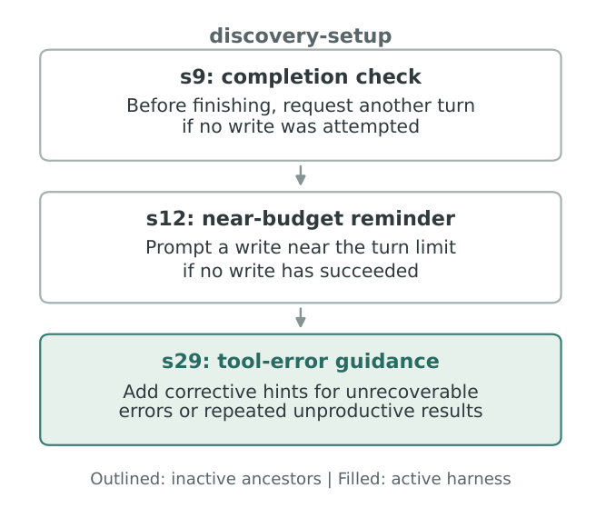
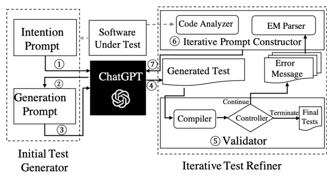

# 5b — Recovery, Retries and Termination

> A failed check helps only if the harness knows what to do next: re-plan, retry, back off or stop.

[Note 05](05-verification-loops.md) turned an agent's "done" into evidence. This note covers what the harness does when the evidence says no. Left alone, an agent that fails a gate produces a small mutation of the same broken fix, again and again. A retry policy that treats a 429, a refusal and a bad spec alike either burns money or gives up too early, and an error path with no ceiling can fail thousands of times in a row. This chapter covers loop detection and the nudges a harness injects, failures sorted by layer, the retry taxonomy and its budgets, and reasoning budgets.

---

## Loop detection

The doom loop: an agent produces 10+ variations of a broken solution, each a small mutation of the last, converging on nothing.

`LoopDetectionMiddleware` tracks **per-file edit counts** and triggers a *"reconsider your approach"* prompt after N edits. The intervention is deliberately not a hard stop — it forces re-planning rather than repair, which is the actual missing move.

Paired with the **two-retry rule**:

> **Cap retries at two per gate failure. Beyond that, the problem is in the context or the specification — not the execution.**

Three failures on the same gate means the agent lacks information or the spec is wrong. More attempts spend money to confirm that.

### Nudges the harness injects

Loop detection is one of several messages a harness can inject at a set point in the run. The Object-Oriented Harness paper (Li G. et al., 2026) evolved harnesses as a class hierarchy. One lineage, for tasks whose deliverable is a written file, added three injected nudges, each subclass inheriting the one before:


*Image Source: Li G. et al. (2026)*

- **Completion check** (s9). Before the agent finishes, request another turn if it never attempted a write. A narrow version of `PreCompletionChecklistMiddleware` ([note 05](05-verification-loops.md#the-self-verification-loop)).
- **Near-budget reminder** (s12). Near the turn limit, if no write has succeeded yet, prompt the agent to write now instead of exploring further.
- **Tool-error guidance** (s29). Add corrective hints for unrecoverable errors or repeated unproductive results, rather than a bare stack trace ([agent-oriented error messages](05-verification-loops.md#agent-oriented-error-messages)).

Each one is a hook ([note 04](04-execution-boundaries.md#hooks-deterministic-control-flow)), not a sentence in the system prompt. It fires at the right moment instead of competing for attention from the start.

---

## Failure, recovery, and termination

Li's taxonomy (ch. 5, distilled from production harness source code) sorts failures by layer:

| Layer | Examples |
|---|---|
| **API** | 429s, overload, timeouts, dropped connections, output cut off at the token limit |
| **Tool** | Hallucinated tool names, malformed arguments, execution exceptions, the same error returned again and again |
| **Context** | Window overflow, failed compaction, a tool call without its paired result |
| **Control flow** | No-progress loops, and **death spirals**, where error handling calls the LLM, fails, and cascades |

**Detect: classify, then count.** Ask whether a retry could help before retrying. Fingerprint `hash(tool, args)`; a repeated fingerprint means a no-progress loop. Keep a separate failure counter for each recovery path. Some failures never raise an error:

- **Silent stalls.** A streaming connection stays open with no data. SDK timeouts usually cover only connection setup, so add an idle watchdog. Every long-lived connection needs a liveness signal.
- **Broken trajectories.** Repair an unpaired tool call before sending the context. Production may patch it with a placeholder; a training-data collection mode should refuse, because synthetic placeholders pollute training data.

**Recover: escalate through increasingly visible stages.**

1. **Silent retry**, with backoff and jitter, honouring `retry-after`. Retry the main loop; *drop* failed background calls such as title generation, so they don't amplify into quota contention.
2. **Degrade and continue.** On truncation, raise the output cap, then ask the model to continue from the break. On persistent overload, fall back to another model, stripping provider-specific blocks from the history first.
3. **Surface to the user**, along with what was already tried. Albada's UX version (*Building Applications with AI Agents*, ch. 3): say what can't be done, offer an alternative or a hand-off to a human, and keep the user's context so they don't have to repeat themselves. For background work, the same rule applies before anything fails: tell the user when the task starts, give an estimated completion time, and end with a short summary.

Tool-layer errors never end the session. They come back as structured tool results, and malformed arguments are repaired programmatically. Treat the **whole recovery loop** as the unit: hold back intermediate errors from users and event subscribers until recovery has definitely failed.

**Terminate: every recovery path needs a ceiling, set from data.** Claude Code's compaction breaker trips after **3** consecutive failures. Before it existed, one session failed more than 3,000 times in a row, futile retries cost about 250,000 API calls a day globally, and over 1,000 sessions saw streaks of 50+. For death spirals, disable model-invoking side effects on the error path (a stop hook that writes a commit message by calling the LLM, after a context overflow, is the classic case) and add a recursion-depth counter. Above all of this sit max turns, a session budget, and escalation to a human.

---

## Retry taxonomy

Not all failures are retryable:

| Failure | Response |
|---|---|
| **Transient** (network, rate limit) | Retry with exponential backoff (2×, jitter ±20%), max 3 |
| **Tool error** | Retry once, then escalate |
| **Model refusal** | **Never retry** — it will refuse again |
| **Schema violation** | Return the validation error; retry once with it in context |
| **Context exhaustion** | Compact or reset, then resume ([note 06](06-long-horizon-execution.md)) |
| **Fatal** | Stop; surface the error |

Albada's corrective flow for malformed calls (*Building Applications with AI Agents*, ch. 4) sharpens the schema row. **Validate** every response against the schema (jsonschema or Pydantic). If a required tool call was skipped, trigger it yourself; if the JSON is invalid, ask the model to fix it. **Regenerate only the broken part** rather than the whole exchange. When retries run out, **fall back**: a backup model, a clarifying question to the user, cached data, or a safe default. Log every validation error, retry and fallback.

A common shortcut breaks the "not all failures are retryable" rule. Rothman's hardened engine (*Context Engineering for Multi-Agent Systems*, ch. 5) decorates its LLM and embedding calls with tenacity's `@retry(wait=wait_random_exponential(min=1, max=60), stop=stop_after_attempt(6))`. With no `retry=` filter, that retries **every** exception, refusals and bugs included, and the waits alone can add minutes before the first real failure shows. Its good half: after the last attempt the wrapper logs and re-raises, so the executor halts instead of passing on an empty string. Restrict the decorator to transient error types (`retry=retry_if_exception_type((RateLimitError, APIConnectionError, APITimeoutError))`).

Retry budget is **per-invocation, not per-tool** — otherwise five tools with three retries each become fifteen attempts. Circuit-break after 5 consecutive failures with a 60s cooldown, then fail fast.

**Degrade loudly.** A partial result carries a `degraded: true` flag; silent degradation is worse than failure because it looks like success.

### Retry at two levels

A single retry tier is too coarse for a multi-step workflow. PRINCE retries at **both the individual LLM call and the logical node** — the whole step in the agent's plan:

- **Call-level** absorbs transient noise: a timeout, a rate limit, a malformed response. Nothing about the plan was wrong.
- **Node-level** re-runs the step. Use it when the call succeeded but the step didn't achieve its purpose.

Retrying the wrong level wastes the attempt: re-issuing a call cannot fix a step whose *approach* was wrong, and re-running a whole node to recover from a rate limit pays for work that already succeeded.

### Feed the error back as context

The move that makes retries more than repetition:

> **Give the agent the error, not just another attempt.**

An identical retry re-runs the reasoning that just failed and tends to fail identically. PRINCE passes the failure back in — the database error message, the generated query, and the original context all return to the model, which then produces a *corrected* query rather than the same one. Capped at 3 attempts, after which the tool reports failure honestly.

This is the same instinct as the schema-violation row above (return the validation error, retry with it in context) generalized to every retryable failure, and it's what makes a retry a re-plan. It also explains why the two-retry rule holds: once the error is already in context, further attempts add no new information, so a third failure genuinely indicates a bad spec rather than bad luck.

How much the error is worth, and where it stops paying. In InterCode ([arXiv:2306.14898](https://arxiv.org/abs/2306.14898) (Yang et al., NeurIPS 2023 Datasets and Benchmarks)), letting the model see execution output and retry for up to 10 turns took GPT-4 from **9.1% to 73.7%** on 1,034 Spider-derived SQL tasks, and gpt-3.5-turbo from 10.5% to 47.3%; on 200 NL2Bash-derived shell tasks the gain was smaller (GPT-4 34.0% → 48.5%). Two limits. The retrying agent saw a reward computed from the gold answer and stopped once it reached 1, so this measures retry against an oracle, not self-verification. And the curves plateau: in later turns models make *"small, cursory adjustments to the prior action"*, repeat earlier moves and ignore fresh observations, which is the empirical case for the attempt cap above and for [loop detection](#loop-detection). A reasoning scaffold helped on SQL (ReAct 58.7% vs. 47.3% for plain retry, gpt-3.5-turbo) and hurt on Bash (20.5% vs. 46.5%), so no one retry prompt wins everywhere.

The same loop with a real stopping rule, and its blind spot. ChatTester ([arXiv:2305.04207](https://arxiv.org/abs/2305.04207) (Yuan et al., FSE 2024)) feeds Java compiler errors, the buggy line and the missing class context back to gpt-3.5-turbo, and counts a round as invalid when the error count doesn't fall; once more than three invalid rounds have accumulated, the loop ends. On 100 focal methods the repair loop alone lifted compilation from 39.0% to 60.6% and passing tests from 22.3% to 34.0% (73.3% and 41.0% with an intention-first prompt added), at about 30 s per round. It repairs only compile errors, because a failing run could mean a bad test or a bad method, and that leaves the main failure untouched: in the 1,000-method baseline study, **85.5% of tests that compiled but failed did so on an assertion, and every one inspected was a wrong assertion rather than a real bug**. A green compile is layer 1 of the [termination check](05-verification-loops.md#the-three-layer-termination-check), not evidence the test checks anything.


*Image Source: Yuan et al., [No More Manual Tests? Evaluating and Improving ChatGPT for Unit Test Generation](https://arxiv.org/abs/2305.04207) (FSE 2024), Fig. 7*

---

## Reasoning budgets

Where models expose reasoning effort tiers, spend asymmetrically — the **"reasoning sandwich"**:

```
planning:     extra-high
execution:    high
verification: extra-high
```

High effort at the ends, where decisions are made and checked; moderate through the middle, where work is mechanical. LangChain found this split avoided timeouts while preserving quality. The shape mirrors [asymmetric QA](05-verification-loops.md#asymmetric-qa) — pay for judgment, economize on labor.

What a budget buys is feedback, not tokens. Zhang et al. ([arXiv:2605.29682](https://arxiv.org/abs/2605.29682) (Zhang et al., 2026-05, preprint, Harbin Institute of Technology)) scored each feedback event for how informative, valid, non-redundant and retained it was. Raw spend predicted harness failure rates poorly (R² 0.27 for tokens and 0.01 for cost on their synthetic tasks). Their feedback measure, normalised by how hard the task is, reached 0.99 there and 0.93 on pooled traces from HumanEval, Terminal-Bench 2.0 and SWE-bench Verified. **On the synthetic tasks, holding cost and tool calls fixed and changing only feedback quality raised success from 0.27 to 0.90.** Verifier strength was one of the three largest levers, alongside routing quality and memory fidelity. Read this as direction, not law. The core experiments are partly simulated harness roles, the real-trace scores use gates and constants the authors set by hand, the R² values are fits to group averages, and the paper gives no task counts, run counts or dollar costs. It uses only three small models.

---

## Pitfalls

- **Retrying a refusal or a bad spec.** Symptom: three identical failures and a growing bill. Fix: use the retry taxonomy. Never retry a refusal. After two failed retries, treat the problem as a bad spec, since a third attempt adds no information.
- **A retry budget per tool.** Symptom: five tools with three retries each become fifteen attempts. Fix: budget per invocation, with a circuit breaker after 5 consecutive failures and a 60s cooldown.
- **Treating error handling as free.** Symptom: an error path calls the LLM, fails, and cascades. Before Claude Code's compaction breaker, which now trips after 3 consecutive failures, one session failed more than 3,000 times in a row. Fix: every recovery path gets a ceiling set from data.

## Try it

1. Classify each failure and choose a response from the retry taxonomy: a 429, a safety refusal, JSON missing a required field, a window overflow.

   <details><summary>Answer</summary>

   429: transient, exponential backoff with jitter, max 3. Refusal: never retry, because it will refuse again. Missing field: schema violation, return the validation error and retry once with it in context. Overflow: context exhaustion, compact or reset and resume.

   </details>

## Interview checklist

| Prompt | Answer in one line |
|---|---|
| How do you stop an agent stuck on the same bug? | Track per-file edit counts or a `hash(tool, args)` fingerprint and prompt "reconsider your approach" after N. After two failed retries, assume a bad spec. A hard stop alone doesn't force re-planning. |
| Why is a retry budget per invocation? | Otherwise five tools with three retries each become fifteen attempts. Add a circuit breaker after 5 consecutive failures, with a 60s cooldown, then fail fast. |
| An agent edits the same file a dozen times. Is a hard stop the fix? | No. A hard stop ends the run without a new plan. Count edits per file and inject a "reconsider your approach" prompt, so the agent re-plans instead of repairing. |

## Next

[06-long-horizon-execution.md](06-long-horizon-execution.md): surviving past one context window.
