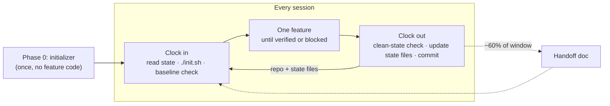
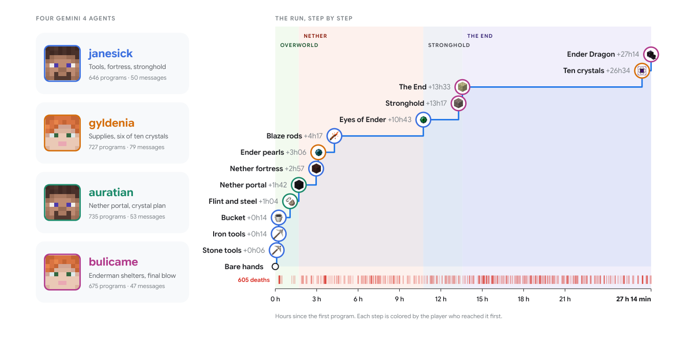

# 6 — Long-Horizon Execution

> Work that outlasts a single context window. The harness's job is to make the loop re-entrant.

---

## The problem

Long-horizon work requires **durable state, planning, observation, and verification to keep working across multiple context windows.** Two distinct degradations show up as sessions extend:

1. **Coherence decay** — models lose the thread as the window fills. See [02-context-engineering/notes/01](../../02-context-engineering/notes/01-why-context-is-finite.md).
2. **Context anxiety** — as the window approaches its limit, models **prematurely wrap up work**, declaring done rather than continuing. This one surprises people: the agent doesn't fail loudly, it *finishes early and confidently*.

Context anxiety is a harness problem with a harness fix. The agent stops because it perceives scarcity; give it a mechanism to continue and the perception goes away.

### What breaks at a session boundary

Treat the agent like an engineer whose short-term memory is wiped every shift. Each boundary loses something, and the losses compound:

- **The *why* goes first.** Code survives and reasoning doesn't. Compaction keeps *what* was done and drops *why option B beat option A*. The next session may "optimize away" a deliberate decision.
- **Duplicate and half-redone work.** Without a record of what's finished, the agent redoes it, or half-redoes it and collides with the existing version.
- **Verification amnesia.** Which tests passed, which failed and why all have to be rediscovered from scratch.
- **Drift.** The gap between the agent's picture and the real repo grows a little each session until the result no longer matches the original intent.

Two metrics name the problem:

| Metric | What it measures |
|---|---|
| **Rebuild cost** | Time for a fresh session to reach a state where it can act. A good harness gets this to a few minutes. |
| **Drift** | Distance between the agent's understanding and the repo's actual state. Unmanaged, it compounds per session. |

---

## State externalization

The foundational technique:

> **Progress lives in files, not in the context window.**

Once state is external, the loop becomes **re-entrant** — any fresh context can pick up where the last left off by reading the files. Context windows become disposable.

The canonical pattern:

- An **initializer agent** turns the task into filesystem state (plan, checklist, scaffolding).
- A **worker agent** runs a re-entrant loop: read state → do the next thing → write state.
- **Progress passes via files**, independent of any context window.

This is why the filesystem is *"arguably the most foundational harness primitive"* ([note 02](02-harness-anatomy.md#why-the-filesystem-is-foundational)). Every other long-horizon technique depends on it.

### Shallow vs. deep agents

A **shallow** agent runs a tool-calling loop inside one window and falls apart on long, multi-step work. A **deep** agent adds four things. DAIR (Saravia) names them, and Claude Code, the Claude Agent SDK, LangChain Deep Agents and the deep-research products all converge on them:

| Pillar | What it means | Covered in |
|---|---|---|
| **Explicit planning** | A living to-do list the agent updates and recovers from | [Plans as artifacts](#plans-as-first-class-artifacts) |
| **Orchestrator + subagents** | Specialists with clean contexts; the orchestrator integrates their results | [07](07-orchestration.md#subagents-as-context-firewall) |
| **External memory** | Intermediate work goes to files and stores, not the conversation history | This section, [02-context/06](../../02-context-engineering/notes/06-memory.md) |
| **Verification** | A judge, verifier subagent or human checks output before it's accepted | [05](05-verification-loops.md) |

Deep Agents ships all four as defaults on top of the LangGraph runtime: a `write_todos` tool (statuses `pending`, `in_progress`, `completed`), a virtual filesystem (`ls`, `read_file`, `write_file`, `edit_file`, `glob`, `grep`, plus `execute` on sandbox backends), a `task` tool for subagents, automatic summarization and large-result offloading, `AGENTS.md` memory loaded at startup, and automatic prompt caching on Anthropic and Bedrock models. The agent loop is the same as anywhere else. The defaults are the harness:

```python
from deepagents import create_deep_agent

agent = create_deep_agent(
    model="anthropic:claude-sonnet-4-6",
    tools=[search, fetch_page],           # your domain tools
    memory=["./AGENTS.md"],               # always loaded, unlike skills
    system_prompt="You are a research analyst.",
)   # write_todos, file tools, task (subagents) and summarization come built in
agent.invoke({"messages": [{"role": "user", "content": "Survey the 2026 agent-eval papers"}]})
```

---

## The session lifecycle

The agent clocks in from the repo and clocks out into the repo. This section is the routine that makes the loop re-entrant: a one-time setup, then the same start and end for every session. It is adapted from *learn-harness-engineering* lectures 05, 06 and 12 and Anthropic's long-running-agent harness.


*Image Source: diagram based on Anthropic (2025) and learn-harness-engineering*

### Phase 0: initialization is its own session

Initialization and implementation optimize different things. Implementation maximizes *verified features*. Initialization maximizes *the reliability of every later session*. Combine them and the agent drifts toward visible output (feature code) and short-changes the infrastructure, whose payoff only shows up later. The usual results are a test framework configured but never run, and a choice of Vitest that the next session doesn't know about, so it adds Jest.

Anthropic's long-running-agent harness makes this a separate role: an **initializer agent** runs once, then a **coding agent** runs every session after. The initializer writes **no feature code.** It leaves behind:

1. A **root instruction file** (`AGENTS.md`), short and routing ([note 09](09-repo-as-system-of-record.md#the-entry-file-is-a-router))
2. A **standard startup path**, `init.sh`: install, verify, print how to start
3. **One passing example test**, which proves the test harness itself works
4. A **machine-readable feature list** with every feature `not_started` ([note 10](10-scope-and-done.md))
5. A **progress log** recording the starting state
6. A **clean baseline commit**

The startup path is a dozen lines of shell. It installs, runs the baseline verification, and prints the start command rather than running it, so a session can always boot and check before doing anything else:

```bash
#!/usr/bin/env bash
set -euo pipefail
cd "$(dirname "${BASH_SOURCE[0]}")"

INSTALL_CMD=(npm install)     # replace per repo
VERIFY_CMD=(npm test)
START_CMD=(npm run dev)

"${INSTALL_CMD[@]}"
"${VERIFY_CMD[@]}"            # fails loudly if the baseline is broken
printf 'start with:'; printf ' %q' "${START_CMD[@]}"; echo
[ "${RUN_START_COMMAND:-0}" = "1" ] && exec "${START_CMD[@]}"
```

Start from a project template rather than an empty directory where possible, so only project-specific setup remains.

**Startup readiness**, the four conditions initialization must satisfy:

- [ ] **Can start.** `./init.sh` succeeds from a clean checkout.
- [ ] **Can test.** At least one test passes.
- [ ] **Can see progress.** A progress log and feature list exist.
- [ ] **Can pick up next steps.** A fresh session can name the next feature without asking.

The check is the [fresh session test](09-repo-as-system-of-record.md#the-fresh-session-test). A session with no chat history must be able to say what the repo does, how to start it, how to verify it, what is unfinished, and what's next.

### Clock in: the fixed startup sequence

Every session after initialization starts the same way:

```
1. pwd                          → confirm you're in the right repo
2. read progress.md             → recover durable state
3. read feature_list.json       → what's done, what's next
4. git log --oneline -5         → what changed most recently
5. ./init.sh                    → standardized startup, not memory
6. run the baseline smoke / e2e → is the starting state already broken?
7. if broken → fix that first   → never stack new work on a red baseline
8. pick ONE unfinished feature  → highest priority
9. work only on it until verified or explicitly blocked
```

The order is deliberate. State is recovered *before* any edits, and the baseline is verified *before* new work can hide an existing break. Step 7 is the one most often skipped, and skipping it is how a session ends up blamed for a failure it inherited.

### The state files

| File | Holds | Without it |
|---|---|---|
| **Progress log** | Current verified state, done / in progress / next, known issues | Every session re-diagnoses |
| **Decision log** | What was decided, why, rejected alternatives, constraints | Decisions get silently reversed |
| **Feature list** | Per-feature status and evidence ([note 10](10-scope-and-done.md)) | Scope sprawl, false "done" |
| **Session handoff** | Compact "verified now / broken / next best step" for big sessions | Next session can't tell verified from assumed |
| **Git commits** | Exact repo state per atomic unit, message says *why* | No checkpoint to resume or roll back to |

The progress log keeps state in a shape the next session can read in one pass. The first block is the part every session reads. The session log below it is append-only:

```markdown
## Current Verified State
- Standard startup path:      ./init.sh
- Standard verification path: npm test && npm run e2e
- Current highest-priority unfinished feature:
- Current blocker:

### Session 004
- Goal / Completed / Verification run / Evidence captured:
- Commits:
- Known risk or unresolved issue:
- Next best step:
```

A decision-log entry needs only four lines:

```markdown
## 2026-01-15: Redis for user-preference cache
- Why: read on every API call, small payload
- Rejected: Postgres materialized view (write churn makes upkeep costly)
- Constraint: TTL 5 min, invalidate on write
```

The decision log is the one people drop, and it's the one that holds the *why* that compaction loses.

### When to hand off

Short tasks fit in one session. Long tasks need artifacts. A workable trigger: **once a task looks set to use more than ~60% of the window, start writing the handoff**, while there's still room to write it well and before context anxiety starts ending the work early.

The handoff document separates *verified* from *assumed*, which a generated summary blurs:

```markdown
## Verified Now         what works · what verification actually ran
## Changed This Session code or behaviour added · harness changes
## Broken Or Unverified known defect · unverified path · risk for next session
## Next Best Step       feature · why next · what counts as passing · what must not change
## Commands             startup · verification · focused debug command
```

Whether to *compact* or *reset* at that point depends on the model ([below](#compaction-vs-context-reset)). Either way, the handoff file is what the next window reads.

### Clock out: clean state is part of done

Session completion = **the task passes verification AND the clean-state check passes.** A session with either missing isn't finished.

**The five clean-state conditions:**

1. **Build passes**
2. **All tests pass**, including tests that existed before this session
3. **Progress recorded** in the log and feature list, machine-readable
4. **No stale artifacts**: debug logs, temp files, commented-out code, stray `console.log`/`print`, unlabeled TODOs
5. **Standard startup path works**, so the next session can run `./init.sh` with no manual repair

```
## Session exit checklist          (lives in AGENTS.md)
- [ ] build passes
- [ ] all tests pass
- [ ] feature_list.json + progress.md updated
- [ ] no debug code / temp files left
- [ ] ./init.sh still works from clean
- [ ] safe work committed with a why-message
```

Treat a session like a transaction: commit a clean state, or roll back to the last one. Leaving a partial mess is not an allowed outcome.

**"Clean up later" means never.** The next session has its own goal. It builds on top of the mess instead of cleaning it, which adds more mess. And because **agents copy patterns already in the repo**, including bad ones (OpenAI's observation from their Codex work), a little slop becomes the template for more.

### Entropy management: two cleanup modes

Per-session cleanup isn't enough on its own. Combine two modes:

| Mode | When | Covers | Analogy |
|---|---|---|---|
| **Immediate** | End of every session | Temp artifacts, feature state, build/tests green | Reference counting: free as soon as you're done |
| **Periodic** | Weekly, or a background agent | Structural drift, quality-doc update, benchmark re-run, targeted refactor PRs | Tracing GC: sweep the whole heap on a cadence |

Make cleanup **idempotent**, so running it twice is safe (`rm -f`, restore to a known state, re-run tests). Retries are normal, and cleanup can't be something that breaks when it runs again.

OpenAI's version of the periodic mode: they started by spending a fifth of every Friday hand-cleaning "AI slop". That didn't scale, so they moved to:

1. **Golden rules encoded in the repo**, concrete and mechanically checkable (e.g. "use the shared utility, don't hand-roll helpers"; "validate boundaries, don't guess data shapes")
2. **Background agents** that scan for deviations, update quality scores and open small refactor PRs
3. **Human taste captured once and enforced continuously**: review comments become docs, and docs that aren't enough become checks ([note 05](05-verification-loops.md#promote-review-feedback-into-checks))

The **quality document** that this loop updates is covered in [note 08](08-maturity-and-failure-modes.md#the-quality-document).

### Diagnosing which artifact is missing

When a long-running harness misbehaves, add the **smallest artifact that addresses the observed failure**, not another paragraph in the root file:

| Failure | Looks like | Fix first with |
|---|---|---|
| Cold-start confusion | New session spends its time rediscovering setup and status | Progress log, repo as system of record ([note 09](09-repo-as-system-of-record.md)) |
| Fragile startup | Every session re-learns how to boot | `init.sh` |
| Scope sprawl | Several features started, none finished | Feature list + WIP=1 ([note 10](10-scope-and-done.md)) |
| Premature completion | "Done" after edits, before runnable proof | Evidence-gated feature state, clean-state checklist |
| Weak handoff | Next session can't tell verified from broken | Session handoff |
| Subjective review | Quality depends on reviewer taste | Evaluator rubric ([note 05](05-verification-loops.md#grading-criteria-beat-vibes)) |

---

## Plans as first-class artifacts

Planning is the model decomposing a goal into steps. The harness's contribution is making the plan **durable and inspectable**:

- **Ephemeral lightweight plans** for small changes — in-context, discarded after.
- **Execution plans checked into the repository** for complex work, carrying **progress logs and decision logs**.
- Active plans, completed plans, and known tech debt **versioned and co-located**, so agents operate without external context.

Harnesses support this by prompting for a plan file and **injecting reminders about how to use it**. A plan the agent forgets to update is a plan that doesn't exist — the reminder is the mechanism.

The decision log deserves emphasis: it records *why*, which is exactly what a summary drops and what a resumed session needs most.

The plan's state lives in the progress log ([state files](#the-state-files)), so a resumed session reads where the plan stands before it touches code.

---

## Compaction vs. context reset

Two strategies for hitting the limit — genuinely different, not variations:

| | **Compaction** | **Context reset** |
|---|---|---|
| Mechanism | Summarize earlier conversation in place | Clear the window entirely, hand off via structured state |
| Preserves | A lossy trace of everything | Only what the handoff document captures |
| Failure mode | Summary-of-summary drift over many cycles | Anything not written down is gone |
| Best for | Single long session | Multi-day / multi-session work |

Anthropic's finding: **context resets outperformed compaction for Claude Sonnet 4.5**, though newer models (Opus 4.6) mitigate the underlying issue naturally. This is a live example of harness scaffolding whose necessity is model-dependent — precisely the kind of component to re-test on each model upgrade ([note 08](08-maturity-and-failure-modes.md#iterative-simplification)).

Compaction tuning, when you use it: **maximize recall first, then improve precision** by cutting superfluous content. Distill architectural decisions and unresolved issues; discard redundant tool outputs. A reset's handoff document is subject to the same discipline, written deliberately rather than generated.

The handoff document and when to write it are in [the session lifecycle](#when-to-hand-off).

Depth on both: [02-context-engineering/notes/05](../../02-context-engineering/notes/05-compression-compaction.md).

---

## Tool-call offloading

Large tool outputs clutter the window without adding signal — a 2,000-line log contributes maybe five useful lines.

The harness keeps the **head and tail tokens** of any output above a threshold, **offloads the full result to the filesystem**, and leaves a path the model can read if it needs more. Bounded cost, no information destroyed.

Pair with **message pruning** — dropping stale tool results from history entirely once they've been acted on — and **cache control headers** so the stable prefix stays cacheable across a long session ([02-context-engineering/notes/02](../../02-context-engineering/notes/02-context-anatomy.md#ordering-stable-before-dynamic)).

---

## Structured note-taking

Agents maintain **persistent memory outside the context window** — markdown notes, memory files, scratchpads — tracking progress across complex tasks without token bloat.

Notably, this behavior is **partly emergent**: Claude playing Pokémon developed its own note structures, maintaining strategic notes and tallies across thousands of steps without being told to. The harness's job is to *provide the medium* and prompt for its use; the model will often organize it sensibly.

Design guidance in [02-context-engineering/notes/06](../../02-context-engineering/notes/06-memory.md): index-plus-detail rather than transcripts, and memory that is editable and auditable.

---

## Ralph loops

A continuation pattern for work that exceeds any single session:

> **Hooks intercept the agent's completion attempt and re-inject the original prompt into a fresh context.**

The agent believes it's starting over; the filesystem holds everything it accomplished. Combined with state externalization, this runs a task across arbitrarily many context windows without human intervention between them.

It also directly defeats **context anxiety** — premature wrap-up becomes harmless, because "done" triggers a fresh window rather than ending the work. The verification gate ([note 05](05-verification-loops.md)) is what decides whether the loop actually terminates.

---

## What a 27-hour run looks like

Faldor et al. (2026) ran four Gemini agents on one Minecraft server until they beat the Ender Dragon, with no human help. It took **27 h 14 min**. It is a rare public record of a multi-agent run that long, and most of this note's techniques show up in it.


*Image Source: Faldor et al. (2026)*

| Measure | Value |
|---|---|
| Programs written and run | 2,783 (63,313 lines of JavaScript); median runtime 33.5 s; a program was running about 40% of the time |
| Programs that ended in error | 22% |
| Messages between agents | 229 |
| Deaths | 605 |
| Server restarts | 6 (world saved every 5 min) |
| Model calls | about 24,000; about 1.35B input tokens (91% cached), about 16M output |
| Cost to the win | about $520 (about $1,040 at standard prices) |

What made 27 hours possible:

- **State outside the context.** Agents kept shared notes and a shared chat outside any context window, so what the team knew survived 605 deaths and 6 restarts.
- **Tools that accumulate.** Agents wrote 42 reusable helper functions. A crafting fix was reused in 655 later programs and a self-stop counter (a program-level loop guard) in 1,519.
- **Honest reporting.** False claims were retracted ([note 05](05-verification-loops.md#an-observer-that-checks-claims-against-the-record)), so the shared state stayed true.

The timeline also shows where long runs spend time. The agents reached The End at 13 h 33, then spent almost 13 more hours on the last two steps. Progress on a long task is not linear. The harness has to keep a run alive through the plateau, which is exactly the stretch where context anxiety would end it early.

Limitations the authors state: the bot API gives privileged information a human player wouldn't have, the game ran on Easy, the model knew Minecraft from pretraining, and it was a single run.

---

## Autonomous end-to-end execution

What the assembled techniques enable, per OpenAI's account of their internal harness — agents that run the full chain with **no human intervention**:

```
verify current state → reproduce the bug → implement the fix
→ verify in the running application → open a PR
→ handle review feedback → merge
```

Logs, metrics, and traces checked proactively by the agent throughout.

The enabling decision is **minimizing merge resistance**: occasional flaky test failures are handled by *rerunning* rather than *blocking*. In a high-throughput environment, the cost of waiting for manual review exceeds the cost of fixing the occasional small error. Correctness discipline doesn't disappear — it moves into machine-executed constraints ([note 04](04-execution-boundaries.md#encode-constraints-dont-document-them)).

This posture only works if the constraint layer is genuinely strong. Adopting the throughput without the enforcement is how architectures erode quickly.

---

## Decomposition and specialization

For long-running work, **breaking complex tasks into tractable chunks and assigning specialized personas** prevents coherence degradation and improves output.

The caveat from Anthropic's own results: decomposition is **scaffolding around a model limitation.** When Opus 4.6 arrived, sprint decomposition could be **removed entirely** with no quality loss. Build it when the model needs it; re-test when the model changes.

Multi-agent depth: [note 07](07-orchestration.md).

---

## Working reference

`~/.claude/refs/agent-context.md` — compaction triggers (80% limit, phase boundaries, before subagent spawn), what must survive compaction.
`~/.claude/refs/agent-memory.md` — durable state and memory hygiene.

---

→ Next: [07-orchestration.md](07-orchestration.md) — many agents, one harness.
