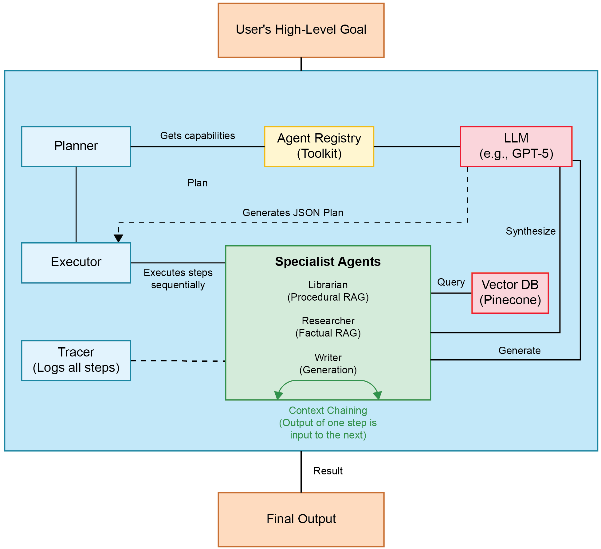
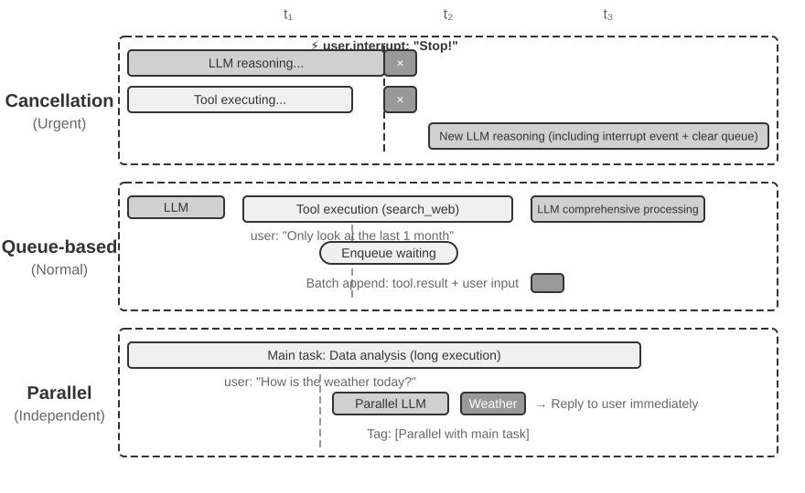

# 7 — Orchestration and Multi-Agent Harnesses

> Subagents are a context management technique before they are an architecture. Treat the second as a consequence of the first.

---

## Subagents as context firewall

The primary justification is not division of labor — it is **context isolation**:

> Sub-agents function as a **"context firewall"**: discrete tasks run in isolated windows so intermediate noise never accumulates in the parent thread responsible for orchestration.

A search that reads 40 files and finds 3 relevant ones should return **the 3**, not the 40. The subagent absorbs the exploration; the orchestrator receives a **condensed summary (~1,000–2,000 tokens)**. The parent stays coherent far longer than it otherwise could.

*"When working on hard problems that require many, many context windows to solve, sub-agents are the key to maintaining coherency across many sessions."*

The settled default: **orchestrator holds the plan; subagents hold the details.** Sub-agents return summaries only — search and debugging detail stays in their own contexts.

The sizing rule that follows: **give each subagent the minimum context, authority and execution budget needed to finish one clearly defined task.** Deep Agents' built-in `task` tool encodes the same contract. Each call gets a fresh agent instance, runs on its own until it finishes, and returns **one final report**. It is stateless, so it can't send a stream of messages back to the parent. The parent can still watch: `stream.subagents` gives a typed stream per subagent for UIs and tracing, without that output entering the parent's context.

---

## Protocols precede collaboration

The sequencing rule:

> **Establish a task graph and isolation boundaries *before* introducing parallelism.**

Parallelism added to an undefined task structure produces collision, not speed. Define what each agent owns, what it receives, what it returns, and what it may touch — then parallelize.

**Use natural language inside a task and protocols between tasks.** Agents that coordinate only by conversation fail in predictable ways: an agent forgets what it committed to, two agents both think they own a task, work starts before its dependency finishes, a failure is silently treated as done, a retried request runs twice, two workers edit the same files, and after a crash nobody can reconstruct the global state. Each of those is a missing piece of one of three foundations:

| Foundation | Defines | Prevents |
|---|---|---|
| **Communication protocol** | Message meanings; how requests, results, failures and acks are sent; valid state transitions | Lost acks, silent failures, double execution |
| **Task graph** | What work exists, who owns each task, which tasks depend on which | Duplicate ownership, premature starts, unknown global state |
| **Isolation boundary** | Which files, branches, tools and resources each agent may modify | Write collisions, cross-agent damage |

At the infrastructure level that becomes durable messaging, explicit task state, dependency tracking, idempotent processing, isolated side effects, structured handoffs and deterministic verification.

Isolate is also the **most expensive of the four context levers** ([02-context/10](../../02-context-engineering/notes/10-tools-and-multi-agent.md#costs)): real tokens multiply and cross-agent context is lost. Reach for it when a genuine context or trust boundary exists, not for tidiness.

---

## Role-based separation

The reliable patterns, from cheapest to most involved:

### Explorer / Executor

| Role | Tools | Model | Context |
|---|---|---|---|
| **Explorer** | Read-only | Cheaper | Isolated, disposable |
| **Executor** | Full | Stronger | Holds the plan |

Read-only exploration is safe and parallelizable, so it can run cheap and wide. Constraining the tool set *per role* is the point — the explorer physically cannot mutate anything.

### Planner / Executor

Splits decomposition from implementation. The fix for "the agent got lost in a 40-step task."

### Generator / Evaluator

Splits production from judgment — the structural answer to self-evaluation bias ([note 05](05-verification-loops.md#separating-generation-from-evaluation)).

### Topologies

| Topology | Shape | Use when |
|---|---|---|
| **Sequential** | A → B → C, each consumes the last one's artifact | Stages genuinely depend on each other |
| **Parallel** | Fan out independent workers, join the results | Subtasks share no state |
| **Manager hierarchy** | One orchestrator delegates and integrates; it can nest | The default for open-ended work |
| **All-to-all** | Agents chat freely | Brainstorming and low-stakes creative work only, because it is hard to predict and control |

Albada's rules for the static shapes (*Building Applications with AI Agents*, ch. 5): **set a maximum chain length**, because errors compound down a chain. Move to a graph only when you must both branch *and* later consolidate. A graph costs more model calls and adds new failure classes: cycles, unreachable nodes and conflicting state merges. So cap its depth and branching factor, unit-test every router function, and use tracing to check that every path reaches a terminal node.

How to cut the work is a separate choice from the topology. **Functional** decomposition splits by expertise (research, code, review). **Spatial** splits by file or directory, which parallelizes well until the files depend on each other. **Temporal** splits into stages where later ones need earlier ones finished. **Data-driven** splits by data partition for large datasets processed chunk by chunk.

### Full pipeline

Rob Earlam's harness runs a role chain end to end: **Orchestrator → PO-Spec → Feature Design → Tech Lead → Build → QA.** Around it, three supporting concepts worth naming:

- **Roles** — behavioral definitions holding each agent's logic, prerequisites, constraints, and process.
- **Artifacts** — concrete deliverables from each agent, **tagged with task IDs for traceability**.
- **Workflow standards** — governance covering technology practice, inter-agent communication, and state tracking.

Because artifacts are stored and indexed by task ID, they become a **searchable historical record**: past implementations serve as reference patterns for future work (reuse the pagination approach from task 214). Multi-agent state that persists is organizational memory, not just plumbing.

---

## Graph-based orchestration: ADK 2.0

Google's ADK 2.0 replaces ad-hoc Python loops with **structured, declarative, graph-based primitives**. The harness becomes a topology rather than control flow buried in code.

| Primitive | Role |
|---|---|
| **Agent** | Model definition, instructions, state target mappings |
| **`@node`** | Arbitrary Python — deterministic computation, tool calls, classification |
| **Edge** | Declarative routing based on state values or return codes |
| **JoinNode** | Synchronization barrier — blocks until parallel branches complete |

### Typed state

Pydantic schemas replace unstructured dictionaries:

```python
class GatewayContext(BaseModel):
    raw_payload: str = ""
    detected_language: str = "UNKNOWN"
```

ADK **validates inputs and outputs at node boundaries**, so key errors surface at the boundary rather than three nodes downstream. Schema inheritance lets base configurations extend across workflows.

This is [note 04](04-execution-boundaries.md#encode-constraints-dont-document-them) applied to orchestration: the contract between agents is *enforced*, not documented.

### Event-driven routing

Nodes return `Event` objects carrying routing instructions:

```python
return Event(actions=EventActions(route="loop_back"))
```

The engine evaluates and executes the matching edge. This **decouples node logic from graph topology** — a node states its outcome; the graph decides what that means. Rewiring the workflow doesn't touch node code.

### Subgraph composition

ADK 2.0 treats **compiled workflows as first-class nodes**, so self-contained sub-flows nest inside higher-level coordinators. The same composition property that makes functions useful, applied to agent graphs.

---

## A plan-execute engine, end to end


*Image Source: Rothman, *Context Engineering for Multi-Agent Systems* (Packt, 2025), Fig. 4.1*

Rothman's Context Engine (*Context Engineering for Multi-Agent Systems*, ch. 4) is a compact, fully coded manager hierarchy. Four parts:

- **Agent Registry.** Maps each agent name to a handler and a capability description. The Planner reads only those descriptions, so "the clarity of this description directly determines the quality of the Planner's reasoning". Agent descriptions are tool descriptions ([note 03](03-tool-design.md)) one level up.
- **Planner.** One LLM call in JSON mode turns the goal into a list of `{step, agent, input}`. Inputs can point at earlier outputs with a placeholder such as `"$$STEP_1_OUTPUT$$"`. The parser accepts a bare list and also unwraps `{"plan": [...]}`, because models add the wrapper unprompted.
- **Executor.** Runs steps in order. It resolves placeholders against a state dict, calls the agent, and stores the result under `STEP_N_OUTPUT`.
- **ExecutionTrace.** Logs the planned input, the resolved input and the output of every step. It is returned even when the run fails.

The resolver is where the design pays off:

```python
import re
REF = re.compile(r"^\$\$(STEP_\d+_OUTPUT)\$\$$")

def resolve(value, state):
    if isinstance(value, str) and (m := REF.match(value)):
        key = m.group(1)
        if key not in state:          # the plan referenced a step that never ran
            raise ValueError(f"Dependency Error: {key} not found")
        return state[key]
    if isinstance(value, dict):
        return {k: resolve(v, state) for k, v in value.items()}
    if isinstance(value, list):
        return [resolve(v, state) for v in value]
    return value
```

A missing reference **fails fast** instead of passing the literal placeholder string to the next agent. The run halts at that step, and the trace shows which step broke and what it was given.

Two cautions:

- **The book's "MCP" is not the Model Context Protocol.** In the code it is a homegrown `create_mcp_message(sender, content)` dict envelope passed between in-process functions. That is fine as a message format, but nothing in it is MCP as [note 03](03-tool-design.md#mcp-vs-in-process) uses the term.
- **One skipped chunk can take down the run.** In ch. 8, a sanitizer skipped a retrieved chunk of legitimate testimony, and a later step failed with a fatal Dependency Error ([note 04](04-execution-boundaries.md#moderation-around-the-whole-engine)). Fail-fast is right, but the step that drops data has to say so.

### The latency budget of a sequential plan

Sequential plans add their latencies together. Rothman's ch. 8 estimate for a three-step plan (Librarian → Researcher → Writer) with moderation on both ends. These are illustrative figures that vary with model, network and load:

| Call | ≈ ms |
|---|---|
| Moderation, pre-flight | 200 |
| Planner | 3,000 |
| Embeddings (×2) | 150 each |
| Vector-DB queries (×2) | 250 each |
| Researcher synthesis | 4,000 |
| Writer | 2,500 |
| Moderation, post-flight | 200 |
| **Total** | **≈ 10,700** |

That is at least eight API calls in a row, and the generation calls dominate. Measured runs in ch. 5 were far slower than the estimate: **148 s and 151 s** for three-step plans with gpt-5 as the generation model, run from Colab. Rothman's levers: run independent calls in parallel, cache repeated retrievals and plans, and use smaller, faster models for the simpler steps. The broader point is that each extra agent in a sequential plan adds its full latency to the user's wait.

---

## Multi-agent failure modes

Named problems that emerge specifically from orchestration:

| Failure | Shape | Mitigation |
|---|---|---|
| **Loop oscillation** | Two nodes bounce work between them indefinitely | Iteration counters on cyclic edges; forced escalation |
| **Context pollution** | Nested workflows leak state upward, defeating isolation | Explicit boundary schemas; return summaries only |
| **Concurrency collision** | Parallel branches write the same state or file | JoinNode barriers; per-branch ownership of state keys |
| **Consensus deadlock** | Reviewer agents never agree, blocking progress | Tie-break rule, majority threshold, or a final arbiter |

All four are *harness* bugs. None is fixed by a better model, and all four get worse as agent count rises — which is the practical argument for keeping agent counts as low as the task allows.

Two more problems are specific to many agents. **Hallucinations amplify**: one agent's invention becomes the next agent's input, so cross-validate claims that cross a handoff. **Failures are hard to attribute.** The fix is to **evaluate each component and the end-to-end result separately**. If the end-to-end eval fails while every component eval passes, the bug is in a handoff or integration. If one component eval fails, you know which agent to fix. Per-step traces (each agent's plan, prompt, tool calls and results) make that analysis fast.

---

## Handoff design

What crosses a boundary is the whole design. The short version: **define interfaces, not vibes.** Each agent needs a schema for its inputs and outputs: which fields, which types, which IDs or references get passed along. Handoffs break more often than the models do.

- **Structured, not prose.** A typed schema — findings, files touched, confidence, open questions — beats a paragraph.
- **Summaries, never transcripts.** Sending a subagent's full history back defeats the firewall.
- **State on disk, references in the message.** Large artifacts go to files; the handoff carries paths ([note 06](06-long-horizon-execution.md#tool-call-offloading)).
- **Declare what was *not* done.** Scoped claims prevent the orchestrator from assuming coverage that doesn't exist.
- **Label every source in the subagent's prompt.** Li's convention: a role statement, then inputs tagged `[FROM_MAIN_AGENT]`, `[FROM_USER]` and `[TOOL_RESULT]`, then explicit boundaries, then a JSON output schema. A subagent that can't tell instructions from data will follow injected text.
- **Key the payload, and keep the keys stable.** Rothman's engine broke when two agents were "upgraded" to return dicts (`{"blueprint_json": ...}`, `{"facts": ...}`) instead of strings. The Writer still expected raw strings, so the upgraded pipeline broke at its last step (*Context Engineering for Multi-Agent Systems*, ch. 5). Whenever an agent's output shape changes, every consumer of that output has to change in the same commit.
- **Synthesize, don't delegate understanding.** "Based on your findings, fix the auth bug" pushes the orchestrator's job onto the worker. The orchestrator reads the findings and hands down a precise spec: the file, the line, the change, and what done looks like.

---

Collaboration tools reduce to a small set of primitives: `spawn` and `cancel`, `send_message`, and `list_agents`. Each one runs in one of four modes: **sync** (wait for the result), **async** (task ID plus an event later), **streaming** (partial results as they come), or **multi-turn** (a conversation with the worker). Choose the mode per task; a 30-minute research job should never be a sync call.

---

## Asynchronous agents: events and safe points


*Image Source: Li, [AI Agents in Depth](https://github.com/bojieli/ai-agent-book/blob/main/book-en/chapter6.md) (2026), Fig. 6-2 (Apache-2.0)*

A resident agent receives user messages, tool results, timers, webhooks and messages from other agents, all at unpredictable times. Li's model (ch. 4) is an **event loop**: each iteration drains a batch of events from the queue, appends them to the trajectory, calls the LLM once, and runs the tools it chose. Events are consumed **only at safe points**, meaning the end of a reasoning stretch or a tool return, never mid-step. Cancellation is checked at safe points too, the same discipline as Go's `ctx.Done()`.

**Model each input as a structured event:** source (who), channel (how), content (what, including urgency), and context (which thread or task it belongs to). This keeps a user command distinct from a tool result that *contains* a command, which is the prompt-injection case.

Three strategies, which differ only in how they treat the safe point:

| Strategy | For | Mechanics |
|---|---|---|
| **Cancel** (force a safe point now) | `user.interrupt`, supervisor orders, urgent alerts | Abort the streaming response or tool, drain the queue, append everything, and re-invoke the LLM |
| **Queue** (wait for the next safe point) | Routine input, tool results, timers | Append as a batch when the current step finishes. "Only last month" arrives with the search results it modifies, saving a round trip |
| **Parallel** (don't wait) | Independent, cheap queries ("what's the weather?") | Answer in a side session; append the exchange to the main trajectory, marked as parallel |

Hard-coded rules miss semantics. Li recommends a **small classifier LLM as the event router** to pick the strategy.

**Keeping a synchronous model sane** (five rules):

1. Write the assistant message, including any tool call, to the trajectory as soon as it is produced.
2. Write the tool result only when the tool completes.
3. If an interrupt arrives mid-tool, insert a **placeholder result** ("still running in the background; handle the new event first") so every call stays paired, and deliver the real result later as a new event.
4. If an interrupt arrives mid-thought, discard the partial thinking.
5. Queue non-urgent events and append them in a batch.

Placeholders invite hallucinated results, so interrupt only when it is genuinely urgent. For batches, the model tends to answer only the last event. Number them (`[Unprocessed event 2/4] User note: Beijing data only`) and end with a summary line ("4 events: 1 tool result, 2 user messages, 1 reminder; address all of them").

Polling is the fallback, not the design. Timers and heartbeats make an agent *look* proactive, but an OTP request during a live phone call can't wait five minutes for the next tick. Real proactivity needs a push channel from the outside world into the queue.

### Double texting: the same problem in a chat app

Oshin and Campos (*Learning LangChain*, ch. 8) list the options for a user who sends a second message while the first run is still going:

| Strategy | Behaviour | Cost |
|---|---|---|
| **Refuse** | Reject new input until the run finishes | Simplest; pushes concurrency onto the caller |
| **Handle independently** | Start a second run on a new thread | The user sees two separate runs that can't be reconciled |
| **Queue** | Run the new input after the current run | Queue grows without bound, and later inputs may already be stale |
| **Interrupt** | Stop the current run and restart with both inputs | Choose what to keep: nothing, the last completed step, the in-progress step too, or wait for the current node to finish |
| **Fork and merge** | Run both in parallel and merge the state afterwards | Needs merge-friendly state (CRDT-style) or manual conflict resolution. If you have either, the authors rate this the best option overall |

The interrupt row hits the same pairing constraint as Li's rule 3. OpenAI's API requires every assistant message carrying tool calls to be followed immediately by its tool messages, so an interrupted run's state must be cleaned up or padded before the next model call.

Labs, upstream: [4-4 event-triggered email agent](https://github.com/bojieli/ai-agent-book/tree/main/chapter6/agent-with-event-trigger) · [4-5 async agent with interruption](https://github.com/bojieli/ai-agent-book/tree/main/chapter6/async-agent).

---

## Coordination without a coordinator: four agents in Minecraft

Most of this note designs coordination in advance. The Gemini Minecraft run (Faldor et al., 2026; harness in [note 02](02-harness-anatomy.md#one-harness-read-through-the-five-subsystems), timeline in [note 06](06-long-horizon-execution.md#what-a-27-hour-run-looks-like)) shows how much four agents organize on their own when the harness gives them the right shared surfaces. There was no orchestrator. Each agent had the same instructions, a shared chat and shared notes.

What emerged over 27 hours:

| Behaviour | What happened | The harness surface behind it |
|---|---|---|
| **Specialization** | One agent took tools, the fortress and the stronghold; one took supplies and six of the ten crystals; one the Nether portal and the crystal plan; one built Enderman shelters and landed the final blow | Shared chat, where agents announced what they were taking |
| **Shared memory** | Locations, plans and lessons were written to notes every agent could read | Shared notes outside every context window |
| **Own tools** | 42 reusable helper functions, reused across thousands of later programs | A code-writing action space ([note 03](03-tool-design.md)) |
| **Rescues** | Agents went to help a teammate stuck or dying | Shared chat plus each agent's position in the world |
| **Corrections** | Agents retracted false claims and flagged teammates' contradictions | The instruction to report honestly, plus an Observer agent checking claims ([note 05](05-verification-loops.md#an-observer-that-checks-claims-against-the-record)) |

The chat stayed small: **229 messages** across 2,783 programs, roughly 50 to 80 per agent. Coordination happened through a few short messages and a shared written record, not constant conversation. That is the [protocols-between-tasks](#protocols-precede-collaboration) rule arriving on its own.

The caution: one run, one game, on Easy. It shows that emergent coordination *can* hold for a day. It doesn't show that it will in your domain, where a silently wrong shared note costs more than a death in Minecraft.

---

## When *not* to go multi-agent

Multi-agent is the expensive option. Single agent with verification is the correct default; escalate only when:

- **Context genuinely doesn't fit** — the firewall argument, the strongest reason.
- **Roles need different tools or trust levels** — read-only explorer, sandboxed executor.
- **Self-evaluation bias is the blocker** — you need an external evaluator.
- **Branches are genuinely independent** — real parallelism, not sequential work in costume.

Absent one of these, added agents multiply token cost and introduce the four failure modes above while solving nothing. The three architectural patterns, in order of increasing cost: **single agent with verification → two-agent supervisor → multi-agent with a shared harness layer.**

---

## Working reference

`~/.claude/refs/agent-architecture.md` — orchestrator/subagent responsibility split.
`~/.claude/refs/agent-context.md` — subagent context isolation; orchestrator-holds-plan as the settled default.
`~/.claude/refs/google-adk.md` · `~/.claude/refs/langgraph.md` — framework bindings.

---

→ Next: [08-maturity-and-failure-modes.md](08-maturity-and-failure-modes.md) — staging the build, and what goes wrong.
